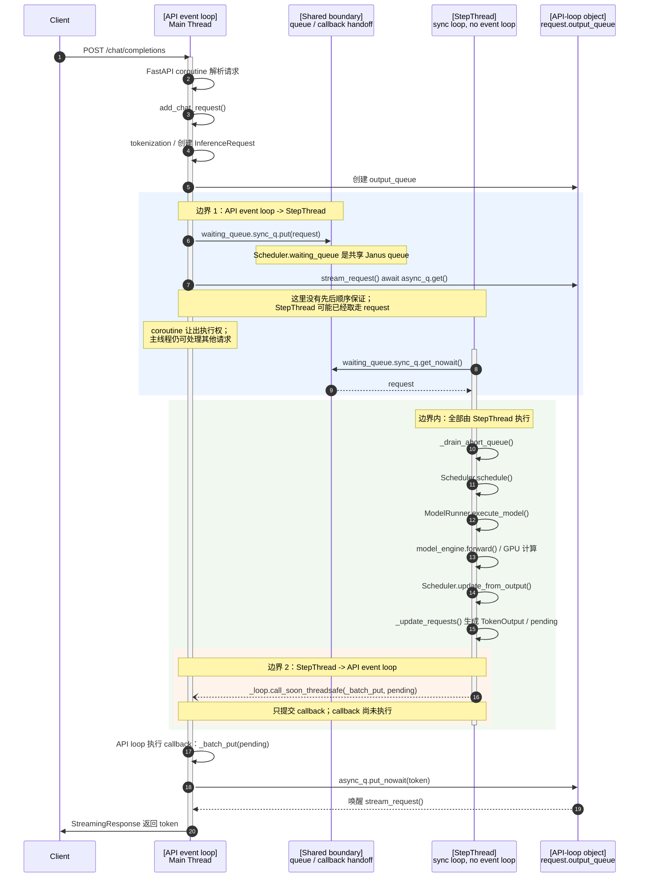
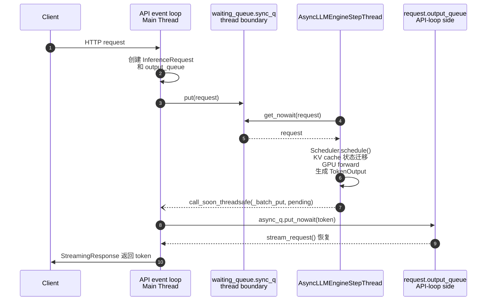

# InferenceServer 线程与事件循环时序

本文分析普通在线推理服务路径：不启用 Mooncake connector，不启用 pipeline parallel。对应代码主要在：

- `python/infinilm/server/inference_server.py`
- `python/infinilm/llm/llm.py`
- `python/infinilm/llm/scheduler.py`
- `python/infinilm/llm/model_runner/model_runner.py`
- `python/infinilm/llm/request.py`

文中以默认配置 `cache_type="paged"` 为主，因此 scheduler 使用 `Scheduler`。如果配置为 `static`，服务会改用 `StaticScheduler`，但其请求入队边界、step 线程执行 forward、token 回到 API event loop 的模型相同。

## 1. 总体结构

普通服务只有一个 asyncio 事件循环和一个后台推理线程：

```text
Main Thread
  └─ API event loop
     ├─ uvicorn / FastAPI
     ├─ HTTP request coroutines
     ├─ request 创建、tokenization
     ├─ stream_request() 等待 token
     ├─ _batch_put() 写 async output queue
     └─ StreamingResponse 网络发送

AsyncLLMEngineStepThread
  ├─ _step_loop()
  ├─ Scheduler 调度
  ├─ ModelRunner / model_engine.forward()
  ├─ GPU 计算
  └─ TokenOutput 生成
```

更准确地说，主线程不是“包含一个额外线程来运行事件循环”，而是主线程进入并执行 `uvicorn.run()` 创建的 asyncio event loop。所有 `async def` endpoint、coroutine 以及提交回该 loop 的 callback 都由主线程执行。

`AsyncLLMEngineStepThread` 没有自己的 asyncio event loop。它是一个同步 `while` 循环线程，负责调度和推理。

因此，普通服务的核心计数是：

| 项目 | 数量 | 说明 |
| --- | ---: | --- |
| asyncio event loop | 1 | API event loop，运行在主线程 |
| Python 调度层线程 | 2 | 主线程 + `AsyncLLMEngineStepThread` |
| 推理调度事件循环 | 0 | step 线程是同步循环，不是 asyncio loop |

## 2. 对象层级

在默认 `cache_type="paged"` 配置下，`waiting_queue` 不是直接挂在 `AsyncLLMEngine` 上，实际对象层级是：

```text
InferenceServer
  └─ engine: AsyncLLMEngine
       ├─ _loop: API event loop
       ├─ _abort_queue: janus.Queue
       ├─ _step_thread: AsyncLLMEngineStepThread
       └─ engine: LLMEngine
            └─ scheduler: Scheduler
                 ├─ waiting_queue: janus.Queue
                 └─ running_queue: janus.Queue
```

API event loop 和 step 线程能够访问同一个 `waiting_queue`，是因为它们持有同一个 `AsyncLLMEngine` 对象图：

```text
API event loop:
InferenceServer.engine
  -> AsyncLLMEngine
  -> LLMEngine
  -> Scheduler
  -> waiting_queue

AsyncLLMEngineStepThread:
AsyncLLMEngine._step_loop() 的 self
  -> AsyncLLMEngine.engine
  -> LLMEngine
  -> Scheduler
  -> waiting_queue
```

这里需要区分“可以访问”和“应该修改”：

- `waiting_queue.sync_q` 是 API 线程到 step 线程的显式生产/消费边界。
- scheduler 内部的 running queue、KV cache 状态、请求状态迁移主要由 step 线程修改。
- API 侧不应绕过 `AsyncLLMEngine.add_request()` 直接操作 scheduler 内部状态。

## 3. 启动时序

```text
Main Thread
  1. InferenceServer.start()
  2. uvicorn.run(app)
  3. uvicorn 创建并运行 API event loop
  4. FastAPI lifespan startup
  5. AsyncLLMEngine(...)
     └─ LLMEngine(...)
        ├─ ModelRunner(...)
        └─ Scheduler(...)  # 默认 cache_type="paged"
           ├─ waiting_queue = janus.Queue()
           └─ running_queue = janus.Queue()
  6. AsyncLLMEngine.start()
     ├─ self._loop = asyncio.get_running_loop()
     ├─ self._abort_queue = janus.Queue()
     └─ 创建并启动 AsyncLLMEngineStepThread
  7. uvicorn 开始接收 HTTP 请求
```

`AsyncLLMEngine.start()` 中的 `asyncio.get_running_loop()` 只保存当前 API event loop 的引用，不会创建新的 event loop。

注意：`add_chat_request()` 中的 chat template、tokenization 和 multimodal preprocessing 是同步调用，发生在 API event loop 线程上。长输入可能阻塞该 event loop；这些预处理尚未进入 step 线程。

## 4. 请求处理时序图

以下以流式 chat 请求为例。图中只有两个执行主体：

- `API event loop / Main Thread`：主线程上的 asyncio 调度器及其 coroutine/callback。
- `AsyncLLMEngineStepThread`：后台同步推理线程，没有 asyncio event loop。

中间的 `Shared boundary` 是共享的 Janus queue 和 `call_soon_threadsafe()` 投递点，不是第三个线程。

两点图例说明：

- `AsyncLLMEngineStepThread` 在 lifespan 阶段已经启动并持续轮询；图中 activation 只表示该请求相关的执行路径，不表示线程在该时刻才创建。
- `StreamingResponse(_stream_chat())` 中的 `_stream_chat` 是 async generator，endpoint 返回 `StreamingResponse` 对象时不会立即执行完整个 generator；请求创建和 token 输出发生在 Starlette 迭代响应 body 的过程中。



上图展示的是某一轮 `_step_loop()` 中一次 forward 的路径。实际 step 线程会持续执行：

```text
while running:
    clear wakeup event
    drain abort queue
    engine.step()
    if no work:
        wait for wakeup event, timeout 3ms
```

如果只看线程所有权，边界可以简化成：

```text
        API event loop / Main Thread                      AsyncLLMEngineStepThread
        --------------------------                        ---------------------------
Client HTTP
    |
    v
FastAPI coroutine
request 创建 / tokenization
request.output_queue 创建
    |
    | 边界 1: waiting_queue.sync_q.put(request)
    |          API coroutine 随后 await async_q.get()
    |          该等待与 StepThread 取队列可并发发生
    +---------------------------------------------->  waiting_queue.sync_q.get_nowait()
                                                        Scheduler.schedule()
                                                        KV cache / batch 状态迁移
                                                        ModelRunner.execute_model()
                                                        model_engine.forward() / GPU
                                                        _update_requests()
    |
    | 边界 2
    | call_soon_threadsafe(_batch_put, pending)
    +<----------------------------------------------  提交 callback 到 API loop
    |
    v
_batch_put(pending)
async_q.put_nowait(token)
stream_request() 恢复
    |
    v
StreamingResponse
    |
    v
Client
```

`output_queue.async_q` 是 API event loop 侧的消费对象。StepThread 不能直接向它 `put_nowait()`，必须通过边界 2 把 `_batch_put()` callback 调度回 API loop。

非流式请求的调度和推理路径相同。区别是 `_chat()` 在 API event loop 中持续消费 token，聚合成完整文本后一次性返回 JSON。

## 5. 线程边界

普通请求路径有两个关键跨线程边界。

### 5.1 请求提交：API event loop -> step 线程

API 侧调用链：

```text
InferenceServer._stream_chat()
  -> AsyncLLMEngine.add_chat_request()
     -> AsyncLLMEngine.add_request()
        -> LLMEngine.add_request()
           -> Scheduler.add_request()
              -> waiting_queue.sync_q.put(request)
```

step 线程消费：

```text
AsyncLLMEngine._step_loop()
  -> LLMEngine.step()
     -> Scheduler.schedule()
        -> waiting_queue.sync_q.get_nowait()
```

边界语义：

```text
API event loop:
  request 创建与初始化完成
  通过 Janus sync queue 生产请求

AsyncLLMEngineStepThread:
  消费请求
  执行入队后的 scheduler 状态迁移和 batch 组装

说明：API event loop 调用 `Scheduler.add_request()` 时会同步完成 request 的 block hash 初始化、状态置为 `WAITING`、写入 waiting queue；跨过 waiting queue 之后的调度和 batch 组装由 step 线程执行。
```

### 5.2 token 返回：step 线程 -> API event loop

step 线程生成：

```python
pending = [(request.output_queue.async_q, token_output), ...]
```

随后调用：

```python
self._loop.call_soon_threadsafe(self._batch_put, pending)
```

`_batch_put()` 最终在 API event loop 所在主线程执行：

```python
request.output_queue.async_q.put_nowait(output)
```

这样可以唤醒 API event loop 中的等待者：

```python
token_output = await asyncio.wait_for(
    request.output_queue.async_q.get(),
    timeout=timeout,
)
```

不能在 step 线程直接执行：

```python
request.output_queue.async_q.put_nowait(output)
```

原因不是 Python 对象不能跨线程引用，而是 `async_q` 是 asyncio 侧对象，绑定并服务于 API event loop。asyncio queue 的内部唤醒、future、callback 调度不是跨线程自由修改的安全接口。

`call_soon_threadsafe()` 的作用是把 `_batch_put(pending)` 这个 callback 投递回 API event loop，由主线程执行。

## 6. 代码调用层级

### API event loop 侧

```text
InferenceServer.start()
  -> uvicorn.run()
     -> FastAPI lifespan
        -> AsyncLLMEngine.__init__()
        -> AsyncLLMEngine.start()

POST /chat/completions
  -> InferenceServer.chat_completions()
     -> StreamingResponse(_stream_chat())
        -> AsyncLLMEngine.add_chat_request()
           -> AsyncLLMEngine.add_request()
              -> LLMEngine.add_request()
                 -> Scheduler.add_request()

StreamingResponse 消费 generator
  -> InferenceServer._stream_chat()
     -> AsyncLLMEngine.stream_request()
        -> request.output_queue.async_q.get()

API event loop callback
  -> AsyncLLMEngine._batch_put()
     -> request.output_queue.async_q.put_nowait()
```

### step 线程侧

```text
AsyncLLMEngine._step_loop()
  -> AsyncLLMEngine._drain_abort_queue()
  -> AsyncLLMEngine.engine.step()
     -> LLMEngine.step()
        -> Scheduler.schedule()
           -> waiting_queue.sync_q.get_nowait()
           -> 分配 KV cache / 组 batch
           -> running_queue.sync_q.get_nowait()
        -> ModelRunner.execute_model()
           -> ModelRunner._model_forward()
              -> processor.build_model_inputs()
              -> InferEngine.forward()
        -> Scheduler.update_from_output()
        -> LLMEngine._update_requests()
           -> tokenizer.decode()
           -> TokenOutput 构造
           -> Scheduler.complete_requests()
  -> self._loop.call_soon_threadsafe(_batch_put, pending)
```

## 7. 空闲与取消

### 空闲节奏

`_step_loop()` 在没有工作时执行：

```python
self._step_wakeup.wait(timeout=0.003)
```

其中 `_step_wakeup` 是 `threading.Event`。新请求入队、abort 入队和服务 stop 都会立即 `set()` 该事件，使空闲中的 step 线程提前醒来；3ms timeout 仅作为无事件时的 fallback polling。因此空闲 sleep 期间到达的新请求通常只需等待剩余 wait 时间，名义上约为 0～3ms；如果新请求在当前有工作的 `engine.step()` 执行期间到达，则需要等待当前 step 完成。由于该 step 的 `did_work=True`，返回后通常立即进入下一轮调度，不会再额外等待 3ms。

每轮循环会在检查 abort queue 和 scheduler 状态之前先 `clear()` wakeup event。这样，如果事件在 `clear()` 之前已经 set，对应的 request/abort 已进入队列，后续状态检查能够看到；如果事件在状态检查之后、`wait()` 之前 set，`wait()` 会立即返回。

### 客户端断开或取消

API event loop 检测到客户端断开或 coroutine 取消后：

```text
_stream_chat() finally
  -> AsyncLLMEngine.add_aborted_req()
     -> _abort_queue.sync_q.put((request, reason))
```

step 线程下一轮循环开始时：

```text
_step_loop()
  -> _drain_abort_queue()
     -> request.mark_canceled() / mark_timeout() / mark_failed()
```

之后 scheduler 会跳过或清理该请求。取消信息同样通过 Janus queue 跨线程传递，避免 API 线程直接修改 scheduler 的内部状态。

补充一个例外：普通 forward 产生的 token 通过边界 2 的 `_batch_put()` 写入 `async_q`；取消、超时或失败时，`_drain_abort_queue()` 会构造一个 finished 哨兵 `TokenOutput`，并直接通过 `req.output_queue.sync_q.put_nowait()` 投递。这是 Janus 同步侧的合法用法，与“StepThread 不能直接操作 `async_q`”不冲突。

## 8. 一句话总结

普通 InferenceServer 的执行模型是：

> request 在 API event loop 中创建，并通过 `Scheduler.waiting_queue.sync_q` 投递给 `AsyncLLMEngineStepThread`；调度、KV cache 状态迁移和 GPU forward 都在 step 线程执行；生成的 token 通过 `_loop.call_soon_threadsafe()` 回到 API event loop，写入 request 的 async output queue，最终由 `stream_request()` 和 `StreamingResponse` 返回客户端。

对应的精简时序如下：



注：从 Python 服务调度角度看，`model_engine.forward()` 在 step 线程被同步调用。底层设备或原生推理库内部是否创建额外线程，不属于本文讨论的 Python 服务线程层次。
