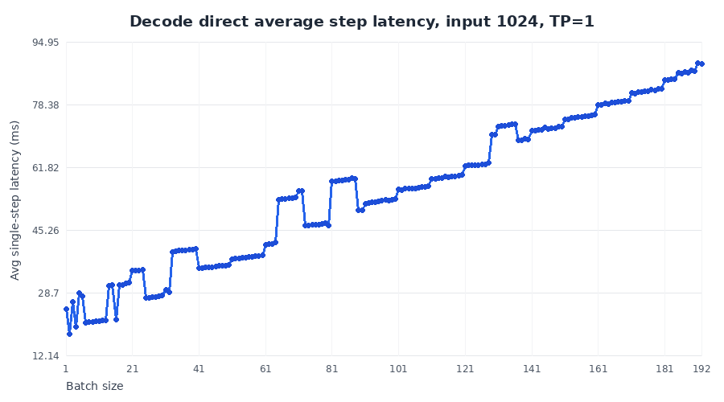
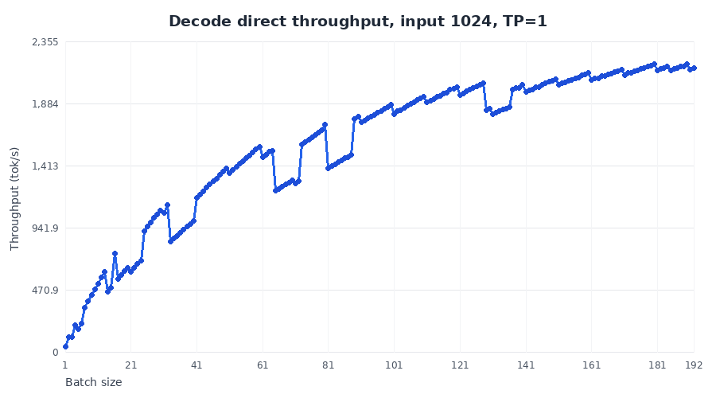
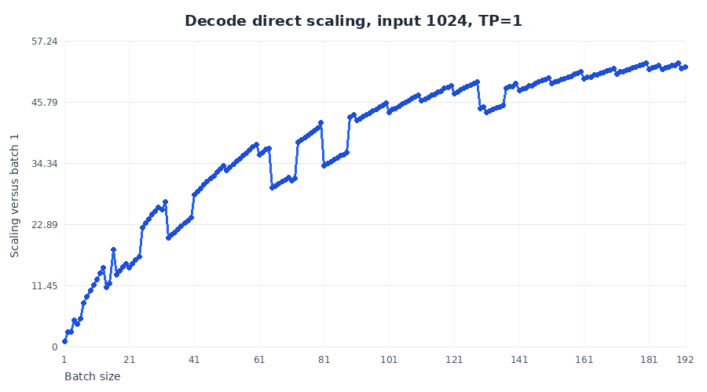

# Decode-Direct Input 1024 TP=1 性能报告

## 运行环境

| 项目 | 值 |
| ---: | ---: |
| 日期 | 2026-11-23 17:45:33-18:09:39（Asia/Shanghai） |
| 平台 | Hygon BW1000 |
| 设备 | 1 x Hygon BW1000 HCU，64 GB HBM，CUDA_VISIBLE_DEVICES 按前 1 张分配 |
| Driver / runtime | 6.3.30-V1.4.1a / DTK 26.04-rc4 |
| InfiniLM build | 分支 `pd-v0.2.9-v1-tp`，commit `da7d18e7` |
| 模型 | `/data/shared/.infinifabric-models-20261027-fef304a05440/Qwen3-8B--b968826d9c46dd6066d109eabc6255188de91218` |
| 模式 | `decode-direct` |
| Attention backend | `flash-attn` |
| Graph request | enabled |
| Expected execution mode | `graph` |
| Cache | paged KV cache，block size 256，num blocks 960 |
| Max batched tokens | 18,432 |
| Tensor parallel size | 1 |
| Input length | 1024 tokens / request |
| Batch size range | 1..192 |
| Decode steps per repeat | 4 |
| Warmup / measured repeats | 每个形状 3 次 / 30 次 |
| Batch 执行顺序 | random seed 2026 |


本报告对应原始 JSONL 和 log 为本机运行产物，不随仓库提交：

```text
../../../benchmark-hygon-bw-tp1-decode-direct-input1024.jsonl
../../../benchmark-hygon-bw-tp1-decode-direct-input1024.log
```

input 1024、TP=1 在首次 batch 1..256 初始化阶段发生 device malloc OOM；正式有效报告范围为 batch 1..192。原始失败日志保留为 `benchmark-hygon-bw-tp1-decode-direct-input1024-batch256-oom.log`，不随仓库提交。

## 构建与测试命令

```bash
xmake build _infinilm && xmake install _infinilm
```

```bash
SKIP_BUILD=1 TP=1 GPU=0 \
MODE=decode-direct \
INPUT_LEN=1024 \
BATCH_SIZES="$(seq -s, 1 192)" REPEATS=30 \
OUTPUT=benchmark-hygon-bw-tp1-decode-direct-input1024.jsonl ./run_bench_hygon.sh
```

## 执行模式与 Graph 覆盖

- Graph request: enabled
- Expected execution mode: `graph`
- Graph-covered batches: 1..192
- Eager-fallback batches: none
- Mode source: compiler rule；该字段不是 C++ runtime 回传的实际执行模式。

## 资源开销

| 项目 | 值 |
| ---: | ---: |
| Workspace allocation | 每 rank 1,944 MiB，TP=1 合计 1,944 MiB |
| 权重加载时间 | 42.20 s |
| Graph compilation time | 未单独打点；包含在进程初始化到首个 sample 的 wall time 中 |
| Paged cache blocks | 960 |
| 正式 sample 数 | 23,040 |
| 进程 wall time | 1445 s (first runtime log to final JSONL write) |
| Monitor peak HCU memory use | 87%（本 run 时间窗，分配 HCUs，10 秒采样） |
| Monitor peak package power | 376.0 W（本 run 时间窗，分配 HCUs，10 秒采样） |
| Monitor peak sensor temperature | 63.0 C（本 run 时间窗，edge/junction，10 秒采样） |


## 测试口径

- Direct decode 不执行语义 prefill，paged KV cache 全 0 初始化。
- Step 0 使用 dummy token；step 1..3 使用上一步 sampled token。
- 每次 repeat 执行 4 个 decode step。
- `avg_step_latency = four_step_repeat_duration / 4`。
- 完整结果表聚合每个 batch 的 120 个 individual step samples。
- `single_step_throughput = batch_size / avg_step_latency`。
- 计时边界为 `engine_forward_including_sampling`。
- 分位数使用线性插值；每个 batch 只有 30 个 repeat，p99 是尾部参考。

## 核心结果

| 指标 | 结果 |
| ---: | ---: |
| 最高 single-step throughput | batch 180，2,183.33 tok/s |
| 最快 batch 平均 step latency | batch 2，17.849 ms |
| 最大 batch scaling | 52.322x |
| Ideal-scaling efficiency | 27.3% |
| Median step std | 0.061 ms |
| Maximum step std | 0.153 ms，batch 133 |


## 趋势图

### 1. Batch size 与 Avg Step Latency



平均 step latency 从 batch 1 的 24.308 ms 变为 batch 192 的 89.199 ms。

### 2. Batch size 与 Single-step Throughput



吞吐峰值出现在 batch 180，为 2,183.33 tok/s。

### 3. Batch size 与 Scaling



batch 192 相对 batch 1 的 scaling 为 52.322x；理想 192x 效率约 27.3%。

## Batch 区间平均 latency 与吞吐

下表按连续 16 个 batch 分组。平均值是区间内各 batch 聚合 single-step 统计的算术平均；区间最优 batch 取吞吐最高的 batch。

| Batch 区间 | 平均单 step latency ms | 平均吞吐 tok/s | 区间最优 batch |
| ---: | ---: | ---: | ---: |
| 1..16 | 23.451 | 366.26 | 16 |
| 17..32 | 30.369 | 821.03 | 32 |
| 33..48 | 37.660 | 1,085.22 | 48 |
| 49..64 | 38.685 | 1,458.61 | 60 |
| 65..80 | 50.330 | 1,454.04 | 80 |
| 81..96 | 55.273 | 1,610.75 | 96 |
| 97..112 | 55.849 | 1,870.54 | 110 |
| 113..128 | 60.896 | 1,978.26 | 128 |
| 129..144 | 71.335 | 1,914.65 | 140 |
| 145..160 | 74.040 | 2,059.34 | 160 |
| 161..176 | 79.880 | 2,109.12 | 176 |
| 177..192 | 85.572 | 2,156.21 | 180 |


## 关键批次与跳变

| Change | Mode transition | Avg step ms | Throughput tok/s | Observation |
| --- | ---: | ---: | ---: | --- |
| 2 -> 3 | graph | 17.849 -> 26.249 | 112.05 -> 114.29 | 平均 step latency 增加 47.1%，可能对应 kernel shape 或 workspace 分档变化 |
| 4 -> 5 | graph | 19.681 -> 28.685 | 203.24 -> 174.31 | 平均 step latency 增加 45.7%，可能对应 kernel shape 或 workspace 分档变化 |
| 13 -> 14 | graph | 21.409 -> 30.594 | 607.22 -> 457.60 | 平均 step latency 增加 42.9%，可能对应 kernel shape 或 workspace 分档变化 |
| 16 -> 17 | graph | 21.524 -> 30.635 | 743.36 -> 554.92 | 平均 step latency 增加 42.3%，可能对应 kernel shape 或 workspace 分档变化 |
| 32 -> 33 | graph | 28.708 -> 39.509 | 1,114.65 -> 835.26 | 平均 step latency 增加 37.6%，可能对应 kernel shape 或 workspace 分档变化 |
| 64 -> 65 | graph | 41.986 -> 53.279 | 1,524.31 -> 1,220.00 | 平均 step latency 增加 26.9%，可能对应 kernel shape 或 workspace 分档变化 |


## Step 一致性

峰值 batch 180 的 4 个 decode step 结果如下：

| Step | Past KV length | Avg step ms | Std ms | Throughput tok/s |
| ---: | ---: | ---: | ---: | ---: |
| 0 | 1024 | 82.419 | 0.055 | 2,183.97 |
| 1 | 1025 | 82.454 | 0.073 | 2,183.05 |
| 2 | 1026 | 82.447 | 0.037 | 2,183.23 |
| 3 | 1027 | 82.453 | 0.063 | 2,183.06 |


所有 batch 中，4 个 step 平均耗时最大差异为 0.252 ms，出现在 batch 121。差异包含 past KV length 增长和 step kernel 形状影响。

## 数据稳定性

- 单 step std 中位数为 0.061 ms。
- 最大 std 为 0.153 ms，出现在 batch 133。
- 各 batch p99 与 max 接近，尾部稳定；每个 batch 只有 30 个 repeat，p99 仍是尾部参考值。

## TP 对比摘要

| TP | Best batch | Peak throughput tok/s | Scaling vs TP=1 |
| ---: | ---: | ---: | ---: |
| 1 | 180 | 2,183.33 | 1.000x |
| 2 | 256 | 4,134.71 | 1.894x |
| 4 | 240 | 5,899.98 | 2.702x |


## Single-step 完整结果

### Batch 1..16

| Batch | Mode | Avg Step ms | Min Step ms | P50 Step ms | P95 Step ms | P99 Step ms | Max Step ms | Std Step ms | Single-step tok/s | Scaling |
| ---: | --- | ---: | ---: | ---: | ---: | ---: | ---: | ---: | ---: | ---: |
| 1 | graph | 24.308 | 24.189 | 24.289 | 24.590 | 24.647 | 24.801 | 0.098 | 41.14 | 1.000x |
| 2 | graph | 17.849 | 17.829 | 17.848 | 17.865 | 17.871 | 17.895 | 0.009 | 112.05 | 2.724x |
| 3 | graph | 26.249 | 26.230 | 26.246 | 26.270 | 26.279 | 26.281 | 0.011 | 114.29 | 2.778x |
| 4 | graph | 19.681 | 19.644 | 19.664 | 19.811 | 19.915 | 19.996 | 0.055 | 203.24 | 4.940x |
| 5 | graph | 28.685 | 28.658 | 28.685 | 28.706 | 28.713 | 28.716 | 0.011 | 174.31 | 4.237x |
| 6 | graph | 27.842 | 27.820 | 27.842 | 27.858 | 27.863 | 27.866 | 0.009 | 215.50 | 5.238x |
| 7 | graph | 20.794 | 20.767 | 20.794 | 20.814 | 20.822 | 20.827 | 0.011 | 336.63 | 8.183x |
| 8 | graph | 20.931 | 20.893 | 20.925 | 20.952 | 21.076 | 21.264 | 0.040 | 382.20 | 9.291x |
| 9 | graph | 20.931 | 20.892 | 20.916 | 21.066 | 21.205 | 21.228 | 0.059 | 429.99 | 10.452x |
| 10 | graph | 21.080 | 21.050 | 21.076 | 21.100 | 21.175 | 21.322 | 0.028 | 474.39 | 11.531x |
| 11 | graph | 21.243 | 21.216 | 21.242 | 21.261 | 21.305 | 21.369 | 0.017 | 517.82 | 12.587x |
| 12 | graph | 21.318 | 21.291 | 21.318 | 21.343 | 21.350 | 21.356 | 0.013 | 562.90 | 13.683x |
| 13 | graph | 21.409 | 21.383 | 21.409 | 21.431 | 21.441 | 21.447 | 0.013 | 607.22 | 14.760x |
| 14 | graph | 30.594 | 30.554 | 30.594 | 30.616 | 30.623 | 30.629 | 0.013 | 457.60 | 11.123x |
| 15 | graph | 30.772 | 30.740 | 30.770 | 30.794 | 30.801 | 30.809 | 0.012 | 487.45 | 11.849x |
| 16 | graph | 21.524 | 21.497 | 21.524 | 21.544 | 21.553 | 21.559 | 0.011 | 743.36 | 18.069x |


### Batch 17..32

| Batch | Mode | Avg Step ms | Min Step ms | P50 Step ms | P95 Step ms | P99 Step ms | Max Step ms | Std Step ms | Single-step tok/s | Scaling |
| ---: | --- | ---: | ---: | ---: | ---: | ---: | ---: | ---: | ---: | ---: |
| 17 | graph | 30.635 | 30.580 | 30.615 | 30.769 | 30.942 | 31.110 | 0.080 | 554.92 | 13.489x |
| 18 | graph | 30.746 | 30.707 | 30.747 | 30.771 | 30.783 | 30.794 | 0.016 | 585.45 | 14.231x |
| 19 | graph | 31.130 | 31.100 | 31.128 | 31.156 | 31.175 | 31.194 | 0.016 | 610.35 | 14.836x |
| 20 | graph | 31.288 | 31.250 | 31.285 | 31.310 | 31.346 | 31.467 | 0.021 | 639.22 | 15.538x |
| 21 | graph | 34.473 | 34.429 | 34.474 | 34.495 | 34.510 | 34.519 | 0.017 | 609.18 | 14.808x |
| 22 | graph | 34.561 | 34.509 | 34.549 | 34.623 | 34.865 | 34.985 | 0.061 | 636.55 | 15.473x |
| 23 | graph | 34.625 | 34.586 | 34.623 | 34.655 | 34.672 | 34.688 | 0.020 | 664.27 | 16.147x |
| 24 | graph | 34.810 | 34.777 | 34.808 | 34.840 | 34.859 | 34.868 | 0.016 | 689.46 | 16.759x |
| 25 | graph | 27.278 | 27.234 | 27.276 | 27.310 | 27.337 | 27.398 | 0.022 | 916.48 | 22.277x |
| 26 | graph | 27.382 | 27.319 | 27.379 | 27.433 | 27.449 | 27.455 | 0.028 | 949.52 | 23.081x |
| 27 | graph | 27.533 | 27.487 | 27.523 | 27.558 | 27.862 | 27.928 | 0.057 | 980.65 | 23.837x |
| 28 | graph | 27.587 | 27.542 | 27.583 | 27.612 | 27.858 | 27.895 | 0.046 | 1,014.97 | 24.672x |
| 29 | graph | 27.816 | 27.784 | 27.815 | 27.843 | 27.851 | 27.854 | 0.013 | 1,042.55 | 25.342x |
| 30 | graph | 27.988 | 27.963 | 27.988 | 28.008 | 28.019 | 28.029 | 0.013 | 1,071.88 | 26.055x |
| 31 | graph | 29.344 | 29.275 | 29.331 | 29.438 | 29.490 | 29.704 | 0.058 | 1,056.43 | 25.679x |
| 32 | graph | 28.708 | 28.669 | 28.699 | 28.744 | 28.995 | 29.038 | 0.050 | 1,114.65 | 27.095x |


### Batch 33..48

| Batch | Mode | Avg Step ms | Min Step ms | P50 Step ms | P95 Step ms | P99 Step ms | Max Step ms | Std Step ms | Single-step tok/s | Scaling |
| ---: | --- | ---: | ---: | ---: | ---: | ---: | ---: | ---: | ---: | ---: |
| 33 | graph | 39.509 | 39.433 | 39.507 | 39.550 | 39.568 | 39.636 | 0.026 | 835.26 | 20.303x |
| 34 | graph | 39.647 | 39.602 | 39.646 | 39.684 | 39.717 | 39.722 | 0.023 | 857.56 | 20.845x |
| 35 | graph | 39.758 | 39.638 | 39.758 | 39.832 | 39.867 | 39.909 | 0.044 | 880.33 | 21.399x |
| 36 | graph | 39.923 | 39.847 | 39.903 | 40.117 | 40.282 | 40.338 | 0.080 | 901.74 | 21.919x |
| 37 | graph | 39.915 | 39.836 | 39.915 | 39.944 | 39.996 | 40.136 | 0.031 | 926.97 | 22.532x |
| 38 | graph | 40.059 | 39.926 | 40.059 | 40.164 | 40.190 | 40.206 | 0.071 | 948.61 | 23.058x |
| 39 | graph | 40.158 | 40.011 | 40.137 | 40.353 | 40.545 | 40.653 | 0.100 | 971.17 | 23.607x |
| 40 | graph | 40.213 | 40.080 | 40.219 | 40.314 | 40.337 | 40.343 | 0.063 | 994.71 | 24.179x |
| 41 | graph | 35.118 | 34.928 | 35.117 | 35.252 | 35.338 | 35.363 | 0.103 | 1,167.48 | 28.379x |
| 42 | graph | 35.134 | 35.079 | 35.125 | 35.168 | 35.307 | 35.454 | 0.043 | 1,195.41 | 29.058x |
| 43 | graph | 35.282 | 35.146 | 35.265 | 35.428 | 35.613 | 35.679 | 0.086 | 1,218.73 | 29.625x |
| 44 | graph | 35.352 | 35.235 | 35.346 | 35.437 | 35.500 | 35.655 | 0.049 | 1,244.61 | 30.254x |
| 45 | graph | 35.477 | 35.356 | 35.471 | 35.553 | 35.731 | 35.775 | 0.063 | 1,268.44 | 30.833x |
| 46 | graph | 35.538 | 35.415 | 35.528 | 35.614 | 35.864 | 35.891 | 0.067 | 1,294.39 | 31.464x |
| 47 | graph | 35.723 | 35.671 | 35.722 | 35.750 | 35.769 | 35.774 | 0.018 | 1,315.69 | 31.981x |
| 48 | graph | 35.758 | 35.641 | 35.756 | 35.854 | 35.865 | 35.878 | 0.062 | 1,342.35 | 32.629x |


### Batch 49..64

| Batch | Mode | Avg Step ms | Min Step ms | P50 Step ms | P95 Step ms | P99 Step ms | Max Step ms | Std Step ms | Single-step tok/s | Scaling |
| ---: | --- | ---: | ---: | ---: | ---: | ---: | ---: | ---: | ---: | ---: |
| 49 | graph | 35.897 | 35.759 | 35.871 | 36.044 | 36.308 | 36.315 | 0.099 | 1,365.02 | 33.181x |
| 50 | graph | 35.965 | 35.834 | 35.952 | 36.071 | 36.203 | 36.326 | 0.078 | 1,390.26 | 33.794x |
| 51 | graph | 37.586 | 37.420 | 37.574 | 37.752 | 37.994 | 38.085 | 0.112 | 1,356.90 | 32.983x |
| 52 | graph | 37.642 | 37.542 | 37.642 | 37.673 | 37.705 | 37.711 | 0.022 | 1,381.43 | 33.579x |
| 53 | graph | 37.767 | 37.652 | 37.767 | 37.865 | 37.876 | 37.878 | 0.065 | 1,403.36 | 34.112x |
| 54 | graph | 37.877 | 37.834 | 37.877 | 37.907 | 37.918 | 37.920 | 0.018 | 1,425.68 | 34.655x |
| 55 | graph | 38.006 | 37.884 | 38.000 | 38.103 | 38.148 | 38.166 | 0.060 | 1,447.12 | 35.176x |
| 56 | graph | 38.127 | 38.002 | 38.128 | 38.185 | 38.215 | 38.231 | 0.033 | 1,468.79 | 35.703x |
| 57 | graph | 38.251 | 38.085 | 38.241 | 38.359 | 38.647 | 38.738 | 0.099 | 1,490.17 | 36.222x |
| 58 | graph | 38.395 | 38.339 | 38.381 | 38.452 | 38.734 | 38.750 | 0.061 | 1,510.62 | 36.720x |
| 59 | graph | 38.440 | 38.317 | 38.436 | 38.530 | 38.564 | 38.588 | 0.055 | 1,534.84 | 37.308x |
| 60 | graph | 38.582 | 38.448 | 38.573 | 38.655 | 38.877 | 38.969 | 0.059 | 1,555.13 | 37.802x |
| 61 | graph | 41.351 | 41.215 | 41.354 | 41.440 | 41.468 | 41.483 | 0.058 | 1,475.16 | 35.858x |
| 62 | graph | 41.516 | 41.434 | 41.513 | 41.556 | 41.596 | 41.676 | 0.029 | 1,493.39 | 36.301x |
| 63 | graph | 41.570 | 41.381 | 41.562 | 41.666 | 41.836 | 41.852 | 0.064 | 1,515.52 | 36.839x |
| 64 | graph | 41.986 | 41.850 | 41.970 | 42.142 | 42.381 | 42.392 | 0.088 | 1,524.31 | 37.052x |


### Batch 65..80

| Batch | Mode | Avg Step ms | Min Step ms | P50 Step ms | P95 Step ms | P99 Step ms | Max Step ms | Std Step ms | Single-step tok/s | Scaling |
| ---: | --- | ---: | ---: | ---: | ---: | ---: | ---: | ---: | ---: | ---: |
| 65 | graph | 53.279 | 53.228 | 53.277 | 53.313 | 53.338 | 53.342 | 0.022 | 1,220.00 | 29.655x |
| 66 | graph | 53.393 | 53.282 | 53.386 | 53.501 | 53.586 | 53.910 | 0.069 | 1,236.11 | 30.047x |
| 67 | graph | 53.518 | 53.414 | 53.517 | 53.602 | 53.639 | 53.695 | 0.049 | 1,251.91 | 30.431x |
| 68 | graph | 53.593 | 53.478 | 53.586 | 53.679 | 53.808 | 53.876 | 0.049 | 1,268.82 | 30.842x |
| 69 | graph | 53.672 | 53.583 | 53.664 | 53.721 | 53.936 | 53.983 | 0.050 | 1,285.59 | 31.250x |
| 70 | graph | 53.811 | 53.633 | 53.814 | 53.885 | 53.909 | 53.915 | 0.043 | 1,300.84 | 31.620x |
| 71 | graph | 55.472 | 55.344 | 55.474 | 55.539 | 55.580 | 55.588 | 0.042 | 1,279.93 | 31.112x |
| 72 | graph | 55.533 | 55.402 | 55.531 | 55.616 | 55.644 | 55.648 | 0.045 | 1,296.52 | 31.515x |
| 73 | graph | 46.354 | 46.249 | 46.372 | 46.439 | 46.606 | 46.716 | 0.074 | 1,574.85 | 38.281x |
| 74 | graph | 46.456 | 46.370 | 46.454 | 46.485 | 46.526 | 46.534 | 0.021 | 1,592.92 | 38.720x |
| 75 | graph | 46.571 | 46.452 | 46.558 | 46.656 | 46.667 | 46.681 | 0.063 | 1,610.44 | 39.146x |
| 76 | graph | 46.635 | 46.531 | 46.628 | 46.698 | 46.844 | 46.973 | 0.051 | 1,629.66 | 39.613x |
| 77 | graph | 46.727 | 46.527 | 46.700 | 46.828 | 46.843 | 46.888 | 0.078 | 1,647.86 | 40.056x |
| 78 | graph | 46.940 | 46.827 | 46.923 | 47.038 | 47.322 | 47.424 | 0.080 | 1,661.69 | 40.392x |
| 79 | graph | 46.975 | 46.831 | 46.993 | 47.109 | 47.221 | 47.449 | 0.099 | 1,681.76 | 40.880x |
| 80 | graph | 46.358 | 46.261 | 46.359 | 46.388 | 46.408 | 46.421 | 0.022 | 1,725.70 | 41.948x |


### Batch 81..96

| Batch | Mode | Avg Step ms | Min Step ms | P50 Step ms | P95 Step ms | P99 Step ms | Max Step ms | Std Step ms | Single-step tok/s | Scaling |
| ---: | --- | ---: | ---: | ---: | ---: | ---: | ---: | ---: | ---: | ---: |
| 81 | graph | 58.133 | 58.049 | 58.121 | 58.175 | 58.557 | 58.610 | 0.076 | 1,393.35 | 33.869x |
| 82 | graph | 58.212 | 58.147 | 58.200 | 58.249 | 58.586 | 58.698 | 0.071 | 1,408.64 | 34.241x |
| 83 | graph | 58.386 | 58.230 | 58.385 | 58.434 | 58.497 | 58.505 | 0.035 | 1,421.58 | 34.555x |
| 84 | graph | 58.399 | 58.289 | 58.402 | 58.431 | 58.485 | 58.494 | 0.029 | 1,438.39 | 34.964x |
| 85 | graph | 58.613 | 58.510 | 58.606 | 58.654 | 58.898 | 58.985 | 0.053 | 1,450.19 | 35.251x |
| 86 | graph | 58.579 | 58.499 | 58.580 | 58.631 | 58.656 | 58.682 | 0.029 | 1,468.09 | 35.686x |
| 87 | graph | 58.850 | 58.757 | 58.842 | 58.904 | 58.981 | 59.108 | 0.041 | 1,478.33 | 35.935x |
| 88 | graph | 58.812 | 58.723 | 58.809 | 58.849 | 58.868 | 58.902 | 0.025 | 1,496.30 | 36.372x |
| 89 | graph | 50.374 | 50.190 | 50.402 | 50.540 | 50.789 | 50.944 | 0.131 | 1,766.80 | 42.947x |
| 90 | graph | 50.428 | 50.352 | 50.426 | 50.475 | 50.491 | 50.492 | 0.025 | 1,784.71 | 43.382x |
| 91 | graph | 52.213 | 52.026 | 52.229 | 52.362 | 52.387 | 52.412 | 0.110 | 1,742.86 | 42.365x |
| 92 | graph | 52.370 | 52.297 | 52.370 | 52.413 | 52.432 | 52.453 | 0.028 | 1,756.75 | 42.702x |
| 93 | graph | 52.499 | 52.327 | 52.540 | 52.629 | 52.801 | 52.936 | 0.115 | 1,771.46 | 43.060x |
| 94 | graph | 52.690 | 52.570 | 52.688 | 52.745 | 52.785 | 52.795 | 0.035 | 1,784.02 | 43.365x |
| 95 | graph | 52.832 | 52.603 | 52.807 | 53.006 | 53.034 | 53.043 | 0.123 | 1,798.14 | 43.709x |
| 96 | graph | 52.969 | 52.886 | 52.954 | 53.057 | 53.269 | 53.313 | 0.070 | 1,812.37 | 44.054x |


### Batch 97..112

| Batch | Mode | Avg Step ms | Min Step ms | P50 Step ms | P95 Step ms | P99 Step ms | Max Step ms | Std Step ms | Single-step tok/s | Scaling |
| ---: | --- | ---: | ---: | ---: | ---: | ---: | ---: | ---: | ---: | ---: |
| 97 | graph | 53.144 | 52.967 | 53.140 | 53.206 | 53.251 | 53.468 | 0.049 | 1,825.24 | 44.367x |
| 98 | graph | 53.111 | 52.986 | 53.093 | 53.248 | 53.384 | 53.484 | 0.072 | 1,845.19 | 44.852x |
| 99 | graph | 53.314 | 53.163 | 53.306 | 53.407 | 53.677 | 53.734 | 0.076 | 1,856.92 | 45.137x |
| 100 | graph | 53.344 | 53.229 | 53.322 | 53.556 | 53.799 | 53.839 | 0.097 | 1,874.63 | 45.568x |
| 101 | graph | 56.008 | 55.860 | 56.000 | 56.058 | 56.261 | 56.335 | 0.054 | 1,803.31 | 43.834x |
| 102 | graph | 55.842 | 55.742 | 55.841 | 55.894 | 55.954 | 55.989 | 0.036 | 1,826.57 | 44.400x |
| 103 | graph | 56.174 | 56.089 | 56.172 | 56.213 | 56.243 | 56.429 | 0.034 | 1,833.59 | 44.570x |
| 104 | graph | 56.144 | 56.013 | 56.132 | 56.276 | 56.484 | 56.548 | 0.075 | 1,852.37 | 45.027x |
| 105 | graph | 56.160 | 55.970 | 56.195 | 56.352 | 56.431 | 56.669 | 0.129 | 1,869.65 | 45.447x |
| 106 | graph | 56.297 | 56.154 | 56.289 | 56.334 | 56.587 | 56.766 | 0.061 | 1,882.87 | 45.768x |
| 107 | graph | 56.504 | 56.306 | 56.523 | 56.773 | 57.007 | 57.099 | 0.148 | 1,893.67 | 46.031x |
| 108 | graph | 56.560 | 56.435 | 56.556 | 56.662 | 56.682 | 56.720 | 0.066 | 1,909.48 | 46.415x |
| 109 | graph | 56.673 | 56.509 | 56.650 | 56.814 | 56.840 | 56.843 | 0.113 | 1,923.31 | 46.751x |
| 110 | graph | 56.833 | 56.754 | 56.827 | 56.890 | 56.912 | 56.938 | 0.036 | 1,935.51 | 47.048x |
| 111 | graph | 58.648 | 58.357 | 58.654 | 58.839 | 59.118 | 59.160 | 0.141 | 1,892.65 | 46.006x |
| 112 | graph | 58.834 | 58.730 | 58.810 | 59.088 | 59.246 | 59.252 | 0.101 | 1,903.65 | 46.273x |


### Batch 113..128

| Batch | Mode | Avg Step ms | Min Step ms | P50 Step ms | P95 Step ms | P99 Step ms | Max Step ms | Std Step ms | Single-step tok/s | Scaling |
| ---: | --- | ---: | ---: | ---: | ---: | ---: | ---: | ---: | ---: | ---: |
| 113 | graph | 59.032 | 58.862 | 59.004 | 59.358 | 59.582 | 59.668 | 0.136 | 1,914.23 | 46.531x |
| 114 | graph | 58.986 | 58.881 | 58.983 | 59.035 | 59.069 | 59.096 | 0.032 | 1,932.67 | 46.979x |
| 115 | graph | 59.311 | 59.185 | 59.289 | 59.484 | 59.783 | 59.804 | 0.102 | 1,938.93 | 47.131x |
| 116 | graph | 59.222 | 59.071 | 59.224 | 59.327 | 59.372 | 59.413 | 0.065 | 1,958.73 | 47.612x |
| 117 | graph | 59.473 | 59.382 | 59.454 | 59.649 | 59.890 | 59.938 | 0.089 | 1,967.28 | 47.820x |
| 118 | graph | 59.384 | 59.270 | 59.378 | 59.449 | 59.480 | 59.521 | 0.039 | 1,987.06 | 48.301x |
| 119 | graph | 59.693 | 59.553 | 59.696 | 59.735 | 59.750 | 59.762 | 0.030 | 1,993.53 | 48.458x |
| 120 | graph | 59.761 | 59.647 | 59.730 | 59.982 | 60.095 | 60.325 | 0.101 | 2,007.99 | 48.810x |
| 121 | graph | 62.086 | 61.867 | 62.052 | 62.232 | 62.240 | 62.301 | 0.117 | 1,948.91 | 47.373x |
| 122 | graph | 62.273 | 62.179 | 62.255 | 62.422 | 62.650 | 62.694 | 0.084 | 1,959.12 | 47.622x |
| 123 | graph | 62.250 | 62.022 | 62.270 | 62.437 | 62.607 | 62.922 | 0.142 | 1,975.90 | 48.030x |
| 124 | graph | 62.333 | 62.172 | 62.333 | 62.374 | 62.416 | 62.494 | 0.034 | 1,989.33 | 48.356x |
| 125 | graph | 62.402 | 62.181 | 62.426 | 62.553 | 62.774 | 62.856 | 0.131 | 2,003.14 | 48.692x |
| 126 | graph | 62.587 | 62.441 | 62.573 | 62.665 | 62.946 | 63.170 | 0.082 | 2,013.19 | 48.936x |
| 127 | graph | 62.647 | 62.472 | 62.636 | 62.792 | 62.826 | 62.864 | 0.114 | 2,027.22 | 49.277x |
| 128 | graph | 62.901 | 62.803 | 62.894 | 62.949 | 63.235 | 63.281 | 0.063 | 2,034.93 | 49.464x |


### Batch 129..144

| Batch | Mode | Avg Step ms | Min Step ms | P50 Step ms | P95 Step ms | P99 Step ms | Max Step ms | Std Step ms | Single-step tok/s | Scaling |
| ---: | --- | ---: | ---: | ---: | ---: | ---: | ---: | ---: | ---: | ---: |
| 129 | graph | 70.356 | 70.259 | 70.347 | 70.412 | 70.691 | 70.779 | 0.065 | 1,833.53 | 44.569x |
| 130 | graph | 70.464 | 70.330 | 70.462 | 70.519 | 70.560 | 70.579 | 0.035 | 1,844.92 | 44.846x |
| 131 | graph | 72.575 | 72.422 | 72.556 | 72.753 | 72.937 | 73.127 | 0.099 | 1,805.02 | 43.876x |
| 132 | graph | 72.691 | 72.627 | 72.677 | 72.767 | 72.991 | 73.078 | 0.064 | 1,815.91 | 44.141x |
| 133 | graph | 72.828 | 72.730 | 72.793 | 73.036 | 73.221 | 74.185 | 0.153 | 1,826.22 | 44.391x |
| 134 | graph | 72.940 | 72.806 | 72.938 | 72.983 | 73.042 | 73.100 | 0.036 | 1,837.12 | 44.656x |
| 135 | graph | 73.120 | 73.049 | 73.118 | 73.173 | 73.207 | 73.237 | 0.031 | 1,846.28 | 44.879x |
| 136 | graph | 73.278 | 73.176 | 73.269 | 73.335 | 73.560 | 73.624 | 0.058 | 1,855.96 | 45.114x |
| 137 | graph | 68.950 | 68.791 | 68.933 | 69.048 | 69.319 | 69.404 | 0.084 | 1,986.94 | 48.298x |
| 138 | graph | 68.959 | 68.800 | 68.943 | 69.066 | 69.332 | 69.407 | 0.079 | 2,001.20 | 48.645x |
| 139 | graph | 69.369 | 69.225 | 69.362 | 69.431 | 69.452 | 69.481 | 0.037 | 2,003.77 | 48.707x |
| 140 | graph | 69.199 | 69.093 | 69.192 | 69.276 | 69.437 | 69.558 | 0.058 | 2,023.16 | 49.178x |
| 141 | graph | 71.517 | 71.408 | 71.511 | 71.590 | 71.627 | 71.708 | 0.042 | 1,971.57 | 47.924x |
| 142 | graph | 71.521 | 71.424 | 71.512 | 71.588 | 71.782 | 71.801 | 0.051 | 1,985.43 | 48.261x |
| 143 | graph | 71.800 | 71.639 | 71.789 | 71.876 | 72.068 | 72.221 | 0.065 | 1,991.64 | 48.412x |
| 144 | graph | 71.796 | 71.688 | 71.772 | 72.006 | 72.191 | 72.341 | 0.102 | 2,005.67 | 48.753x |


### Batch 145..160

| Batch | Mode | Avg Step ms | Min Step ms | P50 Step ms | P95 Step ms | P99 Step ms | Max Step ms | Std Step ms | Single-step tok/s | Scaling |
| ---: | --- | ---: | ---: | ---: | ---: | ---: | ---: | ---: | ---: | ---: |
| 145 | graph | 72.255 | 72.152 | 72.233 | 72.383 | 72.670 | 72.707 | 0.091 | 2,006.79 | 48.780x |
| 146 | graph | 72.008 | 71.862 | 71.981 | 72.171 | 72.418 | 72.572 | 0.097 | 2,027.56 | 49.285x |
| 147 | graph | 72.186 | 72.094 | 72.180 | 72.267 | 72.344 | 72.368 | 0.049 | 2,036.42 | 49.501x |
| 148 | graph | 72.153 | 71.957 | 72.157 | 72.219 | 72.279 | 72.287 | 0.056 | 2,051.19 | 49.860x |
| 149 | graph | 72.496 | 72.386 | 72.489 | 72.556 | 72.617 | 72.643 | 0.039 | 2,055.30 | 49.959x |
| 150 | graph | 72.521 | 72.367 | 72.498 | 72.756 | 72.988 | 73.064 | 0.109 | 2,068.37 | 50.277x |
| 151 | graph | 74.486 | 74.364 | 74.460 | 74.633 | 74.860 | 74.908 | 0.092 | 2,027.22 | 49.277x |
| 152 | graph | 74.537 | 74.443 | 74.522 | 74.645 | 74.920 | 74.945 | 0.081 | 2,039.27 | 49.570x |
| 153 | graph | 74.861 | 74.736 | 74.839 | 75.034 | 75.292 | 75.318 | 0.095 | 2,043.79 | 49.680x |
| 154 | graph | 74.891 | 74.744 | 74.877 | 74.996 | 75.237 | 75.298 | 0.070 | 2,056.33 | 49.985x |
| 155 | graph | 75.104 | 75.013 | 75.101 | 75.182 | 75.216 | 75.229 | 0.040 | 2,063.80 | 50.166x |
| 156 | graph | 75.144 | 75.014 | 75.128 | 75.319 | 75.533 | 75.623 | 0.098 | 2,076.02 | 50.463x |
| 157 | graph | 75.373 | 75.274 | 75.352 | 75.514 | 75.719 | 75.775 | 0.081 | 2,082.97 | 50.632x |
| 158 | graph | 75.352 | 75.182 | 75.338 | 75.469 | 75.672 | 75.804 | 0.075 | 2,096.83 | 50.969x |
| 159 | graph | 75.623 | 75.515 | 75.617 | 75.724 | 75.774 | 75.794 | 0.055 | 2,102.54 | 51.108x |
| 160 | graph | 75.648 | 75.483 | 75.641 | 75.799 | 75.898 | 76.036 | 0.075 | 2,115.05 | 51.412x |


### Batch 161..176

| Batch | Mode | Avg Step ms | Min Step ms | P50 Step ms | P95 Step ms | P99 Step ms | Max Step ms | Std Step ms | Single-step tok/s | Scaling |
| ---: | --- | ---: | ---: | ---: | ---: | ---: | ---: | ---: | ---: | ---: |
| 161 | graph | 78.193 | 78.052 | 78.192 | 78.252 | 78.287 | 78.300 | 0.040 | 2,059.01 | 50.050x |
| 162 | graph | 78.209 | 78.133 | 78.205 | 78.260 | 78.283 | 78.310 | 0.031 | 2,071.38 | 50.350x |
| 163 | graph | 78.611 | 78.432 | 78.596 | 78.685 | 78.949 | 79.111 | 0.079 | 2,073.49 | 50.402x |
| 164 | graph | 78.499 | 78.270 | 78.505 | 78.563 | 78.602 | 78.611 | 0.048 | 2,089.19 | 50.783x |
| 165 | graph | 78.820 | 78.684 | 78.812 | 78.918 | 79.091 | 79.298 | 0.068 | 2,093.37 | 50.885x |
| 166 | graph | 78.813 | 78.676 | 78.782 | 79.050 | 79.378 | 79.489 | 0.124 | 2,106.25 | 51.198x |
| 167 | graph | 79.113 | 78.959 | 79.101 | 79.230 | 79.294 | 79.334 | 0.067 | 2,110.90 | 51.311x |
| 168 | graph | 79.080 | 78.906 | 79.062 | 79.219 | 79.514 | 79.585 | 0.092 | 2,124.44 | 51.640x |
| 169 | graph | 79.345 | 79.209 | 79.344 | 79.420 | 79.464 | 79.467 | 0.046 | 2,129.94 | 51.774x |
| 170 | graph | 79.318 | 79.123 | 79.312 | 79.402 | 79.432 | 79.473 | 0.048 | 2,143.27 | 52.098x |
| 171 | graph | 81.483 | 81.219 | 81.479 | 81.633 | 81.685 | 81.739 | 0.089 | 2,098.59 | 51.012x |
| 172 | graph | 81.339 | 81.205 | 81.331 | 81.432 | 81.575 | 81.689 | 0.062 | 2,114.60 | 51.401x |
| 173 | graph | 81.656 | 81.542 | 81.633 | 81.789 | 82.199 | 82.254 | 0.104 | 2,118.64 | 51.499x |
| 174 | graph | 81.705 | 81.538 | 81.701 | 81.782 | 81.839 | 81.849 | 0.046 | 2,129.62 | 51.766x |
| 175 | graph | 81.953 | 81.794 | 81.947 | 82.086 | 82.303 | 82.340 | 0.085 | 2,135.36 | 51.906x |
| 176 | graph | 81.941 | 81.811 | 81.945 | 82.014 | 82.072 | 82.238 | 0.052 | 2,147.89 | 52.210x |


### Batch 177..192

| Batch | Mode | Avg Step ms | Min Step ms | P50 Step ms | P95 Step ms | P99 Step ms | Max Step ms | Std Step ms | Single-step tok/s | Scaling |
| ---: | --- | ---: | ---: | ---: | ---: | ---: | ---: | ---: | ---: | ---: |
| 177 | graph | 82.229 | 82.065 | 82.219 | 82.296 | 82.543 | 82.722 | 0.072 | 2,152.51 | 52.323x |
| 178 | graph | 82.203 | 82.011 | 82.197 | 82.313 | 82.412 | 82.576 | 0.070 | 2,165.37 | 52.635x |
| 179 | graph | 82.527 | 82.359 | 82.522 | 82.614 | 82.677 | 82.723 | 0.051 | 2,168.99 | 52.723x |
| 180 | graph | 82.443 | 82.325 | 82.435 | 82.524 | 82.716 | 82.769 | 0.060 | 2,183.33 | 53.072x |
| 181 | graph | 84.756 | 84.579 | 84.749 | 84.859 | 84.990 | 85.144 | 0.068 | 2,135.53 | 51.910x |
| 182 | graph | 84.757 | 84.534 | 84.759 | 84.848 | 84.937 | 85.052 | 0.068 | 2,147.31 | 52.196x |
| 183 | graph | 85.113 | 84.938 | 85.109 | 85.222 | 85.295 | 85.532 | 0.074 | 2,150.09 | 52.264x |
| 184 | graph | 85.069 | 84.915 | 85.035 | 85.390 | 85.537 | 85.549 | 0.131 | 2,162.95 | 52.576x |
| 185 | graph | 86.746 | 86.486 | 86.758 | 86.912 | 86.934 | 86.957 | 0.108 | 2,132.66 | 51.840x |
| 186 | graph | 86.633 | 86.309 | 86.632 | 86.793 | 86.869 | 86.887 | 0.116 | 2,146.98 | 52.188x |
| 187 | graph | 86.894 | 86.601 | 86.890 | 87.106 | 87.203 | 87.344 | 0.137 | 2,152.04 | 52.311x |
| 188 | graph | 86.794 | 86.464 | 86.791 | 87.002 | 87.237 | 87.292 | 0.141 | 2,166.05 | 52.652x |
| 189 | graph | 87.438 | 87.071 | 87.449 | 87.622 | 87.649 | 87.796 | 0.120 | 2,161.54 | 52.542x |
| 190 | graph | 87.111 | 86.780 | 87.113 | 87.302 | 87.561 | 87.631 | 0.135 | 2,181.13 | 53.018x |
| 191 | graph | 89.235 | 88.925 | 89.229 | 89.469 | 89.737 | 89.765 | 0.142 | 2,140.41 | 52.028x |
| 192 | graph | 89.199 | 88.873 | 89.193 | 89.372 | 89.480 | 89.631 | 0.115 | 2,152.49 | 52.322x |


## 分析

1. Single-step 吞吐随 batch 增加总体上升，峰值在 batch 180，为 2,183.33 tok/s。
2. 平均 step latency 随 batch 增加而上升，batch 1 为 24.308 ms，batch 192 为 89.199 ms。
3. Decode step 的 past KV length 从 1024 增至 1027；该变化对平均耗时影响较小，主要 scaling 仍来自 batch 并行度。
4. 连续 batch 的正向 latency 跳变通常对应 kernel shape、workspace 分档或 attention tile 变化，不能解释为连续线性退化。
5. step std 中位数 0.061 ms，最大 0.153 ms，整体测量稳定。

## 结论与建议

1. 该形状下优先在 batch 180 附近获得最高 decode 总吞吐。
2. 最大 batch ideal-scaling 效率为 27.3%，说明 per-step attention/MLP latency 随 batch 增长明显。
3. graph 已覆盖全部有效 batch；TP=1 input 1024 如需 batch 256，应先降低 workspace/cache 压力或调整图编译策略。
4. 对关键跳变 batch 建议结合 C++ model-only timer 和 kernel profile 复核。
5. 若需要更稳定的 p99，建议将 `BENCHMARK_REPEATS` 提高到 100 或以上。

## 数据完整性

```text
config records: 1
step samples: 23040
overall summaries: 192
per-step summaries: 768
scaling records: 192
step samples per batch: 120
samples per decode step: 30
```
