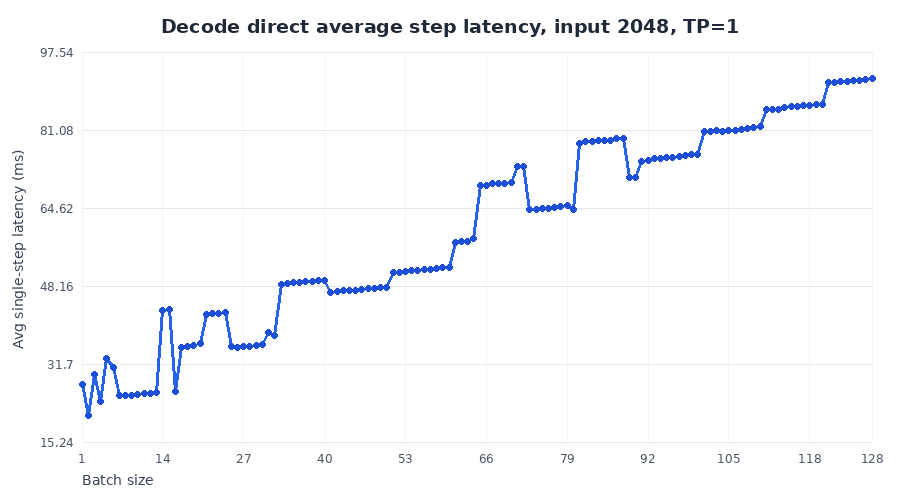
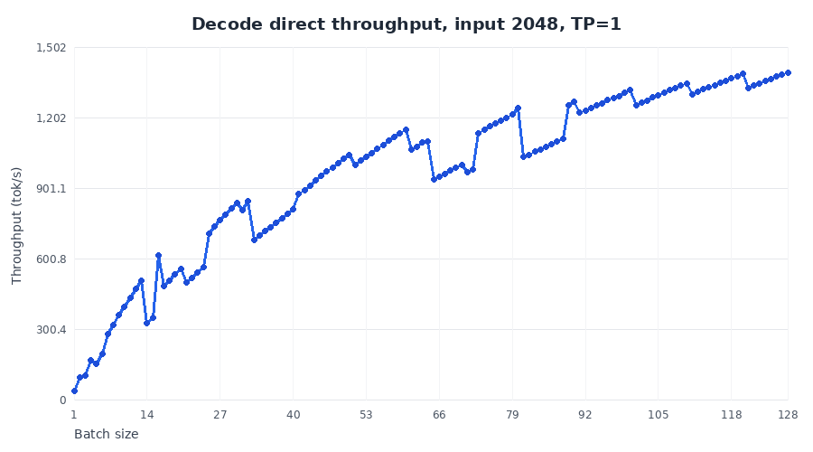

# Decode-Direct Input 2048 TP=1 性能报告

## 运行环境

| 项目 | 值 |
| ---: | ---: |
| 日期 | 2026-11-23 18:10:06-18:27:26（Asia/Shanghai） |
| 平台 | Hygon BW1000 |
| 设备 | 1 x Hygon BW1000 HCU，64 GB HBM，CUDA_VISIBLE_DEVICES 按前 1 张分配 |
| Driver / runtime | 6.3.30-V1.4.1a / DTK 26.04-rc4 |
| InfiniLM build | 分支 `pd-v0.2.9-v1-tp`，commit `da7d18e7` |
| 模型 | `/data/shared/.infinifabric-models-20261027-fef304a05440/Qwen3-8B--b968826d9c46dd6066d109eabc6255188de91218` |
| 模式 | `decode-direct` |
| Attention backend | `flash-attn` |
| Graph request | enabled |
| Expected execution mode | `graph` |
| Cache | paged KV cache，block size 256，num blocks 1152 |
| Max batched tokens | 18,432 |
| Tensor parallel size | 1 |
| Input length | 2048 tokens / request |
| Batch size range | 1..128 |
| Decode steps per repeat | 4 |
| Warmup / measured repeats | 每个形状 3 次 / 30 次 |
| Batch 执行顺序 | random seed 2026 |


本报告对应原始 JSONL 和 log 为本机运行产物，不随仓库提交：

```text
../../../benchmark-hygon-bw-tp1-decode-direct-input2048.jsonl
../../../benchmark-hygon-bw-tp1-decode-direct-input2048.log
```

## 构建与测试命令

```bash
xmake build _infinilm && xmake install _infinilm
```

```bash
SKIP_BUILD=1 TP=1 GPU=0 \
MODE=decode-direct \
INPUT_LEN=2048 \
BATCH_SIZES="$(seq -s, 1 128)" REPEATS=30 \
OUTPUT=benchmark-hygon-bw-tp1-decode-direct-input2048.jsonl ./run_bench_hygon.sh
```

## 执行模式与 Graph 覆盖

- Graph request: enabled
- Expected execution mode: `graph`
- Graph-covered batches: 1..128
- Eager-fallback batches: none
- Mode source: compiler rule；该字段不是 C++ runtime 回传的实际执行模式。

## 资源开销

| 项目 | 值 |
| ---: | ---: |
| Workspace allocation | 每 rank 1,944 MiB，TP=1 合计 1,944 MiB |
| 权重加载时间 | 25.54 s |
| Graph compilation time | 未单独打点；包含在进程初始化到首个 sample 的 wall time 中 |
| Paged cache blocks | 1,152 |
| 正式 sample 数 | 15,360 |
| 进程 wall time | 1041 s (first runtime log to final JSONL write) |
| Monitor peak HCU memory use | 97%（本 run 时间窗，分配 HCUs，10 秒采样） |
| Monitor peak package power | 380.0 W（本 run 时间窗，分配 HCUs，10 秒采样） |
| Monitor peak sensor temperature | 63.0 C（本 run 时间窗，edge/junction，10 秒采样） |


## 测试口径

- Direct decode 不执行语义 prefill，paged KV cache 全 0 初始化。
- Step 0 使用 dummy token；step 1..3 使用上一步 sampled token。
- 每次 repeat 执行 4 个 decode step。
- `avg_step_latency = four_step_repeat_duration / 4`。
- 完整结果表聚合每个 batch 的 120 个 individual step samples。
- `single_step_throughput = batch_size / avg_step_latency`。
- 计时边界为 `engine_forward_including_sampling`。
- 分位数使用线性插值；每个 batch 只有 30 个 repeat，p99 是尾部参考。

## 核心结果

| 指标 | 结果 |
| ---: | ---: |
| 最高 single-step throughput | batch 128，1,393.35 tok/s |
| 最快 batch 平均 step latency | batch 2，20.915 ms |
| 最大 batch scaling | 38.121x |
| Ideal-scaling efficiency | 29.8% |
| Median step std | 0.064 ms |
| Maximum step std | 0.233 ms，batch 99 |


## 趋势图

### 1. Batch size 与 Avg Step Latency



平均 step latency 从 batch 1 的 27.359 ms 变为 batch 128 的 91.865 ms。

### 2. Batch size 与 Single-step Throughput



吞吐峰值出现在 batch 128，为 1,393.35 tok/s。

### 3. Batch size 与 Scaling


batch 128 相对 batch 1 的 scaling 为 38.121x；理想 128x 效率约 29.8%。

## Batch 区间平均 latency 与吞吐

下表按连续 16 个 batch 分组。平均值是区间内各 batch 聚合 single-step 统计的算术平均；区间最优 batch 取吞吐最高的 batch。

| Batch 区间 | 平均单 step latency ms | 平均吞吐 tok/s | 区间最优 batch |
| ---: | ---: | ---: | ---: |
| 1..16 | 28.408 | 300.14 | 16 |
| 17..32 | 37.558 | 656.60 | 32 |
| 33..48 | 48.140 | 842.85 | 48 |
| 49..64 | 52.614 | 1,072.97 | 60 |
| 65..80 | 67.603 | 1,077.08 | 80 |
| 81..96 | 76.412 | 1,161.04 | 96 |
| 97..112 | 80.299 | 1,301.26 | 110 |
| 113..128 | 88.776 | 1,357.17 | 128 |


## 关键批次与跳变

| Change | Mode transition | Avg step ms | Throughput tok/s | Observation |
| --- | ---: | ---: | ---: | --- |
| 13 -> 14 | graph | 25.599 -> 43.068 | 507.82 -> 325.07 | 平均 step latency 增加 68.2%，可能对应 kernel shape 或 workspace 分档变化 |
| 2 -> 3 | graph | 20.915 -> 29.510 | 95.62 -> 101.66 | 平均 step latency 增加 41.1%，可能对应 kernel shape 或 workspace 分档变化 |
| 4 -> 5 | graph | 23.746 -> 32.884 | 168.45 -> 152.05 | 平均 step latency 增加 38.5%，可能对应 kernel shape 或 workspace 分档变化 |
| 16 -> 17 | graph | 25.999 -> 35.247 | 615.41 -> 482.31 | 平均 step latency 增加 35.6%，可能对应 kernel shape 或 workspace 分档变化 |
| 32 -> 33 | graph | 37.807 -> 48.538 | 846.41 -> 679.89 | 平均 step latency 增加 28.4%，可能对应 kernel shape 或 workspace 分档变化 |
| 80 -> 81 | graph | 64.397 -> 78.334 | 1,242.29 -> 1,034.03 | 平均 step latency 增加 21.6%，可能对应 kernel shape 或 workspace 分档变化 |


## Step 一致性

峰值 batch 128 的 4 个 decode step 结果如下：

| Step | Past KV length | Avg step ms | Std ms | Throughput tok/s |
| ---: | ---: | ---: | ---: | ---: |
| 0 | 2048 | 91.853 | 0.063 | 1,393.54 |
| 1 | 2049 | 91.861 | 0.048 | 1,393.42 |
| 2 | 2050 | 91.867 | 0.110 | 1,393.32 |
| 3 | 2051 | 91.881 | 0.077 | 1,393.11 |


所有 batch 中，4 个 step 平均耗时最大差异为 0.259 ms，出现在 batch 113。差异包含 past KV length 增长和 step kernel 形状影响。

## 数据稳定性

- 单 step std 中位数为 0.064 ms。
- 最大 std 为 0.233 ms，出现在 batch 99。
- 各 batch p99 与 max 接近，尾部稳定；每个 batch 只有 30 个 repeat，p99 仍是尾部参考值。

## TP 对比摘要

| TP | Best batch | Peak throughput tok/s | Scaling vs TP=1 |
| ---: | ---: | ---: | ---: |
| 1 | 128 | 1,393.35 | 1.000x |
| 2 | 120 | 2,341.81 | 1.681x |
| 4 | 120 | 3,467.80 | 2.489x |


## Single-step 完整结果

### Batch 1..16

| Batch | Mode | Avg Step ms | Min Step ms | P50 Step ms | P95 Step ms | P99 Step ms | Max Step ms | Std Step ms | Single-step tok/s | Scaling |
| ---: | --- | ---: | ---: | ---: | ---: | ---: | ---: | ---: | ---: | ---: |
| 1 | graph | 27.359 | 27.201 | 27.339 | 27.525 | 27.817 | 27.968 | 0.101 | 36.55 | 1.000x |
| 2 | graph | 20.915 | 20.895 | 20.915 | 20.928 | 20.937 | 20.940 | 0.008 | 95.62 | 2.616x |
| 3 | graph | 29.510 | 29.481 | 29.506 | 29.528 | 29.581 | 29.785 | 0.028 | 101.66 | 2.781x |
| 4 | graph | 23.746 | 23.719 | 23.746 | 23.761 | 23.773 | 23.786 | 0.010 | 168.45 | 4.609x |
| 5 | graph | 32.884 | 32.795 | 32.897 | 32.918 | 32.930 | 32.939 | 0.034 | 152.05 | 4.160x |
| 6 | graph | 31.004 | 30.972 | 31.002 | 31.026 | 31.034 | 31.035 | 0.011 | 193.53 | 5.295x |
| 7 | graph | 24.976 | 24.953 | 24.977 | 24.993 | 24.996 | 25.005 | 0.010 | 280.26 | 7.668x |
| 8 | graph | 25.043 | 25.008 | 25.041 | 25.068 | 25.085 | 25.093 | 0.014 | 319.45 | 8.740x |
| 9 | graph | 25.107 | 25.081 | 25.108 | 25.124 | 25.135 | 25.139 | 0.011 | 358.46 | 9.807x |
| 10 | graph | 25.244 | 25.215 | 25.244 | 25.264 | 25.273 | 25.275 | 0.011 | 396.13 | 10.838x |
| 11 | graph | 25.391 | 25.353 | 25.382 | 25.413 | 25.719 | 25.803 | 0.057 | 433.23 | 11.853x |
| 12 | graph | 25.440 | 25.409 | 25.441 | 25.459 | 25.470 | 25.473 | 0.012 | 471.70 | 12.905x |
| 13 | graph | 25.599 | 25.543 | 25.575 | 25.729 | 26.135 | 26.182 | 0.101 | 507.82 | 13.894x |
| 14 | graph | 43.068 | 43.006 | 43.044 | 43.191 | 43.513 | 43.591 | 0.092 | 325.07 | 8.894x |
| 15 | graph | 43.250 | 43.215 | 43.249 | 43.283 | 43.291 | 43.316 | 0.016 | 346.82 | 9.489x |
| 16 | graph | 25.999 | 25.951 | 25.992 | 26.030 | 26.262 | 26.401 | 0.050 | 615.41 | 16.837x |


### Batch 17..32

| Batch | Mode | Avg Step ms | Min Step ms | P50 Step ms | P95 Step ms | P99 Step ms | Max Step ms | Std Step ms | Single-step tok/s | Scaling |
| ---: | --- | ---: | ---: | ---: | ---: | ---: | ---: | ---: | ---: | ---: |
| 17 | graph | 35.247 | 35.178 | 35.238 | 35.278 | 35.609 | 35.692 | 0.063 | 482.31 | 13.196x |
| 18 | graph | 35.421 | 35.374 | 35.415 | 35.459 | 35.613 | 35.705 | 0.039 | 508.17 | 13.903x |
| 19 | graph | 35.665 | 35.632 | 35.660 | 35.688 | 35.780 | 35.932 | 0.031 | 532.74 | 14.575x |
| 20 | graph | 35.970 | 35.925 | 35.969 | 35.999 | 36.015 | 36.040 | 0.017 | 556.02 | 15.212x |
| 21 | graph | 42.223 | 42.167 | 42.215 | 42.259 | 42.522 | 42.557 | 0.052 | 497.36 | 13.607x |
| 22 | graph | 42.347 | 42.288 | 42.339 | 42.389 | 42.502 | 42.668 | 0.046 | 519.52 | 14.213x |
| 23 | graph | 42.457 | 42.401 | 42.447 | 42.520 | 42.709 | 42.792 | 0.052 | 541.73 | 14.821x |
| 24 | graph | 42.521 | 42.461 | 42.514 | 42.554 | 42.780 | 42.906 | 0.049 | 564.43 | 15.442x |
| 25 | graph | 35.359 | 35.291 | 35.343 | 35.468 | 35.648 | 35.679 | 0.065 | 707.03 | 19.344x |
| 26 | graph | 35.264 | 35.198 | 35.265 | 35.297 | 35.307 | 35.310 | 0.020 | 737.29 | 20.172x |
| 27 | graph | 35.404 | 35.350 | 35.401 | 35.435 | 35.533 | 35.562 | 0.031 | 762.63 | 20.865x |
| 28 | graph | 35.483 | 35.433 | 35.476 | 35.512 | 35.716 | 35.749 | 0.043 | 789.11 | 21.589x |
| 29 | graph | 35.579 | 35.525 | 35.559 | 35.669 | 36.025 | 36.121 | 0.086 | 815.09 | 22.300x |
| 30 | graph | 35.804 | 35.772 | 35.803 | 35.825 | 35.839 | 35.843 | 0.013 | 837.88 | 22.924x |
| 31 | graph | 38.371 | 38.280 | 38.359 | 38.475 | 38.661 | 38.714 | 0.065 | 807.90 | 22.103x |
| 32 | graph | 37.807 | 37.761 | 37.796 | 37.842 | 38.134 | 38.243 | 0.060 | 846.41 | 23.157x |


### Batch 33..48

| Batch | Mode | Avg Step ms | Min Step ms | P50 Step ms | P95 Step ms | P99 Step ms | Max Step ms | Std Step ms | Single-step tok/s | Scaling |
| ---: | --- | ---: | ---: | ---: | ---: | ---: | ---: | ---: | ---: | ---: |
| 33 | graph | 48.538 | 48.442 | 48.531 | 48.591 | 48.885 | 48.982 | 0.065 | 679.89 | 18.601x |
| 34 | graph | 48.710 | 48.625 | 48.708 | 48.758 | 48.780 | 48.841 | 0.031 | 698.00 | 19.097x |
| 35 | graph | 48.858 | 48.788 | 48.857 | 48.898 | 48.922 | 48.938 | 0.026 | 716.36 | 19.599x |
| 36 | graph | 49.002 | 48.928 | 48.998 | 49.051 | 49.200 | 49.324 | 0.047 | 734.67 | 20.100x |
| 37 | graph | 49.072 | 48.987 | 49.066 | 49.125 | 49.411 | 49.487 | 0.063 | 753.99 | 20.628x |
| 38 | graph | 49.166 | 49.102 | 49.163 | 49.216 | 49.227 | 49.231 | 0.027 | 772.89 | 21.146x |
| 39 | graph | 49.335 | 49.271 | 49.327 | 49.389 | 49.526 | 49.737 | 0.053 | 790.52 | 21.628x |
| 40 | graph | 49.410 | 49.346 | 49.400 | 49.480 | 49.670 | 49.831 | 0.057 | 809.55 | 22.148x |
| 41 | graph | 46.891 | 46.853 | 46.888 | 46.925 | 46.968 | 46.992 | 0.022 | 874.37 | 23.922x |
| 42 | graph | 47.017 | 46.909 | 47.045 | 47.095 | 47.129 | 47.578 | 0.084 | 893.29 | 24.439x |
| 43 | graph | 47.150 | 47.106 | 47.141 | 47.177 | 47.403 | 47.428 | 0.045 | 911.98 | 24.951x |
| 44 | graph | 47.164 | 47.122 | 47.163 | 47.195 | 47.206 | 47.215 | 0.018 | 932.92 | 25.524x |
| 45 | graph | 47.303 | 47.254 | 47.289 | 47.391 | 47.642 | 47.652 | 0.063 | 951.31 | 26.027x |
| 46 | graph | 47.395 | 47.323 | 47.369 | 47.513 | 47.865 | 47.872 | 0.094 | 970.56 | 26.554x |
| 47 | graph | 47.555 | 47.511 | 47.547 | 47.588 | 47.758 | 47.890 | 0.046 | 988.34 | 27.040x |
| 48 | graph | 47.669 | 47.619 | 47.659 | 47.705 | 47.962 | 48.143 | 0.059 | 1,006.94 | 27.549x |


### Batch 49..64

| Batch | Mode | Avg Step ms | Min Step ms | P50 Step ms | P95 Step ms | P99 Step ms | Max Step ms | Std Step ms | Single-step tok/s | Scaling |
| ---: | --- | ---: | ---: | ---: | ---: | ---: | ---: | ---: | ---: | ---: |
| 49 | graph | 47.810 | 47.741 | 47.791 | 47.898 | 48.197 | 48.271 | 0.081 | 1,024.89 | 28.040x |
| 50 | graph | 47.917 | 47.871 | 47.908 | 47.968 | 48.170 | 48.320 | 0.052 | 1,043.48 | 28.548x |
| 51 | graph | 50.960 | 50.869 | 50.946 | 51.085 | 51.306 | 51.443 | 0.076 | 1,000.78 | 27.380x |
| 52 | graph | 51.047 | 50.982 | 51.037 | 51.088 | 51.388 | 51.491 | 0.062 | 1,018.67 | 27.870x |
| 53 | graph | 51.237 | 51.186 | 51.232 | 51.280 | 51.344 | 51.430 | 0.030 | 1,034.41 | 28.301x |
| 54 | graph | 51.427 | 51.300 | 51.420 | 51.551 | 51.823 | 51.875 | 0.081 | 1,050.03 | 28.728x |
| 55 | graph | 51.478 | 51.425 | 51.469 | 51.510 | 51.750 | 51.949 | 0.058 | 1,068.42 | 29.231x |
| 56 | graph | 51.614 | 51.571 | 51.612 | 51.650 | 51.659 | 51.665 | 0.019 | 1,084.98 | 29.684x |
| 57 | graph | 51.742 | 51.686 | 51.737 | 51.775 | 51.893 | 52.117 | 0.043 | 1,101.62 | 30.139x |
| 58 | graph | 51.858 | 51.790 | 51.847 | 51.889 | 52.178 | 52.273 | 0.058 | 1,118.44 | 30.599x |
| 59 | graph | 51.960 | 51.904 | 51.960 | 52.001 | 52.015 | 52.038 | 0.024 | 1,135.50 | 31.066x |
| 60 | graph | 52.108 | 52.050 | 52.101 | 52.155 | 52.403 | 52.451 | 0.052 | 1,151.45 | 31.502x |
| 61 | graph | 57.364 | 57.306 | 57.360 | 57.400 | 57.444 | 57.598 | 0.033 | 1,063.39 | 29.093x |
| 62 | graph | 57.509 | 57.451 | 57.501 | 57.545 | 57.810 | 57.865 | 0.053 | 1,078.09 | 29.495x |
| 63 | graph | 57.576 | 57.476 | 57.548 | 57.758 | 58.115 | 58.233 | 0.117 | 1,094.21 | 29.936x |
| 64 | graph | 58.224 | 58.145 | 58.215 | 58.270 | 58.526 | 58.634 | 0.058 | 1,099.21 | 30.073x |


### Batch 65..80

| Batch | Mode | Avg Step ms | Min Step ms | P50 Step ms | P95 Step ms | P99 Step ms | Max Step ms | Std Step ms | Single-step tok/s | Scaling |
| ---: | --- | ---: | ---: | ---: | ---: | ---: | ---: | ---: | ---: | ---: |
| 65 | graph | 69.368 | 69.286 | 69.351 | 69.423 | 69.806 | 69.971 | 0.086 | 937.03 | 25.636x |
| 66 | graph | 69.465 | 69.401 | 69.451 | 69.504 | 69.519 | 70.600 | 0.107 | 950.12 | 25.994x |
| 67 | graph | 69.690 | 69.639 | 69.683 | 69.720 | 70.004 | 70.106 | 0.057 | 961.40 | 26.303x |
| 68 | graph | 69.709 | 69.657 | 69.706 | 69.747 | 69.795 | 69.938 | 0.032 | 975.49 | 26.688x |
| 69 | graph | 69.793 | 69.731 | 69.792 | 69.828 | 69.838 | 69.843 | 0.019 | 988.64 | 27.048x |
| 70 | graph | 69.982 | 69.916 | 69.973 | 70.013 | 70.361 | 70.400 | 0.066 | 1,000.25 | 27.366x |
| 71 | graph | 73.299 | 73.186 | 73.264 | 73.712 | 73.927 | 73.950 | 0.142 | 968.63 | 26.501x |
| 72 | graph | 73.405 | 73.302 | 73.389 | 73.478 | 73.880 | 73.988 | 0.105 | 980.86 | 26.835x |
| 73 | graph | 64.329 | 64.165 | 64.327 | 64.447 | 64.544 | 64.680 | 0.081 | 1,134.79 | 31.047x |
| 74 | graph | 64.399 | 64.300 | 64.373 | 64.674 | 64.781 | 64.904 | 0.103 | 1,149.09 | 31.438x |
| 75 | graph | 64.473 | 64.362 | 64.496 | 64.555 | 64.829 | 64.936 | 0.085 | 1,163.27 | 31.826x |
| 76 | graph | 64.585 | 64.489 | 64.539 | 64.940 | 65.083 | 65.135 | 0.128 | 1,176.75 | 32.195x |
| 77 | graph | 64.780 | 64.700 | 64.755 | 65.041 | 65.302 | 65.515 | 0.115 | 1,188.64 | 32.520x |
| 78 | graph | 64.923 | 64.853 | 64.914 | 64.991 | 65.171 | 65.317 | 0.053 | 1,201.42 | 32.870x |
| 79 | graph | 65.043 | 64.967 | 65.021 | 65.167 | 65.418 | 65.481 | 0.074 | 1,214.57 | 33.230x |
| 80 | graph | 64.397 | 64.301 | 64.363 | 64.748 | 64.915 | 64.980 | 0.126 | 1,242.29 | 33.988x |


### Batch 81..96

| Batch | Mode | Avg Step ms | Min Step ms | P50 Step ms | P95 Step ms | P99 Step ms | Max Step ms | Std Step ms | Single-step tok/s | Scaling |
| ---: | --- | ---: | ---: | ---: | ---: | ---: | ---: | ---: | ---: | ---: |
| 81 | graph | 78.334 | 78.189 | 78.360 | 78.433 | 78.707 | 78.739 | 0.098 | 1,034.03 | 28.290x |
| 82 | graph | 78.594 | 78.439 | 78.604 | 78.656 | 78.673 | 78.769 | 0.056 | 1,043.34 | 28.545x |
| 83 | graph | 78.585 | 78.453 | 78.620 | 78.684 | 78.772 | 79.028 | 0.091 | 1,056.18 | 28.896x |
| 84 | graph | 78.922 | 78.833 | 78.897 | 79.021 | 79.418 | 79.439 | 0.109 | 1,064.35 | 29.120x |
| 85 | graph | 78.966 | 78.895 | 78.957 | 78.999 | 79.352 | 79.411 | 0.066 | 1,076.42 | 29.450x |
| 86 | graph | 78.955 | 78.877 | 78.941 | 79.023 | 79.326 | 79.424 | 0.071 | 1,089.23 | 29.800x |
| 87 | graph | 79.235 | 79.171 | 79.218 | 79.373 | 79.634 | 79.654 | 0.080 | 1,098.00 | 30.040x |
| 88 | graph | 79.206 | 79.127 | 79.190 | 79.274 | 79.514 | 79.523 | 0.062 | 1,111.03 | 30.397x |
| 89 | graph | 70.954 | 70.778 | 70.995 | 71.103 | 71.230 | 71.455 | 0.121 | 1,254.34 | 34.317x |
| 90 | graph | 71.035 | 70.946 | 71.022 | 71.124 | 71.391 | 71.480 | 0.077 | 1,266.99 | 34.664x |
| 91 | graph | 74.536 | 74.312 | 74.572 | 74.709 | 74.845 | 75.168 | 0.132 | 1,220.89 | 33.402x |
| 92 | graph | 74.691 | 74.609 | 74.678 | 74.744 | 75.119 | 75.190 | 0.079 | 1,231.74 | 33.699x |
| 93 | graph | 74.981 | 74.910 | 74.975 | 75.031 | 75.206 | 75.263 | 0.046 | 1,240.31 | 33.934x |
| 94 | graph | 75.034 | 74.927 | 75.000 | 75.370 | 75.532 | 75.577 | 0.125 | 1,252.77 | 34.275x |
| 95 | graph | 75.304 | 75.227 | 75.300 | 75.351 | 75.497 | 75.695 | 0.050 | 1,261.55 | 34.515x |
| 96 | graph | 75.266 | 75.175 | 75.255 | 75.309 | 75.731 | 75.802 | 0.081 | 1,275.48 | 34.896x |


### Batch 97..112

| Batch | Mode | Avg Step ms | Min Step ms | P50 Step ms | P95 Step ms | P99 Step ms | Max Step ms | Std Step ms | Single-step tok/s | Scaling |
| ---: | --- | ---: | ---: | ---: | ---: | ---: | ---: | ---: | ---: | ---: |
| 97 | graph | 75.474 | 75.264 | 75.492 | 75.681 | 75.997 | 76.121 | 0.159 | 1,285.20 | 35.162x |
| 98 | graph | 75.762 | 75.654 | 75.742 | 75.886 | 76.131 | 76.239 | 0.085 | 1,293.52 | 35.389x |
| 99 | graph | 75.811 | 75.527 | 75.779 | 76.368 | 76.497 | 76.527 | 0.233 | 1,305.88 | 35.727x |
| 100 | graph | 75.912 | 75.729 | 75.847 | 76.310 | 76.398 | 76.423 | 0.164 | 1,317.32 | 36.040x |
| 101 | graph | 80.659 | 80.516 | 80.612 | 81.085 | 81.206 | 81.284 | 0.153 | 1,252.18 | 34.258x |
| 102 | graph | 80.719 | 80.613 | 80.701 | 80.783 | 81.162 | 81.307 | 0.096 | 1,263.65 | 34.572x |
| 103 | graph | 80.870 | 80.788 | 80.851 | 80.975 | 81.338 | 81.352 | 0.093 | 1,273.64 | 34.846x |
| 104 | graph | 80.779 | 80.702 | 80.771 | 80.826 | 81.090 | 81.214 | 0.063 | 1,287.47 | 35.224x |
| 105 | graph | 81.007 | 80.814 | 81.057 | 81.150 | 81.511 | 81.517 | 0.143 | 1,296.19 | 35.462x |
| 106 | graph | 81.031 | 80.948 | 81.022 | 81.113 | 81.289 | 81.308 | 0.055 | 1,308.13 | 35.789x |
| 107 | graph | 81.194 | 81.009 | 81.245 | 81.450 | 81.513 | 81.596 | 0.137 | 1,317.83 | 36.055x |
| 108 | graph | 81.436 | 81.311 | 81.376 | 81.807 | 81.956 | 82.725 | 0.184 | 1,326.19 | 36.283x |
| 109 | graph | 81.547 | 81.482 | 81.538 | 81.592 | 81.908 | 81.961 | 0.063 | 1,336.65 | 36.569x |
| 110 | graph | 81.773 | 81.659 | 81.749 | 81.937 | 82.249 | 82.276 | 0.099 | 1,345.19 | 36.803x |
| 111 | graph | 85.383 | 85.292 | 85.363 | 85.458 | 85.878 | 85.888 | 0.096 | 1,300.03 | 35.568x |
| 112 | graph | 85.421 | 85.312 | 85.414 | 85.478 | 85.788 | 85.854 | 0.068 | 1,311.15 | 35.872x |


### Batch 113..128

| Batch | Mode | Avg Step ms | Min Step ms | P50 Step ms | P95 Step ms | P99 Step ms | Max Step ms | Std Step ms | Single-step tok/s | Scaling |
| ---: | --- | ---: | ---: | ---: | ---: | ---: | ---: | ---: | ---: | ---: |
| 113 | graph | 85.493 | 85.309 | 85.548 | 85.635 | 85.859 | 85.929 | 0.131 | 1,321.75 | 36.162x |
| 114 | graph | 85.799 | 85.688 | 85.760 | 86.173 | 86.285 | 86.341 | 0.132 | 1,328.69 | 36.352x |
| 115 | graph | 85.968 | 85.876 | 85.952 | 86.032 | 86.401 | 86.575 | 0.097 | 1,337.71 | 36.599x |
| 116 | graph | 86.057 | 85.975 | 86.045 | 86.123 | 86.419 | 86.520 | 0.077 | 1,347.95 | 36.878x |
| 117 | graph | 86.167 | 85.982 | 86.224 | 86.304 | 86.384 | 86.708 | 0.128 | 1,357.83 | 37.149x |
| 118 | graph | 86.226 | 86.172 | 86.225 | 86.272 | 86.281 | 86.305 | 0.025 | 1,368.50 | 37.441x |
| 119 | graph | 86.387 | 86.165 | 86.425 | 86.553 | 86.715 | 86.864 | 0.134 | 1,377.51 | 37.687x |
| 120 | graph | 86.522 | 86.453 | 86.508 | 86.653 | 86.921 | 87.011 | 0.080 | 1,386.92 | 37.945x |
| 121 | graph | 91.127 | 91.038 | 91.103 | 91.387 | 91.512 | 91.542 | 0.093 | 1,327.82 | 36.328x |
| 122 | graph | 91.178 | 91.069 | 91.177 | 91.232 | 91.334 | 91.388 | 0.043 | 1,338.04 | 36.607x |
| 123 | graph | 91.404 | 91.292 | 91.382 | 91.613 | 91.799 | 91.940 | 0.101 | 1,345.67 | 36.816x |
| 124 | graph | 91.329 | 91.269 | 91.314 | 91.374 | 91.748 | 91.754 | 0.079 | 1,357.73 | 37.146x |
| 125 | graph | 91.520 | 91.332 | 91.579 | 91.678 | 91.889 | 92.019 | 0.134 | 1,365.82 | 37.367x |
| 126 | graph | 91.573 | 91.480 | 91.557 | 91.744 | 91.909 | 91.928 | 0.075 | 1,375.95 | 37.645x |
| 127 | graph | 91.801 | 91.597 | 91.856 | 91.949 | 92.271 | 92.338 | 0.141 | 1,383.42 | 37.849x |
| 128 | graph | 91.865 | 91.791 | 91.848 | 91.933 | 92.202 | 92.447 | 0.079 | 1,393.35 | 38.121x |


## 分析

1. Single-step 吞吐随 batch 增加总体上升，峰值在 batch 128，为 1,393.35 tok/s。
2. 平均 step latency 随 batch 增加而上升，batch 1 为 27.359 ms，batch 128 为 91.865 ms。
3. Decode step 的 past KV length 从 2048 增至 2051；该变化对平均耗时影响较小，主要 scaling 仍来自 batch 并行度。
4. 连续 batch 的正向 latency 跳变通常对应 kernel shape、workspace 分档或 attention tile 变化，不能解释为连续线性退化。
5. step std 中位数 0.064 ms，最大 0.233 ms，整体测量稳定。

## 结论与建议

1. 该形状下优先在 batch 128 附近获得最高 decode 总吞吐。
2. 最大 batch ideal-scaling 效率为 29.8%，说明 per-step attention/MLP latency 随 batch 增长明显。
3. graph 已覆盖全部有效 batch；TP=1 input 1024 如需 batch 256，应先降低 workspace/cache 压力或调整图编译策略。
4. 对关键跳变 batch 建议结合 C++ model-only timer 和 kernel profile 复核。
5. 若需要更稳定的 p99，建议将 `BENCHMARK_REPEATS` 提高到 100 或以上。

## 数据完整性

```text
config records: 1
step samples: 15360
overall summaries: 128
per-step summaries: 512
scaling records: 128
step samples per batch: 120
samples per decode step: 30
```
