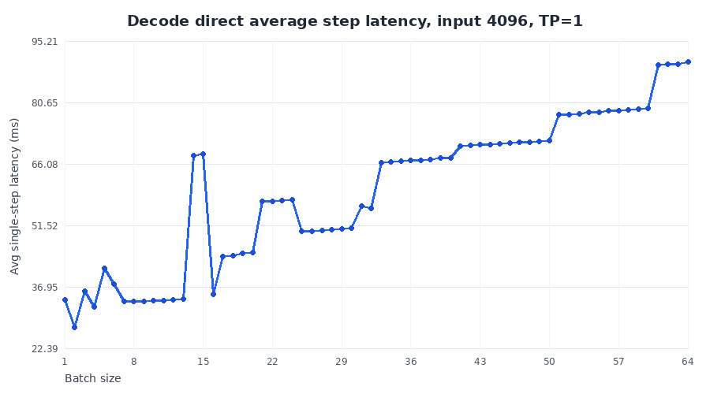
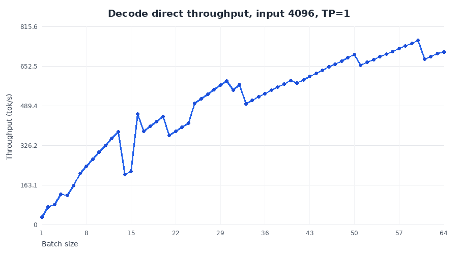
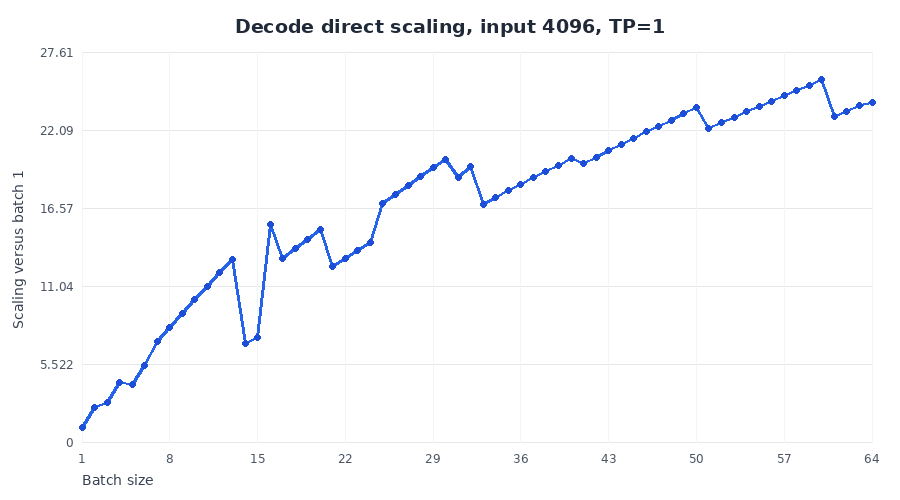

# Decode-Direct Input 4096 TP=1 性能报告

## 运行环境

| 项目 | 值 |
| ---: | ---: |
| 日期 | 2026-11-23 18:27:54-18:36:32（Asia/Shanghai） |
| 平台 | Hygon BW1000 |
| 设备 | 1 x Hygon BW1000 HCU，64 GB HBM，CUDA_VISIBLE_DEVICES 按前 1 张分配 |
| Driver / runtime | 6.3.30-V1.4.1a / DTK 26.04-rc4 |
| InfiniLM build | 分支 `pd-v0.2.9-v1-tp`，commit `da7d18e7` |
| 模型 | `/data/shared/.infinifabric-models-20261027-fef304a05440/Qwen3-8B--b968826d9c46dd6066d109eabc6255188de91218` |
| 模式 | `decode-direct` |
| Attention backend | `flash-attn` |
| Graph request | enabled |
| Expected execution mode | `graph` |
| Cache | paged KV cache，block size 256，num blocks 1088 |
| Max batched tokens | 18,432 |
| Tensor parallel size | 1 |
| Input length | 4096 tokens / request |
| Batch size range | 1..64 |
| Decode steps per repeat | 4 |
| Warmup / measured repeats | 每个形状 3 次 / 30 次 |
| Batch 执行顺序 | random seed 2026 |


本报告对应原始 JSONL 和 log 为本机运行产物，不随仓库提交：

```text
../../../benchmark-hygon-bw-tp1-decode-direct-input4096.jsonl
../../../benchmark-hygon-bw-tp1-decode-direct-input4096.log
```

## 构建与测试命令

```bash
xmake build _infinilm && xmake install _infinilm
```

```bash
SKIP_BUILD=1 TP=1 GPU=0 \
MODE=decode-direct \
INPUT_LEN=4096 \
BATCH_SIZES="$(seq -s, 1 64)" REPEATS=30 \
OUTPUT=benchmark-hygon-bw-tp1-decode-direct-input4096.jsonl ./run_bench_hygon.sh
```

## 执行模式与 Graph 覆盖

- Graph request: enabled
- Expected execution mode: `graph`
- Graph-covered batches: 1..64
- Eager-fallback batches: none
- Mode source: compiler rule；该字段不是 C++ runtime 回传的实际执行模式。

## 资源开销

| 项目 | 值 |
| ---: | ---: |
| Workspace allocation | 每 rank 1,944 MiB，TP=1 合计 1,944 MiB |
| 权重加载时间 | 12.68 s |
| Graph compilation time | 未单独打点；包含在进程初始化到首个 sample 的 wall time 中 |
| Paged cache blocks | 1,088 |
| 正式 sample 数 | 7,680 |
| 进程 wall time | 519 s (first runtime log to final JSONL write) |
| Monitor peak HCU memory use | 94%（本 run 时间窗，分配 HCUs，10 秒采样） |
| Monitor peak package power | 339.0 W（本 run 时间窗，分配 HCUs，10 秒采样） |
| Monitor peak sensor temperature | 62.0 C（本 run 时间窗，edge/junction，10 秒采样） |


## 测试口径

- Direct decode 不执行语义 prefill，paged KV cache 全 0 初始化。
- Step 0 使用 dummy token；step 1..3 使用上一步 sampled token。
- 每次 repeat 执行 4 个 decode step。
- `avg_step_latency = four_step_repeat_duration / 4`。
- 完整结果表聚合每个 batch 的 120 个 individual step samples。
- `single_step_throughput = batch_size / avg_step_latency`。
- 计时边界为 `engine_forward_including_sampling`。
- 分位数使用线性插值；每个 batch 只有 30 个 repeat，p99 是尾部参考。

## 核心结果

| 指标 | 结果 |
| ---: | ---: |
| 最高 single-step throughput | batch 60，757.36 tok/s |
| 最快 batch 平均 step latency | batch 2，27.411 ms |
| 最大 batch scaling | 24.024x |
| Ideal-scaling efficiency | 37.5% |
| Median step std | 0.023 ms |
| Maximum step std | 0.115 ms，batch 51 |


## 趋势图

### 1. Batch size 与 Avg Step Latency



平均 step latency 从 batch 1 的 33.854 ms 变为 batch 64 的 90.187 ms。

### 2. Batch size 与 Single-step Throughput



吞吐峰值出现在 batch 60，为 757.36 tok/s。

### 3. Batch size 与 Scaling



batch 64 相对 batch 1 的 scaling 为 24.024x；理想 64x 效率约 37.5%。

## Batch 区间平均 latency 与吞吐

下表按连续 16 个 batch 分组。平均值是区间内各 batch 聚合 single-step 统计的算术平均；区间最优 batch 取吞吐最高的 batch。

| Batch 区间 | 平均单 step latency ms | 平均吞吐 tok/s | 区间最优 batch |
| ---: | ---: | ---: | ---: |
| 1..16 | 38.456 | 221.85 | 16 |
| 17..32 | 51.357 | 476.90 | 30 |
| 33..48 | 68.879 | 586.68 | 48 |
| 49..64 | 80.403 | 702.69 | 60 |


## 关键批次与跳变

| Change | Mode transition | Avg step ms | Throughput tok/s | Observation |
| --- | ---: | ---: | ---: | --- |
| 13 -> 14 | graph | 33.996 -> 67.992 | 382.40 -> 205.91 | 平均 step latency 增加 100.0%，可能对应 kernel shape 或 workspace 分档变化 |
| 2 -> 3 | graph | 27.411 -> 35.904 | 72.96 -> 83.56 | 平均 step latency 增加 31.0%，可能对应 kernel shape 或 workspace 分档变化 |
| 4 -> 5 | graph | 32.209 -> 41.252 | 124.19 -> 121.21 | 平均 step latency 增加 28.1%，可能对应 kernel shape 或 workspace 分档变化 |
| 20 -> 21 | graph | 44.989 -> 57.232 | 444.55 -> 366.93 | 平均 step latency 增加 27.2%，可能对应 kernel shape 或 workspace 分档变化 |
| 16 -> 17 | graph | 35.096 -> 44.219 | 455.89 -> 384.45 | 平均 step latency 增加 26.0%，可能对应 kernel shape 或 workspace 分档变化 |
| 32 -> 33 | graph | 55.595 -> 66.451 | 575.59 -> 496.61 | 平均 step latency 增加 19.5%，可能对应 kernel shape 或 workspace 分档变化 |


## Step 一致性

峰值 batch 60 的 4 个 decode step 结果如下：

| Step | Past KV length | Avg step ms | Std ms | Throughput tok/s |
| ---: | ---: | ---: | ---: | ---: |
| 0 | 4096 | 79.214 | 0.019 | 757.44 |
| 1 | 4097 | 79.215 | 0.022 | 757.43 |
| 2 | 4098 | 79.230 | 0.024 | 757.29 |
| 3 | 4099 | 79.230 | 0.026 | 757.29 |


所有 batch 中，4 个 step 平均耗时最大差异为 0.039 ms，出现在 batch 46。差异包含 past KV length 增长和 step kernel 形状影响。

## 数据稳定性

- 单 step std 中位数为 0.023 ms。
- 最大 std 为 0.115 ms，出现在 batch 51。
- 各 batch p99 与 max 接近，尾部稳定；每个 batch 只有 30 个 repeat，p99 仍是尾部参考值。

## TP 对比摘要

| TP | Best batch | Peak throughput tok/s | Scaling vs TP=1 |
| ---: | ---: | ---: | ---: |
| 1 | 60 | 757.36 | 1.000x |
| 2 | 60 | 1,241.38 | 1.639x |
| 4 | 63 | 2,021.80 | 2.670x |


## Single-step 完整结果

### Batch 1..16

| Batch | Mode | Avg Step ms | Min Step ms | P50 Step ms | P95 Step ms | P99 Step ms | Max Step ms | Std Step ms | Single-step tok/s | Scaling |
| ---: | --- | ---: | ---: | ---: | ---: | ---: | ---: | ---: | ---: | ---: |
| 1 | graph | 33.854 | 33.720 | 33.854 | 33.918 | 33.953 | 33.956 | 0.039 | 29.54 | 1.000x |
| 2 | graph | 27.411 | 27.386 | 27.411 | 27.427 | 27.434 | 27.449 | 0.010 | 72.96 | 2.470x |
| 3 | graph | 35.904 | 35.876 | 35.904 | 35.922 | 35.926 | 35.932 | 0.010 | 83.56 | 2.829x |
| 4 | graph | 32.209 | 32.177 | 32.209 | 32.231 | 32.244 | 32.248 | 0.013 | 124.19 | 4.204x |
| 5 | graph | 41.252 | 41.217 | 41.252 | 41.274 | 41.281 | 41.282 | 0.013 | 121.21 | 4.103x |
| 6 | graph | 37.607 | 37.586 | 37.605 | 37.622 | 37.629 | 37.630 | 0.010 | 159.55 | 5.401x |
| 7 | graph | 33.444 | 33.405 | 33.438 | 33.472 | 33.626 | 33.768 | 0.040 | 209.31 | 7.086x |
| 8 | graph | 33.454 | 33.421 | 33.453 | 33.477 | 33.489 | 33.514 | 0.015 | 239.13 | 8.096x |
| 9 | graph | 33.486 | 33.455 | 33.485 | 33.505 | 33.518 | 33.520 | 0.012 | 268.77 | 9.099x |
| 10 | graph | 33.609 | 33.571 | 33.608 | 33.627 | 33.635 | 33.653 | 0.013 | 297.54 | 10.073x |
| 11 | graph | 33.771 | 33.719 | 33.772 | 33.795 | 33.807 | 33.808 | 0.015 | 325.72 | 11.027x |
| 12 | graph | 33.843 | 33.798 | 33.844 | 33.869 | 33.878 | 33.881 | 0.016 | 354.58 | 12.004x |
| 13 | graph | 33.996 | 33.961 | 33.996 | 34.019 | 34.024 | 34.032 | 0.014 | 382.40 | 12.946x |
| 14 | graph | 67.992 | 67.947 | 67.993 | 68.021 | 68.069 | 68.228 | 0.031 | 205.91 | 6.971x |
| 15 | graph | 68.374 | 68.264 | 68.357 | 68.530 | 68.658 | 68.798 | 0.073 | 219.38 | 7.427x |
| 16 | graph | 35.096 | 35.056 | 35.082 | 35.212 | 35.358 | 35.388 | 0.056 | 455.89 | 15.434x |


### Batch 17..32

| Batch | Mode | Avg Step ms | Min Step ms | P50 Step ms | P95 Step ms | P99 Step ms | Max Step ms | Std Step ms | Single-step tok/s | Scaling |
| ---: | --- | ---: | ---: | ---: | ---: | ---: | ---: | ---: | ---: | ---: |
| 17 | graph | 44.219 | 44.187 | 44.219 | 44.244 | 44.250 | 44.268 | 0.016 | 384.45 | 13.015x |
| 18 | graph | 44.382 | 44.345 | 44.383 | 44.413 | 44.424 | 44.441 | 0.018 | 405.57 | 13.730x |
| 19 | graph | 44.807 | 44.763 | 44.806 | 44.834 | 44.845 | 44.851 | 0.016 | 424.04 | 14.356x |
| 20 | graph | 44.989 | 44.941 | 44.989 | 45.012 | 45.015 | 45.045 | 0.015 | 444.55 | 15.050x |
| 21 | graph | 57.232 | 57.149 | 57.219 | 57.362 | 57.600 | 57.614 | 0.070 | 366.93 | 12.422x |
| 22 | graph | 57.221 | 57.173 | 57.222 | 57.246 | 57.255 | 57.266 | 0.018 | 384.48 | 13.016x |
| 23 | graph | 57.343 | 57.288 | 57.343 | 57.376 | 57.395 | 57.405 | 0.022 | 401.10 | 13.579x |
| 24 | graph | 57.514 | 57.481 | 57.512 | 57.538 | 57.569 | 57.591 | 0.017 | 417.29 | 14.127x |
| 25 | graph | 50.048 | 49.997 | 50.050 | 50.079 | 50.103 | 50.113 | 0.023 | 499.52 | 16.911x |
| 26 | graph | 50.168 | 50.131 | 50.166 | 50.195 | 50.208 | 50.212 | 0.016 | 518.26 | 17.545x |
| 27 | graph | 50.355 | 50.277 | 50.341 | 50.400 | 50.699 | 50.740 | 0.068 | 536.19 | 18.152x |
| 28 | graph | 50.422 | 50.386 | 50.419 | 50.453 | 50.468 | 50.474 | 0.016 | 555.32 | 18.800x |
| 29 | graph | 50.589 | 50.543 | 50.589 | 50.620 | 50.636 | 50.644 | 0.020 | 573.25 | 19.407x |
| 30 | graph | 50.800 | 50.748 | 50.802 | 50.827 | 50.840 | 50.843 | 0.018 | 590.55 | 19.992x |
| 31 | graph | 56.030 | 55.949 | 56.027 | 56.107 | 56.144 | 56.173 | 0.046 | 553.28 | 18.731x |
| 32 | graph | 55.595 | 55.543 | 55.593 | 55.635 | 55.663 | 55.677 | 0.026 | 575.59 | 19.486x |


### Batch 33..48

| Batch | Mode | Avg Step ms | Min Step ms | P50 Step ms | P95 Step ms | P99 Step ms | Max Step ms | Std Step ms | Single-step tok/s | Scaling |
| ---: | --- | ---: | ---: | ---: | ---: | ---: | ---: | ---: | ---: | ---: |
| 33 | graph | 66.451 | 66.329 | 66.432 | 66.628 | 66.817 | 66.879 | 0.083 | 496.61 | 16.812x |
| 34 | graph | 66.526 | 66.446 | 66.518 | 66.570 | 66.586 | 67.388 | 0.084 | 511.08 | 17.302x |
| 35 | graph | 66.662 | 66.598 | 66.659 | 66.706 | 66.728 | 66.732 | 0.026 | 525.04 | 17.775x |
| 36 | graph | 66.958 | 66.849 | 66.939 | 67.279 | 67.326 | 67.396 | 0.099 | 537.65 | 18.202x |
| 37 | graph | 67.007 | 66.923 | 66.994 | 67.086 | 67.314 | 67.408 | 0.068 | 552.18 | 18.694x |
| 38 | graph | 67.193 | 67.091 | 67.193 | 67.251 | 67.272 | 67.276 | 0.032 | 565.53 | 19.146x |
| 39 | graph | 67.428 | 67.297 | 67.394 | 67.689 | 67.791 | 68.027 | 0.114 | 578.40 | 19.581x |
| 40 | graph | 67.475 | 67.357 | 67.467 | 67.635 | 67.788 | 67.816 | 0.073 | 592.81 | 20.069x |
| 41 | graph | 70.303 | 70.249 | 70.304 | 70.336 | 70.343 | 70.350 | 0.020 | 583.19 | 19.743x |
| 42 | graph | 70.514 | 70.393 | 70.504 | 70.595 | 70.907 | 71.002 | 0.084 | 595.62 | 20.164x |
| 43 | graph | 70.604 | 70.543 | 70.603 | 70.653 | 70.667 | 70.670 | 0.028 | 609.03 | 20.618x |
| 44 | graph | 70.692 | 70.638 | 70.692 | 70.727 | 70.737 | 70.759 | 0.021 | 622.42 | 21.072x |
| 45 | graph | 70.851 | 70.785 | 70.849 | 70.888 | 70.910 | 70.915 | 0.023 | 635.14 | 21.502x |
| 46 | graph | 70.938 | 70.867 | 70.931 | 71.014 | 71.037 | 71.066 | 0.035 | 648.45 | 21.953x |
| 47 | graph | 71.168 | 71.123 | 71.168 | 71.206 | 71.222 | 71.227 | 0.022 | 660.41 | 22.358x |
| 48 | graph | 71.288 | 71.251 | 71.289 | 71.311 | 71.328 | 71.333 | 0.016 | 673.32 | 22.795x |


### Batch 49..64

| Batch | Mode | Avg Step ms | Min Step ms | P50 Step ms | P95 Step ms | P99 Step ms | Max Step ms | Std Step ms | Single-step tok/s | Scaling |
| ---: | --- | ---: | ---: | ---: | ---: | ---: | ---: | ---: | ---: | ---: |
| 49 | graph | 71.405 | 71.355 | 71.405 | 71.436 | 71.455 | 71.471 | 0.022 | 686.23 | 23.232x |
| 50 | graph | 71.532 | 71.486 | 71.533 | 71.564 | 71.599 | 71.601 | 0.021 | 698.98 | 23.664x |
| 51 | graph | 77.682 | 77.560 | 77.649 | 77.957 | 78.138 | 78.261 | 0.115 | 656.52 | 22.226x |
| 52 | graph | 77.768 | 77.698 | 77.765 | 77.810 | 77.822 | 77.831 | 0.025 | 668.65 | 22.637x |
| 53 | graph | 78.011 | 77.941 | 78.001 | 78.058 | 78.314 | 78.395 | 0.058 | 679.40 | 23.000x |
| 54 | graph | 78.222 | 78.172 | 78.221 | 78.263 | 78.273 | 78.275 | 0.024 | 690.35 | 23.371x |
| 55 | graph | 78.340 | 78.296 | 78.340 | 78.372 | 78.399 | 78.420 | 0.021 | 702.06 | 23.768x |
| 56 | graph | 78.679 | 78.600 | 78.675 | 78.727 | 78.749 | 78.810 | 0.029 | 711.75 | 24.096x |
| 57 | graph | 78.746 | 78.693 | 78.747 | 78.781 | 78.791 | 78.793 | 0.022 | 723.84 | 24.505x |
| 58 | graph | 78.878 | 78.825 | 78.879 | 78.918 | 78.927 | 78.936 | 0.022 | 735.31 | 24.893x |
| 59 | graph | 79.037 | 78.986 | 79.034 | 79.082 | 79.106 | 79.107 | 0.025 | 746.48 | 25.272x |
| 60 | graph | 79.222 | 79.170 | 79.219 | 79.259 | 79.298 | 79.321 | 0.024 | 757.36 | 25.640x |
| 61 | graph | 89.497 | 89.364 | 89.463 | 89.771 | 89.890 | 89.985 | 0.110 | 681.58 | 23.074x |
| 62 | graph | 89.624 | 89.539 | 89.609 | 89.657 | 89.975 | 90.157 | 0.083 | 691.78 | 23.420x |
| 63 | graph | 89.612 | 89.550 | 89.612 | 89.656 | 89.678 | 89.681 | 0.025 | 703.03 | 23.801x |
| 64 | graph | 90.187 | 90.120 | 90.186 | 90.238 | 90.252 | 90.262 | 0.029 | 709.64 | 24.024x |


## 分析

1. Single-step 吞吐随 batch 增加总体上升，峰值在 batch 60，为 757.36 tok/s。
2. 平均 step latency 随 batch 增加而上升，batch 1 为 33.854 ms，batch 64 为 90.187 ms。
3. Decode step 的 past KV length 从 4096 增至 4099；该变化对平均耗时影响较小，主要 scaling 仍来自 batch 并行度。
4. 连续 batch 的正向 latency 跳变通常对应 kernel shape、workspace 分档或 attention tile 变化，不能解释为连续线性退化。
5. step std 中位数 0.023 ms，最大 0.115 ms，整体测量稳定。

## 结论与建议

1. 该形状下优先在 batch 60 附近获得最高 decode 总吞吐。
2. 最大 batch ideal-scaling 效率为 37.5%，说明 per-step attention/MLP latency 随 batch 增长明显。
3. graph 已覆盖全部有效 batch；TP=1 input 1024 如需 batch 256，应先降低 workspace/cache 压力或调整图编译策略。
4. 对关键跳变 batch 建议结合 C++ model-only timer 和 kernel profile 复核。
5. 若需要更稳定的 p99，建议将 `BENCHMARK_REPEATS` 提高到 100 或以上。

## 数据完整性

```text
config records: 1
step samples: 7680
overall summaries: 64
per-step summaries: 256
scaling records: 64
step samples per batch: 120
samples per decode step: 30
```
