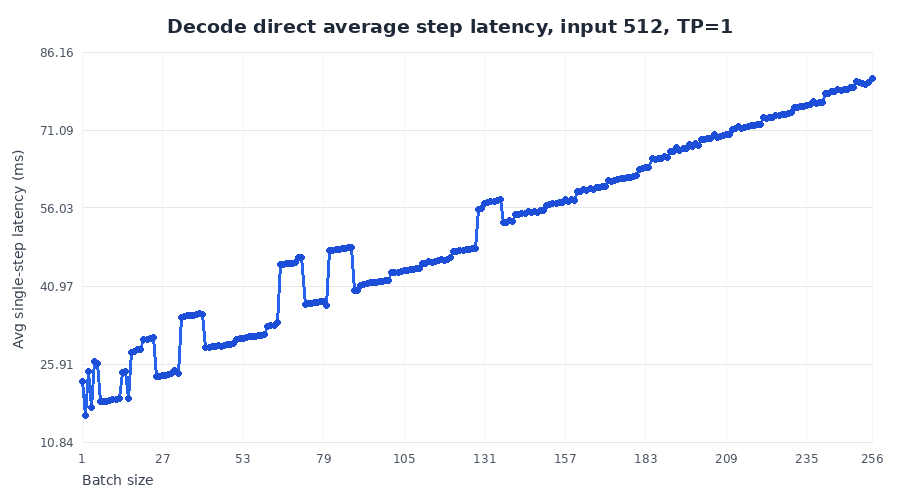
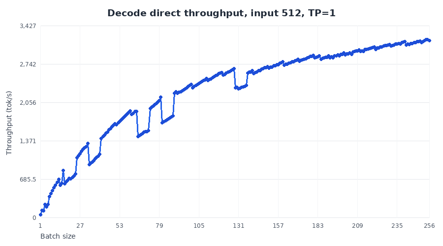
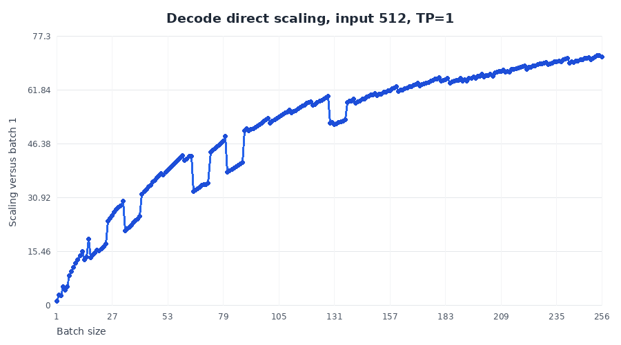

# Decode-Direct Input 512 TP=1 性能报告

## 运行环境

| 项目 | 值 |
| ---: | ---: |
| 日期 | 2026-11-23 17:12:38-17:42:34（Asia/Shanghai） |
| 平台 | Hygon BW1000 |
| 设备 | 1 x Hygon BW1000 HCU，64 GB HBM，CUDA_VISIBLE_DEVICES 按前 1 张分配 |
| Driver / runtime | 6.3.30-V1.4.1a / DTK 26.04-rc4 |
| InfiniLM build | 分支 `pd-v0.2.9-v1-tp`，commit `da7d18e7` |
| 模型 | `/data/shared/.infinifabric-models-20261027-fef304a05440/Qwen3-8B--b968826d9c46dd6066d109eabc6255188de91218` |
| 模式 | `decode-direct` |
| Attention backend | `flash-attn` |
| Graph request | enabled |
| Expected execution mode | `graph` |
| Cache | paged KV cache，block size 256，num blocks 768 |
| Max batched tokens | 18,432 |
| Tensor parallel size | 1 |
| Input length | 512 tokens / request |
| Batch size range | 1..256 |
| Decode steps per repeat | 4 |
| Warmup / measured repeats | 每个形状 3 次 / 30 次 |
| Batch 执行顺序 | random seed 2026 |


本报告对应原始 JSONL 和 log 为本机运行产物，不随仓库提交：

```text
../../../benchmark-hygon-bw-tp1-decode-direct-input512.jsonl
../../../benchmark-hygon-bw-tp1-decode-direct-input512.log
```

## 构建与测试命令

```bash
xmake build _infinilm && xmake install _infinilm
```

```bash
SKIP_BUILD=1 TP=1 GPU=0 \
MODE=decode-direct \
INPUT_LEN=512 \
BATCH_SIZES="$(seq -s, 1 256)" REPEATS=30 \
OUTPUT=benchmark-hygon-bw-tp1-decode-direct-input512.jsonl ./run_bench_hygon.sh
```

## 执行模式与 Graph 覆盖

- Graph request: enabled
- Expected execution mode: `graph`
- Graph-covered batches: 1..256
- Eager-fallback batches: none
- Mode source: compiler rule；该字段不是 C++ runtime 回传的实际执行模式。

## 资源开销

| 项目 | 值 |
| ---: | ---: |
| Workspace allocation | 每 rank 1,944 MiB，TP=1 合计 1,944 MiB |
| 权重加载时间 | 60.44 s |
| Graph compilation time | 未单独打点；包含在进程初始化到首个 sample 的 wall time 中 |
| Paged cache blocks | 768 |
| 正式 sample 数 | 30,720 |
| 进程 wall time | 1796 s (first runtime log to final JSONL write) |
| Monitor peak HCU memory use | 76%（本 run 时间窗，分配 HCUs，10 秒采样） |
| Monitor peak package power | 364.0 W（本 run 时间窗，分配 HCUs，10 秒采样） |
| Monitor peak sensor temperature | 63.0 C（本 run 时间窗，edge/junction，10 秒采样） |


## 测试口径

- Direct decode 不执行语义 prefill，paged KV cache 全 0 初始化。
- Step 0 使用 dummy token；step 1..3 使用上一步 sampled token。
- 每次 repeat 执行 4 个 decode step。
- `avg_step_latency = four_step_repeat_duration / 4`。
- 完整结果表聚合每个 batch 的 120 个 individual step samples。
- `single_step_throughput = batch_size / avg_step_latency`。
- 计时边界为 `engine_forward_including_sampling`。
- 分位数使用线性插值；每个 batch 只有 30 个 repeat，p99 是尾部参考。

## 核心结果

| 指标 | 结果 |
| ---: | ---: |
| 最高 single-step throughput | batch 254，3,176.67 tok/s |
| 最快 batch 平均 step latency | batch 2，16.036 ms |
| 最大 batch scaling | 71.315x |
| Ideal-scaling efficiency | 27.9% |
| Median step std | 0.046 ms |
| Maximum step std | 0.179 ms，batch 201 |


## 趋势图

### 1. Batch size 与 Avg Step Latency



平均 step latency 从 batch 1 的 22.554 ms 变为 batch 256 的 80.963 ms。

### 2. Batch size 与 Single-step Throughput



吞吐峰值出现在 batch 254，为 3,176.67 tok/s。

### 3. Batch size 与 Scaling



batch 256 相对 batch 1 的 scaling 为 71.315x；理想 256x 效率约 27.9%。

## Batch 区间平均 latency 与吞吐

下表按连续 16 个 batch 分组。平均值是区间内各 batch 聚合 single-step 统计的算术平均；区间最优 batch 取吞吐最高的 batch。

| Batch 区间 | 平均单 step latency ms | 平均吞吐 tok/s | 区间最优 batch |
| ---: | ---: | ---: | ---: |
| 1..16 | 20.821 | 416.62 | 16 |
| 17..32 | 26.751 | 941.50 | 32 |
| 33..48 | 32.321 | 1,275.28 | 48 |
| 49..64 | 31.508 | 1,790.59 | 60 |
| 65..80 | 41.607 | 1,767.43 | 80 |
| 81..96 | 44.612 | 2,002.96 | 96 |
| 97..112 | 43.605 | 2,395.49 | 110 |
| 113..128 | 46.916 | 2,567.57 | 128 |
| 129..144 | 55.523 | 2,461.84 | 144 |
| 145..160 | 56.486 | 2,699.23 | 160 |
| 161..176 | 60.365 | 2,790.86 | 176 |
| 177..192 | 64.436 | 2,863.47 | 180 |
| 193..208 | 68.726 | 2,917.07 | 208 |
| 209..224 | 71.972 | 3,007.89 | 220 |
| 225..240 | 75.250 | 3,089.44 | 240 |
| 241..256 | 79.353 | 3,131.36 | 254 |


## 关键批次与跳变

| Change | Mode transition | Avg step ms | Throughput tok/s | Observation |
| --- | ---: | ---: | ---: | --- |
| 2 -> 3 | graph | 16.036 -> 24.552 | 124.72 -> 122.19 | 平均 step latency 增加 53.1%，可能对应 kernel shape 或 workspace 分档变化 |
| 4 -> 5 | graph | 17.444 -> 26.450 | 229.30 -> 189.03 | 平均 step latency 增加 51.6%，可能对应 kernel shape 或 workspace 分档变化 |
| 16 -> 17 | graph | 19.149 -> 28.219 | 835.57 -> 602.44 | 平均 step latency 增加 47.4%，可能对应 kernel shape 或 workspace 分档变化 |
| 32 -> 33 | graph | 24.147 -> 34.972 | 1,325.24 -> 943.61 | 平均 step latency 增加 44.8%，可能对应 kernel shape 或 workspace 分档变化 |
| 64 -> 65 | graph | 33.844 -> 45.028 | 1,891.04 -> 1,443.54 | 平均 step latency 增加 33.0%，可能对应 kernel shape 或 workspace 分档变化 |
| 80 -> 81 | graph | 37.188 -> 47.811 | 2,151.25 -> 1,694.17 | 平均 step latency 增加 28.6%，可能对应 kernel shape 或 workspace 分档变化 |


## Step 一致性

峰值 batch 254 的 4 个 decode step 结果如下：

| Step | Past KV length | Avg step ms | Std ms | Throughput tok/s |
| ---: | ---: | ---: | ---: | ---: |
| 0 | 512 | 79.963 | 0.123 | 3,176.46 |
| 1 | 513 | 79.939 | 0.104 | 3,177.40 |
| 2 | 514 | 79.966 | 0.136 | 3,176.35 |
| 3 | 515 | 79.963 | 0.099 | 3,176.45 |


所有 batch 中，4 个 step 平均耗时最大差异为 0.281 ms，出现在 batch 119。差异包含 past KV length 增长和 step kernel 形状影响。

## 数据稳定性

- 单 step std 中位数为 0.046 ms。
- 最大 std 为 0.179 ms，出现在 batch 201。
- 各 batch p99 与 max 接近，尾部稳定；每个 batch 只有 30 个 repeat，p99 仍是尾部参考值。

## TP 对比摘要

| TP | Best batch | Peak throughput tok/s | Scaling vs TP=1 |
| ---: | ---: | ---: | ---: |
| 1 | 254 | 3,176.67 | 1.000x |
| 2 | 256 | 5,334.23 | 1.679x |
| 4 | 256 | 7,169.85 | 2.257x |


## Single-step 完整结果

### Batch 1..16

| Batch | Mode | Avg Step ms | Min Step ms | P50 Step ms | P95 Step ms | P99 Step ms | Max Step ms | Std Step ms | Single-step tok/s | Scaling |
| ---: | --- | ---: | ---: | ---: | ---: | ---: | ---: | ---: | ---: | ---: |
| 1 | graph | 22.554 | 22.444 | 22.545 | 22.658 | 22.797 | 22.830 | 0.064 | 44.34 | 1.000x |
| 2 | graph | 16.036 | 16.017 | 16.036 | 16.050 | 16.057 | 16.060 | 0.008 | 124.72 | 2.813x |
| 3 | graph | 24.552 | 24.512 | 24.537 | 24.645 | 24.836 | 24.844 | 0.063 | 122.19 | 2.756x |
| 4 | graph | 17.444 | 17.427 | 17.443 | 17.461 | 17.471 | 17.476 | 0.009 | 229.30 | 5.172x |
| 5 | graph | 26.450 | 26.431 | 26.449 | 26.464 | 26.473 | 26.503 | 0.009 | 189.03 | 4.264x |
| 6 | graph | 26.079 | 26.048 | 26.076 | 26.109 | 26.122 | 26.173 | 0.016 | 230.07 | 5.189x |
| 7 | graph | 18.651 | 18.616 | 18.643 | 18.695 | 18.838 | 18.910 | 0.038 | 375.31 | 8.465x |
| 8 | graph | 18.672 | 18.648 | 18.672 | 18.688 | 18.695 | 18.697 | 0.009 | 428.45 | 9.663x |
| 9 | graph | 18.691 | 18.672 | 18.688 | 18.704 | 18.766 | 18.841 | 0.018 | 481.52 | 10.860x |
| 10 | graph | 18.868 | 18.845 | 18.868 | 18.885 | 18.889 | 18.926 | 0.012 | 530.00 | 11.954x |
| 11 | graph | 19.045 | 19.015 | 19.044 | 19.063 | 19.080 | 19.105 | 0.013 | 577.59 | 13.027x |
| 12 | graph | 19.114 | 19.049 | 19.121 | 19.159 | 19.178 | 19.186 | 0.030 | 627.81 | 14.160x |
| 13 | graph | 19.171 | 19.139 | 19.171 | 19.188 | 19.201 | 19.213 | 0.012 | 678.09 | 15.294x |
| 14 | graph | 24.262 | 24.236 | 24.258 | 24.288 | 24.345 | 24.381 | 0.019 | 577.03 | 13.015x |
| 15 | graph | 24.394 | 24.361 | 24.390 | 24.414 | 24.492 | 24.499 | 0.019 | 614.91 | 13.869x |
| 16 | graph | 19.149 | 19.106 | 19.141 | 19.186 | 19.204 | 19.230 | 0.024 | 835.57 | 18.846x |


### Batch 17..32

| Batch | Mode | Avg Step ms | Min Step ms | P50 Step ms | P95 Step ms | P99 Step ms | Max Step ms | Std Step ms | Single-step tok/s | Scaling |
| ---: | --- | ---: | ---: | ---: | ---: | ---: | ---: | ---: | ---: | ---: |
| 17 | graph | 28.219 | 28.167 | 28.218 | 28.251 | 28.254 | 28.255 | 0.016 | 602.44 | 13.588x |
| 18 | graph | 28.339 | 28.305 | 28.338 | 28.372 | 28.398 | 28.404 | 0.018 | 635.16 | 14.326x |
| 19 | graph | 28.659 | 28.628 | 28.660 | 28.678 | 28.685 | 28.690 | 0.012 | 662.96 | 14.952x |
| 20 | graph | 28.794 | 28.766 | 28.791 | 28.823 | 28.910 | 28.935 | 0.023 | 694.58 | 15.666x |
| 21 | graph | 30.628 | 30.560 | 30.631 | 30.672 | 30.680 | 30.681 | 0.028 | 685.65 | 15.464x |
| 22 | graph | 30.675 | 30.624 | 30.674 | 30.705 | 30.722 | 30.732 | 0.019 | 717.19 | 16.176x |
| 23 | graph | 30.797 | 30.755 | 30.797 | 30.830 | 30.852 | 30.869 | 0.019 | 746.82 | 16.844x |
| 24 | graph | 30.953 | 30.887 | 30.954 | 30.979 | 30.990 | 30.994 | 0.018 | 775.38 | 17.488x |
| 25 | graph | 23.401 | 23.347 | 23.401 | 23.439 | 23.454 | 23.459 | 0.021 | 1,068.34 | 24.096x |
| 26 | graph | 23.533 | 23.485 | 23.533 | 23.566 | 23.573 | 23.574 | 0.018 | 1,104.81 | 24.918x |
| 27 | graph | 23.641 | 23.597 | 23.633 | 23.679 | 23.894 | 23.975 | 0.049 | 1,142.10 | 25.759x |
| 28 | graph | 23.670 | 23.631 | 23.669 | 23.696 | 23.704 | 23.727 | 0.015 | 1,182.93 | 26.680x |
| 29 | graph | 23.860 | 23.782 | 23.821 | 24.117 | 24.306 | 24.313 | 0.111 | 1,215.44 | 27.413x |
| 30 | graph | 24.053 | 24.021 | 24.052 | 24.088 | 24.095 | 24.098 | 0.017 | 1,247.27 | 28.131x |
| 31 | graph | 24.648 | 24.600 | 24.643 | 24.707 | 24.721 | 24.728 | 0.028 | 1,257.71 | 28.367x |
| 32 | graph | 24.147 | 24.102 | 24.136 | 24.253 | 24.378 | 24.438 | 0.052 | 1,325.24 | 29.890x |


### Batch 33..48

| Batch | Mode | Avg Step ms | Min Step ms | P50 Step ms | P95 Step ms | P99 Step ms | Max Step ms | Std Step ms | Single-step tok/s | Scaling |
| ---: | --- | ---: | ---: | ---: | ---: | ---: | ---: | ---: | ---: | ---: |
| 33 | graph | 34.972 | 34.931 | 34.971 | 35.005 | 35.022 | 35.034 | 0.021 | 943.61 | 21.282x |
| 34 | graph | 35.168 | 35.121 | 35.168 | 35.198 | 35.204 | 35.228 | 0.019 | 966.79 | 21.805x |
| 35 | graph | 35.260 | 35.204 | 35.260 | 35.296 | 35.305 | 35.307 | 0.021 | 992.63 | 22.388x |
| 36 | graph | 35.352 | 35.307 | 35.352 | 35.381 | 35.388 | 35.391 | 0.018 | 1,018.34 | 22.968x |
| 37 | graph | 35.318 | 35.257 | 35.317 | 35.349 | 35.361 | 35.372 | 0.020 | 1,047.63 | 23.628x |
| 38 | graph | 35.434 | 35.393 | 35.431 | 35.464 | 35.508 | 35.538 | 0.022 | 1,072.43 | 24.188x |
| 39 | graph | 35.597 | 35.515 | 35.598 | 35.661 | 35.702 | 35.753 | 0.041 | 1,095.60 | 24.710x |
| 40 | graph | 35.553 | 35.509 | 35.550 | 35.584 | 35.619 | 35.635 | 0.021 | 1,125.08 | 25.375x |
| 41 | graph | 29.011 | 28.970 | 29.009 | 29.038 | 29.050 | 29.060 | 0.016 | 1,413.26 | 31.875x |
| 42 | graph | 29.018 | 28.979 | 29.018 | 29.048 | 29.052 | 29.057 | 0.018 | 1,447.38 | 32.645x |
| 43 | graph | 29.210 | 29.161 | 29.208 | 29.240 | 29.253 | 29.257 | 0.018 | 1,472.09 | 33.202x |
| 44 | graph | 29.200 | 29.164 | 29.201 | 29.223 | 29.227 | 29.234 | 0.015 | 1,506.83 | 33.985x |
| 45 | graph | 29.451 | 29.404 | 29.447 | 29.491 | 29.510 | 29.558 | 0.024 | 1,527.98 | 34.462x |
| 46 | graph | 29.379 | 29.330 | 29.373 | 29.427 | 29.454 | 29.481 | 0.026 | 1,565.77 | 35.315x |
| 47 | graph | 29.571 | 29.532 | 29.572 | 29.597 | 29.605 | 29.613 | 0.017 | 1,589.42 | 35.848x |
| 48 | graph | 29.637 | 29.591 | 29.634 | 29.666 | 29.692 | 29.715 | 0.018 | 1,619.60 | 36.529x |


### Batch 49..64

| Batch | Mode | Avg Step ms | Min Step ms | P50 Step ms | P95 Step ms | P99 Step ms | Max Step ms | Std Step ms | Single-step tok/s | Scaling |
| ---: | --- | ---: | ---: | ---: | ---: | ---: | ---: | ---: | ---: | ---: |
| 49 | graph | 29.701 | 29.664 | 29.700 | 29.726 | 29.735 | 29.738 | 0.016 | 1,649.75 | 37.209x |
| 50 | graph | 29.797 | 29.757 | 29.798 | 29.825 | 29.836 | 29.838 | 0.017 | 1,678.00 | 37.846x |
| 51 | graph | 30.718 | 30.648 | 30.710 | 30.797 | 30.831 | 30.849 | 0.040 | 1,660.27 | 37.446x |
| 52 | graph | 30.738 | 30.692 | 30.739 | 30.765 | 30.779 | 30.806 | 0.020 | 1,691.70 | 38.155x |
| 53 | graph | 30.884 | 30.840 | 30.880 | 30.915 | 30.926 | 30.928 | 0.019 | 1,716.11 | 38.706x |
| 54 | graph | 30.967 | 30.925 | 30.965 | 30.996 | 31.001 | 31.006 | 0.015 | 1,743.81 | 39.330x |
| 55 | graph | 31.121 | 31.058 | 31.105 | 31.228 | 31.489 | 31.600 | 0.076 | 1,767.31 | 39.860x |
| 56 | graph | 31.142 | 31.106 | 31.141 | 31.171 | 31.189 | 31.195 | 0.018 | 1,798.20 | 40.557x |
| 57 | graph | 31.235 | 31.185 | 31.234 | 31.268 | 31.273 | 31.282 | 0.020 | 1,824.89 | 41.159x |
| 58 | graph | 31.408 | 31.351 | 31.395 | 31.459 | 31.744 | 31.863 | 0.069 | 1,846.69 | 41.651x |
| 59 | graph | 31.418 | 31.370 | 31.418 | 31.455 | 31.467 | 31.482 | 0.021 | 1,877.89 | 42.354x |
| 60 | graph | 31.533 | 31.484 | 31.529 | 31.566 | 31.678 | 31.706 | 0.029 | 1,902.75 | 42.915x |
| 61 | graph | 33.062 | 33.010 | 33.062 | 33.095 | 33.107 | 33.109 | 0.020 | 1,845.02 | 41.613x |
| 62 | graph | 33.295 | 33.241 | 33.292 | 33.329 | 33.400 | 33.675 | 0.042 | 1,862.13 | 41.999x |
| 63 | graph | 33.265 | 33.212 | 33.261 | 33.301 | 33.312 | 33.326 | 0.021 | 1,893.91 | 42.716x |
| 64 | graph | 33.844 | 33.752 | 33.830 | 33.944 | 34.176 | 34.289 | 0.075 | 1,891.04 | 42.651x |


### Batch 65..80

| Batch | Mode | Avg Step ms | Min Step ms | P50 Step ms | P95 Step ms | P99 Step ms | Max Step ms | Std Step ms | Single-step tok/s | Scaling |
| ---: | --- | ---: | ---: | ---: | ---: | ---: | ---: | ---: | ---: | ---: |
| 65 | graph | 45.028 | 44.970 | 45.029 | 45.067 | 45.072 | 45.080 | 0.021 | 1,443.54 | 32.558x |
| 66 | graph | 45.130 | 45.072 | 45.131 | 45.179 | 45.202 | 45.206 | 0.026 | 1,462.43 | 32.984x |
| 67 | graph | 45.310 | 45.243 | 45.294 | 45.397 | 45.688 | 45.713 | 0.072 | 1,478.70 | 33.351x |
| 68 | graph | 45.273 | 45.220 | 45.273 | 45.310 | 45.322 | 45.353 | 0.023 | 1,501.98 | 33.876x |
| 69 | graph | 45.323 | 45.266 | 45.323 | 45.351 | 45.377 | 45.415 | 0.022 | 1,522.42 | 34.337x |
| 70 | graph | 45.557 | 45.506 | 45.555 | 45.588 | 45.604 | 45.705 | 0.024 | 1,536.54 | 34.655x |
| 71 | graph | 46.397 | 46.335 | 46.394 | 46.443 | 46.461 | 46.477 | 0.024 | 1,530.28 | 34.514x |
| 72 | graph | 46.442 | 46.398 | 46.441 | 46.478 | 46.495 | 46.520 | 0.022 | 1,550.31 | 34.966x |
| 73 | graph | 37.459 | 37.391 | 37.450 | 37.495 | 37.783 | 37.813 | 0.057 | 1,948.80 | 43.954x |
| 74 | graph | 37.563 | 37.499 | 37.553 | 37.596 | 37.948 | 37.965 | 0.065 | 1,970.00 | 44.432x |
| 75 | graph | 37.636 | 37.534 | 37.645 | 37.717 | 37.738 | 37.749 | 0.066 | 1,992.76 | 44.945x |
| 76 | graph | 37.717 | 37.662 | 37.715 | 37.748 | 37.893 | 37.913 | 0.034 | 2,014.98 | 45.446x |
| 77 | graph | 37.850 | 37.805 | 37.850 | 37.885 | 37.891 | 37.894 | 0.020 | 2,034.33 | 45.883x |
| 78 | graph | 37.910 | 37.856 | 37.909 | 37.945 | 37.963 | 37.967 | 0.022 | 2,057.51 | 46.406x |
| 79 | graph | 37.925 | 37.803 | 37.949 | 38.021 | 38.058 | 38.063 | 0.075 | 2,083.04 | 46.981x |
| 80 | graph | 37.188 | 37.139 | 37.186 | 37.219 | 37.231 | 37.239 | 0.020 | 2,151.25 | 48.520x |


### Batch 81..96

| Batch | Mode | Avg Step ms | Min Step ms | P50 Step ms | P95 Step ms | P99 Step ms | Max Step ms | Std Step ms | Single-step tok/s | Scaling |
| ---: | --- | ---: | ---: | ---: | ---: | ---: | ---: | ---: | ---: | ---: |
| 81 | graph | 47.811 | 47.766 | 47.811 | 47.843 | 47.858 | 47.860 | 0.021 | 1,694.17 | 38.211x |
| 82 | graph | 47.858 | 47.805 | 47.853 | 47.903 | 47.956 | 48.209 | 0.042 | 1,713.41 | 38.645x |
| 83 | graph | 47.953 | 47.838 | 47.956 | 48.050 | 48.060 | 48.070 | 0.079 | 1,730.85 | 39.038x |
| 84 | graph | 48.071 | 48.010 | 48.070 | 48.108 | 48.128 | 48.143 | 0.024 | 1,747.42 | 39.412x |
| 85 | graph | 48.217 | 48.158 | 48.219 | 48.258 | 48.266 | 48.270 | 0.024 | 1,762.85 | 39.760x |
| 86 | graph | 48.221 | 48.160 | 48.222 | 48.260 | 48.264 | 48.269 | 0.025 | 1,783.47 | 40.225x |
| 87 | graph | 48.377 | 48.256 | 48.409 | 48.482 | 48.519 | 48.562 | 0.083 | 1,798.36 | 40.561x |
| 88 | graph | 48.437 | 48.381 | 48.432 | 48.473 | 48.610 | 48.726 | 0.038 | 1,816.81 | 40.977x |
| 89 | graph | 40.139 | 40.066 | 40.143 | 40.177 | 40.189 | 40.192 | 0.026 | 2,217.27 | 50.009x |
| 90 | graph | 40.112 | 40.043 | 40.107 | 40.155 | 40.351 | 40.438 | 0.047 | 2,243.70 | 50.605x |
| 91 | graph | 41.088 | 40.886 | 41.078 | 41.252 | 41.271 | 41.313 | 0.118 | 2,214.78 | 49.953x |
| 92 | graph | 41.189 | 41.117 | 41.183 | 41.231 | 41.338 | 41.523 | 0.045 | 2,233.61 | 50.377x |
| 93 | graph | 41.417 | 41.333 | 41.416 | 41.466 | 41.493 | 41.508 | 0.029 | 2,245.47 | 50.645x |
| 94 | graph | 41.556 | 41.485 | 41.552 | 41.607 | 41.625 | 41.652 | 0.031 | 2,262.02 | 51.018x |
| 95 | graph | 41.623 | 41.453 | 41.642 | 41.768 | 41.779 | 41.781 | 0.110 | 2,282.37 | 51.477x |
| 96 | graph | 41.725 | 41.633 | 41.730 | 41.773 | 41.790 | 41.799 | 0.035 | 2,300.80 | 51.893x |


### Batch 97..112

| Batch | Mode | Avg Step ms | Min Step ms | P50 Step ms | P95 Step ms | P99 Step ms | Max Step ms | Std Step ms | Single-step tok/s | Scaling |
| ---: | --- | ---: | ---: | ---: | ---: | ---: | ---: | ---: | ---: | ---: |
| 97 | graph | 41.894 | 41.809 | 41.885 | 41.942 | 42.225 | 42.386 | 0.072 | 2,315.35 | 52.221x |
| 98 | graph | 41.859 | 41.781 | 41.856 | 41.916 | 41.927 | 41.937 | 0.034 | 2,341.22 | 52.804x |
| 99 | graph | 41.972 | 41.787 | 41.978 | 42.125 | 42.141 | 42.150 | 0.115 | 2,358.72 | 53.199x |
| 100 | graph | 42.031 | 41.974 | 42.033 | 42.071 | 42.077 | 42.088 | 0.024 | 2,379.19 | 53.661x |
| 101 | graph | 43.554 | 43.486 | 43.554 | 43.607 | 43.613 | 43.622 | 0.028 | 2,318.98 | 52.303x |
| 102 | graph | 43.536 | 43.451 | 43.537 | 43.586 | 43.611 | 43.615 | 0.033 | 2,342.88 | 52.842x |
| 103 | graph | 43.665 | 43.490 | 43.668 | 43.804 | 43.815 | 43.837 | 0.113 | 2,358.88 | 53.203x |
| 104 | graph | 43.734 | 43.607 | 43.739 | 43.794 | 43.846 | 43.961 | 0.044 | 2,378.02 | 53.634x |
| 105 | graph | 43.902 | 43.819 | 43.901 | 43.937 | 43.946 | 43.953 | 0.023 | 2,391.72 | 53.943x |
| 106 | graph | 43.899 | 43.817 | 43.900 | 43.946 | 43.958 | 43.994 | 0.032 | 2,414.66 | 54.461x |
| 107 | graph | 44.062 | 43.867 | 44.060 | 44.214 | 44.249 | 44.255 | 0.123 | 2,428.37 | 54.770x |
| 108 | graph | 44.158 | 44.058 | 44.138 | 44.359 | 44.518 | 44.522 | 0.089 | 2,445.78 | 55.163x |
| 109 | graph | 44.357 | 44.260 | 44.351 | 44.425 | 44.433 | 44.477 | 0.041 | 2,457.33 | 55.423x |
| 110 | graph | 44.384 | 44.287 | 44.386 | 44.438 | 44.540 | 44.630 | 0.045 | 2,478.40 | 55.898x |
| 111 | graph | 45.285 | 45.090 | 45.326 | 45.483 | 45.748 | 45.775 | 0.142 | 2,451.16 | 55.284x |
| 112 | graph | 45.396 | 45.311 | 45.400 | 45.447 | 45.462 | 45.470 | 0.034 | 2,467.16 | 55.645x |


### Batch 113..128

| Batch | Mode | Avg Step ms | Min Step ms | P50 Step ms | P95 Step ms | P99 Step ms | Max Step ms | Std Step ms | Single-step tok/s | Scaling |
| ---: | --- | ---: | ---: | ---: | ---: | ---: | ---: | ---: | ---: | ---: |
| 113 | graph | 45.666 | 45.579 | 45.647 | 45.854 | 46.089 | 46.184 | 0.091 | 2,474.51 | 55.811x |
| 114 | graph | 45.599 | 45.520 | 45.599 | 45.647 | 45.660 | 45.678 | 0.029 | 2,500.06 | 56.387x |
| 115 | graph | 45.750 | 45.568 | 45.800 | 45.891 | 45.915 | 46.187 | 0.131 | 2,513.67 | 56.694x |
| 116 | graph | 45.829 | 45.723 | 45.801 | 46.069 | 46.266 | 46.359 | 0.106 | 2,531.16 | 57.088x |
| 117 | graph | 46.003 | 45.943 | 46.000 | 46.032 | 46.210 | 46.385 | 0.047 | 2,543.33 | 57.363x |
| 118 | graph | 45.957 | 45.901 | 45.954 | 46.015 | 46.036 | 46.053 | 0.029 | 2,567.61 | 57.911x |
| 119 | graph | 46.179 | 45.979 | 46.181 | 46.339 | 46.389 | 46.392 | 0.131 | 2,576.91 | 58.120x |
| 120 | graph | 46.438 | 46.308 | 46.422 | 46.571 | 46.617 | 46.644 | 0.071 | 2,584.08 | 58.282x |
| 121 | graph | 47.639 | 47.573 | 47.636 | 47.677 | 47.710 | 47.726 | 0.025 | 2,539.93 | 57.286x |
| 122 | graph | 47.712 | 47.638 | 47.710 | 47.762 | 47.778 | 47.885 | 0.035 | 2,557.02 | 57.672x |
| 123 | graph | 47.730 | 47.537 | 47.724 | 47.883 | 47.895 | 47.897 | 0.120 | 2,577.01 | 58.122x |
| 124 | graph | 47.828 | 47.758 | 47.830 | 47.876 | 47.958 | 48.071 | 0.040 | 2,592.62 | 58.475x |
| 125 | graph | 47.986 | 47.931 | 47.987 | 48.032 | 48.053 | 48.066 | 0.024 | 2,604.91 | 58.752x |
| 126 | graph | 48.040 | 47.947 | 48.026 | 48.169 | 48.335 | 48.462 | 0.074 | 2,622.80 | 59.155x |
| 127 | graph | 48.121 | 47.952 | 48.140 | 48.266 | 48.285 | 48.315 | 0.120 | 2,639.20 | 59.525x |
| 128 | graph | 48.188 | 48.130 | 48.188 | 48.228 | 48.248 | 48.265 | 0.025 | 2,656.27 | 59.910x |


### Batch 129..144

| Batch | Mode | Avg Step ms | Min Step ms | P50 Step ms | P95 Step ms | P99 Step ms | Max Step ms | Std Step ms | Single-step tok/s | Scaling |
| ---: | --- | ---: | ---: | ---: | ---: | ---: | ---: | ---: | ---: | ---: |
| 129 | graph | 55.764 | 55.683 | 55.755 | 55.811 | 56.056 | 56.181 | 0.060 | 2,313.33 | 52.175x |
| 130 | graph | 55.885 | 55.836 | 55.884 | 55.922 | 55.942 | 56.001 | 0.023 | 2,326.21 | 52.466x |
| 131 | graph | 56.991 | 56.899 | 56.982 | 57.058 | 57.096 | 57.104 | 0.044 | 2,298.62 | 51.844x |
| 132 | graph | 57.115 | 57.049 | 57.105 | 57.168 | 57.363 | 57.475 | 0.052 | 2,311.15 | 52.126x |
| 133 | graph | 57.200 | 57.156 | 57.200 | 57.224 | 57.238 | 57.290 | 0.019 | 2,325.17 | 52.443x |
| 134 | graph | 57.381 | 57.330 | 57.382 | 57.418 | 57.429 | 57.437 | 0.023 | 2,335.28 | 52.671x |
| 135 | graph | 57.564 | 57.495 | 57.562 | 57.608 | 57.623 | 57.769 | 0.031 | 2,345.23 | 52.895x |
| 136 | graph | 57.618 | 57.556 | 57.619 | 57.653 | 57.661 | 57.675 | 0.022 | 2,360.37 | 53.236x |
| 137 | graph | 53.193 | 53.138 | 53.178 | 53.249 | 53.620 | 53.653 | 0.075 | 2,575.52 | 58.089x |
| 138 | graph | 53.189 | 53.093 | 53.183 | 53.273 | 53.315 | 53.347 | 0.043 | 2,594.50 | 58.517x |
| 139 | graph | 53.575 | 53.492 | 53.566 | 53.645 | 53.788 | 53.826 | 0.048 | 2,594.50 | 58.517x |
| 140 | graph | 53.403 | 53.320 | 53.384 | 53.451 | 53.808 | 53.996 | 0.087 | 2,621.57 | 59.127x |
| 141 | graph | 54.789 | 54.697 | 54.761 | 55.059 | 55.249 | 55.256 | 0.104 | 2,573.49 | 58.043x |
| 142 | graph | 54.778 | 54.685 | 54.774 | 54.838 | 54.863 | 54.877 | 0.032 | 2,592.29 | 58.467x |
| 143 | graph | 54.996 | 54.897 | 54.967 | 55.300 | 55.438 | 55.455 | 0.113 | 2,600.17 | 58.645x |
| 144 | graph | 54.921 | 54.858 | 54.921 | 54.968 | 55.005 | 55.073 | 0.032 | 2,621.96 | 59.136x |


### Batch 145..160

| Batch | Mode | Avg Step ms | Min Step ms | P50 Step ms | P95 Step ms | P99 Step ms | Max Step ms | Std Step ms | Single-step tok/s | Scaling |
| ---: | --- | ---: | ---: | ---: | ---: | ---: | ---: | ---: | ---: | ---: |
| 145 | graph | 55.334 | 55.286 | 55.333 | 55.380 | 55.416 | 55.422 | 0.027 | 2,620.47 | 59.103x |
| 146 | graph | 55.126 | 55.054 | 55.119 | 55.183 | 55.210 | 55.300 | 0.037 | 2,648.47 | 59.734x |
| 147 | graph | 55.306 | 55.217 | 55.278 | 55.588 | 55.819 | 55.859 | 0.108 | 2,657.92 | 59.947x |
| 148 | graph | 55.252 | 55.192 | 55.249 | 55.309 | 55.350 | 55.352 | 0.030 | 2,678.64 | 60.415x |
| 149 | graph | 55.643 | 55.547 | 55.640 | 55.708 | 55.747 | 55.751 | 0.039 | 2,677.80 | 60.396x |
| 150 | graph | 55.602 | 55.493 | 55.598 | 55.659 | 55.711 | 55.725 | 0.036 | 2,697.73 | 60.845x |
| 151 | graph | 56.589 | 56.489 | 56.562 | 56.807 | 56.941 | 57.110 | 0.097 | 2,668.38 | 60.183x |
| 152 | graph | 56.660 | 56.605 | 56.655 | 56.709 | 56.730 | 56.740 | 0.028 | 2,682.69 | 60.506x |
| 153 | graph | 56.971 | 56.895 | 56.970 | 57.017 | 57.032 | 57.075 | 0.031 | 2,685.58 | 60.571x |
| 154 | graph | 56.884 | 56.820 | 56.874 | 56.935 | 57.197 | 57.246 | 0.055 | 2,707.25 | 61.060x |
| 155 | graph | 57.188 | 57.129 | 57.185 | 57.261 | 57.284 | 57.301 | 0.033 | 2,710.34 | 61.130x |
| 156 | graph | 57.130 | 57.072 | 57.125 | 57.195 | 57.241 | 57.301 | 0.035 | 2,730.61 | 61.587x |
| 157 | graph | 57.618 | 57.554 | 57.612 | 57.679 | 57.744 | 57.788 | 0.038 | 2,724.86 | 61.457x |
| 158 | graph | 57.366 | 57.235 | 57.340 | 57.606 | 57.801 | 57.831 | 0.110 | 2,754.25 | 62.120x |
| 159 | graph | 57.584 | 57.515 | 57.574 | 57.673 | 57.819 | 57.840 | 0.050 | 2,761.17 | 62.276x |
| 160 | graph | 57.523 | 57.446 | 57.509 | 57.617 | 57.871 | 57.921 | 0.068 | 2,781.50 | 62.735x |


### Batch 161..176

| Batch | Mode | Avg Step ms | Min Step ms | P50 Step ms | P95 Step ms | P99 Step ms | Max Step ms | Std Step ms | Single-step tok/s | Scaling |
| ---: | --- | ---: | ---: | ---: | ---: | ---: | ---: | ---: | ---: | ---: |
| 161 | graph | 59.202 | 59.141 | 59.196 | 59.250 | 59.311 | 59.386 | 0.035 | 2,719.51 | 61.336x |
| 162 | graph | 59.252 | 59.172 | 59.254 | 59.308 | 59.326 | 59.400 | 0.036 | 2,734.09 | 61.665x |
| 163 | graph | 59.536 | 59.477 | 59.530 | 59.598 | 59.628 | 59.634 | 0.034 | 2,737.86 | 61.750x |
| 164 | graph | 59.457 | 59.380 | 59.444 | 59.536 | 59.816 | 59.893 | 0.068 | 2,758.28 | 62.211x |
| 165 | graph | 59.723 | 59.664 | 59.719 | 59.766 | 59.848 | 59.948 | 0.037 | 2,762.75 | 62.312x |
| 166 | graph | 59.666 | 59.571 | 59.649 | 59.764 | 60.010 | 60.048 | 0.074 | 2,782.15 | 62.749x |
| 167 | graph | 59.966 | 59.899 | 59.960 | 60.033 | 60.072 | 60.101 | 0.037 | 2,784.90 | 62.811x |
| 168 | graph | 59.935 | 59.868 | 59.924 | 60.000 | 60.192 | 60.233 | 0.050 | 2,803.04 | 63.221x |
| 169 | graph | 60.131 | 60.069 | 60.124 | 60.183 | 60.301 | 60.363 | 0.040 | 2,810.52 | 63.389x |
| 170 | graph | 60.122 | 60.081 | 60.119 | 60.169 | 60.188 | 60.192 | 0.026 | 2,827.58 | 63.774x |
| 171 | graph | 61.285 | 61.187 | 61.273 | 61.393 | 61.442 | 61.459 | 0.060 | 2,790.23 | 62.932x |
| 172 | graph | 61.214 | 61.142 | 61.208 | 61.269 | 61.312 | 61.334 | 0.032 | 2,809.82 | 63.373x |
| 173 | graph | 61.431 | 61.373 | 61.427 | 61.488 | 61.502 | 61.504 | 0.028 | 2,816.18 | 63.517x |
| 174 | graph | 61.505 | 61.433 | 61.489 | 61.594 | 61.918 | 61.983 | 0.079 | 2,829.02 | 63.806x |
| 175 | graph | 61.698 | 61.608 | 61.687 | 61.755 | 62.085 | 62.127 | 0.069 | 2,836.42 | 63.973x |
| 176 | graph | 61.724 | 61.652 | 61.694 | 61.992 | 62.138 | 62.174 | 0.099 | 2,851.41 | 64.311x |


### Batch 177..192

| Batch | Mode | Avg Step ms | Min Step ms | P50 Step ms | P95 Step ms | P99 Step ms | Max Step ms | Std Step ms | Single-step tok/s | Scaling |
| ---: | --- | ---: | ---: | ---: | ---: | ---: | ---: | ---: | ---: | ---: |
| 177 | graph | 61.913 | 61.867 | 61.908 | 61.965 | 61.987 | 62.009 | 0.026 | 2,858.83 | 64.479x |
| 178 | graph | 61.932 | 61.846 | 61.927 | 62.010 | 62.059 | 62.118 | 0.045 | 2,874.12 | 64.824x |
| 179 | graph | 62.206 | 62.143 | 62.202 | 62.267 | 62.296 | 62.321 | 0.036 | 2,877.53 | 64.900x |
| 180 | graph | 62.228 | 62.139 | 62.190 | 62.442 | 62.459 | 62.478 | 0.096 | 2,892.58 | 65.240x |
| 181 | graph | 63.555 | 63.467 | 63.551 | 63.614 | 63.648 | 63.743 | 0.039 | 2,847.94 | 64.233x |
| 182 | graph | 63.575 | 63.502 | 63.565 | 63.663 | 63.691 | 63.709 | 0.046 | 2,862.78 | 64.568x |
| 183 | graph | 63.789 | 63.691 | 63.782 | 63.879 | 63.927 | 63.943 | 0.049 | 2,868.82 | 64.704x |
| 184 | graph | 63.832 | 63.726 | 63.818 | 63.938 | 63.975 | 64.034 | 0.057 | 2,882.57 | 65.014x |
| 185 | graph | 65.514 | 65.203 | 65.519 | 65.650 | 65.681 | 65.692 | 0.098 | 2,823.83 | 63.689x |
| 186 | graph | 65.435 | 65.063 | 65.423 | 65.604 | 65.814 | 65.894 | 0.125 | 2,842.50 | 64.110x |
| 187 | graph | 65.643 | 65.274 | 65.644 | 65.856 | 65.942 | 66.134 | 0.141 | 2,848.73 | 64.251x |
| 188 | graph | 65.663 | 65.350 | 65.664 | 65.836 | 66.080 | 66.138 | 0.137 | 2,863.08 | 64.575x |
| 189 | graph | 66.033 | 65.673 | 66.043 | 66.189 | 66.320 | 66.346 | 0.104 | 2,862.21 | 64.555x |
| 190 | graph | 65.845 | 65.462 | 65.871 | 66.022 | 66.062 | 66.081 | 0.119 | 2,885.57 | 65.082x |
| 191 | graph | 66.934 | 66.621 | 66.921 | 67.137 | 67.239 | 67.255 | 0.123 | 2,853.54 | 64.359x |
| 192 | graph | 66.880 | 66.651 | 66.894 | 67.019 | 67.070 | 67.112 | 0.097 | 2,870.82 | 64.749x |


### Batch 193..208

| Batch | Mode | Avg Step ms | Min Step ms | P50 Step ms | P95 Step ms | P99 Step ms | Max Step ms | Std Step ms | Single-step tok/s | Scaling |
| ---: | --- | ---: | ---: | ---: | ---: | ---: | ---: | ---: | ---: | ---: |
| 193 | graph | 67.719 | 67.436 | 67.704 | 67.942 | 68.097 | 68.159 | 0.127 | 2,850.00 | 64.280x |
| 194 | graph | 67.217 | 66.797 | 67.234 | 67.411 | 67.473 | 67.535 | 0.135 | 2,886.17 | 65.095x |
| 195 | graph | 67.517 | 67.051 | 67.534 | 67.687 | 67.747 | 67.821 | 0.128 | 2,888.14 | 65.140x |
| 196 | graph | 67.560 | 67.321 | 67.563 | 67.714 | 67.742 | 67.779 | 0.095 | 2,901.12 | 65.433x |
| 197 | graph | 68.201 | 67.823 | 68.191 | 68.381 | 68.577 | 68.726 | 0.130 | 2,888.53 | 65.149x |
| 198 | graph | 67.913 | 67.609 | 67.890 | 68.174 | 68.375 | 68.420 | 0.135 | 2,915.50 | 65.757x |
| 199 | graph | 68.398 | 68.088 | 68.396 | 68.701 | 68.882 | 68.910 | 0.147 | 2,909.44 | 65.620x |
| 200 | graph | 68.021 | 67.798 | 68.028 | 68.162 | 68.185 | 68.251 | 0.097 | 2,940.28 | 66.316x |
| 201 | graph | 69.192 | 68.832 | 69.158 | 69.559 | 69.704 | 69.752 | 0.179 | 2,904.95 | 65.519x |
| 202 | graph | 69.234 | 68.944 | 69.244 | 69.367 | 69.400 | 69.408 | 0.096 | 2,917.64 | 65.805x |
| 203 | graph | 69.450 | 69.019 | 69.475 | 69.616 | 69.699 | 69.722 | 0.126 | 2,922.97 | 65.925x |
| 204 | graph | 69.476 | 69.221 | 69.483 | 69.632 | 69.681 | 69.692 | 0.099 | 2,936.26 | 66.225x |
| 205 | graph | 70.296 | 70.092 | 70.290 | 70.430 | 70.462 | 70.475 | 0.090 | 2,916.23 | 65.773x |
| 206 | graph | 69.652 | 69.258 | 69.673 | 69.805 | 69.877 | 69.959 | 0.110 | 2,957.54 | 66.705x |
| 207 | graph | 69.768 | 69.354 | 69.774 | 69.968 | 70.162 | 70.191 | 0.133 | 2,966.97 | 66.918x |
| 208 | graph | 70.001 | 69.683 | 70.002 | 70.166 | 70.206 | 70.210 | 0.116 | 2,971.38 | 67.017x |


### Batch 209..224

| Batch | Mode | Avg Step ms | Min Step ms | P50 Step ms | P95 Step ms | P99 Step ms | Max Step ms | Std Step ms | Single-step tok/s | Scaling |
| ---: | --- | ---: | ---: | ---: | ---: | ---: | ---: | ---: | ---: | ---: |
| 209 | graph | 70.163 | 69.877 | 70.154 | 70.403 | 70.570 | 70.607 | 0.119 | 2,978.76 | 67.184x |
| 210 | graph | 70.216 | 69.869 | 70.220 | 70.426 | 70.590 | 70.675 | 0.136 | 2,990.76 | 67.454x |
| 211 | graph | 71.194 | 70.855 | 71.198 | 71.374 | 71.486 | 71.502 | 0.125 | 2,963.73 | 66.845x |
| 212 | graph | 71.347 | 71.045 | 71.354 | 71.499 | 71.680 | 71.750 | 0.109 | 2,971.39 | 67.017x |
| 213 | graph | 71.794 | 71.496 | 71.806 | 71.933 | 72.014 | 72.191 | 0.105 | 2,966.81 | 66.914x |
| 214 | graph | 71.318 | 70.949 | 71.335 | 71.503 | 71.550 | 71.586 | 0.125 | 3,000.65 | 67.677x |
| 215 | graph | 71.602 | 71.303 | 71.607 | 71.751 | 71.802 | 71.812 | 0.108 | 3,002.73 | 67.724x |
| 216 | graph | 71.712 | 71.469 | 71.706 | 71.882 | 72.108 | 72.167 | 0.125 | 3,012.05 | 67.935x |
| 217 | graph | 71.896 | 71.617 | 71.900 | 72.029 | 72.101 | 72.151 | 0.096 | 3,018.27 | 68.075x |
| 218 | graph | 71.925 | 71.640 | 71.928 | 72.089 | 72.144 | 72.195 | 0.100 | 3,030.94 | 68.361x |
| 219 | graph | 72.127 | 71.891 | 72.128 | 72.267 | 72.368 | 72.504 | 0.102 | 3,036.31 | 68.482x |
| 220 | graph | 72.152 | 71.816 | 72.167 | 72.289 | 72.320 | 72.327 | 0.096 | 3,049.13 | 68.771x |
| 221 | graph | 73.537 | 73.207 | 73.534 | 73.805 | 73.960 | 74.006 | 0.154 | 3,005.29 | 67.782x |
| 222 | graph | 73.410 | 73.074 | 73.405 | 73.583 | 73.694 | 73.785 | 0.109 | 3,024.12 | 68.207x |
| 223 | graph | 73.564 | 73.331 | 73.579 | 73.716 | 73.739 | 73.754 | 0.102 | 3,031.37 | 68.370x |
| 224 | graph | 73.591 | 73.377 | 73.583 | 73.744 | 73.768 | 73.796 | 0.092 | 3,043.87 | 68.652x |


### Batch 225..240

| Batch | Mode | Avg Step ms | Min Step ms | P50 Step ms | P95 Step ms | P99 Step ms | Max Step ms | Std Step ms | Single-step tok/s | Scaling |
| ---: | --- | ---: | ---: | ---: | ---: | ---: | ---: | ---: | ---: | ---: |
| 225 | graph | 73.849 | 73.613 | 73.837 | 73.999 | 74.066 | 74.088 | 0.094 | 3,046.77 | 68.718x |
| 226 | graph | 73.854 | 73.597 | 73.870 | 74.005 | 74.024 | 74.089 | 0.099 | 3,060.08 | 69.018x |
| 227 | graph | 73.998 | 73.699 | 73.991 | 74.191 | 74.240 | 74.370 | 0.136 | 3,067.64 | 69.188x |
| 228 | graph | 74.140 | 73.776 | 74.165 | 74.292 | 74.352 | 74.470 | 0.110 | 3,075.27 | 69.360x |
| 229 | graph | 74.305 | 73.978 | 74.313 | 74.474 | 74.587 | 74.608 | 0.111 | 3,081.88 | 69.509x |
| 230 | graph | 74.393 | 74.168 | 74.383 | 74.552 | 74.781 | 74.855 | 0.117 | 3,091.69 | 69.731x |
| 231 | graph | 75.422 | 75.129 | 75.418 | 75.603 | 75.635 | 75.750 | 0.112 | 3,062.76 | 69.078x |
| 232 | graph | 75.443 | 75.048 | 75.461 | 75.588 | 75.612 | 75.613 | 0.108 | 3,075.17 | 69.358x |
| 233 | graph | 75.682 | 75.373 | 75.663 | 76.021 | 76.200 | 76.280 | 0.155 | 3,078.66 | 69.437x |
| 234 | graph | 75.623 | 75.343 | 75.629 | 75.808 | 75.867 | 75.909 | 0.118 | 3,094.28 | 69.789x |
| 235 | graph | 75.850 | 75.520 | 75.872 | 75.999 | 76.036 | 76.086 | 0.104 | 3,098.22 | 69.878x |
| 236 | graph | 75.945 | 75.738 | 75.959 | 76.078 | 76.123 | 76.149 | 0.095 | 3,107.49 | 70.087x |
| 237 | graph | 76.513 | 76.256 | 76.514 | 76.647 | 76.693 | 76.731 | 0.091 | 3,097.52 | 69.862x |
| 238 | graph | 76.225 | 75.968 | 76.234 | 76.354 | 76.417 | 76.424 | 0.092 | 3,122.34 | 70.422x |
| 239 | graph | 76.338 | 76.107 | 76.350 | 76.472 | 76.508 | 76.513 | 0.090 | 3,130.80 | 70.613x |
| 240 | graph | 76.421 | 76.179 | 76.430 | 76.566 | 76.693 | 76.824 | 0.107 | 3,140.52 | 70.832x |


### Batch 241..256

| Batch | Mode | Avg Step ms | Min Step ms | P50 Step ms | P95 Step ms | P99 Step ms | Max Step ms | Std Step ms | Single-step tok/s | Scaling |
| ---: | --- | ---: | ---: | ---: | ---: | ---: | ---: | ---: | ---: | ---: |
| 241 | graph | 78.175 | 77.973 | 78.168 | 78.285 | 78.369 | 78.497 | 0.075 | 3,082.83 | 69.531x |
| 242 | graph | 78.198 | 77.942 | 78.201 | 78.278 | 78.375 | 78.519 | 0.064 | 3,094.73 | 69.799x |
| 243 | graph | 78.567 | 78.410 | 78.566 | 78.680 | 78.728 | 78.748 | 0.070 | 3,092.88 | 69.758x |
| 244 | graph | 78.509 | 78.198 | 78.514 | 78.610 | 78.808 | 78.895 | 0.086 | 3,107.93 | 70.097x |
| 245 | graph | 78.943 | 78.766 | 78.949 | 79.056 | 79.074 | 79.145 | 0.065 | 3,103.49 | 69.997x |
| 246 | graph | 78.716 | 78.530 | 78.725 | 78.807 | 78.866 | 78.869 | 0.065 | 3,125.15 | 70.485x |
| 247 | graph | 78.995 | 78.725 | 78.994 | 79.099 | 79.160 | 79.179 | 0.073 | 3,126.79 | 70.522x |
| 248 | graph | 78.943 | 78.682 | 78.948 | 79.045 | 79.071 | 79.097 | 0.070 | 3,141.52 | 70.855x |
| 249 | graph | 79.345 | 79.206 | 79.341 | 79.444 | 79.503 | 79.686 | 0.067 | 3,138.21 | 70.780x |
| 250 | graph | 79.264 | 79.097 | 79.266 | 79.361 | 79.389 | 79.406 | 0.065 | 3,154.03 | 71.137x |
| 251 | graph | 80.416 | 80.227 | 80.422 | 80.543 | 80.685 | 80.741 | 0.084 | 3,121.29 | 70.398x |
| 252 | graph | 80.256 | 80.072 | 80.234 | 80.554 | 80.691 | 80.710 | 0.110 | 3,139.95 | 70.819x |
| 253 | graph | 80.100 | 79.832 | 80.096 | 80.256 | 80.404 | 80.540 | 0.104 | 3,158.56 | 71.239x |
| 254 | graph | 79.958 | 79.612 | 79.957 | 80.129 | 80.196 | 80.287 | 0.117 | 3,176.67 | 71.647x |
| 255 | graph | 80.296 | 80.085 | 80.294 | 80.439 | 80.462 | 80.538 | 0.089 | 3,175.76 | 71.627x |
| 256 | graph | 80.963 | 80.672 | 80.970 | 81.091 | 81.232 | 81.315 | 0.095 | 3,161.93 | 71.315x |


## 分析

1. Single-step 吞吐随 batch 增加总体上升，峰值在 batch 254，为 3,176.67 tok/s。
2. 平均 step latency 随 batch 增加而上升，batch 1 为 22.554 ms，batch 256 为 80.963 ms。
3. Decode step 的 past KV length 从 512 增至 515；该变化对平均耗时影响较小，主要 scaling 仍来自 batch 并行度。
4. 连续 batch 的正向 latency 跳变通常对应 kernel shape、workspace 分档或 attention tile 变化，不能解释为连续线性退化。
5. step std 中位数 0.046 ms，最大 0.179 ms，整体测量稳定。

## 结论与建议

1. 该形状下优先在 batch 254 附近获得最高 decode 总吞吐。
2. 最大 batch ideal-scaling 效率为 27.9%，说明 per-step attention/MLP latency 随 batch 增长明显。
3. graph 已覆盖全部有效 batch；TP=1 input 1024 如需 batch 256，应先降低 workspace/cache 压力或调整图编译策略。
4. 对关键跳变 batch 建议结合 C++ model-only timer 和 kernel profile 复核。
5. 若需要更稳定的 p99，建议将 `BENCHMARK_REPEATS` 提高到 100 或以上。

## 数据完整性

```text
config records: 1
step samples: 30720
overall summaries: 256
per-step summaries: 1024
scaling records: 256
step samples per batch: 120
samples per decode step: 30
```
