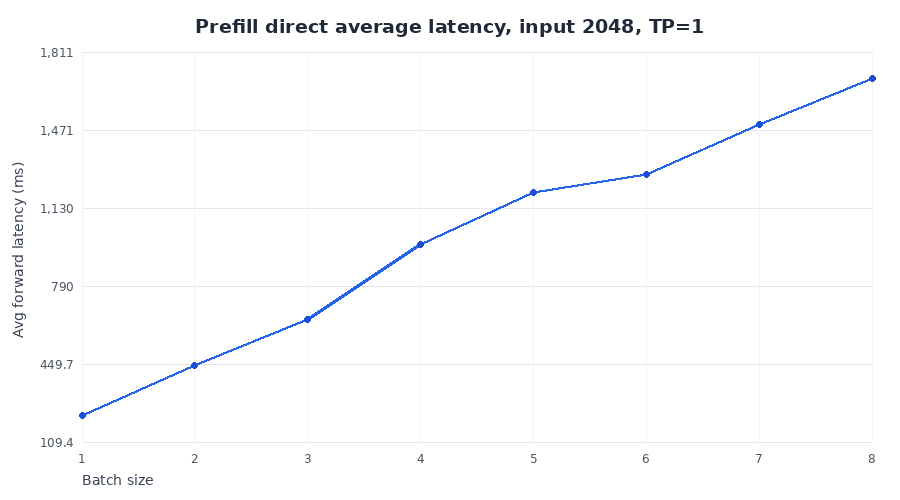
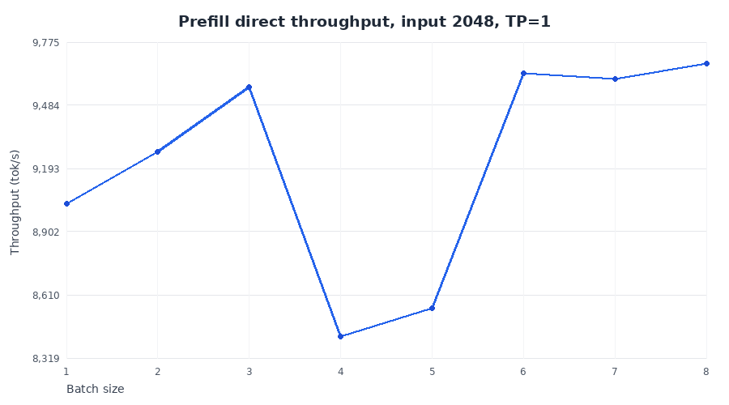
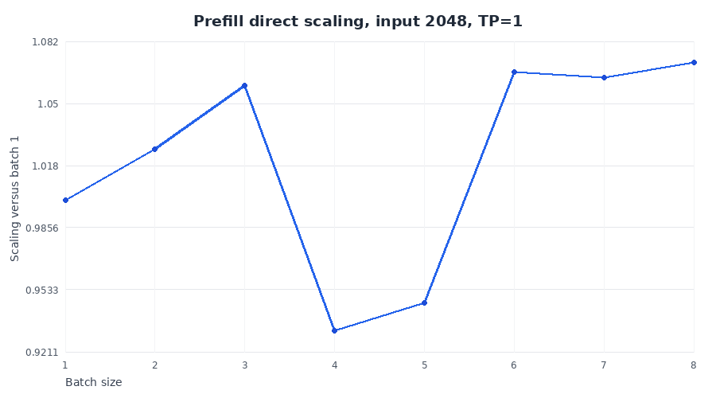

# Prefill-Direct Input 2048 TP=1 性能报告

## 运行环境

| 项目 | 值 |
| ---: | ---: |
| 日期 | 2026-11-23 17:04:31-17:08:56（Asia/Shanghai） |
| 平台 | Hygon BW1000 |
| 设备 | 1 x Hygon BW1000 HCU，64 GB HBM，CUDA_VISIBLE_DEVICES 按前 1 张分配 |
| Driver / runtime | 6.3.30-V1.4.1a / DTK 26.04-rc4 |
| InfiniLM build | 分支 `pd-v0.2.9-v1-tp`，commit `da7d18e7` |
| 模型 | `/data/shared/.infinifabric-models-20261027-fef304a05440/Qwen3-8B--b968826d9c46dd6066d109eabc6255188de91218` |
| 模式 | `prefill-direct` |
| Attention backend | `flash-attn` |
| Graph request | disabled |
| Expected execution mode | `eager` |
| Cache | paged KV cache，block size 256，num blocks 64 |
| Max batched tokens | 18,432 |
| Tensor parallel size | 1 |
| Input length | 2048 tokens / request |
| Batch size | 1..8 |
| Warmup / measured repeats | 每个形状 3 次 / 30 次 |
| Batch 执行顺序 | random seed 2026 |


本报告对应原始 JSONL 和 log 为本机运行产物，不随仓库提交：

```text
../../../benchmark-hygon-bw-tp1-prefill-direct-input2048.jsonl
../../../benchmark-hygon-bw-tp1-prefill-direct-input2048.log
```

## 构建与测试命令

```bash
xmake build _infinilm && xmake install _infinilm
```

```bash
SKIP_BUILD=1 TP=1 GPU=0 \
MODE=prefill-direct INPUT_LEN=2048 \
BATCH_SIZES="$(seq -s, 1 8)" REPEATS=30 \
OUTPUT=benchmark-hygon-bw-tp1-prefill-direct-input2048.jsonl ./run_bench_hygon.sh
```

## 执行模式与 Graph 覆盖

本轮 prefill-direct 不传递 `--enable-graph`，所有 physical prefill forward 走 eager path。记录中的 expected execution mode 由 benchmark 根据 compiler 规则推断，不是 C++ runtime 回传的实际执行模式。

## 资源开销

| 项目 | 值 |
| ---: | ---: |
| Workspace allocation | 每 rank 1,944 MiB，TP=1 合计 1,944 MiB |
| 权重加载时间 | 2.87 s |
| Graph compilation time | 未单独打点；包含在进程初始化到首个 sample 的 wall time 中 |
| Paged cache blocks | 64 |
| 正式 sample 数 | 240 |
| 进程 wall time | 265 s (first runtime log to final JSONL write) |
| Monitor peak HCU memory use | 38%（本 run 时间窗，分配 HCUs，10 秒采样） |
| Monitor peak package power | 418.0 W（本 run 时间窗，分配 HCUs，10 秒采样） |
| Monitor peak sensor temperature | 67.0 C（本 run 时间窗，edge/junction，10 秒采样） |


## 测试口径

- 每个 sample 是一次物理 prefill forward。
- `token_count = batch_size * 2048`。
- `throughput = token_count / avg_forward_duration_s`。
- 计时边界为 `engine_forward_including_sampling`。
- Direct prefill 使用合成输入和全 0 paged KV cache，输出 token 不用于正确性判断。
- 分位数使用线性插值；每个 batch 只有 30 个正式样本，p99 只能作为尾部参考。

## 核心结果

| Batch | Input tokens | Avg ms | Min ms | P50 ms | P95 ms | P99 ms | Max ms | Std ms | Throughput tok/s | Scaling |
| ---: | ---: | ---: | ---: | ---: | ---: | ---: | ---: | ---: | ---: | ---: |
| 1 | 2,048 | 226.750 | 226.615 | 226.751 | 226.834 | 227.007 | 227.074 | 0.089 | 9,031.98 | 1.000x |
| 2 | 4,096 | 441.915 | 441.681 | 441.896 | 442.079 | 442.106 | 442.116 | 0.100 | 9,268.75 | 1.026x |
| 3 | 6,144 | 642.114 | 641.812 | 642.121 | 642.327 | 642.461 | 642.499 | 0.147 | 9,568.40 | 1.059x |
| 4 | 8,192 | 972.971 | 972.778 | 972.970 | 973.150 | 973.196 | 973.212 | 0.117 | 8,419.58 | 0.932x |
| 5 | 10,240 | 1,197.733 | 1,196.635 | 1,197.695 | 1,198.467 | 1,198.576 | 1,198.603 | 0.463 | 8,549.48 | 0.947x |
| 6 | 12,288 | 1,275.766 | 1,274.649 | 1,275.810 | 1,276.364 | 1,276.875 | 1,277.067 | 0.508 | 9,631.86 | 1.066x |
| 7 | 14,336 | 1,492.342 | 1,491.400 | 1,492.303 | 1,493.224 | 1,493.883 | 1,494.055 | 0.565 | 9,606.38 | 1.064x |
| 8 | 16,384 | 1,693.465 | 1,692.208 | 1,693.365 | 1,694.572 | 1,696.030 | 1,696.529 | 0.793 | 9,674.84 | 1.071x |


## 趋势图

### 1. Batch size 与 Avg Latency



平均 latency 从 batch 1 的 226.750 ms 变为 batch 8 的 1,693.465 ms。

### 2. Batch size 与 Throughput



吞吐峰值出现在 batch 8，为 9,674.84 tok/s。

### 3. Batch size 与 Scaling



batch 8 相对 batch 1 的 scaling 为 1.071x，理想 8x 的效率约 13.4%。

## 关键批次与区间

| Batch / range | 观察 |
| ---: | ---: |
| batch 1 -> 8 | 平均 latency 从 226.750 ms 变为 1,693.465 ms，为 7.468x。 |
| batch 8 | 吞吐峰值 9,674.84 tok/s。 |
| batch 8 | per-request prefill latency 为 211.68 ms/request。 |


## 数据稳定性

- Std 中位数为 0.305 ms。
- 最大 std 为 0.793 ms，出现在 batch 8。
- 各 batch p99 与 max 接近，尾部稳定；每个 batch 只有 30 个 repeat，p99 是尾部参考值。

## TP 对比摘要

| TP | Best batch | Peak throughput tok/s | Scaling vs TP=1 |
| ---: | ---: | ---: | ---: |
| 1 | 8 | 9,674.84 | 1.000x |
| 2 | 8 | 16,244.36 | 1.679x |
| 4 | 8 | 25,208.09 | 2.606x |


## 分析

1. 吞吐随 batch 增加总体上升，峰值在 batch 8，为 9,674.84 tok/s。
2. 平均 forward latency 从 226.750 ms 增至 1,693.465 ms，增幅低于 batch 扩大倍数。
3. 吞吐峰值通常出现在最大或次大 batch，说明较大 prefill 能更好复用权重读取带宽。
4. 连续 batch 间的 latency 跳变来自算子形状/workspace 分档变化；图和完整表可定位具体区间。
5. 分位数接近均值，std 处于亚毫秒量级，本轮测量稳定性良好。

## 结论与建议

1. 该形状适合优先使用 batch 8 附近配置以获得最高 prefill 总吞吐。
2. 最大 batch 的理想 scaling 效率为 13.4%；继续扩大 batch 受权重带宽和算子效率限制。
3. 如需跨 input length 严格对比，应保持相同 `max_num_batched_tokens` 和测量轮次重跑。
4. 后续可将 eager prefill 与编译后的 prefill path 做同轮对比，定位剩余延迟来源。

## 数据完整性

```text
config records: 1
sample records: 240
summary records: 8
overall summaries: 8
scaling records: 8
samples per batch: 30
```
