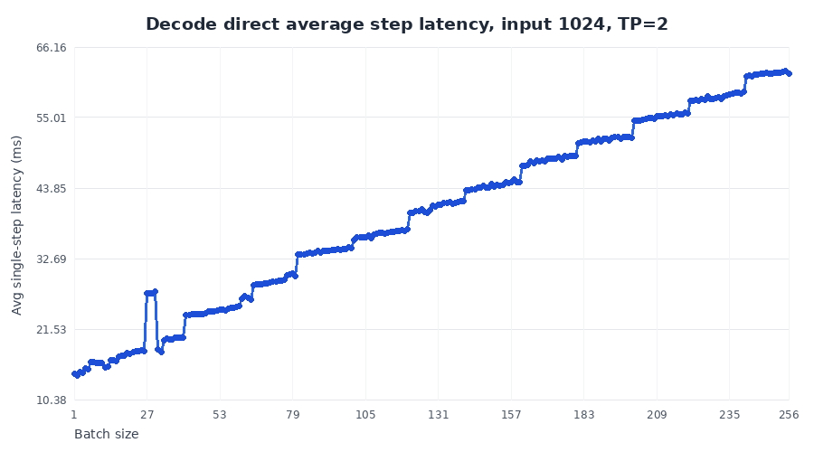
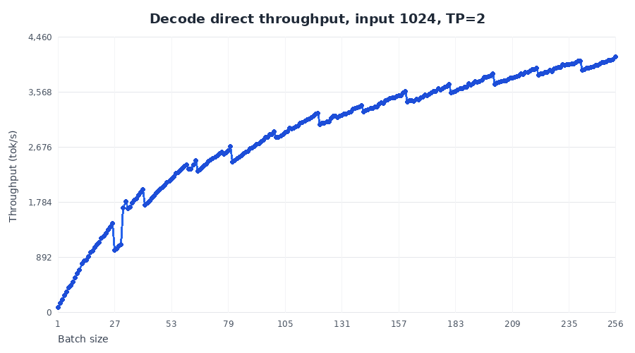
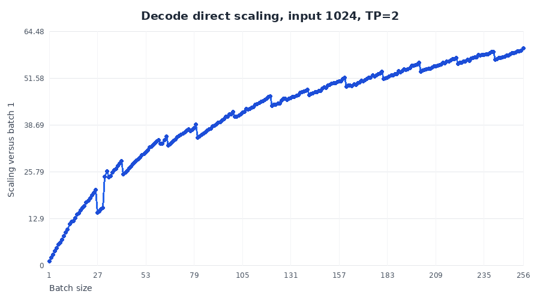

# Decode-Direct Input 1024 TP=2 性能报告

## 运行环境

| 项目 | 值 |
| ---: | ---: |
| 日期 | 2026-11-23 19:04:38-19:27:49（Asia/Shanghai） |
| 平台 | Hygon BW1000 |
| 设备 | 2 x Hygon BW1000 HCU，64 GB HBM，CUDA_VISIBLE_DEVICES 按前 2 张分配 |
| Driver / runtime | 6.3.30-V1.4.1a / DTK 26.04-rc4 |
| InfiniLM build | 分支 `pd-v0.2.9-v1-tp`，commit `da7d18e7` |
| 模型 | `/data/shared/.infinifabric-models-20261027-fef304a05440/Qwen3-8B--b968826d9c46dd6066d109eabc6255188de91218` |
| 模式 | `decode-direct` |
| Attention backend | `flash-attn` |
| Graph request | enabled |
| Expected execution mode | `graph` |
| Cache | paged KV cache，block size 256，num blocks 1280 |
| Max batched tokens | 18,432 |
| Tensor parallel size | 2 |
| Input length | 1024 tokens / request |
| Batch size range | 1..256 |
| Decode steps per repeat | 4 |
| Warmup / measured repeats | 每个形状 3 次 / 30 次 |
| Batch 执行顺序 | random seed 2026 |


本报告对应原始 JSONL 和 log 为本机运行产物，不随仓库提交：

```text
../../../benchmark-hygon-bw-tp2-decode-direct-input1024.jsonl
../../../benchmark-hygon-bw-tp2-decode-direct-input1024.log
```

## 构建与测试命令

```bash
xmake build _infinilm && xmake install _infinilm
```

```bash
SKIP_BUILD=1 TP=2 GPU=0,1 \
MODE=decode-direct \
INPUT_LEN=1024 \
BATCH_SIZES="$(seq -s, 1 256)" REPEATS=30 \
OUTPUT=benchmark-hygon-bw-tp2-decode-direct-input1024.jsonl ./run_bench_hygon.sh
```

## 执行模式与 Graph 覆盖

- Graph request: enabled
- Expected execution mode: `graph`
- Graph-covered batches: 1..256
- Eager-fallback batches: none
- Mode source: compiler rule；该字段不是 C++ runtime 回传的实际执行模式。

## 资源开销

| 项目 | 值 |
| ---: | ---: |
| Workspace allocation | 每 rank 1,116 MiB，TP=2 合计 2,232 MiB |
| 权重加载时间 | 46.29 s |
| Graph compilation time | 未单独打点；包含在进程初始化到首个 sample 的 wall time 中 |
| Paged cache blocks | 1,280 |
| 正式 sample 数 | 30,720 |
| 进程 wall time | 1391 s (first runtime log to final JSONL write) |
| Monitor peak HCU memory use | 55%（本 run 时间窗，分配 HCUs，10 秒采样） |
| Monitor peak package power | 327.0 W（本 run 时间窗，分配 HCUs，10 秒采样） |
| Monitor peak sensor temperature | 62.0 C（本 run 时间窗，edge/junction，10 秒采样） |


## 测试口径

- Direct decode 不执行语义 prefill，paged KV cache 全 0 初始化。
- Step 0 使用 dummy token；step 1..3 使用上一步 sampled token。
- 每次 repeat 执行 4 个 decode step。
- `avg_step_latency = four_step_repeat_duration / 4`。
- 完整结果表聚合每个 batch 的 120 个 individual step samples。
- `single_step_throughput = batch_size / avg_step_latency`。
- 计时边界为 `engine_forward_including_sampling`。
- 分位数使用线性插值；每个 batch 只有 30 个 repeat，p99 是尾部参考。

## 核心结果

| 指标 | 结果 |
| ---: | ---: |
| 最高 single-step throughput | batch 256，4,134.71 tok/s |
| 最快 batch 平均 step latency | batch 2，14.223 ms |
| 最大 batch scaling | 59.777x |
| Ideal-scaling efficiency | 23.4% |
| Median step std | 0.029 ms |
| Maximum step std | 0.134 ms，batch 205 |


## 趋势图

### 1. Batch size 与 Avg Step Latency



平均 step latency 从 batch 1 的 14.457 ms 变为 batch 256 的 61.915 ms。

### 2. Batch size 与 Single-step Throughput



吞吐峰值出现在 batch 256，为 4,134.71 tok/s。

### 3. Batch size 与 Scaling



batch 256 相对 batch 1 的 scaling 为 59.777x；理想 256x 效率约 23.4%。

## Batch 区间平均 latency 与吞吐

下表按连续 16 个 batch 分组。平均值是区间内各 batch 聚合 single-step 统计的算术平均；区间最优 batch 取吞吐最高的 batch。

| Batch 区间 | 平均单 step latency ms | 平均吞吐 tok/s | 区间最优 batch |
| ---: | ---: | ---: | ---: |
| 1..16 | 15.649 | 531.90 | 16 |
| 17..32 | 20.159 | 1,235.15 | 32 |
| 33..48 | 21.940 | 1,843.65 | 48 |
| 49..64 | 25.099 | 2,248.21 | 64 |
| 65..80 | 29.181 | 2,482.61 | 80 |
| 81..96 | 33.714 | 2,624.15 | 96 |
| 97..112 | 35.783 | 2,919.29 | 112 |
| 113..128 | 38.568 | 3,125.11 | 120 |
| 129..144 | 41.967 | 3,252.09 | 140 |
| 145..160 | 44.394 | 3,434.61 | 160 |
| 161..176 | 48.177 | 3,497.05 | 175 |
| 177..192 | 50.695 | 3,639.40 | 192 |
| 193..208 | 53.283 | 3,763.59 | 200 |
| 209..224 | 56.013 | 3,865.16 | 220 |
| 225..240 | 58.372 | 3,982.77 | 240 |
| 241..256 | 61.923 | 4,012.87 | 256 |


## 关键批次与跳变

| Change | Mode transition | Avg step ms | Throughput tok/s | Observation |
| --- | ---: | ---: | ---: | --- |
| 26 -> 27 | graph | 18.055 -> 27.130 | 1,440.05 -> 995.19 | 平均 step latency 增加 50.3%，可能对应 kernel shape 或 workspace 分档变化 |
| 40 -> 41 | graph | 20.213 -> 23.710 | 1,978.90 -> 1,729.25 | 平均 step latency 增加 17.3%，可能对应 kernel shape 或 workspace 分档变化 |
| 80 -> 81 | graph | 29.836 -> 33.306 | 2,681.30 -> 2,432.01 | 平均 step latency 增加 11.6%，可能对应 kernel shape 或 workspace 分档变化 |
| 32 -> 33 | graph | 17.920 -> 19.756 | 1,785.69 -> 1,670.41 | 平均 step latency 增加 10.2%，可能对应 kernel shape 或 workspace 分档变化 |
| 64 -> 65 | graph | 26.135 -> 28.484 | 2,448.87 -> 2,281.99 | 平均 step latency 增加 9.0%，可能对应 kernel shape 或 workspace 分档变化 |
| 6 -> 7 | graph | 15.156 -> 16.283 | 395.87 -> 429.90 | 平均 step latency 增加 7.4%，可能对应 kernel shape 或 workspace 分档变化 |


## Step 一致性

峰值 batch 256 的 4 个 decode step 结果如下：

| Step | Past KV length | Avg step ms | Std ms | Throughput tok/s |
| ---: | ---: | ---: | ---: | ---: |
| 0 | 1024 | 61.902 | 0.061 | 4,135.58 |
| 1 | 1025 | 61.920 | 0.088 | 4,134.39 |
| 2 | 1026 | 61.932 | 0.047 | 4,133.56 |
| 3 | 1027 | 61.906 | 0.052 | 4,135.29 |


所有 batch 中，4 个 step 平均耗时最大差异为 0.090 ms，出现在 batch 230。差异包含 past KV length 增长和 step kernel 形状影响。

## 数据稳定性

- 单 step std 中位数为 0.029 ms。
- 最大 std 为 0.134 ms，出现在 batch 205。
- 各 batch p99 与 max 接近，尾部稳定；每个 batch 只有 30 个 repeat，p99 仍是尾部参考值。

## TP 对比摘要

| TP | Best batch | Peak throughput tok/s | Scaling vs TP=1 |
| ---: | ---: | ---: | ---: |
| 1 | 180 | 2,183.33 | 1.000x |
| 2 | 256 | 4,134.71 | 1.894x |
| 4 | 240 | 5,899.98 | 2.702x |


## Single-step 完整结果

### Batch 1..16

| Batch | Mode | Avg Step ms | Min Step ms | P50 Step ms | P95 Step ms | P99 Step ms | Max Step ms | Std Step ms | Single-step tok/s | Scaling |
| ---: | --- | ---: | ---: | ---: | ---: | ---: | ---: | ---: | ---: | ---: |
| 1 | graph | 14.457 | 14.416 | 14.456 | 14.494 | 14.500 | 14.504 | 0.018 | 69.17 | 1.000x |
| 2 | graph | 14.223 | 14.195 | 14.222 | 14.249 | 14.261 | 14.291 | 0.014 | 140.61 | 2.033x |
| 3 | graph | 14.754 | 14.720 | 14.753 | 14.774 | 14.784 | 14.804 | 0.013 | 203.34 | 2.940x |
| 4 | graph | 14.629 | 14.605 | 14.629 | 14.650 | 14.658 | 14.672 | 0.011 | 273.42 | 3.953x |
| 5 | graph | 15.267 | 15.187 | 15.293 | 15.322 | 15.358 | 15.726 | 0.065 | 327.51 | 4.735x |
| 6 | graph | 15.156 | 15.134 | 15.155 | 15.174 | 15.184 | 15.209 | 0.011 | 395.87 | 5.723x |
| 7 | graph | 16.283 | 16.252 | 16.281 | 16.311 | 16.325 | 16.332 | 0.014 | 429.90 | 6.215x |
| 8 | graph | 16.330 | 16.305 | 16.329 | 16.350 | 16.356 | 16.373 | 0.011 | 489.89 | 7.083x |
| 9 | graph | 16.148 | 16.124 | 16.148 | 16.166 | 16.177 | 16.191 | 0.011 | 557.33 | 8.058x |
| 10 | graph | 16.193 | 16.166 | 16.192 | 16.210 | 16.243 | 16.363 | 0.019 | 617.53 | 8.928x |
| 11 | graph | 16.212 | 16.185 | 16.212 | 16.236 | 16.249 | 16.250 | 0.013 | 678.49 | 9.809x |
| 12 | graph | 15.422 | 15.398 | 15.421 | 15.440 | 15.464 | 15.562 | 0.016 | 778.10 | 11.249x |
| 13 | graph | 15.586 | 15.563 | 15.584 | 15.608 | 15.622 | 15.630 | 0.013 | 834.08 | 12.059x |
| 14 | graph | 16.554 | 16.531 | 16.554 | 16.574 | 16.589 | 16.614 | 0.012 | 845.71 | 12.227x |
| 15 | graph | 16.652 | 16.627 | 16.651 | 16.667 | 16.672 | 16.706 | 0.010 | 900.81 | 13.023x |
| 16 | graph | 16.517 | 16.494 | 16.514 | 16.537 | 16.558 | 16.572 | 0.012 | 968.70 | 14.005x |


### Batch 17..32

| Batch | Mode | Avg Step ms | Min Step ms | P50 Step ms | P95 Step ms | P99 Step ms | Max Step ms | Std Step ms | Single-step tok/s | Scaling |
| ---: | --- | ---: | ---: | ---: | ---: | ---: | ---: | ---: | ---: | ---: |
| 17 | graph | 17.159 | 17.137 | 17.158 | 17.182 | 17.187 | 17.209 | 0.012 | 990.73 | 14.323x |
| 18 | graph | 17.257 | 17.238 | 17.256 | 17.276 | 17.289 | 17.298 | 0.011 | 1,043.03 | 15.080x |
| 19 | graph | 17.349 | 17.315 | 17.348 | 17.370 | 17.377 | 17.388 | 0.014 | 1,095.18 | 15.834x |
| 20 | graph | 17.739 | 17.710 | 17.739 | 17.758 | 17.775 | 17.807 | 0.013 | 1,127.45 | 16.300x |
| 21 | graph | 17.626 | 17.599 | 17.624 | 17.652 | 17.663 | 17.671 | 0.013 | 1,191.41 | 17.225x |
| 22 | graph | 17.872 | 17.848 | 17.872 | 17.891 | 17.905 | 17.936 | 0.012 | 1,230.96 | 17.797x |
| 23 | graph | 17.964 | 17.941 | 17.963 | 17.983 | 17.996 | 18.004 | 0.012 | 1,280.31 | 18.510x |
| 24 | graph | 18.048 | 18.023 | 18.047 | 18.072 | 18.076 | 18.103 | 0.013 | 1,329.77 | 19.225x |
| 25 | graph | 18.127 | 18.092 | 18.129 | 18.150 | 18.153 | 18.157 | 0.013 | 1,379.14 | 19.939x |
| 26 | graph | 18.055 | 18.030 | 18.055 | 18.080 | 18.087 | 18.088 | 0.012 | 1,440.05 | 20.819x |
| 27 | graph | 27.130 | 27.097 | 27.129 | 27.155 | 27.170 | 27.194 | 0.015 | 995.19 | 14.388x |
| 28 | graph | 27.205 | 27.124 | 27.214 | 27.236 | 27.241 | 27.248 | 0.030 | 1,029.20 | 14.880x |
| 29 | graph | 27.231 | 27.181 | 27.214 | 27.267 | 27.598 | 27.645 | 0.077 | 1,064.97 | 15.397x |
| 30 | graph | 27.485 | 27.454 | 27.485 | 27.506 | 27.519 | 27.538 | 0.013 | 1,091.49 | 15.780x |
| 31 | graph | 18.366 | 18.338 | 18.365 | 18.391 | 18.404 | 18.431 | 0.014 | 1,687.86 | 24.402x |
| 32 | graph | 17.920 | 17.883 | 17.920 | 17.941 | 17.948 | 17.979 | 0.012 | 1,785.69 | 25.817x |


### Batch 33..48

| Batch | Mode | Avg Step ms | Min Step ms | P50 Step ms | P95 Step ms | P99 Step ms | Max Step ms | Std Step ms | Single-step tok/s | Scaling |
| ---: | --- | ---: | ---: | ---: | ---: | ---: | ---: | ---: | ---: | ---: |
| 33 | graph | 19.756 | 19.724 | 19.754 | 19.782 | 19.787 | 19.900 | 0.019 | 1,670.41 | 24.150x |
| 34 | graph | 20.003 | 19.980 | 20.002 | 20.021 | 20.027 | 20.028 | 0.011 | 1,699.76 | 24.574x |
| 35 | graph | 19.844 | 19.812 | 19.843 | 19.867 | 19.886 | 20.002 | 0.020 | 1,763.72 | 25.499x |
| 36 | graph | 19.910 | 19.882 | 19.909 | 19.931 | 19.940 | 19.944 | 0.012 | 1,808.17 | 26.142x |
| 37 | graph | 20.183 | 20.148 | 20.177 | 20.218 | 20.361 | 20.438 | 0.036 | 1,833.20 | 26.503x |
| 38 | graph | 20.136 | 20.098 | 20.134 | 20.160 | 20.173 | 20.192 | 0.016 | 1,887.15 | 27.283x |
| 39 | graph | 20.141 | 20.099 | 20.140 | 20.164 | 20.179 | 20.193 | 0.015 | 1,936.39 | 27.995x |
| 40 | graph | 20.213 | 20.177 | 20.211 | 20.239 | 20.246 | 20.284 | 0.016 | 1,978.90 | 28.610x |
| 41 | graph | 23.710 | 23.672 | 23.710 | 23.729 | 23.762 | 23.774 | 0.015 | 1,729.25 | 25.001x |
| 42 | graph | 23.804 | 23.771 | 23.800 | 23.835 | 23.879 | 23.960 | 0.024 | 1,764.42 | 25.509x |
| 43 | graph | 23.825 | 23.797 | 23.824 | 23.843 | 23.852 | 23.957 | 0.017 | 1,804.83 | 26.093x |
| 44 | graph | 23.848 | 23.815 | 23.847 | 23.872 | 23.881 | 23.912 | 0.015 | 1,845.02 | 26.674x |
| 45 | graph | 23.859 | 23.818 | 23.857 | 23.896 | 23.906 | 23.927 | 0.020 | 1,886.08 | 27.268x |
| 46 | graph | 23.872 | 23.833 | 23.870 | 23.902 | 23.920 | 24.026 | 0.021 | 1,926.96 | 27.859x |
| 47 | graph | 23.942 | 23.906 | 23.938 | 23.971 | 24.039 | 24.188 | 0.030 | 1,963.05 | 28.381x |
| 48 | graph | 23.987 | 23.955 | 23.987 | 24.015 | 24.047 | 24.068 | 0.018 | 2,001.05 | 28.930x |


### Batch 49..64

| Batch | Mode | Avg Step ms | Min Step ms | P50 Step ms | P95 Step ms | P99 Step ms | Max Step ms | Std Step ms | Single-step tok/s | Scaling |
| ---: | --- | ---: | ---: | ---: | ---: | ---: | ---: | ---: | ---: | ---: |
| 49 | graph | 24.325 | 24.287 | 24.324 | 24.350 | 24.365 | 24.394 | 0.016 | 2,014.39 | 29.123x |
| 50 | graph | 24.351 | 24.317 | 24.349 | 24.380 | 24.410 | 24.459 | 0.018 | 2,053.28 | 29.685x |
| 51 | graph | 24.304 | 24.267 | 24.301 | 24.328 | 24.350 | 24.418 | 0.018 | 2,098.42 | 30.338x |
| 52 | graph | 24.473 | 24.439 | 24.472 | 24.501 | 24.529 | 24.545 | 0.018 | 2,124.80 | 30.719x |
| 53 | graph | 24.547 | 24.519 | 24.545 | 24.574 | 24.584 | 24.607 | 0.016 | 2,159.13 | 31.216x |
| 54 | graph | 24.613 | 24.581 | 24.610 | 24.642 | 24.653 | 24.659 | 0.017 | 2,193.99 | 31.720x |
| 55 | graph | 24.473 | 24.420 | 24.475 | 24.499 | 24.516 | 24.518 | 0.016 | 2,247.35 | 32.491x |
| 56 | graph | 24.741 | 24.694 | 24.740 | 24.763 | 24.774 | 24.781 | 0.014 | 2,263.46 | 32.724x |
| 57 | graph | 24.889 | 24.827 | 24.868 | 25.004 | 25.324 | 25.382 | 0.095 | 2,290.20 | 33.111x |
| 58 | graph | 24.957 | 24.925 | 24.956 | 24.986 | 24.997 | 24.998 | 0.016 | 2,324.00 | 33.599x |
| 59 | graph | 24.994 | 24.954 | 24.993 | 25.017 | 25.031 | 25.033 | 0.015 | 2,360.59 | 34.128x |
| 60 | graph | 25.224 | 25.192 | 25.224 | 25.252 | 25.269 | 25.286 | 0.017 | 2,378.69 | 34.390x |
| 61 | graph | 26.374 | 26.315 | 26.374 | 26.410 | 26.429 | 26.457 | 0.020 | 2,312.89 | 33.439x |
| 62 | graph | 26.745 | 26.577 | 26.744 | 26.878 | 26.935 | 26.952 | 0.076 | 2,318.21 | 33.515x |
| 63 | graph | 26.437 | 26.396 | 26.438 | 26.463 | 26.491 | 26.498 | 0.018 | 2,383.04 | 34.453x |
| 64 | graph | 26.135 | 26.094 | 26.131 | 26.171 | 26.221 | 26.266 | 0.023 | 2,448.87 | 35.404x |


### Batch 65..80

| Batch | Mode | Avg Step ms | Min Step ms | P50 Step ms | P95 Step ms | P99 Step ms | Max Step ms | Std Step ms | Single-step tok/s | Scaling |
| ---: | --- | ---: | ---: | ---: | ---: | ---: | ---: | ---: | ---: | ---: |
| 65 | graph | 28.484 | 28.435 | 28.479 | 28.540 | 28.568 | 28.589 | 0.028 | 2,281.99 | 32.992x |
| 66 | graph | 28.580 | 28.532 | 28.581 | 28.612 | 28.627 | 28.635 | 0.019 | 2,309.28 | 33.386x |
| 67 | graph | 28.678 | 28.606 | 28.653 | 28.905 | 29.107 | 29.128 | 0.098 | 2,336.28 | 33.777x |
| 68 | graph | 28.645 | 28.596 | 28.632 | 28.749 | 28.917 | 28.930 | 0.056 | 2,373.90 | 34.321x |
| 69 | graph | 28.817 | 28.771 | 28.816 | 28.854 | 28.860 | 28.866 | 0.020 | 2,394.41 | 34.617x |
| 70 | graph | 28.714 | 28.678 | 28.713 | 28.750 | 28.781 | 28.788 | 0.021 | 2,437.82 | 35.245x |
| 71 | graph | 28.830 | 28.752 | 28.807 | 28.985 | 29.348 | 29.373 | 0.109 | 2,462.75 | 35.605x |
| 72 | graph | 28.975 | 28.909 | 28.962 | 29.025 | 29.331 | 29.370 | 0.061 | 2,484.86 | 35.925x |
| 73 | graph | 29.023 | 28.970 | 29.019 | 29.064 | 29.096 | 29.214 | 0.030 | 2,515.21 | 36.364x |
| 74 | graph | 29.168 | 29.114 | 29.167 | 29.204 | 29.220 | 29.236 | 0.022 | 2,537.05 | 36.679x |
| 75 | graph | 29.221 | 29.163 | 29.215 | 29.269 | 29.317 | 29.342 | 0.028 | 2,566.67 | 37.108x |
| 76 | graph | 29.319 | 29.261 | 29.318 | 29.350 | 29.364 | 29.374 | 0.019 | 2,592.18 | 37.476x |
| 77 | graph | 30.073 | 30.024 | 30.072 | 30.097 | 30.106 | 30.109 | 0.014 | 2,560.46 | 37.018x |
| 78 | graph | 30.235 | 30.207 | 30.233 | 30.261 | 30.279 | 30.391 | 0.021 | 2,579.79 | 37.297x |
| 79 | graph | 30.294 | 30.258 | 30.290 | 30.326 | 30.348 | 30.432 | 0.022 | 2,607.80 | 37.702x |
| 80 | graph | 29.836 | 29.807 | 29.835 | 29.864 | 29.879 | 29.891 | 0.016 | 2,681.30 | 38.765x |


### Batch 81..96

| Batch | Mode | Avg Step ms | Min Step ms | P50 Step ms | P95 Step ms | P99 Step ms | Max Step ms | Std Step ms | Single-step tok/s | Scaling |
| ---: | --- | ---: | ---: | ---: | ---: | ---: | ---: | ---: | ---: | ---: |
| 81 | graph | 33.306 | 33.265 | 33.305 | 33.336 | 33.347 | 33.350 | 0.019 | 2,432.01 | 35.161x |
| 82 | graph | 33.388 | 33.333 | 33.378 | 33.418 | 33.690 | 33.908 | 0.065 | 2,455.97 | 35.507x |
| 83 | graph | 33.294 | 33.250 | 33.294 | 33.318 | 33.352 | 33.367 | 0.018 | 2,492.94 | 36.042x |
| 84 | graph | 33.419 | 33.357 | 33.409 | 33.465 | 33.646 | 33.732 | 0.048 | 2,513.55 | 36.340x |
| 85 | graph | 33.569 | 33.525 | 33.567 | 33.598 | 33.615 | 33.690 | 0.021 | 2,532.13 | 36.608x |
| 86 | graph | 33.459 | 33.408 | 33.455 | 33.503 | 33.545 | 33.641 | 0.030 | 2,570.32 | 37.160x |
| 87 | graph | 33.584 | 33.545 | 33.580 | 33.609 | 33.711 | 33.792 | 0.029 | 2,590.55 | 37.453x |
| 88 | graph | 33.839 | 33.796 | 33.836 | 33.871 | 33.896 | 33.929 | 0.022 | 2,600.56 | 37.598x |
| 89 | graph | 33.690 | 33.640 | 33.692 | 33.723 | 33.734 | 33.747 | 0.022 | 2,641.74 | 38.193x |
| 90 | graph | 33.863 | 33.759 | 33.860 | 33.905 | 33.925 | 33.931 | 0.025 | 2,657.79 | 38.425x |
| 91 | graph | 33.899 | 33.760 | 33.891 | 33.964 | 34.020 | 34.242 | 0.051 | 2,684.48 | 38.811x |
| 92 | graph | 33.921 | 33.861 | 33.919 | 33.966 | 34.008 | 34.013 | 0.028 | 2,712.19 | 39.211x |
| 93 | graph | 34.029 | 33.974 | 34.028 | 34.072 | 34.088 | 34.113 | 0.024 | 2,733.00 | 39.512x |
| 94 | graph | 34.043 | 33.992 | 34.042 | 34.083 | 34.102 | 34.106 | 0.023 | 2,761.20 | 39.920x |
| 95 | graph | 34.135 | 34.095 | 34.134 | 34.168 | 34.182 | 34.193 | 0.019 | 2,783.10 | 40.237x |
| 96 | graph | 33.985 | 33.935 | 33.980 | 34.025 | 34.058 | 34.098 | 0.025 | 2,824.81 | 40.840x |


### Batch 97..112

| Batch | Mode | Avg Step ms | Min Step ms | P50 Step ms | P95 Step ms | P99 Step ms | Max Step ms | Std Step ms | Single-step tok/s | Scaling |
| ---: | --- | ---: | ---: | ---: | ---: | ---: | ---: | ---: | ---: | ---: |
| 97 | graph | 34.257 | 34.149 | 34.254 | 34.321 | 34.332 | 34.402 | 0.034 | 2,831.53 | 40.937x |
| 98 | graph | 34.127 | 34.063 | 34.127 | 34.167 | 34.196 | 34.225 | 0.027 | 2,871.63 | 41.516x |
| 99 | graph | 34.469 | 34.408 | 34.466 | 34.517 | 34.534 | 34.604 | 0.026 | 2,872.15 | 41.524x |
| 100 | graph | 34.272 | 34.227 | 34.272 | 34.304 | 34.313 | 34.318 | 0.019 | 2,917.86 | 42.185x |
| 101 | graph | 35.643 | 35.575 | 35.643 | 35.690 | 35.714 | 35.716 | 0.028 | 2,833.63 | 40.967x |
| 102 | graph | 36.013 | 35.937 | 36.011 | 36.058 | 36.092 | 36.097 | 0.026 | 2,832.30 | 40.948x |
| 103 | graph | 36.054 | 35.982 | 36.051 | 36.102 | 36.117 | 36.122 | 0.028 | 2,856.84 | 41.303x |
| 104 | graph | 36.098 | 36.009 | 36.098 | 36.140 | 36.162 | 36.163 | 0.025 | 2,881.09 | 41.653x |
| 105 | graph | 36.086 | 35.999 | 36.079 | 36.184 | 36.194 | 36.248 | 0.047 | 2,909.71 | 42.067x |
| 106 | graph | 36.299 | 36.235 | 36.293 | 36.341 | 36.634 | 36.798 | 0.063 | 2,920.16 | 42.218x |
| 107 | graph | 35.979 | 35.919 | 35.977 | 36.018 | 36.037 | 36.043 | 0.027 | 2,973.95 | 42.996x |
| 108 | graph | 36.446 | 36.323 | 36.440 | 36.502 | 36.539 | 36.585 | 0.035 | 2,963.33 | 42.842x |
| 109 | graph | 36.648 | 36.584 | 36.647 | 36.688 | 36.701 | 36.704 | 0.023 | 2,974.26 | 43.000x |
| 110 | graph | 36.708 | 36.657 | 36.706 | 36.747 | 36.772 | 36.790 | 0.024 | 2,996.65 | 43.324x |
| 111 | graph | 36.787 | 36.730 | 36.784 | 36.830 | 36.843 | 36.852 | 0.025 | 3,017.34 | 43.623x |
| 112 | graph | 36.647 | 36.573 | 36.647 | 36.686 | 36.695 | 36.713 | 0.023 | 3,056.19 | 44.185x |


### Batch 113..128

| Batch | Mode | Avg Step ms | Min Step ms | P50 Step ms | P95 Step ms | P99 Step ms | Max Step ms | Std Step ms | Single-step tok/s | Scaling |
| ---: | --- | ---: | ---: | ---: | ---: | ---: | ---: | ---: | ---: | ---: |
| 113 | graph | 36.767 | 36.698 | 36.766 | 36.809 | 36.835 | 36.839 | 0.027 | 3,073.40 | 44.434x |
| 114 | graph | 36.850 | 36.750 | 36.825 | 37.062 | 37.335 | 37.372 | 0.105 | 3,093.66 | 44.727x |
| 115 | graph | 36.887 | 36.822 | 36.889 | 36.927 | 36.948 | 36.986 | 0.027 | 3,117.62 | 45.073x |
| 116 | graph | 37.027 | 36.935 | 37.025 | 37.076 | 37.099 | 37.121 | 0.027 | 3,132.86 | 45.293x |
| 117 | graph | 37.108 | 36.981 | 37.089 | 37.150 | 37.605 | 37.655 | 0.094 | 3,152.92 | 45.583x |
| 118 | graph | 37.127 | 37.070 | 37.123 | 37.190 | 37.239 | 37.272 | 0.036 | 3,178.24 | 45.949x |
| 119 | graph | 37.076 | 36.996 | 37.076 | 37.121 | 37.146 | 37.192 | 0.027 | 3,209.61 | 46.403x |
| 120 | graph | 37.335 | 37.207 | 37.315 | 37.453 | 37.622 | 38.050 | 0.094 | 3,214.18 | 46.469x |
| 121 | graph | 39.856 | 39.805 | 39.854 | 39.895 | 39.918 | 39.969 | 0.025 | 3,035.95 | 43.892x |
| 122 | graph | 39.846 | 39.796 | 39.847 | 39.888 | 39.910 | 39.916 | 0.026 | 3,061.78 | 44.266x |
| 123 | graph | 40.139 | 40.025 | 40.120 | 40.310 | 40.495 | 40.519 | 0.081 | 3,064.35 | 44.303x |
| 124 | graph | 40.222 | 40.162 | 40.223 | 40.261 | 40.270 | 40.273 | 0.024 | 3,082.91 | 44.571x |
| 125 | graph | 40.491 | 40.424 | 40.490 | 40.537 | 40.543 | 40.546 | 0.023 | 3,087.10 | 44.632x |
| 126 | graph | 40.095 | 40.031 | 40.095 | 40.136 | 40.162 | 40.167 | 0.024 | 3,142.57 | 45.434x |
| 127 | graph | 39.967 | 39.927 | 39.965 | 40.008 | 40.032 | 40.075 | 0.022 | 3,177.66 | 45.941x |
| 128 | graph | 40.289 | 40.202 | 40.260 | 40.583 | 40.784 | 40.809 | 0.113 | 3,177.02 | 45.932x |


### Batch 129..144

| Batch | Mode | Avg Step ms | Min Step ms | P50 Step ms | P95 Step ms | P99 Step ms | Max Step ms | Std Step ms | Single-step tok/s | Scaling |
| ---: | --- | ---: | ---: | ---: | ---: | ---: | ---: | ---: | ---: | ---: |
| 129 | graph | 41.014 | 40.945 | 40.996 | 41.117 | 41.381 | 41.430 | 0.079 | 3,145.25 | 45.472x |
| 130 | graph | 40.974 | 40.900 | 40.951 | 41.186 | 41.407 | 41.445 | 0.091 | 3,172.78 | 45.870x |
| 131 | graph | 41.175 | 41.085 | 41.162 | 41.279 | 41.310 | 41.313 | 0.048 | 3,181.57 | 45.997x |
| 132 | graph | 41.161 | 40.999 | 41.144 | 41.266 | 41.595 | 41.778 | 0.111 | 3,206.88 | 46.363x |
| 133 | graph | 41.455 | 41.358 | 41.453 | 41.489 | 41.504 | 41.885 | 0.046 | 3,208.26 | 46.383x |
| 134 | graph | 41.495 | 41.450 | 41.494 | 41.529 | 41.541 | 41.548 | 0.019 | 3,229.31 | 46.688x |
| 135 | graph | 41.638 | 41.520 | 41.616 | 41.807 | 42.096 | 42.123 | 0.086 | 3,242.26 | 46.875x |
| 136 | graph | 41.389 | 41.340 | 41.382 | 41.416 | 41.562 | 41.652 | 0.035 | 3,285.94 | 47.506x |
| 137 | graph | 41.525 | 41.460 | 41.524 | 41.580 | 41.658 | 41.737 | 0.040 | 3,299.18 | 47.698x |
| 138 | graph | 41.646 | 41.592 | 41.642 | 41.696 | 41.718 | 41.732 | 0.026 | 3,313.62 | 47.907x |
| 139 | graph | 41.844 | 41.722 | 41.841 | 41.881 | 42.003 | 42.261 | 0.049 | 3,321.88 | 48.026x |
| 140 | graph | 41.794 | 41.738 | 41.794 | 41.821 | 41.828 | 41.871 | 0.018 | 3,349.76 | 48.429x |
| 141 | graph | 43.524 | 43.473 | 43.523 | 43.562 | 43.589 | 43.632 | 0.026 | 3,239.57 | 46.836x |
| 142 | graph | 43.529 | 43.436 | 43.507 | 43.709 | 43.994 | 44.037 | 0.098 | 3,262.20 | 47.163x |
| 143 | graph | 43.648 | 43.542 | 43.648 | 43.693 | 43.719 | 43.721 | 0.028 | 3,276.24 | 47.366x |
| 144 | graph | 43.654 | 43.600 | 43.653 | 43.686 | 43.702 | 43.707 | 0.019 | 3,298.68 | 47.691x |


### Batch 145..160

| Batch | Mode | Avg Step ms | Min Step ms | P50 Step ms | P95 Step ms | P99 Step ms | Max Step ms | Std Step ms | Single-step tok/s | Scaling |
| ---: | --- | ---: | ---: | ---: | ---: | ---: | ---: | ---: | ---: | ---: |
| 145 | graph | 43.962 | 43.813 | 43.940 | 44.151 | 44.407 | 44.488 | 0.103 | 3,298.28 | 47.685x |
| 146 | graph | 43.906 | 43.841 | 43.905 | 43.945 | 43.968 | 43.975 | 0.024 | 3,325.30 | 48.075x |
| 147 | graph | 44.205 | 44.117 | 44.189 | 44.253 | 44.593 | 44.786 | 0.080 | 3,325.45 | 48.078x |
| 148 | graph | 43.874 | 43.765 | 43.868 | 43.953 | 44.018 | 44.055 | 0.039 | 3,373.29 | 48.769x |
| 149 | graph | 43.977 | 43.904 | 43.986 | 44.027 | 44.034 | 44.040 | 0.036 | 3,388.12 | 48.984x |
| 150 | graph | 44.441 | 44.341 | 44.437 | 44.495 | 44.547 | 44.585 | 0.036 | 3,375.23 | 48.797x |
| 151 | graph | 44.042 | 43.919 | 44.040 | 44.089 | 44.104 | 44.108 | 0.028 | 3,428.55 | 49.568x |
| 152 | graph | 44.304 | 44.236 | 44.305 | 44.357 | 44.377 | 44.492 | 0.040 | 3,430.87 | 49.602x |
| 153 | graph | 44.242 | 44.197 | 44.240 | 44.278 | 44.309 | 44.324 | 0.021 | 3,458.22 | 49.997x |
| 154 | graph | 44.406 | 44.276 | 44.404 | 44.455 | 44.480 | 44.579 | 0.036 | 3,468.03 | 50.139x |
| 155 | graph | 44.731 | 44.656 | 44.702 | 44.867 | 45.126 | 45.135 | 0.094 | 3,465.18 | 50.098x |
| 156 | graph | 44.618 | 44.566 | 44.619 | 44.653 | 44.665 | 44.668 | 0.020 | 3,496.38 | 50.549x |
| 157 | graph | 44.810 | 44.621 | 44.809 | 44.920 | 44.988 | 44.991 | 0.072 | 3,503.71 | 50.655x |
| 158 | graph | 45.138 | 44.994 | 45.133 | 45.262 | 45.372 | 45.396 | 0.068 | 3,500.40 | 50.607x |
| 159 | graph | 44.848 | 44.693 | 44.860 | 44.946 | 44.986 | 45.072 | 0.072 | 3,545.33 | 51.257x |
| 160 | graph | 44.800 | 44.720 | 44.792 | 44.848 | 45.100 | 45.141 | 0.055 | 3,571.40 | 51.633x |


### Batch 161..176

| Batch | Mode | Avg Step ms | Min Step ms | P50 Step ms | P95 Step ms | P99 Step ms | Max Step ms | Std Step ms | Single-step tok/s | Scaling |
| ---: | --- | ---: | ---: | ---: | ---: | ---: | ---: | ---: | ---: | ---: |
| 161 | graph | 47.356 | 47.309 | 47.353 | 47.403 | 47.423 | 47.577 | 0.029 | 3,399.81 | 49.153x |
| 162 | graph | 47.361 | 47.303 | 47.361 | 47.402 | 47.415 | 47.423 | 0.023 | 3,420.51 | 49.452x |
| 163 | graph | 47.544 | 47.451 | 47.544 | 47.581 | 47.594 | 47.598 | 0.023 | 3,428.40 | 49.566x |
| 164 | graph | 48.116 | 47.995 | 48.117 | 48.176 | 48.213 | 48.232 | 0.034 | 3,408.43 | 49.277x |
| 165 | graph | 47.795 | 47.746 | 47.792 | 47.839 | 47.910 | 47.938 | 0.029 | 3,452.25 | 49.911x |
| 166 | graph | 48.277 | 48.165 | 48.279 | 48.319 | 48.351 | 48.361 | 0.032 | 3,438.51 | 49.712x |
| 167 | graph | 48.091 | 48.028 | 48.090 | 48.125 | 48.140 | 48.145 | 0.022 | 3,472.59 | 50.205x |
| 168 | graph | 48.213 | 48.132 | 48.215 | 48.277 | 48.317 | 48.475 | 0.048 | 3,484.54 | 50.378x |
| 169 | graph | 48.077 | 48.004 | 48.059 | 48.209 | 48.481 | 48.516 | 0.080 | 3,515.22 | 50.821x |
| 170 | graph | 48.554 | 48.431 | 48.554 | 48.589 | 48.632 | 48.647 | 0.028 | 3,501.24 | 50.619x |
| 171 | graph | 48.494 | 48.353 | 48.475 | 48.666 | 48.714 | 48.739 | 0.081 | 3,526.22 | 50.980x |
| 172 | graph | 48.457 | 48.406 | 48.453 | 48.522 | 48.536 | 48.538 | 0.029 | 3,549.56 | 51.318x |
| 173 | graph | 48.433 | 48.353 | 48.431 | 48.470 | 48.515 | 48.538 | 0.025 | 3,571.92 | 51.641x |
| 174 | graph | 48.757 | 48.630 | 48.757 | 48.800 | 48.817 | 48.833 | 0.030 | 3,568.74 | 51.595x |
| 175 | graph | 48.426 | 48.326 | 48.414 | 48.467 | 48.750 | 48.912 | 0.075 | 3,613.74 | 52.246x |
| 176 | graph | 48.874 | 48.741 | 48.875 | 48.915 | 48.943 | 48.951 | 0.033 | 3,601.10 | 52.063x |


### Batch 177..192

| Batch | Mode | Avg Step ms | Min Step ms | P50 Step ms | P95 Step ms | P99 Step ms | Max Step ms | Std Step ms | Single-step tok/s | Scaling |
| ---: | --- | ---: | ---: | ---: | ---: | ---: | ---: | ---: | ---: | ---: |
| 177 | graph | 48.840 | 48.790 | 48.840 | 48.878 | 48.889 | 48.894 | 0.020 | 3,624.10 | 52.395x |
| 178 | graph | 48.943 | 48.849 | 48.944 | 48.984 | 49.056 | 49.169 | 0.036 | 3,636.90 | 52.580x |
| 179 | graph | 48.970 | 48.890 | 48.979 | 49.018 | 49.044 | 49.073 | 0.039 | 3,655.26 | 52.846x |
| 180 | graph | 48.873 | 48.688 | 48.860 | 49.018 | 49.153 | 49.203 | 0.096 | 3,683.04 | 53.247x |
| 181 | graph | 50.957 | 50.805 | 50.955 | 51.022 | 51.031 | 51.086 | 0.035 | 3,551.99 | 51.353x |
| 182 | graph | 51.076 | 50.950 | 51.068 | 51.166 | 51.219 | 51.231 | 0.049 | 3,563.33 | 51.517x |
| 183 | graph | 51.147 | 51.027 | 51.126 | 51.271 | 51.662 | 51.693 | 0.108 | 3,577.94 | 51.728x |
| 184 | graph | 51.208 | 51.092 | 51.214 | 51.272 | 51.281 | 51.370 | 0.040 | 3,593.18 | 51.948x |
| 185 | graph | 51.107 | 51.032 | 51.106 | 51.174 | 51.205 | 51.213 | 0.038 | 3,619.84 | 52.334x |
| 186 | graph | 51.355 | 51.222 | 51.357 | 51.416 | 51.439 | 51.446 | 0.040 | 3,621.84 | 52.363x |
| 187 | graph | 51.275 | 51.211 | 51.258 | 51.326 | 51.817 | 51.869 | 0.099 | 3,646.99 | 52.726x |
| 188 | graph | 51.598 | 51.524 | 51.587 | 51.683 | 51.732 | 51.968 | 0.052 | 3,643.57 | 52.677x |
| 189 | graph | 51.155 | 51.064 | 51.138 | 51.283 | 51.536 | 51.541 | 0.075 | 3,694.66 | 53.415x |
| 190 | graph | 51.608 | 51.542 | 51.605 | 51.652 | 51.685 | 51.690 | 0.029 | 3,681.62 | 53.227x |
| 191 | graph | 51.656 | 51.552 | 51.658 | 51.711 | 51.731 | 51.736 | 0.036 | 3,697.51 | 53.457x |
| 192 | graph | 51.355 | 51.245 | 51.355 | 51.400 | 51.417 | 51.449 | 0.029 | 3,738.70 | 54.052x |


### Batch 193..208

| Batch | Mode | Avg Step ms | Min Step ms | P50 Step ms | P95 Step ms | P99 Step ms | Max Step ms | Std Step ms | Single-step tok/s | Scaling |
| ---: | --- | ---: | ---: | ---: | ---: | ---: | ---: | ---: | ---: | ---: |
| 193 | graph | 51.855 | 51.790 | 51.853 | 51.905 | 51.933 | 51.936 | 0.029 | 3,721.91 | 53.809x |
| 194 | graph | 51.901 | 51.770 | 51.907 | 51.963 | 51.985 | 52.060 | 0.047 | 3,737.89 | 54.041x |
| 195 | graph | 51.982 | 51.866 | 51.975 | 52.049 | 52.135 | 52.229 | 0.048 | 3,751.28 | 54.234x |
| 196 | graph | 51.611 | 51.527 | 51.610 | 51.655 | 51.666 | 51.677 | 0.027 | 3,797.62 | 54.904x |
| 197 | graph | 51.872 | 51.817 | 51.870 | 51.918 | 51.928 | 51.945 | 0.028 | 3,797.81 | 54.907x |
| 198 | graph | 51.905 | 51.840 | 51.895 | 51.974 | 52.008 | 52.038 | 0.037 | 3,814.67 | 55.150x |
| 199 | graph | 51.984 | 51.789 | 51.972 | 52.091 | 52.139 | 52.146 | 0.055 | 3,828.10 | 55.345x |
| 200 | graph | 51.828 | 51.674 | 51.840 | 51.883 | 51.944 | 52.143 | 0.059 | 3,858.89 | 55.790x |
| 201 | graph | 54.532 | 54.449 | 54.525 | 54.596 | 54.794 | 54.953 | 0.060 | 3,685.94 | 53.289x |
| 202 | graph | 54.476 | 54.372 | 54.473 | 54.538 | 54.551 | 54.693 | 0.042 | 3,708.08 | 53.610x |
| 203 | graph | 54.490 | 54.366 | 54.490 | 54.565 | 54.580 | 54.587 | 0.044 | 3,725.47 | 53.861x |
| 204 | graph | 54.614 | 54.506 | 54.611 | 54.675 | 54.743 | 54.757 | 0.041 | 3,735.28 | 54.003x |
| 205 | graph | 54.812 | 54.682 | 54.779 | 55.166 | 55.395 | 55.456 | 0.134 | 3,740.09 | 54.072x |
| 206 | graph | 54.922 | 54.748 | 54.889 | 55.233 | 55.362 | 55.444 | 0.121 | 3,750.79 | 54.227x |
| 207 | graph | 54.930 | 54.753 | 54.911 | 55.028 | 55.462 | 55.549 | 0.108 | 3,768.44 | 54.482x |
| 208 | graph | 54.807 | 54.710 | 54.809 | 54.900 | 54.973 | 54.993 | 0.053 | 3,795.10 | 54.868x |


### Batch 209..224

| Batch | Mode | Avg Step ms | Min Step ms | P50 Step ms | P95 Step ms | P99 Step ms | Max Step ms | Std Step ms | Single-step tok/s | Scaling |
| ---: | --- | ---: | ---: | ---: | ---: | ---: | ---: | ---: | ---: | ---: |
| 209 | graph | 55.161 | 55.015 | 55.161 | 55.217 | 55.251 | 55.253 | 0.044 | 3,788.92 | 54.778x |
| 210 | graph | 55.229 | 55.063 | 55.236 | 55.316 | 55.342 | 55.554 | 0.062 | 3,802.35 | 54.972x |
| 211 | graph | 55.280 | 55.132 | 55.275 | 55.361 | 55.443 | 55.672 | 0.063 | 3,816.95 | 55.184x |
| 212 | graph | 55.342 | 55.194 | 55.320 | 55.629 | 55.857 | 55.870 | 0.122 | 3,830.69 | 55.382x |
| 213 | graph | 55.268 | 55.199 | 55.256 | 55.376 | 55.400 | 55.416 | 0.043 | 3,853.98 | 55.719x |
| 214 | graph | 55.550 | 55.430 | 55.548 | 55.602 | 55.825 | 55.859 | 0.058 | 3,852.39 | 55.696x |
| 215 | graph | 55.430 | 55.324 | 55.432 | 55.481 | 55.615 | 55.718 | 0.049 | 3,878.77 | 56.077x |
| 216 | graph | 55.677 | 55.598 | 55.674 | 55.757 | 55.783 | 55.837 | 0.037 | 3,879.49 | 56.088x |
| 217 | graph | 55.495 | 55.438 | 55.492 | 55.540 | 55.587 | 55.724 | 0.034 | 3,910.23 | 56.532x |
| 218 | graph | 55.532 | 55.463 | 55.528 | 55.588 | 55.735 | 55.860 | 0.049 | 3,925.67 | 56.755x |
| 219 | graph | 55.802 | 55.702 | 55.786 | 55.908 | 56.210 | 56.278 | 0.081 | 3,924.60 | 56.740x |
| 220 | graph | 55.716 | 55.615 | 55.717 | 55.758 | 55.812 | 55.838 | 0.033 | 3,948.62 | 57.087x |
| 221 | graph | 57.649 | 57.481 | 57.646 | 57.743 | 58.046 | 58.113 | 0.080 | 3,833.56 | 55.424x |
| 222 | graph | 57.597 | 57.474 | 57.596 | 57.672 | 57.735 | 58.037 | 0.067 | 3,854.36 | 55.724x |
| 223 | graph | 57.832 | 57.704 | 57.834 | 57.927 | 57.970 | 57.993 | 0.056 | 3,855.98 | 55.748x |
| 224 | graph | 57.642 | 57.541 | 57.643 | 57.684 | 57.703 | 57.719 | 0.031 | 3,886.07 | 56.183x |


### Batch 225..240

| Batch | Mode | Avg Step ms | Min Step ms | P50 Step ms | P95 Step ms | P99 Step ms | Max Step ms | Std Step ms | Single-step tok/s | Scaling |
| ---: | --- | ---: | ---: | ---: | ---: | ---: | ---: | ---: | ---: | ---: |
| 225 | graph | 57.984 | 57.865 | 57.964 | 58.215 | 58.396 | 58.408 | 0.095 | 3,880.35 | 56.100x |
| 226 | graph | 57.731 | 57.567 | 57.728 | 57.840 | 57.870 | 57.889 | 0.063 | 3,914.69 | 56.596x |
| 227 | graph | 58.306 | 58.230 | 58.292 | 58.398 | 58.617 | 58.751 | 0.071 | 3,893.26 | 56.287x |
| 228 | graph | 57.873 | 57.817 | 57.872 | 57.902 | 57.933 | 57.937 | 0.021 | 3,939.66 | 56.958x |
| 229 | graph | 57.945 | 57.874 | 57.932 | 57.982 | 58.399 | 58.468 | 0.079 | 3,952.06 | 57.137x |
| 230 | graph | 58.026 | 57.871 | 58.024 | 58.123 | 58.172 | 58.220 | 0.059 | 3,963.72 | 57.305x |
| 231 | graph | 58.233 | 58.085 | 58.228 | 58.305 | 58.412 | 58.449 | 0.049 | 3,966.82 | 57.350x |
| 232 | graph | 57.935 | 57.878 | 57.921 | 57.983 | 58.309 | 58.412 | 0.074 | 4,004.50 | 57.895x |
| 233 | graph | 58.364 | 58.258 | 58.362 | 58.433 | 58.450 | 58.470 | 0.036 | 3,992.18 | 57.717x |
| 234 | graph | 58.442 | 58.308 | 58.435 | 58.519 | 58.832 | 59.009 | 0.089 | 4,003.98 | 57.887x |
| 235 | graph | 58.676 | 58.561 | 58.668 | 58.782 | 58.853 | 58.971 | 0.060 | 4,005.06 | 57.903x |
| 236 | graph | 58.737 | 58.586 | 58.722 | 58.885 | 59.212 | 59.228 | 0.092 | 4,017.90 | 58.089x |
| 237 | graph | 58.941 | 58.801 | 58.922 | 59.054 | 59.457 | 59.492 | 0.110 | 4,021.00 | 58.133x |
| 238 | graph | 58.921 | 58.787 | 58.924 | 59.007 | 59.026 | 59.071 | 0.057 | 4,039.30 | 58.398x |
| 239 | graph | 58.823 | 58.738 | 58.814 | 58.873 | 58.927 | 59.382 | 0.062 | 4,063.03 | 58.741x |
| 240 | graph | 59.014 | 58.895 | 59.008 | 59.101 | 59.183 | 59.394 | 0.059 | 4,066.85 | 58.796x |


### Batch 241..256

| Batch | Mode | Avg Step ms | Min Step ms | P50 Step ms | P95 Step ms | P99 Step ms | Max Step ms | Std Step ms | Single-step tok/s | Scaling |
| ---: | --- | ---: | ---: | ---: | ---: | ---: | ---: | ---: | ---: | ---: |
| 241 | graph | 61.556 | 61.398 | 61.538 | 61.627 | 62.049 | 62.138 | 0.104 | 3,915.14 | 56.603x |
| 242 | graph | 61.658 | 61.513 | 61.653 | 61.733 | 61.884 | 61.915 | 0.059 | 3,924.88 | 56.744x |
| 243 | graph | 61.476 | 61.407 | 61.476 | 61.524 | 61.542 | 61.553 | 0.029 | 3,952.76 | 57.147x |
| 244 | graph | 61.749 | 61.631 | 61.747 | 61.855 | 62.164 | 62.440 | 0.106 | 3,951.51 | 57.129x |
| 245 | graph | 61.771 | 61.706 | 61.771 | 61.817 | 61.834 | 61.859 | 0.027 | 3,966.27 | 57.342x |
| 246 | graph | 61.936 | 61.767 | 61.936 | 62.010 | 62.032 | 62.044 | 0.049 | 3,971.87 | 57.423x |
| 247 | graph | 61.886 | 61.751 | 61.886 | 61.978 | 62.027 | 62.103 | 0.055 | 3,991.21 | 57.703x |
| 248 | graph | 62.094 | 61.967 | 62.090 | 62.165 | 62.187 | 62.211 | 0.041 | 3,993.93 | 57.742x |
| 249 | graph | 61.977 | 61.749 | 61.961 | 62.091 | 62.521 | 62.552 | 0.121 | 4,017.64 | 58.085x |
| 250 | graph | 61.895 | 61.734 | 61.894 | 62.019 | 62.066 | 62.086 | 0.079 | 4,039.11 | 58.395x |
| 251 | graph | 62.103 | 61.929 | 62.099 | 62.205 | 62.273 | 62.276 | 0.060 | 4,041.70 | 58.433x |
| 252 | graph | 62.087 | 61.956 | 62.095 | 62.195 | 62.215 | 62.364 | 0.064 | 4,058.84 | 58.681x |
| 253 | graph | 62.111 | 61.992 | 62.101 | 62.239 | 62.576 | 62.619 | 0.098 | 4,073.35 | 58.890x |
| 254 | graph | 62.240 | 62.128 | 62.237 | 62.311 | 62.375 | 62.634 | 0.059 | 4,080.97 | 59.001x |
| 255 | graph | 62.317 | 62.161 | 62.315 | 62.434 | 62.605 | 62.620 | 0.085 | 4,091.96 | 59.159x |
| 256 | graph | 61.915 | 61.776 | 61.910 | 62.023 | 62.051 | 62.306 | 0.065 | 4,134.71 | 59.777x |


## 分析

1. Single-step 吞吐随 batch 增加总体上升，峰值在 batch 256，为 4,134.71 tok/s。
2. 平均 step latency 随 batch 增加而上升，batch 1 为 14.457 ms，batch 256 为 61.915 ms。
3. Decode step 的 past KV length 从 1024 增至 1027；该变化对平均耗时影响较小，主要 scaling 仍来自 batch 并行度。
4. 连续 batch 的正向 latency 跳变通常对应 kernel shape、workspace 分档或 attention tile 变化，不能解释为连续线性退化。
5. step std 中位数 0.029 ms，最大 0.134 ms，整体测量稳定。

## 结论与建议

1. 该形状下优先在 batch 256 附近获得最高 decode 总吞吐。
2. 最大 batch ideal-scaling 效率为 23.4%，说明 per-step attention/MLP latency 随 batch 增长明显。
3. graph 已覆盖全部有效 batch；TP=1 input 1024 如需 batch 256，应先降低 workspace/cache 压力或调整图编译策略。
4. 对关键跳变 batch 建议结合 C++ model-only timer 和 kernel profile 复核。
5. 若需要更稳定的 p99，建议将 `BENCHMARK_REPEATS` 提高到 100 或以上。

## 数据完整性

```text
config records: 1
step samples: 30720
overall summaries: 256
per-step summaries: 1024
scaling records: 256
step samples per batch: 120
samples per decode step: 30
```
