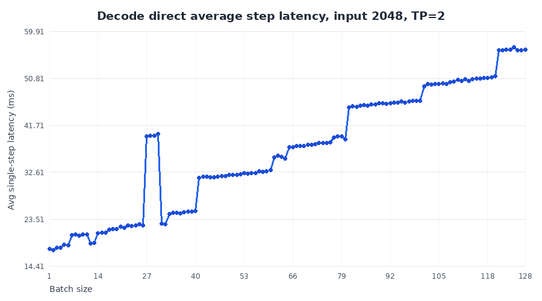
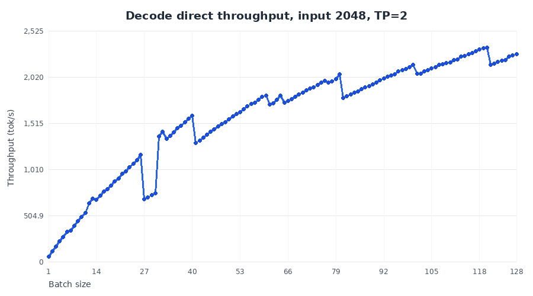
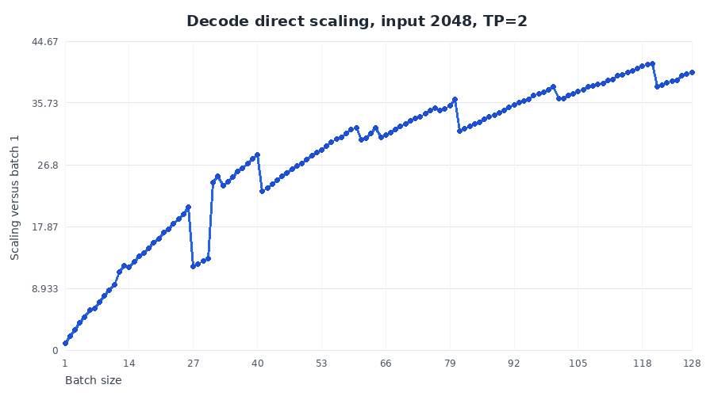

# Decode-Direct Input 2048 TP=2 性能报告

## 运行环境

| 项目 | 值 |
| ---: | ---: |
| 日期 | 2026-11-23 19:28:20-19:39:05（Asia/Shanghai） |
| 平台 | Hygon BW1000 |
| 设备 | 2 x Hygon BW1000 HCU，64 GB HBM，CUDA_VISIBLE_DEVICES 按前 2 张分配 |
| Driver / runtime | 6.3.30-V1.4.1a / DTK 26.04-rc4 |
| InfiniLM build | 分支 `pd-v0.2.9-v1-tp`，commit `da7d18e7` |
| 模型 | `/data/shared/.infinifabric-models-20261027-fef304a05440/Qwen3-8B--b968826d9c46dd6066d109eabc6255188de91218` |
| 模式 | `decode-direct` |
| Attention backend | `flash-attn` |
| Graph request | enabled |
| Expected execution mode | `graph` |
| Cache | paged KV cache，block size 256，num blocks 1152 |
| Max batched tokens | 18,432 |
| Tensor parallel size | 2 |
| Input length | 2048 tokens / request |
| Batch size range | 1..128 |
| Decode steps per repeat | 4 |
| Warmup / measured repeats | 每个形状 3 次 / 30 次 |
| Batch 执行顺序 | random seed 2026 |


本报告对应原始 JSONL 和 log 为本机运行产物，不随仓库提交：

```text
../../../benchmark-hygon-bw-tp2-decode-direct-input2048.jsonl
../../../benchmark-hygon-bw-tp2-decode-direct-input2048.log
```

## 构建与测试命令

```bash
xmake build _infinilm && xmake install _infinilm
```

```bash
SKIP_BUILD=1 TP=2 GPU=0,1 \
MODE=decode-direct \
INPUT_LEN=2048 \
BATCH_SIZES="$(seq -s, 1 128)" REPEATS=30 \
OUTPUT=benchmark-hygon-bw-tp2-decode-direct-input2048.jsonl ./run_bench_hygon.sh
```

## 执行模式与 Graph 覆盖

- Graph request: enabled
- Expected execution mode: `graph`
- Graph-covered batches: 1..128
- Eager-fallback batches: none
- Mode source: compiler rule；该字段不是 C++ runtime 回传的实际执行模式。

## 资源开销

| 项目 | 值 |
| ---: | ---: |
| Workspace allocation | 每 rank 1,116 MiB，TP=2 合计 2,232 MiB |
| 权重加载时间 | 21.30 s |
| Graph compilation time | 未单独打点；包含在进程初始化到首个 sample 的 wall time 中 |
| Paged cache blocks | 1,152 |
| 正式 sample 数 | 15,360 |
| 进程 wall time | 645 s (first runtime log to final JSONL write) |
| Monitor peak HCU memory use | 52%（本 run 时间窗，分配 HCUs，10 秒采样） |
| Monitor peak package power | 324.0 W（本 run 时间窗，分配 HCUs，10 秒采样） |
| Monitor peak sensor temperature | 62.0 C（本 run 时间窗，edge/junction，10 秒采样） |


## 测试口径

- Direct decode 不执行语义 prefill，paged KV cache 全 0 初始化。
- Step 0 使用 dummy token；step 1..3 使用上一步 sampled token。
- 每次 repeat 执行 4 个 decode step。
- `avg_step_latency = four_step_repeat_duration / 4`。
- 完整结果表聚合每个 batch 的 120 个 individual step samples。
- `single_step_throughput = batch_size / avg_step_latency`。
- 计时边界为 `engine_forward_including_sampling`。
- 分位数使用线性插值；每个 batch 只有 30 个 repeat，p99 是尾部参考。

## 核心结果

| 指标 | 结果 |
| ---: | ---: |
| 最高 single-step throughput | batch 120，2,341.81 tok/s |
| 最快 batch 平均 step latency | batch 2，17.552 ms |
| 最大 batch scaling | 40.163x |
| Ideal-scaling efficiency | 31.4% |
| Median step std | 0.019 ms |
| Maximum step std | 0.108 ms，batch 62 |


## 趋势图

### 1. Batch size 与 Avg Step Latency



平均 step latency 从 batch 1 的 17.692 ms 变为 batch 128 的 56.386 ms。

### 2. Batch size 与 Single-step Throughput



吞吐峰值出现在 batch 120，为 2,341.81 tok/s。

### 3. Batch size 与 Scaling



batch 128 相对 batch 1 的 scaling 为 40.163x；理想 128x 效率约 31.4%。

## Batch 区间平均 latency 与吞吐

下表按连续 16 个 batch 分组。平均值是区间内各 batch 聚合 single-step 统计的算术平均；区间最优 batch 取吞吐最高的 batch。

| Batch 区间 | 平均单 step latency ms | 平均吞吐 tok/s | 区间最优 batch |
| ---: | ---: | ---: | ---: |
| 1..16 | 19.423 | 427.36 | 16 |
| 17..32 | 26.527 | 962.56 | 32 |
| 33..48 | 28.253 | 1,437.26 | 40 |
| 49..64 | 33.226 | 1,698.56 | 64 |
| 65..80 | 38.284 | 1,892.40 | 80 |
| 81..96 | 45.767 | 1,933.14 | 96 |
| 97..112 | 49.045 | 2,130.26 | 112 |
| 113..128 | 53.584 | 2,250.93 | 120 |


## 关键批次与跳变

| Change | Mode transition | Avg step ms | Throughput tok/s | Observation |
| --- | ---: | ---: | ---: | --- |
| 26 -> 27 | graph | 22.267 -> 39.575 | 1,167.64 -> 682.24 | 平均 step latency 增加 77.7%，可能对应 kernel shape 或 workspace 分档变化 |
| 40 -> 41 | graph | 25.045 -> 31.538 | 1,597.11 -> 1,300.00 | 平均 step latency 增加 25.9%，可能对应 kernel shape 或 workspace 分档变化 |
| 80 -> 81 | graph | 38.993 -> 45.176 | 2,051.63 -> 1,792.99 | 平均 step latency 增加 15.9%，可能对应 kernel shape 或 workspace 分档变化 |
| 6 -> 7 | graph | 18.480 -> 20.436 | 324.68 -> 342.54 | 平均 step latency 增加 10.6%，可能对应 kernel shape 或 workspace 分档变化 |
| 120 -> 121 | graph | 51.242 -> 56.286 | 2,341.81 -> 2,149.74 | 平均 step latency 增加 9.8%，可能对应 kernel shape 或 workspace 分档变化 |
| 13 -> 14 | graph | 18.915 -> 20.751 | 687.29 -> 674.68 | 平均 step latency 增加 9.7%，可能对应 kernel shape 或 workspace 分档变化 |


## Step 一致性

峰值 batch 120 的 4 个 decode step 结果如下：

| Step | Past KV length | Avg step ms | Std ms | Throughput tok/s |
| ---: | ---: | ---: | ---: | ---: |
| 0 | 2048 | 51.233 | 0.031 | 2,342.22 |
| 1 | 2049 | 51.239 | 0.029 | 2,341.98 |
| 2 | 2050 | 51.252 | 0.030 | 2,341.36 |
| 3 | 2051 | 51.245 | 0.033 | 2,341.70 |


所有 batch 中，4 个 step 平均耗时最大差异为 0.045 ms，出现在 batch 114。差异包含 past KV length 增长和 step kernel 形状影响。

## 数据稳定性

- 单 step std 中位数为 0.019 ms。
- 最大 std 为 0.108 ms，出现在 batch 62。
- 各 batch p99 与 max 接近，尾部稳定；每个 batch 只有 30 个 repeat，p99 仍是尾部参考值。

## TP 对比摘要

| TP | Best batch | Peak throughput tok/s | Scaling vs TP=1 |
| ---: | ---: | ---: | ---: |
| 1 | 128 | 1,393.35 | 1.000x |
| 2 | 120 | 2,341.81 | 1.681x |
| 4 | 120 | 3,467.80 | 2.489x |


## Single-step 完整结果

### Batch 1..16

| Batch | Mode | Avg Step ms | Min Step ms | P50 Step ms | P95 Step ms | P99 Step ms | Max Step ms | Std Step ms | Single-step tok/s | Scaling |
| ---: | --- | ---: | ---: | ---: | ---: | ---: | ---: | ---: | ---: | ---: |
| 1 | graph | 17.692 | 17.649 | 17.694 | 17.719 | 17.730 | 17.778 | 0.019 | 56.52 | 1.000x |
| 2 | graph | 17.552 | 17.518 | 17.551 | 17.572 | 17.593 | 17.611 | 0.013 | 113.95 | 2.016x |
| 3 | graph | 18.005 | 17.981 | 18.003 | 18.026 | 18.038 | 18.073 | 0.013 | 166.62 | 2.948x |
| 4 | graph | 17.925 | 17.902 | 17.924 | 17.941 | 17.947 | 17.950 | 0.010 | 223.16 | 3.948x |
| 5 | graph | 18.540 | 18.513 | 18.539 | 18.559 | 18.598 | 18.626 | 0.015 | 269.69 | 4.772x |
| 6 | graph | 18.480 | 18.459 | 18.479 | 18.494 | 18.515 | 18.519 | 0.010 | 324.68 | 5.744x |
| 7 | graph | 20.436 | 20.410 | 20.435 | 20.455 | 20.461 | 20.463 | 0.011 | 342.54 | 6.060x |
| 8 | graph | 20.552 | 20.521 | 20.543 | 20.636 | 20.732 | 20.771 | 0.040 | 389.25 | 6.887x |
| 9 | graph | 20.341 | 20.316 | 20.341 | 20.358 | 20.365 | 20.392 | 0.012 | 442.45 | 7.828x |
| 10 | graph | 20.493 | 20.469 | 20.492 | 20.514 | 20.522 | 20.534 | 0.010 | 487.97 | 8.633x |
| 11 | graph | 20.549 | 20.514 | 20.549 | 20.568 | 20.582 | 20.590 | 0.012 | 535.29 | 9.471x |
| 12 | graph | 18.836 | 18.805 | 18.834 | 18.859 | 18.867 | 18.895 | 0.013 | 637.07 | 11.271x |
| 13 | graph | 18.915 | 18.890 | 18.915 | 18.935 | 18.950 | 18.955 | 0.012 | 687.29 | 12.160x |
| 14 | graph | 20.751 | 20.724 | 20.750 | 20.769 | 20.776 | 20.781 | 0.010 | 674.68 | 11.937x |
| 15 | graph | 20.835 | 20.811 | 20.834 | 20.851 | 20.871 | 20.875 | 0.011 | 719.95 | 12.738x |
| 16 | graph | 20.871 | 20.809 | 20.869 | 20.894 | 20.921 | 20.999 | 0.019 | 766.61 | 13.563x |


### Batch 17..32

| Batch | Mode | Avg Step ms | Min Step ms | P50 Step ms | P95 Step ms | P99 Step ms | Max Step ms | Std Step ms | Single-step tok/s | Scaling |
| ---: | --- | ---: | ---: | ---: | ---: | ---: | ---: | ---: | ---: | ---: |
| 17 | graph | 21.489 | 21.461 | 21.490 | 21.510 | 21.526 | 21.533 | 0.013 | 791.10 | 13.996x |
| 18 | graph | 21.593 | 21.561 | 21.592 | 21.613 | 21.630 | 21.654 | 0.013 | 833.60 | 14.748x |
| 19 | graph | 21.636 | 21.603 | 21.637 | 21.657 | 21.663 | 21.669 | 0.012 | 878.15 | 15.537x |
| 20 | graph | 22.014 | 21.988 | 22.013 | 22.034 | 22.064 | 22.068 | 0.015 | 908.51 | 16.074x |
| 21 | graph | 21.876 | 21.825 | 21.877 | 21.897 | 21.905 | 21.934 | 0.013 | 959.95 | 16.984x |
| 22 | graph | 22.233 | 22.211 | 22.231 | 22.256 | 22.273 | 22.286 | 0.013 | 989.51 | 17.507x |
| 23 | graph | 22.220 | 22.188 | 22.219 | 22.244 | 22.254 | 22.256 | 0.014 | 1,035.11 | 18.314x |
| 24 | graph | 22.336 | 22.253 | 22.336 | 22.356 | 22.375 | 22.378 | 0.016 | 1,074.50 | 19.011x |
| 25 | graph | 22.520 | 22.487 | 22.517 | 22.553 | 22.581 | 22.603 | 0.018 | 1,110.13 | 19.641x |
| 26 | graph | 22.267 | 22.239 | 22.267 | 22.288 | 22.302 | 22.307 | 0.013 | 1,167.64 | 20.658x |
| 27 | graph | 39.575 | 39.545 | 39.575 | 39.597 | 39.605 | 39.616 | 0.013 | 682.24 | 12.070x |
| 28 | graph | 39.698 | 39.660 | 39.694 | 39.718 | 39.865 | 39.889 | 0.031 | 705.33 | 12.479x |
| 29 | graph | 39.714 | 39.673 | 39.712 | 39.743 | 39.800 | 39.861 | 0.022 | 730.22 | 12.919x |
| 30 | graph | 40.023 | 39.981 | 40.014 | 40.055 | 40.225 | 40.235 | 0.041 | 749.56 | 13.262x |
| 31 | graph | 22.673 | 22.643 | 22.673 | 22.695 | 22.714 | 22.734 | 0.014 | 1,367.25 | 24.190x |
| 32 | graph | 22.564 | 22.529 | 22.565 | 22.584 | 22.594 | 22.599 | 0.012 | 1,418.16 | 25.091x |


### Batch 33..48

| Batch | Mode | Avg Step ms | Min Step ms | P50 Step ms | P95 Step ms | P99 Step ms | Max Step ms | Std Step ms | Single-step tok/s | Scaling |
| ---: | --- | ---: | ---: | ---: | ---: | ---: | ---: | ---: | ---: | ---: |
| 33 | graph | 24.519 | 24.486 | 24.520 | 24.542 | 24.552 | 24.552 | 0.014 | 1,345.90 | 23.812x |
| 34 | graph | 24.687 | 24.660 | 24.687 | 24.709 | 24.725 | 24.736 | 0.014 | 1,377.22 | 24.366x |
| 35 | graph | 24.699 | 24.668 | 24.699 | 24.718 | 24.741 | 24.768 | 0.015 | 1,417.06 | 25.071x |
| 36 | graph | 24.668 | 24.594 | 24.693 | 24.724 | 24.731 | 24.739 | 0.048 | 1,459.39 | 25.820x |
| 37 | graph | 24.886 | 24.848 | 24.887 | 24.911 | 24.916 | 24.917 | 0.014 | 1,486.76 | 26.304x |
| 38 | graph | 24.959 | 24.910 | 24.958 | 24.991 | 25.003 | 25.007 | 0.022 | 1,522.51 | 26.937x |
| 39 | graph | 24.951 | 24.910 | 24.949 | 24.978 | 24.987 | 24.990 | 0.018 | 1,563.09 | 27.655x |
| 40 | graph | 25.045 | 25.010 | 25.045 | 25.078 | 25.085 | 25.098 | 0.018 | 1,597.11 | 28.257x |
| 41 | graph | 31.538 | 31.495 | 31.539 | 31.566 | 31.574 | 31.577 | 0.017 | 1,300.00 | 23.000x |
| 42 | graph | 31.685 | 31.632 | 31.685 | 31.712 | 31.730 | 31.748 | 0.018 | 1,325.56 | 23.452x |
| 43 | graph | 31.730 | 31.691 | 31.728 | 31.761 | 31.801 | 31.852 | 0.021 | 1,355.18 | 23.976x |
| 44 | graph | 31.617 | 31.564 | 31.615 | 31.643 | 31.647 | 31.649 | 0.016 | 1,391.65 | 24.622x |
| 45 | graph | 31.639 | 31.605 | 31.637 | 31.667 | 31.678 | 31.682 | 0.017 | 1,422.30 | 25.164x |
| 46 | graph | 31.760 | 31.721 | 31.761 | 31.786 | 31.800 | 31.804 | 0.016 | 1,448.36 | 25.625x |
| 47 | graph | 31.812 | 31.769 | 31.813 | 31.832 | 31.848 | 31.849 | 0.014 | 1,477.43 | 26.139x |
| 48 | graph | 31.858 | 31.818 | 31.859 | 31.878 | 31.888 | 31.906 | 0.013 | 1,506.66 | 26.656x |


### Batch 49..64

| Batch | Mode | Avg Step ms | Min Step ms | P50 Step ms | P95 Step ms | P99 Step ms | Max Step ms | Std Step ms | Single-step tok/s | Scaling |
| ---: | --- | ---: | ---: | ---: | ---: | ---: | ---: | ---: | ---: | ---: |
| 49 | graph | 32.126 | 32.091 | 32.126 | 32.147 | 32.159 | 32.193 | 0.015 | 1,525.25 | 26.985x |
| 50 | graph | 32.092 | 32.057 | 32.090 | 32.122 | 32.129 | 32.130 | 0.015 | 1,558.01 | 27.565x |
| 51 | graph | 32.112 | 32.075 | 32.111 | 32.137 | 32.163 | 32.192 | 0.016 | 1,588.18 | 28.099x |
| 52 | graph | 32.232 | 32.197 | 32.232 | 32.256 | 32.272 | 32.280 | 0.016 | 1,613.32 | 28.543x |
| 53 | graph | 32.390 | 32.357 | 32.388 | 32.416 | 32.441 | 32.469 | 0.017 | 1,636.29 | 28.950x |
| 54 | graph | 32.380 | 32.344 | 32.380 | 32.409 | 32.435 | 32.441 | 0.018 | 1,667.69 | 29.505x |
| 55 | graph | 32.393 | 32.355 | 32.392 | 32.425 | 32.437 | 32.455 | 0.019 | 1,697.89 | 30.040x |
| 56 | graph | 32.493 | 32.462 | 32.492 | 32.521 | 32.535 | 32.537 | 0.016 | 1,723.43 | 30.492x |
| 57 | graph | 32.784 | 32.747 | 32.784 | 32.815 | 32.830 | 32.848 | 0.017 | 1,738.63 | 30.761x |
| 58 | graph | 32.712 | 32.678 | 32.713 | 32.736 | 32.742 | 32.751 | 0.014 | 1,773.03 | 31.369x |
| 59 | graph | 32.764 | 32.726 | 32.765 | 32.788 | 32.797 | 32.799 | 0.015 | 1,800.73 | 31.859x |
| 60 | graph | 33.026 | 32.988 | 33.028 | 33.051 | 33.061 | 33.074 | 0.016 | 1,816.72 | 32.142x |
| 61 | graph | 35.461 | 35.405 | 35.456 | 35.503 | 35.608 | 35.659 | 0.036 | 1,720.19 | 30.434x |
| 62 | graph | 35.805 | 35.648 | 35.783 | 35.980 | 36.239 | 36.409 | 0.108 | 1,731.62 | 30.636x |
| 63 | graph | 35.623 | 35.579 | 35.624 | 35.649 | 35.652 | 35.653 | 0.017 | 1,768.51 | 31.289x |
| 64 | graph | 35.213 | 35.166 | 35.207 | 35.241 | 35.386 | 35.427 | 0.033 | 1,817.49 | 32.156x |


### Batch 65..80

| Batch | Mode | Avg Step ms | Min Step ms | P50 Step ms | P95 Step ms | P99 Step ms | Max Step ms | Std Step ms | Single-step tok/s | Scaling |
| ---: | --- | ---: | ---: | ---: | ---: | ---: | ---: | ---: | ---: | ---: |
| 65 | graph | 37.427 | 37.372 | 37.417 | 37.485 | 37.512 | 37.530 | 0.033 | 1,736.71 | 30.726x |
| 66 | graph | 37.484 | 37.434 | 37.484 | 37.521 | 37.535 | 37.549 | 0.024 | 1,760.73 | 31.152x |
| 67 | graph | 37.728 | 37.587 | 37.723 | 37.771 | 37.897 | 37.963 | 0.039 | 1,775.89 | 31.420x |
| 68 | graph | 37.707 | 37.658 | 37.695 | 37.740 | 38.023 | 38.033 | 0.060 | 1,803.36 | 31.906x |
| 69 | graph | 37.734 | 37.684 | 37.732 | 37.760 | 37.819 | 37.837 | 0.021 | 1,828.57 | 32.352x |
| 70 | graph | 37.927 | 37.822 | 37.926 | 37.961 | 37.992 | 38.178 | 0.033 | 1,845.63 | 32.654x |
| 71 | graph | 37.919 | 37.861 | 37.914 | 37.955 | 38.111 | 38.191 | 0.041 | 1,872.42 | 33.127x |
| 72 | graph | 38.000 | 37.948 | 38.002 | 38.022 | 38.035 | 38.038 | 0.017 | 1,894.76 | 33.523x |
| 73 | graph | 38.280 | 38.236 | 38.276 | 38.312 | 38.364 | 38.413 | 0.024 | 1,907.02 | 33.740x |
| 74 | graph | 38.232 | 38.183 | 38.231 | 38.260 | 38.275 | 38.316 | 0.019 | 1,935.55 | 34.245x |
| 75 | graph | 38.292 | 38.249 | 38.290 | 38.322 | 38.346 | 38.363 | 0.019 | 1,958.65 | 34.653x |
| 76 | graph | 38.387 | 38.335 | 38.386 | 38.417 | 38.427 | 38.428 | 0.018 | 1,979.83 | 35.028x |
| 77 | graph | 39.362 | 39.332 | 39.362 | 39.385 | 39.398 | 39.402 | 0.015 | 1,956.19 | 34.610x |
| 78 | graph | 39.563 | 39.407 | 39.563 | 39.593 | 39.602 | 39.613 | 0.021 | 1,971.56 | 34.882x |
| 79 | graph | 39.503 | 39.469 | 39.504 | 39.528 | 39.537 | 39.554 | 0.015 | 1,999.83 | 35.382x |
| 80 | graph | 38.993 | 38.943 | 38.993 | 39.016 | 39.019 | 39.025 | 0.015 | 2,051.63 | 36.298x |


### Batch 81..96

| Batch | Mode | Avg Step ms | Min Step ms | P50 Step ms | P95 Step ms | P99 Step ms | Max Step ms | Std Step ms | Single-step tok/s | Scaling |
| ---: | --- | ---: | ---: | ---: | ---: | ---: | ---: | ---: | ---: | ---: |
| 81 | graph | 45.176 | 45.126 | 45.171 | 45.205 | 45.358 | 45.421 | 0.035 | 1,792.99 | 31.722x |
| 82 | graph | 45.346 | 45.251 | 45.344 | 45.408 | 45.508 | 45.721 | 0.050 | 1,808.32 | 31.993x |
| 83 | graph | 45.328 | 45.284 | 45.326 | 45.359 | 45.410 | 45.464 | 0.023 | 1,831.10 | 32.396x |
| 84 | graph | 45.506 | 45.391 | 45.506 | 45.538 | 45.554 | 45.573 | 0.023 | 1,845.92 | 32.659x |
| 85 | graph | 45.621 | 45.582 | 45.620 | 45.649 | 45.656 | 45.660 | 0.016 | 1,863.18 | 32.964x |
| 86 | graph | 45.547 | 45.467 | 45.546 | 45.592 | 45.647 | 45.730 | 0.033 | 1,888.16 | 33.406x |
| 87 | graph | 45.685 | 45.650 | 45.686 | 45.711 | 45.717 | 45.722 | 0.016 | 1,904.34 | 33.692x |
| 88 | graph | 45.787 | 45.750 | 45.785 | 45.819 | 45.831 | 45.833 | 0.018 | 1,921.95 | 34.004x |
| 89 | graph | 45.944 | 45.887 | 45.938 | 45.980 | 46.134 | 46.160 | 0.038 | 1,937.15 | 34.273x |
| 90 | graph | 45.984 | 45.890 | 45.977 | 46.031 | 46.174 | 46.263 | 0.045 | 1,957.21 | 34.628x |
| 91 | graph | 45.853 | 45.792 | 45.850 | 45.918 | 45.970 | 46.044 | 0.039 | 1,984.60 | 35.112x |
| 92 | graph | 45.918 | 45.856 | 45.913 | 45.967 | 46.106 | 46.152 | 0.040 | 2,003.55 | 35.448x |
| 93 | graph | 46.045 | 45.967 | 46.037 | 46.092 | 46.246 | 46.275 | 0.042 | 2,019.78 | 35.735x |
| 94 | graph | 46.102 | 46.044 | 46.102 | 46.148 | 46.178 | 46.204 | 0.027 | 2,038.96 | 36.074x |
| 95 | graph | 46.305 | 46.164 | 46.304 | 46.355 | 46.364 | 46.365 | 0.029 | 2,051.62 | 36.298x |
| 96 | graph | 46.122 | 46.069 | 46.118 | 46.162 | 46.179 | 46.180 | 0.024 | 2,081.45 | 36.826x |


### Batch 97..112

| Batch | Mode | Avg Step ms | Min Step ms | P50 Step ms | P95 Step ms | P99 Step ms | Max Step ms | Std Step ms | Single-step tok/s | Scaling |
| ---: | --- | ---: | ---: | ---: | ---: | ---: | ---: | ---: | ---: | ---: |
| 97 | graph | 46.285 | 46.235 | 46.282 | 46.324 | 46.335 | 46.358 | 0.024 | 2,095.71 | 37.078x |
| 98 | graph | 46.479 | 46.308 | 46.471 | 46.617 | 46.664 | 46.697 | 0.064 | 2,108.46 | 37.304x |
| 99 | graph | 46.487 | 46.431 | 46.487 | 46.524 | 46.533 | 46.540 | 0.022 | 2,129.64 | 37.678x |
| 100 | graph | 46.453 | 46.401 | 46.447 | 46.492 | 46.628 | 46.749 | 0.041 | 2,152.71 | 38.087x |
| 101 | graph | 49.196 | 49.139 | 49.193 | 49.247 | 49.267 | 49.358 | 0.031 | 2,053.01 | 36.323x |
| 102 | graph | 49.697 | 49.603 | 49.683 | 49.841 | 49.886 | 49.892 | 0.063 | 2,052.42 | 36.312x |
| 103 | graph | 49.557 | 49.508 | 49.558 | 49.589 | 49.618 | 49.625 | 0.021 | 2,078.42 | 36.772x |
| 104 | graph | 49.673 | 49.625 | 49.670 | 49.716 | 49.743 | 49.744 | 0.024 | 2,093.70 | 37.042x |
| 105 | graph | 49.727 | 49.672 | 49.721 | 49.775 | 49.943 | 50.007 | 0.044 | 2,111.53 | 37.358x |
| 106 | graph | 49.841 | 49.799 | 49.840 | 49.867 | 49.879 | 49.889 | 0.016 | 2,126.77 | 37.628x |
| 107 | graph | 49.691 | 49.618 | 49.692 | 49.735 | 49.749 | 49.752 | 0.025 | 2,153.33 | 38.097x |
| 108 | graph | 50.033 | 49.971 | 50.032 | 50.076 | 50.138 | 50.259 | 0.034 | 2,158.57 | 38.190x |
| 109 | graph | 50.186 | 50.134 | 50.185 | 50.228 | 50.273 | 50.298 | 0.025 | 2,171.91 | 38.426x |
| 110 | graph | 50.473 | 50.264 | 50.453 | 50.649 | 50.703 | 50.713 | 0.084 | 2,179.40 | 38.559x |
| 111 | graph | 50.320 | 50.248 | 50.320 | 50.361 | 50.372 | 50.379 | 0.024 | 2,205.87 | 39.027x |
| 112 | graph | 50.618 | 50.422 | 50.616 | 50.666 | 50.699 | 50.712 | 0.032 | 2,212.64 | 39.147x |


### Batch 113..128

| Batch | Mode | Avg Step ms | Min Step ms | P50 Step ms | P95 Step ms | P99 Step ms | Max Step ms | Std Step ms | Single-step tok/s | Scaling |
| ---: | --- | ---: | ---: | ---: | ---: | ---: | ---: | ---: | ---: | ---: |
| 113 | graph | 50.310 | 50.252 | 50.309 | 50.349 | 50.365 | 50.371 | 0.023 | 2,246.05 | 39.738x |
| 114 | graph | 50.644 | 50.578 | 50.640 | 50.693 | 50.704 | 50.709 | 0.029 | 2,251.03 | 39.826x |
| 115 | graph | 50.718 | 50.660 | 50.714 | 50.771 | 50.795 | 50.799 | 0.028 | 2,267.44 | 40.116x |
| 116 | graph | 50.803 | 50.740 | 50.802 | 50.854 | 50.915 | 50.998 | 0.035 | 2,283.31 | 40.397x |
| 117 | graph | 50.845 | 50.786 | 50.846 | 50.881 | 50.887 | 50.898 | 0.021 | 2,301.10 | 40.712x |
| 118 | graph | 50.888 | 50.839 | 50.887 | 50.924 | 50.949 | 50.992 | 0.023 | 2,318.84 | 41.026x |
| 119 | graph | 50.961 | 50.860 | 50.938 | 51.091 | 51.148 | 51.194 | 0.066 | 2,335.14 | 41.314x |
| 120 | graph | 51.242 | 51.179 | 51.241 | 51.290 | 51.348 | 51.367 | 0.032 | 2,341.81 | 41.432x |
| 121 | graph | 56.286 | 56.184 | 56.269 | 56.408 | 56.425 | 56.427 | 0.058 | 2,149.74 | 38.034x |
| 122 | graph | 56.281 | 56.202 | 56.279 | 56.327 | 56.337 | 56.378 | 0.030 | 2,167.70 | 38.352x |
| 123 | graph | 56.373 | 56.299 | 56.371 | 56.424 | 56.444 | 56.446 | 0.033 | 2,181.88 | 38.603x |
| 124 | graph | 56.404 | 56.361 | 56.404 | 56.439 | 56.450 | 56.467 | 0.019 | 2,198.41 | 38.895x |
| 125 | graph | 56.775 | 56.729 | 56.774 | 56.800 | 56.971 | 57.000 | 0.036 | 2,201.66 | 38.953x |
| 126 | graph | 56.186 | 56.136 | 56.186 | 56.212 | 56.224 | 56.233 | 0.017 | 2,242.54 | 39.676x |
| 127 | graph | 56.239 | 56.179 | 56.236 | 56.276 | 56.349 | 56.479 | 0.033 | 2,258.23 | 39.953x |
| 128 | graph | 56.386 | 56.334 | 56.387 | 56.418 | 56.426 | 56.441 | 0.020 | 2,270.05 | 40.163x |


## 分析

1. Single-step 吞吐随 batch 增加总体上升，峰值在 batch 120，为 2,341.81 tok/s。
2. 平均 step latency 随 batch 增加而上升，batch 1 为 17.692 ms，batch 128 为 56.386 ms。
3. Decode step 的 past KV length 从 2048 增至 2051；该变化对平均耗时影响较小，主要 scaling 仍来自 batch 并行度。
4. 连续 batch 的正向 latency 跳变通常对应 kernel shape、workspace 分档或 attention tile 变化，不能解释为连续线性退化。
5. step std 中位数 0.019 ms，最大 0.108 ms，整体测量稳定。

## 结论与建议

1. 该形状下优先在 batch 120 附近获得最高 decode 总吞吐。
2. 最大 batch ideal-scaling 效率为 31.4%，说明 per-step attention/MLP latency 随 batch 增长明显。
3. graph 已覆盖全部有效 batch；TP=1 input 1024 如需 batch 256，应先降低 workspace/cache 压力或调整图编译策略。
4. 对关键跳变 batch 建议结合 C++ model-only timer 和 kernel profile 复核。
5. 若需要更稳定的 p99，建议将 `BENCHMARK_REPEATS` 提高到 100 或以上。

## 数据完整性

```text
config records: 1
step samples: 15360
overall summaries: 128
per-step summaries: 512
scaling records: 128
step samples per batch: 120
samples per decode step: 30
```
