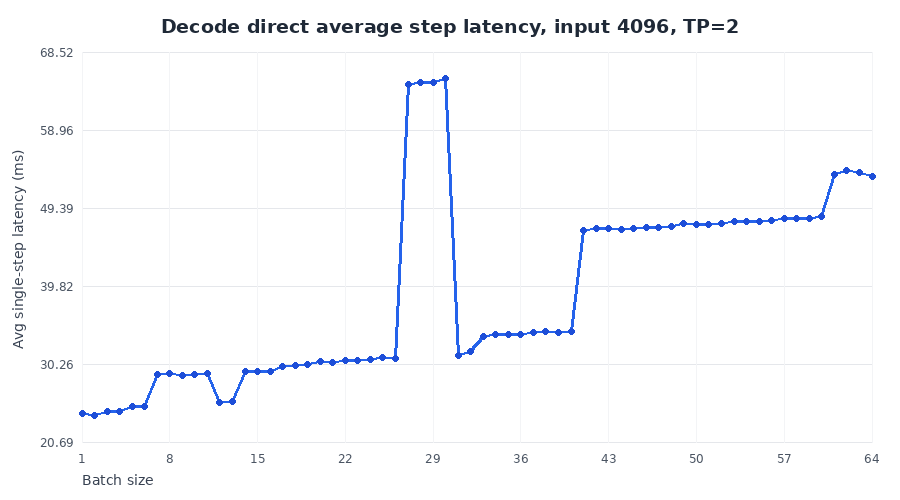
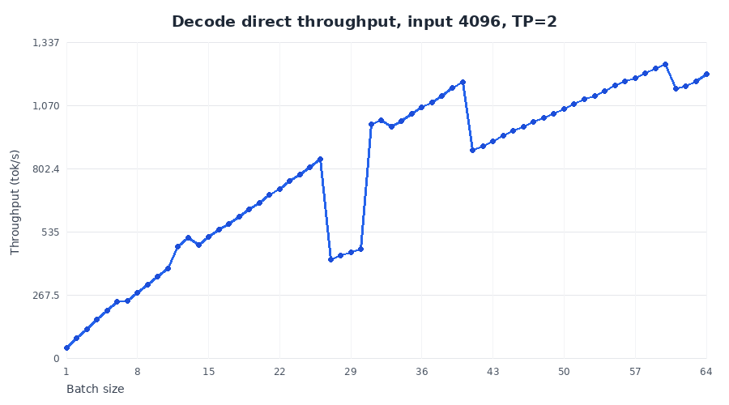
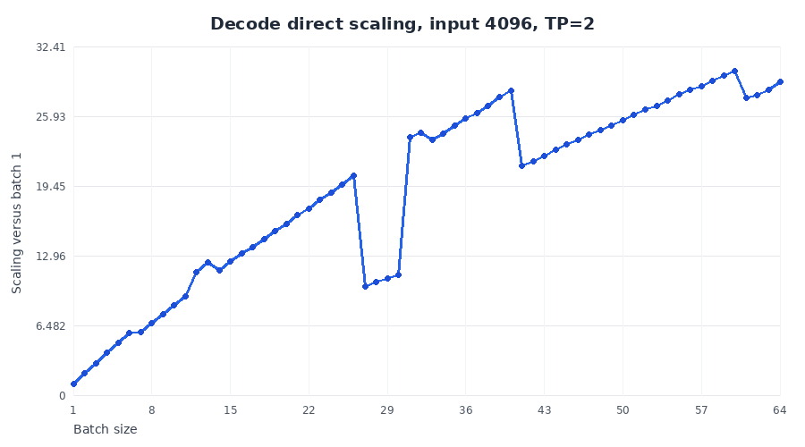

# Decode-Direct Input 4096 TP=2 性能报告

## 运行环境

| 项目 | 值 |
| ---: | ---: |
| 日期 | 2026-11-23 19:39:34-19:45:17（Asia/Shanghai） |
| 平台 | Hygon BW1000 |
| 设备 | 2 x Hygon BW1000 HCU，64 GB HBM，CUDA_VISIBLE_DEVICES 按前 2 张分配 |
| Driver / runtime | 6.3.30-V1.4.1a / DTK 26.04-rc4 |
| InfiniLM build | 分支 `pd-v0.2.9-v1-tp`，commit `da7d18e7` |
| 模型 | `/data/shared/.infinifabric-models-20261027-fef304a05440/Qwen3-8B--b968826d9c46dd6066d109eabc6255188de91218` |
| 模式 | `decode-direct` |
| Attention backend | `flash-attn` |
| Graph request | enabled |
| Expected execution mode | `graph` |
| Cache | paged KV cache，block size 256，num blocks 1088 |
| Max batched tokens | 18,432 |
| Tensor parallel size | 2 |
| Input length | 4096 tokens / request |
| Batch size range | 1..64 |
| Decode steps per repeat | 4 |
| Warmup / measured repeats | 每个形状 3 次 / 30 次 |
| Batch 执行顺序 | random seed 2026 |


本报告对应原始 JSONL 和 log 为本机运行产物，不随仓库提交：

```text
../../../benchmark-hygon-bw-tp2-decode-direct-input4096.jsonl
../../../benchmark-hygon-bw-tp2-decode-direct-input4096.log
```

## 构建与测试命令

```bash
xmake build _infinilm && xmake install _infinilm
```

```bash
SKIP_BUILD=1 TP=2 GPU=0,1 \
MODE=decode-direct \
INPUT_LEN=4096 \
BATCH_SIZES="$(seq -s, 1 64)" REPEATS=30 \
OUTPUT=benchmark-hygon-bw-tp2-decode-direct-input4096.jsonl ./run_bench_hygon.sh
```

## 执行模式与 Graph 覆盖

- Graph request: enabled
- Expected execution mode: `graph`
- Graph-covered batches: 1..64
- Eager-fallback batches: none
- Mode source: compiler rule；该字段不是 C++ runtime 回传的实际执行模式。

## 资源开销

| 项目 | 值 |
| ---: | ---: |
| Workspace allocation | 每 rank 1,116 MiB，TP=2 合计 2,232 MiB |
| 权重加载时间 | 11.29 s |
| Graph compilation time | 未单独打点；包含在进程初始化到首个 sample 的 wall time 中 |
| Paged cache blocks | 1,088 |
| 正式 sample 数 | 7,680 |
| 进程 wall time | 342 s (first runtime log to final JSONL write) |
| Monitor peak HCU memory use | 50%（本 run 时间窗，分配 HCUs，10 秒采样） |
| Monitor peak package power | 320.0 W（本 run 时间窗，分配 HCUs，10 秒采样） |
| Monitor peak sensor temperature | 62.0 C（本 run 时间窗，edge/junction，10 秒采样） |


## 测试口径

- Direct decode 不执行语义 prefill，paged KV cache 全 0 初始化。
- Step 0 使用 dummy token；step 1..3 使用上一步 sampled token。
- 每次 repeat 执行 4 个 decode step。
- `avg_step_latency = four_step_repeat_duration / 4`。
- 完整结果表聚合每个 batch 的 120 个 individual step samples。
- `single_step_throughput = batch_size / avg_step_latency`。
- 计时边界为 `engine_forward_including_sampling`。
- 分位数使用线性插值；每个 batch 只有 30 个 repeat，p99 是尾部参考。

## 核心结果

| 指标 | 结果 |
| ---: | ---: |
| 最高 single-step throughput | batch 60，1,241.38 tok/s |
| 最快 batch 平均 step latency | batch 2，23.988 ms |
| 最大 batch scaling | 29.106x |
| Ideal-scaling efficiency | 45.5% |
| Median step std | 0.017 ms |
| Maximum step std | 0.255 ms，batch 19 |


## 趋势图

### 1. Batch size 与 Avg Step Latency



平均 step latency 从 batch 1 的 24.235 ms 变为 batch 64 的 53.289 ms。

### 2. Batch size 与 Single-step Throughput



吞吐峰值出现在 batch 60，为 1,241.38 tok/s。

### 3. Batch size 与 Scaling



batch 64 相对 batch 1 的 scaling 为 29.106x；理想 64x 效率约 45.5%。

## Batch 区间平均 latency 与吞吐

下表按连续 16 个 batch 分组。平均值是区间内各 batch 聚合 single-step 统计的算术平均；区间最优 batch 取吞吐最高的 batch。

| Batch 区间 | 平均单 step latency ms | 平均吞吐 tok/s | 区间最优 batch |
| ---: | ---: | ---: | ---: |
| 1..16 | 26.949 | 307.23 | 16 |
| 17..32 | 39.242 | 674.06 | 32 |
| 33..48 | 40.453 | 1,010.85 | 40 |
| 49..64 | 49.245 | 1,146.46 | 60 |


## 关键批次与跳变

| Change | Mode transition | Avg step ms | Throughput tok/s | Observation |
| --- | ---: | ---: | ---: | --- |
| 26 -> 27 | graph | 30.886 -> 64.550 | 841.81 -> 418.28 | 平均 step latency 增加 109.0%，可能对应 kernel shape 或 workspace 分档变化 |
| 40 -> 41 | graph | 34.241 -> 46.671 | 1,168.18 -> 878.49 | 平均 step latency 增加 36.3%，可能对应 kernel shape 或 workspace 分档变化 |
| 6 -> 7 | graph | 25.081 -> 28.912 | 239.22 -> 242.11 | 平均 step latency 增加 15.3%，可能对应 kernel shape 或 workspace 分档变化 |
| 13 -> 14 | graph | 25.599 -> 29.299 | 507.82 -> 477.84 | 平均 step latency 增加 14.5%，可能对应 kernel shape 或 workspace 分档变化 |
| 60 -> 61 | graph | 48.333 -> 53.460 | 1,241.38 -> 1,141.04 | 平均 step latency 增加 10.6%，可能对应 kernel shape 或 workspace 分档变化 |
| 32 -> 33 | graph | 31.783 -> 33.673 | 1,006.82 -> 980.00 | 平均 step latency 增加 5.9%，可能对应 kernel shape 或 workspace 分档变化 |


## Step 一致性

峰值 batch 60 的 4 个 decode step 结果如下：

| Step | Past KV length | Avg step ms | Std ms | Throughput tok/s |
| ---: | ---: | ---: | ---: | ---: |
| 0 | 4096 | 48.335 | 0.025 | 1,241.34 |
| 1 | 4097 | 48.332 | 0.034 | 1,241.42 |
| 2 | 4098 | 48.334 | 0.016 | 1,241.37 |
| 3 | 4099 | 48.333 | 0.018 | 1,241.39 |


所有 batch 中，4 个 step 平均耗时最大差异为 0.090 ms，出现在 batch 19。差异包含 past KV length 增长和 step kernel 形状影响。

## 数据稳定性

- 单 step std 中位数为 0.017 ms。
- 最大 std 为 0.255 ms，出现在 batch 19。
- 各 batch p99 与 max 接近，尾部稳定；每个 batch 只有 30 个 repeat，p99 仍是尾部参考值。

## TP 对比摘要

| TP | Best batch | Peak throughput tok/s | Scaling vs TP=1 |
| ---: | ---: | ---: | ---: |
| 1 | 60 | 757.36 | 1.000x |
| 2 | 60 | 1,241.38 | 1.639x |
| 4 | 63 | 2,021.80 | 2.670x |


## Single-step 完整结果

### Batch 1..16

| Batch | Mode | Avg Step ms | Min Step ms | P50 Step ms | P95 Step ms | P99 Step ms | Max Step ms | Std Step ms | Single-step tok/s | Scaling |
| ---: | --- | ---: | ---: | ---: | ---: | ---: | ---: | ---: | ---: | ---: |
| 1 | graph | 24.235 | 24.178 | 24.236 | 24.267 | 24.286 | 24.313 | 0.020 | 41.26 | 1.000x |
| 2 | graph | 23.988 | 23.960 | 23.987 | 24.006 | 24.023 | 24.088 | 0.014 | 83.38 | 2.021x |
| 3 | graph | 24.488 | 24.464 | 24.488 | 24.504 | 24.516 | 24.519 | 0.011 | 122.51 | 2.969x |
| 4 | graph | 24.440 | 24.415 | 24.441 | 24.460 | 24.477 | 24.481 | 0.012 | 163.66 | 3.966x |
| 5 | graph | 25.024 | 24.998 | 25.023 | 25.046 | 25.054 | 25.065 | 0.013 | 199.81 | 4.842x |
| 6 | graph | 25.081 | 25.060 | 25.079 | 25.101 | 25.120 | 25.123 | 0.012 | 239.22 | 5.798x |
| 7 | graph | 28.912 | 28.875 | 28.913 | 28.932 | 28.951 | 28.955 | 0.014 | 242.11 | 5.868x |
| 8 | graph | 29.050 | 29.015 | 29.049 | 29.071 | 29.081 | 29.090 | 0.013 | 275.39 | 6.674x |
| 9 | graph | 28.856 | 28.822 | 28.856 | 28.879 | 28.892 | 28.896 | 0.014 | 311.89 | 7.559x |
| 10 | graph | 29.002 | 28.968 | 29.000 | 29.035 | 29.059 | 29.074 | 0.017 | 344.80 | 8.356x |
| 11 | graph | 29.031 | 28.948 | 29.029 | 29.057 | 29.071 | 29.076 | 0.017 | 378.91 | 9.183x |
| 12 | graph | 25.521 | 25.497 | 25.521 | 25.537 | 25.550 | 25.554 | 0.011 | 470.19 | 11.395x |
| 13 | graph | 25.599 | 25.562 | 25.600 | 25.620 | 25.629 | 25.633 | 0.013 | 507.82 | 12.307x |
| 14 | graph | 29.299 | 29.260 | 29.297 | 29.325 | 29.336 | 29.341 | 0.016 | 477.84 | 11.581x |
| 15 | graph | 29.295 | 29.254 | 29.284 | 29.349 | 29.357 | 29.360 | 0.029 | 512.04 | 12.409x |
| 16 | graph | 29.370 | 29.335 | 29.370 | 29.393 | 29.400 | 29.408 | 0.014 | 544.78 | 13.203x |


### Batch 17..32

| Batch | Mode | Avg Step ms | Min Step ms | P50 Step ms | P95 Step ms | P99 Step ms | Max Step ms | Std Step ms | Single-step tok/s | Scaling |
| ---: | --- | ---: | ---: | ---: | ---: | ---: | ---: | ---: | ---: | ---: |
| 17 | graph | 29.999 | 29.968 | 29.999 | 30.024 | 30.032 | 30.035 | 0.014 | 566.68 | 13.734x |
| 18 | graph | 30.062 | 30.020 | 30.060 | 30.084 | 30.099 | 30.102 | 0.014 | 598.77 | 14.511x |
| 19 | graph | 30.195 | 30.144 | 30.170 | 30.195 | 30.217 | 32.974 | 0.255 | 629.25 | 15.250x |
| 20 | graph | 30.529 | 30.495 | 30.529 | 30.554 | 30.560 | 30.563 | 0.014 | 655.11 | 15.877x |
| 21 | graph | 30.393 | 30.348 | 30.394 | 30.420 | 30.428 | 30.430 | 0.016 | 690.95 | 16.745x |
| 22 | graph | 30.724 | 30.692 | 30.721 | 30.752 | 30.769 | 30.774 | 0.017 | 716.06 | 17.354x |
| 23 | graph | 30.746 | 30.716 | 30.747 | 30.769 | 30.780 | 30.802 | 0.014 | 748.07 | 18.130x |
| 24 | graph | 30.855 | 30.818 | 30.853 | 30.879 | 30.890 | 30.918 | 0.015 | 777.83 | 18.851x |
| 25 | graph | 31.012 | 30.970 | 31.011 | 31.035 | 31.150 | 31.241 | 0.030 | 806.13 | 19.537x |
| 26 | graph | 30.886 | 30.840 | 30.886 | 30.914 | 30.932 | 30.937 | 0.018 | 841.81 | 20.402x |
| 27 | graph | 64.550 | 64.516 | 64.551 | 64.578 | 64.586 | 64.597 | 0.017 | 418.28 | 10.137x |
| 28 | graph | 64.762 | 64.715 | 64.761 | 64.793 | 64.812 | 64.824 | 0.019 | 432.35 | 10.478x |
| 29 | graph | 64.813 | 64.773 | 64.812 | 64.844 | 64.862 | 64.866 | 0.018 | 447.44 | 10.844x |
| 30 | graph | 65.224 | 65.184 | 65.226 | 65.253 | 65.262 | 65.263 | 0.019 | 459.95 | 11.147x |
| 31 | graph | 31.332 | 31.299 | 31.332 | 31.360 | 31.367 | 31.370 | 0.016 | 989.39 | 23.978x |
| 32 | graph | 31.783 | 31.751 | 31.783 | 31.809 | 31.816 | 31.817 | 0.014 | 1,006.82 | 24.401x |


### Batch 33..48

| Batch | Mode | Avg Step ms | Min Step ms | P50 Step ms | P95 Step ms | P99 Step ms | Max Step ms | Std Step ms | Single-step tok/s | Scaling |
| ---: | --- | ---: | ---: | ---: | ---: | ---: | ---: | ---: | ---: | ---: |
| 33 | graph | 33.673 | 33.635 | 33.674 | 33.698 | 33.707 | 33.708 | 0.015 | 980.00 | 23.751x |
| 34 | graph | 33.868 | 33.839 | 33.868 | 33.893 | 33.904 | 33.912 | 0.015 | 1,003.89 | 24.330x |
| 35 | graph | 33.846 | 33.814 | 33.846 | 33.870 | 33.886 | 33.888 | 0.016 | 1,034.11 | 25.062x |
| 36 | graph | 33.871 | 33.834 | 33.870 | 33.897 | 33.908 | 33.924 | 0.015 | 1,062.86 | 25.759x |
| 37 | graph | 34.159 | 34.063 | 34.158 | 34.191 | 34.285 | 34.487 | 0.041 | 1,083.18 | 26.251x |
| 38 | graph | 34.255 | 34.222 | 34.255 | 34.281 | 34.295 | 34.297 | 0.016 | 1,109.32 | 26.885x |
| 39 | graph | 34.148 | 34.098 | 34.139 | 34.218 | 34.243 | 34.342 | 0.038 | 1,142.08 | 27.679x |
| 40 | graph | 34.241 | 34.197 | 34.240 | 34.265 | 34.276 | 34.280 | 0.014 | 1,168.18 | 28.311x |
| 41 | graph | 46.671 | 46.614 | 46.671 | 46.700 | 46.714 | 46.729 | 0.019 | 878.49 | 21.291x |
| 42 | graph | 46.825 | 46.776 | 46.823 | 46.854 | 46.874 | 46.912 | 0.019 | 896.97 | 21.738x |
| 43 | graph | 46.880 | 46.827 | 46.879 | 46.917 | 46.973 | 47.037 | 0.029 | 917.24 | 22.230x |
| 44 | graph | 46.775 | 46.736 | 46.774 | 46.801 | 46.810 | 46.854 | 0.019 | 940.68 | 22.798x |
| 45 | graph | 46.865 | 46.829 | 46.864 | 46.896 | 46.912 | 46.928 | 0.018 | 960.20 | 23.271x |
| 46 | graph | 46.944 | 46.871 | 46.940 | 46.974 | 47.060 | 47.076 | 0.026 | 979.88 | 23.748x |
| 47 | graph | 47.056 | 47.017 | 47.054 | 47.083 | 47.101 | 47.110 | 0.017 | 998.81 | 24.207x |
| 48 | graph | 47.167 | 47.121 | 47.164 | 47.214 | 47.229 | 47.236 | 0.023 | 1,017.66 | 24.663x |


### Batch 49..64

| Batch | Mode | Avg Step ms | Min Step ms | P50 Step ms | P95 Step ms | P99 Step ms | Max Step ms | Std Step ms | Single-step tok/s | Scaling |
| ---: | --- | ---: | ---: | ---: | ---: | ---: | ---: | ---: | ---: | ---: |
| 49 | graph | 47.439 | 47.400 | 47.438 | 47.468 | 47.479 | 47.485 | 0.017 | 1,032.90 | 25.033x |
| 50 | graph | 47.396 | 47.349 | 47.395 | 47.429 | 47.437 | 47.438 | 0.018 | 1,054.94 | 25.567x |
| 51 | graph | 47.393 | 47.354 | 47.390 | 47.421 | 47.435 | 47.435 | 0.015 | 1,076.10 | 26.080x |
| 52 | graph | 47.513 | 47.449 | 47.513 | 47.548 | 47.568 | 47.582 | 0.020 | 1,094.44 | 26.524x |
| 53 | graph | 47.750 | 47.702 | 47.749 | 47.779 | 47.794 | 47.802 | 0.019 | 1,109.95 | 26.900x |
| 54 | graph | 47.723 | 47.663 | 47.723 | 47.757 | 47.777 | 47.784 | 0.021 | 1,131.54 | 27.423x |
| 55 | graph | 47.721 | 47.682 | 47.721 | 47.749 | 47.761 | 47.762 | 0.017 | 1,152.53 | 27.932x |
| 56 | graph | 47.848 | 47.781 | 47.847 | 47.889 | 47.901 | 47.968 | 0.024 | 1,170.37 | 28.364x |
| 57 | graph | 48.152 | 48.105 | 48.153 | 48.181 | 48.201 | 48.209 | 0.018 | 1,183.76 | 28.689x |
| 58 | graph | 48.121 | 48.080 | 48.120 | 48.157 | 48.163 | 48.194 | 0.021 | 1,205.30 | 29.211x |
| 59 | graph | 48.107 | 48.063 | 48.107 | 48.140 | 48.155 | 48.159 | 0.019 | 1,226.42 | 29.723x |
| 60 | graph | 48.333 | 48.247 | 48.334 | 48.368 | 48.377 | 48.444 | 0.024 | 1,241.38 | 30.085x |
| 61 | graph | 53.460 | 53.391 | 53.461 | 53.503 | 53.508 | 53.512 | 0.024 | 1,141.04 | 27.654x |
| 62 | graph | 53.957 | 53.675 | 53.956 | 54.161 | 54.219 | 54.236 | 0.110 | 1,149.06 | 27.848x |
| 63 | graph | 53.724 | 53.658 | 53.723 | 53.768 | 53.783 | 53.795 | 0.026 | 1,172.65 | 28.420x |
| 64 | graph | 53.289 | 53.222 | 53.289 | 53.332 | 53.342 | 53.374 | 0.029 | 1,200.99 | 29.106x |


## 分析

1. Single-step 吞吐随 batch 增加总体上升，峰值在 batch 60，为 1,241.38 tok/s。
2. 平均 step latency 随 batch 增加而上升，batch 1 为 24.235 ms，batch 64 为 53.289 ms。
3. Decode step 的 past KV length 从 4096 增至 4099；该变化对平均耗时影响较小，主要 scaling 仍来自 batch 并行度。
4. 连续 batch 的正向 latency 跳变通常对应 kernel shape、workspace 分档或 attention tile 变化，不能解释为连续线性退化。
5. step std 中位数 0.017 ms，最大 0.255 ms，整体测量稳定。

## 结论与建议

1. 该形状下优先在 batch 60 附近获得最高 decode 总吞吐。
2. 最大 batch ideal-scaling 效率为 45.5%，说明 per-step attention/MLP latency 随 batch 增长明显。
3. graph 已覆盖全部有效 batch；TP=1 input 1024 如需 batch 256，应先降低 workspace/cache 压力或调整图编译策略。
4. 对关键跳变 batch 建议结合 C++ model-only timer 和 kernel profile 复核。
5. 若需要更稳定的 p99，建议将 `BENCHMARK_REPEATS` 提高到 100 或以上。

## 数据完整性

```text
config records: 1
step samples: 7680
overall summaries: 64
per-step summaries: 256
scaling records: 64
step samples per batch: 120
samples per decode step: 30
```
