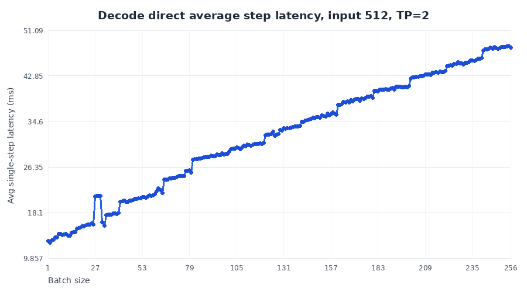
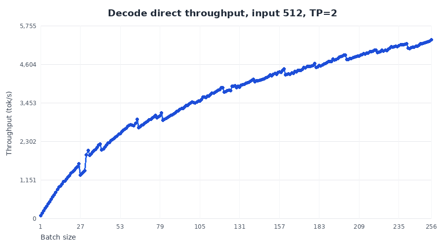
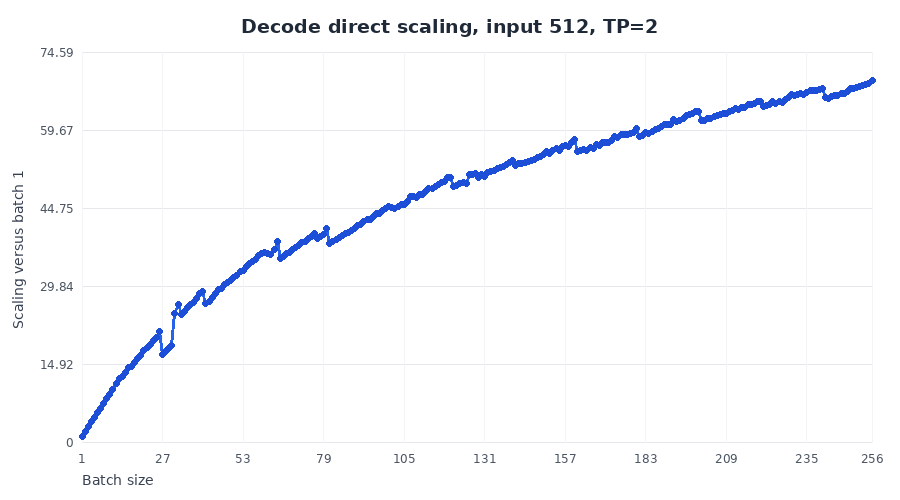

# Decode-Direct Input 512 TP=2 性能报告

## 运行环境

| 项目 | 值 |
| ---: | ---: |
| 日期 | 2026-11-23 18:45:14-19:04:05（Asia/Shanghai） |
| 平台 | Hygon BW1000 |
| 设备 | 2 x Hygon BW1000 HCU，64 GB HBM，CUDA_VISIBLE_DEVICES 按前 2 张分配 |
| Driver / runtime | 6.3.30-V1.4.1a / DTK 26.04-rc4 |
| InfiniLM build | 分支 `pd-v0.2.9-v1-tp`，commit `da7d18e7` |
| 模型 | `/data/shared/.infinifabric-models-20261027-fef304a05440/Qwen3-8B--b968826d9c46dd6066d109eabc6255188de91218` |
| 模式 | `decode-direct` |
| Attention backend | `flash-attn` |
| Graph request | enabled |
| Expected execution mode | `graph` |
| Cache | paged KV cache，block size 256，num blocks 768 |
| Max batched tokens | 18,432 |
| Tensor parallel size | 2 |
| Input length | 512 tokens / request |
| Batch size range | 1..256 |
| Decode steps per repeat | 4 |
| Warmup / measured repeats | 每个形状 3 次 / 30 次 |
| Batch 执行顺序 | random seed 2026 |


本报告对应原始 JSONL 和 log 为本机运行产物，不随仓库提交：

```text
../../../benchmark-hygon-bw-tp2-decode-direct-input512.jsonl
../../../benchmark-hygon-bw-tp2-decode-direct-input512.log
```

## 构建与测试命令

```bash
xmake build _infinilm && xmake install _infinilm
```

```bash
SKIP_BUILD=1 TP=2 GPU=0,1 \
MODE=decode-direct \
INPUT_LEN=512 \
BATCH_SIZES="$(seq -s, 1 256)" REPEATS=30 \
OUTPUT=benchmark-hygon-bw-tp2-decode-direct-input512.jsonl ./run_bench_hygon.sh
```

## 执行模式与 Graph 覆盖

- Graph request: enabled
- Expected execution mode: `graph`
- Graph-covered batches: 1..256
- Eager-fallback batches: none
- Mode source: compiler rule；该字段不是 C++ runtime 回传的实际执行模式。

## 资源开销

| 项目 | 值 |
| ---: | ---: |
| Workspace allocation | 每 rank 1,116 MiB，TP=2 合计 2,232 MiB |
| 权重加载时间 | 46.67 s |
| Graph compilation time | 未单独打点；包含在进程初始化到首个 sample 的 wall time 中 |
| Paged cache blocks | 768 |
| 正式 sample 数 | 30,720 |
| 进程 wall time | 1131 s (first runtime log to final JSONL write) |
| Monitor peak HCU memory use | 41%（本 run 时间窗，分配 HCUs，10 秒采样） |
| Monitor peak package power | 324.0 W（本 run 时间窗，分配 HCUs，10 秒采样） |
| Monitor peak sensor temperature | 62.0 C（本 run 时间窗，edge/junction，10 秒采样） |


## 测试口径

- Direct decode 不执行语义 prefill，paged KV cache 全 0 初始化。
- Step 0 使用 dummy token；step 1..3 使用上一步 sampled token。
- 每次 repeat 执行 4 个 decode step。
- `avg_step_latency = four_step_repeat_duration / 4`。
- 完整结果表聚合每个 batch 的 120 个 individual step samples。
- `single_step_throughput = batch_size / avg_step_latency`。
- 计时边界为 `engine_forward_including_sampling`。
- 分位数使用线性插值；每个 batch 只有 30 个 repeat，p99 是尾部参考。

## 核心结果

| 指标 | 结果 |
| ---: | ---: |
| 最高 single-step throughput | batch 256，5,334.23 tok/s |
| 最快 batch 平均 step latency | batch 2，12.701 ms |
| 最大 batch scaling | 69.137x |
| Ideal-scaling efficiency | 27.0% |
| Median step std | 0.036 ms |
| Maximum step std | 0.107 ms，batch 24 |


## 趋势图

### 1. Batch size 与 Avg Step Latency



平均 step latency 从 batch 1 的 12.961 ms 变为 batch 256 的 47.992 ms。

### 2. Batch size 与 Single-step Throughput



吞吐峰值出现在 batch 256，为 5,334.23 tok/s。

### 3. Batch size 与 Scaling



batch 256 相对 batch 1 的 scaling 为 69.137x；理想 256x 效率约 27.0%。

## Batch 区间平均 latency 与吞吐

下表按连续 16 个 batch 分组。平均值是区间内各 batch 聚合 single-step 统计的算术平均；区间最优 batch 取吞吐最高的 batch。

| Batch 区间 | 平均单 step latency ms | 平均吞吐 tok/s | 区间最优 batch |
| ---: | ---: | ---: | ---: |
| 1..16 | 13.849 | 602.39 | 16 |
| 17..32 | 17.082 | 1,437.91 | 32 |
| 33..48 | 19.003 | 2,125.79 | 48 |
| 49..64 | 21.212 | 2,660.29 | 64 |
| 65..80 | 24.702 | 2,932.60 | 80 |
| 81..96 | 28.146 | 3,143.03 | 96 |
| 97..112 | 29.574 | 3,531.97 | 112 |
| 113..128 | 31.397 | 3,837.26 | 128 |
| 129..144 | 33.752 | 4,043.27 | 140 |
| 145..160 | 35.586 | 4,284.70 | 160 |
| 161..176 | 38.284 | 4,400.66 | 176 |
| 177..192 | 40.038 | 4,607.74 | 192 |
| 193..208 | 41.762 | 4,801.10 | 199 |
| 209..224 | 43.721 | 4,951.51 | 219 |
| 225..240 | 45.419 | 5,118.54 | 240 |
| 241..256 | 47.903 | 5,187.27 | 256 |


## 关键批次与跳变

| Change | Mode transition | Avg step ms | Throughput tok/s | Observation |
| --- | ---: | ---: | ---: | --- |
| 26 -> 27 | graph | 15.978 -> 20.971 | 1,627.25 -> 1,287.52 | 平均 step latency 增加 31.2%，可能对应 kernel shape 或 workspace 分档变化 |
| 32 -> 33 | graph | 15.732 -> 17.598 | 2,034.06 -> 1,875.21 | 平均 step latency 增加 11.9%，可能对应 kernel shape 或 workspace 分档变化 |
| 40 -> 41 | graph | 18.032 -> 20.063 | 2,218.29 -> 2,043.57 | 平均 step latency 增加 11.3%，可能对应 kernel shape 或 workspace 分档变化 |
| 64 -> 65 | graph | 21.683 -> 24.038 | 2,951.66 -> 2,704.06 | 平均 step latency 增加 10.9%，可能对应 kernel shape 或 workspace 分档变化 |
| 80 -> 81 | graph | 25.395 -> 27.689 | 3,150.20 -> 2,925.35 | 平均 step latency 增加 9.0%，可能对应 kernel shape 或 workspace 分档变化 |
| 160 -> 161 | graph | 35.844 -> 37.613 | 4,463.74 -> 4,280.44 | 平均 step latency 增加 4.9%，可能对应 kernel shape 或 workspace 分档变化 |


## Step 一致性

峰值 batch 256 的 4 个 decode step 结果如下：

| Step | Past KV length | Avg step ms | Std ms | Throughput tok/s |
| ---: | ---: | ---: | ---: | ---: |
| 0 | 512 | 47.966 | 0.054 | 5,337.16 |
| 1 | 513 | 47.988 | 0.069 | 5,334.69 |
| 2 | 514 | 48.024 | 0.047 | 5,330.67 |
| 3 | 515 | 47.990 | 0.059 | 5,334.40 |


所有 batch 中，4 个 step 平均耗时最大差异为 0.073 ms，出现在 batch 163。差异包含 past KV length 增长和 step kernel 形状影响。

## 数据稳定性

- 单 step std 中位数为 0.036 ms。
- 最大 std 为 0.107 ms，出现在 batch 24。
- 各 batch p99 与 max 接近，尾部稳定；每个 batch 只有 30 个 repeat，p99 仍是尾部参考值。

## TP 对比摘要

| TP | Best batch | Peak throughput tok/s | Scaling vs TP=1 |
| ---: | ---: | ---: | ---: |
| 1 | 254 | 3,176.67 | 1.000x |
| 2 | 256 | 5,334.23 | 1.679x |
| 4 | 256 | 7,169.85 | 2.257x |


## Single-step 完整结果

### Batch 1..16

| Batch | Mode | Avg Step ms | Min Step ms | P50 Step ms | P95 Step ms | P99 Step ms | Max Step ms | Std Step ms | Single-step tok/s | Scaling |
| ---: | --- | ---: | ---: | ---: | ---: | ---: | ---: | ---: | ---: | ---: |
| 1 | graph | 12.961 | 12.915 | 12.962 | 12.994 | 13.001 | 13.018 | 0.019 | 77.15 | 1.000x |
| 2 | graph | 12.701 | 12.678 | 12.702 | 12.719 | 12.750 | 12.790 | 0.015 | 157.47 | 2.041x |
| 3 | graph | 13.111 | 13.078 | 13.112 | 13.132 | 13.157 | 13.170 | 0.015 | 228.81 | 2.966x |
| 4 | graph | 13.152 | 13.132 | 13.150 | 13.170 | 13.190 | 13.208 | 0.011 | 304.14 | 3.942x |
| 5 | graph | 13.636 | 13.608 | 13.635 | 13.656 | 13.663 | 13.668 | 0.012 | 366.67 | 4.752x |
| 6 | graph | 13.641 | 13.603 | 13.625 | 13.670 | 14.054 | 14.321 | 0.083 | 439.85 | 5.701x |
| 7 | graph | 14.207 | 14.180 | 14.205 | 14.227 | 14.275 | 14.309 | 0.015 | 492.71 | 6.386x |
| 8 | graph | 14.263 | 14.237 | 14.257 | 14.297 | 14.382 | 14.529 | 0.033 | 560.88 | 7.270x |
| 9 | graph | 14.065 | 14.044 | 14.064 | 14.082 | 14.085 | 14.086 | 0.009 | 639.90 | 8.294x |
| 10 | graph | 14.156 | 14.132 | 14.155 | 14.178 | 14.187 | 14.191 | 0.011 | 706.41 | 9.156x |
| 11 | graph | 14.281 | 14.255 | 14.280 | 14.300 | 14.311 | 14.319 | 0.012 | 770.26 | 9.983x |
| 12 | graph | 13.902 | 13.872 | 13.900 | 13.926 | 13.934 | 13.942 | 0.012 | 863.16 | 11.187x |
| 13 | graph | 13.933 | 13.907 | 13.931 | 13.960 | 13.972 | 13.996 | 0.014 | 933.02 | 12.093x |
| 14 | graph | 14.496 | 14.476 | 14.496 | 14.511 | 14.537 | 14.554 | 0.011 | 965.76 | 12.517x |
| 15 | graph | 14.532 | 14.513 | 14.530 | 14.546 | 14.557 | 14.604 | 0.011 | 1,032.23 | 13.379x |
| 16 | graph | 14.548 | 14.523 | 14.548 | 14.562 | 14.574 | 14.597 | 0.010 | 1,099.84 | 14.255x |


### Batch 17..32

| Batch | Mode | Avg Step ms | Min Step ms | P50 Step ms | P95 Step ms | P99 Step ms | Max Step ms | Std Step ms | Single-step tok/s | Scaling |
| ---: | --- | ---: | ---: | ---: | ---: | ---: | ---: | ---: | ---: | ---: |
| 17 | graph | 15.185 | 15.166 | 15.184 | 15.201 | 15.208 | 15.212 | 0.010 | 1,119.53 | 14.510x |
| 18 | graph | 15.266 | 15.241 | 15.264 | 15.288 | 15.317 | 15.340 | 0.014 | 1,179.08 | 15.282x |
| 19 | graph | 15.364 | 15.338 | 15.363 | 15.388 | 15.406 | 15.411 | 0.014 | 1,236.68 | 16.029x |
| 20 | graph | 15.666 | 15.637 | 15.665 | 15.690 | 15.701 | 15.753 | 0.015 | 1,276.68 | 16.547x |
| 21 | graph | 15.589 | 15.563 | 15.585 | 15.612 | 15.704 | 15.825 | 0.029 | 1,347.06 | 17.459x |
| 22 | graph | 15.855 | 15.827 | 15.854 | 15.873 | 15.935 | 15.969 | 0.017 | 1,387.58 | 17.984x |
| 23 | graph | 15.916 | 15.891 | 15.916 | 15.938 | 15.949 | 15.985 | 0.014 | 1,445.09 | 18.730x |
| 24 | graph | 15.981 | 15.826 | 16.004 | 16.174 | 16.320 | 16.406 | 0.107 | 1,501.81 | 19.465x |
| 25 | graph | 16.143 | 16.103 | 16.140 | 16.178 | 16.213 | 16.227 | 0.018 | 1,548.65 | 20.072x |
| 26 | graph | 15.978 | 15.948 | 15.977 | 16.001 | 16.008 | 16.059 | 0.014 | 1,627.25 | 21.091x |
| 27 | graph | 20.971 | 20.945 | 20.970 | 20.991 | 20.997 | 20.998 | 0.011 | 1,287.52 | 16.688x |
| 28 | graph | 21.071 | 21.038 | 21.068 | 21.098 | 21.108 | 21.152 | 0.016 | 1,328.83 | 17.223x |
| 29 | graph | 21.066 | 21.040 | 21.064 | 21.086 | 21.092 | 21.100 | 0.011 | 1,376.62 | 17.842x |
| 30 | graph | 21.142 | 21.118 | 21.142 | 21.160 | 21.187 | 21.192 | 0.012 | 1,418.95 | 18.391x |
| 31 | graph | 16.392 | 16.367 | 16.392 | 16.411 | 16.422 | 16.455 | 0.013 | 1,891.12 | 24.511x |
| 32 | graph | 15.732 | 15.703 | 15.726 | 15.750 | 15.863 | 16.084 | 0.037 | 2,034.06 | 26.363x |


### Batch 33..48

| Batch | Mode | Avg Step ms | Min Step ms | P50 Step ms | P95 Step ms | P99 Step ms | Max Step ms | Std Step ms | Single-step tok/s | Scaling |
| ---: | --- | ---: | ---: | ---: | ---: | ---: | ---: | ---: | ---: | ---: |
| 33 | graph | 17.598 | 17.572 | 17.596 | 17.615 | 17.634 | 17.656 | 0.012 | 1,875.21 | 24.305x |
| 34 | graph | 17.715 | 17.674 | 17.706 | 17.804 | 17.903 | 17.906 | 0.043 | 1,919.26 | 24.875x |
| 35 | graph | 17.696 | 17.670 | 17.694 | 17.720 | 17.741 | 17.772 | 0.014 | 1,977.79 | 25.634x |
| 36 | graph | 17.736 | 17.713 | 17.734 | 17.756 | 17.766 | 17.768 | 0.011 | 2,029.80 | 26.308x |
| 37 | graph | 17.954 | 17.914 | 17.954 | 17.977 | 17.986 | 18.014 | 0.013 | 2,060.77 | 26.710x |
| 38 | graph | 17.950 | 17.927 | 17.949 | 17.973 | 17.992 | 18.011 | 0.013 | 2,116.96 | 27.438x |
| 39 | graph | 17.858 | 17.816 | 17.851 | 17.904 | 17.931 | 17.935 | 0.024 | 2,183.95 | 28.306x |
| 40 | graph | 18.032 | 17.999 | 18.031 | 18.052 | 18.059 | 18.119 | 0.013 | 2,218.29 | 28.751x |
| 41 | graph | 20.063 | 20.032 | 20.062 | 20.085 | 20.090 | 20.104 | 0.013 | 2,043.57 | 26.487x |
| 42 | graph | 20.193 | 20.160 | 20.193 | 20.212 | 20.241 | 20.277 | 0.014 | 2,079.93 | 26.958x |
| 43 | graph | 20.232 | 20.180 | 20.230 | 20.249 | 20.263 | 20.426 | 0.021 | 2,125.29 | 27.546x |
| 44 | graph | 20.040 | 20.011 | 20.038 | 20.069 | 20.086 | 20.097 | 0.016 | 2,195.61 | 28.457x |
| 45 | graph | 20.061 | 20.024 | 20.059 | 20.088 | 20.177 | 20.192 | 0.023 | 2,243.14 | 29.073x |
| 46 | graph | 20.250 | 20.213 | 20.250 | 20.273 | 20.307 | 20.312 | 0.016 | 2,271.56 | 29.442x |
| 47 | graph | 20.281 | 20.250 | 20.282 | 20.303 | 20.309 | 20.310 | 0.012 | 2,317.46 | 30.037x |
| 48 | graph | 20.390 | 20.356 | 20.387 | 20.416 | 20.434 | 20.560 | 0.022 | 2,354.05 | 30.511x |


### Batch 49..64

| Batch | Mode | Avg Step ms | Min Step ms | P50 Step ms | P95 Step ms | P99 Step ms | Max Step ms | Std Step ms | Single-step tok/s | Scaling |
| ---: | --- | ---: | ---: | ---: | ---: | ---: | ---: | ---: | ---: | ---: |
| 49 | graph | 20.612 | 20.584 | 20.612 | 20.632 | 20.641 | 20.687 | 0.014 | 2,377.20 | 30.811x |
| 50 | graph | 20.615 | 20.588 | 20.615 | 20.635 | 20.663 | 20.666 | 0.014 | 2,425.39 | 31.435x |
| 51 | graph | 20.730 | 20.703 | 20.730 | 20.751 | 20.788 | 20.809 | 0.015 | 2,460.16 | 31.886x |
| 52 | graph | 20.663 | 20.613 | 20.656 | 20.709 | 20.883 | 20.928 | 0.042 | 2,516.63 | 32.618x |
| 53 | graph | 20.902 | 20.874 | 20.902 | 20.921 | 20.931 | 20.939 | 0.013 | 2,535.63 | 32.864x |
| 54 | graph | 20.867 | 20.838 | 20.866 | 20.890 | 20.896 | 20.909 | 0.014 | 2,587.84 | 33.541x |
| 55 | graph | 20.827 | 20.791 | 20.826 | 20.849 | 20.888 | 20.918 | 0.017 | 2,640.79 | 34.227x |
| 56 | graph | 20.999 | 20.972 | 20.998 | 21.023 | 21.039 | 21.040 | 0.013 | 2,666.79 | 34.564x |
| 57 | graph | 21.218 | 21.184 | 21.217 | 21.246 | 21.252 | 21.252 | 0.014 | 2,686.41 | 34.818x |
| 58 | graph | 21.098 | 21.039 | 21.073 | 21.237 | 21.274 | 21.512 | 0.067 | 2,749.06 | 35.630x |
| 59 | graph | 21.194 | 21.151 | 21.192 | 21.226 | 21.235 | 21.260 | 0.016 | 2,783.84 | 36.081x |
| 60 | graph | 21.447 | 21.405 | 21.444 | 21.483 | 21.488 | 21.494 | 0.019 | 2,797.65 | 36.260x |
| 61 | graph | 21.949 | 21.899 | 21.948 | 21.977 | 21.990 | 21.991 | 0.016 | 2,779.21 | 36.021x |
| 62 | graph | 22.446 | 22.235 | 22.442 | 22.597 | 22.642 | 22.753 | 0.098 | 2,762.15 | 35.800x |
| 63 | graph | 22.150 | 22.118 | 22.151 | 22.175 | 22.186 | 22.194 | 0.016 | 2,844.29 | 36.865x |
| 64 | graph | 21.683 | 21.649 | 21.682 | 21.709 | 21.731 | 21.758 | 0.018 | 2,951.66 | 38.256x |


### Batch 65..80

| Batch | Mode | Avg Step ms | Min Step ms | P50 Step ms | P95 Step ms | P99 Step ms | Max Step ms | Std Step ms | Single-step tok/s | Scaling |
| ---: | --- | ---: | ---: | ---: | ---: | ---: | ---: | ---: | ---: | ---: |
| 65 | graph | 24.038 | 23.957 | 24.037 | 24.081 | 24.097 | 24.104 | 0.022 | 2,704.06 | 35.047x |
| 66 | graph | 24.072 | 24.032 | 24.073 | 24.102 | 24.117 | 24.121 | 0.018 | 2,741.74 | 35.536x |
| 67 | graph | 24.045 | 23.926 | 24.047 | 24.142 | 24.223 | 24.390 | 0.067 | 2,786.42 | 36.115x |
| 68 | graph | 24.277 | 24.228 | 24.274 | 24.311 | 24.335 | 24.468 | 0.027 | 2,800.95 | 36.303x |
| 69 | graph | 24.270 | 24.233 | 24.266 | 24.308 | 24.317 | 24.325 | 0.020 | 2,842.98 | 36.848x |
| 70 | graph | 24.352 | 24.262 | 24.354 | 24.380 | 24.391 | 24.392 | 0.020 | 2,874.56 | 37.257x |
| 71 | graph | 24.426 | 24.387 | 24.426 | 24.451 | 24.459 | 24.473 | 0.017 | 2,906.76 | 37.674x |
| 72 | graph | 24.485 | 24.420 | 24.482 | 24.517 | 24.534 | 24.541 | 0.019 | 2,940.61 | 38.113x |
| 73 | graph | 24.667 | 24.619 | 24.668 | 24.705 | 24.744 | 24.794 | 0.025 | 2,959.36 | 38.356x |
| 74 | graph | 24.674 | 24.626 | 24.671 | 24.701 | 24.735 | 24.767 | 0.020 | 2,999.16 | 38.872x |
| 75 | graph | 24.749 | 24.674 | 24.746 | 24.797 | 24.830 | 24.852 | 0.032 | 3,030.43 | 39.277x |
| 76 | graph | 24.692 | 24.644 | 24.687 | 24.732 | 24.804 | 24.865 | 0.028 | 3,077.97 | 39.893x |
| 77 | graph | 25.640 | 25.612 | 25.641 | 25.657 | 25.670 | 25.696 | 0.012 | 3,003.06 | 38.923x |
| 78 | graph | 25.704 | 25.648 | 25.703 | 25.726 | 25.737 | 25.750 | 0.014 | 3,034.60 | 39.331x |
| 79 | graph | 25.743 | 25.696 | 25.732 | 25.821 | 25.956 | 26.113 | 0.051 | 3,068.76 | 39.774x |
| 80 | graph | 25.395 | 25.360 | 25.393 | 25.422 | 25.424 | 25.432 | 0.015 | 3,150.20 | 40.830x |


### Batch 81..96

| Batch | Mode | Avg Step ms | Min Step ms | P50 Step ms | P95 Step ms | P99 Step ms | Max Step ms | Std Step ms | Single-step tok/s | Scaling |
| ---: | --- | ---: | ---: | ---: | ---: | ---: | ---: | ---: | ---: | ---: |
| 81 | graph | 27.689 | 27.599 | 27.689 | 27.721 | 27.730 | 27.746 | 0.020 | 2,925.35 | 37.915x |
| 82 | graph | 27.734 | 27.557 | 27.726 | 27.794 | 27.915 | 27.924 | 0.049 | 2,956.63 | 38.321x |
| 83 | graph | 27.780 | 27.689 | 27.780 | 27.812 | 27.823 | 27.831 | 0.023 | 2,987.80 | 38.725x |
| 84 | graph | 27.862 | 27.775 | 27.860 | 27.896 | 27.917 | 27.932 | 0.022 | 3,014.91 | 39.076x |
| 85 | graph | 27.917 | 27.856 | 27.917 | 27.944 | 27.981 | 27.993 | 0.019 | 3,044.69 | 39.462x |
| 86 | graph | 28.004 | 27.962 | 28.003 | 28.038 | 28.051 | 28.055 | 0.020 | 3,070.96 | 39.803x |
| 87 | graph | 28.080 | 27.992 | 28.084 | 28.122 | 28.141 | 28.182 | 0.029 | 3,098.33 | 40.157x |
| 88 | graph | 28.214 | 28.107 | 28.215 | 28.253 | 28.275 | 28.284 | 0.025 | 3,118.97 | 40.425x |
| 89 | graph | 28.196 | 28.101 | 28.198 | 28.235 | 28.252 | 28.275 | 0.025 | 3,156.43 | 40.910x |
| 90 | graph | 28.184 | 28.071 | 28.193 | 28.254 | 28.294 | 28.680 | 0.072 | 3,193.33 | 41.389x |
| 91 | graph | 28.372 | 28.316 | 28.374 | 28.404 | 28.434 | 28.452 | 0.023 | 3,207.39 | 41.571x |
| 92 | graph | 28.338 | 28.231 | 28.338 | 28.379 | 28.392 | 28.405 | 0.026 | 3,246.49 | 42.078x |
| 93 | graph | 28.307 | 28.254 | 28.306 | 28.340 | 28.357 | 28.380 | 0.020 | 3,285.38 | 42.582x |
| 94 | graph | 28.619 | 28.572 | 28.617 | 28.664 | 28.682 | 28.704 | 0.023 | 3,284.53 | 42.571x |
| 95 | graph | 28.531 | 28.473 | 28.529 | 28.572 | 28.587 | 28.597 | 0.023 | 3,329.76 | 43.157x |
| 96 | graph | 28.507 | 28.408 | 28.507 | 28.548 | 28.560 | 28.573 | 0.026 | 3,367.59 | 43.647x |


### Batch 97..112

| Batch | Mode | Avg Step ms | Min Step ms | P50 Step ms | P95 Step ms | P99 Step ms | Max Step ms | Std Step ms | Single-step tok/s | Scaling |
| ---: | --- | ---: | ---: | ---: | ---: | ---: | ---: | ---: | ---: | ---: |
| 97 | graph | 28.784 | 28.730 | 28.781 | 28.832 | 28.847 | 28.850 | 0.025 | 3,369.93 | 43.678x |
| 98 | graph | 28.640 | 28.533 | 28.648 | 28.688 | 28.702 | 28.718 | 0.037 | 3,421.75 | 44.349x |
| 99 | graph | 28.783 | 28.727 | 28.778 | 28.826 | 28.858 | 28.909 | 0.026 | 3,439.57 | 44.580x |
| 100 | graph | 28.739 | 28.687 | 28.736 | 28.778 | 28.787 | 28.796 | 0.022 | 3,479.64 | 45.100x |
| 101 | graph | 29.196 | 29.076 | 29.203 | 29.233 | 29.244 | 29.246 | 0.032 | 3,459.33 | 44.836x |
| 102 | graph | 29.567 | 29.449 | 29.571 | 29.618 | 29.640 | 29.784 | 0.042 | 3,449.84 | 44.713x |
| 103 | graph | 29.631 | 29.587 | 29.630 | 29.670 | 29.711 | 29.729 | 0.024 | 3,476.07 | 45.053x |
| 104 | graph | 29.667 | 29.574 | 29.666 | 29.704 | 29.749 | 29.783 | 0.026 | 3,505.53 | 45.435x |
| 105 | graph | 29.903 | 29.797 | 29.907 | 29.943 | 29.967 | 29.993 | 0.031 | 3,511.30 | 45.510x |
| 106 | graph | 29.814 | 29.775 | 29.812 | 29.844 | 29.852 | 29.855 | 0.018 | 3,555.43 | 46.082x |
| 107 | graph | 29.572 | 29.481 | 29.575 | 29.615 | 29.636 | 29.650 | 0.032 | 3,618.24 | 46.896x |
| 108 | graph | 29.864 | 29.811 | 29.862 | 29.898 | 29.905 | 29.951 | 0.021 | 3,616.36 | 46.872x |
| 109 | graph | 30.202 | 30.143 | 30.204 | 30.243 | 30.256 | 30.265 | 0.024 | 3,608.99 | 46.776x |
| 110 | graph | 30.112 | 30.043 | 30.109 | 30.157 | 30.189 | 30.426 | 0.038 | 3,653.04 | 47.347x |
| 111 | graph | 30.436 | 30.370 | 30.429 | 30.485 | 30.620 | 30.746 | 0.044 | 3,646.96 | 47.268x |
| 112 | graph | 30.274 | 30.168 | 30.277 | 30.315 | 30.331 | 30.333 | 0.030 | 3,699.56 | 47.950x |


### Batch 113..128

| Batch | Mode | Avg Step ms | Min Step ms | P50 Step ms | P95 Step ms | P99 Step ms | Max Step ms | Std Step ms | Single-step tok/s | Scaling |
| ---: | --- | ---: | ---: | ---: | ---: | ---: | ---: | ---: | ---: | ---: |
| 113 | graph | 30.249 | 30.193 | 30.238 | 30.281 | 30.622 | 30.671 | 0.065 | 3,735.65 | 48.418x |
| 114 | graph | 30.443 | 30.343 | 30.452 | 30.492 | 30.496 | 30.697 | 0.045 | 3,744.71 | 48.535x |
| 115 | graph | 30.539 | 30.409 | 30.547 | 30.605 | 30.618 | 30.636 | 0.046 | 3,765.73 | 48.808x |
| 116 | graph | 30.507 | 30.382 | 30.506 | 30.551 | 30.558 | 30.569 | 0.027 | 3,802.39 | 49.283x |
| 117 | graph | 30.571 | 30.460 | 30.569 | 30.620 | 30.671 | 30.880 | 0.040 | 3,827.09 | 49.603x |
| 118 | graph | 30.683 | 30.631 | 30.681 | 30.722 | 30.759 | 30.913 | 0.032 | 3,845.80 | 49.845x |
| 119 | graph | 30.511 | 30.459 | 30.509 | 30.552 | 30.575 | 30.582 | 0.024 | 3,900.30 | 50.552x |
| 120 | graph | 30.766 | 30.606 | 30.760 | 30.860 | 30.945 | 30.967 | 0.051 | 3,900.37 | 50.552x |
| 121 | graph | 32.109 | 32.058 | 32.107 | 32.147 | 32.161 | 32.180 | 0.022 | 3,768.45 | 48.843x |
| 122 | graph | 32.211 | 32.119 | 32.215 | 32.259 | 32.274 | 32.276 | 0.033 | 3,787.54 | 49.090x |
| 123 | graph | 32.217 | 32.159 | 32.207 | 32.296 | 32.378 | 32.513 | 0.045 | 3,817.91 | 49.484x |
| 124 | graph | 32.369 | 32.267 | 32.365 | 32.411 | 32.438 | 32.570 | 0.031 | 3,830.83 | 49.651x |
| 125 | graph | 32.728 | 32.669 | 32.726 | 32.760 | 32.776 | 32.840 | 0.022 | 3,819.35 | 49.502x |
| 126 | graph | 31.979 | 31.927 | 31.980 | 32.003 | 32.011 | 32.015 | 0.018 | 3,940.12 | 51.068x |
| 127 | graph | 32.191 | 32.057 | 32.201 | 32.246 | 32.256 | 32.289 | 0.045 | 3,945.21 | 51.134x |
| 128 | graph | 32.284 | 32.227 | 32.279 | 32.335 | 32.479 | 32.583 | 0.043 | 3,964.78 | 51.387x |


### Batch 129..144

| Batch | Mode | Avg Step ms | Min Step ms | P50 Step ms | P95 Step ms | P99 Step ms | Max Step ms | Std Step ms | Single-step tok/s | Scaling |
| ---: | --- | ---: | ---: | ---: | ---: | ---: | ---: | ---: | ---: | ---: |
| 129 | graph | 33.105 | 32.970 | 33.107 | 33.153 | 33.196 | 33.203 | 0.036 | 3,896.66 | 50.504x |
| 130 | graph | 32.911 | 32.859 | 32.910 | 32.948 | 32.969 | 33.054 | 0.025 | 3,950.09 | 51.197x |
| 131 | graph | 33.391 | 33.248 | 33.392 | 33.463 | 33.522 | 33.665 | 0.058 | 3,923.24 | 50.849x |
| 132 | graph | 33.231 | 33.051 | 33.238 | 33.303 | 33.347 | 33.359 | 0.053 | 3,972.14 | 51.483x |
| 133 | graph | 33.335 | 33.289 | 33.333 | 33.368 | 33.380 | 33.388 | 0.019 | 3,989.84 | 51.712x |
| 134 | graph | 33.405 | 33.333 | 33.398 | 33.459 | 33.640 | 33.684 | 0.046 | 4,011.41 | 51.992x |
| 135 | graph | 33.451 | 33.390 | 33.450 | 33.491 | 33.511 | 33.526 | 0.023 | 4,035.70 | 52.307x |
| 136 | graph | 33.637 | 33.588 | 33.635 | 33.671 | 33.687 | 33.691 | 0.022 | 4,043.19 | 52.404x |
| 137 | graph | 33.693 | 33.588 | 33.693 | 33.728 | 33.755 | 33.807 | 0.027 | 4,066.15 | 52.701x |
| 138 | graph | 33.695 | 33.634 | 33.692 | 33.733 | 33.757 | 33.893 | 0.029 | 4,095.59 | 53.083x |
| 139 | graph | 33.723 | 33.606 | 33.719 | 33.758 | 33.846 | 34.083 | 0.043 | 4,121.85 | 53.423x |
| 140 | graph | 33.756 | 33.701 | 33.752 | 33.798 | 33.840 | 33.964 | 0.031 | 4,147.42 | 53.755x |
| 141 | graph | 34.547 | 34.489 | 34.540 | 34.593 | 34.687 | 34.768 | 0.035 | 4,081.45 | 52.900x |
| 142 | graph | 34.528 | 34.467 | 34.526 | 34.566 | 34.581 | 34.583 | 0.023 | 4,112.57 | 53.303x |
| 143 | graph | 34.745 | 34.694 | 34.743 | 34.790 | 34.798 | 34.806 | 0.023 | 4,115.73 | 53.344x |
| 144 | graph | 34.873 | 34.815 | 34.866 | 34.925 | 35.108 | 35.180 | 0.046 | 4,129.23 | 53.519x |


### Batch 145..160

| Batch | Mode | Avg Step ms | Min Step ms | P50 Step ms | P95 Step ms | P99 Step ms | Max Step ms | Std Step ms | Single-step tok/s | Scaling |
| ---: | --- | ---: | ---: | ---: | ---: | ---: | ---: | ---: | ---: | ---: |
| 145 | graph | 35.020 | 34.948 | 35.013 | 35.079 | 35.128 | 35.155 | 0.037 | 4,140.54 | 53.665x |
| 146 | graph | 35.111 | 34.960 | 35.096 | 35.237 | 35.452 | 35.468 | 0.078 | 4,158.29 | 53.895x |
| 147 | graph | 35.288 | 35.182 | 35.277 | 35.402 | 35.510 | 35.543 | 0.057 | 4,165.68 | 53.991x |
| 148 | graph | 35.198 | 35.084 | 35.199 | 35.238 | 35.263 | 35.290 | 0.030 | 4,204.84 | 54.499x |
| 149 | graph | 35.385 | 35.238 | 35.385 | 35.439 | 35.450 | 35.536 | 0.039 | 4,210.83 | 54.576x |
| 150 | graph | 35.412 | 35.339 | 35.418 | 35.470 | 35.493 | 35.695 | 0.047 | 4,235.84 | 54.901x |
| 151 | graph | 35.286 | 35.229 | 35.285 | 35.323 | 35.336 | 35.342 | 0.025 | 4,279.36 | 55.465x |
| 152 | graph | 35.724 | 35.565 | 35.730 | 35.780 | 35.793 | 35.799 | 0.044 | 4,254.89 | 55.147x |
| 153 | graph | 35.631 | 35.501 | 35.649 | 35.688 | 35.695 | 35.705 | 0.053 | 4,294.02 | 55.655x |
| 154 | graph | 35.500 | 35.440 | 35.495 | 35.566 | 35.603 | 35.648 | 0.031 | 4,338.06 | 56.225x |
| 155 | graph | 36.055 | 35.971 | 36.053 | 36.108 | 36.139 | 36.141 | 0.032 | 4,298.97 | 55.719x |
| 156 | graph | 35.760 | 35.687 | 35.761 | 35.803 | 35.816 | 35.817 | 0.024 | 4,362.40 | 56.541x |
| 157 | graph | 35.937 | 35.827 | 35.932 | 36.044 | 36.117 | 36.133 | 0.062 | 4,368.74 | 56.623x |
| 158 | graph | 36.227 | 36.112 | 36.225 | 36.306 | 36.325 | 36.327 | 0.045 | 4,361.42 | 56.528x |
| 159 | graph | 35.992 | 35.813 | 35.994 | 36.059 | 36.133 | 36.250 | 0.053 | 4,417.64 | 57.257x |
| 160 | graph | 35.844 | 35.704 | 35.846 | 35.912 | 36.122 | 36.153 | 0.064 | 4,463.74 | 57.854x |


### Batch 161..176

| Batch | Mode | Avg Step ms | Min Step ms | P50 Step ms | P95 Step ms | P99 Step ms | Max Step ms | Std Step ms | Single-step tok/s | Scaling |
| ---: | --- | ---: | ---: | ---: | ---: | ---: | ---: | ---: | ---: | ---: |
| 161 | graph | 37.613 | 37.471 | 37.617 | 37.675 | 37.711 | 37.716 | 0.047 | 4,280.44 | 55.479x |
| 162 | graph | 37.643 | 37.487 | 37.655 | 37.714 | 37.743 | 37.754 | 0.057 | 4,303.61 | 55.779x |
| 163 | graph | 37.749 | 37.607 | 37.766 | 37.827 | 37.852 | 37.863 | 0.062 | 4,318.05 | 55.966x |
| 164 | graph | 38.161 | 37.971 | 38.165 | 38.233 | 38.256 | 38.272 | 0.048 | 4,297.54 | 55.700x |
| 165 | graph | 38.025 | 37.931 | 38.026 | 38.072 | 38.092 | 38.107 | 0.030 | 4,339.27 | 56.241x |
| 166 | graph | 38.281 | 38.141 | 38.286 | 38.348 | 38.415 | 38.451 | 0.049 | 4,336.35 | 56.203x |
| 167 | graph | 38.055 | 37.952 | 38.053 | 38.108 | 38.142 | 38.187 | 0.037 | 4,388.43 | 56.878x |
| 168 | graph | 38.415 | 38.275 | 38.418 | 38.475 | 38.481 | 38.501 | 0.042 | 4,373.32 | 56.682x |
| 169 | graph | 38.218 | 38.029 | 38.222 | 38.301 | 38.328 | 38.447 | 0.062 | 4,422.01 | 57.313x |
| 170 | graph | 38.510 | 38.310 | 38.497 | 38.653 | 38.836 | 38.927 | 0.076 | 4,414.40 | 57.215x |
| 171 | graph | 38.634 | 38.426 | 38.638 | 38.763 | 38.817 | 38.828 | 0.083 | 4,426.20 | 57.368x |
| 172 | graph | 38.634 | 38.486 | 38.640 | 38.712 | 38.731 | 38.732 | 0.055 | 4,452.02 | 57.702x |
| 173 | graph | 38.376 | 38.208 | 38.376 | 38.457 | 38.636 | 38.708 | 0.062 | 4,508.00 | 58.428x |
| 174 | graph | 38.775 | 38.616 | 38.767 | 38.903 | 39.076 | 39.165 | 0.077 | 4,487.43 | 58.161x |
| 175 | graph | 38.617 | 38.478 | 38.617 | 38.683 | 38.770 | 38.934 | 0.053 | 4,531.65 | 58.734x |
| 176 | graph | 38.837 | 38.671 | 38.840 | 38.898 | 38.982 | 39.061 | 0.052 | 4,531.81 | 58.737x |


### Batch 177..192

| Batch | Mode | Avg Step ms | Min Step ms | P50 Step ms | P95 Step ms | P99 Step ms | Max Step ms | Std Step ms | Single-step tok/s | Scaling |
| ---: | --- | ---: | ---: | ---: | ---: | ---: | ---: | ---: | ---: | ---: |
| 177 | graph | 39.051 | 38.891 | 39.055 | 39.111 | 39.137 | 39.146 | 0.047 | 4,532.59 | 58.747x |
| 178 | graph | 39.138 | 38.989 | 39.144 | 39.200 | 39.215 | 39.219 | 0.042 | 4,547.95 | 58.946x |
| 179 | graph | 39.145 | 38.965 | 39.149 | 39.208 | 39.231 | 39.262 | 0.049 | 4,572.71 | 59.267x |
| 180 | graph | 38.880 | 38.778 | 38.882 | 38.943 | 38.991 | 39.018 | 0.042 | 4,629.65 | 60.005x |
| 181 | graph | 40.178 | 40.100 | 40.175 | 40.235 | 40.256 | 40.261 | 0.035 | 4,505.00 | 58.389x |
| 182 | graph | 40.192 | 40.079 | 40.190 | 40.245 | 40.271 | 40.282 | 0.036 | 4,528.28 | 58.691x |
| 183 | graph | 40.054 | 39.939 | 40.054 | 40.114 | 40.146 | 40.301 | 0.043 | 4,568.78 | 59.216x |
| 184 | graph | 40.383 | 40.301 | 40.381 | 40.431 | 40.447 | 40.476 | 0.030 | 4,556.42 | 59.056x |
| 185 | graph | 40.328 | 40.185 | 40.331 | 40.412 | 40.450 | 40.456 | 0.059 | 4,587.40 | 59.457x |
| 186 | graph | 40.394 | 40.257 | 40.400 | 40.444 | 40.473 | 40.491 | 0.040 | 4,604.60 | 59.680x |
| 187 | graph | 40.473 | 40.339 | 40.490 | 40.552 | 40.586 | 40.592 | 0.064 | 4,620.38 | 59.885x |
| 188 | graph | 40.407 | 40.322 | 40.407 | 40.458 | 40.484 | 40.588 | 0.035 | 4,652.67 | 60.303x |
| 189 | graph | 40.350 | 40.169 | 40.353 | 40.403 | 40.428 | 40.438 | 0.044 | 4,684.00 | 60.709x |
| 190 | graph | 40.520 | 40.426 | 40.513 | 40.576 | 40.739 | 40.836 | 0.051 | 4,689.02 | 60.774x |
| 191 | graph | 40.717 | 40.572 | 40.721 | 40.778 | 40.814 | 40.817 | 0.049 | 4,690.93 | 60.799x |
| 192 | graph | 40.392 | 40.246 | 40.394 | 40.446 | 40.458 | 40.463 | 0.037 | 4,753.46 | 61.609x |


### Batch 193..208

| Batch | Mode | Avg Step ms | Min Step ms | P50 Step ms | P95 Step ms | P99 Step ms | Max Step ms | Std Step ms | Single-step tok/s | Scaling |
| ---: | --- | ---: | ---: | ---: | ---: | ---: | ---: | ---: | ---: | ---: |
| 193 | graph | 40.869 | 40.656 | 40.869 | 40.936 | 41.024 | 41.183 | 0.052 | 4,722.43 | 61.207x |
| 194 | graph | 40.862 | 40.742 | 40.861 | 40.930 | 40.941 | 41.027 | 0.039 | 4,747.71 | 61.535x |
| 195 | graph | 40.905 | 40.751 | 40.910 | 40.994 | 41.053 | 41.178 | 0.063 | 4,767.18 | 61.787x |
| 196 | graph | 40.740 | 40.588 | 40.757 | 40.830 | 40.874 | 40.907 | 0.069 | 4,811.03 | 62.356x |
| 197 | graph | 40.748 | 40.632 | 40.731 | 40.827 | 41.176 | 41.192 | 0.079 | 4,834.63 | 62.661x |
| 198 | graph | 40.886 | 40.771 | 40.881 | 40.975 | 41.049 | 41.088 | 0.049 | 4,842.74 | 62.767x |
| 199 | graph | 40.758 | 40.647 | 40.744 | 40.840 | 40.947 | 41.513 | 0.088 | 4,882.52 | 63.282x |
| 200 | graph | 41.039 | 40.881 | 41.039 | 41.096 | 41.111 | 41.124 | 0.037 | 4,873.47 | 63.165x |
| 201 | graph | 42.410 | 42.321 | 42.401 | 42.493 | 42.524 | 42.624 | 0.045 | 4,739.39 | 61.427x |
| 202 | graph | 42.588 | 42.510 | 42.582 | 42.656 | 42.744 | 42.805 | 0.044 | 4,743.11 | 61.475x |
| 203 | graph | 42.582 | 42.431 | 42.590 | 42.683 | 42.699 | 42.703 | 0.068 | 4,767.23 | 61.788x |
| 204 | graph | 42.723 | 42.575 | 42.723 | 42.796 | 42.835 | 43.001 | 0.053 | 4,774.91 | 61.887x |
| 205 | graph | 42.638 | 42.570 | 42.628 | 42.705 | 42.891 | 42.942 | 0.051 | 4,807.87 | 62.315x |
| 206 | graph | 42.761 | 42.612 | 42.770 | 42.835 | 42.879 | 42.906 | 0.058 | 4,817.52 | 62.440x |
| 207 | graph | 42.843 | 42.711 | 42.854 | 42.908 | 42.960 | 42.964 | 0.054 | 4,831.54 | 62.621x |
| 208 | graph | 42.848 | 42.723 | 42.843 | 42.949 | 43.039 | 43.064 | 0.070 | 4,854.33 | 62.917x |


### Batch 209..224

| Batch | Mode | Avg Step ms | Min Step ms | P50 Step ms | P95 Step ms | P99 Step ms | Max Step ms | Std Step ms | Single-step tok/s | Scaling |
| ---: | --- | ---: | ---: | ---: | ---: | ---: | ---: | ---: | ---: | ---: |
| 209 | graph | 43.088 | 42.905 | 43.078 | 43.213 | 43.491 | 43.561 | 0.095 | 4,850.54 | 62.868x |
| 210 | graph | 43.106 | 42.936 | 43.097 | 43.185 | 43.322 | 43.359 | 0.057 | 4,871.73 | 63.142x |
| 211 | graph | 43.149 | 42.958 | 43.143 | 43.251 | 43.443 | 43.481 | 0.072 | 4,889.98 | 63.379x |
| 212 | graph | 43.046 | 42.947 | 43.045 | 43.109 | 43.138 | 43.156 | 0.039 | 4,925.00 | 63.833x |
| 213 | graph | 43.390 | 43.276 | 43.390 | 43.463 | 43.505 | 43.512 | 0.042 | 4,909.01 | 63.625x |
| 214 | graph | 43.409 | 43.274 | 43.424 | 43.497 | 43.533 | 43.586 | 0.065 | 4,929.89 | 63.896x |
| 215 | graph | 43.543 | 43.321 | 43.544 | 43.620 | 43.680 | 43.685 | 0.056 | 4,937.59 | 63.996x |
| 216 | graph | 43.416 | 43.343 | 43.414 | 43.464 | 43.478 | 43.495 | 0.030 | 4,975.16 | 64.483x |
| 217 | graph | 43.618 | 43.496 | 43.612 | 43.700 | 43.759 | 43.852 | 0.051 | 4,975.03 | 64.481x |
| 218 | graph | 43.585 | 43.428 | 43.589 | 43.690 | 43.708 | 43.760 | 0.069 | 5,001.75 | 64.827x |
| 219 | graph | 43.584 | 43.473 | 43.559 | 43.715 | 43.808 | 43.823 | 0.071 | 5,024.78 | 65.126x |
| 220 | graph | 43.790 | 43.561 | 43.792 | 43.898 | 44.000 | 44.010 | 0.069 | 5,023.94 | 65.115x |
| 221 | graph | 44.609 | 44.491 | 44.612 | 44.717 | 44.742 | 44.756 | 0.062 | 4,954.12 | 64.210x |
| 222 | graph | 44.729 | 44.571 | 44.738 | 44.815 | 44.857 | 44.866 | 0.066 | 4,963.22 | 64.328x |
| 223 | graph | 44.825 | 44.684 | 44.827 | 44.889 | 44.933 | 44.991 | 0.048 | 4,974.94 | 64.480x |
| 224 | graph | 44.643 | 44.543 | 44.626 | 44.759 | 44.775 | 44.782 | 0.057 | 5,017.56 | 65.032x |


### Batch 225..240

| Batch | Mode | Avg Step ms | Min Step ms | P50 Step ms | P95 Step ms | P99 Step ms | Max Step ms | Std Step ms | Single-step tok/s | Scaling |
| ---: | --- | ---: | ---: | ---: | ---: | ---: | ---: | ---: | ---: | ---: |
| 225 | graph | 45.012 | 44.838 | 45.011 | 45.078 | 45.107 | 45.121 | 0.042 | 4,998.64 | 64.787x |
| 226 | graph | 44.973 | 44.823 | 44.972 | 45.086 | 45.163 | 45.171 | 0.063 | 5,025.19 | 65.131x |
| 227 | graph | 45.278 | 45.110 | 45.277 | 45.378 | 45.483 | 45.591 | 0.067 | 5,013.49 | 64.980x |
| 228 | graph | 45.109 | 44.885 | 45.118 | 45.210 | 45.310 | 45.432 | 0.074 | 5,054.42 | 65.510x |
| 229 | graph | 45.099 | 44.921 | 45.105 | 45.170 | 45.211 | 45.245 | 0.054 | 5,077.74 | 65.812x |
| 230 | graph | 44.910 | 44.768 | 44.912 | 44.990 | 45.039 | 45.070 | 0.050 | 5,121.39 | 66.378x |
| 231 | graph | 45.231 | 45.061 | 45.232 | 45.302 | 45.325 | 45.377 | 0.047 | 5,107.17 | 66.194x |
| 232 | graph | 45.232 | 45.057 | 45.232 | 45.323 | 45.386 | 45.521 | 0.062 | 5,129.16 | 66.479x |
| 233 | graph | 45.364 | 45.186 | 45.375 | 45.452 | 45.491 | 45.508 | 0.063 | 5,136.28 | 66.571x |
| 234 | graph | 45.606 | 45.465 | 45.606 | 45.659 | 45.788 | 45.849 | 0.048 | 5,130.92 | 66.502x |
| 235 | graph | 45.614 | 45.465 | 45.616 | 45.680 | 45.713 | 45.767 | 0.047 | 5,151.92 | 66.774x |
| 236 | graph | 45.553 | 45.462 | 45.546 | 45.636 | 45.855 | 45.888 | 0.059 | 5,180.74 | 67.147x |
| 237 | graph | 45.742 | 45.601 | 45.741 | 45.803 | 45.836 | 45.951 | 0.044 | 5,181.29 | 67.154x |
| 238 | graph | 45.916 | 45.761 | 45.916 | 45.998 | 46.255 | 46.399 | 0.083 | 5,183.36 | 67.181x |
| 239 | graph | 46.007 | 45.817 | 46.001 | 46.103 | 46.162 | 46.189 | 0.063 | 5,194.88 | 67.331x |
| 240 | graph | 46.064 | 45.927 | 46.060 | 46.141 | 46.204 | 46.394 | 0.053 | 5,210.10 | 67.528x |


### Batch 241..256

| Batch | Mode | Avg Step ms | Min Step ms | P50 Step ms | P95 Step ms | P99 Step ms | Max Step ms | Std Step ms | Single-step tok/s | Scaling |
| ---: | --- | ---: | ---: | ---: | ---: | ---: | ---: | ---: | ---: | ---: |
| 241 | graph | 47.394 | 47.340 | 47.395 | 47.438 | 47.454 | 47.467 | 0.026 | 5,084.98 | 65.906x |
| 242 | graph | 47.678 | 47.522 | 47.677 | 47.750 | 47.830 | 47.995 | 0.059 | 5,075.69 | 65.786x |
| 243 | graph | 47.694 | 47.542 | 47.703 | 47.788 | 47.813 | 47.993 | 0.072 | 5,094.93 | 66.035x |
| 244 | graph | 47.726 | 47.607 | 47.713 | 47.818 | 47.832 | 47.859 | 0.052 | 5,112.47 | 66.263x |
| 245 | graph | 47.921 | 47.731 | 47.923 | 48.021 | 48.089 | 48.096 | 0.063 | 5,112.56 | 66.264x |
| 246 | graph | 47.806 | 47.715 | 47.792 | 47.918 | 48.187 | 48.210 | 0.076 | 5,145.76 | 66.694x |
| 247 | graph | 48.031 | 47.847 | 48.034 | 48.107 | 48.224 | 48.340 | 0.063 | 5,142.51 | 66.652x |
| 248 | graph | 47.919 | 47.837 | 47.914 | 47.973 | 48.173 | 48.194 | 0.049 | 5,175.38 | 67.078x |
| 249 | graph | 47.736 | 47.588 | 47.728 | 47.806 | 47.997 | 48.117 | 0.064 | 5,216.17 | 67.607x |
| 250 | graph | 47.903 | 47.777 | 47.914 | 48.003 | 48.019 | 48.057 | 0.067 | 5,218.92 | 67.642x |
| 251 | graph | 48.047 | 47.920 | 48.047 | 48.137 | 48.155 | 48.171 | 0.045 | 5,224.04 | 67.709x |
| 252 | graph | 48.103 | 47.898 | 48.101 | 48.188 | 48.255 | 48.387 | 0.064 | 5,238.75 | 67.899x |
| 253 | graph | 48.041 | 47.930 | 48.031 | 48.132 | 48.144 | 48.211 | 0.059 | 5,266.31 | 68.256x |
| 254 | graph | 48.212 | 48.023 | 48.209 | 48.304 | 48.423 | 48.553 | 0.067 | 5,268.41 | 68.284x |
| 255 | graph | 48.248 | 48.081 | 48.251 | 48.346 | 48.387 | 48.448 | 0.059 | 5,285.15 | 68.501x |
| 256 | graph | 47.992 | 47.807 | 48.001 | 48.078 | 48.090 | 48.139 | 0.062 | 5,334.23 | 69.137x |


## 分析

1. Single-step 吞吐随 batch 增加总体上升，峰值在 batch 256，为 5,334.23 tok/s。
2. 平均 step latency 随 batch 增加而上升，batch 1 为 12.961 ms，batch 256 为 47.992 ms。
3. Decode step 的 past KV length 从 512 增至 515；该变化对平均耗时影响较小，主要 scaling 仍来自 batch 并行度。
4. 连续 batch 的正向 latency 跳变通常对应 kernel shape、workspace 分档或 attention tile 变化，不能解释为连续线性退化。
5. step std 中位数 0.036 ms，最大 0.107 ms，整体测量稳定。

## 结论与建议

1. 该形状下优先在 batch 256 附近获得最高 decode 总吞吐。
2. 最大 batch ideal-scaling 效率为 27.0%，说明 per-step attention/MLP latency 随 batch 增长明显。
3. graph 已覆盖全部有效 batch；TP=1 input 1024 如需 batch 256，应先降低 workspace/cache 压力或调整图编译策略。
4. 对关键跳变 batch 建议结合 C++ model-only timer 和 kernel profile 复核。
5. 若需要更稳定的 p99，建议将 `BENCHMARK_REPEATS` 提高到 100 或以上。

## 数据完整性

```text
config records: 1
step samples: 30720
overall summaries: 256
per-step summaries: 1024
scaling records: 256
step samples per batch: 120
samples per decode step: 30
```
