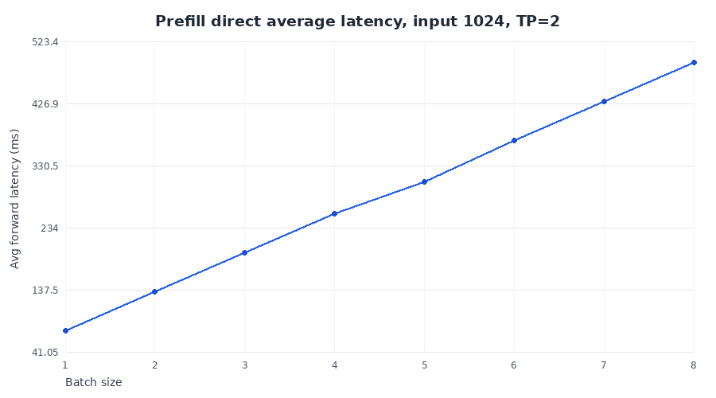
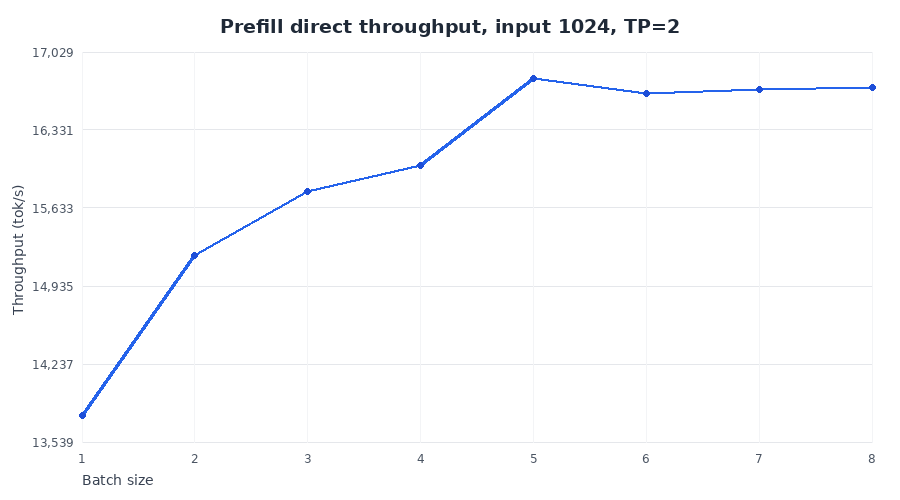
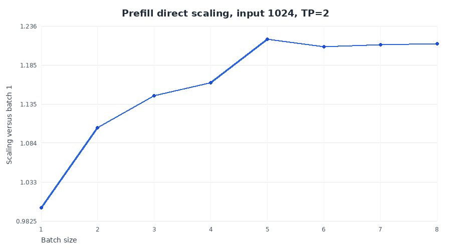

# Prefill-Direct Input 1024 TP=2 性能报告

## 运行环境

| 项目 | 值 |
| ---: | ---: |
| 日期 | 2026-11-23 18:38:14-18:39:33（Asia/Shanghai） |
| 平台 | Hygon BW1000 |
| 设备 | 2 x Hygon BW1000 HCU，64 GB HBM，CUDA_VISIBLE_DEVICES 按前 2 张分配 |
| Driver / runtime | 6.3.30-V1.4.1a / DTK 26.04-rc4 |
| InfiniLM build | 分支 `pd-v0.2.9-v1-tp`，commit `da7d18e7` |
| 模型 | `/data/shared/.infinifabric-models-20261027-fef304a05440/Qwen3-8B--b968826d9c46dd6066d109eabc6255188de91218` |
| 模式 | `prefill-direct` |
| Attention backend | `flash-attn` |
| Graph request | disabled |
| Expected execution mode | `eager` |
| Cache | paged KV cache，block size 256，num blocks 32 |
| Max batched tokens | 18,432 |
| Tensor parallel size | 2 |
| Input length | 1024 tokens / request |
| Batch size | 1..8 |
| Warmup / measured repeats | 每个形状 3 次 / 30 次 |
| Batch 执行顺序 | random seed 2026 |


本报告对应原始 JSONL 和 log 为本机运行产物，不随仓库提交：

```text
../../../benchmark-hygon-bw-tp2-prefill-direct-input1024.jsonl
../../../benchmark-hygon-bw-tp2-prefill-direct-input1024.log
```

## 构建与测试命令

```bash
xmake build _infinilm && xmake install _infinilm
```

```bash
SKIP_BUILD=1 TP=2 GPU=0,1 \
MODE=prefill-direct INPUT_LEN=1024 \
BATCH_SIZES="$(seq -s, 1 8)" REPEATS=30 \
OUTPUT=benchmark-hygon-bw-tp2-prefill-direct-input1024.jsonl ./run_bench_hygon.sh
```

## 执行模式与 Graph 覆盖

本轮 prefill-direct 不传递 `--enable-graph`，所有 physical prefill forward 走 eager path。记录中的 expected execution mode 由 benchmark 根据 compiler 规则推断，不是 C++ runtime 回传的实际执行模式。

## 资源开销

| 项目 | 值 |
| ---: | ---: |
| Workspace allocation | 每 rank 1,116 MiB，TP=2 合计 2,232 MiB |
| 权重加载时间 | 3.20 s |
| Graph compilation time | 未单独打点；包含在进程初始化到首个 sample 的 wall time 中 |
| Paged cache blocks | 32 |
| 正式 sample 数 | 240 |
| 进程 wall time | 79 s (first runtime log to final JSONL write) |
| Monitor peak HCU memory use | 21%（本 run 时间窗，分配 HCUs，10 秒采样） |
| Monitor peak package power | 383.0 W（本 run 时间窗，分配 HCUs，10 秒采样） |
| Monitor peak sensor temperature | 65.0 C（本 run 时间窗，edge/junction，10 秒采样） |


## 测试口径

- 每个 sample 是一次物理 prefill forward。
- `token_count = batch_size * 1024`。
- `throughput = token_count / avg_forward_duration_s`。
- 计时边界为 `engine_forward_including_sampling`。
- Direct prefill 使用合成输入和全 0 paged KV cache，输出 token 不用于正确性判断。
- 分位数使用线性插值；每个 batch 只有 30 个正式样本，p99 只能作为尾部参考。

## 核心结果

| Batch | Input tokens | Avg ms | Min ms | P50 ms | P95 ms | P99 ms | Max ms | Std ms | Throughput tok/s | Scaling |
| ---: | ---: | ---: | ---: | ---: | ---: | ---: | ---: | ---: | ---: | ---: |
| 1 | 1,024 | 74.315 | 74.236 | 74.310 | 74.387 | 74.427 | 74.442 | 0.042 | 13,779.23 | 1.000x |
| 2 | 2,048 | 134.672 | 134.529 | 134.672 | 134.791 | 134.844 | 134.862 | 0.077 | 15,207.35 | 1.104x |
| 3 | 3,072 | 194.672 | 194.541 | 194.686 | 194.772 | 194.784 | 194.786 | 0.063 | 15,780.39 | 1.145x |
| 4 | 4,096 | 255.848 | 255.754 | 255.824 | 255.958 | 256.166 | 256.250 | 0.094 | 16,009.53 | 1.162x |
| 5 | 5,120 | 304.976 | 304.781 | 304.943 | 305.174 | 305.637 | 305.816 | 0.184 | 16,788.22 | 1.218x |
| 6 | 6,144 | 368.821 | 368.631 | 368.817 | 368.991 | 369.006 | 369.011 | 0.099 | 16,658.47 | 1.209x |
| 7 | 7,168 | 429.444 | 429.250 | 429.437 | 429.656 | 429.667 | 429.669 | 0.122 | 16,691.37 | 1.211x |
| 8 | 8,192 | 490.123 | 489.894 | 490.037 | 490.589 | 490.686 | 490.696 | 0.206 | 16,714.19 | 1.213x |


## 趋势图

### 1. Batch size 与 Avg Latency



平均 latency 从 batch 1 的 74.315 ms 变为 batch 8 的 490.123 ms。

### 2. Batch size 与 Throughput



吞吐峰值出现在 batch 5，为 16,788.22 tok/s。

### 3. Batch size 与 Scaling



batch 8 相对 batch 1 的 scaling 为 1.218x，理想 8x 的效率约 15.2%。

## 关键批次与区间

| Batch / range | 观察 |
| ---: | ---: |
| batch 1 -> 8 | 平均 latency 从 74.315 ms 变为 490.123 ms，为 6.595x。 |
| batch 5 | 吞吐峰值 16,788.22 tok/s。 |
| batch 8 | per-request prefill latency 为 61.27 ms/request。 |


## 数据稳定性

- Std 中位数为 0.097 ms。
- 最大 std 为 0.206 ms，出现在 batch 8。
- 各 batch p99 与 max 接近，尾部稳定；每个 batch 只有 30 个 repeat，p99 是尾部参考值。

## TP 对比摘要

| TP | Best batch | Peak throughput tok/s | Scaling vs TP=1 |
| ---: | ---: | ---: | ---: |
| 1 | 5 | 10,252.30 | 1.000x |
| 2 | 5 | 16,788.22 | 1.638x |
| 4 | 8 | 25,516.22 | 2.489x |


## 分析

1. 吞吐随 batch 增加总体上升，峰值在 batch 5，为 16,788.22 tok/s。
2. 平均 forward latency 从 74.315 ms 增至 490.123 ms，增幅低于 batch 扩大倍数。
3. 吞吐峰值通常出现在最大或次大 batch，说明较大 prefill 能更好复用权重读取带宽。
4. 连续 batch 间的 latency 跳变来自算子形状/workspace 分档变化；图和完整表可定位具体区间。
5. 分位数接近均值，std 处于亚毫秒量级，本轮测量稳定性良好。

## 结论与建议

1. 该形状适合优先使用 batch 5 附近配置以获得最高 prefill 总吞吐。
2. 最大 batch 的理想 scaling 效率为 15.2%；继续扩大 batch 受权重带宽和算子效率限制。
3. 如需跨 input length 严格对比，应保持相同 `max_num_batched_tokens` 和测量轮次重跑。
4. 后续可将 eager prefill 与编译后的 prefill path 做同轮对比，定位剩余延迟来源。

## 数据完整性

```text
config records: 1
sample records: 240
summary records: 8
overall summaries: 8
scaling records: 8
samples per batch: 30
```
