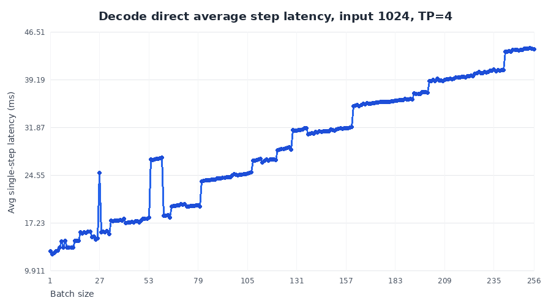
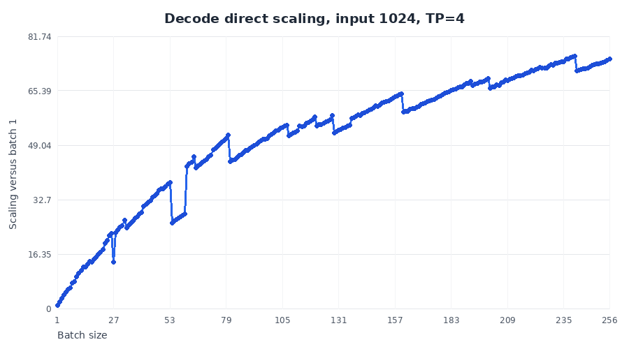

# Decode-Direct Input 1024 TP=4 性能报告

## 运行环境

| 项目 | 值 |
| ---: | ---: |
| 日期 | 2026-11-23 20:07:08-20:24:12（Asia/Shanghai） |
| 平台 | Hygon BW1000 |
| 设备 | 4 x Hygon BW1000 HCU，64 GB HBM，CUDA_VISIBLE_DEVICES 按前 4 张分配 |
| Driver / runtime | 6.3.30-V1.4.1a / DTK 26.04-rc4 |
| InfiniLM build | 分支 `pd-v0.2.9-v1-tp`，commit `da7d18e7` |
| 模型 | `/data/shared/.infinifabric-models-20261027-fef304a05440/Qwen3-8B--b968826d9c46dd6066d109eabc6255188de91218` |
| 模式 | `decode-direct` |
| Attention backend | `flash-attn` |
| Graph request | enabled |
| Expected execution mode | `graph` |
| Cache | paged KV cache，block size 256，num blocks 1280 |
| Max batched tokens | 18,432 |
| Tensor parallel size | 4 |
| Input length | 1024 tokens / request |
| Batch size range | 1..256 |
| Decode steps per repeat | 4 |
| Warmup / measured repeats | 每个形状 3 次 / 30 次 |
| Batch 执行顺序 | random seed 2026 |


本报告对应原始 JSONL 和 log 为本机运行产物，不随仓库提交：

```text
../../../benchmark-hygon-bw-tp4-decode-direct-input1024.jsonl
../../../benchmark-hygon-bw-tp4-decode-direct-input1024.log
```

## 构建与测试命令

```bash
xmake build _infinilm && xmake install _infinilm
```

```bash
SKIP_BUILD=1 TP=4 GPU=0,1,2,3 \
MODE=decode-direct \
INPUT_LEN=1024 \
BATCH_SIZES="$(seq -s, 1 256)" REPEATS=30 \
OUTPUT=benchmark-hygon-bw-tp4-decode-direct-input1024.jsonl ./run_bench_hygon.sh
```

## 执行模式与 Graph 覆盖

- Graph request: enabled
- Expected execution mode: `graph`
- Graph-covered batches: 1..256
- Eager-fallback batches: none
- Mode source: compiler rule；该字段不是 C++ runtime 回传的实际执行模式。

## 资源开销

| 项目 | 值 |
| ---: | ---: |
| Workspace allocation | 每 rank 702 MiB，TP=4 合计 2,808 MiB |
| 权重加载时间 | 44.12 s |
| Graph compilation time | 未单独打点；包含在进程初始化到首个 sample 的 wall time 中 |
| Paged cache blocks | 1,280 |
| 正式 sample 数 | 30,720 |
| 进程 wall time | 1024 s (first runtime log to final JSONL write) |
| Monitor peak HCU memory use | 31%（本 run 时间窗，分配 HCUs，10 秒采样） |
| Monitor peak package power | 304.0 W（本 run 时间窗，分配 HCUs，10 秒采样） |
| Monitor peak sensor temperature | 63.0 C（本 run 时间窗，edge/junction，10 秒采样） |


## 测试口径

- Direct decode 不执行语义 prefill，paged KV cache 全 0 初始化。
- Step 0 使用 dummy token；step 1..3 使用上一步 sampled token。
- 每次 repeat 执行 4 个 decode step。
- `avg_step_latency = four_step_repeat_duration / 4`。
- 完整结果表聚合每个 batch 的 120 个 individual step samples。
- `single_step_throughput = batch_size / avg_step_latency`。
- 计时边界为 `engine_forward_including_sampling`。
- 分位数使用线性插值；每个 batch 只有 30 个 repeat，p99 是尾部参考。

## 核心结果

| 指标 | 结果 |
| ---: | ---: |
| 最高 single-step throughput | batch 240，5,899.98 tok/s |
| 最快 batch 平均 step latency | batch 2，12.436 ms |
| 最大 batch scaling | 74.947x |
| Ideal-scaling efficiency | 29.3% |
| Median step std | 0.027 ms |
| Maximum step std | 0.318 ms，batch 175 |


## 趋势图

### 1. Batch size 与 Avg Step Latency



平均 step latency 从 batch 1 的 12.841 ms 变为 batch 256 的 43.860 ms。

### 2. Batch size 与 Single-step Throughput


吞吐峰值出现在 batch 240，为 5,899.98 tok/s。

### 3. Batch size 与 Scaling



batch 256 相对 batch 1 的 scaling 为 74.947x；理想 256x 效率约 29.3%。

## Batch 区间平均 latency 与吞吐

下表按连续 16 个 batch 分组。平均值是区间内各 batch 聚合 single-step 统计的算术平均；区间最优 batch 取吞吐最高的 batch。

| Batch 区间 | 平均单 step latency ms | 平均吞吐 tok/s | 区间最优 batch |
| ---: | ---: | ---: | ---: |
| 1..16 | 13.534 | 616.36 | 16 |
| 17..32 | 16.126 | 1,536.92 | 32 |
| 33..48 | 17.470 | 2,319.70 | 48 |
| 49..64 | 21.968 | 2,671.08 | 64 |
| 65..80 | 19.856 | 3,651.73 | 80 |
| 81..96 | 23.942 | 3,695.11 | 96 |
| 97..112 | 25.351 | 4,122.59 | 107 |
| 113..128 | 27.684 | 4,352.21 | 128 |
| 129..144 | 31.275 | 4,365.45 | 144 |
| 145..160 | 31.562 | 4,831.01 | 160 |
| 161..176 | 35.464 | 4,750.77 | 176 |
| 177..192 | 35.980 | 5,127.39 | 192 |
| 193..208 | 38.096 | 5,263.66 | 200 |
| 209..224 | 39.481 | 5,483.27 | 224 |
| 225..240 | 40.429 | 5,750.47 | 240 |
| 241..256 | 43.726 | 5,682.84 | 256 |


## 关键批次与跳变

| Change | Mode transition | Avg step ms | Throughput tok/s | Observation |
| --- | ---: | ---: | ---: | --- |
| 26 -> 27 | graph | 14.803 -> 24.880 | 1,756.37 -> 1,085.22 | 平均 step latency 增加 68.1%，可能对应 kernel shape 或 workspace 分档变化 |
| 53 -> 54 | graph | 18.028 -> 26.898 | 2,939.94 -> 2,007.61 | 平均 step latency 增加 49.2%，可能对应 kernel shape 或 workspace 分档变化 |
| 80 -> 81 | graph | 19.715 -> 23.543 | 4,057.78 -> 3,440.47 | 平均 step latency 增加 19.4%，可能对应 kernel shape 或 workspace 分档变化 |
| 32 -> 33 | graph | 15.488 -> 17.541 | 2,066.06 -> 1,881.26 | 平均 step latency 增加 13.3%，可能对应 kernel shape 或 workspace 分档变化 |
| 128 -> 129 | graph | 28.412 -> 31.405 | 4,505.22 -> 4,107.69 | 平均 step latency 增加 10.5%，可能对应 kernel shape 或 workspace 分档变化 |
| 160 -> 161 | graph | 31.915 -> 35.071 | 5,013.36 -> 4,590.66 | 平均 step latency 增加 9.9%，可能对应 kernel shape 或 workspace 分档变化 |


## Step 一致性

峰值 batch 240 的 4 个 decode step 结果如下：

| Step | Past KV length | Avg step ms | Std ms | Throughput tok/s |
| ---: | ---: | ---: | ---: | ---: |
| 0 | 1024 | 40.667 | 0.060 | 5,901.53 |
| 1 | 1025 | 40.680 | 0.053 | 5,899.66 |
| 2 | 1026 | 40.674 | 0.049 | 5,900.64 |
| 3 | 1027 | 40.691 | 0.072 | 5,898.11 |


所有 batch 中，4 个 step 平均耗时最大差异为 0.132 ms，出现在 batch 175。差异包含 past KV length 增长和 step kernel 形状影响。

## 数据稳定性

- 单 step std 中位数为 0.027 ms。
- 最大 std 为 0.318 ms，出现在 batch 175。
- 各 batch p99 与 max 接近，尾部稳定；每个 batch 只有 30 个 repeat，p99 仍是尾部参考值。

## TP 对比摘要

| TP | Best batch | Peak throughput tok/s | Scaling vs TP=1 |
| ---: | ---: | ---: | ---: |
| 1 | 180 | 2,183.33 | 1.000x |
| 2 | 256 | 4,134.71 | 1.894x |
| 4 | 240 | 5,899.98 | 2.702x |


## Single-step 完整结果

### Batch 1..16

| Batch | Mode | Avg Step ms | Min Step ms | P50 Step ms | P95 Step ms | P99 Step ms | Max Step ms | Std Step ms | Single-step tok/s | Scaling |
| ---: | --- | ---: | ---: | ---: | ---: | ---: | ---: | ---: | ---: | ---: |
| 1 | graph | 12.841 | 12.788 | 12.839 | 12.877 | 12.886 | 12.900 | 0.021 | 77.88 | 1.000x |
| 2 | graph | 12.436 | 12.397 | 12.434 | 12.473 | 12.497 | 12.515 | 0.021 | 160.83 | 2.065x |
| 3 | graph | 12.617 | 12.573 | 12.616 | 12.650 | 12.661 | 12.671 | 0.018 | 237.78 | 3.053x |
| 4 | graph | 12.838 | 12.802 | 12.836 | 12.867 | 12.883 | 12.886 | 0.019 | 311.58 | 4.001x |
| 5 | graph | 12.996 | 12.959 | 12.989 | 13.032 | 13.054 | 13.418 | 0.043 | 384.73 | 4.940x |
| 6 | graph | 13.471 | 13.433 | 13.470 | 13.512 | 13.528 | 13.531 | 0.021 | 445.39 | 5.719x |
| 7 | graph | 14.335 | 14.287 | 14.332 | 14.380 | 14.404 | 14.409 | 0.023 | 488.33 | 6.270x |
| 8 | graph | 13.471 | 13.428 | 13.467 | 13.503 | 13.515 | 13.546 | 0.019 | 593.88 | 7.626x |
| 9 | graph | 14.504 | 14.456 | 14.500 | 14.548 | 14.573 | 14.625 | 0.025 | 620.50 | 7.968x |
| 10 | graph | 13.385 | 13.337 | 13.383 | 13.421 | 13.444 | 13.453 | 0.021 | 747.09 | 9.593x |
| 11 | graph | 13.403 | 13.371 | 13.401 | 13.427 | 13.466 | 13.473 | 0.017 | 820.74 | 10.539x |
| 12 | graph | 13.445 | 13.415 | 13.441 | 13.486 | 13.503 | 13.517 | 0.020 | 892.52 | 11.460x |
| 13 | graph | 13.439 | 13.396 | 13.436 | 13.485 | 13.505 | 13.522 | 0.025 | 967.33 | 12.421x |
| 14 | graph | 14.443 | 14.411 | 14.436 | 14.490 | 14.533 | 14.539 | 0.025 | 969.32 | 12.447x |
| 15 | graph | 14.502 | 14.456 | 14.496 | 14.546 | 14.562 | 14.572 | 0.025 | 1,034.37 | 13.282x |
| 16 | graph | 14.421 | 14.388 | 14.418 | 14.453 | 14.466 | 14.469 | 0.017 | 1,109.50 | 14.247x |


### Batch 17..32

| Batch | Mode | Avg Step ms | Min Step ms | P50 Step ms | P95 Step ms | P99 Step ms | Max Step ms | Std Step ms | Single-step tok/s | Scaling |
| ---: | --- | ---: | ---: | ---: | ---: | ---: | ---: | ---: | ---: | ---: |
| 17 | graph | 15.751 | 15.715 | 15.746 | 15.786 | 15.833 | 15.919 | 0.025 | 1,079.30 | 13.859x |
| 18 | graph | 15.610 | 15.570 | 15.601 | 15.648 | 15.677 | 15.823 | 0.030 | 1,153.14 | 14.807x |
| 19 | graph | 15.792 | 15.760 | 15.787 | 15.833 | 15.857 | 15.857 | 0.021 | 1,203.18 | 15.449x |
| 20 | graph | 15.722 | 15.676 | 15.716 | 15.762 | 15.790 | 15.793 | 0.021 | 1,272.13 | 16.335x |
| 21 | graph | 15.884 | 15.841 | 15.883 | 15.926 | 15.938 | 15.951 | 0.022 | 1,322.10 | 16.976x |
| 22 | graph | 15.877 | 15.840 | 15.870 | 15.932 | 15.943 | 15.986 | 0.025 | 1,385.69 | 17.793x |
| 23 | graph | 15.017 | 14.982 | 15.012 | 15.053 | 15.073 | 15.075 | 0.020 | 1,531.60 | 19.667x |
| 24 | graph | 15.110 | 15.073 | 15.105 | 15.156 | 15.174 | 15.183 | 0.023 | 1,588.38 | 20.396x |
| 25 | graph | 14.671 | 14.632 | 14.669 | 14.714 | 14.722 | 14.735 | 0.023 | 1,703.99 | 21.880x |
| 26 | graph | 14.803 | 14.765 | 14.804 | 14.828 | 14.848 | 14.851 | 0.017 | 1,756.37 | 22.553x |
| 27 | graph | 24.880 | 24.848 | 24.877 | 24.910 | 24.923 | 24.925 | 0.016 | 1,085.22 | 13.935x |
| 28 | graph | 15.803 | 15.762 | 15.802 | 15.847 | 15.863 | 15.881 | 0.023 | 1,771.78 | 22.751x |
| 29 | graph | 15.846 | 15.803 | 15.842 | 15.886 | 15.908 | 15.944 | 0.024 | 1,830.12 | 23.500x |
| 30 | graph | 15.790 | 15.753 | 15.787 | 15.826 | 15.848 | 15.855 | 0.021 | 1,899.93 | 24.396x |
| 31 | graph | 15.965 | 15.911 | 15.962 | 16.004 | 16.048 | 16.050 | 0.026 | 1,941.77 | 24.933x |
| 32 | graph | 15.488 | 15.452 | 15.484 | 15.529 | 15.562 | 15.573 | 0.022 | 2,066.06 | 26.529x |


### Batch 33..48

| Batch | Mode | Avg Step ms | Min Step ms | P50 Step ms | P95 Step ms | P99 Step ms | Max Step ms | Std Step ms | Single-step tok/s | Scaling |
| ---: | --- | ---: | ---: | ---: | ---: | ---: | ---: | ---: | ---: | ---: |
| 33 | graph | 17.541 | 17.494 | 17.540 | 17.588 | 17.607 | 17.610 | 0.026 | 1,881.26 | 24.156x |
| 34 | graph | 17.477 | 17.433 | 17.473 | 17.520 | 17.526 | 17.533 | 0.021 | 1,945.36 | 24.979x |
| 35 | graph | 17.558 | 17.512 | 17.556 | 17.590 | 17.607 | 17.620 | 0.020 | 1,993.42 | 25.597x |
| 36 | graph | 17.603 | 17.546 | 17.596 | 17.666 | 17.748 | 17.785 | 0.036 | 2,045.11 | 26.260x |
| 37 | graph | 17.561 | 17.511 | 17.560 | 17.605 | 17.623 | 17.651 | 0.025 | 2,106.92 | 27.054x |
| 38 | graph | 17.676 | 17.639 | 17.671 | 17.731 | 17.737 | 17.740 | 0.023 | 2,149.81 | 27.605x |
| 39 | graph | 17.600 | 17.560 | 17.596 | 17.634 | 17.665 | 17.681 | 0.024 | 2,215.93 | 28.454x |
| 40 | graph | 17.794 | 17.755 | 17.789 | 17.846 | 17.856 | 17.933 | 0.026 | 2,247.90 | 28.864x |
| 41 | graph | 17.195 | 17.145 | 17.192 | 17.237 | 17.251 | 17.255 | 0.024 | 2,384.46 | 30.618x |
| 42 | graph | 17.246 | 17.192 | 17.236 | 17.311 | 17.408 | 17.437 | 0.038 | 2,435.32 | 31.271x |
| 43 | graph | 17.323 | 17.273 | 17.320 | 17.370 | 17.387 | 17.388 | 0.022 | 2,482.23 | 31.873x |
| 44 | graph | 17.409 | 17.361 | 17.404 | 17.466 | 17.487 | 17.497 | 0.026 | 2,527.39 | 32.453x |
| 45 | graph | 17.266 | 17.223 | 17.264 | 17.310 | 17.323 | 17.325 | 0.022 | 2,606.26 | 33.466x |
| 46 | graph | 17.487 | 17.433 | 17.485 | 17.516 | 17.536 | 17.554 | 0.018 | 2,630.53 | 33.777x |
| 47 | graph | 17.456 | 17.407 | 17.452 | 17.508 | 17.532 | 17.540 | 0.029 | 2,692.41 | 34.572x |
| 48 | graph | 17.323 | 17.275 | 17.322 | 17.358 | 17.375 | 17.394 | 0.020 | 2,770.86 | 35.579x |


### Batch 49..64

| Batch | Mode | Avg Step ms | Min Step ms | P50 Step ms | P95 Step ms | P99 Step ms | Max Step ms | Std Step ms | Single-step tok/s | Scaling |
| ---: | --- | ---: | ---: | ---: | ---: | ---: | ---: | ---: | ---: | ---: |
| 49 | graph | 17.532 | 17.489 | 17.530 | 17.575 | 17.590 | 17.607 | 0.023 | 2,794.88 | 35.888x |
| 50 | graph | 17.825 | 17.776 | 17.821 | 17.880 | 17.920 | 17.926 | 0.031 | 2,804.97 | 36.017x |
| 51 | graph | 17.885 | 17.838 | 17.879 | 17.930 | 17.951 | 17.956 | 0.024 | 2,851.62 | 36.616x |
| 52 | graph | 17.856 | 17.790 | 17.852 | 17.910 | 17.923 | 17.958 | 0.026 | 2,912.13 | 37.393x |
| 53 | graph | 18.028 | 17.992 | 18.026 | 18.056 | 18.086 | 18.092 | 0.019 | 2,939.94 | 37.750x |
| 54 | graph | 26.898 | 26.846 | 26.893 | 26.940 | 26.979 | 27.082 | 0.029 | 2,007.61 | 25.779x |
| 55 | graph | 26.844 | 26.796 | 26.841 | 26.884 | 26.899 | 26.909 | 0.025 | 2,048.91 | 26.309x |
| 56 | graph | 26.984 | 26.925 | 26.975 | 27.036 | 27.229 | 27.246 | 0.051 | 2,075.32 | 26.648x |
| 57 | graph | 27.051 | 27.007 | 27.048 | 27.077 | 27.101 | 27.183 | 0.020 | 2,107.12 | 27.057x |
| 58 | graph | 27.068 | 27.020 | 27.065 | 27.097 | 27.129 | 27.139 | 0.021 | 2,142.76 | 27.514x |
| 59 | graph | 27.176 | 27.137 | 27.171 | 27.214 | 27.228 | 27.233 | 0.022 | 2,171.06 | 27.878x |
| 60 | graph | 27.206 | 27.160 | 27.200 | 27.252 | 27.265 | 27.271 | 0.024 | 2,205.36 | 28.318x |
| 61 | graph | 18.338 | 18.297 | 18.338 | 18.368 | 18.386 | 18.421 | 0.018 | 3,326.49 | 42.714x |
| 62 | graph | 18.332 | 18.287 | 18.334 | 18.369 | 18.386 | 18.399 | 0.022 | 3,382.12 | 43.428x |
| 63 | graph | 18.433 | 18.383 | 18.432 | 18.460 | 18.483 | 18.498 | 0.018 | 3,417.83 | 43.887x |
| 64 | graph | 18.032 | 18.001 | 18.029 | 18.076 | 18.086 | 18.096 | 0.020 | 3,549.17 | 45.573x |


### Batch 65..80

| Batch | Mode | Avg Step ms | Min Step ms | P50 Step ms | P95 Step ms | P99 Step ms | Max Step ms | Std Step ms | Single-step tok/s | Scaling |
| ---: | --- | ---: | ---: | ---: | ---: | ---: | ---: | ---: | ---: | ---: |
| 65 | graph | 19.741 | 19.697 | 19.738 | 19.785 | 19.795 | 19.807 | 0.025 | 3,292.67 | 42.280x |
| 66 | graph | 19.801 | 19.764 | 19.795 | 19.843 | 19.856 | 19.858 | 0.023 | 3,333.12 | 42.799x |
| 67 | graph | 19.830 | 19.797 | 19.826 | 19.870 | 19.889 | 19.905 | 0.022 | 3,378.64 | 43.383x |
| 68 | graph | 19.883 | 19.840 | 19.879 | 19.934 | 19.954 | 19.959 | 0.026 | 3,419.96 | 43.914x |
| 69 | graph | 19.952 | 19.913 | 19.949 | 19.990 | 20.020 | 20.032 | 0.022 | 3,458.35 | 44.407x |
| 70 | graph | 20.121 | 19.948 | 20.120 | 20.174 | 20.198 | 20.230 | 0.036 | 3,479.01 | 44.672x |
| 71 | graph | 20.015 | 19.950 | 20.013 | 20.067 | 20.078 | 20.103 | 0.030 | 3,547.35 | 45.550x |
| 72 | graph | 20.077 | 20.033 | 20.070 | 20.119 | 20.142 | 20.156 | 0.024 | 3,586.18 | 46.048x |
| 73 | graph | 19.702 | 19.630 | 19.697 | 19.774 | 19.799 | 19.803 | 0.039 | 3,705.27 | 47.578x |
| 74 | graph | 19.738 | 19.691 | 19.736 | 19.777 | 19.788 | 19.805 | 0.024 | 3,749.06 | 48.140x |
| 75 | graph | 19.765 | 19.701 | 19.765 | 19.803 | 19.817 | 19.817 | 0.024 | 3,794.52 | 48.724x |
| 76 | graph | 19.776 | 19.727 | 19.775 | 19.813 | 19.826 | 19.842 | 0.023 | 3,843.08 | 49.347x |
| 77 | graph | 19.776 | 19.729 | 19.773 | 19.818 | 19.840 | 19.862 | 0.022 | 3,893.65 | 49.997x |
| 78 | graph | 19.887 | 19.844 | 19.879 | 19.942 | 19.953 | 19.998 | 0.029 | 3,922.07 | 50.361x |
| 79 | graph | 19.914 | 19.867 | 19.911 | 19.957 | 19.963 | 19.974 | 0.022 | 3,966.98 | 50.938x |
| 80 | graph | 19.715 | 19.673 | 19.710 | 19.752 | 19.766 | 19.790 | 0.022 | 4,057.78 | 52.104x |


### Batch 81..96

| Batch | Mode | Avg Step ms | Min Step ms | P50 Step ms | P95 Step ms | P99 Step ms | Max Step ms | Std Step ms | Single-step tok/s | Scaling |
| ---: | --- | ---: | ---: | ---: | ---: | ---: | ---: | ---: | ---: | ---: |
| 81 | graph | 23.543 | 23.490 | 23.542 | 23.581 | 23.595 | 23.631 | 0.025 | 3,440.47 | 44.177x |
| 82 | graph | 23.695 | 23.616 | 23.696 | 23.727 | 23.747 | 23.759 | 0.020 | 3,460.63 | 44.436x |
| 83 | graph | 23.791 | 23.658 | 23.792 | 23.837 | 23.865 | 23.900 | 0.031 | 3,488.76 | 44.798x |
| 84 | graph | 23.737 | 23.691 | 23.737 | 23.768 | 23.787 | 23.792 | 0.018 | 3,538.76 | 45.440x |
| 85 | graph | 23.728 | 23.695 | 23.725 | 23.763 | 23.788 | 23.804 | 0.021 | 3,582.30 | 45.999x |
| 86 | graph | 23.892 | 23.831 | 23.890 | 23.945 | 23.960 | 23.989 | 0.029 | 3,599.56 | 46.220x |
| 87 | graph | 23.827 | 23.768 | 23.825 | 23.860 | 23.875 | 23.876 | 0.020 | 3,651.36 | 46.885x |
| 88 | graph | 23.828 | 23.790 | 23.828 | 23.869 | 23.885 | 23.896 | 0.023 | 3,693.08 | 47.421x |
| 89 | graph | 24.047 | 23.893 | 24.063 | 24.133 | 24.142 | 24.166 | 0.067 | 3,701.12 | 47.524x |
| 90 | graph | 24.045 | 23.994 | 24.045 | 24.079 | 24.113 | 24.134 | 0.024 | 3,742.99 | 48.062x |
| 91 | graph | 24.072 | 24.006 | 24.066 | 24.132 | 24.161 | 24.200 | 0.034 | 3,780.27 | 48.541x |
| 92 | graph | 24.121 | 24.088 | 24.118 | 24.162 | 24.184 | 24.202 | 0.022 | 3,814.11 | 48.975x |
| 93 | graph | 24.145 | 24.097 | 24.143 | 24.191 | 24.202 | 24.212 | 0.025 | 3,851.79 | 49.459x |
| 94 | graph | 24.181 | 24.133 | 24.180 | 24.223 | 24.241 | 24.250 | 0.025 | 3,887.28 | 49.915x |
| 95 | graph | 24.192 | 24.139 | 24.189 | 24.234 | 24.256 | 24.267 | 0.025 | 3,926.99 | 50.425x |
| 96 | graph | 24.229 | 24.062 | 24.237 | 24.333 | 24.347 | 24.361 | 0.069 | 3,962.24 | 50.877x |


### Batch 97..112

| Batch | Mode | Avg Step ms | Min Step ms | P50 Step ms | P95 Step ms | P99 Step ms | Max Step ms | Std Step ms | Single-step tok/s | Scaling |
| ---: | --- | ---: | ---: | ---: | ---: | ---: | ---: | ---: | ---: | ---: |
| 97 | graph | 24.469 | 24.428 | 24.468 | 24.513 | 24.526 | 24.534 | 0.023 | 3,964.18 | 50.902x |
| 98 | graph | 24.658 | 24.502 | 24.656 | 24.744 | 24.764 | 24.775 | 0.052 | 3,974.39 | 51.033x |
| 99 | graph | 24.551 | 24.501 | 24.550 | 24.589 | 24.600 | 24.617 | 0.021 | 4,032.40 | 51.778x |
| 100 | graph | 24.507 | 24.461 | 24.506 | 24.540 | 24.555 | 24.571 | 0.019 | 4,080.44 | 52.395x |
| 101 | graph | 24.590 | 24.545 | 24.588 | 24.629 | 24.639 | 24.675 | 0.023 | 4,107.34 | 52.740x |
| 102 | graph | 24.597 | 24.551 | 24.593 | 24.639 | 24.661 | 24.693 | 0.022 | 4,146.87 | 53.248x |
| 103 | graph | 24.665 | 24.606 | 24.666 | 24.710 | 24.726 | 24.727 | 0.025 | 4,175.91 | 53.621x |
| 104 | graph | 24.659 | 24.602 | 24.656 | 24.704 | 24.719 | 24.721 | 0.023 | 4,217.49 | 54.155x |
| 105 | graph | 24.766 | 24.710 | 24.760 | 24.817 | 24.856 | 24.860 | 0.032 | 4,239.64 | 54.439x |
| 106 | graph | 24.875 | 24.830 | 24.873 | 24.908 | 24.928 | 24.952 | 0.021 | 4,261.36 | 54.718x |
| 107 | graph | 24.935 | 24.872 | 24.933 | 24.981 | 24.995 | 25.016 | 0.026 | 4,291.17 | 55.101x |
| 108 | graph | 26.787 | 26.731 | 26.784 | 26.823 | 26.838 | 26.850 | 0.022 | 4,031.76 | 51.770x |
| 109 | graph | 26.785 | 26.743 | 26.783 | 26.831 | 26.840 | 26.878 | 0.025 | 4,069.41 | 52.253x |
| 110 | graph | 26.813 | 26.767 | 26.811 | 26.854 | 26.876 | 26.881 | 0.022 | 4,102.52 | 52.678x |
| 111 | graph | 26.949 | 26.898 | 26.946 | 26.993 | 27.001 | 27.008 | 0.022 | 4,118.84 | 52.888x |
| 112 | graph | 27.003 | 26.937 | 27.002 | 27.044 | 27.058 | 27.072 | 0.024 | 4,147.67 | 53.258x |


### Batch 113..128

| Batch | Mode | Avg Step ms | Min Step ms | P50 Step ms | P95 Step ms | P99 Step ms | Max Step ms | Std Step ms | Single-step tok/s | Scaling |
| ---: | --- | ---: | ---: | ---: | ---: | ---: | ---: | ---: | ---: | ---: |
| 113 | graph | 26.507 | 26.433 | 26.505 | 26.546 | 26.562 | 26.565 | 0.023 | 4,263.04 | 54.740x |
| 114 | graph | 26.766 | 26.687 | 26.767 | 26.805 | 26.812 | 26.819 | 0.027 | 4,259.11 | 54.689x |
| 115 | graph | 26.903 | 26.739 | 26.906 | 27.005 | 27.027 | 27.041 | 0.054 | 4,274.61 | 54.888x |
| 116 | graph | 26.766 | 26.702 | 26.765 | 26.802 | 26.809 | 26.819 | 0.021 | 4,333.93 | 55.650x |
| 117 | graph | 26.918 | 26.851 | 26.918 | 26.957 | 26.971 | 26.974 | 0.025 | 4,346.53 | 55.812x |
| 118 | graph | 26.931 | 26.874 | 26.930 | 26.962 | 26.975 | 27.012 | 0.022 | 4,381.56 | 56.262x |
| 119 | graph | 26.946 | 26.902 | 26.943 | 26.986 | 26.994 | 27.042 | 0.023 | 4,416.28 | 56.707x |
| 120 | graph | 26.821 | 26.770 | 26.819 | 26.866 | 26.878 | 26.880 | 0.025 | 4,474.08 | 57.449x |
| 121 | graph | 28.345 | 28.293 | 28.344 | 28.381 | 28.393 | 28.410 | 0.023 | 4,268.78 | 54.813x |
| 122 | graph | 28.412 | 28.365 | 28.410 | 28.444 | 28.455 | 28.472 | 0.019 | 4,294.01 | 55.137x |
| 123 | graph | 28.548 | 28.487 | 28.544 | 28.596 | 28.615 | 28.712 | 0.032 | 4,308.59 | 55.324x |
| 124 | graph | 28.564 | 28.516 | 28.565 | 28.600 | 28.613 | 28.719 | 0.025 | 4,341.11 | 55.742x |
| 125 | graph | 28.617 | 28.571 | 28.615 | 28.654 | 28.669 | 28.671 | 0.020 | 4,368.02 | 56.088x |
| 126 | graph | 28.712 | 28.668 | 28.709 | 28.757 | 28.771 | 28.789 | 0.024 | 4,388.36 | 56.349x |
| 127 | graph | 28.784 | 28.597 | 28.810 | 28.863 | 28.915 | 28.930 | 0.075 | 4,412.17 | 56.655x |
| 128 | graph | 28.412 | 28.334 | 28.411 | 28.443 | 28.467 | 28.468 | 0.021 | 4,505.22 | 57.849x |


### Batch 129..144

| Batch | Mode | Avg Step ms | Min Step ms | P50 Step ms | P95 Step ms | P99 Step ms | Max Step ms | Std Step ms | Single-step tok/s | Scaling |
| ---: | --- | ---: | ---: | ---: | ---: | ---: | ---: | ---: | ---: | ---: |
| 129 | graph | 31.405 | 31.278 | 31.408 | 31.505 | 31.535 | 31.545 | 0.057 | 4,107.69 | 52.745x |
| 130 | graph | 31.358 | 31.226 | 31.361 | 31.447 | 31.482 | 31.624 | 0.061 | 4,145.70 | 53.233x |
| 131 | graph | 31.401 | 31.345 | 31.400 | 31.446 | 31.460 | 31.464 | 0.028 | 4,171.88 | 53.569x |
| 132 | graph | 31.477 | 31.345 | 31.477 | 31.522 | 31.537 | 31.549 | 0.028 | 4,193.60 | 53.848x |
| 133 | graph | 31.487 | 31.437 | 31.487 | 31.516 | 31.551 | 31.573 | 0.020 | 4,223.91 | 54.237x |
| 134 | graph | 31.579 | 31.532 | 31.579 | 31.610 | 31.622 | 31.634 | 0.019 | 4,243.32 | 54.486x |
| 135 | graph | 31.686 | 31.622 | 31.684 | 31.724 | 31.742 | 31.744 | 0.023 | 4,260.52 | 54.707x |
| 136 | graph | 31.685 | 31.631 | 31.685 | 31.739 | 31.747 | 31.766 | 0.028 | 4,292.20 | 55.114x |
| 137 | graph | 30.820 | 30.759 | 30.822 | 30.861 | 30.873 | 30.906 | 0.027 | 4,445.10 | 57.077x |
| 138 | graph | 30.922 | 30.855 | 30.919 | 30.967 | 30.975 | 30.979 | 0.021 | 4,462.86 | 57.305x |
| 139 | graph | 30.945 | 30.882 | 30.943 | 30.976 | 30.985 | 30.998 | 0.021 | 4,491.90 | 57.678x |
| 140 | graph | 30.897 | 30.818 | 30.889 | 30.937 | 31.136 | 31.229 | 0.053 | 4,531.15 | 58.182x |
| 141 | graph | 31.196 | 31.141 | 31.197 | 31.238 | 31.254 | 31.256 | 0.025 | 4,519.84 | 58.037x |
| 142 | graph | 31.104 | 31.043 | 31.103 | 31.144 | 31.167 | 31.180 | 0.024 | 4,565.29 | 58.621x |
| 143 | graph | 31.253 | 31.208 | 31.251 | 31.294 | 31.312 | 31.315 | 0.022 | 4,575.57 | 58.753x |
| 144 | graph | 31.191 | 31.140 | 31.189 | 31.228 | 31.252 | 31.260 | 0.021 | 4,616.74 | 59.281x |


### Batch 145..160

| Batch | Mode | Avg Step ms | Min Step ms | P50 Step ms | P95 Step ms | P99 Step ms | Max Step ms | Std Step ms | Single-step tok/s | Scaling |
| ---: | --- | ---: | ---: | ---: | ---: | ---: | ---: | ---: | ---: | ---: |
| 145 | graph | 31.257 | 31.210 | 31.254 | 31.295 | 31.344 | 31.377 | 0.026 | 4,639.01 | 59.567x |
| 146 | graph | 31.302 | 31.257 | 31.302 | 31.337 | 31.353 | 31.371 | 0.022 | 4,664.25 | 59.891x |
| 147 | graph | 31.274 | 31.171 | 31.276 | 31.317 | 31.345 | 31.350 | 0.028 | 4,700.39 | 60.355x |
| 148 | graph | 31.266 | 31.189 | 31.263 | 31.300 | 31.318 | 31.403 | 0.023 | 4,733.57 | 60.781x |
| 149 | graph | 31.506 | 31.400 | 31.509 | 31.550 | 31.567 | 31.582 | 0.031 | 4,729.27 | 60.726x |
| 150 | graph | 31.486 | 31.391 | 31.479 | 31.562 | 31.604 | 31.630 | 0.048 | 4,764.05 | 61.173x |
| 151 | graph | 31.370 | 31.290 | 31.356 | 31.477 | 31.613 | 31.617 | 0.056 | 4,813.59 | 61.809x |
| 152 | graph | 31.562 | 31.417 | 31.562 | 31.615 | 31.650 | 31.657 | 0.034 | 4,815.94 | 61.839x |
| 153 | graph | 31.624 | 31.553 | 31.624 | 31.666 | 31.699 | 31.715 | 0.028 | 4,838.14 | 62.124x |
| 154 | graph | 31.745 | 31.689 | 31.741 | 31.786 | 31.793 | 31.817 | 0.023 | 4,851.18 | 62.292x |
| 155 | graph | 31.682 | 31.596 | 31.672 | 31.793 | 31.841 | 31.848 | 0.054 | 4,892.30 | 62.820x |
| 156 | graph | 31.716 | 31.619 | 31.711 | 31.773 | 31.806 | 31.863 | 0.035 | 4,918.70 | 63.159x |
| 157 | graph | 31.736 | 31.595 | 31.734 | 31.865 | 31.983 | 32.452 | 0.102 | 4,947.13 | 63.524x |
| 158 | graph | 31.751 | 31.662 | 31.750 | 31.791 | 31.807 | 31.817 | 0.026 | 4,976.28 | 63.898x |
| 159 | graph | 31.806 | 31.654 | 31.804 | 31.982 | 32.002 | 32.003 | 0.077 | 4,999.00 | 64.190x |
| 160 | graph | 31.915 | 31.865 | 31.915 | 31.945 | 31.973 | 31.988 | 0.021 | 5,013.36 | 64.374x |


### Batch 161..176

| Batch | Mode | Avg Step ms | Min Step ms | P50 Step ms | P95 Step ms | P99 Step ms | Max Step ms | Std Step ms | Single-step tok/s | Scaling |
| ---: | --- | ---: | ---: | ---: | ---: | ---: | ---: | ---: | ---: | ---: |
| 161 | graph | 35.071 | 35.012 | 35.072 | 35.115 | 35.129 | 35.136 | 0.026 | 4,590.66 | 58.947x |
| 162 | graph | 35.167 | 35.059 | 35.163 | 35.223 | 35.262 | 35.445 | 0.042 | 4,606.62 | 59.151x |
| 163 | graph | 35.335 | 35.254 | 35.333 | 35.373 | 35.392 | 35.406 | 0.024 | 4,612.98 | 59.233x |
| 164 | graph | 35.142 | 35.072 | 35.142 | 35.182 | 35.192 | 35.198 | 0.025 | 4,666.73 | 59.923x |
| 165 | graph | 35.286 | 35.249 | 35.283 | 35.322 | 35.345 | 35.347 | 0.020 | 4,676.13 | 60.044x |
| 166 | graph | 35.442 | 35.327 | 35.442 | 35.498 | 35.510 | 35.535 | 0.035 | 4,683.67 | 60.141x |
| 167 | graph | 35.406 | 35.340 | 35.406 | 35.448 | 35.467 | 35.469 | 0.025 | 4,716.73 | 60.565x |
| 168 | graph | 35.571 | 35.381 | 35.570 | 35.608 | 35.682 | 35.712 | 0.035 | 4,722.95 | 60.645x |
| 169 | graph | 35.454 | 35.331 | 35.443 | 35.549 | 35.588 | 35.621 | 0.057 | 4,766.70 | 61.207x |
| 170 | graph | 35.521 | 35.456 | 35.521 | 35.566 | 35.595 | 35.639 | 0.027 | 4,785.86 | 61.453x |
| 171 | graph | 35.617 | 35.549 | 35.617 | 35.673 | 35.688 | 35.710 | 0.033 | 4,801.01 | 61.647x |
| 172 | graph | 35.545 | 35.488 | 35.546 | 35.584 | 35.595 | 35.604 | 0.025 | 4,838.92 | 62.134x |
| 173 | graph | 35.668 | 35.597 | 35.663 | 35.724 | 35.749 | 35.849 | 0.033 | 4,850.31 | 62.280x |
| 174 | graph | 35.659 | 35.601 | 35.660 | 35.700 | 35.744 | 35.746 | 0.025 | 4,879.49 | 62.655x |
| 175 | graph | 35.796 | 35.682 | 35.777 | 35.836 | 35.928 | 39.222 | 0.318 | 4,888.79 | 62.775x |
| 176 | graph | 35.737 | 35.648 | 35.739 | 35.787 | 35.805 | 35.812 | 0.032 | 4,924.82 | 63.237x |


### Batch 177..192

| Batch | Mode | Avg Step ms | Min Step ms | P50 Step ms | P95 Step ms | P99 Step ms | Max Step ms | Std Step ms | Single-step tok/s | Scaling |
| ---: | --- | ---: | ---: | ---: | ---: | ---: | ---: | ---: | ---: | ---: |
| 177 | graph | 35.756 | 35.577 | 35.755 | 35.870 | 35.932 | 36.004 | 0.080 | 4,950.28 | 63.564x |
| 178 | graph | 35.788 | 35.617 | 35.787 | 35.906 | 35.923 | 35.998 | 0.074 | 4,973.77 | 63.866x |
| 179 | graph | 35.800 | 35.674 | 35.794 | 35.880 | 35.898 | 35.908 | 0.044 | 5,000.03 | 64.203x |
| 180 | graph | 35.763 | 35.655 | 35.764 | 35.830 | 35.935 | 35.974 | 0.056 | 5,033.18 | 64.629x |
| 181 | graph | 35.836 | 35.750 | 35.834 | 35.877 | 35.903 | 35.919 | 0.029 | 5,050.77 | 64.855x |
| 182 | graph | 35.893 | 35.776 | 35.887 | 36.018 | 36.055 | 36.130 | 0.068 | 5,070.64 | 65.110x |
| 183 | graph | 35.916 | 35.813 | 35.908 | 36.005 | 36.039 | 36.086 | 0.053 | 5,095.21 | 65.425x |
| 184 | graph | 35.929 | 35.856 | 35.925 | 36.002 | 36.046 | 36.057 | 0.041 | 5,121.26 | 65.760x |
| 185 | graph | 36.028 | 35.864 | 36.030 | 36.076 | 36.092 | 36.192 | 0.041 | 5,134.96 | 65.936x |
| 186 | graph | 36.007 | 35.939 | 35.998 | 36.060 | 36.102 | 36.192 | 0.034 | 5,165.73 | 66.331x |
| 187 | graph | 36.083 | 35.979 | 36.081 | 36.134 | 36.159 | 36.163 | 0.032 | 5,182.52 | 66.546x |
| 188 | graph | 36.234 | 36.049 | 36.247 | 36.352 | 36.388 | 36.410 | 0.079 | 5,188.43 | 66.622x |
| 189 | graph | 36.094 | 36.041 | 36.093 | 36.145 | 36.157 | 36.166 | 0.028 | 5,236.30 | 67.237x |
| 190 | graph | 36.141 | 36.070 | 36.141 | 36.202 | 36.230 | 36.239 | 0.032 | 5,257.19 | 67.505x |
| 191 | graph | 36.279 | 36.185 | 36.277 | 36.329 | 36.351 | 36.360 | 0.032 | 5,264.80 | 67.603x |
| 192 | graph | 36.137 | 36.054 | 36.134 | 36.193 | 36.262 | 36.306 | 0.035 | 5,313.13 | 68.223x |


### Batch 193..208

| Batch | Mode | Avg Step ms | Min Step ms | P50 Step ms | P95 Step ms | P99 Step ms | Max Step ms | Std Step ms | Single-step tok/s | Scaling |
| ---: | --- | ---: | ---: | ---: | ---: | ---: | ---: | ---: | ---: | ---: |
| 193 | graph | 37.060 | 36.857 | 37.057 | 37.241 | 37.272 | 37.275 | 0.104 | 5,207.72 | 66.870x |
| 194 | graph | 36.970 | 36.883 | 36.962 | 37.070 | 37.112 | 37.162 | 0.047 | 5,247.46 | 67.380x |
| 195 | graph | 37.027 | 36.940 | 37.009 | 37.140 | 37.167 | 37.169 | 0.055 | 5,266.49 | 67.624x |
| 196 | graph | 37.012 | 36.924 | 37.003 | 37.079 | 37.118 | 37.128 | 0.041 | 5,295.52 | 67.997x |
| 197 | graph | 37.231 | 36.988 | 37.243 | 37.346 | 37.367 | 37.467 | 0.080 | 5,291.35 | 67.944x |
| 198 | graph | 37.307 | 37.044 | 37.304 | 37.397 | 37.487 | 37.516 | 0.062 | 5,307.38 | 68.150x |
| 199 | graph | 37.266 | 37.083 | 37.294 | 37.390 | 37.436 | 37.444 | 0.088 | 5,339.93 | 68.567x |
| 200 | graph | 37.207 | 37.144 | 37.205 | 37.255 | 37.261 | 37.535 | 0.039 | 5,375.39 | 69.023x |
| 201 | graph | 38.969 | 38.789 | 38.969 | 39.028 | 39.047 | 39.091 | 0.038 | 5,157.88 | 66.230x |
| 202 | graph | 38.936 | 38.753 | 38.926 | 39.093 | 39.186 | 39.200 | 0.085 | 5,187.94 | 66.616x |
| 203 | graph | 39.189 | 39.001 | 39.185 | 39.264 | 39.291 | 39.320 | 0.052 | 5,180.06 | 66.515x |
| 204 | graph | 38.982 | 38.831 | 38.979 | 39.111 | 39.126 | 39.212 | 0.075 | 5,233.24 | 67.197x |
| 205 | graph | 39.338 | 39.041 | 39.336 | 39.545 | 39.606 | 39.636 | 0.132 | 5,211.25 | 66.915x |
| 206 | graph | 39.039 | 38.914 | 39.034 | 39.148 | 39.208 | 39.325 | 0.062 | 5,276.79 | 67.757x |
| 207 | graph | 39.050 | 38.945 | 39.047 | 39.122 | 39.157 | 39.173 | 0.046 | 5,300.93 | 68.067x |
| 208 | graph | 38.957 | 38.754 | 38.955 | 39.078 | 39.120 | 39.158 | 0.079 | 5,339.26 | 68.559x |


### Batch 209..224

| Batch | Mode | Avg Step ms | Min Step ms | P50 Step ms | P95 Step ms | P99 Step ms | Max Step ms | Std Step ms | Single-step tok/s | Scaling |
| ---: | --- | ---: | ---: | ---: | ---: | ---: | ---: | ---: | ---: | ---: |
| 209 | graph | 39.173 | 39.056 | 39.169 | 39.260 | 39.332 | 39.343 | 0.052 | 5,335.26 | 68.507x |
| 210 | graph | 39.197 | 39.079 | 39.200 | 39.263 | 39.290 | 39.347 | 0.046 | 5,357.55 | 68.794x |
| 211 | graph | 39.223 | 39.144 | 39.217 | 39.279 | 39.317 | 39.356 | 0.036 | 5,379.45 | 69.075x |
| 212 | graph | 39.336 | 39.186 | 39.348 | 39.425 | 39.487 | 39.512 | 0.063 | 5,389.42 | 69.203x |
| 213 | graph | 39.204 | 39.134 | 39.199 | 39.267 | 39.280 | 39.298 | 0.034 | 5,433.13 | 69.764x |
| 214 | graph | 39.337 | 39.270 | 39.333 | 39.392 | 39.420 | 39.446 | 0.033 | 5,440.17 | 69.855x |
| 215 | graph | 39.493 | 39.416 | 39.489 | 39.557 | 39.569 | 39.570 | 0.035 | 5,444.03 | 69.904x |
| 216 | graph | 39.560 | 39.353 | 39.557 | 39.613 | 39.698 | 39.703 | 0.043 | 5,460.09 | 70.110x |
| 217 | graph | 39.523 | 39.361 | 39.541 | 39.576 | 39.591 | 39.592 | 0.055 | 5,490.43 | 70.500x |
| 218 | graph | 39.606 | 39.426 | 39.603 | 39.674 | 39.692 | 39.824 | 0.045 | 5,504.18 | 70.677x |
| 219 | graph | 39.594 | 39.439 | 39.615 | 39.703 | 39.764 | 39.772 | 0.084 | 5,531.14 | 71.023x |
| 220 | graph | 39.479 | 39.404 | 39.480 | 39.528 | 39.556 | 39.576 | 0.030 | 5,572.54 | 71.554x |
| 221 | graph | 39.748 | 39.592 | 39.753 | 39.812 | 39.865 | 39.915 | 0.049 | 5,559.99 | 71.393x |
| 222 | graph | 39.743 | 39.615 | 39.752 | 39.820 | 39.849 | 39.853 | 0.054 | 5,585.93 | 71.726x |
| 223 | graph | 39.757 | 39.638 | 39.757 | 39.807 | 39.857 | 39.971 | 0.040 | 5,609.02 | 72.023x |
| 224 | graph | 39.717 | 39.569 | 39.700 | 39.873 | 39.905 | 39.907 | 0.077 | 5,639.95 | 72.420x |


### Batch 225..240

| Batch | Mode | Avg Step ms | Min Step ms | P50 Step ms | P95 Step ms | P99 Step ms | Max Step ms | Std Step ms | Single-step tok/s | Scaling |
| ---: | --- | ---: | ---: | ---: | ---: | ---: | ---: | ---: | ---: | ---: |
| 225 | graph | 40.038 | 39.956 | 40.021 | 40.158 | 40.209 | 40.319 | 0.064 | 5,619.66 | 72.159x |
| 226 | graph | 40.222 | 40.041 | 40.214 | 40.394 | 40.481 | 40.525 | 0.106 | 5,618.84 | 72.149x |
| 227 | graph | 40.395 | 40.253 | 40.392 | 40.461 | 40.495 | 40.514 | 0.037 | 5,619.57 | 72.158x |
| 228 | graph | 40.167 | 40.004 | 40.132 | 40.369 | 40.394 | 40.482 | 0.120 | 5,676.34 | 72.887x |
| 229 | graph | 40.137 | 40.073 | 40.137 | 40.191 | 40.222 | 40.231 | 0.032 | 5,705.40 | 73.260x |
| 230 | graph | 40.380 | 40.184 | 40.371 | 40.502 | 40.538 | 40.613 | 0.066 | 5,695.85 | 73.138x |
| 231 | graph | 40.245 | 40.184 | 40.237 | 40.307 | 40.344 | 40.364 | 0.035 | 5,739.90 | 73.703x |
| 232 | graph | 40.387 | 40.226 | 40.395 | 40.456 | 40.494 | 40.497 | 0.053 | 5,744.44 | 73.762x |
| 233 | graph | 40.533 | 40.303 | 40.547 | 40.659 | 40.719 | 40.794 | 0.089 | 5,748.33 | 73.812x |
| 234 | graph | 40.584 | 40.406 | 40.580 | 40.744 | 40.794 | 40.817 | 0.083 | 5,765.79 | 74.036x |
| 235 | graph | 40.726 | 40.487 | 40.726 | 40.933 | 40.985 | 41.005 | 0.113 | 5,770.33 | 74.094x |
| 236 | graph | 40.486 | 40.328 | 40.479 | 40.615 | 40.668 | 40.716 | 0.075 | 5,829.17 | 74.850x |
| 237 | graph | 40.656 | 40.454 | 40.651 | 40.761 | 40.805 | 40.820 | 0.068 | 5,829.47 | 74.853x |
| 238 | graph | 40.596 | 40.409 | 40.589 | 40.733 | 40.818 | 40.837 | 0.088 | 5,862.59 | 75.279x |
| 239 | graph | 40.633 | 40.530 | 40.627 | 40.707 | 40.755 | 40.763 | 0.043 | 5,881.87 | 75.526x |
| 240 | graph | 40.678 | 40.546 | 40.676 | 40.780 | 40.816 | 40.845 | 0.060 | 5,899.98 | 75.759x |


### Batch 241..256

| Batch | Mode | Avg Step ms | Min Step ms | P50 Step ms | P95 Step ms | P99 Step ms | Max Step ms | Std Step ms | Single-step tok/s | Scaling |
| ---: | --- | ---: | ---: | ---: | ---: | ---: | ---: | ---: | ---: | ---: |
| 241 | graph | 43.418 | 43.215 | 43.429 | 43.493 | 43.516 | 43.581 | 0.062 | 5,550.69 | 71.274x |
| 242 | graph | 43.479 | 43.261 | 43.479 | 43.552 | 43.727 | 43.817 | 0.066 | 5,565.96 | 71.470x |
| 243 | graph | 43.511 | 43.329 | 43.517 | 43.604 | 43.627 | 43.637 | 0.062 | 5,584.74 | 71.711x |
| 244 | graph | 43.456 | 43.345 | 43.460 | 43.529 | 43.583 | 43.684 | 0.053 | 5,614.82 | 72.097x |
| 245 | graph | 43.733 | 43.520 | 43.735 | 43.793 | 43.957 | 43.991 | 0.053 | 5,602.20 | 71.935x |
| 246 | graph | 43.712 | 43.564 | 43.723 | 43.814 | 43.851 | 43.870 | 0.068 | 5,627.73 | 72.263x |
| 247 | graph | 43.699 | 43.593 | 43.706 | 43.798 | 43.830 | 43.842 | 0.058 | 5,652.36 | 72.579x |
| 248 | graph | 43.608 | 43.462 | 43.584 | 43.742 | 43.765 | 43.770 | 0.082 | 5,687.03 | 73.024x |
| 249 | graph | 43.710 | 43.524 | 43.711 | 43.776 | 43.796 | 43.822 | 0.045 | 5,696.70 | 73.149x |
| 250 | graph | 43.738 | 43.588 | 43.745 | 43.882 | 43.923 | 43.930 | 0.078 | 5,715.84 | 73.394x |
| 251 | graph | 43.897 | 43.730 | 43.922 | 43.982 | 44.017 | 44.021 | 0.073 | 5,717.89 | 73.421x |
| 252 | graph | 43.904 | 43.714 | 43.925 | 43.995 | 44.018 | 44.190 | 0.079 | 5,739.84 | 73.702x |
| 253 | graph | 43.926 | 43.813 | 43.936 | 44.005 | 44.058 | 44.065 | 0.060 | 5,759.72 | 73.958x |
| 254 | graph | 43.986 | 43.818 | 43.987 | 44.089 | 44.140 | 44.152 | 0.064 | 5,774.51 | 74.148x |
| 255 | graph | 43.976 | 43.890 | 43.971 | 44.058 | 44.101 | 44.104 | 0.041 | 5,798.59 | 74.457x |
| 256 | graph | 43.860 | 43.707 | 43.845 | 44.001 | 44.051 | 44.106 | 0.077 | 5,836.77 | 74.947x |


## 分析

1. Single-step 吞吐随 batch 增加总体上升，峰值在 batch 240，为 5,899.98 tok/s。
2. 平均 step latency 随 batch 增加而上升，batch 1 为 12.841 ms，batch 256 为 43.860 ms。
3. Decode step 的 past KV length 从 1024 增至 1027；该变化对平均耗时影响较小，主要 scaling 仍来自 batch 并行度。
4. 连续 batch 的正向 latency 跳变通常对应 kernel shape、workspace 分档或 attention tile 变化，不能解释为连续线性退化。
5. step std 中位数 0.027 ms，最大 0.318 ms，整体测量稳定。

## 结论与建议

1. 该形状下优先在 batch 240 附近获得最高 decode 总吞吐。
2. 最大 batch ideal-scaling 效率为 29.3%，说明 per-step attention/MLP latency 随 batch 增长明显。
3. graph 已覆盖全部有效 batch；TP=1 input 1024 如需 batch 256，应先降低 workspace/cache 压力或调整图编译策略。
4. 对关键跳变 batch 建议结合 C++ model-only timer 和 kernel profile 复核。
5. 若需要更稳定的 p99，建议将 `BENCHMARK_REPEATS` 提高到 100 或以上。

## 数据完整性

```text
config records: 1
step samples: 30720
overall summaries: 256
per-step summaries: 1024
scaling records: 256
step samples per batch: 120
samples per decode step: 30
```
