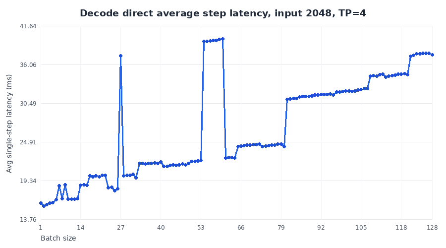
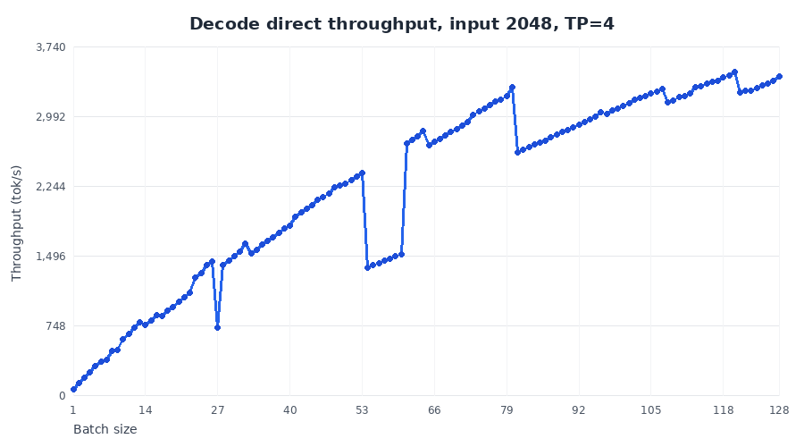
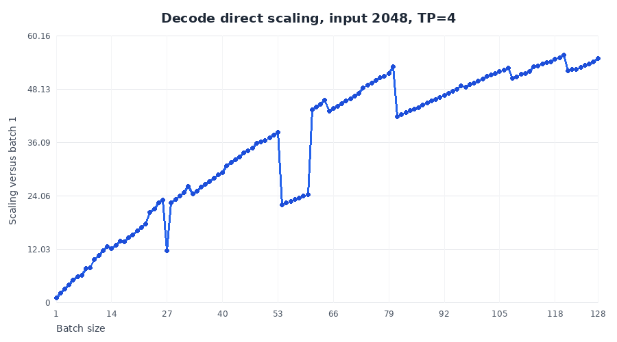

# Decode-Direct Input 2048 TP=4 性能报告

## 运行环境

| 项目 | 值 |
| ---: | ---: |
| 日期 | 2026-11-23 20:24:47-20:32:44（Asia/Shanghai） |
| 平台 | Hygon BW1000 |
| 设备 | 4 x Hygon BW1000 HCU，64 GB HBM，CUDA_VISIBLE_DEVICES 按前 4 张分配 |
| Driver / runtime | 6.3.30-V1.4.1a / DTK 26.04-rc4 |
| InfiniLM build | 分支 `pd-v0.2.9-v1-tp`，commit `da7d18e7` |
| 模型 | `/data/shared/.infinifabric-models-20261027-fef304a05440/Qwen3-8B--b968826d9c46dd6066d109eabc6255188de91218` |
| 模式 | `decode-direct` |
| Attention backend | `flash-attn` |
| Graph request | enabled |
| Expected execution mode | `graph` |
| Cache | paged KV cache，block size 256，num blocks 1152 |
| Max batched tokens | 18,432 |
| Tensor parallel size | 4 |
| Input length | 2048 tokens / request |
| Batch size range | 1..128 |
| Decode steps per repeat | 4 |
| Warmup / measured repeats | 每个形状 3 次 / 30 次 |
| Batch 执行顺序 | random seed 2026 |


本报告对应原始 JSONL 和 log 为本机运行产物，不随仓库提交：

```text
../../../benchmark-hygon-bw-tp4-decode-direct-input2048.jsonl
../../../benchmark-hygon-bw-tp4-decode-direct-input2048.log
```

## 构建与测试命令

```bash
xmake build _infinilm && xmake install _infinilm
```

```bash
SKIP_BUILD=1 TP=4 GPU=0,1,2,3 \
MODE=decode-direct \
INPUT_LEN=2048 \
BATCH_SIZES="$(seq -s, 1 128)" REPEATS=30 \
OUTPUT=benchmark-hygon-bw-tp4-decode-direct-input2048.jsonl ./run_bench_hygon.sh
```

## 执行模式与 Graph 覆盖

- Graph request: enabled
- Expected execution mode: `graph`
- Graph-covered batches: 1..128
- Eager-fallback batches: none
- Mode source: compiler rule；该字段不是 C++ runtime 回传的实际执行模式。

## 资源开销

| 项目 | 值 |
| ---: | ---: |
| Workspace allocation | 每 rank 702 MiB，TP=4 合计 2,808 MiB |
| 权重加载时间 | 21.25 s |
| Graph compilation time | 未单独打点；包含在进程初始化到首个 sample 的 wall time 中 |
| Paged cache blocks | 1,152 |
| 正式 sample 数 | 15,360 |
| 进程 wall time | 477 s (first runtime log to final JSONL write) |
| Monitor peak HCU memory use | 29%（本 run 时间窗，分配 HCUs，10 秒采样） |
| Monitor peak package power | 299.0 W（本 run 时间窗，分配 HCUs，10 秒采样） |
| Monitor peak sensor temperature | 63.0 C（本 run 时间窗，edge/junction，10 秒采样） |


## 测试口径

- Direct decode 不执行语义 prefill，paged KV cache 全 0 初始化。
- Step 0 使用 dummy token；step 1..3 使用上一步 sampled token。
- 每次 repeat 执行 4 个 decode step。
- `avg_step_latency = four_step_repeat_duration / 4`。
- 完整结果表聚合每个 batch 的 120 个 individual step samples。
- `single_step_throughput = batch_size / avg_step_latency`。
- 计时边界为 `engine_forward_including_sampling`。
- 分位数使用线性插值；每个 batch 只有 30 个 repeat，p99 是尾部参考。

## 核心结果

| 指标 | 结果 |
| ---: | ---: |
| 最高 single-step throughput | batch 120，3,467.80 tok/s |
| 最快 batch 平均 step latency | batch 2，15.683 ms |
| 最大 batch scaling | 54.935x |
| Ideal-scaling efficiency | 42.9% |
| Median step std | 0.040 ms |
| Maximum step std | 0.124 ms，batch 101 |


## 趋势图

### 1. Batch size 与 Avg Step Latency



平均 step latency 从 batch 1 的 16.084 ms 变为 batch 128 的 37.475 ms。

### 2. Batch size 与 Single-step Throughput



吞吐峰值出现在 batch 120，为 3,467.80 tok/s。

### 3. Batch size 与 Scaling



batch 128 相对 batch 1 的 scaling 为 54.935x；理想 128x 效率约 42.9%。

## Batch 区间平均 latency 与吞吐

下表按连续 16 个 batch 分组。平均值是区间内各 batch 聚合 single-step 统计的算术平均；区间最优 batch 取吞吐最高的 batch。

| Batch 区间 | 平均单 step latency ms | 平均吞吐 tok/s | 区间最优 batch |
| ---: | ---: | ---: | ---: |
| 1..16 | 17.077 | 487.63 | 16 |
| 17..32 | 20.625 | 1,216.65 | 32 |
| 33..48 | 21.678 | 1,869.18 | 48 |
| 49..64 | 29.846 | 2,043.63 | 64 |
| 65..80 | 24.424 | 2,968.30 | 80 |
| 81..96 | 31.486 | 2,809.90 | 96 |
| 97..112 | 32.990 | 3,166.92 | 107 |
| 113..128 | 36.032 | 3,345.32 | 120 |


## 关键批次与跳变

| Change | Mode transition | Avg step ms | Throughput tok/s | Observation |
| --- | ---: | ---: | ---: | --- |
| 26 -> 27 | graph | 18.135 -> 37.290 | 1,433.69 -> 724.06 | 平均 step latency 增加 105.6%，可能对应 kernel shape 或 workspace 分档变化 |
| 53 -> 54 | graph | 22.247 -> 39.411 | 2,382.32 -> 1,370.17 | 平均 step latency 增加 77.2%，可能对应 kernel shape 或 workspace 分档变化 |
| 80 -> 81 | graph | 24.247 -> 31.057 | 3,299.39 -> 2,608.10 | 平均 step latency 增加 28.1%，可能对应 kernel shape 或 workspace 分档变化 |
| 8 -> 9 | graph | 16.715 -> 18.712 | 478.61 -> 480.98 | 平均 step latency 增加 11.9%，可能对应 kernel shape 或 workspace 分档变化 |
| 6 -> 7 | graph | 16.609 -> 18.564 | 361.24 -> 377.07 | 平均 step latency 增加 11.8%，可能对应 kernel shape 或 workspace 分档变化 |
| 13 -> 14 | graph | 16.726 -> 18.645 | 777.22 -> 750.89 | 平均 step latency 增加 11.5%，可能对应 kernel shape 或 workspace 分档变化 |


## Step 一致性

峰值 batch 120 的 4 个 decode step 结果如下：

| Step | Past KV length | Avg step ms | Std ms | Throughput tok/s |
| ---: | ---: | ---: | ---: | ---: |
| 0 | 2048 | 34.596 | 0.043 | 3,468.59 |
| 1 | 2049 | 34.604 | 0.054 | 3,467.76 |
| 2 | 2050 | 34.598 | 0.049 | 3,468.44 |
| 3 | 2051 | 34.618 | 0.046 | 3,466.41 |


所有 batch 中，4 个 step 平均耗时最大差异为 0.108 ms，出现在 batch 101。差异包含 past KV length 增长和 step kernel 形状影响。

## 数据稳定性

- 单 step std 中位数为 0.040 ms。
- 最大 std 为 0.124 ms，出现在 batch 101。
- 各 batch p99 与 max 接近，尾部稳定；每个 batch 只有 30 个 repeat，p99 仍是尾部参考值。

## TP 对比摘要

| TP | Best batch | Peak throughput tok/s | Scaling vs TP=1 |
| ---: | ---: | ---: | ---: |
| 1 | 128 | 1,393.35 | 1.000x |
| 2 | 120 | 2,341.81 | 1.681x |
| 4 | 120 | 3,467.80 | 2.489x |


## Single-step 完整结果

### Batch 1..16

| Batch | Mode | Avg Step ms | Min Step ms | P50 Step ms | P95 Step ms | P99 Step ms | Max Step ms | Std Step ms | Single-step tok/s | Scaling |
| ---: | --- | ---: | ---: | ---: | ---: | ---: | ---: | ---: | ---: | ---: |
| 1 | graph | 16.084 | 15.997 | 16.084 | 16.137 | 16.152 | 16.156 | 0.038 | 62.18 | 1.000x |
| 2 | graph | 15.683 | 15.614 | 15.679 | 15.723 | 15.968 | 16.164 | 0.060 | 127.52 | 2.051x |
| 3 | graph | 15.845 | 15.797 | 15.845 | 15.889 | 15.908 | 15.965 | 0.027 | 189.33 | 3.045x |
| 4 | graph | 16.109 | 16.038 | 16.100 | 16.191 | 16.222 | 16.244 | 0.038 | 248.31 | 3.994x |
| 5 | graph | 16.183 | 16.141 | 16.183 | 16.217 | 16.230 | 16.232 | 0.020 | 308.97 | 4.969x |
| 6 | graph | 16.609 | 16.557 | 16.609 | 16.653 | 16.665 | 16.704 | 0.023 | 361.24 | 5.810x |
| 7 | graph | 18.564 | 18.488 | 18.564 | 18.645 | 18.681 | 18.692 | 0.041 | 377.07 | 6.065x |
| 8 | graph | 16.715 | 16.639 | 16.706 | 16.810 | 16.841 | 16.872 | 0.047 | 478.61 | 7.698x |
| 9 | graph | 18.712 | 18.639 | 18.699 | 18.807 | 18.829 | 18.838 | 0.047 | 480.98 | 7.736x |
| 10 | graph | 16.655 | 16.595 | 16.645 | 16.756 | 16.773 | 16.783 | 0.042 | 600.43 | 9.657x |
| 11 | graph | 16.677 | 16.606 | 16.668 | 16.764 | 16.810 | 16.825 | 0.043 | 659.60 | 10.609x |
| 12 | graph | 16.676 | 16.597 | 16.672 | 16.742 | 16.800 | 16.815 | 0.036 | 719.58 | 11.573x |
| 13 | graph | 16.726 | 16.657 | 16.716 | 16.809 | 16.865 | 17.050 | 0.052 | 777.22 | 12.500x |
| 14 | graph | 18.645 | 18.601 | 18.641 | 18.680 | 18.695 | 18.696 | 0.021 | 750.89 | 12.077x |
| 15 | graph | 18.708 | 18.626 | 18.706 | 18.778 | 18.797 | 18.836 | 0.037 | 801.78 | 12.895x |
| 16 | graph | 18.641 | 18.597 | 18.634 | 18.678 | 18.686 | 18.764 | 0.023 | 858.34 | 13.805x |


### Batch 17..32

| Batch | Mode | Avg Step ms | Min Step ms | P50 Step ms | P95 Step ms | P99 Step ms | Max Step ms | Std Step ms | Single-step tok/s | Scaling |
| ---: | --- | ---: | ---: | ---: | ---: | ---: | ---: | ---: | ---: | ---: |
| 17 | graph | 19.993 | 19.889 | 19.982 | 20.082 | 20.128 | 20.136 | 0.049 | 850.31 | 13.676x |
| 18 | graph | 19.846 | 19.801 | 19.847 | 19.869 | 19.876 | 19.904 | 0.017 | 907.00 | 14.588x |
| 19 | graph | 20.039 | 19.947 | 20.040 | 20.098 | 20.104 | 20.107 | 0.036 | 948.17 | 15.250x |
| 20 | graph | 19.907 | 19.863 | 19.903 | 19.951 | 19.967 | 19.971 | 0.022 | 1,004.68 | 16.159x |
| 21 | graph | 20.082 | 20.042 | 20.077 | 20.120 | 20.132 | 20.139 | 0.022 | 1,045.72 | 16.819x |
| 22 | graph | 20.082 | 20.045 | 20.082 | 20.107 | 20.131 | 20.133 | 0.018 | 1,095.53 | 17.620x |
| 23 | graph | 18.304 | 18.266 | 18.302 | 18.331 | 18.353 | 18.463 | 0.021 | 1,256.54 | 20.210x |
| 24 | graph | 18.368 | 18.319 | 18.360 | 18.407 | 18.431 | 18.849 | 0.050 | 1,306.63 | 21.015x |
| 25 | graph | 17.882 | 17.842 | 17.877 | 17.919 | 17.925 | 17.930 | 0.020 | 1,398.06 | 22.486x |
| 26 | graph | 18.135 | 18.075 | 18.132 | 18.187 | 18.242 | 18.269 | 0.030 | 1,433.69 | 23.059x |
| 27 | graph | 37.290 | 37.243 | 37.285 | 37.339 | 37.347 | 37.462 | 0.029 | 724.06 | 11.645x |
| 28 | graph | 20.015 | 19.943 | 20.013 | 20.066 | 20.078 | 20.105 | 0.030 | 1,398.93 | 22.500x |
| 29 | graph | 20.077 | 20.045 | 20.072 | 20.115 | 20.144 | 20.159 | 0.020 | 1,444.46 | 23.232x |
| 30 | graph | 20.058 | 20.019 | 20.056 | 20.086 | 20.102 | 20.106 | 0.016 | 1,495.67 | 24.056x |
| 31 | graph | 20.198 | 20.153 | 20.197 | 20.227 | 20.239 | 20.241 | 0.018 | 1,534.78 | 24.685x |
| 32 | graph | 19.727 | 19.676 | 19.725 | 19.768 | 19.792 | 19.817 | 0.024 | 1,622.13 | 26.090x |


### Batch 33..48

| Batch | Mode | Avg Step ms | Min Step ms | P50 Step ms | P95 Step ms | P99 Step ms | Max Step ms | Std Step ms | Single-step tok/s | Scaling |
| ---: | --- | ---: | ---: | ---: | ---: | ---: | ---: | ---: | ---: | ---: |
| 33 | graph | 21.768 | 21.719 | 21.767 | 21.807 | 21.831 | 21.842 | 0.024 | 1,515.99 | 24.383x |
| 34 | graph | 21.770 | 21.724 | 21.766 | 21.811 | 21.840 | 21.846 | 0.023 | 1,561.80 | 25.119x |
| 35 | graph | 21.699 | 21.649 | 21.698 | 21.739 | 21.761 | 21.771 | 0.023 | 1,612.95 | 25.942x |
| 36 | graph | 21.788 | 21.748 | 21.787 | 21.818 | 21.832 | 21.840 | 0.018 | 1,652.27 | 26.574x |
| 37 | graph | 21.801 | 21.744 | 21.797 | 21.847 | 21.940 | 22.099 | 0.040 | 1,697.20 | 27.297x |
| 38 | graph | 21.890 | 21.838 | 21.891 | 21.931 | 21.943 | 21.999 | 0.024 | 1,735.97 | 27.921x |
| 39 | graph | 21.837 | 21.792 | 21.835 | 21.870 | 21.885 | 21.920 | 0.021 | 1,785.94 | 28.724x |
| 40 | graph | 22.026 | 21.997 | 22.024 | 22.050 | 22.068 | 22.081 | 0.016 | 1,816.07 | 29.209x |
| 41 | graph | 21.383 | 21.348 | 21.383 | 21.417 | 21.425 | 21.434 | 0.019 | 1,917.43 | 30.839x |
| 42 | graph | 21.386 | 21.343 | 21.385 | 21.431 | 21.451 | 21.453 | 0.023 | 1,963.90 | 31.587x |
| 43 | graph | 21.496 | 21.432 | 21.488 | 21.523 | 21.689 | 21.831 | 0.048 | 2,000.39 | 32.174x |
| 44 | graph | 21.600 | 21.553 | 21.595 | 21.638 | 21.761 | 21.786 | 0.034 | 2,037.06 | 32.763x |
| 45 | graph | 21.520 | 21.481 | 21.515 | 21.559 | 21.591 | 21.638 | 0.024 | 2,091.07 | 33.632x |
| 46 | graph | 21.608 | 21.573 | 21.604 | 21.646 | 21.655 | 21.662 | 0.020 | 2,128.86 | 34.240x |
| 47 | graph | 21.709 | 21.664 | 21.706 | 21.739 | 21.753 | 21.869 | 0.022 | 2,164.97 | 34.820x |
| 48 | graph | 21.573 | 21.524 | 21.568 | 21.605 | 21.629 | 21.740 | 0.025 | 2,225.03 | 35.786x |


### Batch 49..64

| Batch | Mode | Avg Step ms | Min Step ms | P50 Step ms | P95 Step ms | P99 Step ms | Max Step ms | Std Step ms | Single-step tok/s | Scaling |
| ---: | --- | ---: | ---: | ---: | ---: | ---: | ---: | ---: | ---: | ---: |
| 49 | graph | 21.817 | 21.770 | 21.815 | 21.855 | 21.874 | 21.882 | 0.023 | 2,245.91 | 36.122x |
| 50 | graph | 22.066 | 22.004 | 22.059 | 22.104 | 22.346 | 22.574 | 0.062 | 2,265.88 | 36.444x |
| 51 | graph | 22.101 | 22.063 | 22.098 | 22.137 | 22.152 | 22.158 | 0.021 | 2,307.57 | 37.114x |
| 52 | graph | 22.132 | 22.073 | 22.126 | 22.166 | 22.308 | 22.382 | 0.037 | 2,349.51 | 37.789x |
| 53 | graph | 22.247 | 22.206 | 22.242 | 22.277 | 22.290 | 22.531 | 0.030 | 2,382.32 | 38.316x |
| 54 | graph | 39.411 | 39.371 | 39.409 | 39.445 | 39.468 | 39.474 | 0.021 | 1,370.17 | 22.037x |
| 55 | graph | 39.383 | 39.324 | 39.363 | 39.545 | 39.571 | 39.577 | 0.060 | 1,396.56 | 22.462x |
| 56 | graph | 39.456 | 39.387 | 39.444 | 39.623 | 39.640 | 39.649 | 0.054 | 1,419.30 | 22.827x |
| 57 | graph | 39.550 | 39.504 | 39.549 | 39.584 | 39.591 | 39.598 | 0.020 | 1,441.21 | 23.180x |
| 58 | graph | 39.535 | 39.430 | 39.497 | 39.664 | 39.679 | 39.754 | 0.077 | 1,467.06 | 23.596x |
| 59 | graph | 39.665 | 39.629 | 39.663 | 39.696 | 39.731 | 39.746 | 0.019 | 1,487.46 | 23.924x |
| 60 | graph | 39.715 | 39.661 | 39.713 | 39.742 | 39.839 | 39.859 | 0.025 | 1,510.76 | 24.298x |
| 61 | graph | 22.567 | 22.516 | 22.559 | 22.614 | 22.700 | 22.734 | 0.034 | 2,703.08 | 43.475x |
| 62 | graph | 22.662 | 22.592 | 22.656 | 22.704 | 22.728 | 22.765 | 0.024 | 2,735.88 | 44.003x |
| 63 | graph | 22.661 | 22.622 | 22.661 | 22.687 | 22.694 | 22.718 | 0.016 | 2,780.15 | 44.715x |
| 64 | graph | 22.573 | 22.535 | 22.570 | 22.595 | 22.615 | 22.642 | 0.015 | 2,835.22 | 45.601x |


### Batch 65..80

| Batch | Mode | Avg Step ms | Min Step ms | P50 Step ms | P95 Step ms | P99 Step ms | Max Step ms | Std Step ms | Single-step tok/s | Scaling |
| ---: | --- | ---: | ---: | ---: | ---: | ---: | ---: | ---: | ---: | ---: |
| 65 | graph | 24.264 | 24.220 | 24.265 | 24.294 | 24.321 | 24.363 | 0.022 | 2,678.81 | 43.085x |
| 66 | graph | 24.309 | 24.272 | 24.305 | 24.346 | 24.352 | 24.435 | 0.021 | 2,715.00 | 43.667x |
| 67 | graph | 24.369 | 24.278 | 24.356 | 24.437 | 24.457 | 24.458 | 0.052 | 2,749.42 | 44.221x |
| 68 | graph | 24.431 | 24.377 | 24.427 | 24.460 | 24.478 | 24.829 | 0.041 | 2,783.36 | 44.766x |
| 69 | graph | 24.458 | 24.424 | 24.455 | 24.486 | 24.509 | 24.511 | 0.018 | 2,821.18 | 45.375x |
| 70 | graph | 24.554 | 24.456 | 24.542 | 24.687 | 24.728 | 24.960 | 0.058 | 2,850.91 | 45.853x |
| 71 | graph | 24.547 | 24.508 | 24.546 | 24.578 | 24.586 | 24.608 | 0.018 | 2,892.36 | 46.520x |
| 72 | graph | 24.603 | 24.569 | 24.600 | 24.639 | 24.661 | 24.666 | 0.018 | 2,926.42 | 47.067x |
| 73 | graph | 24.265 | 24.160 | 24.268 | 24.311 | 24.332 | 24.390 | 0.036 | 3,008.50 | 48.387x |
| 74 | graph | 24.281 | 24.237 | 24.282 | 24.313 | 24.319 | 24.324 | 0.018 | 3,047.68 | 49.018x |
| 75 | graph | 24.365 | 24.242 | 24.343 | 24.506 | 24.555 | 24.569 | 0.080 | 3,078.16 | 49.508x |
| 76 | graph | 24.414 | 24.377 | 24.412 | 24.447 | 24.455 | 24.461 | 0.018 | 3,113.02 | 50.069x |
| 77 | graph | 24.460 | 24.423 | 24.458 | 24.496 | 24.521 | 24.529 | 0.020 | 3,147.94 | 50.630x |
| 78 | graph | 24.595 | 24.445 | 24.609 | 24.658 | 24.664 | 24.679 | 0.052 | 3,171.32 | 51.006x |
| 79 | graph | 24.616 | 24.466 | 24.653 | 24.704 | 24.723 | 24.750 | 0.078 | 3,209.26 | 51.616x |
| 80 | graph | 24.247 | 24.209 | 24.245 | 24.277 | 24.306 | 24.381 | 0.022 | 3,299.39 | 53.066x |


### Batch 81..96

| Batch | Mode | Avg Step ms | Min Step ms | P50 Step ms | P95 Step ms | P99 Step ms | Max Step ms | Std Step ms | Single-step tok/s | Scaling |
| ---: | --- | ---: | ---: | ---: | ---: | ---: | ---: | ---: | ---: | ---: |
| 81 | graph | 31.057 | 30.994 | 31.051 | 31.107 | 31.138 | 31.426 | 0.043 | 2,608.10 | 41.948x |
| 82 | graph | 31.105 | 31.004 | 31.103 | 31.168 | 31.208 | 31.240 | 0.041 | 2,636.22 | 42.400x |
| 83 | graph | 31.181 | 31.116 | 31.179 | 31.217 | 31.234 | 31.249 | 0.020 | 2,661.87 | 42.812x |
| 84 | graph | 31.188 | 31.113 | 31.181 | 31.255 | 31.280 | 31.290 | 0.040 | 2,693.32 | 43.318x |
| 85 | graph | 31.373 | 31.214 | 31.387 | 31.472 | 31.515 | 31.744 | 0.074 | 2,709.37 | 43.576x |
| 86 | graph | 31.480 | 31.303 | 31.500 | 31.571 | 31.591 | 31.604 | 0.076 | 2,731.88 | 43.938x |
| 87 | graph | 31.462 | 31.286 | 31.459 | 31.514 | 31.530 | 31.941 | 0.059 | 2,765.24 | 44.475x |
| 88 | graph | 31.476 | 31.284 | 31.479 | 31.524 | 31.536 | 31.557 | 0.041 | 2,795.75 | 44.966x |
| 89 | graph | 31.498 | 31.407 | 31.504 | 31.538 | 31.554 | 31.569 | 0.031 | 2,825.58 | 45.445x |
| 90 | graph | 31.631 | 31.474 | 31.654 | 31.709 | 31.729 | 31.731 | 0.071 | 2,845.32 | 45.763x |
| 91 | graph | 31.678 | 31.510 | 31.707 | 31.785 | 31.803 | 31.870 | 0.090 | 2,872.67 | 46.203x |
| 92 | graph | 31.712 | 31.532 | 31.701 | 31.852 | 31.880 | 31.893 | 0.114 | 2,901.11 | 46.660x |
| 93 | graph | 31.741 | 31.608 | 31.763 | 31.833 | 31.857 | 31.872 | 0.073 | 2,929.99 | 47.125x |
| 94 | graph | 31.724 | 31.595 | 31.691 | 31.844 | 31.976 | 32.025 | 0.089 | 2,963.09 | 47.657x |
| 95 | graph | 31.800 | 31.632 | 31.809 | 31.882 | 31.899 | 31.926 | 0.064 | 2,987.46 | 48.049x |
| 96 | graph | 31.667 | 31.498 | 31.696 | 31.790 | 31.815 | 31.887 | 0.093 | 3,031.50 | 48.757x |


### Batch 97..112

| Batch | Mode | Avg Step ms | Min Step ms | P50 Step ms | P95 Step ms | P99 Step ms | Max Step ms | Std Step ms | Single-step tok/s | Scaling |
| ---: | --- | ---: | ---: | ---: | ---: | ---: | ---: | ---: | ---: | ---: |
| 97 | graph | 32.118 | 31.951 | 32.135 | 32.206 | 32.283 | 32.347 | 0.077 | 3,020.11 | 48.574x |
| 98 | graph | 32.063 | 31.968 | 32.058 | 32.131 | 32.157 | 32.198 | 0.044 | 3,056.47 | 49.159x |
| 99 | graph | 32.163 | 32.014 | 32.134 | 32.379 | 32.415 | 32.423 | 0.100 | 3,078.07 | 49.506x |
| 100 | graph | 32.228 | 32.064 | 32.254 | 32.321 | 32.363 | 32.385 | 0.078 | 3,102.93 | 49.906x |
| 101 | graph | 32.268 | 32.062 | 32.277 | 32.472 | 32.511 | 32.516 | 0.124 | 3,130.05 | 50.342x |
| 102 | graph | 32.195 | 32.080 | 32.198 | 32.256 | 32.269 | 32.270 | 0.041 | 3,168.21 | 50.956x |
| 103 | graph | 32.264 | 32.172 | 32.245 | 32.426 | 32.466 | 32.529 | 0.073 | 3,192.43 | 51.346x |
| 104 | graph | 32.384 | 32.211 | 32.400 | 32.456 | 32.492 | 32.502 | 0.064 | 3,211.42 | 51.651x |
| 105 | graph | 32.479 | 32.289 | 32.499 | 32.585 | 32.731 | 32.888 | 0.098 | 3,232.84 | 51.996x |
| 106 | graph | 32.560 | 32.360 | 32.560 | 32.624 | 32.686 | 32.692 | 0.054 | 3,255.51 | 52.360x |
| 107 | graph | 32.618 | 32.438 | 32.628 | 32.686 | 32.711 | 32.723 | 0.057 | 3,280.41 | 52.761x |
| 108 | graph | 34.378 | 34.201 | 34.383 | 34.457 | 34.475 | 34.520 | 0.061 | 3,141.56 | 50.528x |
| 109 | graph | 34.484 | 34.309 | 34.489 | 34.627 | 34.654 | 34.692 | 0.105 | 3,160.86 | 50.838x |
| 110 | graph | 34.417 | 34.306 | 34.426 | 34.503 | 34.530 | 34.579 | 0.059 | 3,196.12 | 51.405x |
| 111 | graph | 34.567 | 34.490 | 34.559 | 34.635 | 34.659 | 34.677 | 0.033 | 3,211.19 | 51.647x |
| 112 | graph | 34.647 | 34.493 | 34.655 | 34.734 | 34.766 | 34.788 | 0.066 | 3,232.61 | 51.992x |


### Batch 113..128

| Batch | Mode | Avg Step ms | Min Step ms | P50 Step ms | P95 Step ms | P99 Step ms | Max Step ms | Std Step ms | Single-step tok/s | Scaling |
| ---: | --- | ---: | ---: | ---: | ---: | ---: | ---: | ---: | ---: | ---: |
| 113 | graph | 34.230 | 34.070 | 34.236 | 34.290 | 34.372 | 34.417 | 0.055 | 3,301.23 | 53.096x |
| 114 | graph | 34.367 | 34.270 | 34.358 | 34.490 | 34.547 | 34.568 | 0.047 | 3,317.13 | 53.351x |
| 115 | graph | 34.433 | 34.301 | 34.418 | 34.561 | 34.612 | 34.743 | 0.079 | 3,339.85 | 53.717x |
| 116 | graph | 34.522 | 34.329 | 34.553 | 34.661 | 34.706 | 34.730 | 0.098 | 3,360.21 | 54.044x |
| 117 | graph | 34.667 | 34.445 | 34.661 | 34.860 | 34.882 | 34.896 | 0.112 | 3,375.00 | 54.282x |
| 118 | graph | 34.643 | 34.446 | 34.648 | 34.775 | 34.878 | 34.898 | 0.093 | 3,406.16 | 54.783x |
| 119 | graph | 34.725 | 34.528 | 34.717 | 34.914 | 34.950 | 34.953 | 0.107 | 3,426.95 | 55.118x |
| 120 | graph | 34.604 | 34.466 | 34.602 | 34.692 | 34.714 | 34.737 | 0.049 | 3,467.80 | 55.775x |
| 121 | graph | 37.276 | 37.131 | 37.287 | 37.386 | 37.407 | 37.416 | 0.077 | 3,246.02 | 52.208x |
| 122 | graph | 37.368 | 37.258 | 37.354 | 37.509 | 37.536 | 37.743 | 0.070 | 3,264.86 | 52.511x |
| 123 | graph | 37.614 | 37.369 | 37.617 | 37.759 | 37.826 | 37.835 | 0.100 | 3,270.07 | 52.595x |
| 124 | graph | 37.598 | 37.410 | 37.610 | 37.733 | 37.792 | 37.843 | 0.094 | 3,298.09 | 53.045x |
| 125 | graph | 37.651 | 37.430 | 37.645 | 37.832 | 37.885 | 37.898 | 0.101 | 3,319.99 | 53.397x |
| 126 | graph | 37.675 | 37.492 | 37.679 | 37.784 | 37.789 | 37.801 | 0.065 | 3,344.41 | 53.790x |
| 127 | graph | 37.666 | 37.507 | 37.666 | 37.816 | 37.912 | 37.942 | 0.093 | 3,371.74 | 54.230x |
| 128 | graph | 37.475 | 37.320 | 37.482 | 37.589 | 37.615 | 37.644 | 0.074 | 3,415.58 | 54.935x |


## 分析

1. Single-step 吞吐随 batch 增加总体上升，峰值在 batch 120，为 3,467.80 tok/s。
2. 平均 step latency 随 batch 增加而上升，batch 1 为 16.084 ms，batch 128 为 37.475 ms。
3. Decode step 的 past KV length 从 2048 增至 2051；该变化对平均耗时影响较小，主要 scaling 仍来自 batch 并行度。
4. 连续 batch 的正向 latency 跳变通常对应 kernel shape、workspace 分档或 attention tile 变化，不能解释为连续线性退化。
5. step std 中位数 0.040 ms，最大 0.124 ms，整体测量稳定。

## 结论与建议

1. 该形状下优先在 batch 120 附近获得最高 decode 总吞吐。
2. 最大 batch ideal-scaling 效率为 42.9%，说明 per-step attention/MLP latency 随 batch 增长明显。
3. graph 已覆盖全部有效 batch；TP=1 input 1024 如需 batch 256，应先降低 workspace/cache 压力或调整图编译策略。
4. 对关键跳变 batch 建议结合 C++ model-only timer 和 kernel profile 复核。
5. 若需要更稳定的 p99，建议将 `BENCHMARK_REPEATS` 提高到 100 或以上。

## 数据完整性

```text
config records: 1
step samples: 15360
overall summaries: 128
per-step summaries: 512
scaling records: 128
step samples per batch: 120
samples per decode step: 30
```
