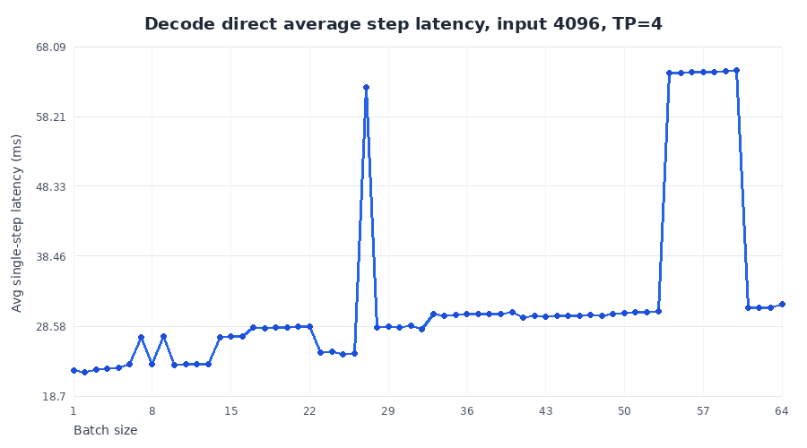
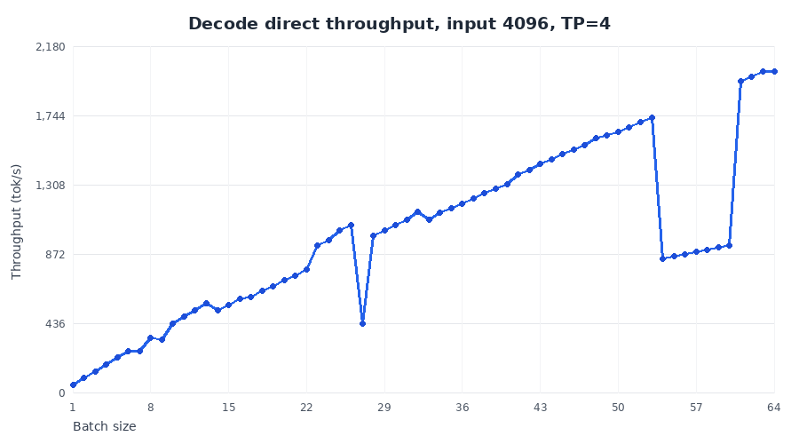
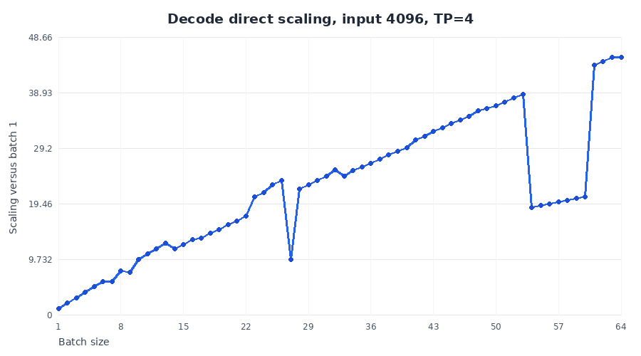

# Decode-Direct Input 4096 TP=4 性能报告

## 运行环境

| 项目 | 值 |
| ---: | ---: |
| 日期 | 2026-11-23 20:33:16-20:38:03（Asia/Shanghai） |
| 平台 | Hygon BW1000 |
| 设备 | 4 x Hygon BW1000 HCU，64 GB HBM，CUDA_VISIBLE_DEVICES 按前 4 张分配 |
| Driver / runtime | 6.3.30-V1.4.1a / DTK 26.04-rc4 |
| InfiniLM build | 分支 `pd-v0.2.9-v1-tp`，commit `da7d18e7` |
| 模型 | `/data/shared/.infinifabric-models-20261027-fef304a05440/Qwen3-8B--b968826d9c46dd6066d109eabc6255188de91218` |
| 模式 | `decode-direct` |
| Attention backend | `flash-attn` |
| Graph request | enabled |
| Expected execution mode | `graph` |
| Cache | paged KV cache，block size 256，num blocks 1088 |
| Max batched tokens | 18,432 |
| Tensor parallel size | 4 |
| Input length | 4096 tokens / request |
| Batch size range | 1..64 |
| Decode steps per repeat | 4 |
| Warmup / measured repeats | 每个形状 3 次 / 30 次 |
| Batch 执行顺序 | random seed 2026 |


本报告对应原始 JSONL 和 log 为本机运行产物，不随仓库提交：

```text
../../../benchmark-hygon-bw-tp4-decode-direct-input4096.jsonl
../../../benchmark-hygon-bw-tp4-decode-direct-input4096.log
```

## 构建与测试命令

```bash
xmake build _infinilm && xmake install _infinilm
```

```bash
SKIP_BUILD=1 TP=4 GPU=0,1,2,3 \
MODE=decode-direct \
INPUT_LEN=4096 \
BATCH_SIZES="$(seq -s, 1 64)" REPEATS=30 \
OUTPUT=benchmark-hygon-bw-tp4-decode-direct-input4096.jsonl ./run_bench_hygon.sh
```

## 执行模式与 Graph 覆盖

- Graph request: enabled
- Expected execution mode: `graph`
- Graph-covered batches: 1..64
- Eager-fallback batches: none
- Mode source: compiler rule；该字段不是 C++ runtime 回传的实际执行模式。

## 资源开销

| 项目 | 值 |
| ---: | ---: |
| Workspace allocation | 每 rank 702 MiB，TP=4 合计 2,808 MiB |
| 权重加载时间 | 11.44 s |
| Graph compilation time | 未单独打点；包含在进程初始化到首个 sample 的 wall time 中 |
| Paged cache blocks | 1,088 |
| 正式 sample 数 | 7,680 |
| 进程 wall time | 287 s (first runtime log to final JSONL write) |
| Monitor peak HCU memory use | 28%（本 run 时间窗，分配 HCUs，10 秒采样） |
| Monitor peak package power | 295.0 W（本 run 时间窗，分配 HCUs，10 秒采样） |
| Monitor peak sensor temperature | 62.0 C（本 run 时间窗，edge/junction，10 秒采样） |


## 测试口径

- Direct decode 不执行语义 prefill，paged KV cache 全 0 初始化。
- Step 0 使用 dummy token；step 1..3 使用上一步 sampled token。
- 每次 repeat 执行 4 个 decode step。
- `avg_step_latency = four_step_repeat_duration / 4`。
- 完整结果表聚合每个 batch 的 120 个 individual step samples。
- `single_step_throughput = batch_size / avg_step_latency`。
- 计时边界为 `engine_forward_including_sampling`。
- 分位数使用线性插值；每个 batch 只有 30 个 repeat，p99 是尾部参考。

## 核心结果

| 指标 | 结果 |
| ---: | ---: |
| 最高 single-step throughput | batch 63，2,021.80 tok/s |
| 最快 batch 平均 step latency | batch 2，22.108 ms |
| 最大 batch scaling | 45.057x |
| Ideal-scaling efficiency | 70.4% |
| Median step std | 0.032 ms |
| Maximum step std | 0.118 ms，batch 36 |


## 趋势图

### 1. Batch size 与 Avg Step Latency



平均 step latency 从 batch 1 的 22.322 ms 变为 batch 64 的 31.706 ms。

### 2. Batch size 与 Single-step Throughput



吞吐峰值出现在 batch 63，为 2,021.80 tok/s。

### 3. Batch size 与 Scaling



batch 64 相对 batch 1 的 scaling 为 45.057x；理想 64x 效率约 70.4%。

## Batch 区间平均 latency 与吞吐

下表按连续 16 个 batch 分组。平均值是区间内各 batch 聚合 single-step 统计的算术平均；区间最优 batch 取吞吐最高的 batch。

| Batch 区间 | 平均单 step latency ms | 平均吞吐 tok/s | 区间最优 batch |
| ---: | ---: | ---: | ---: |
| 1..16 | 24.155 | 344.28 | 16 |
| 17..32 | 29.616 | 861.84 | 32 |
| 33..48 | 30.146 | 1,343.95 | 48 |
| 49..64 | 45.559 | 1,409.01 | 63 |


## 关键批次与跳变

| Change | Mode transition | Avg step ms | Throughput tok/s | Observation |
| --- | ---: | ---: | ---: | --- |
| 26 -> 27 | graph | 24.678 -> 62.317 | 1,053.58 -> 433.27 | 平均 step latency 增加 152.5%，可能对应 kernel shape 或 workspace 分档变化 |
| 53 -> 54 | graph | 30.649 -> 64.337 | 1,729.25 -> 839.33 | 平均 step latency 增加 109.9%，可能对应 kernel shape 或 workspace 分档变化 |
| 8 -> 9 | graph | 23.185 -> 27.119 | 345.05 -> 331.87 | 平均 step latency 增加 17.0%，可能对应 kernel shape 或 workspace 分档变化 |
| 13 -> 14 | graph | 23.198 -> 27.031 | 560.39 -> 517.93 | 平均 step latency 增加 16.5%，可能对应 kernel shape 或 workspace 分档变化 |
| 6 -> 7 | graph | 23.175 -> 26.961 | 258.90 -> 259.63 | 平均 step latency 增加 16.3%，可能对应 kernel shape 或 workspace 分档变化 |
| 32 -> 33 | graph | 28.164 -> 30.286 | 1,136.20 -> 1,089.63 | 平均 step latency 增加 7.5%，可能对应 kernel shape 或 workspace 分档变化 |


## Step 一致性

峰值 batch 63 的 4 个 decode step 结果如下：

| Step | Past KV length | Avg step ms | Std ms | Throughput tok/s |
| ---: | ---: | ---: | ---: | ---: |
| 0 | 4096 | 31.165 | 0.045 | 2,021.51 |
| 1 | 4097 | 31.156 | 0.035 | 2,022.10 |
| 2 | 4098 | 31.166 | 0.026 | 2,021.46 |
| 3 | 4099 | 31.155 | 0.024 | 2,022.13 |


所有 batch 中，4 个 step 平均耗时最大差异为 0.036 ms，出现在 batch 37。差异包含 past KV length 增长和 step kernel 形状影响。

## 数据稳定性

- 单 step std 中位数为 0.032 ms。
- 最大 std 为 0.118 ms，出现在 batch 36。
- 各 batch p99 与 max 接近，尾部稳定；每个 batch 只有 30 个 repeat，p99 仍是尾部参考值。

## TP 对比摘要

| TP | Best batch | Peak throughput tok/s | Scaling vs TP=1 |
| ---: | ---: | ---: | ---: |
| 1 | 60 | 757.36 | 1.000x |
| 2 | 60 | 1,241.38 | 1.639x |
| 4 | 63 | 2,021.80 | 2.670x |


## Single-step 完整结果

### Batch 1..16

| Batch | Mode | Avg Step ms | Min Step ms | P50 Step ms | P95 Step ms | P99 Step ms | Max Step ms | Std Step ms | Single-step tok/s | Scaling |
| ---: | --- | ---: | ---: | ---: | ---: | ---: | ---: | ---: | ---: | ---: |
| 1 | graph | 22.322 | 22.247 | 22.310 | 22.402 | 22.435 | 22.438 | 0.046 | 44.80 | 1.000x |
| 2 | graph | 22.108 | 22.069 | 22.107 | 22.139 | 22.147 | 22.150 | 0.020 | 90.47 | 2.019x |
| 3 | graph | 22.401 | 22.333 | 22.395 | 22.462 | 22.485 | 22.498 | 0.032 | 133.92 | 2.989x |
| 4 | graph | 22.573 | 22.486 | 22.569 | 22.652 | 22.703 | 22.713 | 0.044 | 177.21 | 3.956x |
| 5 | graph | 22.688 | 22.610 | 22.678 | 22.775 | 22.861 | 22.986 | 0.056 | 220.38 | 4.919x |
| 6 | graph | 23.175 | 23.112 | 23.167 | 23.242 | 23.273 | 23.279 | 0.036 | 258.90 | 5.779x |
| 7 | graph | 26.961 | 26.906 | 26.953 | 27.027 | 27.047 | 27.086 | 0.032 | 259.63 | 5.795x |
| 8 | graph | 23.185 | 23.133 | 23.178 | 23.250 | 23.315 | 23.359 | 0.035 | 345.05 | 7.702x |
| 9 | graph | 27.119 | 27.052 | 27.109 | 27.164 | 27.205 | 27.545 | 0.048 | 331.87 | 7.408x |
| 10 | graph | 23.111 | 23.075 | 23.105 | 23.149 | 23.170 | 23.175 | 0.022 | 432.70 | 9.659x |
| 11 | graph | 23.152 | 23.107 | 23.147 | 23.193 | 23.206 | 23.309 | 0.027 | 475.12 | 10.606x |
| 12 | graph | 23.184 | 23.141 | 23.182 | 23.225 | 23.242 | 23.251 | 0.023 | 517.59 | 11.553x |
| 13 | graph | 23.198 | 23.152 | 23.196 | 23.235 | 23.251 | 23.257 | 0.021 | 560.39 | 12.509x |
| 14 | graph | 27.031 | 26.985 | 27.023 | 27.086 | 27.108 | 27.131 | 0.028 | 517.93 | 11.561x |
| 15 | graph | 27.122 | 27.052 | 27.123 | 27.159 | 27.188 | 27.195 | 0.025 | 553.05 | 12.345x |
| 16 | graph | 27.145 | 27.100 | 27.137 | 27.208 | 27.230 | 27.258 | 0.032 | 589.43 | 13.157x |


### Batch 17..32

| Batch | Mode | Avg Step ms | Min Step ms | P50 Step ms | P95 Step ms | P99 Step ms | Max Step ms | Std Step ms | Single-step tok/s | Scaling |
| ---: | --- | ---: | ---: | ---: | ---: | ---: | ---: | ---: | ---: | ---: |
| 17 | graph | 28.347 | 28.285 | 28.345 | 28.399 | 28.410 | 28.416 | 0.028 | 599.71 | 13.387x |
| 18 | graph | 28.247 | 28.194 | 28.243 | 28.294 | 28.308 | 28.318 | 0.025 | 637.25 | 14.224x |
| 19 | graph | 28.397 | 28.331 | 28.389 | 28.442 | 28.591 | 28.805 | 0.051 | 669.09 | 14.935x |
| 20 | graph | 28.348 | 28.293 | 28.346 | 28.392 | 28.404 | 28.418 | 0.025 | 705.52 | 15.748x |
| 21 | graph | 28.576 | 28.498 | 28.573 | 28.614 | 28.707 | 28.754 | 0.030 | 734.89 | 16.404x |
| 22 | graph | 28.465 | 28.412 | 28.464 | 28.508 | 28.521 | 28.532 | 0.023 | 772.88 | 17.252x |
| 23 | graph | 24.869 | 24.817 | 24.866 | 24.914 | 24.922 | 24.926 | 0.023 | 924.86 | 20.645x |
| 24 | graph | 24.972 | 24.922 | 24.966 | 25.015 | 25.031 | 25.051 | 0.025 | 961.09 | 21.453x |
| 25 | graph | 24.547 | 24.499 | 24.545 | 24.585 | 24.592 | 24.593 | 0.022 | 1,018.47 | 22.734x |
| 26 | graph | 24.678 | 24.621 | 24.671 | 24.722 | 24.796 | 24.834 | 0.031 | 1,053.58 | 23.518x |
| 27 | graph | 62.317 | 62.260 | 62.296 | 62.454 | 62.472 | 62.475 | 0.057 | 433.27 | 9.671x |
| 28 | graph | 28.404 | 28.340 | 28.402 | 28.449 | 28.463 | 28.468 | 0.026 | 985.79 | 22.005x |
| 29 | graph | 28.500 | 28.458 | 28.496 | 28.534 | 28.637 | 28.659 | 0.028 | 1,017.55 | 22.713x |
| 30 | graph | 28.444 | 28.395 | 28.439 | 28.486 | 28.507 | 28.516 | 0.026 | 1,054.72 | 23.543x |
| 31 | graph | 28.581 | 28.534 | 28.581 | 28.617 | 28.633 | 28.664 | 0.023 | 1,084.64 | 24.211x |
| 32 | graph | 28.164 | 28.076 | 28.134 | 28.304 | 28.336 | 28.337 | 0.069 | 1,136.20 | 25.362x |


### Batch 33..48

| Batch | Mode | Avg Step ms | Min Step ms | P50 Step ms | P95 Step ms | P99 Step ms | Max Step ms | Std Step ms | Single-step tok/s | Scaling |
| ---: | --- | ---: | ---: | ---: | ---: | ---: | ---: | ---: | ---: | ---: |
| 33 | graph | 30.286 | 30.124 | 30.303 | 30.404 | 30.425 | 30.434 | 0.086 | 1,089.63 | 24.322x |
| 34 | graph | 30.097 | 30.024 | 30.088 | 30.156 | 30.247 | 30.280 | 0.038 | 1,129.69 | 25.217x |
| 35 | graph | 30.157 | 30.104 | 30.148 | 30.211 | 30.316 | 30.546 | 0.048 | 1,160.60 | 25.907x |
| 36 | graph | 30.347 | 30.175 | 30.357 | 30.580 | 30.707 | 30.868 | 0.118 | 1,186.26 | 26.479x |
| 37 | graph | 30.248 | 30.107 | 30.293 | 30.352 | 30.378 | 30.383 | 0.081 | 1,223.23 | 27.305x |
| 38 | graph | 30.325 | 30.213 | 30.289 | 30.442 | 30.455 | 30.464 | 0.082 | 1,253.08 | 27.971x |
| 39 | graph | 30.337 | 30.170 | 30.368 | 30.411 | 30.427 | 30.428 | 0.074 | 1,285.55 | 28.696x |
| 40 | graph | 30.550 | 30.372 | 30.566 | 30.609 | 30.620 | 30.629 | 0.061 | 1,309.33 | 29.227x |
| 41 | graph | 29.821 | 29.767 | 29.809 | 29.913 | 29.999 | 30.108 | 0.047 | 1,374.86 | 30.689x |
| 42 | graph | 30.022 | 29.834 | 30.035 | 30.094 | 30.120 | 30.150 | 0.060 | 1,398.99 | 31.228x |
| 43 | graph | 29.924 | 29.857 | 29.908 | 30.030 | 30.049 | 30.089 | 0.050 | 1,436.97 | 32.076x |
| 44 | graph | 30.021 | 29.940 | 30.004 | 30.114 | 30.140 | 30.222 | 0.053 | 1,465.64 | 32.716x |
| 45 | graph | 30.004 | 29.897 | 29.972 | 30.143 | 30.170 | 30.182 | 0.075 | 1,499.78 | 33.478x |
| 46 | graph | 30.041 | 29.990 | 30.039 | 30.082 | 30.113 | 30.203 | 0.029 | 1,531.24 | 34.180x |
| 47 | graph | 30.185 | 30.070 | 30.150 | 30.306 | 30.323 | 30.328 | 0.077 | 1,557.05 | 34.756x |
| 48 | graph | 29.975 | 29.908 | 29.956 | 30.105 | 30.132 | 30.197 | 0.056 | 1,601.35 | 35.745x |


### Batch 49..64

| Batch | Mode | Avg Step ms | Min Step ms | P50 Step ms | P95 Step ms | P99 Step ms | Max Step ms | Std Step ms | Single-step tok/s | Scaling |
| ---: | --- | ---: | ---: | ---: | ---: | ---: | ---: | ---: | ---: | ---: |
| 49 | graph | 30.234 | 30.156 | 30.229 | 30.295 | 30.434 | 30.588 | 0.053 | 1,620.72 | 36.177x |
| 50 | graph | 30.449 | 30.379 | 30.438 | 30.523 | 30.619 | 30.924 | 0.058 | 1,642.09 | 36.654x |
| 51 | graph | 30.520 | 30.463 | 30.518 | 30.553 | 30.572 | 30.672 | 0.023 | 1,671.04 | 37.301x |
| 52 | graph | 30.506 | 30.452 | 30.502 | 30.546 | 30.569 | 30.634 | 0.027 | 1,704.58 | 38.049x |
| 53 | graph | 30.649 | 30.598 | 30.650 | 30.685 | 30.710 | 30.727 | 0.023 | 1,729.25 | 38.600x |
| 54 | graph | 64.337 | 64.289 | 64.335 | 64.375 | 64.394 | 64.419 | 0.023 | 839.33 | 18.735x |
| 55 | graph | 64.301 | 64.225 | 64.301 | 64.352 | 64.356 | 64.362 | 0.030 | 855.35 | 19.093x |
| 56 | graph | 64.515 | 64.432 | 64.517 | 64.548 | 64.557 | 64.600 | 0.024 | 868.01 | 19.375x |
| 57 | graph | 64.475 | 64.424 | 64.470 | 64.506 | 64.605 | 64.636 | 0.029 | 884.06 | 19.734x |
| 58 | graph | 64.474 | 64.409 | 64.470 | 64.519 | 64.550 | 64.756 | 0.038 | 899.59 | 20.080x |
| 59 | graph | 64.652 | 64.578 | 64.648 | 64.699 | 64.867 | 65.151 | 0.059 | 912.57 | 20.370x |
| 60 | graph | 64.682 | 64.604 | 64.677 | 64.722 | 64.750 | 64.918 | 0.035 | 927.62 | 20.706x |
| 61 | graph | 31.112 | 31.007 | 31.108 | 31.160 | 31.288 | 31.303 | 0.040 | 1,960.67 | 43.766x |
| 62 | graph | 31.171 | 31.100 | 31.172 | 31.214 | 31.236 | 31.286 | 0.028 | 1,989.02 | 44.398x |
| 63 | graph | 31.160 | 31.092 | 31.157 | 31.212 | 31.262 | 31.336 | 0.034 | 2,021.80 | 45.130x |
| 64 | graph | 31.706 | 31.642 | 31.706 | 31.756 | 31.798 | 31.849 | 0.030 | 2,018.52 | 45.057x |


## 分析

1. Single-step 吞吐随 batch 增加总体上升，峰值在 batch 63，为 2,021.80 tok/s。
2. 平均 step latency 随 batch 增加而上升，batch 1 为 22.322 ms，batch 64 为 31.706 ms。
3. Decode step 的 past KV length 从 4096 增至 4099；该变化对平均耗时影响较小，主要 scaling 仍来自 batch 并行度。
4. 连续 batch 的正向 latency 跳变通常对应 kernel shape、workspace 分档或 attention tile 变化，不能解释为连续线性退化。
5. step std 中位数 0.032 ms，最大 0.118 ms，整体测量稳定。

## 结论与建议

1. 该形状下优先在 batch 63 附近获得最高 decode 总吞吐。
2. 最大 batch ideal-scaling 效率为 70.4%，说明 per-step attention/MLP latency 随 batch 增长明显。
3. graph 已覆盖全部有效 batch；TP=1 input 1024 如需 batch 256，应先降低 workspace/cache 压力或调整图编译策略。
4. 对关键跳变 batch 建议结合 C++ model-only timer 和 kernel profile 复核。
5. 若需要更稳定的 p99，建议将 `BENCHMARK_REPEATS` 提高到 100 或以上。

## 数据完整性

```text
config records: 1
step samples: 7680
overall summaries: 64
per-step summaries: 256
scaling records: 64
step samples per batch: 120
samples per decode step: 30
```
