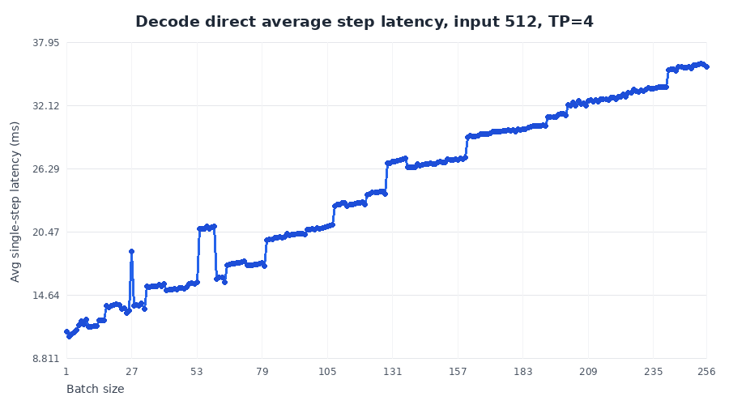
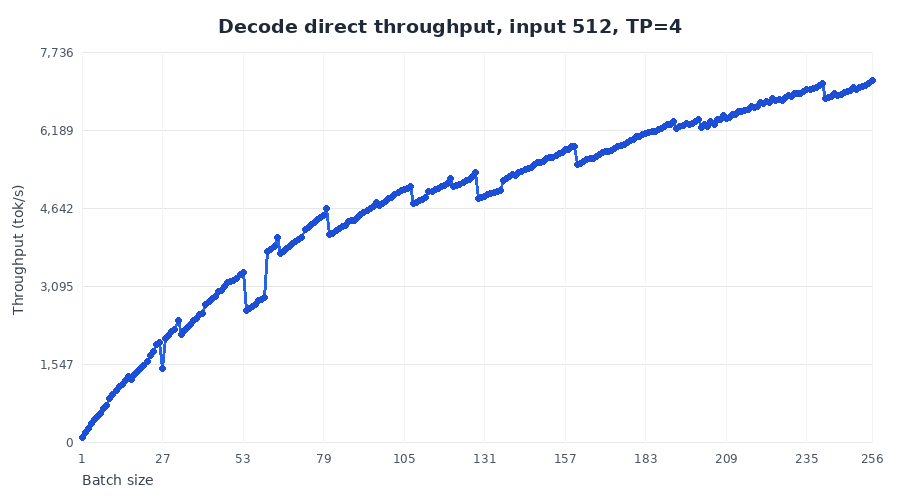
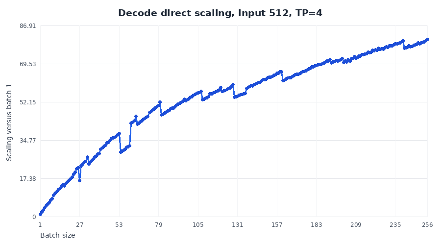

# Decode-Direct Input 512 TP=4 性能报告

## 运行环境

| 项目 | 值 |
| ---: | ---: |
| 日期 | 2026-11-23 19:52:04-20:06:33（Asia/Shanghai） |
| 平台 | Hygon BW1000 |
| 设备 | 4 x Hygon BW1000 HCU，64 GB HBM，CUDA_VISIBLE_DEVICES 按前 4 张分配 |
| Driver / runtime | 6.3.30-V1.4.1a / DTK 26.04-rc4 |
| InfiniLM build | 分支 `pd-v0.2.9-v1-tp`，commit `da7d18e7` |
| 模型 | `/data/shared/.infinifabric-models-20261027-fef304a05440/Qwen3-8B--b968826d9c46dd6066d109eabc6255188de91218` |
| 模式 | `decode-direct` |
| Attention backend | `flash-attn` |
| Graph request | enabled |
| Expected execution mode | `graph` |
| Cache | paged KV cache，block size 256，num blocks 768 |
| Max batched tokens | 18,432 |
| Tensor parallel size | 4 |
| Input length | 512 tokens / request |
| Batch size range | 1..256 |
| Decode steps per repeat | 4 |
| Warmup / measured repeats | 每个形状 3 次 / 30 次 |
| Batch 执行顺序 | random seed 2026 |


本报告对应原始 JSONL 和 log 为本机运行产物，不随仓库提交：

```text
../../../benchmark-hygon-bw-tp4-decode-direct-input512.jsonl
../../../benchmark-hygon-bw-tp4-decode-direct-input512.log
```

## 构建与测试命令

```bash
xmake build _infinilm && xmake install _infinilm
```

```bash
SKIP_BUILD=1 TP=4 GPU=0,1,2,3 \
MODE=decode-direct \
INPUT_LEN=512 \
BATCH_SIZES="$(seq -s, 1 256)" REPEATS=30 \
OUTPUT=benchmark-hygon-bw-tp4-decode-direct-input512.jsonl ./run_bench_hygon.sh
```

## 执行模式与 Graph 覆盖

- Graph request: enabled
- Expected execution mode: `graph`
- Graph-covered batches: 1..256
- Eager-fallback batches: none
- Mode source: compiler rule；该字段不是 C++ runtime 回传的实际执行模式。

## 资源开销

| 项目 | 值 |
| ---: | ---: |
| Workspace allocation | 每 rank 702 MiB，TP=4 合计 2,808 MiB |
| 权重加载时间 | 43.89 s |
| Graph compilation time | 未单独打点；包含在进程初始化到首个 sample 的 wall time 中 |
| Paged cache blocks | 768 |
| 正式 sample 数 | 30,720 |
| 进程 wall time | 869 s (first runtime log to final JSONL write) |
| Monitor peak HCU memory use | 27%（本 run 时间窗，分配 HCUs，10 秒采样） |
| Monitor peak package power | 300.0 W（本 run 时间窗，分配 HCUs，10 秒采样） |
| Monitor peak sensor temperature | 63.0 C（本 run 时间窗，edge/junction，10 秒采样） |


## 测试口径

- Direct decode 不执行语义 prefill，paged KV cache 全 0 初始化。
- Step 0 使用 dummy token；step 1..3 使用上一步 sampled token。
- 每次 repeat 执行 4 个 decode step。
- `avg_step_latency = four_step_repeat_duration / 4`。
- 完整结果表聚合每个 batch 的 120 个 individual step samples。
- `single_step_throughput = batch_size / avg_step_latency`。
- 计时边界为 `engine_forward_including_sampling`。
- 分位数使用线性插值；每个 batch 只有 30 个 repeat，p99 是尾部参考。

## 核心结果

| 指标 | 结果 |
| ---: | ---: |
| 最高 single-step throughput | batch 256，7,169.85 tok/s |
| 最快 batch 平均 step latency | batch 2，10.820 ms |
| 最大 batch scaling | 80.549x |
| Ideal-scaling efficiency | 31.5% |
| Median step std | 0.029 ms |
| Maximum step std | 0.229 ms，batch 35 |


## 趋势图

### 1. Batch size 与 Avg Step Latency



平均 step latency 从 batch 1 的 11.234 ms 变为 batch 256 的 35.705 ms。

### 2. Batch size 与 Single-step Throughput



吞吐峰值出现在 batch 256，为 7,169.85 tok/s。

### 3. Batch size 与 Scaling



batch 256 相对 batch 1 的 scaling 为 80.549x；理想 256x 效率约 31.5%。

## Batch 区间平均 latency 与吞吐

下表按连续 16 个 batch 分组。平均值是区间内各 batch 聚合 single-step 统计的算术平均；区间最优 batch 取吞吐最高的 batch。

| Batch 区间 | 平均单 step latency ms | 平均吞吐 tok/s | 区间最优 batch |
| ---: | ---: | ---: | ---: |
| 1..16 | 11.742 | 712.18 | 16 |
| 17..32 | 13.856 | 1,776.71 | 32 |
| 33..48 | 15.310 | 2,647.59 | 48 |
| 49..64 | 18.009 | 3,189.46 | 64 |
| 65..80 | 17.487 | 4,146.35 | 80 |
| 81..96 | 20.051 | 4,412.10 | 96 |
| 97..112 | 21.504 | 4,861.53 | 107 |
| 113..128 | 23.536 | 5,118.38 | 128 |
| 129..144 | 26.747 | 5,104.81 | 144 |
| 145..160 | 26.981 | 5,651.26 | 160 |
| 161..176 | 29.510 | 5,709.14 | 176 |
| 177..192 | 30.018 | 6,145.60 | 192 |
| 193..208 | 31.703 | 6,323.95 | 208 |
| 209..224 | 32.730 | 6,614.22 | 224 |
| 225..240 | 33.584 | 6,922.39 | 240 |
| 241..256 | 35.655 | 6,969.12 | 256 |


## 关键批次与跳变

| Change | Mode transition | Avg step ms | Throughput tok/s | Observation |
| --- | ---: | ---: | ---: | --- |
| 26 -> 27 | graph | 13.148 -> 18.641 | 1,977.53 -> 1,448.41 | 平均 step latency 增加 41.8%，可能对应 kernel shape 或 workspace 分档变化 |
| 53 -> 54 | graph | 15.803 -> 20.732 | 3,353.75 -> 2,604.63 | 平均 step latency 增加 31.2%，可能对应 kernel shape 或 workspace 分档变化 |
| 32 -> 33 | graph | 13.331 -> 15.414 | 2,400.33 -> 2,140.88 | 平均 step latency 增加 15.6%，可能对应 kernel shape 或 workspace 分档变化 |
| 80 -> 81 | graph | 17.285 -> 19.707 | 4,628.16 -> 4,110.21 | 平均 step latency 增加 14.0%，可能对应 kernel shape 或 workspace 分档变化 |
| 128 -> 129 | graph | 23.958 -> 26.761 | 5,342.65 -> 4,820.37 | 平均 step latency 增加 11.7%，可能对应 kernel shape 或 workspace 分档变化 |
| 16 -> 17 | graph | 12.314 -> 13.605 | 1,299.36 -> 1,249.52 | 平均 step latency 增加 10.5%，可能对应 kernel shape 或 workspace 分档变化 |


## Step 一致性

峰值 batch 256 的 4 个 decode step 结果如下：

| Step | Past KV length | Avg step ms | Std ms | Throughput tok/s |
| ---: | ---: | ---: | ---: | ---: |
| 0 | 512 | 35.688 | 0.074 | 7,173.34 |
| 1 | 513 | 35.728 | 0.080 | 7,165.28 |
| 2 | 514 | 35.704 | 0.074 | 7,170.16 |
| 3 | 515 | 35.701 | 0.082 | 7,170.64 |


所有 batch 中，4 个 step 平均耗时最大差异为 0.188 ms，出现在 batch 152。差异包含 past KV length 增长和 step kernel 形状影响。

## 数据稳定性

- 单 step std 中位数为 0.029 ms。
- 最大 std 为 0.229 ms，出现在 batch 35。
- 各 batch p99 与 max 接近，尾部稳定；每个 batch 只有 30 个 repeat，p99 仍是尾部参考值。

## TP 对比摘要

| TP | Best batch | Peak throughput tok/s | Scaling vs TP=1 |
| ---: | ---: | ---: | ---: |
| 1 | 254 | 3,176.67 | 1.000x |
| 2 | 256 | 5,334.23 | 1.679x |
| 4 | 256 | 7,169.85 | 2.257x |


## Single-step 完整结果

### Batch 1..16

| Batch | Mode | Avg Step ms | Min Step ms | P50 Step ms | P95 Step ms | P99 Step ms | Max Step ms | Std Step ms | Single-step tok/s | Scaling |
| ---: | --- | ---: | ---: | ---: | ---: | ---: | ---: | ---: | ---: | ---: |
| 1 | graph | 11.234 | 11.195 | 11.230 | 11.283 | 11.304 | 11.322 | 0.025 | 89.01 | 1.000x |
| 2 | graph | 10.820 | 10.769 | 10.818 | 10.862 | 10.866 | 10.878 | 0.023 | 184.84 | 2.077x |
| 3 | graph | 11.010 | 10.963 | 11.004 | 11.059 | 11.093 | 11.098 | 0.029 | 272.47 | 3.061x |
| 4 | graph | 11.176 | 11.128 | 11.165 | 11.212 | 11.561 | 11.669 | 0.067 | 357.90 | 4.021x |
| 5 | graph | 11.386 | 11.334 | 11.384 | 11.432 | 11.456 | 11.463 | 0.026 | 439.13 | 4.933x |
| 6 | graph | 11.853 | 11.807 | 11.851 | 11.889 | 11.909 | 11.964 | 0.023 | 506.21 | 5.687x |
| 7 | graph | 12.217 | 12.166 | 12.217 | 12.247 | 12.265 | 12.284 | 0.022 | 572.98 | 6.437x |
| 8 | graph | 11.910 | 11.849 | 11.904 | 11.964 | 11.973 | 11.994 | 0.033 | 671.71 | 7.546x |
| 9 | graph | 12.384 | 12.344 | 12.380 | 12.432 | 12.457 | 12.541 | 0.026 | 726.72 | 8.164x |
| 10 | graph | 11.703 | 11.655 | 11.700 | 11.739 | 11.748 | 11.778 | 0.019 | 854.50 | 9.600x |
| 11 | graph | 11.712 | 11.667 | 11.710 | 11.758 | 11.788 | 11.792 | 0.024 | 939.18 | 10.551x |
| 12 | graph | 11.776 | 11.729 | 11.766 | 11.856 | 11.926 | 11.960 | 0.038 | 1,018.99 | 11.448x |
| 13 | graph | 11.749 | 11.709 | 11.746 | 11.781 | 11.814 | 11.849 | 0.020 | 1,106.44 | 12.430x |
| 14 | graph | 12.302 | 12.254 | 12.299 | 12.345 | 12.369 | 12.375 | 0.023 | 1,138.00 | 12.785x |
| 15 | graph | 12.321 | 12.287 | 12.315 | 12.356 | 12.371 | 12.379 | 0.019 | 1,217.48 | 13.678x |
| 16 | graph | 12.314 | 12.258 | 12.309 | 12.351 | 12.370 | 12.416 | 0.023 | 1,299.36 | 14.598x |


### Batch 17..32

| Batch | Mode | Avg Step ms | Min Step ms | P50 Step ms | P95 Step ms | P99 Step ms | Max Step ms | Std Step ms | Single-step tok/s | Scaling |
| ---: | --- | ---: | ---: | ---: | ---: | ---: | ---: | ---: | ---: | ---: |
| 17 | graph | 13.605 | 13.557 | 13.600 | 13.650 | 13.667 | 13.701 | 0.024 | 1,249.52 | 14.038x |
| 18 | graph | 13.501 | 13.459 | 13.500 | 13.535 | 13.551 | 13.574 | 0.021 | 1,333.24 | 14.978x |
| 19 | graph | 13.656 | 13.622 | 13.651 | 13.696 | 13.702 | 13.720 | 0.020 | 1,391.29 | 15.630x |
| 20 | graph | 13.675 | 13.608 | 13.669 | 13.734 | 13.762 | 13.764 | 0.028 | 1,462.51 | 16.430x |
| 21 | graph | 13.810 | 13.762 | 13.807 | 13.849 | 13.893 | 13.910 | 0.025 | 1,520.69 | 17.084x |
| 22 | graph | 13.718 | 13.681 | 13.712 | 13.758 | 13.773 | 13.813 | 0.021 | 1,603.79 | 18.018x |
| 23 | graph | 13.365 | 13.320 | 13.362 | 13.405 | 13.424 | 13.432 | 0.023 | 1,720.95 | 19.334x |
| 24 | graph | 13.426 | 13.395 | 13.425 | 13.455 | 13.485 | 13.497 | 0.018 | 1,787.53 | 20.082x |
| 25 | graph | 12.977 | 12.933 | 12.975 | 13.012 | 13.019 | 13.031 | 0.022 | 1,926.49 | 21.643x |
| 26 | graph | 13.148 | 13.110 | 13.144 | 13.181 | 13.223 | 13.224 | 0.022 | 1,977.53 | 22.216x |
| 27 | graph | 18.641 | 18.598 | 18.639 | 18.668 | 18.686 | 18.729 | 0.017 | 1,448.41 | 16.272x |
| 28 | graph | 13.624 | 13.595 | 13.620 | 13.670 | 13.681 | 13.708 | 0.020 | 2,055.13 | 23.088x |
| 29 | graph | 13.742 | 13.718 | 13.741 | 13.769 | 13.776 | 13.785 | 0.014 | 2,110.36 | 23.709x |
| 30 | graph | 13.645 | 13.612 | 13.646 | 13.669 | 13.682 | 13.722 | 0.017 | 2,198.64 | 24.700x |
| 31 | graph | 13.834 | 13.782 | 13.830 | 13.883 | 13.919 | 14.160 | 0.039 | 2,240.90 | 25.175x |
| 32 | graph | 13.331 | 13.294 | 13.331 | 13.354 | 13.372 | 13.420 | 0.017 | 2,400.33 | 26.966x |


### Batch 33..48

| Batch | Mode | Avg Step ms | Min Step ms | P50 Step ms | P95 Step ms | P99 Step ms | Max Step ms | Std Step ms | Single-step tok/s | Scaling |
| ---: | --- | ---: | ---: | ---: | ---: | ---: | ---: | ---: | ---: | ---: |
| 33 | graph | 15.414 | 15.375 | 15.410 | 15.462 | 15.472 | 15.476 | 0.023 | 2,140.88 | 24.052x |
| 34 | graph | 15.324 | 15.274 | 15.324 | 15.357 | 15.362 | 15.363 | 0.019 | 2,218.70 | 24.926x |
| 35 | graph | 15.436 | 15.378 | 15.413 | 15.488 | 15.519 | 17.919 | 0.229 | 2,267.38 | 25.473x |
| 36 | graph | 15.447 | 15.396 | 15.443 | 15.487 | 15.508 | 15.522 | 0.023 | 2,330.55 | 26.182x |
| 37 | graph | 15.404 | 15.352 | 15.401 | 15.432 | 15.450 | 15.488 | 0.019 | 2,401.98 | 26.985x |
| 38 | graph | 15.540 | 15.486 | 15.537 | 15.581 | 15.586 | 15.609 | 0.021 | 2,445.23 | 27.471x |
| 39 | graph | 15.439 | 15.386 | 15.438 | 15.476 | 15.513 | 15.527 | 0.022 | 2,526.12 | 28.379x |
| 40 | graph | 15.640 | 15.593 | 15.637 | 15.690 | 15.699 | 15.707 | 0.024 | 2,557.49 | 28.732x |
| 41 | graph | 15.047 | 15.004 | 15.044 | 15.081 | 15.100 | 15.129 | 0.020 | 2,724.74 | 30.611x |
| 42 | graph | 15.096 | 15.041 | 15.092 | 15.137 | 15.149 | 15.322 | 0.030 | 2,782.22 | 31.257x |
| 43 | graph | 15.112 | 15.065 | 15.109 | 15.152 | 15.173 | 15.177 | 0.022 | 2,845.37 | 31.966x |
| 44 | graph | 15.228 | 15.180 | 15.225 | 15.274 | 15.286 | 15.289 | 0.023 | 2,889.35 | 32.460x |
| 45 | graph | 15.100 | 15.038 | 15.101 | 15.139 | 15.166 | 15.173 | 0.025 | 2,980.05 | 33.479x |
| 46 | graph | 15.265 | 15.231 | 15.261 | 15.305 | 15.323 | 15.358 | 0.021 | 3,013.48 | 33.855x |
| 47 | graph | 15.278 | 15.239 | 15.276 | 15.316 | 15.338 | 15.346 | 0.021 | 3,076.37 | 34.561x |
| 48 | graph | 15.182 | 15.146 | 15.183 | 15.213 | 15.232 | 15.239 | 0.017 | 3,161.60 | 35.519x |


### Batch 49..64

| Batch | Mode | Avg Step ms | Min Step ms | P50 Step ms | P95 Step ms | P99 Step ms | Max Step ms | Std Step ms | Single-step tok/s | Scaling |
| ---: | --- | ---: | ---: | ---: | ---: | ---: | ---: | ---: | ---: | ---: |
| 49 | graph | 15.370 | 15.328 | 15.362 | 15.412 | 15.471 | 15.827 | 0.048 | 3,187.95 | 35.815x |
| 50 | graph | 15.634 | 15.582 | 15.630 | 15.674 | 15.696 | 15.701 | 0.023 | 3,198.06 | 35.928x |
| 51 | graph | 15.691 | 15.655 | 15.688 | 15.729 | 15.761 | 15.766 | 0.022 | 3,250.22 | 36.514x |
| 52 | graph | 15.664 | 15.626 | 15.660 | 15.690 | 15.703 | 15.987 | 0.033 | 3,319.67 | 37.295x |
| 53 | graph | 15.803 | 15.760 | 15.799 | 15.849 | 15.868 | 15.968 | 0.029 | 3,353.75 | 37.677x |
| 54 | graph | 20.732 | 20.695 | 20.733 | 20.762 | 20.769 | 20.771 | 0.018 | 2,604.63 | 29.262x |
| 55 | graph | 20.711 | 20.663 | 20.710 | 20.749 | 20.766 | 20.790 | 0.020 | 2,655.64 | 29.835x |
| 56 | graph | 20.758 | 20.712 | 20.757 | 20.792 | 20.799 | 20.802 | 0.018 | 2,697.74 | 30.308x |
| 57 | graph | 20.917 | 20.812 | 20.916 | 20.954 | 20.984 | 21.062 | 0.028 | 2,725.09 | 30.615x |
| 58 | graph | 20.702 | 20.664 | 20.700 | 20.732 | 20.761 | 20.767 | 0.017 | 2,801.67 | 31.475x |
| 59 | graph | 20.897 | 20.864 | 20.898 | 20.922 | 20.932 | 20.949 | 0.016 | 2,823.40 | 31.719x |
| 60 | graph | 20.926 | 20.889 | 20.925 | 20.957 | 20.970 | 20.978 | 0.017 | 2,867.27 | 32.212x |
| 61 | graph | 16.120 | 16.080 | 16.119 | 16.154 | 16.163 | 16.178 | 0.017 | 3,784.06 | 42.512x |
| 62 | graph | 16.224 | 16.151 | 16.224 | 16.251 | 16.280 | 16.300 | 0.019 | 3,821.53 | 42.933x |
| 63 | graph | 16.213 | 16.173 | 16.212 | 16.252 | 16.265 | 16.277 | 0.020 | 3,885.73 | 43.654x |
| 64 | graph | 15.783 | 15.749 | 15.781 | 15.812 | 15.828 | 15.840 | 0.016 | 4,054.90 | 45.554x |


### Batch 65..80

| Batch | Mode | Avg Step ms | Min Step ms | P50 Step ms | P95 Step ms | P99 Step ms | Max Step ms | Std Step ms | Single-step tok/s | Scaling |
| ---: | --- | ---: | ---: | ---: | ---: | ---: | ---: | ---: | ---: | ---: |
| 65 | graph | 17.376 | 17.340 | 17.372 | 17.406 | 17.448 | 17.527 | 0.023 | 3,740.81 | 42.026x |
| 66 | graph | 17.472 | 17.435 | 17.469 | 17.508 | 17.525 | 17.528 | 0.021 | 3,777.51 | 42.438x |
| 67 | graph | 17.486 | 17.447 | 17.483 | 17.516 | 17.531 | 17.545 | 0.017 | 3,831.55 | 43.045x |
| 68 | graph | 17.510 | 17.445 | 17.504 | 17.548 | 17.566 | 17.586 | 0.022 | 3,883.57 | 43.630x |
| 69 | graph | 17.560 | 17.525 | 17.557 | 17.600 | 17.648 | 17.662 | 0.021 | 3,929.30 | 44.143x |
| 70 | graph | 17.596 | 17.553 | 17.594 | 17.633 | 17.647 | 17.650 | 0.023 | 3,978.09 | 44.692x |
| 71 | graph | 17.652 | 17.584 | 17.648 | 17.700 | 17.716 | 17.724 | 0.024 | 4,022.19 | 45.187x |
| 72 | graph | 17.749 | 17.712 | 17.747 | 17.774 | 17.781 | 17.843 | 0.017 | 4,056.53 | 45.573x |
| 73 | graph | 17.349 | 17.289 | 17.346 | 17.394 | 17.438 | 17.458 | 0.031 | 4,207.62 | 47.270x |
| 74 | graph | 17.392 | 17.333 | 17.390 | 17.423 | 17.441 | 17.466 | 0.019 | 4,254.85 | 47.801x |
| 75 | graph | 17.387 | 17.345 | 17.386 | 17.407 | 17.433 | 17.449 | 0.015 | 4,313.57 | 48.461x |
| 76 | graph | 17.437 | 17.398 | 17.435 | 17.464 | 17.477 | 17.486 | 0.016 | 4,358.59 | 48.966x |
| 77 | graph | 17.451 | 17.388 | 17.441 | 17.509 | 17.594 | 17.849 | 0.049 | 4,412.31 | 49.570x |
| 78 | graph | 17.542 | 17.501 | 17.536 | 17.574 | 17.579 | 17.868 | 0.036 | 4,446.39 | 49.953x |
| 79 | graph | 17.553 | 17.504 | 17.551 | 17.591 | 17.605 | 17.610 | 0.021 | 4,500.60 | 50.562x |
| 80 | graph | 17.285 | 17.260 | 17.284 | 17.307 | 17.316 | 17.325 | 0.013 | 4,628.16 | 51.995x |


### Batch 81..96

| Batch | Mode | Avg Step ms | Min Step ms | P50 Step ms | P95 Step ms | P99 Step ms | Max Step ms | Std Step ms | Single-step tok/s | Scaling |
| ---: | --- | ---: | ---: | ---: | ---: | ---: | ---: | ---: | ---: | ---: |
| 81 | graph | 19.707 | 19.649 | 19.707 | 19.736 | 19.752 | 19.793 | 0.020 | 4,110.21 | 46.176x |
| 82 | graph | 19.793 | 19.733 | 19.795 | 19.824 | 19.846 | 19.850 | 0.017 | 4,142.81 | 46.542x |
| 83 | graph | 19.764 | 19.712 | 19.763 | 19.801 | 19.809 | 19.824 | 0.021 | 4,199.55 | 47.180x |
| 84 | graph | 19.876 | 19.820 | 19.875 | 19.905 | 19.920 | 19.938 | 0.018 | 4,226.12 | 47.478x |
| 85 | graph | 19.909 | 19.859 | 19.908 | 19.945 | 19.955 | 19.981 | 0.020 | 4,269.39 | 47.964x |
| 86 | graph | 19.994 | 19.930 | 19.994 | 20.039 | 20.048 | 20.049 | 0.026 | 4,301.20 | 48.321x |
| 87 | graph | 19.928 | 19.859 | 19.919 | 20.008 | 20.088 | 20.153 | 0.040 | 4,365.81 | 49.047x |
| 88 | graph | 19.988 | 19.946 | 19.988 | 20.010 | 20.024 | 20.033 | 0.014 | 4,402.66 | 49.461x |
| 89 | graph | 20.243 | 20.063 | 20.248 | 20.388 | 20.415 | 20.420 | 0.111 | 4,396.51 | 49.392x |
| 90 | graph | 20.166 | 20.119 | 20.160 | 20.197 | 20.237 | 20.580 | 0.043 | 4,463.05 | 50.140x |
| 91 | graph | 20.186 | 20.140 | 20.182 | 20.236 | 20.249 | 20.315 | 0.027 | 4,508.11 | 50.646x |
| 92 | graph | 20.238 | 20.188 | 20.236 | 20.275 | 20.287 | 20.299 | 0.021 | 4,545.85 | 51.070x |
| 93 | graph | 20.256 | 20.188 | 20.254 | 20.309 | 20.341 | 20.410 | 0.033 | 4,591.33 | 51.581x |
| 94 | graph | 20.289 | 20.246 | 20.285 | 20.318 | 20.408 | 20.584 | 0.035 | 4,632.98 | 52.049x |
| 95 | graph | 20.295 | 20.233 | 20.291 | 20.333 | 20.385 | 20.439 | 0.026 | 4,681.01 | 52.588x |
| 96 | graph | 20.181 | 20.122 | 20.179 | 20.225 | 20.249 | 20.256 | 0.027 | 4,757.01 | 53.442x |


### Batch 97..112

| Batch | Mode | Avg Step ms | Min Step ms | P50 Step ms | P95 Step ms | P99 Step ms | Max Step ms | Std Step ms | Single-step tok/s | Scaling |
| ---: | --- | ---: | ---: | ---: | ---: | ---: | ---: | ---: | ---: | ---: |
| 97 | graph | 20.651 | 20.572 | 20.648 | 20.698 | 20.839 | 20.878 | 0.041 | 4,697.18 | 52.770x |
| 98 | graph | 20.682 | 20.607 | 20.671 | 20.784 | 20.807 | 20.834 | 0.045 | 4,738.51 | 53.234x |
| 99 | graph | 20.738 | 20.647 | 20.735 | 20.772 | 20.813 | 21.197 | 0.049 | 4,773.76 | 53.630x |
| 100 | graph | 20.674 | 20.612 | 20.672 | 20.717 | 20.767 | 20.796 | 0.028 | 4,837.09 | 54.342x |
| 101 | graph | 20.791 | 20.689 | 20.797 | 20.839 | 20.849 | 20.856 | 0.032 | 4,857.95 | 54.576x |
| 102 | graph | 20.753 | 20.708 | 20.749 | 20.790 | 20.839 | 20.936 | 0.028 | 4,914.93 | 55.216x |
| 103 | graph | 20.805 | 20.752 | 20.800 | 20.859 | 20.911 | 20.982 | 0.032 | 4,950.62 | 55.617x |
| 104 | graph | 20.864 | 20.817 | 20.862 | 20.897 | 20.928 | 21.052 | 0.026 | 4,984.63 | 55.999x |
| 105 | graph | 20.933 | 20.854 | 20.934 | 20.982 | 20.999 | 21.028 | 0.030 | 5,016.01 | 56.352x |
| 106 | graph | 21.050 | 20.984 | 21.051 | 21.091 | 21.110 | 21.114 | 0.023 | 5,035.56 | 56.572x |
| 107 | graph | 21.119 | 21.067 | 21.119 | 21.155 | 21.167 | 21.180 | 0.022 | 5,066.44 | 56.919x |
| 108 | graph | 22.848 | 22.803 | 22.847 | 22.884 | 22.902 | 22.918 | 0.021 | 4,726.82 | 53.103x |
| 109 | graph | 22.951 | 22.899 | 22.953 | 22.986 | 23.006 | 23.007 | 0.021 | 4,749.18 | 53.354x |
| 110 | graph | 22.987 | 22.934 | 22.985 | 23.026 | 23.048 | 23.081 | 0.023 | 4,785.30 | 53.760x |
| 111 | graph | 23.111 | 23.069 | 23.109 | 23.143 | 23.198 | 23.312 | 0.029 | 4,802.91 | 53.958x |
| 112 | graph | 23.104 | 23.065 | 23.098 | 23.161 | 23.173 | 23.187 | 0.027 | 4,847.56 | 54.460x |


### Batch 113..128

| Batch | Mode | Avg Step ms | Min Step ms | P50 Step ms | P95 Step ms | P99 Step ms | Max Step ms | Std Step ms | Single-step tok/s | Scaling |
| ---: | --- | ---: | ---: | ---: | ---: | ---: | ---: | ---: | ---: | ---: |
| 113 | graph | 22.785 | 22.738 | 22.781 | 22.827 | 22.887 | 22.913 | 0.027 | 4,959.33 | 55.715x |
| 114 | graph | 22.968 | 22.872 | 22.943 | 23.066 | 23.072 | 23.083 | 0.063 | 4,963.34 | 55.760x |
| 115 | graph | 22.938 | 22.877 | 22.937 | 22.980 | 22.990 | 23.137 | 0.031 | 5,013.52 | 56.324x |
| 116 | graph | 23.061 | 22.994 | 23.057 | 23.102 | 23.129 | 23.195 | 0.025 | 5,030.07 | 56.510x |
| 117 | graph | 23.124 | 23.070 | 23.125 | 23.169 | 23.181 | 23.191 | 0.024 | 5,059.67 | 56.843x |
| 118 | graph | 23.154 | 23.097 | 23.151 | 23.189 | 23.242 | 23.317 | 0.027 | 5,096.37 | 57.255x |
| 119 | graph | 23.173 | 23.128 | 23.171 | 23.212 | 23.220 | 23.226 | 0.022 | 5,135.33 | 57.692x |
| 120 | graph | 23.001 | 22.951 | 22.998 | 23.054 | 23.085 | 23.189 | 0.032 | 5,217.08 | 58.611x |
| 121 | graph | 23.884 | 23.834 | 23.880 | 23.922 | 23.956 | 24.053 | 0.028 | 5,066.24 | 56.916x |
| 122 | graph | 23.975 | 23.834 | 23.981 | 24.016 | 24.035 | 24.046 | 0.033 | 5,088.61 | 57.168x |
| 123 | graph | 24.077 | 24.007 | 24.075 | 24.146 | 24.173 | 24.193 | 0.038 | 5,108.65 | 57.393x |
| 124 | graph | 24.090 | 24.019 | 24.089 | 24.130 | 24.170 | 24.184 | 0.025 | 5,147.45 | 57.829x |
| 125 | graph | 24.077 | 24.013 | 24.062 | 24.176 | 24.377 | 24.432 | 0.063 | 5,191.78 | 58.327x |
| 126 | graph | 24.180 | 24.117 | 24.176 | 24.233 | 24.260 | 24.279 | 0.026 | 5,210.88 | 58.541x |
| 127 | graph | 24.130 | 24.076 | 24.129 | 24.171 | 24.195 | 24.202 | 0.024 | 5,263.08 | 59.128x |
| 128 | graph | 23.958 | 23.898 | 23.959 | 23.992 | 24.021 | 24.032 | 0.023 | 5,342.65 | 60.022x |


### Batch 129..144

| Batch | Mode | Avg Step ms | Min Step ms | P50 Step ms | P95 Step ms | P99 Step ms | Max Step ms | Std Step ms | Single-step tok/s | Scaling |
| ---: | --- | ---: | ---: | ---: | ---: | ---: | ---: | ---: | ---: | ---: |
| 129 | graph | 26.761 | 26.699 | 26.756 | 26.825 | 26.903 | 26.921 | 0.037 | 4,820.37 | 54.154x |
| 130 | graph | 26.812 | 26.729 | 26.806 | 26.876 | 26.905 | 26.916 | 0.035 | 4,848.61 | 54.471x |
| 131 | graph | 26.894 | 26.848 | 26.886 | 26.943 | 26.957 | 26.962 | 0.029 | 4,871.07 | 54.724x |
| 132 | graph | 26.915 | 26.852 | 26.905 | 26.970 | 27.150 | 27.333 | 0.053 | 4,904.39 | 55.098x |
| 133 | graph | 26.989 | 26.935 | 26.988 | 27.035 | 27.057 | 27.066 | 0.026 | 4,927.98 | 55.363x |
| 134 | graph | 27.065 | 27.022 | 27.068 | 27.103 | 27.118 | 27.123 | 0.021 | 4,950.99 | 55.622x |
| 135 | graph | 27.175 | 27.094 | 27.173 | 27.224 | 27.291 | 27.320 | 0.031 | 4,967.73 | 55.810x |
| 136 | graph | 27.218 | 27.102 | 27.218 | 27.298 | 27.318 | 27.457 | 0.055 | 4,996.70 | 56.135x |
| 137 | graph | 26.379 | 26.263 | 26.350 | 26.480 | 26.498 | 26.524 | 0.074 | 5,193.59 | 58.347x |
| 138 | graph | 26.407 | 26.353 | 26.405 | 26.453 | 26.474 | 26.476 | 0.027 | 5,225.96 | 58.711x |
| 139 | graph | 26.381 | 26.325 | 26.379 | 26.421 | 26.454 | 26.460 | 0.024 | 5,269.01 | 59.194x |
| 140 | graph | 26.380 | 26.314 | 26.379 | 26.415 | 26.436 | 26.444 | 0.022 | 5,307.09 | 59.622x |
| 141 | graph | 26.673 | 26.622 | 26.671 | 26.720 | 26.771 | 26.786 | 0.028 | 5,286.18 | 59.387x |
| 142 | graph | 26.589 | 26.532 | 26.585 | 26.640 | 26.696 | 26.991 | 0.047 | 5,340.56 | 59.998x |
| 143 | graph | 26.640 | 26.592 | 26.636 | 26.690 | 26.710 | 26.727 | 0.027 | 5,367.80 | 60.304x |
| 144 | graph | 26.672 | 26.610 | 26.670 | 26.716 | 26.738 | 26.755 | 0.028 | 5,398.85 | 60.653x |


### Batch 145..160

| Batch | Mode | Avg Step ms | Min Step ms | P50 Step ms | P95 Step ms | P99 Step ms | Max Step ms | Std Step ms | Single-step tok/s | Scaling |
| ---: | --- | ---: | ---: | ---: | ---: | ---: | ---: | ---: | ---: | ---: |
| 145 | graph | 26.707 | 26.646 | 26.706 | 26.755 | 26.804 | 26.825 | 0.030 | 5,429.33 | 60.995x |
| 146 | graph | 26.774 | 26.730 | 26.773 | 26.815 | 26.836 | 26.859 | 0.025 | 5,453.03 | 61.262x |
| 147 | graph | 26.740 | 26.674 | 26.735 | 26.791 | 26.826 | 26.857 | 0.028 | 5,497.33 | 61.759x |
| 148 | graph | 26.725 | 26.676 | 26.722 | 26.762 | 26.776 | 26.784 | 0.024 | 5,537.94 | 62.216x |
| 149 | graph | 26.829 | 26.770 | 26.820 | 26.880 | 27.048 | 27.234 | 0.053 | 5,553.60 | 62.391x |
| 150 | graph | 26.934 | 26.831 | 26.928 | 27.034 | 27.111 | 27.361 | 0.064 | 5,569.07 | 62.565x |
| 151 | graph | 26.876 | 26.822 | 26.876 | 26.919 | 26.935 | 26.939 | 0.026 | 5,618.30 | 63.118x |
| 152 | graph | 26.891 | 26.744 | 26.865 | 27.027 | 27.035 | 27.041 | 0.100 | 5,652.37 | 63.501x |
| 153 | graph | 27.124 | 27.003 | 27.132 | 27.171 | 27.192 | 27.194 | 0.041 | 5,640.67 | 63.370x |
| 154 | graph | 27.106 | 27.038 | 27.100 | 27.157 | 27.193 | 27.305 | 0.036 | 5,681.45 | 63.828x |
| 155 | graph | 27.104 | 27.030 | 27.098 | 27.151 | 27.173 | 27.219 | 0.026 | 5,718.73 | 64.247x |
| 156 | graph | 27.145 | 27.090 | 27.140 | 27.193 | 27.210 | 27.211 | 0.026 | 5,747.00 | 64.564x |
| 157 | graph | 27.089 | 27.025 | 27.081 | 27.149 | 27.173 | 27.187 | 0.032 | 5,795.77 | 65.112x |
| 158 | graph | 27.245 | 27.181 | 27.246 | 27.287 | 27.305 | 27.311 | 0.026 | 5,799.26 | 65.151x |
| 159 | graph | 27.139 | 27.068 | 27.134 | 27.198 | 27.223 | 27.233 | 0.032 | 5,858.63 | 65.818x |
| 160 | graph | 27.268 | 27.212 | 27.263 | 27.317 | 27.329 | 27.347 | 0.026 | 5,867.73 | 65.921x |


### Batch 161..176

| Batch | Mode | Avg Step ms | Min Step ms | P50 Step ms | P95 Step ms | P99 Step ms | Max Step ms | Std Step ms | Single-step tok/s | Scaling |
| ---: | --- | ---: | ---: | ---: | ---: | ---: | ---: | ---: | ---: | ---: |
| 161 | graph | 29.208 | 29.097 | 29.219 | 29.268 | 29.279 | 29.286 | 0.046 | 5,512.11 | 61.925x |
| 162 | graph | 29.308 | 29.140 | 29.315 | 29.363 | 29.393 | 29.405 | 0.047 | 5,527.59 | 62.099x |
| 163 | graph | 29.252 | 29.190 | 29.247 | 29.305 | 29.325 | 29.428 | 0.033 | 5,572.34 | 62.602x |
| 164 | graph | 29.252 | 29.184 | 29.251 | 29.289 | 29.315 | 29.343 | 0.026 | 5,606.49 | 62.986x |
| 165 | graph | 29.345 | 29.278 | 29.347 | 29.382 | 29.402 | 29.471 | 0.028 | 5,622.73 | 63.168x |
| 166 | graph | 29.485 | 29.430 | 29.484 | 29.531 | 29.544 | 29.559 | 0.029 | 5,630.04 | 63.250x |
| 167 | graph | 29.488 | 29.406 | 29.487 | 29.527 | 29.552 | 29.570 | 0.025 | 5,663.29 | 63.624x |
| 168 | graph | 29.458 | 29.378 | 29.457 | 29.506 | 29.531 | 29.551 | 0.028 | 5,702.96 | 64.069x |
| 169 | graph | 29.470 | 29.411 | 29.468 | 29.535 | 29.584 | 29.611 | 0.036 | 5,734.57 | 64.425x |
| 170 | graph | 29.545 | 29.477 | 29.534 | 29.586 | 29.831 | 30.090 | 0.064 | 5,754.03 | 64.643x |
| 171 | graph | 29.684 | 29.536 | 29.700 | 29.758 | 29.788 | 29.802 | 0.059 | 5,760.65 | 64.718x |
| 172 | graph | 29.708 | 29.560 | 29.714 | 29.782 | 29.846 | 29.915 | 0.062 | 5,789.67 | 65.044x |
| 173 | graph | 29.667 | 29.597 | 29.667 | 29.717 | 29.719 | 29.788 | 0.028 | 5,831.36 | 65.512x |
| 174 | graph | 29.719 | 29.633 | 29.720 | 29.756 | 29.769 | 29.771 | 0.024 | 5,854.82 | 65.776x |
| 175 | graph | 29.778 | 29.719 | 29.773 | 29.822 | 29.850 | 29.880 | 0.027 | 5,876.91 | 66.024x |
| 176 | graph | 29.797 | 29.706 | 29.795 | 29.844 | 29.900 | 29.959 | 0.033 | 5,906.61 | 66.357x |


### Batch 177..192

| Batch | Mode | Avg Step ms | Min Step ms | P50 Step ms | P95 Step ms | P99 Step ms | Max Step ms | Std Step ms | Single-step tok/s | Scaling |
| ---: | --- | ---: | ---: | ---: | ---: | ---: | ---: | ---: | ---: | ---: |
| 177 | graph | 29.839 | 29.665 | 29.823 | 29.996 | 30.068 | 30.077 | 0.092 | 5,931.78 | 66.640x |
| 178 | graph | 29.780 | 29.635 | 29.780 | 29.891 | 29.936 | 29.987 | 0.065 | 5,977.19 | 67.150x |
| 179 | graph | 29.822 | 29.661 | 29.827 | 29.896 | 29.955 | 29.988 | 0.059 | 6,002.33 | 67.433x |
| 180 | graph | 29.677 | 29.611 | 29.670 | 29.740 | 29.791 | 29.829 | 0.037 | 6,065.34 | 68.141x |
| 181 | graph | 29.896 | 29.807 | 29.891 | 29.935 | 30.106 | 30.136 | 0.041 | 6,054.28 | 68.016x |
| 182 | graph | 29.870 | 29.779 | 29.862 | 29.956 | 29.987 | 30.225 | 0.055 | 6,093.12 | 68.453x |
| 183 | graph | 29.931 | 29.838 | 29.924 | 29.997 | 30.034 | 30.049 | 0.040 | 6,114.06 | 68.688x |
| 184 | graph | 29.942 | 29.847 | 29.936 | 30.010 | 30.059 | 30.063 | 0.040 | 6,145.19 | 69.038x |
| 185 | graph | 30.034 | 29.892 | 30.056 | 30.108 | 30.125 | 30.159 | 0.062 | 6,159.74 | 69.201x |
| 186 | graph | 30.158 | 29.967 | 30.168 | 30.260 | 30.298 | 30.311 | 0.070 | 6,167.56 | 69.289x |
| 187 | graph | 30.189 | 30.044 | 30.189 | 30.367 | 30.393 | 30.399 | 0.095 | 6,194.36 | 69.590x |
| 188 | graph | 30.190 | 30.085 | 30.190 | 30.242 | 30.277 | 30.385 | 0.033 | 6,227.18 | 69.959x |
| 189 | graph | 30.231 | 30.040 | 30.230 | 30.296 | 30.333 | 30.351 | 0.042 | 6,251.78 | 70.235x |
| 190 | graph | 30.201 | 30.114 | 30.197 | 30.260 | 30.298 | 30.456 | 0.038 | 6,291.27 | 70.679x |
| 191 | graph | 30.328 | 30.258 | 30.325 | 30.370 | 30.385 | 30.406 | 0.026 | 6,297.91 | 70.753x |
| 192 | graph | 30.205 | 30.133 | 30.207 | 30.255 | 30.271 | 30.325 | 0.030 | 6,356.50 | 71.412x |


### Batch 193..208

| Batch | Mode | Avg Step ms | Min Step ms | P50 Step ms | P95 Step ms | P99 Step ms | Max Step ms | Std Step ms | Single-step tok/s | Scaling |
| ---: | --- | ---: | ---: | ---: | ---: | ---: | ---: | ---: | ---: | ---: |
| 193 | graph | 31.062 | 30.887 | 31.046 | 31.227 | 31.327 | 31.374 | 0.092 | 6,213.38 | 69.804x |
| 194 | graph | 31.040 | 30.962 | 31.038 | 31.096 | 31.116 | 31.126 | 0.033 | 6,249.98 | 70.215x |
| 195 | graph | 31.027 | 30.972 | 31.020 | 31.075 | 31.107 | 31.236 | 0.034 | 6,284.93 | 70.608x |
| 196 | graph | 31.047 | 30.984 | 31.045 | 31.093 | 31.103 | 31.117 | 0.028 | 6,312.96 | 70.922x |
| 197 | graph | 31.258 | 31.042 | 31.270 | 31.415 | 31.490 | 31.593 | 0.105 | 6,302.43 | 70.804x |
| 198 | graph | 31.317 | 31.082 | 31.319 | 31.429 | 31.483 | 31.519 | 0.075 | 6,322.38 | 71.028x |
| 199 | graph | 31.304 | 31.096 | 31.306 | 31.464 | 31.492 | 31.512 | 0.095 | 6,356.99 | 71.417x |
| 200 | graph | 31.222 | 31.158 | 31.219 | 31.283 | 31.295 | 31.318 | 0.033 | 6,405.76 | 71.965x |
| 201 | graph | 32.182 | 31.954 | 32.190 | 32.326 | 32.350 | 32.358 | 0.103 | 6,245.71 | 70.167x |
| 202 | graph | 32.077 | 32.012 | 32.074 | 32.124 | 32.135 | 32.156 | 0.027 | 6,297.33 | 70.747x |
| 203 | graph | 32.395 | 32.270 | 32.407 | 32.473 | 32.505 | 32.545 | 0.060 | 6,266.31 | 70.398x |
| 204 | graph | 32.117 | 32.048 | 32.116 | 32.168 | 32.182 | 32.190 | 0.030 | 6,351.87 | 71.360x |
| 205 | graph | 32.571 | 32.340 | 32.571 | 32.784 | 32.829 | 32.866 | 0.116 | 6,293.98 | 70.709x |
| 206 | graph | 32.234 | 32.167 | 32.227 | 32.286 | 32.341 | 32.354 | 0.033 | 6,390.78 | 71.797x |
| 207 | graph | 32.315 | 32.202 | 32.315 | 32.371 | 32.397 | 32.400 | 0.039 | 6,405.75 | 71.965x |
| 208 | graph | 32.086 | 31.921 | 32.100 | 32.184 | 32.236 | 32.242 | 0.071 | 6,482.68 | 72.829x |


### Batch 209..224

| Batch | Mode | Avg Step ms | Min Step ms | P50 Step ms | P95 Step ms | P99 Step ms | Max Step ms | Std Step ms | Single-step tok/s | Scaling |
| ---: | --- | ---: | ---: | ---: | ---: | ---: | ---: | ---: | ---: | ---: |
| 209 | graph | 32.546 | 32.332 | 32.548 | 32.603 | 32.614 | 32.659 | 0.047 | 6,421.62 | 72.143x |
| 210 | graph | 32.597 | 32.364 | 32.600 | 32.675 | 32.737 | 32.812 | 0.059 | 6,442.41 | 72.377x |
| 211 | graph | 32.473 | 32.385 | 32.474 | 32.513 | 32.647 | 32.684 | 0.038 | 6,497.77 | 72.999x |
| 212 | graph | 32.608 | 32.450 | 32.603 | 32.664 | 32.689 | 32.773 | 0.034 | 6,501.43 | 73.040x |
| 213 | graph | 32.477 | 32.390 | 32.471 | 32.549 | 32.582 | 32.650 | 0.042 | 6,558.59 | 73.682x |
| 214 | graph | 32.679 | 32.542 | 32.686 | 32.740 | 32.761 | 32.845 | 0.051 | 6,548.51 | 73.569x |
| 215 | graph | 32.698 | 32.639 | 32.698 | 32.747 | 32.764 | 32.787 | 0.029 | 6,575.34 | 73.870x |
| 216 | graph | 32.711 | 32.510 | 32.711 | 32.787 | 32.842 | 32.870 | 0.052 | 6,603.33 | 74.185x |
| 217 | graph | 32.632 | 32.571 | 32.630 | 32.674 | 32.700 | 32.845 | 0.033 | 6,649.94 | 74.708x |
| 218 | graph | 32.853 | 32.617 | 32.860 | 32.988 | 33.031 | 33.084 | 0.087 | 6,635.53 | 74.546x |
| 219 | graph | 32.864 | 32.635 | 32.872 | 32.921 | 32.990 | 33.044 | 0.055 | 6,663.74 | 74.863x |
| 220 | graph | 32.687 | 32.620 | 32.685 | 32.742 | 32.770 | 32.771 | 0.032 | 6,730.47 | 75.613x |
| 221 | graph | 32.944 | 32.859 | 32.944 | 32.997 | 33.006 | 33.010 | 0.031 | 6,708.25 | 75.363x |
| 222 | graph | 32.903 | 32.782 | 32.882 | 33.035 | 33.083 | 33.093 | 0.066 | 6,747.01 | 75.799x |
| 223 | graph | 33.125 | 32.927 | 33.134 | 33.189 | 33.219 | 33.252 | 0.055 | 6,732.07 | 75.631x |
| 224 | graph | 32.886 | 32.747 | 32.862 | 32.996 | 33.012 | 33.055 | 0.069 | 6,811.50 | 76.523x |


### Batch 225..240

| Batch | Mode | Avg Step ms | Min Step ms | P50 Step ms | P95 Step ms | P99 Step ms | Max Step ms | Std Step ms | Single-step tok/s | Scaling |
| ---: | --- | ---: | ---: | ---: | ---: | ---: | ---: | ---: | ---: | ---: |
| 225 | graph | 33.245 | 33.195 | 33.241 | 33.290 | 33.305 | 33.466 | 0.032 | 6,767.92 | 76.034x |
| 226 | graph | 33.255 | 33.171 | 33.254 | 33.313 | 33.332 | 33.363 | 0.036 | 6,795.87 | 76.348x |
| 227 | graph | 33.555 | 33.385 | 33.550 | 33.649 | 33.662 | 33.685 | 0.047 | 6,765.00 | 76.001x |
| 228 | graph | 33.410 | 33.214 | 33.426 | 33.589 | 33.620 | 33.623 | 0.115 | 6,824.22 | 76.666x |
| 229 | graph | 33.363 | 33.256 | 33.357 | 33.446 | 33.471 | 33.509 | 0.045 | 6,863.92 | 77.112x |
| 230 | graph | 33.512 | 33.311 | 33.511 | 33.610 | 33.654 | 33.682 | 0.054 | 6,863.28 | 77.105x |
| 231 | graph | 33.453 | 33.350 | 33.423 | 33.581 | 33.608 | 33.616 | 0.073 | 6,905.18 | 77.576x |
| 232 | graph | 33.559 | 33.353 | 33.574 | 33.718 | 33.749 | 33.761 | 0.100 | 6,913.29 | 77.667x |
| 233 | graph | 33.752 | 33.516 | 33.751 | 33.867 | 33.895 | 34.035 | 0.064 | 6,903.21 | 77.554x |
| 234 | graph | 33.651 | 33.528 | 33.641 | 33.747 | 33.819 | 34.049 | 0.067 | 6,953.67 | 78.120x |
| 235 | graph | 33.652 | 33.581 | 33.649 | 33.717 | 33.749 | 33.752 | 0.036 | 6,983.22 | 78.452x |
| 236 | graph | 33.760 | 33.621 | 33.752 | 33.836 | 33.875 | 33.883 | 0.045 | 6,990.57 | 78.535x |
| 237 | graph | 33.787 | 33.528 | 33.781 | 33.887 | 33.938 | 33.939 | 0.059 | 7,014.61 | 78.805x |
| 238 | graph | 33.804 | 33.613 | 33.803 | 33.891 | 33.975 | 33.995 | 0.057 | 7,040.56 | 79.097x |
| 239 | graph | 33.809 | 33.677 | 33.795 | 33.901 | 33.950 | 34.038 | 0.055 | 7,069.16 | 79.418x |
| 240 | graph | 33.781 | 33.696 | 33.771 | 33.875 | 33.899 | 33.901 | 0.048 | 7,104.56 | 79.816x |


### Batch 241..256

| Batch | Mode | Avg Step ms | Min Step ms | P50 Step ms | P95 Step ms | P99 Step ms | Max Step ms | Std Step ms | Single-step tok/s | Scaling |
| ---: | --- | ---: | ---: | ---: | ---: | ---: | ---: | ---: | ---: | ---: |
| 241 | graph | 35.360 | 35.144 | 35.370 | 35.454 | 35.468 | 35.490 | 0.070 | 6,815.69 | 76.570x |
| 242 | graph | 35.423 | 35.229 | 35.422 | 35.476 | 35.535 | 35.554 | 0.042 | 6,831.64 | 76.750x |
| 243 | graph | 35.454 | 35.199 | 35.473 | 35.545 | 35.620 | 35.636 | 0.081 | 6,854.00 | 77.001x |
| 244 | graph | 35.319 | 35.209 | 35.323 | 35.371 | 35.408 | 35.413 | 0.040 | 6,908.40 | 77.612x |
| 245 | graph | 35.664 | 35.466 | 35.686 | 35.747 | 35.778 | 35.780 | 0.077 | 6,869.63 | 77.176x |
| 246 | graph | 35.670 | 35.452 | 35.674 | 35.742 | 35.790 | 35.864 | 0.059 | 6,896.53 | 77.479x |
| 247 | graph | 35.615 | 35.482 | 35.635 | 35.710 | 35.731 | 35.822 | 0.076 | 6,935.35 | 77.915x |
| 248 | graph | 35.627 | 35.403 | 35.628 | 35.691 | 35.718 | 35.762 | 0.042 | 6,961.04 | 78.203x |
| 249 | graph | 35.666 | 35.463 | 35.665 | 35.721 | 35.732 | 35.738 | 0.035 | 6,981.44 | 78.432x |
| 250 | graph | 35.547 | 35.431 | 35.518 | 35.691 | 35.726 | 35.746 | 0.074 | 7,032.94 | 79.011x |
| 251 | graph | 35.857 | 35.640 | 35.862 | 35.921 | 35.955 | 35.962 | 0.048 | 6,999.97 | 78.641x |
| 252 | graph | 35.856 | 35.645 | 35.855 | 35.915 | 35.935 | 35.988 | 0.045 | 7,028.02 | 78.956x |
| 253 | graph | 35.890 | 35.652 | 35.914 | 36.012 | 36.028 | 36.048 | 0.093 | 7,049.24 | 79.194x |
| 254 | graph | 35.941 | 35.768 | 35.940 | 36.008 | 36.031 | 36.049 | 0.042 | 7,067.12 | 79.395x |
| 255 | graph | 35.890 | 35.805 | 35.874 | 36.014 | 36.060 | 36.077 | 0.059 | 7,105.01 | 79.821x |
| 256 | graph | 35.705 | 35.592 | 35.672 | 35.832 | 35.860 | 35.881 | 0.079 | 7,169.85 | 80.549x |


## 分析

1. Single-step 吞吐随 batch 增加总体上升，峰值在 batch 256，为 7,169.85 tok/s。
2. 平均 step latency 随 batch 增加而上升，batch 1 为 11.234 ms，batch 256 为 35.705 ms。
3. Decode step 的 past KV length 从 512 增至 515；该变化对平均耗时影响较小，主要 scaling 仍来自 batch 并行度。
4. 连续 batch 的正向 latency 跳变通常对应 kernel shape、workspace 分档或 attention tile 变化，不能解释为连续线性退化。
5. step std 中位数 0.029 ms，最大 0.229 ms，整体测量稳定。

## 结论与建议

1. 该形状下优先在 batch 256 附近获得最高 decode 总吞吐。
2. 最大 batch ideal-scaling 效率为 31.5%，说明 per-step attention/MLP latency 随 batch 增长明显。
3. graph 已覆盖全部有效 batch；TP=1 input 1024 如需 batch 256，应先降低 workspace/cache 压力或调整图编译策略。
4. 对关键跳变 batch 建议结合 C++ model-only timer 和 kernel profile 复核。
5. 若需要更稳定的 p99，建议将 `BENCHMARK_REPEATS` 提高到 100 或以上。

## 数据完整性

```text
config records: 1
step samples: 30720
overall summaries: 256
per-step summaries: 1024
scaling records: 256
step samples per batch: 120
samples per decode step: 30
```
