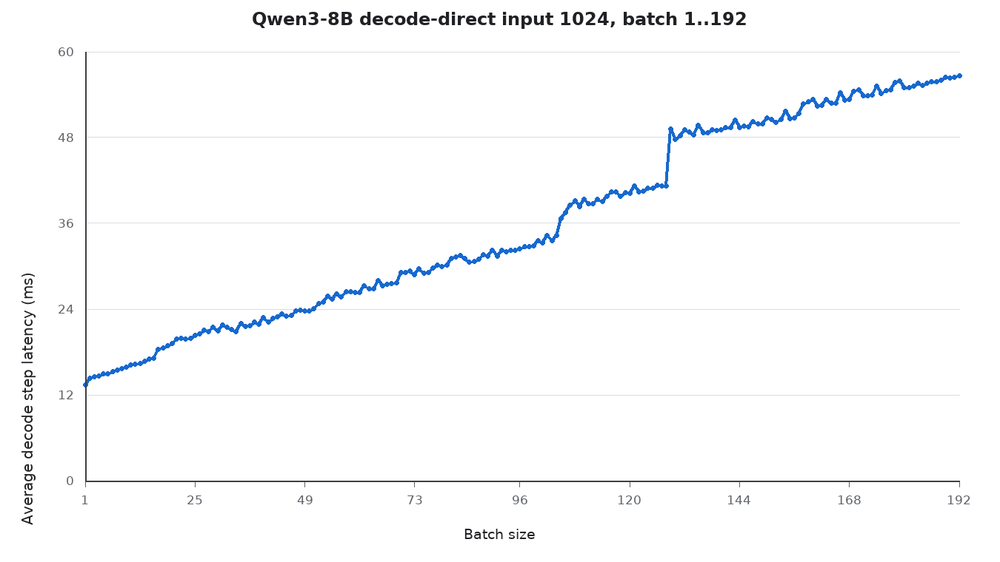
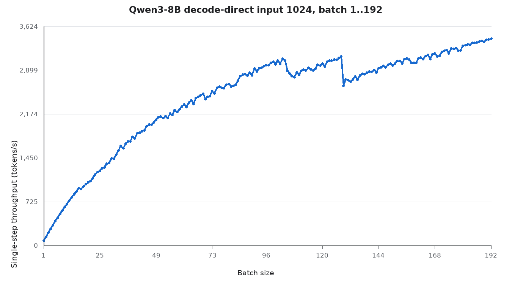
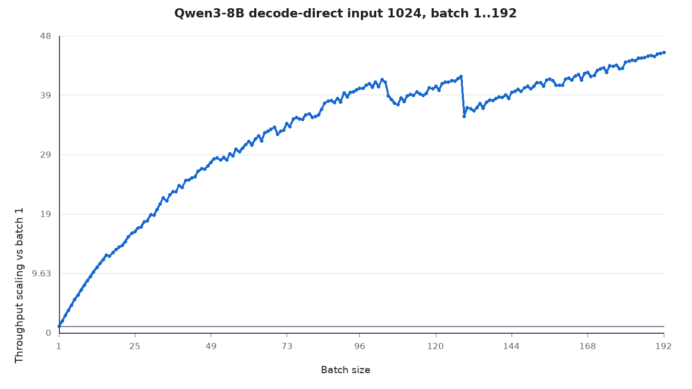

# Decode-Direct Graph 性能报告

## 运行环境

| 项目 | 值 |
| --- | --- |
| 日期 | 2026-11-13 16:38-16:54（Asia/Shanghai） |
| 平台 | MetaX |
| 设备 | C500，物理 GPU 5，64 GiB |
| Driver / runtime | MetaX driver 3.3.12 / MACA 3.2.1.10 |
| InfiniLM build | 当前源码树；基准 commit `112ee225` |
| 模型 | `/data-aisoft/mechdancer/models/Qwen3-8B` |
| 模式 | `decode-direct` |
| Attention backend | `flash-attn` |
| Cache | paged KV cache，block size 256 |
| Max batched tokens | 9,216 |
| Tensor parallel size | 1 |
| 输入长度 | 1,024 tokens / request |
| Batch size | 1..192，共 192 个形状 |
| Decode step 数 | 每个 repeat 固定 4 step |
| Warmup | 每个形状 3 次 repeat |
| 正式样本 | 每个形状 30 次 repeat |
| Batch 执行顺序 | random seed 2026 |
| 干扰检查 | GPU 5 全程无外来进程、无多进程采样点 |

本报告对应的原始 JSONL 和 log 为本机运行产物，不随仓库提交：

```text
../../../benchmark-decode-direct-metax-c500-qwen3-8b-input1024-batch1-192-clean-20261113.jsonl
../../../benchmark-decode-direct-metax-c500-qwen3-8b-input1024-batch1-192-clean-20261113.log
```

## 构建与测试命令

C++ 扩展使用当前源码构建并安装：

```bash
xmake build _infinilm && xmake install _infinilm
```

性能测试命令：

```bash
BENCHMARK_GPU=5 \
INFINILM_MAX_NUM_BATCHED_TOKENS=9216 \
BENCHMARK_MODE=decode-direct \
BATCH_SIZES="$(seq -s, 1 192)" \
INPUT_LENS=1024 \
BENCHMARK_REPEATS=30 \
BENCHMARK_OUTPUT=benchmark-decode-direct-metax-c500-qwen3-8b-input1024-batch1-192-clean-20261113.jsonl \
./run_bench.sh
```

脚本说明：上述命令中的 `run_bench.sh` 是 2026-11-13 测试时的本地脚本名；该脚本未随仓库提交，当前源码树中也没有该文件。复现时应使用等效的 MetaX benchmark 入口，并确认参数为 `--tp 1`、`BENCHMARK_GPU=5` 以及上述环境变量。

### OOM 降范围说明

首先按 A100 的 batch `1..256` 尝试：

```bash
BENCHMARK_GPU=5 \
INFINILM_MAX_NUM_BATCHED_TOKENS=9216 \
BENCHMARK_MODE=decode-direct \
BATCH_SIZES="$(seq -s, 1 256)" \
INPUT_LENS=1024 \
BENCHMARK_REPEATS=30 \
BENCHMARK_OUTPUT=benchmark-decode-direct-metax-c500-qwen3-8b-input1024-batch1-256-clean-20261113.jsonl \
./run_bench.sh
```

该尝试在独立 GPU 5 的 engine 初始化阶段发生 `mcMalloc` OOM，未产生有效 JSONL。随后改用 batch `1..192` 完成本报告。OOM log 保留为 `benchmark-decode-direct-metax-c500-qwen3-8b-input1024-batch1-256-clean-20261113-oom.log`。

## 执行模式与 Graph 覆盖

当前 paged graph compiler 对 decode batch `1..192` 全部生成对应 graph；原始 JSONL 中所有 overall summary 的 `expected_execution_mode` 均为 `graph`，无 eager fallback 混入。

`expected_execution_mode` 是 benchmark 根据 compiler 规则推断的字段，不是 C++ runtime 回传的实际执行模式。

## 资源开销

| 项目 | 值 |
| --- | ---: |
| Workspace allocation | 972.0 MiB |
| 权重加载时间 | 约 39.70 秒 |
| Paged cache blocks | 960 |
| Total benchmark wall time | 约 944.6 秒 |
| GPU 5 温度范围 | 32C-55C |
| GPU 5 功耗范围 | 91W-317W |

## 测试口径

- `decode-direct` 不执行语义完整的 prefill，paged KV cache 初始为全 0。
- Step 0 输入 dummy token；step 1 到 step 3 使用上一步 sampled token。
- 4 个 decode step 的 past KV length 分别为 1024、1025、1026、1027。
- 报告中的 duration 是单 step 时间，由一次 4-step repeat 的对应总耗时指标除以 4 得到。
- Throughput 是 single-step 吞吐：`batch_size / avg_step_duration_s`。
- 计时边界为 `engine_forward_including_sampling`，包含 Python wrapper、C++ engine forward、RankWorker forward、model forward/graph replay 和 sampling。
- 不包含 HTTP、JSON parsing、tokenization、scheduler queueing、`build_model_inputs`、detokenization 和 Python `generate()` 循环。
- 输出 token 不用于正确性判断。
- 分位数使用线性插值；每个 batch 30 个 repeat，p99 只能作为尾部参考。

## 核心结论

| 指标 | 结果 |
| --- | ---: |
| 最高 single-step 吞吐 | batch 192，3,418.89 tok/s |
| batch 192 平均单 step latency | 56.159 ms |
| batch 1 平均单 step latency | 13.287 ms |
| 最大 batch 192 平均单 step latency | 56.159 ms |
| 最大 batch 相对 batch 1 吞吐倍数 | 45.427x |
| 最大 batch 相对理想 192x 的效率 | 23.7% |

吞吐 Top 10 overall 结果：

| Rank | Batch | Avg step ms | Throughput tok/s |
| ---: | ---: | ---: | ---: |
| 1 | 192 | 56.159 | 3,418.89 |
| 2 | 191 | 56.015 | 3,409.78 |
| 3 | 190 | 55.894 | 3,399.28 |
| 4 | 188 | 55.546 | 3,384.58 |
| 5 | 187 | 55.333 | 3,379.54 |
| 6 | 189 | 56.027 | 3,373.36 |
| 7 | 186 | 55.375 | 3,358.93 |
| 8 | 184 | 54.896 | 3,351.80 |
| 9 | 185 | 55.203 | 3,351.28 |
| 10 | 182 | 54.724 | 3,325.79 |

## 趋势图

### 1. Batch size 与平均单 step latency



### 2. Batch size 与吞吐



### 3. Batch size 与吞吐 Scaling



平均单 step latency 从 batch 1 的 13.287 ms 增至 batch 192 的 56.159 ms。吞吐峰值为 batch 192 的 3,418.89 tok/s。

## Batch 区间平均 latency 与吞吐

下表按连续 16 个 batch 分组。`平均单 step latency ms` 和 `平均吞吐 tok/s` 分别是该区间内 16 个 batch 的 overall `Avg Step ms` 与 `Single-step tok/s` 的算术平均值；`区间最优 batch` 取该区间内吞吐最高的 batch。

| Batch 区间 | 平均单 step latency ms | 平均吞吐 tok/s | 区间最优 batch |
| --- | ---: | ---: | ---: |
| 1..16 | 15.438 | 533.50 | 16 |
| 17..32 | 20.025 | 1,215.17 | 32 |
| 33..48 | 22.252 | 1,815.20 | 48 |
| 49..64 | 25.481 | 2,214.10 | 64 |
| 65..80 | 28.671 | 2,526.69 | 80 |
| 81..96 | 31.300 | 2,826.31 | 96 |
| 97..112 | 35.610 | 2,940.92 | 103 |
| 113..128 | 40.119 | 3,002.73 | 128 |
| 129..144 | 48.631 | 2,806.54 | 144 |
| 145..160 | 50.519 | 3,018.36 | 156 |
| 161..176 | 53.272 | 3,162.69 | 175 |
| 177..192 | 55.269 | 3,337.88 | 192 |

区间平均 latency 随 batch size 持续增长，区间平均吞吐整体上升。12 个区间中有 9 个区间的最优 batch 是区间右端点；偏离右端点的区间通常包含 throughput 跳变或局部回落。

## 关键批次与跳变

下表列出吞吐下降幅度最大的相邻 batch 变化。

| Change | Avg step ms | Single-step tok/s | 吞吐变化 |
| --- | ---: | ---: | ---: |
| 128 -> 129 | 40.948 -> 48.842 | 3,125.95 -> 2,641.19 | -484.75 |
| 104 -> 105 | 34.020 -> 36.373 | 3,057.05 -> 2,886.74 | -170.31 |
| 69 -> 70 | 27.506 -> 28.893 | 2,508.54 -> 2,422.73 | -85.81 |
| 64 -> 65 | 26.638 -> 27.796 | 2,402.56 -> 2,338.47 | -64.09 |

这些变化均发生在 graph 覆盖范围内，不能归因于 eager fallback。如需定位原因，应补充 kernel trace 或 C++ model-only 打点。

## Step 一致性

| Decode step | Past KV length | 全部 batch 平均 step latency ms |
| ---: | ---: | ---: |
| 0 | 1024 | 35.536 |
| 1 | 1025 | 35.551 |
| 2 | 1026 | 35.555 |
| 3 | 1027 | 35.553 |

Past KV length 从 1024 增至 1027 时，平均 step latency 变化很小；与 batch size 和区间跳变相比，这 3 个 token 的 KV 增量不是主要影响因素。

## 数据稳定性

- 192 个 overall summary 换算为单 step 后，std 中位数为 0.103 ms。
- 最大单 step std 为 0.446 ms，出现在 batch 163。
- 最大变异系数约 1.251%，中位变异系数约 0.310%。
- P50、P95、P99 和 max 普遍接近。

每个 batch 只有 30 个 repeat 样本；p99 可用于观察尾部，正式尾部对比建议提高到 100+ repeat。

## Single-step 完整结果

| Batch | Mode | Avg step ms | Min step ms | P50 step ms | P95 step ms | P99 step ms | Max step ms | Std step ms | Single-step tok/s | Scaling |
| ---: | --- | ---: | ---: | ---: | ---: | ---: | ---: | ---: | ---: | ---: |
| 1 | graph | 13.287 | 13.197 | 13.289 | 13.329 | 13.347 | 13.350 | 0.027 | 75.26 | 1.000x |
| 2 | graph | 14.232 | 14.200 | 14.226 | 14.267 | 14.324 | 14.343 | 0.026 | 140.53 | 1.867x |
| 3 | graph | 14.424 | 14.310 | 14.428 | 14.473 | 14.485 | 14.485 | 0.039 | 207.99 | 2.764x |
| 4 | graph | 14.557 | 14.490 | 14.558 | 14.596 | 14.603 | 14.605 | 0.024 | 274.78 | 3.651x |
| 5 | graph | 14.854 | 14.809 | 14.847 | 14.922 | 14.946 | 14.953 | 0.038 | 336.62 | 4.473x |
| 6 | graph | 14.852 | 14.583 | 14.856 | 14.950 | 15.012 | 15.034 | 0.084 | 403.99 | 5.368x |
| 7 | graph | 15.165 | 15.066 | 15.132 | 15.267 | 15.271 | 15.273 | 0.075 | 461.57 | 6.133x |
| 8 | graph | 15.382 | 15.269 | 15.379 | 15.471 | 15.476 | 15.477 | 0.044 | 520.09 | 6.910x |
| 9 | graph | 15.565 | 15.465 | 15.573 | 15.625 | 15.642 | 15.644 | 0.040 | 578.21 | 7.683x |
| 10 | graph | 15.755 | 15.716 | 15.748 | 15.802 | 15.826 | 15.835 | 0.027 | 634.73 | 8.434x |
| 11 | graph | 16.107 | 15.723 | 16.011 | 16.473 | 16.560 | 16.564 | 0.201 | 682.92 | 9.074x |
| 12 | graph | 16.193 | 16.157 | 16.189 | 16.244 | 16.260 | 16.261 | 0.025 | 741.08 | 9.847x |
| 13 | graph | 16.273 | 16.196 | 16.263 | 16.402 | 16.514 | 16.536 | 0.066 | 798.88 | 10.615x |
| 14 | graph | 16.596 | 16.389 | 16.604 | 16.698 | 16.746 | 16.759 | 0.070 | 843.56 | 11.208x |
| 15 | graph | 16.833 | 16.646 | 16.860 | 16.932 | 16.951 | 16.956 | 0.081 | 891.12 | 11.840x |
| 16 | graph | 16.937 | 16.877 | 16.959 | 16.981 | 16.984 | 16.985 | 0.041 | 944.66 | 12.552x |
| 17 | graph | 18.206 | 18.043 | 18.157 | 18.388 | 18.397 | 18.399 | 0.128 | 933.73 | 12.407x |
| 18 | graph | 18.423 | 18.370 | 18.419 | 18.485 | 18.499 | 18.504 | 0.038 | 977.04 | 12.982x |
| 19 | graph | 18.693 | 18.522 | 18.693 | 18.779 | 18.786 | 18.786 | 0.053 | 1016.41 | 13.505x |
| 20 | graph | 19.061 | 18.949 | 19.051 | 19.165 | 19.171 | 19.173 | 0.061 | 1049.26 | 13.942x |
| 21 | graph | 19.688 | 19.624 | 19.686 | 19.748 | 19.792 | 19.810 | 0.043 | 1066.62 | 14.172x |
| 22 | graph | 19.799 | 19.704 | 19.786 | 19.913 | 19.921 | 19.924 | 0.059 | 1111.16 | 14.764x |
| 23 | graph | 19.660 | 19.563 | 19.665 | 19.771 | 19.826 | 19.846 | 0.068 | 1169.89 | 15.544x |
| 24 | graph | 19.732 | 19.547 | 19.718 | 19.853 | 19.890 | 19.899 | 0.066 | 1216.31 | 16.161x |
| 25 | graph | 20.212 | 20.068 | 20.206 | 20.397 | 20.422 | 20.428 | 0.094 | 1236.91 | 16.435x |
| 26 | graph | 20.374 | 20.275 | 20.360 | 20.493 | 20.673 | 20.738 | 0.089 | 1276.16 | 16.956x |
| 27 | graph | 20.913 | 20.513 | 20.965 | 21.134 | 21.209 | 21.239 | 0.218 | 1291.05 | 17.154x |
| 28 | graph | 20.716 | 20.549 | 20.703 | 20.804 | 20.918 | 20.964 | 0.070 | 1351.63 | 17.959x |
| 29 | graph | 21.257 | 21.171 | 21.252 | 21.332 | 21.347 | 21.351 | 0.045 | 1364.25 | 18.127x |
| 30 | graph | 20.799 | 20.558 | 20.828 | 20.937 | 20.975 | 20.986 | 0.115 | 1442.41 | 19.165x |
| 31 | graph | 21.609 | 21.515 | 21.604 | 21.727 | 21.752 | 21.762 | 0.062 | 1434.61 | 19.062x |
| 32 | graph | 21.259 | 21.184 | 21.261 | 21.331 | 21.364 | 21.373 | 0.044 | 1505.27 | 20.001x |
| 33 | graph | 21.040 | 20.929 | 21.017 | 21.171 | 21.212 | 21.218 | 0.081 | 1568.45 | 20.840x |
| 34 | graph | 20.653 | 20.585 | 20.646 | 20.724 | 20.748 | 20.755 | 0.040 | 1646.22 | 21.873x |
| 35 | graph | 21.779 | 21.669 | 21.766 | 21.934 | 21.941 | 21.944 | 0.078 | 1607.09 | 21.353x |
| 36 | graph | 21.402 | 21.283 | 21.392 | 21.501 | 21.513 | 21.515 | 0.062 | 1682.09 | 22.350x |
| 37 | graph | 21.516 | 21.268 | 21.507 | 21.655 | 21.673 | 21.680 | 0.088 | 1719.62 | 22.849x |
| 38 | graph | 22.065 | 21.945 | 22.062 | 22.189 | 22.208 | 22.210 | 0.072 | 1722.19 | 22.883x |
| 39 | graph | 21.733 | 21.629 | 21.723 | 21.844 | 21.858 | 21.861 | 0.065 | 1794.55 | 23.844x |
| 40 | graph | 22.583 | 22.459 | 22.569 | 22.712 | 22.833 | 22.866 | 0.081 | 1771.28 | 23.535x |
| 41 | graph | 22.029 | 21.692 | 22.115 | 22.227 | 22.265 | 22.278 | 0.179 | 1861.18 | 24.730x |
| 42 | graph | 22.497 | 22.382 | 22.465 | 22.645 | 22.651 | 22.653 | 0.094 | 1866.91 | 24.806x |
| 43 | graph | 22.733 | 22.472 | 22.722 | 22.835 | 22.970 | 23.023 | 0.091 | 1891.49 | 25.132x |
| 44 | graph | 23.096 | 22.968 | 23.100 | 23.198 | 23.213 | 23.216 | 0.068 | 1905.10 | 25.313x |
| 45 | graph | 22.796 | 22.721 | 22.787 | 22.877 | 22.943 | 22.959 | 0.047 | 1973.99 | 26.228x |
| 46 | graph | 22.957 | 22.756 | 22.961 | 23.031 | 23.039 | 23.042 | 0.053 | 2003.72 | 26.623x |
| 47 | graph | 23.527 | 23.372 | 23.546 | 23.633 | 23.662 | 23.670 | 0.075 | 1997.72 | 26.544x |
| 48 | graph | 23.627 | 23.552 | 23.626 | 23.682 | 23.718 | 23.732 | 0.036 | 2031.53 | 26.993x |
| 49 | graph | 23.556 | 23.384 | 23.563 | 23.674 | 23.694 | 23.697 | 0.078 | 2080.13 | 27.639x |
| 50 | graph | 23.580 | 23.394 | 23.588 | 23.703 | 23.778 | 23.804 | 0.081 | 2120.41 | 28.174x |
| 51 | graph | 23.875 | 23.765 | 23.834 | 24.015 | 24.048 | 24.055 | 0.076 | 2136.13 | 28.383x |
| 52 | graph | 24.623 | 24.505 | 24.594 | 24.803 | 24.853 | 24.872 | 0.094 | 2111.87 | 28.060x |
| 53 | graph | 24.781 | 24.446 | 24.796 | 24.984 | 25.027 | 25.043 | 0.150 | 2138.70 | 28.417x |
| 54 | graph | 25.635 | 25.513 | 25.614 | 25.784 | 25.848 | 25.872 | 0.079 | 2106.51 | 27.989x |
| 55 | graph | 25.206 | 25.138 | 25.194 | 25.301 | 25.334 | 25.340 | 0.049 | 2182.05 | 28.993x |
| 56 | graph | 25.935 | 25.842 | 25.920 | 26.036 | 26.086 | 26.097 | 0.061 | 2159.22 | 28.690x |
| 57 | graph | 25.454 | 25.155 | 25.460 | 25.569 | 25.618 | 25.628 | 0.081 | 2239.36 | 29.754x |
| 58 | graph | 26.265 | 25.806 | 26.268 | 26.416 | 26.517 | 26.554 | 0.123 | 2208.28 | 29.341x |
| 59 | graph | 26.182 | 25.527 | 26.208 | 26.544 | 26.564 | 26.568 | 0.323 | 2253.44 | 29.942x |
| 60 | graph | 26.112 | 25.943 | 26.117 | 26.256 | 26.290 | 26.301 | 0.109 | 2297.81 | 30.531x |
| 61 | graph | 26.109 | 25.863 | 26.108 | 26.226 | 26.236 | 26.238 | 0.075 | 2336.32 | 31.043x |
| 62 | graph | 27.092 | 26.819 | 27.068 | 27.471 | 27.527 | 27.547 | 0.183 | 2288.50 | 30.407x |
| 63 | graph | 26.647 | 26.525 | 26.617 | 26.837 | 26.896 | 26.917 | 0.100 | 2364.26 | 31.414x |
| 64 | graph | 26.638 | 26.568 | 26.622 | 26.729 | 26.792 | 26.815 | 0.054 | 2402.56 | 31.923x |
| 65 | graph | 27.796 | 27.659 | 27.747 | 28.089 | 28.104 | 28.105 | 0.126 | 2338.47 | 31.071x |
| 66 | graph | 27.080 | 26.989 | 27.063 | 27.248 | 27.318 | 27.322 | 0.081 | 2437.21 | 32.383x |
| 67 | graph | 27.250 | 27.147 | 27.222 | 27.408 | 27.510 | 27.535 | 0.084 | 2458.68 | 32.669x |
| 68 | graph | 27.352 | 27.199 | 27.330 | 27.540 | 27.584 | 27.595 | 0.103 | 2486.13 | 33.033x |
| 69 | graph | 27.506 | 27.302 | 27.507 | 27.613 | 27.677 | 27.701 | 0.081 | 2508.54 | 33.331x |
| 70 | graph | 28.893 | 28.717 | 28.886 | 29.080 | 29.122 | 29.127 | 0.124 | 2422.73 | 32.191x |
| 71 | graph | 28.891 | 28.758 | 28.869 | 29.041 | 29.150 | 29.193 | 0.096 | 2457.55 | 32.654x |
| 72 | graph | 29.120 | 28.928 | 29.120 | 29.275 | 29.310 | 29.324 | 0.097 | 2472.54 | 32.853x |
| 73 | graph | 28.632 | 28.461 | 28.636 | 28.730 | 28.750 | 28.756 | 0.061 | 2549.56 | 33.876x |
| 74 | graph | 29.428 | 29.271 | 29.410 | 29.624 | 29.671 | 29.674 | 0.093 | 2514.61 | 33.412x |
| 75 | graph | 28.744 | 28.636 | 28.751 | 28.808 | 28.827 | 28.833 | 0.046 | 2609.21 | 34.669x |
| 76 | graph | 28.903 | 28.824 | 28.908 | 28.967 | 28.985 | 28.992 | 0.042 | 2629.47 | 34.938x |
| 77 | graph | 29.526 | 28.966 | 29.644 | 29.944 | 29.967 | 29.975 | 0.306 | 2607.83 | 34.650x |
| 78 | graph | 29.959 | 29.735 | 29.939 | 30.179 | 30.219 | 30.232 | 0.122 | 2603.56 | 34.594x |
| 79 | graph | 29.689 | 29.293 | 29.693 | 29.790 | 29.813 | 29.823 | 0.089 | 2660.88 | 35.355x |
| 80 | graph | 29.962 | 29.698 | 29.900 | 30.204 | 30.255 | 30.273 | 0.138 | 2670.05 | 35.477x |
| 81 | graph | 30.843 | 30.672 | 30.820 | 31.057 | 31.146 | 31.179 | 0.114 | 2626.18 | 34.894x |
| 82 | graph | 31.083 | 30.934 | 31.064 | 31.268 | 31.365 | 31.398 | 0.115 | 2638.14 | 35.053x |
| 83 | graph | 31.202 | 30.928 | 31.214 | 31.329 | 31.394 | 31.418 | 0.112 | 2660.10 | 35.345x |
| 84 | graph | 30.815 | 30.411 | 30.796 | 31.017 | 31.105 | 31.123 | 0.128 | 2725.97 | 36.220x |
| 85 | graph | 30.308 | 30.185 | 30.299 | 30.417 | 30.480 | 30.502 | 0.073 | 2804.52 | 37.264x |
| 86 | graph | 30.438 | 30.265 | 30.447 | 30.533 | 30.562 | 30.573 | 0.072 | 2825.42 | 37.541x |
| 87 | graph | 30.713 | 30.430 | 30.665 | 31.202 | 31.370 | 31.383 | 0.222 | 2832.63 | 37.637x |
| 88 | graph | 31.347 | 31.126 | 31.387 | 31.501 | 31.551 | 31.564 | 0.117 | 2807.29 | 37.301x |
| 89 | graph | 31.127 | 30.933 | 31.136 | 31.271 | 31.280 | 31.283 | 0.107 | 2859.24 | 37.991x |
| 90 | graph | 32.003 | 31.840 | 32.005 | 32.127 | 32.177 | 32.193 | 0.078 | 2812.23 | 37.366x |
| 91 | graph | 31.111 | 30.767 | 31.103 | 31.368 | 31.386 | 31.387 | 0.196 | 2925.02 | 38.865x |
| 92 | graph | 31.992 | 31.517 | 32.232 | 32.414 | 32.441 | 32.448 | 0.366 | 2875.75 | 38.210x |
| 93 | graph | 31.717 | 31.622 | 31.710 | 31.810 | 31.817 | 31.817 | 0.052 | 2932.23 | 38.961x |
| 94 | graph | 31.942 | 31.808 | 31.933 | 32.043 | 32.115 | 32.144 | 0.069 | 2942.81 | 39.101x |
| 95 | graph | 32.021 | 31.619 | 32.069 | 32.128 | 32.144 | 32.147 | 0.136 | 2966.81 | 39.420x |
| 96 | graph | 32.144 | 31.700 | 32.176 | 32.411 | 32.423 | 32.424 | 0.216 | 2986.57 | 39.683x |
| 97 | graph | 32.507 | 32.348 | 32.483 | 32.700 | 32.844 | 32.887 | 0.118 | 2983.93 | 39.648x |
| 98 | graph | 32.467 | 32.278 | 32.459 | 32.685 | 32.706 | 32.712 | 0.118 | 3018.43 | 40.106x |
| 99 | graph | 32.576 | 32.101 | 32.595 | 32.748 | 32.777 | 32.788 | 0.148 | 3039.08 | 40.380x |
| 100 | graph | 33.354 | 33.221 | 33.341 | 33.539 | 33.651 | 33.684 | 0.106 | 2998.15 | 39.837x |
| 101 | graph | 33.048 | 32.932 | 33.035 | 33.178 | 33.262 | 33.293 | 0.082 | 3056.15 | 40.607x |
| 102 | graph | 33.977 | 33.822 | 33.953 | 34.158 | 34.290 | 34.331 | 0.112 | 3002.00 | 39.888x |
| 103 | graph | 33.305 | 32.765 | 33.335 | 33.448 | 33.451 | 33.451 | 0.135 | 3092.60 | 41.091x |
| 104 | graph | 34.020 | 33.801 | 34.021 | 34.263 | 34.338 | 34.347 | 0.127 | 3057.05 | 40.619x |
| 105 | graph | 36.373 | 36.251 | 36.349 | 36.521 | 36.587 | 36.606 | 0.090 | 2886.74 | 38.356x |
| 106 | graph | 37.221 | 36.991 | 37.202 | 37.395 | 37.431 | 37.442 | 0.120 | 2847.89 | 37.840x |
| 107 | graph | 38.184 | 37.965 | 38.165 | 38.427 | 38.524 | 38.550 | 0.129 | 2802.20 | 37.233x |
| 108 | graph | 38.813 | 38.596 | 38.803 | 39.016 | 39.076 | 39.096 | 0.128 | 2782.59 | 36.972x |
| 109 | graph | 38.020 | 37.554 | 38.057 | 38.211 | 38.224 | 38.225 | 0.162 | 2866.93 | 38.093x |
| 110 | graph | 39.022 | 38.044 | 39.041 | 39.367 | 39.427 | 39.443 | 0.353 | 2818.95 | 37.455x |
| 111 | graph | 38.398 | 38.075 | 38.400 | 38.621 | 38.642 | 38.646 | 0.117 | 2890.74 | 38.409x |
| 112 | graph | 38.472 | 38.361 | 38.483 | 38.546 | 38.559 | 38.564 | 0.058 | 2911.24 | 38.682x |
| 113 | graph | 39.037 | 38.726 | 39.038 | 39.358 | 39.431 | 39.449 | 0.201 | 2894.69 | 38.462x |
| 114 | graph | 38.743 | 38.430 | 38.797 | 38.957 | 39.001 | 39.017 | 0.167 | 2942.50 | 39.097x |
| 115 | graph | 39.452 | 38.866 | 39.573 | 39.740 | 39.753 | 39.757 | 0.288 | 2914.93 | 38.731x |
| 116 | graph | 40.091 | 39.966 | 40.084 | 40.218 | 40.320 | 40.358 | 0.090 | 2893.41 | 38.445x |
| 117 | graph | 40.058 | 39.217 | 40.133 | 40.407 | 40.487 | 40.515 | 0.328 | 2920.73 | 38.808x |
| 118 | graph | 39.466 | 38.962 | 39.587 | 39.735 | 39.874 | 39.926 | 0.260 | 2989.93 | 39.727x |
| 119 | graph | 39.961 | 39.670 | 39.840 | 40.412 | 40.462 | 40.465 | 0.270 | 2977.89 | 39.567x |
| 120 | graph | 39.849 | 39.656 | 39.841 | 40.095 | 40.132 | 40.141 | 0.127 | 3011.33 | 40.012x |
| 121 | graph | 40.863 | 40.641 | 40.869 | 41.036 | 41.116 | 41.142 | 0.109 | 2961.14 | 39.345x |
| 122 | graph | 40.120 | 39.946 | 40.086 | 40.297 | 40.313 | 40.315 | 0.102 | 3040.91 | 40.405x |
| 123 | graph | 40.226 | 39.880 | 40.265 | 40.424 | 40.446 | 40.451 | 0.148 | 3057.72 | 40.628x |
| 124 | graph | 40.546 | 40.028 | 40.555 | 40.843 | 40.877 | 40.883 | 0.196 | 3058.26 | 40.635x |
| 125 | graph | 40.614 | 40.394 | 40.598 | 40.791 | 40.819 | 40.823 | 0.124 | 3077.79 | 40.895x |
| 126 | graph | 40.988 | 40.379 | 41.000 | 41.249 | 41.281 | 41.291 | 0.201 | 3074.06 | 40.845x |
| 127 | graph | 40.936 | 40.711 | 40.914 | 41.158 | 41.196 | 41.209 | 0.128 | 3102.43 | 41.222x |
| 128 | graph | 40.948 | 40.658 | 40.935 | 41.102 | 41.149 | 41.155 | 0.087 | 3125.95 | 41.535x |
| 129 | graph | 48.842 | 48.614 | 48.817 | 49.014 | 49.138 | 49.186 | 0.116 | 2641.19 | 35.094x |
| 130 | graph | 47.382 | 46.713 | 47.405 | 47.613 | 47.745 | 47.783 | 0.209 | 2743.65 | 36.455x |
| 131 | graph | 47.875 | 47.712 | 47.870 | 48.059 | 48.080 | 48.081 | 0.109 | 2736.29 | 36.357x |
| 132 | graph | 48.738 | 47.896 | 48.812 | 49.013 | 49.088 | 49.115 | 0.313 | 2708.34 | 35.986x |
| 133 | graph | 48.414 | 47.874 | 48.649 | 48.839 | 48.873 | 48.879 | 0.371 | 2747.16 | 36.502x |
| 134 | graph | 47.971 | 47.693 | 47.963 | 48.102 | 48.159 | 48.182 | 0.099 | 2793.35 | 37.115x |
| 135 | graph | 49.280 | 49.110 | 49.260 | 49.486 | 49.566 | 49.581 | 0.113 | 2739.43 | 36.399x |
| 136 | graph | 48.315 | 47.968 | 48.323 | 48.542 | 48.550 | 48.551 | 0.151 | 2814.86 | 37.401x |
| 137 | graph | 48.279 | 48.127 | 48.274 | 48.433 | 48.466 | 48.479 | 0.087 | 2837.67 | 37.704x |
| 138 | graph | 48.650 | 48.349 | 48.704 | 48.861 | 48.875 | 48.880 | 0.170 | 2836.58 | 37.690x |
| 139 | graph | 48.583 | 48.304 | 48.578 | 48.784 | 48.865 | 48.898 | 0.118 | 2861.11 | 38.016x |
| 140 | graph | 48.656 | 48.541 | 48.642 | 48.799 | 48.850 | 48.852 | 0.070 | 2877.36 | 38.232x |
| 141 | graph | 49.058 | 48.609 | 49.057 | 49.284 | 49.423 | 49.479 | 0.177 | 2874.14 | 38.189x |
| 142 | graph | 48.958 | 48.722 | 48.949 | 49.089 | 49.134 | 49.147 | 0.083 | 2900.47 | 38.539x |
| 143 | graph | 50.060 | 49.908 | 50.035 | 50.248 | 50.253 | 50.254 | 0.098 | 2856.59 | 37.956x |
| 144 | graph | 49.038 | 48.866 | 49.050 | 49.186 | 49.223 | 49.231 | 0.094 | 2936.49 | 39.017x |
| 145 | graph | 49.226 | 48.986 | 49.222 | 49.449 | 49.465 | 49.469 | 0.137 | 2945.60 | 39.138x |
| 146 | graph | 49.150 | 49.023 | 49.137 | 49.293 | 49.320 | 49.326 | 0.070 | 2970.50 | 39.469x |
| 147 | graph | 49.867 | 49.381 | 49.787 | 50.430 | 50.576 | 50.631 | 0.356 | 2947.85 | 39.168x |
| 148 | graph | 49.476 | 49.195 | 49.476 | 49.618 | 49.629 | 49.630 | 0.091 | 2991.32 | 39.746x |
| 149 | graph | 49.545 | 49.102 | 49.562 | 49.707 | 49.737 | 49.748 | 0.121 | 3007.36 | 39.959x |
| 150 | graph | 50.354 | 49.673 | 50.378 | 50.630 | 50.762 | 50.809 | 0.226 | 2978.92 | 39.581x |
| 151 | graph | 50.186 | 49.880 | 50.161 | 50.488 | 50.513 | 50.513 | 0.169 | 3008.83 | 39.978x |
| 152 | graph | 49.769 | 49.209 | 49.816 | 50.014 | 50.050 | 50.065 | 0.211 | 3054.13 | 40.580x |
| 153 | graph | 50.176 | 49.820 | 50.057 | 50.829 | 50.920 | 50.944 | 0.314 | 3049.25 | 40.515x |
| 154 | graph | 51.234 | 50.781 | 51.212 | 51.491 | 51.534 | 51.550 | 0.144 | 3005.84 | 39.939x |
| 155 | graph | 50.220 | 49.903 | 50.191 | 50.444 | 50.498 | 50.519 | 0.114 | 3086.43 | 41.009x |
| 156 | graph | 50.337 | 50.083 | 50.337 | 50.491 | 50.540 | 50.545 | 0.094 | 3099.14 | 41.178x |
| 157 | graph | 50.982 | 50.443 | 50.974 | 51.190 | 51.289 | 51.327 | 0.160 | 3079.53 | 40.918x |
| 158 | graph | 52.250 | 52.104 | 52.250 | 52.380 | 52.423 | 52.437 | 0.078 | 3023.92 | 40.179x |
| 159 | graph | 52.628 | 52.451 | 52.606 | 52.829 | 52.925 | 52.944 | 0.112 | 3021.22 | 40.143x |
| 160 | graph | 52.912 | 52.728 | 52.902 | 53.082 | 53.094 | 53.094 | 0.094 | 3023.86 | 40.178x |
| 161 | graph | 51.983 | 51.692 | 51.976 | 52.143 | 52.193 | 52.208 | 0.105 | 3097.19 | 41.152x |
| 162 | graph | 52.069 | 51.650 | 52.062 | 52.229 | 52.284 | 52.304 | 0.127 | 3111.25 | 41.339x |
| 163 | graph | 52.904 | 52.121 | 53.035 | 53.326 | 53.389 | 53.413 | 0.446 | 3081.07 | 40.938x |
| 164 | graph | 52.388 | 52.159 | 52.364 | 52.541 | 52.737 | 52.811 | 0.109 | 3130.49 | 41.595x |
| 165 | graph | 52.395 | 51.707 | 52.410 | 52.544 | 52.713 | 52.768 | 0.161 | 3149.18 | 41.843x |
| 166 | graph | 53.802 | 53.562 | 53.803 | 53.985 | 54.064 | 54.094 | 0.111 | 3085.37 | 40.995x |
| 167 | graph | 52.803 | 52.659 | 52.790 | 52.917 | 52.993 | 53.023 | 0.079 | 3162.68 | 42.023x |
| 168 | graph | 52.904 | 52.377 | 52.926 | 53.117 | 53.130 | 53.134 | 0.157 | 3175.54 | 42.193x |
| 169 | graph | 54.052 | 53.918 | 54.035 | 54.259 | 54.299 | 54.307 | 0.102 | 3126.61 | 41.543x |
| 170 | graph | 54.194 | 54.022 | 54.178 | 54.366 | 54.397 | 54.405 | 0.092 | 3136.90 | 41.680x |
| 171 | graph | 53.373 | 53.166 | 53.371 | 53.516 | 53.577 | 53.589 | 0.087 | 3203.86 | 42.570x |
| 172 | graph | 53.384 | 53.277 | 53.358 | 53.496 | 53.565 | 53.592 | 0.075 | 3221.97 | 42.810x |
| 173 | graph | 53.488 | 53.136 | 53.483 | 53.698 | 53.744 | 53.755 | 0.147 | 3234.35 | 42.975x |
| 174 | graph | 54.736 | 54.477 | 54.723 | 54.893 | 54.938 | 54.956 | 0.116 | 3178.89 | 42.238x |
| 175 | graph | 53.752 | 53.615 | 53.724 | 53.902 | 53.940 | 53.954 | 0.079 | 3255.72 | 43.259x |
| 176 | graph | 54.121 | 53.809 | 54.122 | 54.331 | 54.446 | 54.476 | 0.142 | 3251.96 | 43.209x |
| 177 | graph | 54.199 | 53.485 | 54.272 | 54.409 | 54.435 | 54.444 | 0.192 | 3265.72 | 43.392x |
| 178 | graph | 55.253 | 54.145 | 55.325 | 55.472 | 55.500 | 55.509 | 0.267 | 3221.57 | 42.805x |
| 179 | graph | 55.452 | 55.017 | 55.454 | 55.670 | 55.691 | 55.694 | 0.130 | 3227.99 | 42.890x |
| 180 | graph | 54.519 | 54.156 | 54.522 | 54.732 | 54.755 | 54.762 | 0.131 | 3301.58 | 43.868x |
| 181 | graph | 54.561 | 54.215 | 54.554 | 54.770 | 54.781 | 54.783 | 0.130 | 3317.39 | 44.078x |
| 182 | graph | 54.724 | 54.607 | 54.729 | 54.849 | 54.855 | 54.857 | 0.069 | 3325.79 | 44.190x |
| 183 | graph | 55.144 | 54.893 | 55.100 | 55.379 | 55.440 | 55.456 | 0.165 | 3318.61 | 44.094x |
| 184 | graph | 54.896 | 54.167 | 54.970 | 55.179 | 55.224 | 55.242 | 0.283 | 3351.80 | 44.535x |
| 185 | graph | 55.203 | 54.980 | 55.178 | 55.361 | 55.380 | 55.383 | 0.094 | 3351.28 | 44.529x |
| 186 | graph | 55.375 | 55.245 | 55.356 | 55.576 | 55.651 | 55.654 | 0.096 | 3358.93 | 44.630x |
| 187 | graph | 55.333 | 54.698 | 55.386 | 55.544 | 55.597 | 55.616 | 0.201 | 3379.54 | 44.904x |
| 188 | graph | 55.546 | 55.421 | 55.530 | 55.653 | 55.762 | 55.805 | 0.081 | 3384.58 | 44.971x |
| 189 | graph | 56.027 | 55.647 | 56.045 | 56.325 | 56.351 | 56.358 | 0.214 | 3373.36 | 44.822x |
| 190 | graph | 55.894 | 55.471 | 55.887 | 56.099 | 56.144 | 56.157 | 0.148 | 3399.28 | 45.166x |
| 191 | graph | 56.015 | 55.634 | 55.995 | 56.222 | 56.243 | 56.248 | 0.148 | 3409.78 | 45.306x |
| 192 | graph | 56.159 | 55.937 | 56.164 | 56.295 | 56.388 | 56.420 | 0.110 | 3418.89 | 45.427x |

## 结果分析

1. 吞吐最高出现在 batch 192，为 3,418.89 tok/s。
2. 在本轮 batch `1..192` 范围内，吞吐在最大 batch 仍未回落；若资源允许，可继续扩大 batch 寻找饱和点。
3. 本轮数据稳定性较好，std 中位数为 0.103 ms，最大 std 为 0.446 ms。
4. 正式 p99 对比建议将 `BENCHMARK_REPEATS` 提高到 100 或以上。

## 结论与建议

1. 在本轮 input length 1024、batch `1..192` 范围内，**batch 192 吞吐最高**，约 3,418.89 tok/s。
2. batch 192 平均单 step latency 为 56.159 ms。
3. 所有样本均在专用 GPU 5 上采集；监控期间目标卡没有外来进程。

## 数据完整性

```text
config records: 1
step samples: 23040
overall summaries: 192
per-step summaries: 768
每个 batch step samples: 120
scaling records: 192
每个 batch repeat 数: 30
```
