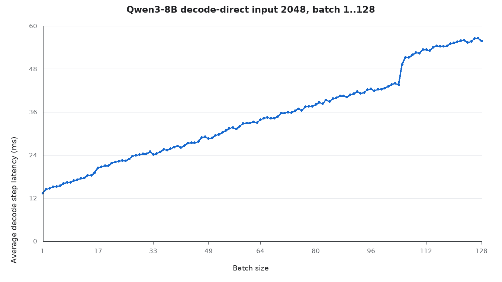
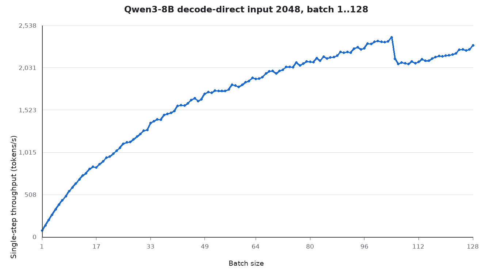
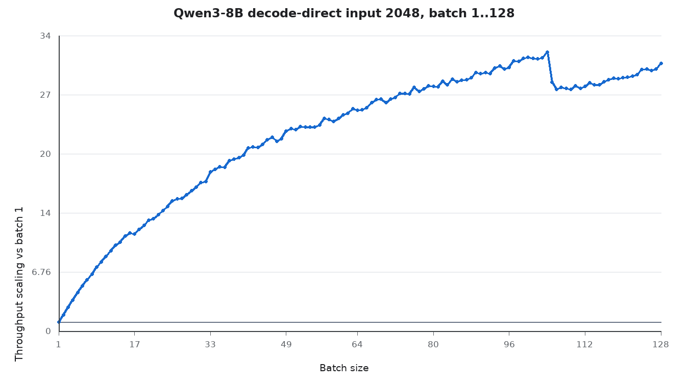

# Decode-Direct Graph 性能报告

## 运行环境

| 项目 | 值 |
| --- | --- |
| 日期 | 2026-11-13 16:57-17:07（Asia/Shanghai） |
| 平台 | MetaX |
| 设备 | C500，物理 GPU 5，64 GiB |
| Driver / runtime | MetaX driver 3.3.12 / MACA 3.2.1.10 |
| InfiniLM build | 当前源码树；基准 commit `112ee225` |
| 模型 | `/data-aisoft/mechdancer/models/Qwen3-8B` |
| 模式 | `decode-direct` |
| Attention backend | `flash-attn` |
| Cache | paged KV cache，block size 256 |
| Max batched tokens | 18,432 |
| Tensor parallel size | 1 |
| 输入长度 | 2,048 tokens / request |
| Batch size | 1..128，共 128 个形状 |
| Decode step 数 | 每个 repeat 固定 4 step |
| Warmup | 每个形状 3 次 repeat |
| 正式样本 | 每个形状 30 次 repeat |
| Batch 执行顺序 | random seed 2026 |
| 干扰检查 | GPU 5 全程无外来进程、无多进程采样点 |

本报告对应的原始 JSONL 和 log 为本机运行产物，不随仓库提交：

```text
../../../benchmark-decode-direct-metax-c500-qwen3-8b-input2048-batch1-128-clean-20261113.jsonl
../../../benchmark-decode-direct-metax-c500-qwen3-8b-input2048-batch1-128-clean-20261113.log
```

## 构建与测试命令

C++ 扩展使用当前源码构建并安装：

```bash
xmake build _infinilm && xmake install _infinilm
```

性能测试命令：

```bash
BENCHMARK_GPU=5 \
INFINILM_MAX_NUM_BATCHED_TOKENS=18432 \
BENCHMARK_MODE=decode-direct \
BATCH_SIZES="$(seq -s, 1 128)" \
INPUT_LENS=2048 \
BENCHMARK_REPEATS=30 \
BENCHMARK_OUTPUT=benchmark-decode-direct-metax-c500-qwen3-8b-input2048-batch1-128-clean-20261113.jsonl \
./run_bench.sh
```


脚本说明：上述命令中的 `run_bench.sh` 是 2026-11-13 测试时的本地脚本名；该脚本未随仓库提交，当前源码树中也没有该文件。复现时应使用等效的 MetaX benchmark 入口，并确认参数为 `--tp 1`、`BENCHMARK_GPU=5` 以及上述环境变量。

## 执行模式与 Graph 覆盖

当前 paged graph compiler 对 decode batch `1..128` 全部生成对应 graph；原始 JSONL 中所有 overall summary 的 `expected_execution_mode` 均为 `graph`，无 eager fallback 混入。

`expected_execution_mode` 是 benchmark 根据 compiler 规则推断的字段，不是 C++ runtime 回传的实际执行模式。

## 资源开销

| 项目 | 值 |
| --- | ---: |
| Workspace allocation | 1944.0 MiB |
| 权重加载时间 | 约 25.83 秒 |
| Paged cache blocks | 1,152 |
| Total benchmark wall time | 约 610.6 秒 |
| GPU 5 温度范围 | 32C-55C |
| GPU 5 功耗范围 | 91W-317W |

## 测试口径

- `decode-direct` 不执行语义完整的 prefill，paged KV cache 初始为全 0。
- Step 0 输入 dummy token；step 1 到 step 3 使用上一步 sampled token。
- 4 个 decode step 的 past KV length 分别为 2048、2049、2050、2051。
- 报告中的 duration 是单 step 时间，由一次 4-step repeat 的对应总耗时指标除以 4 得到。
- Throughput 是 single-step 吞吐：`batch_size / avg_step_duration_s`。
- 计时边界为 `engine_forward_including_sampling`，包含 Python wrapper、C++ engine forward、RankWorker forward、model forward/graph replay 和 sampling。
- 不包含 HTTP、JSON parsing、tokenization、scheduler queueing、`build_model_inputs`、detokenization 和 Python `generate()` 循环。
- 输出 token 不用于正确性判断。
- 分位数使用线性插值；每个 batch 30 个 repeat，p99 只能作为尾部参考。

## 核心结论

| 指标 | 结果 |
| --- | ---: |
| 最高 single-step 吞吐 | batch 104，2,394.80 tok/s |
| batch 104 平均单 step latency | 43.427 ms |
| batch 1 平均单 step latency | 13.312 ms |
| 最大 batch 128 平均单 step latency | 55.655 ms |
| 最大 batch 相对 batch 1 吞吐倍数 | 30.616x |
| 最大 batch 相对理想 128x 的效率 | 23.9% |

吞吐 Top 10 overall 结果：

| Rank | Batch | Avg step ms | Throughput tok/s |
| ---: | ---: | ---: | ---: |
| 1 | 104 | 43.427 | 2,394.80 |
| 2 | 100 | 42.527 | 2,351.44 |
| 3 | 103 | 43.873 | 2,347.70 |
| 4 | 101 | 43.058 | 2,345.69 |
| 5 | 99 | 42.231 | 2,344.24 |
| 6 | 102 | 43.598 | 2,339.55 |
| 7 | 97 | 41.782 | 2,321.57 |
| 8 | 98 | 42.256 | 2,319.18 |
| 9 | 128 | 55.655 | 2,299.86 |
| 10 | 94 | 41.277 | 2,277.30 |

## 趋势图

### 1. Batch size 与平均单 step latency



### 2. Batch size 与吞吐



### 3. Batch size 与吞吐 Scaling



平均单 step latency 从 batch 1 的 13.312 ms 增至 batch 128 的 55.655 ms。吞吐峰值为 batch 104 的 2,394.80 tok/s。

## Batch 区间平均 latency 与吞吐

下表按连续 16 个 batch 分组。`平均单 step latency ms` 和 `平均吞吐 tok/s` 分别是该区间内 16 个 batch 的 overall `Avg Step ms` 与 `Single-step tok/s` 的算术平均值；`区间最优 batch` 取该区间内吞吐最高的 batch。

| Batch 区间 | 平均单 step latency ms | 平均吞吐 tok/s | 区间最优 batch |
| --- | ---: | ---: | ---: |
| 1..16 | 16.351 | 497.71 | 16 |
| 17..32 | 22.602 | 1,075.54 | 32 |
| 33..48 | 26.424 | 1,527.96 | 46 |
| 49..64 | 31.353 | 1,799.39 | 63 |
| 65..80 | 35.869 | 2,019.34 | 79 |
| 81..96 | 40.330 | 2,193.04 | 94 |
| 97..112 | 47.319 | 2,220.30 | 104 |
| 113..128 | 54.987 | 2,190.73 | 128 |

区间平均 latency 随 batch size 持续增长，区间平均吞吐整体上升。8 个区间中有 3 个区间的最优 batch 是区间右端点；偏离右端点的区间通常包含 throughput 跳变或局部回落。

## 关键批次与跳变

下表列出吞吐下降幅度最大的相邻 batch 变化。

| Change | Avg step ms | Single-step tok/s | 吞吐变化 |
| --- | ---: | ---: | ---: |
| 104 -> 105 | 43.427 -> 49.146 | 2,394.80 -> 2,136.50 | -258.31 |
| 105 -> 106 | 49.146 -> 51.089 | 2,136.50 -> 2,074.82 | -61.68 |
| 46 -> 47 | 27.658 -> 28.849 | 1,663.19 -> 1,629.16 | -34.03 |
| 76 -> 77 | 36.306 -> 37.354 | 2,093.31 -> 2,061.37 | -31.94 |

这些变化均发生在 graph 覆盖范围内，不能归因于 eager fallback。如需定位原因，应补充 kernel trace 或 C++ model-only 打点。

## Step 一致性

| Decode step | Past KV length | 全部 batch 平均 step latency ms |
| ---: | ---: | ---: |
| 0 | 2048 | 34.398 |
| 1 | 2049 | 34.407 |
| 2 | 2050 | 34.407 |
| 3 | 2051 | 34.406 |

Past KV length 从 2048 增至 2051 时，平均 step latency 变化很小；与 batch size 和区间跳变相比，这 3 个 token 的 KV 增量不是主要影响因素。

## 数据稳定性

- 128 个 overall summary 换算为单 step 后，std 中位数为 0.101 ms。
- 最大单 step std 为 0.433 ms，出现在 batch 118。
- 最大变异系数约 1.010%，中位变异系数约 0.304%。
- P50、P95、P99 和 max 普遍接近。

每个 batch 只有 30 个 repeat 样本；p99 可用于观察尾部，正式尾部对比建议提高到 100+ repeat。

## Single-step 完整结果

| Batch | Mode | Avg step ms | Min step ms | P50 step ms | P95 step ms | P99 step ms | Max step ms | Std step ms | Single-step tok/s | Scaling |
| ---: | --- | ---: | ---: | ---: | ---: | ---: | ---: | ---: | ---: | ---: |
| 1 | graph | 13.312 | 13.284 | 13.311 | 13.328 | 13.373 | 13.391 | 0.018 | 75.12 | 1.000x |
| 2 | graph | 14.447 | 14.415 | 14.447 | 14.478 | 14.488 | 14.490 | 0.019 | 138.43 | 1.843x |
| 3 | graph | 14.722 | 14.660 | 14.720 | 14.785 | 14.798 | 14.801 | 0.036 | 203.77 | 2.713x |
| 4 | graph | 15.104 | 15.012 | 15.105 | 15.194 | 15.235 | 15.250 | 0.057 | 264.83 | 3.525x |
| 5 | graph | 15.166 | 15.035 | 15.181 | 15.279 | 15.289 | 15.291 | 0.075 | 329.67 | 4.389x |
| 6 | graph | 15.463 | 15.358 | 15.469 | 15.535 | 15.563 | 15.573 | 0.047 | 388.02 | 5.165x |
| 7 | graph | 15.991 | 15.804 | 16.012 | 16.071 | 16.132 | 16.156 | 0.080 | 437.76 | 5.827x |
| 8 | graph | 16.389 | 16.311 | 16.375 | 16.480 | 16.494 | 16.499 | 0.045 | 488.12 | 6.498x |
| 9 | graph | 16.368 | 16.203 | 16.375 | 16.462 | 16.514 | 16.523 | 0.067 | 549.86 | 7.320x |
| 10 | graph | 16.852 | 16.792 | 16.859 | 16.893 | 16.906 | 16.909 | 0.030 | 593.42 | 7.900x |
| 11 | graph | 17.103 | 17.001 | 17.078 | 17.244 | 17.301 | 17.318 | 0.079 | 643.15 | 8.562x |
| 12 | graph | 17.436 | 17.357 | 17.435 | 17.520 | 17.542 | 17.550 | 0.053 | 688.23 | 9.162x |
| 13 | graph | 17.593 | 17.475 | 17.574 | 17.806 | 17.879 | 17.889 | 0.096 | 738.94 | 9.837x |
| 14 | graph | 18.313 | 18.246 | 18.306 | 18.413 | 18.429 | 18.429 | 0.048 | 764.49 | 10.177x |
| 15 | graph | 18.340 | 18.304 | 18.329 | 18.416 | 18.435 | 18.436 | 0.034 | 817.88 | 10.888x |
| 16 | graph | 19.011 | 18.881 | 19.006 | 19.116 | 19.199 | 19.232 | 0.074 | 841.64 | 11.204x |
| 17 | graph | 20.338 | 20.273 | 20.312 | 20.466 | 20.570 | 20.599 | 0.069 | 835.89 | 11.127x |
| 18 | graph | 20.633 | 20.473 | 20.628 | 20.746 | 20.773 | 20.779 | 0.075 | 872.38 | 11.613x |
| 19 | graph | 20.946 | 20.875 | 20.929 | 21.045 | 21.156 | 21.196 | 0.067 | 907.10 | 12.075x |
| 20 | graph | 20.983 | 20.880 | 20.993 | 21.056 | 21.102 | 21.120 | 0.056 | 953.17 | 12.689x |
| 21 | graph | 21.748 | 21.650 | 21.739 | 21.852 | 21.864 | 21.864 | 0.050 | 965.63 | 12.855x |
| 22 | graph | 21.987 | 21.887 | 21.967 | 22.077 | 22.128 | 22.146 | 0.060 | 1000.59 | 13.320x |
| 23 | graph | 22.199 | 22.138 | 22.196 | 22.240 | 22.272 | 22.284 | 0.031 | 1036.06 | 13.792x |
| 24 | graph | 22.451 | 22.383 | 22.447 | 22.515 | 22.567 | 22.586 | 0.042 | 1068.98 | 14.230x |
| 25 | graph | 22.365 | 22.258 | 22.368 | 22.453 | 22.508 | 22.528 | 0.060 | 1117.84 | 14.881x |
| 26 | graph | 22.890 | 22.814 | 22.859 | 23.028 | 23.114 | 23.147 | 0.080 | 1135.88 | 15.121x |
| 27 | graph | 23.643 | 23.564 | 23.642 | 23.734 | 23.742 | 23.742 | 0.053 | 1141.97 | 15.202x |
| 28 | graph | 23.900 | 23.815 | 23.902 | 23.995 | 24.010 | 24.013 | 0.057 | 1171.55 | 15.596x |
| 29 | graph | 24.089 | 24.003 | 24.074 | 24.190 | 24.235 | 24.253 | 0.055 | 1203.87 | 16.026x |
| 30 | graph | 24.280 | 24.174 | 24.266 | 24.421 | 24.459 | 24.468 | 0.071 | 1235.58 | 16.448x |
| 31 | graph | 24.272 | 24.228 | 24.264 | 24.340 | 24.379 | 24.388 | 0.037 | 1277.17 | 17.002x |
| 32 | graph | 24.903 | 24.796 | 24.895 | 25.000 | 25.049 | 25.068 | 0.059 | 1284.99 | 17.106x |
| 33 | graph | 24.125 | 23.743 | 24.168 | 24.253 | 24.280 | 24.285 | 0.137 | 1367.89 | 18.209x |
| 34 | graph | 24.432 | 24.368 | 24.407 | 24.565 | 24.597 | 24.599 | 0.060 | 1391.63 | 18.525x |
| 35 | graph | 24.774 | 24.539 | 24.765 | 24.896 | 25.082 | 25.154 | 0.112 | 1412.77 | 18.807x |
| 36 | graph | 25.552 | 25.423 | 25.529 | 25.676 | 25.716 | 25.731 | 0.078 | 1408.90 | 18.755x |
| 37 | graph | 25.284 | 25.102 | 25.300 | 25.380 | 25.395 | 25.400 | 0.084 | 1463.39 | 19.481x |
| 38 | graph | 25.721 | 25.303 | 25.799 | 25.925 | 25.959 | 25.967 | 0.202 | 1477.38 | 19.667x |
| 39 | graph | 26.156 | 26.037 | 26.147 | 26.308 | 26.345 | 26.358 | 0.078 | 1491.07 | 19.849x |
| 40 | graph | 26.478 | 26.354 | 26.469 | 26.582 | 26.585 | 26.586 | 0.062 | 1510.69 | 20.110x |
| 41 | graph | 26.056 | 25.964 | 26.030 | 26.174 | 26.202 | 26.214 | 0.073 | 1573.54 | 20.947x |
| 42 | graph | 26.560 | 26.339 | 26.576 | 26.670 | 26.713 | 26.726 | 0.087 | 1581.33 | 21.051x |
| 43 | graph | 27.284 | 27.184 | 27.256 | 27.442 | 27.472 | 27.482 | 0.077 | 1576.02 | 20.980x |
| 44 | graph | 27.410 | 27.215 | 27.393 | 27.589 | 27.597 | 27.601 | 0.117 | 1605.28 | 21.370x |
| 45 | graph | 27.415 | 27.243 | 27.421 | 27.548 | 27.560 | 27.560 | 0.084 | 1641.45 | 21.851x |
| 46 | graph | 27.658 | 27.430 | 27.637 | 27.810 | 27.848 | 27.860 | 0.091 | 1663.19 | 22.140x |
| 47 | graph | 28.849 | 28.637 | 28.806 | 29.059 | 29.103 | 29.114 | 0.115 | 1629.16 | 21.687x |
| 48 | graph | 29.025 | 28.816 | 29.018 | 29.191 | 29.232 | 29.249 | 0.104 | 1653.75 | 22.015x |
| 49 | graph | 28.500 | 28.053 | 28.527 | 28.666 | 28.684 | 28.690 | 0.131 | 1719.28 | 22.887x |
| 50 | graph | 28.711 | 28.511 | 28.724 | 28.894 | 29.012 | 29.052 | 0.109 | 1741.47 | 23.183x |
| 51 | graph | 29.435 | 29.260 | 29.385 | 29.676 | 29.696 | 29.702 | 0.135 | 1732.62 | 23.065x |
| 52 | graph | 29.613 | 29.452 | 29.613 | 29.731 | 29.824 | 29.862 | 0.087 | 1755.97 | 23.376x |
| 53 | graph | 30.228 | 30.063 | 30.236 | 30.378 | 30.398 | 30.404 | 0.099 | 1753.34 | 23.341x |
| 54 | graph | 30.798 | 30.627 | 30.791 | 30.969 | 30.986 | 30.987 | 0.110 | 1753.37 | 23.341x |
| 55 | graph | 31.355 | 30.729 | 31.408 | 31.557 | 31.564 | 31.567 | 0.213 | 1754.09 | 23.351x |
| 56 | graph | 31.609 | 31.405 | 31.592 | 31.803 | 31.820 | 31.824 | 0.106 | 1771.64 | 23.584x |
| 57 | graph | 31.175 | 30.978 | 31.157 | 31.330 | 31.338 | 31.341 | 0.086 | 1828.37 | 24.339x |
| 58 | graph | 31.924 | 31.844 | 31.902 | 32.046 | 32.155 | 32.198 | 0.073 | 1816.83 | 24.186x |
| 59 | graph | 32.778 | 32.566 | 32.752 | 33.068 | 33.168 | 33.189 | 0.152 | 1799.99 | 23.962x |
| 60 | graph | 32.846 | 32.679 | 32.815 | 33.026 | 33.040 | 33.046 | 0.106 | 1826.73 | 24.318x |
| 61 | graph | 32.798 | 32.297 | 32.847 | 33.149 | 33.219 | 33.229 | 0.234 | 1859.86 | 24.759x |
| 62 | graph | 33.172 | 33.020 | 33.155 | 33.410 | 33.457 | 33.474 | 0.124 | 1869.05 | 24.881x |
| 63 | graph | 32.955 | 32.878 | 32.945 | 33.051 | 33.077 | 33.085 | 0.047 | 1911.68 | 25.448x |
| 64 | graph | 33.755 | 33.589 | 33.728 | 33.927 | 33.960 | 33.973 | 0.112 | 1896.03 | 25.240x |
| 65 | graph | 34.157 | 33.277 | 34.266 | 34.415 | 34.433 | 34.435 | 0.345 | 1902.96 | 25.332x |
| 66 | graph | 34.381 | 34.247 | 34.377 | 34.524 | 34.560 | 34.562 | 0.091 | 1919.69 | 25.555x |
| 67 | graph | 34.169 | 33.704 | 34.257 | 34.480 | 34.528 | 34.539 | 0.247 | 1960.82 | 26.103x |
| 68 | graph | 34.152 | 33.910 | 34.168 | 34.315 | 34.323 | 34.325 | 0.119 | 1991.12 | 26.506x |
| 69 | graph | 34.585 | 34.158 | 34.587 | 35.035 | 35.082 | 35.094 | 0.293 | 1995.09 | 26.559x |
| 70 | graph | 35.651 | 35.150 | 35.719 | 35.994 | 36.042 | 36.061 | 0.277 | 1963.46 | 26.138x |
| 71 | graph | 35.578 | 35.250 | 35.599 | 35.763 | 35.767 | 35.768 | 0.150 | 1995.60 | 26.566x |
| 72 | graph | 35.849 | 35.665 | 35.857 | 35.986 | 36.016 | 36.027 | 0.102 | 2008.40 | 26.736x |
| 73 | graph | 35.762 | 35.446 | 35.752 | 35.979 | 35.992 | 35.993 | 0.150 | 2041.29 | 27.174x |
| 74 | graph | 36.210 | 36.042 | 36.161 | 36.424 | 36.468 | 36.486 | 0.135 | 2043.61 | 27.205x |
| 75 | graph | 36.790 | 36.613 | 36.784 | 37.026 | 37.074 | 37.084 | 0.118 | 2038.61 | 27.138x |
| 76 | graph | 36.306 | 36.129 | 36.297 | 36.420 | 36.506 | 36.535 | 0.084 | 2093.31 | 27.866x |
| 77 | graph | 37.354 | 36.663 | 37.434 | 37.658 | 37.668 | 37.668 | 0.239 | 2061.37 | 27.441x |
| 78 | graph | 37.449 | 37.237 | 37.427 | 37.641 | 37.685 | 37.700 | 0.127 | 2082.84 | 27.727x |
| 79 | graph | 37.487 | 37.411 | 37.474 | 37.603 | 37.619 | 37.620 | 0.054 | 2107.38 | 28.054x |
| 80 | graph | 38.026 | 37.866 | 37.992 | 38.247 | 38.268 | 38.273 | 0.123 | 2103.82 | 28.006x |
| 81 | graph | 38.598 | 38.407 | 38.577 | 38.784 | 38.936 | 38.996 | 0.128 | 2098.54 | 27.936x |
| 82 | graph | 38.170 | 37.991 | 38.162 | 38.357 | 38.444 | 38.471 | 0.129 | 2148.31 | 28.598x |
| 83 | graph | 39.196 | 39.063 | 39.171 | 39.375 | 39.418 | 39.421 | 0.099 | 2117.54 | 28.189x |
| 84 | graph | 38.819 | 38.403 | 38.809 | 39.015 | 39.042 | 39.042 | 0.146 | 2163.90 | 28.806x |
| 85 | graph | 39.668 | 39.463 | 39.684 | 39.817 | 39.853 | 39.867 | 0.115 | 2142.81 | 28.525x |
| 86 | graph | 39.902 | 39.757 | 39.899 | 40.032 | 40.037 | 40.037 | 0.076 | 2155.30 | 28.691x |
| 87 | graph | 40.318 | 40.029 | 40.355 | 40.528 | 40.645 | 40.692 | 0.170 | 2157.83 | 28.725x |
| 88 | graph | 40.386 | 40.229 | 40.366 | 40.565 | 40.591 | 40.595 | 0.080 | 2178.98 | 29.007x |
| 89 | graph | 40.042 | 39.704 | 39.994 | 40.526 | 40.685 | 40.744 | 0.221 | 2222.65 | 29.588x |
| 90 | graph | 40.691 | 40.576 | 40.668 | 40.805 | 40.844 | 40.851 | 0.071 | 2211.79 | 29.443x |
| 91 | graph | 40.995 | 40.819 | 41.003 | 41.143 | 41.187 | 41.200 | 0.100 | 2219.78 | 29.550x |
| 92 | graph | 41.579 | 41.410 | 41.572 | 41.751 | 41.759 | 41.760 | 0.105 | 2212.65 | 29.455x |
| 93 | graph | 41.130 | 40.950 | 41.136 | 41.318 | 41.326 | 41.328 | 0.107 | 2261.14 | 30.100x |
| 94 | graph | 41.277 | 40.894 | 41.312 | 41.520 | 41.553 | 41.566 | 0.174 | 2277.30 | 30.316x |
| 95 | graph | 42.161 | 41.984 | 42.141 | 42.340 | 42.485 | 42.543 | 0.125 | 2253.29 | 29.996x |
| 96 | graph | 42.350 | 41.673 | 42.350 | 42.605 | 42.733 | 42.782 | 0.205 | 2266.81 | 30.176x |
| 97 | graph | 41.782 | 41.235 | 41.890 | 41.990 | 42.046 | 42.067 | 0.246 | 2321.57 | 30.905x |
| 98 | graph | 42.256 | 41.967 | 42.213 | 42.624 | 43.308 | 43.526 | 0.278 | 2319.18 | 30.873x |
| 99 | graph | 42.231 | 41.917 | 42.233 | 42.329 | 42.399 | 42.415 | 0.078 | 2344.24 | 31.207x |
| 100 | graph | 42.527 | 42.267 | 42.516 | 42.703 | 42.718 | 42.724 | 0.106 | 2351.44 | 31.303x |
| 101 | graph | 43.058 | 42.810 | 43.064 | 43.188 | 43.197 | 43.198 | 0.102 | 2345.69 | 31.226x |
| 102 | graph | 43.598 | 43.423 | 43.586 | 43.738 | 43.783 | 43.802 | 0.085 | 2339.55 | 31.144x |
| 103 | graph | 43.873 | 43.716 | 43.873 | 44.037 | 44.099 | 44.122 | 0.098 | 2347.70 | 31.253x |
| 104 | graph | 43.427 | 43.072 | 43.191 | 44.039 | 44.133 | 44.171 | 0.379 | 2394.80 | 31.880x |
| 105 | graph | 49.146 | 48.618 | 49.202 | 49.402 | 49.470 | 49.498 | 0.212 | 2136.50 | 28.441x |
| 106 | graph | 51.089 | 50.957 | 51.072 | 51.241 | 51.251 | 51.255 | 0.080 | 2074.82 | 27.620x |
| 107 | graph | 51.106 | 51.029 | 51.099 | 51.205 | 51.231 | 51.238 | 0.058 | 2093.68 | 27.871x |
| 108 | graph | 51.821 | 51.504 | 51.833 | 52.054 | 52.096 | 52.112 | 0.168 | 2084.10 | 27.744x |
| 109 | graph | 52.464 | 51.764 | 52.573 | 52.721 | 52.838 | 52.877 | 0.301 | 2077.63 | 27.658x |
| 110 | graph | 52.201 | 51.937 | 52.210 | 52.389 | 52.436 | 52.452 | 0.137 | 2107.22 | 28.052x |
| 111 | graph | 53.237 | 53.112 | 53.224 | 53.419 | 53.441 | 53.444 | 0.082 | 2085.01 | 27.756x |
| 112 | graph | 53.292 | 53.136 | 53.269 | 53.489 | 53.557 | 53.583 | 0.107 | 2101.62 | 27.977x |
| 113 | graph | 52.967 | 52.639 | 52.860 | 53.525 | 53.529 | 53.530 | 0.257 | 2133.40 | 28.400x |
| 114 | graph | 53.902 | 53.758 | 53.894 | 54.033 | 54.048 | 54.052 | 0.090 | 2114.95 | 28.154x |
| 115 | graph | 54.300 | 53.877 | 54.328 | 54.557 | 54.573 | 54.576 | 0.181 | 2117.87 | 28.193x |
| 116 | graph | 54.198 | 54.042 | 54.155 | 54.415 | 54.494 | 54.505 | 0.113 | 2140.32 | 28.492x |
| 117 | graph | 54.141 | 53.510 | 54.329 | 54.486 | 54.629 | 54.679 | 0.368 | 2161.04 | 28.768x |
| 118 | graph | 54.252 | 53.786 | 54.024 | 54.885 | 54.946 | 54.957 | 0.433 | 2175.05 | 28.954x |
| 119 | graph | 54.912 | 54.757 | 54.878 | 55.180 | 55.225 | 55.233 | 0.113 | 2167.10 | 28.849x |
| 120 | graph | 55.136 | 54.851 | 55.136 | 55.359 | 55.444 | 55.475 | 0.140 | 2176.43 | 28.973x |
| 121 | graph | 55.414 | 55.153 | 55.406 | 55.652 | 55.737 | 55.756 | 0.138 | 2183.55 | 29.068x |
| 122 | graph | 55.699 | 55.531 | 55.691 | 55.793 | 55.894 | 55.935 | 0.074 | 2190.33 | 29.158x |
| 123 | graph | 55.792 | 55.586 | 55.771 | 55.975 | 55.983 | 55.985 | 0.107 | 2204.64 | 29.348x |
| 124 | graph | 55.196 | 54.948 | 55.179 | 55.309 | 55.412 | 55.449 | 0.100 | 2246.55 | 29.906x |
| 125 | graph | 55.504 | 55.073 | 55.412 | 55.965 | 56.065 | 56.104 | 0.291 | 2252.08 | 29.980x |
| 126 | graph | 56.313 | 56.113 | 56.295 | 56.589 | 56.636 | 56.645 | 0.138 | 2237.51 | 29.786x |
| 127 | graph | 56.418 | 56.214 | 56.406 | 56.627 | 56.671 | 56.677 | 0.119 | 2251.07 | 29.966x |
| 128 | graph | 55.655 | 55.520 | 55.628 | 55.885 | 55.964 | 55.997 | 0.108 | 2299.86 | 30.616x |

## 结果分析

1. 吞吐最高出现在 batch 104，为 2,394.80 tok/s。
2. 最大 batch 128 的吞吐为 2,299.86 tok/s，低于峰值约 3.96%。
3. 本轮数据稳定性较好，std 中位数为 0.102 ms，最大 std 为 0.433 ms。
4. 正式 p99 对比建议将 `BENCHMARK_REPEATS` 提高到 100 或以上。

## 结论与建议

1. 在本轮 input length 2048、batch `1..128` 范围内，**batch 104 吞吐最高**，约 2,394.80 tok/s。
2. batch 128 平均单 step latency 为 55.655 ms。
3. 所有样本均在专用 GPU 5 上采集；监控期间目标卡没有外来进程。

## 数据完整性

```text
config records: 1
step samples: 15360
overall summaries: 128
per-step summaries: 512
每个 batch step samples: 120
scaling records: 128
每个 batch repeat 数: 30
```
