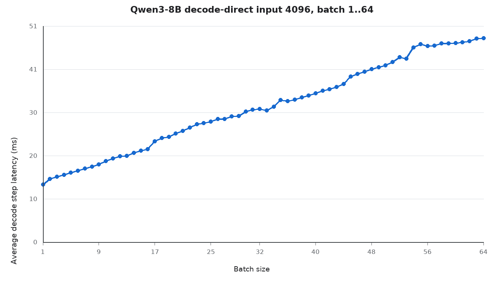
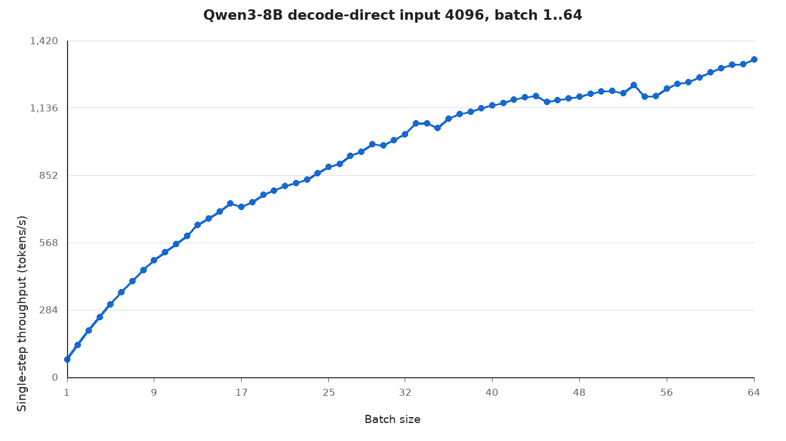
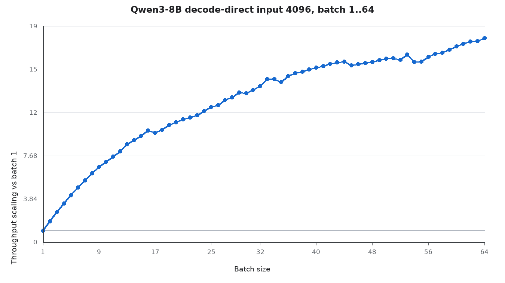

# Decode-Direct Graph 性能报告

## 运行环境

| 项目 | 值 |
| --- | --- |
| 日期 | 2026-11-13 17:25-17:30（Asia/Shanghai） |
| 平台 | MetaX |
| 设备 | C500，物理 GPU 5，64 GiB |
| Driver / runtime | MetaX driver 3.3.12 / MACA 3.2.1.10 |
| InfiniLM build | 当前源码树；基准 commit `112ee225` |
| 模型 | `/data-aisoft/mechdancer/models/Qwen3-8B` |
| 模式 | `decode-direct` |
| Attention backend | `flash-attn` |
| Cache | paged KV cache，block size 256 |
| Max batched tokens | 18,432 |
| Tensor parallel size | 1 |
| 输入长度 | 4,096 tokens / request |
| Batch size | 1..64，共 64 个形状 |
| Decode step 数 | 每个 repeat 固定 4 step |
| Warmup | 每个形状 3 次 repeat |
| 正式样本 | 每个形状 30 次 repeat |
| Batch 执行顺序 | random seed 2026 |
| 干扰检查 | GPU 5 全程无外来进程、无多进程采样点 |

本报告对应的原始 JSONL 和 log 为本机运行产物，不随仓库提交：

```text
../../../benchmark-decode-direct-metax-c500-qwen3-8b-input4096-batch1-64-clean-20261113.jsonl
../../../benchmark-decode-direct-metax-c500-qwen3-8b-input4096-batch1-64-clean-20261113.log
```

## 构建与测试命令

C++ 扩展使用当前源码构建并安装：

```bash
xmake build _infinilm && xmake install _infinilm
```

性能测试命令：

```bash
BENCHMARK_GPU=5 \
INFINILM_MAX_NUM_BATCHED_TOKENS=18432 \
BENCHMARK_MODE=decode-direct \
BATCH_SIZES="$(seq -s, 1 64)" \
INPUT_LENS=4096 \
BENCHMARK_REPEATS=30 \
BENCHMARK_OUTPUT=benchmark-decode-direct-metax-c500-qwen3-8b-input4096-batch1-64-clean-20261113.jsonl \
./run_bench.sh
```


脚本说明：上述命令中的 `run_bench.sh` 是 2026-11-13 测试时的本地脚本名；该脚本未随仓库提交，当前源码树中也没有该文件。复现时应使用等效的 MetaX benchmark 入口，并确认参数为 `--tp 1`、`BENCHMARK_GPU=5` 以及上述环境变量。

## 执行模式与 Graph 覆盖

当前 paged graph compiler 对 decode batch `1..64` 全部生成对应 graph；原始 JSONL 中所有 overall summary 的 `expected_execution_mode` 均为 `graph`，无 eager fallback 混入。

`expected_execution_mode` 是 benchmark 根据 compiler 规则推断的字段，不是 C++ runtime 回传的实际执行模式。

## 资源开销

| 项目 | 值 |
| --- | ---: |
| Workspace allocation | 1944.0 MiB |
| 权重加载时间 | 约 15.94 秒 |
| Paged cache blocks | 1,088 |
| Total benchmark wall time | 约 285.6 秒 |
| GPU 5 温度范围 | 32C-55C |
| GPU 5 功耗范围 | 91W-317W |

## 测试口径

- `decode-direct` 不执行语义完整的 prefill，paged KV cache 初始为全 0。
- Step 0 输入 dummy token；step 1 到 step 3 使用上一步 sampled token。
- 4 个 decode step 的 past KV length 分别为 4096、4097、4098、4099。
- 报告中的 duration 是单 step 时间，由一次 4-step repeat 的对应总耗时指标除以 4 得到。
- Throughput 是 single-step 吞吐：`batch_size / avg_step_duration_s`。
- 计时边界为 `engine_forward_including_sampling`，包含 Python wrapper、C++ engine forward、RankWorker forward、model forward/graph replay 和 sampling。
- 不包含 HTTP、JSON parsing、tokenization、scheduler queueing、`build_model_inputs`、detokenization 和 Python `generate()` 循环。
- 输出 token 不用于正确性判断。
- 分位数使用线性插值；每个 batch 30 个 repeat，p99 只能作为尾部参考。

## 核心结论

| 指标 | 结果 |
| --- | ---: |
| 最高 single-step 吞吐 | batch 64，1,339.42 tok/s |
| batch 64 平均单 step latency | 47.782 ms |
| batch 1 平均单 step latency | 13.519 ms |
| 最大 batch 64 平均单 step latency | 47.782 ms |
| 最大 batch 相对 batch 1 吞吐倍数 | 18.108x |
| 最大 batch 相对理想 64x 的效率 | 28.3% |

吞吐 Top 10 overall 结果：

| Rank | Batch | Avg step ms | Throughput tok/s |
| ---: | ---: | ---: | ---: |
| 1 | 64 | 47.782 | 1,339.42 |
| 2 | 63 | 47.690 | 1,321.05 |
| 3 | 62 | 47.069 | 1,317.22 |
| 4 | 61 | 46.810 | 1,303.15 |
| 5 | 60 | 46.638 | 1,286.50 |
| 6 | 59 | 46.620 | 1,265.56 |
| 7 | 58 | 46.594 | 1,244.78 |
| 8 | 57 | 46.033 | 1,238.25 |
| 9 | 53 | 43.042 | 1,231.37 |
| 10 | 56 | 45.965 | 1,218.32 |

## 趋势图

### 1. Batch size 与平均单 step latency



### 2. Batch size 与吞吐



### 3. Batch size 与吞吐 Scaling



平均单 step latency 从 batch 1 的 13.519 ms 增至 batch 64 的 47.782 ms。吞吐峰值为 batch 64 的 1,339.42 tok/s。

## Batch 区间平均 latency 与吞吐

下表按连续 16 个 batch 分组。`平均单 step latency ms` 和 `平均吞吐 tok/s` 分别是该区间内 16 个 batch 的 overall `Avg Step ms` 与 `Single-step tok/s` 的算术平均值；`区间最优 batch` 取该区间内吞吐最高的 batch。

| Batch 区间 | 平均单 step latency ms | 平均吞吐 tok/s | 区间最优 batch |
| --- | ---: | ---: | ---: |
| 1..16 | 18.046 | 444.05 | 16 |
| 17..32 | 27.773 | 874.37 | 32 |
| 33..48 | 35.555 | 1,136.12 | 44 |
| 49..64 | 45.264 | 1,246.57 | 64 |

区间平均 latency 随 batch size 持续增长，区间平均吞吐整体上升。4 个区间中有 3 个区间的最优 batch 是区间右端点；偏离右端点的区间通常包含 throughput 跳变或局部回落。

## 关键批次与跳变

下表列出吞吐下降幅度最大的相邻 batch 变化。

| Change | Avg step ms | Single-step tok/s | 吞吐变化 |
| --- | ---: | ---: | ---: |
| 53 -> 54 | 43.042 -> 45.587 | 1,231.37 -> 1,184.55 | -46.82 |
| 44 -> 45 | 37.101 -> 38.773 | 1,185.95 -> 1,160.61 | -25.34 |
| 34 -> 35 | 31.713 -> 33.309 | 1,072.13 -> 1,050.78 | -21.35 |
| 16 -> 17 | 21.806 -> 23.630 | 733.76 -> 719.44 | -14.32 |

这些变化均发生在 graph 覆盖范围内，不能归因于 eager fallback。如需定位原因，应补充 kernel trace 或 C++ model-only 打点。

## Step 一致性

| Decode step | Past KV length | 全部 batch 平均 step latency ms |
| ---: | ---: | ---: |
| 0 | 4096 | 31.659 |
| 1 | 4097 | 31.658 |
| 2 | 4098 | 31.660 |
| 3 | 4099 | 31.660 |

Past KV length 从 4096 增至 4099 时，平均 step latency 变化很小；与 batch size 和区间跳变相比，这 3 个 token 的 KV 增量不是主要影响因素。

## 数据稳定性

- 64 个 overall summary 换算为单 step 后，std 中位数为 0.094 ms。
- 最大单 step std 为 0.346 ms，出现在 batch 55。
- 最大变异系数约 1.379%，中位变异系数约 0.328%。
- P50、P95、P99 和 max 普遍接近。

每个 batch 只有 30 个 repeat 样本；p99 可用于观察尾部，正式尾部对比建议提高到 100+ repeat。

## Single-step 完整结果

| Batch | Mode | Avg step ms | Min step ms | P50 step ms | P95 step ms | P99 step ms | Max step ms | Std step ms | Single-step tok/s | Scaling |
| ---: | --- | ---: | ---: | ---: | ---: | ---: | ---: | ---: | ---: | ---: |
| 1 | graph | 13.519 | 13.289 | 13.534 | 13.584 | 14.157 | 14.387 | 0.186 | 73.97 | 1.000x |
| 2 | graph | 14.838 | 14.640 | 14.825 | 14.911 | 15.131 | 15.221 | 0.091 | 134.79 | 1.822x |
| 3 | graph | 15.289 | 15.197 | 15.262 | 15.436 | 15.442 | 15.443 | 0.080 | 196.23 | 2.653x |
| 4 | graph | 15.780 | 15.710 | 15.760 | 15.885 | 15.912 | 15.921 | 0.052 | 253.49 | 3.427x |
| 5 | graph | 16.298 | 15.999 | 16.344 | 16.386 | 16.391 | 16.393 | 0.106 | 306.78 | 4.148x |
| 6 | graph | 16.703 | 16.607 | 16.717 | 16.775 | 16.801 | 16.812 | 0.059 | 359.23 | 4.856x |
| 7 | graph | 17.247 | 17.092 | 17.244 | 17.303 | 17.325 | 17.334 | 0.039 | 405.87 | 5.487x |
| 8 | graph | 17.718 | 17.542 | 17.738 | 17.760 | 17.782 | 17.790 | 0.055 | 451.53 | 6.104x |
| 9 | graph | 18.231 | 18.191 | 18.222 | 18.305 | 18.315 | 18.315 | 0.032 | 493.68 | 6.674x |
| 10 | graph | 18.992 | 18.818 | 18.990 | 19.116 | 19.163 | 19.178 | 0.093 | 526.55 | 7.119x |
| 11 | graph | 19.611 | 19.315 | 19.654 | 19.773 | 19.802 | 19.808 | 0.143 | 560.90 | 7.583x |
| 12 | graph | 20.119 | 19.925 | 20.101 | 20.338 | 20.363 | 20.365 | 0.138 | 596.47 | 8.064x |
| 13 | graph | 20.256 | 20.166 | 20.221 | 20.415 | 20.446 | 20.458 | 0.079 | 641.79 | 8.677x |
| 14 | graph | 20.891 | 20.752 | 20.840 | 21.070 | 21.086 | 21.091 | 0.119 | 670.14 | 9.060x |
| 15 | graph | 21.439 | 21.398 | 21.428 | 21.507 | 21.551 | 21.567 | 0.036 | 699.67 | 9.459x |
| 16 | graph | 21.806 | 21.752 | 21.788 | 21.878 | 21.906 | 21.916 | 0.047 | 733.76 | 9.920x |
| 17 | graph | 23.630 | 23.395 | 23.654 | 23.871 | 23.999 | 24.049 | 0.179 | 719.44 | 9.726x |
| 18 | graph | 24.365 | 24.141 | 24.421 | 24.542 | 24.573 | 24.579 | 0.142 | 738.78 | 9.988x |
| 19 | graph | 24.651 | 24.600 | 24.648 | 24.692 | 24.693 | 24.693 | 0.026 | 770.75 | 10.420x |
| 20 | graph | 25.425 | 25.162 | 25.451 | 25.618 | 25.675 | 25.689 | 0.147 | 786.62 | 10.635x |
| 21 | graph | 26.074 | 26.003 | 26.051 | 26.153 | 26.168 | 26.170 | 0.049 | 805.41 | 10.889x |
| 22 | graph | 26.828 | 26.560 | 26.857 | 26.972 | 27.013 | 27.017 | 0.110 | 820.03 | 11.086x |
| 23 | graph | 27.619 | 27.481 | 27.560 | 27.839 | 27.853 | 27.858 | 0.119 | 832.77 | 11.258x |
| 24 | graph | 27.900 | 27.704 | 27.851 | 28.165 | 28.195 | 28.205 | 0.142 | 860.22 | 11.630x |
| 25 | graph | 28.208 | 28.133 | 28.185 | 28.358 | 28.478 | 28.515 | 0.077 | 886.29 | 11.982x |
| 26 | graph | 28.874 | 28.444 | 28.914 | 29.086 | 29.139 | 29.152 | 0.182 | 900.48 | 12.174x |
| 27 | graph | 28.879 | 28.836 | 28.878 | 28.912 | 28.941 | 28.952 | 0.023 | 934.93 | 12.640x |
| 28 | graph | 29.438 | 29.212 | 29.494 | 29.677 | 29.712 | 29.716 | 0.173 | 951.14 | 12.859x |
| 29 | graph | 29.542 | 29.503 | 29.537 | 29.582 | 29.611 | 29.621 | 0.025 | 981.66 | 13.271x |
| 30 | graph | 30.646 | 30.441 | 30.606 | 30.926 | 30.940 | 30.943 | 0.169 | 978.91 | 13.234x |
| 31 | graph | 31.035 | 30.934 | 31.040 | 31.111 | 31.163 | 31.182 | 0.061 | 998.86 | 13.504x |
| 32 | graph | 31.260 | 31.025 | 31.179 | 31.528 | 31.570 | 31.587 | 0.200 | 1023.68 | 13.839x |
| 33 | graph | 30.847 | 30.663 | 30.841 | 31.008 | 31.025 | 31.029 | 0.101 | 1069.78 | 14.463x |
| 34 | graph | 31.713 | 31.389 | 31.712 | 31.883 | 31.956 | 31.982 | 0.134 | 1072.13 | 14.494x |
| 35 | graph | 33.309 | 33.048 | 33.222 | 33.626 | 33.638 | 33.642 | 0.202 | 1050.78 | 14.206x |
| 36 | graph | 33.030 | 32.722 | 33.045 | 33.128 | 33.192 | 33.217 | 0.103 | 1089.92 | 14.735x |
| 37 | graph | 33.360 | 33.222 | 33.351 | 33.431 | 33.464 | 33.477 | 0.044 | 1109.12 | 14.994x |
| 38 | graph | 33.960 | 33.776 | 33.976 | 34.042 | 34.050 | 34.052 | 0.071 | 1118.97 | 15.128x |
| 39 | graph | 34.367 | 34.301 | 34.342 | 34.490 | 34.572 | 34.605 | 0.069 | 1134.81 | 15.342x |
| 40 | graph | 34.849 | 34.764 | 34.842 | 34.949 | 34.981 | 34.989 | 0.051 | 1147.80 | 15.517x |
| 41 | graph | 35.465 | 35.170 | 35.545 | 35.668 | 35.670 | 35.670 | 0.179 | 1156.06 | 15.629x |
| 42 | graph | 35.847 | 35.778 | 35.837 | 35.906 | 35.976 | 36.003 | 0.043 | 1171.65 | 15.840x |
| 43 | graph | 36.397 | 36.341 | 36.394 | 36.446 | 36.467 | 36.475 | 0.034 | 1181.43 | 15.972x |
| 44 | graph | 37.101 | 36.786 | 37.166 | 37.312 | 37.360 | 37.378 | 0.207 | 1185.95 | 16.033x |
| 45 | graph | 38.773 | 38.492 | 38.780 | 38.841 | 38.847 | 38.848 | 0.060 | 1160.61 | 15.691x |
| 46 | graph | 39.394 | 39.270 | 39.363 | 39.581 | 39.603 | 39.604 | 0.092 | 1167.70 | 15.786x |
| 47 | graph | 39.948 | 39.641 | 40.006 | 40.202 | 40.217 | 40.221 | 0.187 | 1176.54 | 15.906x |
| 48 | graph | 40.520 | 40.435 | 40.498 | 40.685 | 40.732 | 40.734 | 0.075 | 1184.60 | 16.015x |
| 49 | graph | 40.982 | 40.650 | 40.910 | 41.352 | 42.108 | 42.401 | 0.345 | 1195.66 | 16.164x |
| 50 | graph | 41.476 | 41.118 | 41.406 | 41.825 | 41.841 | 41.841 | 0.268 | 1205.53 | 16.298x |
| 51 | graph | 42.183 | 42.105 | 42.178 | 42.266 | 42.289 | 42.297 | 0.044 | 1209.00 | 16.345x |
| 52 | graph | 43.374 | 43.081 | 43.266 | 43.712 | 43.737 | 43.746 | 0.254 | 1198.88 | 16.208x |
| 53 | graph | 43.042 | 42.850 | 43.032 | 43.239 | 43.265 | 43.275 | 0.103 | 1231.37 | 16.647x |
| 54 | graph | 45.587 | 45.440 | 45.555 | 45.787 | 45.809 | 45.817 | 0.094 | 1184.55 | 16.014x |
| 55 | graph | 46.377 | 45.864 | 46.474 | 46.876 | 46.947 | 46.963 | 0.346 | 1185.93 | 16.033x |
| 56 | graph | 45.965 | 45.890 | 45.951 | 46.061 | 46.072 | 46.075 | 0.048 | 1218.32 | 16.471x |
| 57 | graph | 46.033 | 45.902 | 46.020 | 46.201 | 46.209 | 46.210 | 0.084 | 1238.25 | 16.740x |
| 58 | graph | 46.594 | 46.144 | 46.662 | 46.910 | 47.056 | 47.099 | 0.279 | 1244.78 | 16.829x |
| 59 | graph | 46.620 | 46.087 | 46.507 | 47.055 | 47.109 | 47.118 | 0.270 | 1265.56 | 17.109x |
| 60 | graph | 46.638 | 46.180 | 46.674 | 46.766 | 46.801 | 46.814 | 0.142 | 1286.50 | 17.393x |
| 61 | graph | 46.810 | 46.621 | 46.812 | 46.898 | 46.908 | 46.909 | 0.061 | 1303.15 | 17.618x |
| 62 | graph | 47.069 | 46.887 | 47.077 | 47.134 | 47.140 | 47.141 | 0.055 | 1317.22 | 17.808x |
| 63 | graph | 47.690 | 47.391 | 47.691 | 47.884 | 47.957 | 47.971 | 0.106 | 1321.05 | 17.860x |
| 64 | graph | 47.782 | 47.708 | 47.782 | 47.843 | 47.853 | 47.857 | 0.040 | 1339.42 | 18.108x |

## 结果分析

1. 吞吐最高出现在 batch 64，为 1,339.42 tok/s。
2. 在本轮 batch `1..64` 范围内，吞吐在最大 batch 仍未回落；若资源允许，可继续扩大 batch 寻找饱和点。
3. 本轮数据稳定性较好，std 中位数为 0.094 ms，最大 std 为 0.346 ms。
4. 正式 p99 对比建议将 `BENCHMARK_REPEATS` 提高到 100 或以上。

## 结论与建议

1. 在本轮 input length 4096、batch `1..64` 范围内，**batch 64 吞吐最高**，约 1,339.42 tok/s。
2. batch 64 平均单 step latency 为 47.782 ms。
3. 所有样本均在专用 GPU 5 上采集；监控期间目标卡没有外来进程。

## 数据完整性

```text
config records: 1
step samples: 7680
overall summaries: 64
per-step summaries: 256
每个 batch step samples: 120
scaling records: 64
每个 batch repeat 数: 30
```
