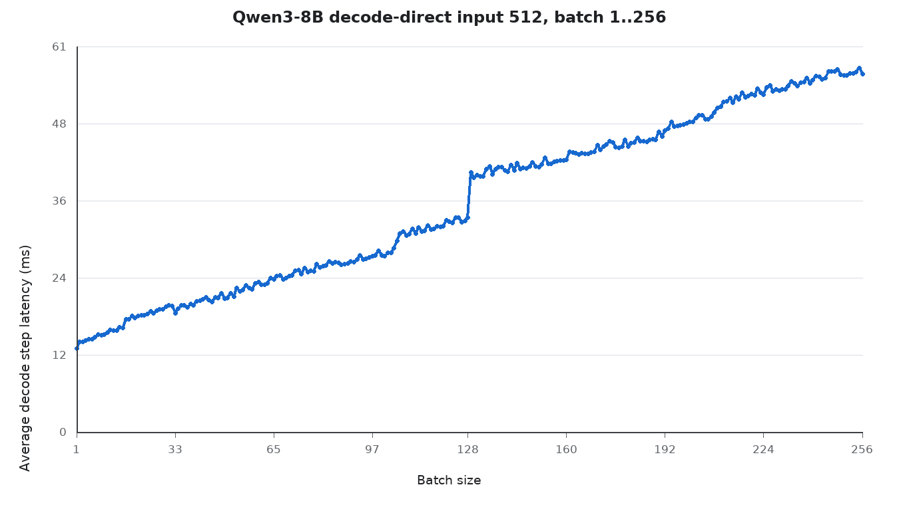
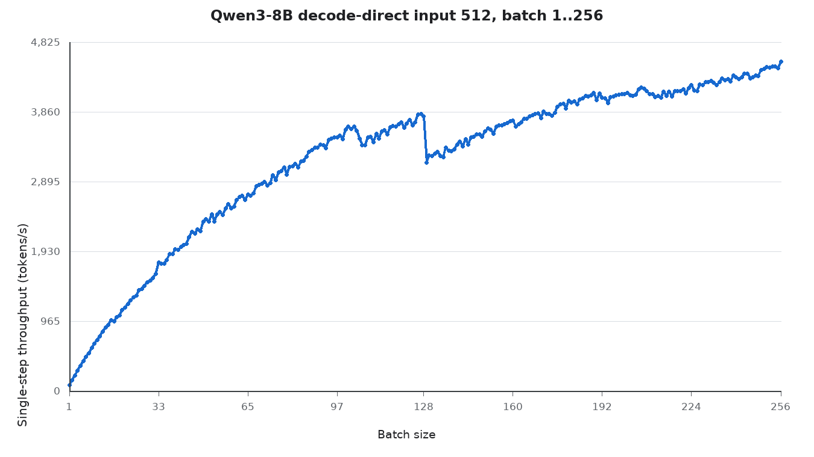
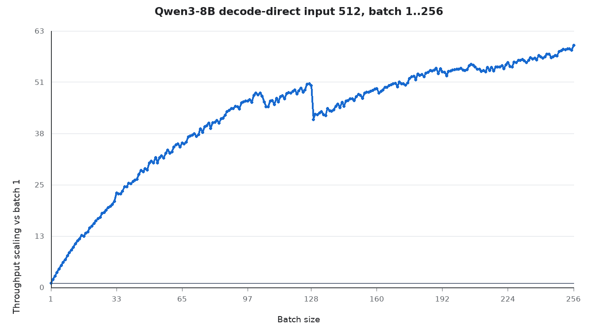

# Decode-Direct Graph 性能报告

## 运行环境

| 项目 | 值 |
| --- | --- |
| 日期 | 2026-11-13 16:11-16:32（Asia/Shanghai） |
| 平台 | MetaX |
| 设备 | C500，物理 GPU 5，64 GiB |
| Driver / runtime | MetaX driver 3.3.12 / MACA 3.2.1.10 |
| InfiniLM build | 当前源码树；基准 commit `112ee225` |
| 模型 | `/data-aisoft/mechdancer/models/Qwen3-8B` |
| 模式 | `decode-direct` |
| Attention backend | `flash-attn` |
| Cache | paged KV cache，block size 256 |
| Max batched tokens | 18,432 |
| Tensor parallel size | 1 |
| 输入长度 | 512 tokens / request |
| Batch size | 1..256，共 256 个形状 |
| Decode step 数 | 每个 repeat 固定 4 step |
| Warmup | 每个形状 3 次 repeat |
| 正式样本 | 每个形状 30 次 repeat |
| Batch 执行顺序 | random seed 2026 |
| 干扰检查 | GPU 5 全程无外来进程、无多进程采样点 |

本报告对应的原始 JSONL 和 log 为本机运行产物，不随仓库提交：

```text
../../../benchmark-decode-direct-metax-c500-qwen3-8b-input512-batch1-256-clean-20261113.jsonl
../../../benchmark-decode-direct-metax-c500-qwen3-8b-input512-batch1-256-clean-20261113.log
```

## 构建与测试命令

C++ 扩展使用当前源码构建并安装：

```bash
xmake build _infinilm && xmake install _infinilm
```

性能测试命令：

```bash
BENCHMARK_GPU=5 \
INFINILM_MAX_NUM_BATCHED_TOKENS=18432 \
BENCHMARK_MODE=decode-direct \
BATCH_SIZES="$(seq -s, 1 256)" \
INPUT_LENS=512 \
BENCHMARK_REPEATS=30 \
BENCHMARK_OUTPUT=benchmark-decode-direct-metax-c500-qwen3-8b-input512-batch1-256-clean-20261113.jsonl \
./run_bench.sh
```


脚本说明：上述命令中的 `run_bench.sh` 是 2026-11-13 测试时的本地脚本名；该脚本未随仓库提交，当前源码树中也没有该文件。复现时应使用等效的 MetaX benchmark 入口，并确认参数为 `--tp 1`、`BENCHMARK_GPU=5` 以及上述环境变量。

## 执行模式与 Graph 覆盖

当前 paged graph compiler 对 decode batch `1..256` 全部生成对应 graph；原始 JSONL 中所有 overall summary 的 `expected_execution_mode` 均为 `graph`，无 eager fallback 混入。

`expected_execution_mode` 是 benchmark 根据 compiler 规则推断的字段，不是 C++ runtime 回传的实际执行模式。

## 资源开销

| 项目 | 值 |
| --- | ---: |
| Workspace allocation | 1944.0 MiB |
| 权重加载时间 | 约 55.11 秒 |
| Paged cache blocks | 768 |
| Total benchmark wall time | 约 1276.9 秒 |
| GPU 5 温度范围 | 32C-55C |
| GPU 5 功耗范围 | 91W-317W |

## 测试口径

- `decode-direct` 不执行语义完整的 prefill，paged KV cache 初始为全 0。
- Step 0 输入 dummy token；step 1 到 step 3 使用上一步 sampled token。
- 4 个 decode step 的 past KV length 分别为 512、513、514、515。
- 报告中的 duration 是单 step 时间，由一次 4-step repeat 的对应总耗时指标除以 4 得到。
- Throughput 是 single-step 吞吐：`batch_size / avg_step_duration_s`。
- 计时边界为 `engine_forward_including_sampling`，包含 Python wrapper、C++ engine forward、RankWorker forward、model forward/graph replay 和 sampling。
- 不包含 HTTP、JSON parsing、tokenization、scheduler queueing、`build_model_inputs`、detokenization 和 Python `generate()` 循环。
- 输出 token 不用于正确性判断。
- 分位数使用线性插值；每个 batch 30 个 repeat，p99 只能作为尾部参考。

## 核心结论

| 指标 | 结果 |
| --- | ---: |
| 最高 single-step 吞吐 | batch 256，4,552.35 tok/s |
| batch 256 平均单 step latency | 56.235 ms |
| batch 1 平均单 step latency | 13.139 ms |
| 最大 batch 256 平均单 step latency | 56.235 ms |
| 最大 batch 相对 batch 1 吞吐倍数 | 59.812x |
| 最大 batch 相对理想 256x 的效率 | 23.4% |

吞吐 Top 10 overall 结果：

| Rank | Batch | Avg step ms | Throughput tok/s |
| ---: | ---: | ---: | ---: |
| 1 | 256 | 56.235 | 4,552.35 |
| 2 | 254 | 56.596 | 4,487.99 |
| 3 | 253 | 56.389 | 4,486.67 |
| 4 | 251 | 56.044 | 4,478.59 |
| 5 | 252 | 56.376 | 4,470.01 |
| 6 | 255 | 57.139 | 4,462.83 |
| 7 | 250 | 56.067 | 4,458.93 |
| 8 | 249 | 56.107 | 4,437.93 |
| 9 | 244 | 55.586 | 4,389.61 |
| 10 | 243 | 55.401 | 4,386.23 |

## 趋势图

### 1. Batch size 与平均单 step latency



### 2. Batch size 与吞吐



### 3. Batch size 与吞吐 Scaling



平均单 step latency 从 batch 1 的 13.139 ms 增至 batch 256 的 56.235 ms。吞吐峰值为 batch 256 的 4,552.35 tok/s。

## Batch 区间平均 latency 与吞吐

下表按连续 16 个 batch 分组。`平均单 step latency ms` 和 `平均吞吐 tok/s` 分别是该区间内 16 个 batch 的 overall `Avg Step ms` 与 `Single-step tok/s` 的算术平均值；`区间最优 batch` 取该区间内吞吐最高的 batch。

| Batch 区间 | 平均单 step latency ms | 平均吞吐 tok/s | 区间最优 batch |
| --- | ---: | ---: | ---: |
| 1..16 | 15.112 | 546.46 | 16 |
| 17..32 | 18.706 | 1,302.58 | 32 |
| 33..48 | 20.334 | 1,986.69 | 47 |
| 49..64 | 22.545 | 2,502.59 | 63 |
| 65..80 | 24.958 | 2,902.65 | 80 |
| 81..96 | 26.736 | 3,308.76 | 96 |
| 97..112 | 29.633 | 3,529.52 | 103 |
| 113..128 | 32.653 | 3,689.37 | 127 |
| 129..144 | 41.039 | 3,325.67 | 143 |
| 145..160 | 42.129 | 3,619.28 | 160 |
| 161..176 | 44.351 | 3,798.85 | 176 |
| 177..192 | 45.805 | 4,027.64 | 189 |
| 193..208 | 48.860 | 4,103.24 | 206 |
| 209..224 | 52.477 | 4,125.44 | 224 |
| 225..240 | 54.471 | 4,268.12 | 239 |
| 241..256 | 56.287 | 4,414.85 | 256 |

区间平均 latency 随 batch size 持续增长，区间平均吞吐整体上升。16 个区间中有 8 个区间的最优 batch 是区间右端点；偏离右端点的区间通常包含 throughput 跳变或局部回落。

## 关键批次与跳变

下表列出吞吐下降幅度最大的相邻 batch 变化。

| Change | Avg step ms | Single-step tok/s | 吞吐变化 |
| --- | ---: | ---: | ---: |
| 128 -> 129 | 33.692 -> 40.805 | 3,799.07 -> 3,161.38 | -637.70 |
| 52 -> 53 | 21.260 -> 22.645 | 2,445.94 -> 2,340.49 | -105.45 |
| 104 -> 105 | 28.905 -> 30.055 | 3,598.01 -> 3,493.62 | -104.39 |
| 78 -> 79 | 25.229 -> 26.401 | 3,091.73 -> 2,992.28 | -99.45 |

这些变化均发生在 graph 覆盖范围内，不能归因于 eager fallback。如需定位原因，应补充 kernel trace 或 C++ model-only 打点。

## Step 一致性

| Decode step | Past KV length | 全部 batch 平均 step latency ms |
| ---: | ---: | ---: |
| 0 | 512 | 35.993 |
| 1 | 513 | 36.010 |
| 2 | 514 | 36.012 |
| 3 | 515 | 36.009 |

Past KV length 从 512 增至 515 时，平均 step latency 变化很小；与 batch size 和区间跳变相比，这 3 个 token 的 KV 增量不是主要影响因素。

## 数据稳定性

- 256 个 overall summary 换算为单 step 后，std 中位数为 0.123 ms。
- 最大单 step std 为 0.606 ms，出现在 batch 233。
- 最大变异系数约 1.478%，中位变异系数约 0.350%。
- P50、P95、P99 和 max 普遍接近。

每个 batch 只有 30 个 repeat 样本；p99 可用于观察尾部，正式尾部对比建议提高到 100+ repeat。

## Single-step 完整结果

| Batch | Mode | Avg step ms | Min step ms | P50 step ms | P95 step ms | P99 step ms | Max step ms | Std step ms | Single-step tok/s | Scaling |
| ---: | --- | ---: | ---: | ---: | ---: | ---: | ---: | ---: | ---: | ---: |
| 1 | graph | 13.139 | 12.982 | 13.142 | 13.242 | 13.276 | 13.279 | 0.062 | 76.11 | 1.000x |
| 2 | graph | 14.107 | 14.012 | 14.102 | 14.177 | 14.228 | 14.249 | 0.046 | 141.78 | 1.863x |
| 3 | graph | 14.098 | 14.052 | 14.095 | 14.147 | 14.167 | 14.169 | 0.025 | 212.79 | 2.796x |
| 4 | graph | 14.331 | 14.204 | 14.280 | 14.474 | 14.482 | 14.485 | 0.098 | 279.12 | 3.667x |
| 5 | graph | 14.593 | 14.543 | 14.578 | 14.693 | 14.730 | 14.739 | 0.047 | 342.63 | 4.502x |
| 6 | graph | 14.583 | 14.554 | 14.582 | 14.617 | 14.646 | 14.654 | 0.021 | 411.45 | 5.406x |
| 7 | graph | 14.873 | 14.801 | 14.887 | 14.925 | 14.943 | 14.951 | 0.043 | 470.65 | 6.184x |
| 8 | graph | 15.264 | 15.202 | 15.254 | 15.335 | 15.416 | 15.443 | 0.046 | 524.11 | 6.886x |
| 9 | graph | 15.229 | 15.173 | 15.236 | 15.259 | 15.269 | 15.273 | 0.025 | 590.97 | 7.765x |
| 10 | graph | 15.276 | 15.197 | 15.278 | 15.318 | 15.321 | 15.322 | 0.027 | 654.60 | 8.601x |
| 11 | graph | 15.658 | 15.418 | 15.674 | 15.753 | 15.816 | 15.841 | 0.085 | 702.51 | 9.230x |
| 12 | graph | 16.016 | 15.918 | 16.009 | 16.126 | 16.197 | 16.215 | 0.062 | 749.24 | 9.844x |
| 13 | graph | 15.880 | 15.789 | 15.877 | 15.957 | 15.982 | 15.986 | 0.047 | 818.65 | 10.756x |
| 14 | graph | 15.949 | 15.855 | 15.929 | 16.055 | 16.090 | 16.102 | 0.059 | 877.79 | 11.533x |
| 15 | graph | 16.413 | 16.300 | 16.427 | 16.513 | 16.537 | 16.539 | 0.070 | 913.92 | 12.008x |
| 16 | graph | 16.377 | 16.161 | 16.415 | 16.444 | 16.454 | 16.457 | 0.086 | 977.01 | 12.837x |
| 17 | graph | 17.651 | 17.591 | 17.651 | 17.691 | 17.708 | 17.712 | 0.023 | 963.12 | 12.654x |
| 18 | graph | 17.709 | 17.636 | 17.708 | 17.752 | 17.765 | 17.770 | 0.031 | 1016.44 | 13.355x |
| 19 | graph | 18.184 | 18.066 | 18.189 | 18.271 | 18.294 | 18.301 | 0.055 | 1044.85 | 13.728x |
| 20 | graph | 17.895 | 17.836 | 17.885 | 17.967 | 17.973 | 17.974 | 0.037 | 1117.61 | 14.684x |
| 21 | graph | 18.244 | 18.007 | 18.252 | 18.327 | 18.391 | 18.416 | 0.072 | 1151.04 | 15.123x |
| 22 | graph | 18.290 | 18.218 | 18.286 | 18.346 | 18.372 | 18.381 | 0.039 | 1202.82 | 15.803x |
| 23 | graph | 18.330 | 18.096 | 18.335 | 18.404 | 18.418 | 18.420 | 0.058 | 1254.79 | 16.486x |
| 24 | graph | 18.509 | 18.452 | 18.491 | 18.596 | 18.608 | 18.612 | 0.043 | 1296.65 | 17.036x |
| 25 | graph | 18.944 | 18.837 | 18.924 | 19.069 | 19.103 | 19.116 | 0.077 | 1319.66 | 17.338x |
| 26 | graph | 18.618 | 18.428 | 18.611 | 18.697 | 18.708 | 18.709 | 0.053 | 1396.49 | 18.348x |
| 27 | graph | 19.099 | 19.055 | 19.090 | 19.168 | 19.198 | 19.203 | 0.035 | 1413.65 | 18.573x |
| 28 | graph | 19.262 | 19.184 | 19.266 | 19.326 | 19.334 | 19.334 | 0.041 | 1453.67 | 19.099x |
| 29 | graph | 19.281 | 18.988 | 19.299 | 19.398 | 19.426 | 19.431 | 0.097 | 1504.11 | 19.762x |
| 30 | graph | 19.675 | 19.564 | 19.657 | 19.833 | 19.845 | 19.846 | 0.077 | 1524.79 | 20.034x |
| 31 | graph | 19.868 | 19.772 | 19.847 | 19.997 | 20.025 | 20.035 | 0.062 | 1560.29 | 20.500x |
| 32 | graph | 19.738 | 19.638 | 19.736 | 19.799 | 19.816 | 19.822 | 0.042 | 1621.25 | 21.301x |
| 33 | graph | 18.619 | 18.488 | 18.583 | 18.873 | 18.922 | 18.935 | 0.120 | 1772.35 | 23.286x |
| 34 | graph | 19.358 | 19.237 | 19.343 | 19.459 | 19.561 | 19.601 | 0.080 | 1756.42 | 23.077x |
| 35 | graph | 19.896 | 19.765 | 19.891 | 20.008 | 20.069 | 20.094 | 0.074 | 1759.15 | 23.113x |
| 36 | graph | 19.886 | 19.747 | 19.852 | 20.108 | 20.173 | 20.188 | 0.111 | 1810.36 | 23.786x |
| 37 | graph | 19.570 | 19.454 | 19.564 | 19.673 | 19.724 | 19.744 | 0.067 | 1890.67 | 24.841x |
| 38 | graph | 20.053 | 19.967 | 20.044 | 20.155 | 20.182 | 20.188 | 0.052 | 1894.99 | 24.898x |
| 39 | graph | 19.865 | 19.658 | 19.879 | 19.978 | 19.994 | 19.995 | 0.081 | 1963.29 | 25.795x |
| 40 | graph | 20.475 | 20.381 | 20.449 | 20.615 | 20.629 | 20.631 | 0.071 | 1953.60 | 25.668x |
| 41 | graph | 20.572 | 20.435 | 20.545 | 20.728 | 20.747 | 20.753 | 0.089 | 1992.95 | 26.185x |
| 42 | graph | 20.854 | 20.671 | 20.814 | 21.109 | 21.158 | 21.165 | 0.150 | 2013.97 | 26.461x |
| 43 | graph | 21.167 | 20.654 | 21.196 | 21.353 | 21.390 | 21.396 | 0.172 | 2031.42 | 26.690x |
| 44 | graph | 20.710 | 20.550 | 20.718 | 20.848 | 20.884 | 20.891 | 0.088 | 2124.57 | 27.914x |
| 45 | graph | 20.411 | 20.351 | 20.402 | 20.499 | 20.516 | 20.521 | 0.039 | 2204.67 | 28.966x |
| 46 | graph | 21.146 | 21.015 | 21.116 | 21.293 | 21.396 | 21.427 | 0.090 | 2175.32 | 28.581x |
| 47 | graph | 21.008 | 20.895 | 20.993 | 21.157 | 21.320 | 21.374 | 0.105 | 2237.25 | 29.394x |
| 48 | graph | 21.758 | 21.623 | 21.725 | 21.974 | 22.009 | 22.018 | 0.100 | 2206.12 | 28.986x |
| 49 | graph | 20.915 | 20.840 | 20.899 | 20.995 | 21.062 | 21.087 | 0.053 | 2342.82 | 30.782x |
| 50 | graph | 21.038 | 20.852 | 21.051 | 21.146 | 21.149 | 21.149 | 0.084 | 2376.60 | 31.225x |
| 51 | graph | 21.801 | 21.116 | 21.831 | 22.027 | 22.038 | 22.042 | 0.197 | 2339.33 | 30.736x |
| 52 | graph | 21.260 | 21.186 | 21.258 | 21.321 | 21.355 | 21.367 | 0.042 | 2445.94 | 32.136x |
| 53 | graph | 22.645 | 22.456 | 22.648 | 22.767 | 22.818 | 22.832 | 0.081 | 2340.49 | 30.751x |
| 54 | graph | 22.097 | 21.944 | 22.088 | 22.220 | 22.260 | 22.266 | 0.070 | 2443.74 | 32.107x |
| 55 | graph | 22.257 | 22.085 | 22.266 | 22.352 | 22.399 | 22.415 | 0.072 | 2471.17 | 32.468x |
| 56 | graph | 23.032 | 22.853 | 22.985 | 23.258 | 23.294 | 23.305 | 0.122 | 2431.39 | 31.945x |
| 57 | graph | 22.610 | 22.467 | 22.612 | 22.721 | 22.750 | 22.760 | 0.071 | 2521.01 | 33.123x |
| 58 | graph | 22.443 | 22.150 | 22.500 | 22.581 | 22.614 | 22.620 | 0.143 | 2584.33 | 33.955x |
| 59 | graph | 23.343 | 22.680 | 23.462 | 23.718 | 23.792 | 23.810 | 0.345 | 2527.57 | 33.209x |
| 60 | graph | 23.542 | 23.413 | 23.510 | 23.767 | 23.866 | 23.884 | 0.114 | 2548.61 | 33.485x |
| 61 | graph | 23.093 | 22.926 | 23.075 | 23.266 | 23.289 | 23.291 | 0.099 | 2641.54 | 34.706x |
| 62 | graph | 23.089 | 22.970 | 23.079 | 23.187 | 23.205 | 23.209 | 0.055 | 2685.32 | 35.281x |
| 63 | graph | 23.366 | 23.228 | 23.355 | 23.500 | 23.528 | 23.529 | 0.081 | 2696.19 | 35.424x |
| 64 | graph | 24.194 | 23.975 | 24.141 | 24.430 | 24.460 | 24.468 | 0.151 | 2645.32 | 34.756x |
| 65 | graph | 23.934 | 23.739 | 23.949 | 24.102 | 24.123 | 24.128 | 0.115 | 2715.85 | 35.683x |
| 66 | graph | 24.449 | 24.305 | 24.438 | 24.617 | 24.637 | 24.640 | 0.092 | 2699.53 | 35.468x |
| 67 | graph | 24.552 | 24.373 | 24.519 | 24.858 | 24.867 | 24.870 | 0.134 | 2728.92 | 35.854x |
| 68 | graph | 23.978 | 23.813 | 23.984 | 24.085 | 24.119 | 24.128 | 0.083 | 2835.91 | 37.260x |
| 69 | graph | 24.206 | 24.027 | 24.214 | 24.367 | 24.395 | 24.406 | 0.099 | 2850.58 | 37.453x |
| 70 | graph | 24.454 | 23.992 | 24.486 | 24.634 | 24.674 | 24.685 | 0.154 | 2862.48 | 37.609x |
| 71 | graph | 24.552 | 24.070 | 24.611 | 24.697 | 24.727 | 24.738 | 0.156 | 2891.78 | 37.994x |
| 72 | graph | 25.332 | 25.153 | 25.300 | 25.569 | 25.633 | 25.658 | 0.116 | 2842.21 | 37.343x |
| 73 | graph | 25.399 | 25.249 | 25.370 | 25.570 | 25.686 | 25.730 | 0.116 | 2874.18 | 37.763x |
| 74 | graph | 24.840 | 24.553 | 24.854 | 24.937 | 24.946 | 24.949 | 0.087 | 2979.02 | 39.140x |
| 75 | graph | 25.722 | 25.217 | 25.709 | 25.922 | 25.937 | 25.939 | 0.136 | 2915.74 | 38.309x |
| 76 | graph | 25.127 | 25.031 | 25.125 | 25.227 | 25.324 | 25.362 | 0.073 | 3024.63 | 39.740x |
| 77 | graph | 25.332 | 25.055 | 25.251 | 25.706 | 25.787 | 25.815 | 0.196 | 3039.63 | 39.937x |
| 78 | graph | 25.229 | 24.932 | 25.218 | 25.459 | 25.485 | 25.494 | 0.138 | 3091.73 | 40.621x |
| 79 | graph | 26.401 | 26.289 | 26.386 | 26.494 | 26.529 | 26.541 | 0.059 | 2992.28 | 39.314x |
| 80 | graph | 25.823 | 25.628 | 25.823 | 26.012 | 26.038 | 26.047 | 0.118 | 3098.01 | 40.704x |
| 81 | graph | 26.067 | 25.877 | 26.087 | 26.219 | 26.280 | 26.292 | 0.101 | 3107.41 | 40.827x |
| 82 | graph | 26.139 | 25.808 | 26.125 | 26.327 | 26.447 | 26.493 | 0.129 | 3137.06 | 41.217x |
| 83 | graph | 26.820 | 26.648 | 26.843 | 26.924 | 26.942 | 26.949 | 0.079 | 3094.74 | 40.661x |
| 84 | graph | 26.475 | 26.284 | 26.470 | 26.638 | 26.769 | 26.817 | 0.105 | 3172.85 | 41.687x |
| 85 | graph | 26.698 | 26.459 | 26.682 | 26.906 | 26.993 | 27.027 | 0.132 | 3183.75 | 41.830x |
| 86 | graph | 26.553 | 26.412 | 26.544 | 26.686 | 26.697 | 26.701 | 0.088 | 3238.86 | 42.554x |
| 87 | graph | 26.276 | 25.877 | 26.197 | 26.761 | 26.957 | 27.036 | 0.284 | 3311.02 | 43.502x |
| 88 | graph | 26.384 | 25.782 | 26.424 | 26.576 | 26.588 | 26.590 | 0.191 | 3335.41 | 43.823x |
| 89 | graph | 26.449 | 25.885 | 26.454 | 26.754 | 26.782 | 26.788 | 0.247 | 3364.99 | 44.211x |
| 90 | graph | 26.767 | 26.489 | 26.779 | 26.977 | 27.003 | 27.011 | 0.123 | 3362.40 | 44.177x |
| 91 | graph | 26.684 | 26.501 | 26.691 | 26.835 | 26.910 | 26.936 | 0.094 | 3410.32 | 44.807x |
| 92 | graph | 27.062 | 26.849 | 27.059 | 27.198 | 27.262 | 27.285 | 0.106 | 3399.60 | 44.666x |
| 93 | graph | 27.722 | 27.608 | 27.715 | 27.844 | 27.917 | 27.942 | 0.082 | 3354.72 | 44.077x |
| 94 | graph | 27.073 | 26.912 | 27.071 | 27.219 | 27.239 | 27.245 | 0.104 | 3472.07 | 45.618x |
| 95 | graph | 27.250 | 27.025 | 27.271 | 27.436 | 27.496 | 27.520 | 0.123 | 3486.28 | 45.805x |
| 96 | graph | 27.361 | 26.958 | 27.355 | 27.522 | 27.620 | 27.655 | 0.125 | 3508.63 | 46.099x |
| 97 | graph | 27.653 | 27.215 | 27.711 | 27.881 | 27.903 | 27.904 | 0.178 | 3507.76 | 46.087x |
| 98 | graph | 27.765 | 27.366 | 27.673 | 28.288 | 28.318 | 28.326 | 0.319 | 3529.57 | 46.374x |
| 99 | graph | 28.427 | 28.285 | 28.379 | 28.674 | 28.737 | 28.755 | 0.127 | 3482.61 | 45.757x |
| 100 | graph | 27.690 | 27.504 | 27.677 | 27.848 | 27.863 | 27.866 | 0.086 | 3611.45 | 47.450x |
| 101 | graph | 27.642 | 27.312 | 27.762 | 28.004 | 28.069 | 28.090 | 0.278 | 3653.81 | 48.006x |
| 102 | graph | 28.124 | 27.961 | 28.061 | 28.442 | 28.472 | 28.482 | 0.153 | 3626.73 | 47.650x |
| 103 | graph | 28.186 | 27.884 | 28.168 | 28.392 | 28.426 | 28.434 | 0.140 | 3654.28 | 48.012x |
| 104 | graph | 28.905 | 28.726 | 28.899 | 29.054 | 29.099 | 29.113 | 0.088 | 3598.01 | 47.273x |
| 105 | graph | 30.055 | 29.837 | 30.076 | 30.221 | 30.256 | 30.262 | 0.109 | 3493.62 | 45.901x |
| 106 | graph | 31.160 | 30.983 | 31.147 | 31.364 | 31.383 | 31.387 | 0.110 | 3401.84 | 44.696x |
| 107 | graph | 31.460 | 31.268 | 31.476 | 31.706 | 31.714 | 31.717 | 0.136 | 3401.11 | 44.686x |
| 108 | graph | 30.806 | 30.666 | 30.811 | 30.926 | 31.007 | 31.034 | 0.078 | 3505.80 | 46.061x |
| 109 | graph | 31.019 | 30.670 | 30.994 | 31.284 | 31.328 | 31.338 | 0.144 | 3513.96 | 46.169x |
| 110 | graph | 31.948 | 31.776 | 31.899 | 32.247 | 32.309 | 32.332 | 0.149 | 3443.10 | 45.238x |
| 111 | graph | 31.211 | 31.068 | 31.195 | 31.422 | 31.466 | 31.479 | 0.107 | 3556.49 | 46.727x |
| 112 | graph | 32.071 | 31.904 | 32.048 | 32.275 | 32.338 | 32.350 | 0.106 | 3492.23 | 45.883x |
| 113 | graph | 31.476 | 31.307 | 31.453 | 31.621 | 31.660 | 31.672 | 0.087 | 3590.08 | 47.169x |
| 114 | graph | 31.610 | 31.451 | 31.617 | 31.809 | 31.835 | 31.843 | 0.120 | 3606.47 | 47.384x |
| 115 | graph | 32.439 | 32.278 | 32.402 | 32.697 | 32.839 | 32.892 | 0.139 | 3545.11 | 46.578x |
| 116 | graph | 31.828 | 31.635 | 31.844 | 31.931 | 32.000 | 32.023 | 0.077 | 3644.60 | 47.885x |
| 117 | graph | 31.943 | 31.603 | 31.924 | 32.174 | 32.228 | 32.234 | 0.139 | 3662.81 | 48.124x |
| 118 | graph | 32.278 | 32.038 | 32.305 | 32.479 | 32.501 | 32.503 | 0.137 | 3655.73 | 48.031x |
| 119 | graph | 32.263 | 32.050 | 32.264 | 32.465 | 32.539 | 32.558 | 0.125 | 3688.38 | 48.460x |
| 120 | graph | 32.310 | 32.050 | 32.305 | 32.514 | 32.533 | 32.539 | 0.125 | 3714.00 | 48.797x |
| 121 | graph | 33.260 | 32.205 | 33.275 | 33.455 | 33.496 | 33.508 | 0.215 | 3637.97 | 47.798x |
| 122 | graph | 32.999 | 32.428 | 32.992 | 33.454 | 33.485 | 33.494 | 0.361 | 3697.05 | 48.574x |
| 123 | graph | 32.831 | 32.604 | 32.829 | 33.036 | 33.097 | 33.110 | 0.133 | 3746.49 | 49.224x |
| 124 | graph | 33.721 | 33.478 | 33.680 | 33.991 | 34.016 | 34.023 | 0.155 | 3677.23 | 48.314x |
| 125 | graph | 33.687 | 33.507 | 33.680 | 33.879 | 33.907 | 33.909 | 0.101 | 3710.64 | 48.753x |
| 126 | graph | 32.934 | 32.500 | 32.946 | 33.042 | 33.107 | 33.129 | 0.103 | 3825.85 | 50.267x |
| 127 | graph | 33.172 | 32.801 | 33.190 | 33.323 | 33.373 | 33.391 | 0.125 | 3828.49 | 50.301x |
| 128 | graph | 33.692 | 32.971 | 33.926 | 34.184 | 34.264 | 34.286 | 0.445 | 3799.07 | 49.915x |
| 129 | graph | 40.805 | 40.641 | 40.819 | 40.912 | 40.941 | 40.948 | 0.075 | 3161.38 | 41.536x |
| 130 | graph | 39.959 | 39.776 | 39.940 | 40.162 | 40.200 | 40.206 | 0.128 | 3253.37 | 42.745x |
| 131 | graph | 40.349 | 40.108 | 40.373 | 40.511 | 40.535 | 40.544 | 0.121 | 3246.68 | 42.657x |
| 132 | graph | 40.195 | 40.037 | 40.188 | 40.370 | 40.407 | 40.419 | 0.085 | 3284.03 | 43.148x |
| 133 | graph | 40.166 | 39.626 | 40.143 | 40.733 | 40.820 | 40.835 | 0.379 | 3311.25 | 43.505x |
| 134 | graph | 41.250 | 41.051 | 41.278 | 41.400 | 41.448 | 41.465 | 0.112 | 3248.48 | 42.681x |
| 135 | graph | 41.753 | 41.481 | 41.761 | 41.964 | 42.119 | 42.176 | 0.179 | 3233.33 | 42.482x |
| 136 | graph | 40.448 | 40.104 | 40.475 | 40.600 | 40.727 | 40.777 | 0.133 | 3362.33 | 44.177x |
| 137 | graph | 41.263 | 41.068 | 41.278 | 41.434 | 41.489 | 41.504 | 0.098 | 3320.14 | 43.622x |
| 138 | graph | 41.593 | 41.424 | 41.588 | 41.745 | 41.840 | 41.873 | 0.099 | 3317.85 | 43.592x |
| 139 | graph | 41.576 | 41.434 | 41.559 | 41.706 | 41.753 | 41.772 | 0.085 | 3343.29 | 43.926x |
| 140 | graph | 41.073 | 40.779 | 41.091 | 41.299 | 41.344 | 41.360 | 0.155 | 3408.57 | 44.784x |
| 141 | graph | 40.906 | 40.838 | 40.912 | 41.005 | 41.047 | 41.049 | 0.053 | 3446.93 | 45.288x |
| 142 | graph | 41.953 | 41.745 | 41.968 | 42.124 | 42.146 | 42.155 | 0.104 | 3384.75 | 44.471x |
| 143 | graph | 41.117 | 40.994 | 41.107 | 41.229 | 41.244 | 41.249 | 0.065 | 3477.92 | 45.695x |
| 144 | graph | 42.224 | 41.926 | 42.182 | 42.488 | 42.605 | 42.636 | 0.137 | 3410.41 | 44.808x |
| 145 | graph | 41.336 | 41.030 | 41.372 | 41.541 | 41.585 | 41.596 | 0.154 | 3507.82 | 46.088x |
| 146 | graph | 41.490 | 41.159 | 41.507 | 41.680 | 41.716 | 41.716 | 0.125 | 3518.90 | 46.234x |
| 147 | graph | 41.453 | 41.052 | 41.448 | 41.623 | 41.650 | 41.660 | 0.122 | 3546.19 | 46.592x |
| 148 | graph | 41.702 | 41.426 | 41.684 | 41.952 | 42.120 | 42.186 | 0.160 | 3548.97 | 46.629x |
| 149 | graph | 42.352 | 42.235 | 42.356 | 42.460 | 42.489 | 42.494 | 0.067 | 3518.15 | 46.224x |
| 150 | graph | 41.764 | 41.484 | 41.764 | 42.029 | 42.109 | 42.123 | 0.155 | 3591.60 | 47.189x |
| 151 | graph | 41.591 | 40.857 | 41.754 | 41.972 | 42.035 | 42.050 | 0.373 | 3630.61 | 47.701x |
| 152 | graph | 42.073 | 41.696 | 42.113 | 42.221 | 42.251 | 42.254 | 0.129 | 3612.80 | 47.467x |
| 153 | graph | 43.027 | 42.788 | 43.012 | 43.250 | 43.335 | 43.360 | 0.147 | 3555.91 | 46.720x |
| 154 | graph | 42.084 | 41.930 | 42.074 | 42.199 | 42.322 | 42.371 | 0.084 | 3659.37 | 48.079x |
| 155 | graph | 42.170 | 41.816 | 42.164 | 42.337 | 43.066 | 43.363 | 0.258 | 3675.60 | 48.292x |
| 156 | graph | 42.448 | 41.878 | 42.476 | 42.659 | 42.715 | 42.725 | 0.171 | 3675.10 | 48.286x |
| 157 | graph | 42.563 | 42.226 | 42.609 | 42.722 | 42.738 | 42.741 | 0.126 | 3688.68 | 48.464x |
| 158 | graph | 42.643 | 42.419 | 42.658 | 42.812 | 42.852 | 42.864 | 0.110 | 3705.18 | 48.681x |
| 159 | graph | 42.610 | 42.222 | 42.619 | 42.806 | 42.817 | 42.821 | 0.138 | 3731.56 | 49.028x |
| 160 | graph | 42.757 | 42.080 | 42.894 | 42.985 | 43.039 | 43.061 | 0.312 | 3742.04 | 49.165x |
| 161 | graph | 43.985 | 43.773 | 43.954 | 44.318 | 44.377 | 44.392 | 0.176 | 3660.33 | 48.092x |
| 162 | graph | 43.898 | 42.988 | 43.942 | 44.154 | 44.321 | 44.386 | 0.309 | 3690.35 | 48.486x |
| 163 | graph | 43.840 | 43.058 | 43.973 | 44.168 | 44.331 | 44.391 | 0.346 | 3718.04 | 48.850x |
| 164 | graph | 43.548 | 43.248 | 43.583 | 43.714 | 43.769 | 43.783 | 0.130 | 3766.00 | 49.480x |
| 165 | graph | 43.803 | 43.165 | 43.942 | 44.202 | 44.304 | 44.339 | 0.376 | 3766.88 | 49.492x |
| 166 | graph | 43.660 | 43.162 | 43.694 | 43.859 | 43.925 | 43.952 | 0.161 | 3802.14 | 49.955x |
| 167 | graph | 43.732 | 43.329 | 43.740 | 43.941 | 44.019 | 44.050 | 0.154 | 3818.67 | 50.172x |
| 168 | graph | 43.880 | 43.563 | 43.906 | 44.011 | 44.014 | 44.015 | 0.109 | 3828.66 | 50.303x |
| 169 | graph | 44.012 | 43.296 | 43.976 | 44.460 | 44.521 | 44.522 | 0.299 | 3839.84 | 50.450x |
| 170 | graph | 45.031 | 44.786 | 45.012 | 45.320 | 45.367 | 45.385 | 0.170 | 3775.21 | 49.601x |
| 171 | graph | 44.277 | 43.840 | 44.050 | 44.964 | 45.089 | 45.140 | 0.449 | 3862.03 | 50.742x |
| 172 | graph | 44.871 | 43.961 | 44.932 | 45.070 | 45.163 | 45.197 | 0.276 | 3833.25 | 50.364x |
| 173 | graph | 45.173 | 44.567 | 45.248 | 45.424 | 45.571 | 45.628 | 0.278 | 3829.76 | 50.318x |
| 174 | graph | 45.676 | 45.491 | 45.662 | 45.935 | 46.011 | 46.014 | 0.118 | 3809.42 | 50.051x |
| 175 | graph | 45.463 | 45.301 | 45.455 | 45.675 | 45.685 | 45.686 | 0.116 | 3849.28 | 50.574x |
| 176 | graph | 44.764 | 44.400 | 44.768 | 44.894 | 44.948 | 44.968 | 0.103 | 3931.77 | 51.658x |
| 177 | graph | 44.626 | 44.341 | 44.676 | 44.775 | 44.782 | 44.783 | 0.128 | 3966.29 | 52.112x |
| 178 | graph | 44.822 | 44.572 | 44.866 | 44.973 | 45.033 | 45.055 | 0.121 | 3971.25 | 52.177x |
| 179 | graph | 45.862 | 45.650 | 45.837 | 46.099 | 46.185 | 46.210 | 0.132 | 3903.04 | 51.281x |
| 180 | graph | 44.882 | 44.549 | 44.907 | 45.053 | 45.130 | 45.147 | 0.129 | 4010.55 | 52.693x |
| 181 | graph | 45.334 | 45.087 | 45.350 | 45.499 | 45.566 | 45.592 | 0.134 | 3992.59 | 52.457x |
| 182 | graph | 45.448 | 45.205 | 45.461 | 45.593 | 45.681 | 45.716 | 0.126 | 4004.61 | 52.615x |
| 183 | graph | 46.175 | 45.371 | 46.377 | 46.758 | 46.804 | 46.815 | 0.473 | 3963.16 | 52.071x |
| 184 | graph | 45.670 | 45.364 | 45.693 | 45.894 | 45.931 | 45.939 | 0.157 | 4028.92 | 52.935x |
| 185 | graph | 45.711 | 45.437 | 45.743 | 45.920 | 45.989 | 46.014 | 0.148 | 4047.17 | 53.174x |
| 186 | graph | 45.574 | 44.952 | 45.725 | 45.909 | 45.942 | 45.953 | 0.322 | 4081.26 | 53.622x |
| 187 | graph | 45.941 | 45.524 | 45.935 | 46.168 | 46.183 | 46.186 | 0.155 | 4070.46 | 53.480x |
| 188 | graph | 46.016 | 45.725 | 46.012 | 46.178 | 46.271 | 46.306 | 0.114 | 4085.58 | 53.679x |
| 189 | graph | 45.883 | 45.409 | 45.858 | 46.191 | 46.249 | 46.259 | 0.174 | 4119.13 | 54.120x |
| 190 | graph | 47.199 | 47.048 | 47.176 | 47.346 | 47.439 | 47.463 | 0.090 | 4025.48 | 52.889x |
| 191 | graph | 46.378 | 45.991 | 46.351 | 46.669 | 46.691 | 46.695 | 0.184 | 4118.29 | 54.109x |
| 192 | graph | 47.355 | 47.179 | 47.335 | 47.552 | 47.578 | 47.585 | 0.096 | 4054.50 | 53.271x |
| 193 | graph | 47.661 | 47.424 | 47.664 | 47.799 | 47.844 | 47.857 | 0.080 | 4049.40 | 53.204x |
| 194 | graph | 48.763 | 48.500 | 48.760 | 48.926 | 48.974 | 48.987 | 0.110 | 3978.42 | 52.271x |
| 195 | graph | 47.963 | 47.599 | 48.026 | 48.149 | 48.189 | 48.203 | 0.153 | 4065.67 | 53.417x |
| 196 | graph | 48.092 | 47.890 | 48.044 | 48.348 | 48.450 | 48.486 | 0.145 | 4075.50 | 53.547x |
| 197 | graph | 48.183 | 48.005 | 48.189 | 48.290 | 48.408 | 48.446 | 0.078 | 4088.55 | 53.718x |
| 198 | graph | 48.340 | 47.909 | 48.337 | 48.487 | 48.567 | 48.581 | 0.110 | 4095.97 | 53.816x |
| 199 | graph | 48.480 | 48.259 | 48.456 | 48.695 | 48.700 | 48.701 | 0.114 | 4104.82 | 53.932x |
| 200 | graph | 48.747 | 48.225 | 48.603 | 49.383 | 49.479 | 49.507 | 0.475 | 4102.80 | 53.905x |
| 201 | graph | 48.712 | 48.493 | 48.687 | 48.903 | 48.929 | 48.929 | 0.112 | 4126.30 | 54.214x |
| 202 | graph | 49.376 | 48.521 | 49.543 | 49.742 | 49.950 | 50.015 | 0.386 | 4091.09 | 53.751x |
| 203 | graph | 49.708 | 49.512 | 49.649 | 49.974 | 50.250 | 50.361 | 0.180 | 4083.82 | 53.656x |
| 204 | graph | 49.778 | 49.605 | 49.749 | 49.966 | 49.980 | 49.985 | 0.098 | 4098.17 | 53.844x |
| 205 | graph | 49.167 | 48.231 | 49.191 | 49.431 | 49.568 | 49.616 | 0.244 | 4169.44 | 54.781x |
| 206 | graph | 49.094 | 48.874 | 49.089 | 49.306 | 49.344 | 49.347 | 0.125 | 4196.02 | 55.130x |
| 207 | graph | 49.532 | 49.217 | 49.583 | 49.770 | 49.817 | 49.826 | 0.164 | 4179.11 | 54.908x |
| 208 | graph | 50.159 | 49.849 | 50.166 | 50.312 | 50.322 | 50.325 | 0.091 | 4146.82 | 54.484x |
| 209 | graph | 50.870 | 49.906 | 50.930 | 51.119 | 51.176 | 51.177 | 0.250 | 4108.50 | 53.980x |
| 210 | graph | 51.136 | 51.025 | 51.132 | 51.260 | 51.281 | 51.288 | 0.064 | 4106.69 | 53.956x |
| 211 | graph | 51.886 | 50.803 | 51.769 | 52.558 | 52.632 | 52.661 | 0.498 | 4066.61 | 53.430x |
| 212 | graph | 51.906 | 51.459 | 51.626 | 53.051 | 53.076 | 53.081 | 0.574 | 4084.27 | 53.662x |
| 213 | graph | 52.468 | 52.303 | 52.443 | 52.663 | 52.812 | 52.872 | 0.123 | 4059.61 | 53.338x |
| 214 | graph | 51.733 | 51.425 | 51.730 | 51.887 | 51.956 | 51.984 | 0.123 | 4136.65 | 54.350x |
| 215 | graph | 52.679 | 51.830 | 52.842 | 53.019 | 53.129 | 53.153 | 0.381 | 4081.36 | 53.624x |
| 216 | graph | 52.215 | 52.056 | 52.195 | 52.405 | 52.538 | 52.592 | 0.103 | 4136.77 | 54.352x |
| 217 | graph | 53.267 | 53.131 | 53.244 | 53.373 | 53.467 | 53.502 | 0.075 | 4073.84 | 53.525x |
| 218 | graph | 52.529 | 51.558 | 52.581 | 52.864 | 52.898 | 52.911 | 0.302 | 4150.09 | 54.527x |
| 219 | graph | 52.776 | 52.413 | 52.787 | 53.020 | 53.065 | 53.081 | 0.174 | 4149.60 | 54.520x |
| 220 | graph | 53.096 | 52.425 | 52.915 | 53.684 | 53.779 | 53.809 | 0.400 | 4143.41 | 54.439x |
| 221 | graph | 52.929 | 52.725 | 52.909 | 53.145 | 53.207 | 53.224 | 0.116 | 4175.43 | 54.859x |
| 222 | graph | 53.921 | 53.445 | 53.897 | 54.181 | 54.306 | 54.344 | 0.164 | 4117.12 | 54.093x |
| 223 | graph | 53.264 | 52.948 | 53.274 | 53.509 | 53.546 | 53.550 | 0.160 | 4186.70 | 55.008x |
| 224 | graph | 52.950 | 52.273 | 52.987 | 53.241 | 53.272 | 53.281 | 0.251 | 4230.41 | 55.582x |
| 225 | graph | 54.174 | 53.797 | 54.166 | 54.395 | 54.409 | 54.412 | 0.137 | 4153.30 | 54.569x |
| 226 | graph | 54.485 | 54.247 | 54.503 | 54.729 | 54.775 | 54.786 | 0.133 | 4147.95 | 54.498x |
| 227 | graph | 53.511 | 53.214 | 53.499 | 53.724 | 53.803 | 53.818 | 0.121 | 4242.12 | 55.736x |
| 228 | graph | 53.866 | 53.441 | 53.880 | 54.563 | 54.633 | 54.654 | 0.285 | 4232.70 | 55.612x |
| 229 | graph | 53.645 | 53.341 | 53.663 | 53.837 | 53.872 | 53.887 | 0.140 | 4268.80 | 56.086x |
| 230 | graph | 53.873 | 53.071 | 53.897 | 54.052 | 54.168 | 54.200 | 0.187 | 4269.32 | 56.093x |
| 231 | graph | 53.876 | 53.577 | 53.884 | 54.096 | 54.161 | 54.162 | 0.129 | 4287.63 | 56.334x |
| 232 | graph | 54.374 | 53.894 | 54.219 | 55.029 | 55.125 | 55.162 | 0.401 | 4266.73 | 56.059x |
| 233 | graph | 55.093 | 54.049 | 55.336 | 55.855 | 56.020 | 56.075 | 0.606 | 4229.25 | 55.567x |
| 234 | graph | 54.780 | 53.704 | 54.988 | 55.173 | 55.221 | 55.240 | 0.438 | 4271.64 | 56.124x |
| 235 | graph | 54.398 | 54.121 | 54.431 | 54.581 | 54.638 | 54.657 | 0.131 | 4319.98 | 56.759x |
| 236 | graph | 54.889 | 54.521 | 54.831 | 55.494 | 55.737 | 55.772 | 0.272 | 4299.57 | 56.491x |
| 237 | graph | 54.965 | 54.729 | 54.975 | 55.193 | 55.247 | 55.259 | 0.147 | 4311.87 | 56.652x |
| 238 | graph | 55.572 | 54.634 | 55.833 | 56.330 | 56.400 | 56.404 | 0.565 | 4282.73 | 56.269x |
| 239 | graph | 54.773 | 54.505 | 54.789 | 54.990 | 55.002 | 55.005 | 0.144 | 4363.50 | 57.331x |
| 240 | graph | 55.264 | 54.592 | 54.995 | 55.942 | 55.986 | 55.989 | 0.456 | 4342.83 | 57.059x |
| 241 | graph | 55.901 | 54.989 | 56.090 | 56.323 | 56.379 | 56.401 | 0.432 | 4311.20 | 56.643x |
| 242 | graph | 55.815 | 54.381 | 55.893 | 56.418 | 56.562 | 56.613 | 0.552 | 4335.76 | 56.966x |
| 243 | graph | 55.401 | 55.182 | 55.385 | 55.706 | 55.757 | 55.758 | 0.160 | 4386.23 | 57.629x |
| 244 | graph | 55.586 | 55.303 | 55.537 | 55.904 | 55.959 | 55.975 | 0.179 | 4389.61 | 57.674x |
| 245 | graph | 56.656 | 56.496 | 56.654 | 56.812 | 56.854 | 56.866 | 0.089 | 4324.37 | 56.816x |
| 246 | graph | 56.697 | 56.446 | 56.675 | 56.857 | 56.921 | 56.942 | 0.102 | 4338.84 | 57.006x |
| 247 | graph | 56.620 | 56.329 | 56.634 | 56.747 | 56.772 | 56.776 | 0.101 | 4362.45 | 57.317x |
| 248 | graph | 56.961 | 56.857 | 56.933 | 57.145 | 57.201 | 57.213 | 0.097 | 4353.88 | 57.204x |
| 249 | graph | 56.107 | 55.748 | 56.144 | 56.295 | 56.384 | 56.416 | 0.174 | 4437.93 | 58.308x |
| 250 | graph | 56.067 | 55.730 | 56.110 | 56.338 | 56.471 | 56.505 | 0.191 | 4458.93 | 58.584x |
| 251 | graph | 56.044 | 55.134 | 56.257 | 56.470 | 56.514 | 56.526 | 0.437 | 4478.59 | 58.843x |
| 252 | graph | 56.376 | 56.049 | 56.383 | 56.597 | 56.639 | 56.652 | 0.155 | 4470.01 | 58.730x |
| 253 | graph | 56.389 | 55.769 | 56.415 | 56.544 | 56.607 | 56.627 | 0.142 | 4486.67 | 58.949x |
| 254 | graph | 56.596 | 56.275 | 56.605 | 56.803 | 56.924 | 56.959 | 0.150 | 4487.99 | 58.966x |
| 255 | graph | 57.139 | 56.398 | 57.229 | 57.553 | 57.663 | 57.707 | 0.368 | 4462.83 | 58.636x |
| 256 | graph | 56.235 | 55.745 | 56.258 | 56.525 | 56.578 | 56.593 | 0.216 | 4552.35 | 59.812x |

## 结果分析

1. 吞吐最高出现在 batch 256，为 4,552.35 tok/s。
2. 在本轮 batch `1..256` 范围内，吞吐在最大 batch 仍未回落；若资源允许，可继续扩大 batch 寻找饱和点。
3. 本轮数据稳定性较好，std 中位数为 0.123 ms，最大 std 为 0.606 ms。
4. 正式 p99 对比建议将 `BENCHMARK_REPEATS` 提高到 100 或以上。

## 结论与建议

1. 在本轮 input length 512、batch `1..256` 范围内，**batch 256 吞吐最高**，约 4,552.35 tok/s。
2. batch 256 平均单 step latency 为 56.235 ms。
3. 所有样本均在专用 GPU 5 上采集；监控期间目标卡没有外来进程。

## 数据完整性

```text
config records: 1
step samples: 30720
overall summaries: 256
per-step summaries: 1024
每个 batch step samples: 120
scaling records: 256
每个 batch repeat 数: 30
```
