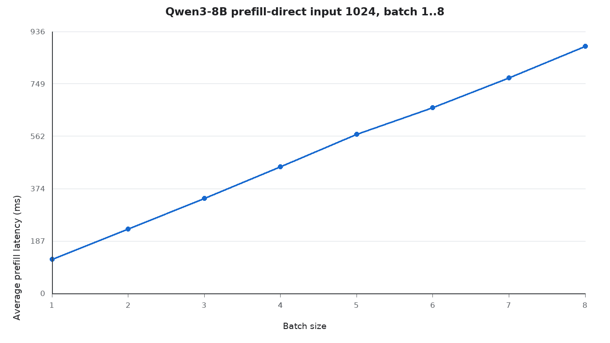
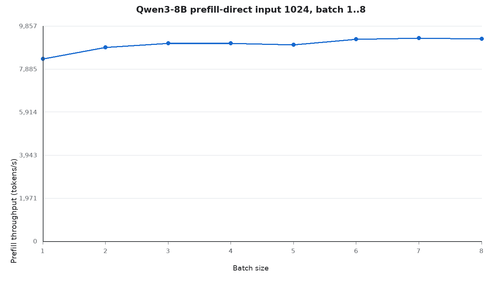
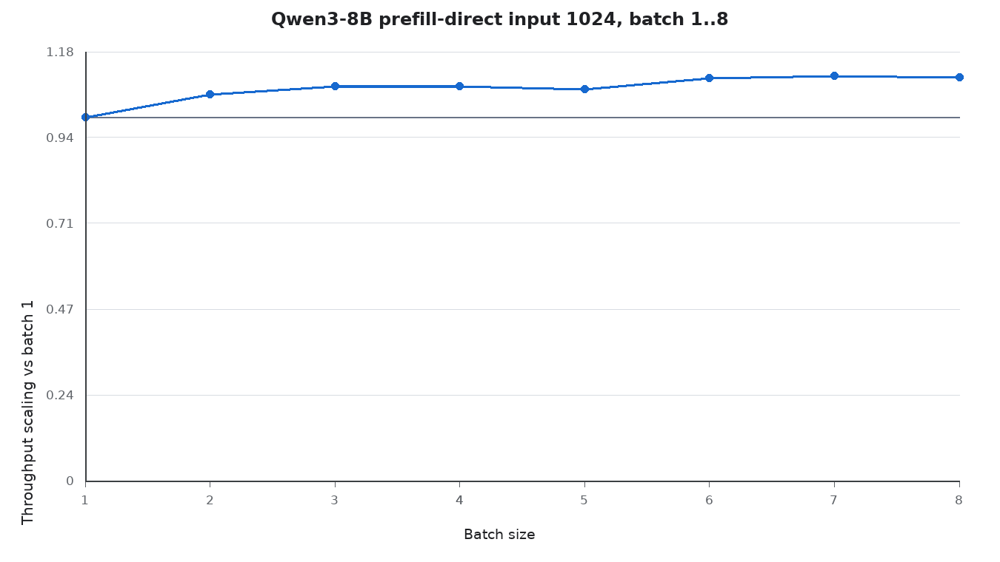

# Prefill-Direct 性能报告

## 运行环境

| 项目 | 值 |
| --- | --- |
| 日期 | 2026-11-13 15:57-15:59（Asia/Shanghai） |
| 平台 | MetaX |
| 设备 | C500，物理 GPU 5，64 GiB |
| Driver / runtime | MetaX driver 3.3.12 / MACA 3.2.1.10 |
| InfiniLM build | 当前源码树；基准 commit `112ee225` |
| 模型 | `/data-aisoft/mechdancer/models/Qwen3-8B` |
| 模式 | `prefill-direct` |
| Attention backend | `flash-attn` |
| Cache | paged KV cache，block size 256 |
| Max batched tokens | 9,216 |
| Tensor parallel size | 1 |
| 输入长度 | 1,024 tokens / request |
| Batch size | 1..8，共 8 个形状 |
| Warmup | 每个形状 3 次 repeat |
| 正式样本 | 每个形状 30 次 repeat |
| Batch 执行顺序 | random seed 2026 |
| 干扰检查 | GPU 5 全程无外来进程、无多进程采样点 |

本报告对应的原始 JSONL 和 log 为本机运行产物，不随仓库提交：

```text
../../../benchmark-prefill-direct-metax-c500-qwen3-8b-input1024-batch1-8-clean-20261113.jsonl
../../../benchmark-prefill-direct-metax-c500-qwen3-8b-input1024-batch1-8-clean-20261113.log
```

## 构建与测试命令

C++ 扩展使用当前源码构建并安装：

```bash
xmake build _infinilm && xmake install _infinilm
```

性能测试命令：

```bash
BENCHMARK_GPU=5 \
INFINILM_MAX_NUM_BATCHED_TOKENS=9216 \
BENCHMARK_MODE=prefill-direct \
BATCH_SIZES=1,2,3,4,5,6,7,8 \
INPUT_LENS=1024 \
BENCHMARK_REPEATS=30 \
BENCHMARK_OUTPUT=benchmark-prefill-direct-metax-c500-qwen3-8b-input1024-batch1-8-clean-20261113.jsonl \
./run_bench.sh
```


脚本说明：上述命令中的 `run_bench.sh` 是 2026-11-13 测试时的本地脚本名；该脚本未随仓库提交，当前源码树中也没有该文件。复现时应使用等效的 MetaX benchmark 入口，并确认参数为 `--tp 1`、`BENCHMARK_GPU=5` 以及上述环境变量。

## 执行模式与 Graph 覆盖

`run_bench.sh` 请求开启 graph compiling，但当前 paged graph compiler 的 graph key 只匹配 decode-only 形状。packed prefill 形状不匹配该 key，因此本轮 expected execution mode 为 `eager`。

`expected_execution_mode` 是 benchmark 根据 compiler 规则推断的字段，不是 C++ runtime 回传的实际执行模式。

## 资源开销

| 项目 | 值 |
| --- | ---: |
| Workspace allocation | 972.0 MiB |
| 权重加载时间 | 约 8.85 秒 |
| Paged cache blocks | 32 |
| Total benchmark wall time | 约 142.8 秒 |
| GPU 5 温度范围 | 32C-55C |
| GPU 5 功耗范围 | 91W-317W |

## 测试口径

- 每个 sample 是一次物理 prefill forward。
- `token_count = batch_size * 1024`。
- `throughput = batch_size * 1024 / avg_forward_duration_s`。
- 计时边界为 `engine_forward_including_sampling`，包含 Python wrapper、C++ engine forward、RankWorker forward、model forward/graph replay 和 sampling。
- 不包含 HTTP、JSON parsing、tokenization、scheduler queueing、`build_model_inputs`、detokenization 和 Python `generate()` 循环。
- 输出 token 不用于正确性判断。
- 分位数使用线性插值；每个 batch 30 个 repeat，p99 只能作为尾部参考。

## 核心结论

| 指标 | 结果 |
| --- | ---: |
| 最高 prefill 吞吐 | batch 7，9,298.77 tok/s |
| batch 1 平均 latency | 122.565 ms |
| batch 7 平均 latency | 770.855 ms |
| 最大 batch 8 吞吐 | 9,278.85 tok/s |

吞吐 Top 10 overall 结果：

| Rank | Batch | Avg ms | Throughput tok/s |
| ---: | ---: | ---: | ---: |
| 1 | 7 | 770.855 | 9,298.77 |
| 2 | 8 | 882.868 | 9,278.85 |
| 3 | 6 | 663.751 | 9,256.48 |
| 4 | 3 | 338.920 | 9,064.09 |
| 5 | 4 | 452.049 | 9,060.97 |
| 6 | 5 | 569.339 | 8,992.89 |
| 7 | 2 | 230.714 | 8,876.77 |
| 8 | 1 | 122.565 | 8,354.72 |

## 趋势图

### 1. Batch size 与平均 latency



### 2. Batch size 与吞吐



### 3. Batch size 与吞吐 Scaling



平均 latency 从 batch 1 的 122.565 ms 增至 batch 8 的 882.868 ms。吞吐峰值为 batch 7 的 9,298.77 tok/s。

## 完整结果表

| Batch | Input tokens | Avg ms | Min ms | P50 ms | P95 ms | P99 ms | Max ms | Std ms | Throughput tok/s | Scaling |
| ---: | ---: | ---: | ---: | ---: | ---: | ---: | ---: | ---: | ---: | ---: |
| 1 | 1,024 | 122.565 | 121.687 | 122.921 | 123.288 | 123.431 | 123.473 | 0.646 | 8354.72 | 1.000x |
| 2 | 2,048 | 230.714 | 230.344 | 230.700 | 231.001 | 231.036 | 231.044 | 0.170 | 8876.77 | 1.062x |
| 3 | 3,072 | 338.920 | 338.355 | 338.942 | 339.361 | 339.560 | 339.611 | 0.261 | 9064.09 | 1.085x |
| 4 | 4,096 | 452.049 | 450.932 | 452.167 | 452.555 | 452.665 | 452.704 | 0.491 | 9060.97 | 1.085x |
| 5 | 5,120 | 569.339 | 568.375 | 569.386 | 569.744 | 569.803 | 569.826 | 0.285 | 8992.89 | 1.076x |
| 6 | 6,144 | 663.751 | 661.350 | 663.716 | 665.273 | 665.804 | 665.935 | 0.974 | 9256.48 | 1.108x |
| 7 | 7,168 | 770.855 | 769.208 | 770.872 | 771.974 | 772.179 | 772.263 | 0.770 | 9298.77 | 1.113x |
| 8 | 8,192 | 882.868 | 881.257 | 882.915 | 884.039 | 884.191 | 884.228 | 0.759 | 9278.85 | 1.111x |

## 结果分析

1. 吞吐最高出现在 batch 7，为 9,298.77 tok/s。
2. 最大 batch 8 的吞吐为 9,278.85 tok/s，低于峰值约 0.21%。
3. 本轮数据稳定性较好，std 中位数为 0.646 ms，最大 std 为 0.974 ms。
4. 正式 p99 对比建议将 `BENCHMARK_REPEATS` 提高到 100 或以上。

## 结论与建议

1. 在本轮 input length 1024、batch `1..8` 范围内，**batch 7 吞吐最高**，约 9,298.77 tok/s。
2. batch 8 平均 forward latency 为 882.868 ms，latency 随 batch 接近线性增长。
3. 所有样本均在专用 GPU 5 上采集；监控期间目标卡没有外来进程。

## 数据完整性

```text
config records: 1
sample records: 240
summary records: 8
scaling records: 8
每个 batch repeat 数: 30
```
