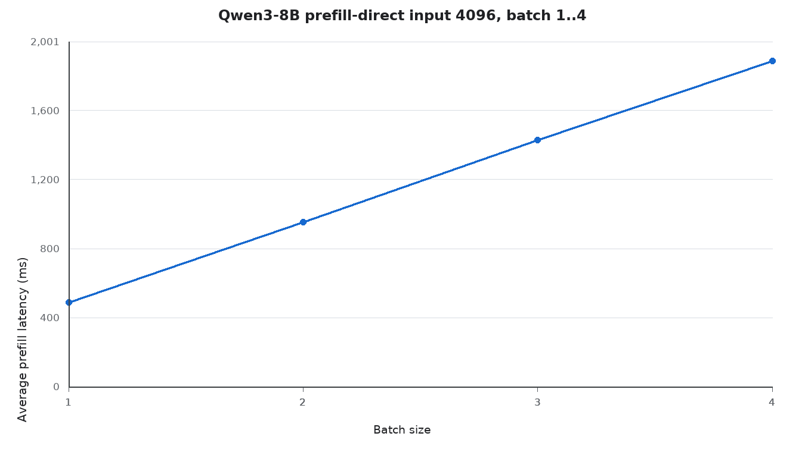
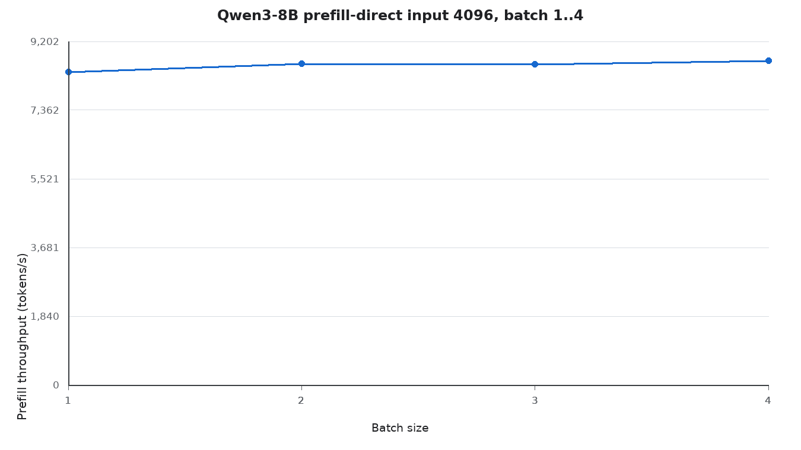
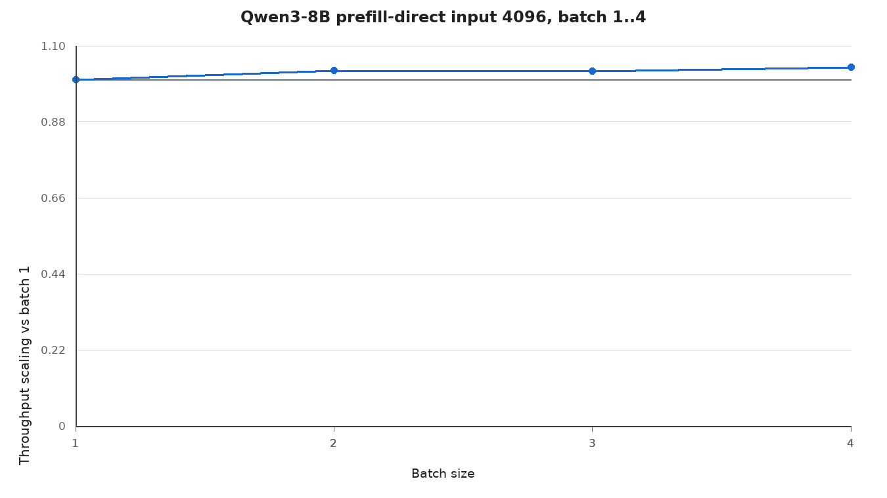

# Prefill-Direct 性能报告

## 运行环境

| 项目 | 值 |
| --- | --- |
| 日期 | 2026-11-13 16:07-16:10（Asia/Shanghai） |
| 平台 | MetaX |
| 设备 | C500，物理 GPU 5，64 GiB |
| Driver / runtime | MetaX driver 3.3.12 / MACA 3.2.1.10 |
| InfiniLM build | 当前源码树；基准 commit `112ee225` |
| 模型 | `/data-aisoft/mechdancer/models/Qwen3-8B` |
| 模式 | `prefill-direct` |
| Attention backend | `flash-attn` |
| Cache | paged KV cache，block size 256 |
| Max batched tokens | 18,432 |
| Tensor parallel size | 1 |
| 输入长度 | 4,096 tokens / request |
| Batch size | 1..4，共 4 个形状 |
| Warmup | 每个形状 3 次 repeat |
| 正式样本 | 每个形状 30 次 repeat |
| Batch 执行顺序 | random seed 2026 |
| 干扰检查 | GPU 5 全程无外来进程、无多进程采样点 |

本报告对应的原始 JSONL 和 log 为本机运行产物，不随仓库提交：

```text
../../../benchmark-prefill-direct-metax-c500-qwen3-8b-input4096-batch1-4-clean-20261113.jsonl
../../../benchmark-prefill-direct-metax-c500-qwen3-8b-input4096-batch1-4-clean-20261113.log
```

## 构建与测试命令

C++ 扩展使用当前源码构建并安装：

```bash
xmake build _infinilm && xmake install _infinilm
```

性能测试命令：

```bash
BENCHMARK_GPU=5 \
INFINILM_MAX_NUM_BATCHED_TOKENS=18432 \
BENCHMARK_MODE=prefill-direct \
BATCH_SIZES=1,2,3,4 \
INPUT_LENS=4096 \
BENCHMARK_REPEATS=30 \
BENCHMARK_OUTPUT=benchmark-prefill-direct-metax-c500-qwen3-8b-input4096-batch1-4-clean-20261113.jsonl \
./run_bench.sh
```


脚本说明：上述命令中的 `run_bench.sh` 是 2026-11-13 测试时的本地脚本名；该脚本未随仓库提交，当前源码树中也没有该文件。复现时应使用等效的 MetaX benchmark 入口，并确认参数为 `--tp 1`、`BENCHMARK_GPU=5` 以及上述环境变量。

## 执行模式与 Graph 覆盖

`run_bench.sh` 请求开启 graph compiling，但当前 paged graph compiler 的 graph key 只匹配 decode-only 形状。packed prefill 形状不匹配该 key，因此本轮 expected execution mode 为 `eager`。

`expected_execution_mode` 是 benchmark 根据 compiler 规则推断的字段，不是 C++ runtime 回传的实际执行模式。

## 资源开销

| 项目 | 值 |
| --- | ---: |
| Workspace allocation | 1944.0 MiB |
| 权重加载时间 | 约 8.30 秒 |
| Paged cache blocks | 64 |
| Total benchmark wall time | 约 166.2 秒 |
| GPU 5 温度范围 | 32C-55C |
| GPU 5 功耗范围 | 91W-317W |

## 测试口径

- 每个 sample 是一次物理 prefill forward。
- `token_count = batch_size * 4096`。
- `throughput = batch_size * 4096 / avg_forward_duration_s`。
- 计时边界为 `engine_forward_including_sampling`，包含 Python wrapper、C++ engine forward、RankWorker forward、model forward/graph replay 和 sampling。
- 不包含 HTTP、JSON parsing、tokenization、scheduler queueing、`build_model_inputs`、detokenization 和 Python `generate()` 循环。
- 输出 token 不用于正确性判断。
- 分位数使用线性插值；每个 batch 30 个 repeat，p99 只能作为尾部参考。

## 核心结论

| 指标 | 结果 |
| --- | ---: |
| 最高 prefill 吞吐 | batch 4，8,681.30 tok/s |
| batch 1 平均 latency | 488.058 ms |
| batch 4 平均 latency | 1887.275 ms |
| 最大 batch 4 吞吐 | 8,681.30 tok/s |

吞吐 Top 10 overall 结果：

| Rank | Batch | Avg ms | Throughput tok/s |
| ---: | ---: | ---: | ---: |
| 1 | 4 | 1887.275 | 8,681.30 |
| 2 | 2 | 952.168 | 8,603.52 |
| 3 | 3 | 1431.120 | 8,586.28 |
| 4 | 1 | 488.058 | 8,392.44 |

## 趋势图

### 1. Batch size 与平均 latency



### 2. Batch size 与吞吐



### 3. Batch size 与吞吐 Scaling



平均 latency 从 batch 1 的 488.058 ms 增至 batch 4 的 1887.275 ms。吞吐峰值为 batch 4 的 8,681.30 tok/s。

## 完整结果表

| Batch | Input tokens | Avg ms | Min ms | P50 ms | P95 ms | P99 ms | Max ms | Std ms | Throughput tok/s | Scaling |
| ---: | ---: | ---: | ---: | ---: | ---: | ---: | ---: | ---: | ---: | ---: |
| 1 | 4,096 | 488.058 | 487.298 | 488.046 | 488.754 | 489.099 | 489.190 | 0.404 | 8392.44 | 1.000x |
| 2 | 8,192 | 952.168 | 950.653 | 952.053 | 953.403 | 953.737 | 953.866 | 0.727 | 8603.52 | 1.025x |
| 3 | 12,288 | 1431.120 | 1429.053 | 1431.096 | 1432.333 | 1432.594 | 1432.657 | 0.869 | 8586.28 | 1.023x |
| 4 | 16,384 | 1887.275 | 1884.136 | 1887.188 | 1889.095 | 1890.481 | 1890.982 | 1.206 | 8681.30 | 1.034x |

## 结果分析

1. 吞吐最高出现在 batch 4，为 8,681.30 tok/s。
2. 在本轮 batch `1..4` 范围内，吞吐在最大 batch 仍未回落；若资源允许，可继续扩大 batch 寻找饱和点。
3. 本轮数据稳定性较好，std 中位数为 0.869 ms，最大 std 为 1.206 ms。
4. 正式 p99 对比建议将 `BENCHMARK_REPEATS` 提高到 100 或以上。

## 结论与建议

1. 在本轮 input length 4096、batch `1..4` 范围内，**batch 4 吞吐最高**，约 8,681.30 tok/s。
2. batch 4 平均 forward latency 为 1887.275 ms，latency 随 batch 接近线性增长。
3. 所有样本均在专用 GPU 5 上采集；监控期间目标卡没有外来进程。

## 数据完整性

```text
config records: 1
sample records: 120
summary records: 4
scaling records: 4
每个 batch repeat 数: 30
```
