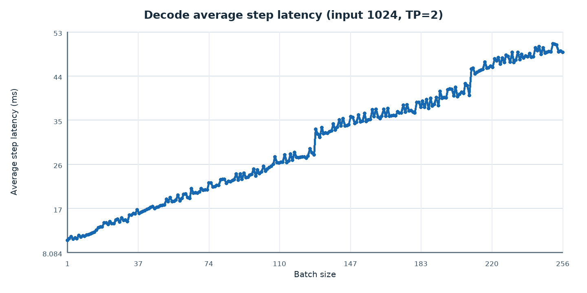
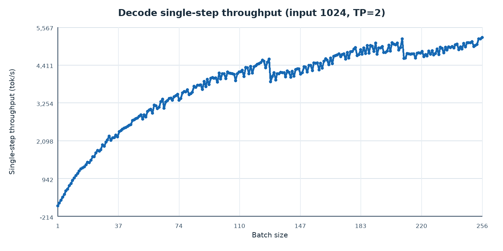
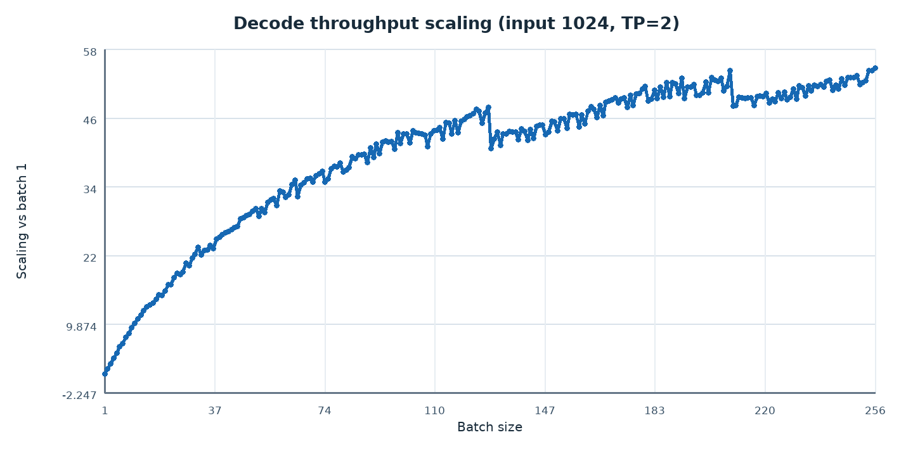

# Decode-Direct Input 1024 TP=2 性能报告

## 运行环境

| 项目 | 值 |
| --- | --- |
| 日期 | 2026-11-18 17:40:52-17:58:52（Asia/Shanghai） |
| 平台 | MetaX C500，64 GiB |
| 设备 | 2 x MetaX C500/C550，物理 GPU 3、4 |
| Driver / runtime | MetaX driver 3.3.12 / MACA 3.2.1.10 |
| InfiniLM build | 当前源码树；未记录独立 build ID |
| 模型 | `/data-aisoft/mechdancer/models/Qwen3-8B` |
| 模式 | `decode-direct` |
| Attention backend | `flash-attn` |
| Graph request | enabled |
| Expected execution mode | `graph` |
| Cache | paged KV cache，block size 256，num blocks 1,280 |
| Max batched tokens | 9,216 |
| Tensor parallel size | 2 |
| Input length | 1,024 tokens / request |
| Batch size | 1..256 |
| Warmup | 每个形状 3 次 repeat |
| Measured repeats | 每个形状 30 次 repeat |
| Batch 执行顺序 | random seed 2026 |
| 干扰控制 | 物理专用 GPU 3、4；每 10 秒采样 `mx-smi` |

本报告对应的原始 JSONL 和 log 为本机运行产物，不随仓库提交：

```text
../../../benchmark-decode-direct-metax-c500-tp2-qwen3-8b-input1024-batch1-256-clean-20261118.jsonl
../../../benchmark-decode-direct-metax-c500-tp2-qwen3-8b-input1024-batch1-256-clean-20261118.log
```

## 构建与测试命令

C++ 扩展使用当前源码构建并安装：

```bash
xmake build _infinilm && xmake install _infinilm
```

性能测试命令：

```bash
BENCHMARK_GPU=3,4 \
INFINILM_MAX_NUM_BATCHED_TOKENS=9216 \
BENCHMARK_MODE=decode-direct \
BATCH_SIZES="$(seq -s, 1 256)" \
INPUT_LENS=1024 \
BENCHMARK_REPEATS=30 \
BENCHMARK_OUTPUT=benchmark-decode-direct-metax-c500-tp2-qwen3-8b-input1024-batch1-256-clean-20261118.jsonl \
./run_bench-metax.sh
```


脚本说明：上述命令记录的是 2026-11-18 运行时的调用方式；当时本地 `run_bench-metax.sh` 硬编码 `--tp 2`。该脚本被仓库 `.gitignore` 忽略，不随本报告提交；如果后续脚本被改为其他 TP 值，复现前必须先确认或改回 `--tp 2`，并保持 `BENCHMARK_GPU=3,4`。

## 执行模式与 Graph 覆盖

当前 paged graph compiler 对 decode batch `1..256` 全部生成对应 graph；原始 JSONL 中所有 overall summary 的 `expected_execution_mode` 均为 `graph`，无 eager fallback 混入。
`expected_execution_mode` 是 benchmark 根据 compiler 规则推断的字段，不是 C++ runtime 回传的实际执行模式。

## 资源开销

| 项目 | 值 |
| --- | ---: |
| Workspace allocation | 每 rank 558.0 MiB，TP=2 合计 1,116.0 MiB |
| 权重加载时间 | 约 52.57 秒 |
| Paged cache blocks | 1,280 |
| 正式 repeat 数 | 7,680 |
| 正式 forward step 数 | 30,720 |
| 本轮总耗时 | 约 1,080.3 秒 |
| GPU 3/4 温度范围 | 30C-53C |
| GPU 3/4 功耗范围 | 95W-300W |
| GPU 3/4 进程显存峰值 | 36,106 MiB |

## 测试口径

- `decode-direct` 不执行语义完整的 prefill，paged KV cache 初始为全 0。
- Step 0 输入 dummy token；step 1 到 step 3 使用上一步 sampled token。
- 4 个 decode step 的 past KV length 分别为 1024、1025、1026、1027。
- 报告中的 duration 是单 step 时间，由一次 4-step repeat 的对应总耗时指标除以 4 得到。
- Throughput 是 single-step 吞吐：`batch_size / avg_step_duration_s`。
- 计时边界为 `engine_forward_including_sampling`，包含 Python wrapper、C++ engine forward、RankWorker forward、TP 通信、model forward/graph replay 和 sampling。
- 不包含 HTTP、JSON parsing、tokenization、scheduler queueing、`build_model_inputs`、detokenization 和 Python `generate()` 循环。
- 输出 token 不用于正确性判断。
- 分位数使用线性插值；每个 batch 30 个 repeat，p99 只能作为尾部参考。

## 核心结论

| 指标 | 结果 |
| --- | ---: |
| 最高 single-step 吞吐 | batch 256，5,257.30 tok/s |
| batch 256 平均单 step latency | 48.694 ms |
| batch 1 平均单 step latency | 10.483 ms |
| 最大 batch 256 平均单 step latency | 48.694 ms |
| 最大 batch 相对 batch 1 吞吐倍数 | 55.111x |

吞吐 Top 10 overall 结果：

| Batch | Avg Step ms | Single-step tok/s | Scaling |
| ---: | ---: | ---: | ---: |
| 256 | 48.694 | 5,257.30 | 55.111x |
| 255 | 48.906 | 5,214.05 | 54.657x |
| 254 | 48.742 | 5,211.16 | 54.627x |
| 208 | 39.965 | 5,204.59 | 54.558x |
| 250 | 48.773 | 5,125.74 | 53.732x |
| 247 | 48.483 | 5,094.53 | 53.404x |
| 249 | 48.876 | 5,094.49 | 53.404x |
| 248 | 48.716 | 5,090.73 | 53.365x |
| 202 | 39.698 | 5,088.42 | 53.340x |
| 205 | 40.380 | 5,076.80 | 53.219x |

## 趋势图

### 1. Batch size 与平均单 step latency



### 2. Batch size 与吞吐



### 3. Batch size 与吞吐 Scaling




平均单 step latency 从 batch 1 的 10.483 ms 增至 batch 256 的 48.694 ms。吞吐峰值为 batch 256 的 5,257.30 tok/s。

## Batch 区间平均 latency 与吞吐

下表按连续 16 个 batch 分组。`平均单 step latency ms` 和 `平均吞吐 tok/s` 分别是该区间内 batch 的 overall `Avg Step ms` 与 `Single-step tok/s` 的算术平均值；`区间最优 batch` 取该区间内吞吐最高的 batch。

| Batch 区间 | 平均单 step latency ms | 平均吞吐 tok/s | 区间最优 batch |
| --- | ---: | ---: | ---: |
| 1..16 | 11.407 | 728.87 | 16 |
| 17..32 | 14.120 | 1,727.03 | 32 |
| 33..48 | 16.550 | 2,441.06 | 48 |
| 49..64 | 18.753 | 3,010.08 | 64 |
| 65..80 | 21.136 | 3,428.45 | 79 |
| 81..96 | 23.156 | 3,821.08 | 94 |
| 97..112 | 25.405 | 4,113.77 | 112 |
| 113..128 | 27.553 | 4,374.07 | 128 |
| 129..144 | 33.122 | 4,121.92 | 144 |
| 145..160 | 35.233 | 4,329.31 | 157 |
| 161..176 | 36.356 | 4,635.30 | 175 |
| 177..192 | 37.900 | 4,869.38 | 192 |
| 193..208 | 40.565 | 4,944.16 | 208 |
| 209..224 | 45.762 | 4,731.38 | 224 |
| 225..240 | 47.679 | 4,876.84 | 240 |
| 241..256 | 49.136 | 5,058.21 | 256 |

区间平均 latency 随 batch size 整体增长；16 个区间中有 12 个区间的最优 batch 是区间右端点。偏离右端点的区间通常包含吞吐跳变或局部回落。

## 关键批次与跳变

下表列出吞吐下降幅度最大的相邻 batch 变化。

| Change | Avg step ms | Single-step tok/s | 吞吐变化 |
| --- | ---: | ---: | ---: |
| 128 -> 129 | 27.856 -> 33.059 | 4,595.12 -> 3,902.12 | -693.00 |
| 208 -> 209 | 39.965 -> 45.331 | 5,204.59 -> 4,610.49 | -594.10 |
| 192 -> 193 | 37.821 -> 40.717 | 5,076.58 -> 4,740.05 | -336.53 |
| 64 -> 65 | 18.996 -> 21.023 | 3,369.16 -> 3,091.84 | -277.32 |
| 180 -> 181 | 36.409 -> 38.500 | 4,943.79 -> 4,701.31 | -242.49 |

这些变化均在 graph 覆盖范围内，不能归因于 eager fallback。如需定位原因，应补充 kernel trace 或 C++ model-only 打点。

## Step 一致性

峰值 batch 256 的 4 个 decode step 结果如下：

| Step | Past KV length | Avg step ms | Std ms | Throughput tok/s |
| ---: | ---: | ---: | ---: | ---: |
| 0 | 1024 | 12.158 | 0.106 | 21,055.41 |
| 1 | 1025 | 12.173 | 0.096 | 21,029.34 |
| 2 | 1026 | 12.186 | 0.103 | 21,007.69 |
| 3 | 1027 | 12.176 | 0.118 | 21,024.35 |

所有 batch 中，4 个 step 平均耗时最大差异为 1.078 ms，出现在 batch 206。该差异主要来自 past KV length 增长以及不同 step 的 kernel 形状。

## 数据稳定性

- 256 个 overall summary换算为单 step 后的 std 中位数为 0.167 ms。
- 最大 std 为 9.749 ms，出现在 batch 206。
- 最大变异系数约 23.021%，中位变异系数约 0.579%。
- P50、P95、P99 和 max 普遍接近。
- 每个 batch 只有 30 个 repeat 样本；p99 可用于观察尾部，正式尾部对比建议提高到 100+ repeat。

## Single-step 完整结果

### Batch 1..64

| Batch | Mode | Avg Step ms | Min ms | P50 ms | P95 ms | P99 ms | Max ms | Std ms | Throughput tok/s | Scaling |
| ---: | --- | ---: | ---: | ---: | ---: | ---: | ---: | ---: | ---: | ---: |
| 1 | graph | 10.483 | 10.371 | 10.478 | 10.621 | 10.646 | 10.650 | 0.076 | 95.40 | 1.000x |
| 2 | graph | 10.823 | 10.436 | 10.789 | 11.442 | 11.554 | 11.580 | 0.257 | 184.78 | 1.937x |
| 3 | graph | 11.234 | 10.859 | 10.977 | 11.529 | 14.634 | 15.878 | 0.891 | 267.04 | 2.799x |
| 4 | graph | 10.807 | 10.443 | 10.802 | 11.261 | 11.300 | 11.302 | 0.217 | 370.12 | 3.880x |
| 5 | graph | 10.989 | 10.808 | 10.896 | 11.322 | 11.409 | 11.440 | 0.190 | 454.98 | 4.769x |
| 6 | graph | 10.822 | 10.656 | 10.733 | 11.148 | 11.942 | 12.237 | 0.292 | 554.42 | 5.812x |
| 7 | graph | 11.489 | 11.327 | 11.424 | 11.907 | 11.946 | 11.958 | 0.165 | 609.26 | 6.387x |
| 8 | graph | 11.194 | 11.115 | 11.189 | 11.280 | 11.313 | 11.319 | 0.044 | 714.67 | 7.492x |
| 9 | graph | 11.433 | 11.287 | 11.359 | 11.881 | 11.958 | 11.975 | 0.183 | 787.18 | 8.252x |
| 10 | graph | 11.316 | 11.084 | 11.216 | 12.026 | 12.258 | 12.298 | 0.289 | 883.71 | 9.264x |
| 11 | graph | 11.590 | 11.510 | 11.561 | 11.717 | 11.936 | 11.999 | 0.091 | 949.09 | 9.949x |
| 12 | graph | 11.699 | 11.629 | 11.675 | 11.783 | 12.089 | 12.207 | 0.102 | 1,025.77 | 10.753x |
| 13 | graph | 11.852 | 11.713 | 11.789 | 12.246 | 12.455 | 12.511 | 0.183 | 1,096.85 | 11.498x |
| 14 | graph | 12.003 | 11.881 | 11.943 | 12.355 | 12.624 | 12.717 | 0.172 | 1,166.41 | 12.227x |
| 15 | graph | 12.147 | 12.047 | 12.107 | 12.411 | 12.568 | 12.602 | 0.119 | 1,234.84 | 12.945x |
| 16 | graph | 12.625 | 12.350 | 12.692 | 12.898 | 12.969 | 12.976 | 0.168 | 1,267.34 | 13.285x |
| 17 | graph | 13.114 | 12.713 | 13.109 | 13.481 | 13.495 | 13.499 | 0.207 | 1,296.35 | 13.589x |
| 18 | graph | 13.231 | 13.076 | 13.189 | 13.465 | 13.470 | 13.470 | 0.120 | 1,360.39 | 14.261x |
| 19 | graph | 13.263 | 13.187 | 13.253 | 13.348 | 13.415 | 13.436 | 0.049 | 1,432.54 | 15.017x |
| 20 | graph | 14.038 | 13.892 | 13.981 | 14.367 | 14.617 | 14.661 | 0.162 | 1,424.69 | 14.935x |
| 21 | graph | 14.040 | 13.934 | 14.024 | 14.236 | 14.284 | 14.293 | 0.090 | 1,495.74 | 15.679x |
| 22 | graph | 13.725 | 13.505 | 13.630 | 14.251 | 14.742 | 14.920 | 0.292 | 1,602.96 | 16.803x |
| 23 | graph | 14.296 | 14.178 | 14.274 | 14.459 | 14.657 | 14.731 | 0.110 | 1,608.80 | 16.865x |
| 24 | graph | 13.943 | 13.823 | 13.894 | 14.294 | 14.617 | 14.647 | 0.178 | 1,721.25 | 18.043x |
| 25 | graph | 13.899 | 13.825 | 13.888 | 13.966 | 14.067 | 14.104 | 0.052 | 1,798.72 | 18.855x |
| 26 | graph | 14.631 | 14.512 | 14.620 | 14.772 | 14.791 | 14.798 | 0.084 | 1,777.11 | 18.629x |
| 27 | graph | 14.842 | 14.670 | 14.812 | 15.058 | 15.108 | 15.113 | 0.111 | 1,819.15 | 19.070x |
| 28 | graph | 14.244 | 14.066 | 14.234 | 14.484 | 14.552 | 14.562 | 0.128 | 1,965.68 | 20.606x |
| 29 | graph | 15.084 | 14.976 | 15.096 | 15.196 | 15.224 | 15.235 | 0.069 | 1,922.63 | 20.154x |
| 30 | graph | 14.609 | 14.465 | 14.584 | 14.707 | 15.190 | 15.383 | 0.156 | 2,053.54 | 21.527x |
| 31 | graph | 14.643 | 14.498 | 14.647 | 14.779 | 14.801 | 14.802 | 0.080 | 2,117.02 | 22.192x |
| 32 | graph | 14.312 | 14.128 | 14.229 | 14.843 | 15.147 | 15.220 | 0.245 | 2,235.91 | 23.438x |
| 33 | graph | 15.662 | 15.586 | 15.659 | 15.742 | 15.773 | 15.784 | 0.047 | 2,106.95 | 22.087x |
| 34 | graph | 15.618 | 15.550 | 15.602 | 15.739 | 15.796 | 15.811 | 0.061 | 2,176.96 | 22.820x |
| 35 | graph | 15.940 | 15.706 | 15.939 | 16.040 | 16.053 | 16.057 | 0.066 | 2,195.67 | 23.017x |
| 36 | graph | 15.923 | 15.809 | 15.905 | 16.070 | 16.139 | 16.154 | 0.076 | 2,260.92 | 23.701x |
| 37 | graph | 16.724 | 16.617 | 16.690 | 16.821 | 17.287 | 17.472 | 0.149 | 2,212.36 | 23.192x |
| 38 | graph | 16.013 | 15.775 | 16.038 | 16.201 | 16.346 | 16.404 | 0.145 | 2,373.10 | 24.876x |
| 39 | graph | 16.199 | 16.074 | 16.208 | 16.274 | 16.350 | 16.379 | 0.063 | 2,407.62 | 25.238x |
| 40 | graph | 16.345 | 16.166 | 16.347 | 16.453 | 16.592 | 16.644 | 0.091 | 2,447.30 | 25.654x |
| 41 | graph | 16.531 | 16.400 | 16.529 | 16.612 | 16.698 | 16.733 | 0.073 | 2,480.24 | 26.000x |
| 42 | graph | 16.820 | 16.753 | 16.809 | 16.916 | 16.934 | 16.934 | 0.046 | 2,497.02 | 26.175x |
| 43 | graph | 16.978 | 16.853 | 16.945 | 17.173 | 17.241 | 17.264 | 0.099 | 2,532.68 | 26.549x |
| 44 | graph | 17.177 | 16.995 | 17.164 | 17.303 | 17.427 | 17.477 | 0.089 | 2,561.63 | 26.853x |
| 45 | graph | 17.373 | 16.723 | 17.147 | 17.941 | 18.286 | 18.421 | 0.457 | 2,590.21 | 27.152x |
| 46 | graph | 16.950 | 16.731 | 16.904 | 17.211 | 17.254 | 17.271 | 0.170 | 2,713.80 | 28.448x |
| 47 | graph | 17.213 | 17.109 | 17.162 | 17.475 | 17.744 | 17.819 | 0.149 | 2,730.53 | 28.623x |
| 48 | graph | 17.329 | 16.984 | 17.380 | 17.525 | 17.651 | 17.692 | 0.168 | 2,769.98 | 29.037x |
| 49 | graph | 17.563 | 17.379 | 17.512 | 17.894 | 18.211 | 18.323 | 0.185 | 2,789.97 | 29.246x |
| 50 | graph | 17.627 | 17.175 | 17.648 | 17.787 | 18.151 | 18.284 | 0.181 | 2,836.63 | 29.736x |
| 51 | graph | 17.709 | 17.620 | 17.689 | 17.837 | 17.858 | 17.866 | 0.062 | 2,879.95 | 30.190x |
| 52 | graph | 18.901 | 18.534 | 18.853 | 19.267 | 19.305 | 19.320 | 0.205 | 2,751.11 | 28.839x |
| 53 | graph | 18.364 | 18.237 | 18.354 | 18.511 | 18.552 | 18.557 | 0.079 | 2,886.02 | 30.253x |
| 54 | graph | 19.182 | 18.963 | 19.143 | 19.392 | 19.762 | 19.887 | 0.166 | 2,815.13 | 29.510x |
| 55 | graph | 18.389 | 18.023 | 18.123 | 19.571 | 21.268 | 21.838 | 0.744 | 2,990.89 | 31.353x |
| 56 | graph | 18.451 | 18.127 | 18.505 | 18.624 | 18.719 | 18.756 | 0.172 | 3,035.12 | 31.816x |
| 57 | graph | 18.682 | 18.497 | 18.664 | 18.794 | 18.854 | 18.878 | 0.072 | 3,051.11 | 31.984x |
| 58 | graph | 19.720 | 19.434 | 19.657 | 20.057 | 20.216 | 20.279 | 0.186 | 2,941.13 | 30.831x |
| 59 | graph | 18.514 | 18.311 | 18.466 | 18.829 | 19.173 | 19.299 | 0.194 | 3,186.80 | 33.406x |
| 60 | graph | 18.998 | 18.458 | 18.959 | 19.249 | 21.497 | 22.407 | 0.669 | 3,158.26 | 33.107x |
| 61 | graph | 19.859 | 19.747 | 19.830 | 20.092 | 20.226 | 20.264 | 0.117 | 3,071.73 | 32.200x |
| 62 | graph | 19.912 | 19.728 | 19.878 | 20.245 | 20.343 | 20.366 | 0.148 | 3,113.75 | 32.641x |
| 63 | graph | 19.181 | 18.729 | 19.120 | 19.955 | 20.796 | 20.946 | 0.437 | 3,284.56 | 34.431x |
| 64 | graph | 18.996 | 18.603 | 19.018 | 19.122 | 19.244 | 19.292 | 0.130 | 3,369.16 | 35.318x |

### Batch 65..128

| Batch | Mode | Avg Step ms | Min ms | P50 ms | P95 ms | P99 ms | Max ms | Std ms | Throughput tok/s | Scaling |
| ---: | --- | ---: | ---: | ---: | ---: | ---: | ---: | ---: | ---: | ---: |
| 65 | graph | 21.023 | 20.856 | 21.001 | 21.250 | 21.384 | 21.432 | 0.116 | 3,091.84 | 32.411x |
| 66 | graph | 20.096 | 19.615 | 20.055 | 20.423 | 21.118 | 21.363 | 0.280 | 3,284.15 | 34.427x |
| 67 | graph | 20.194 | 19.663 | 20.092 | 21.425 | 21.523 | 21.539 | 0.452 | 3,317.75 | 34.779x |
| 68 | graph | 20.076 | 19.709 | 20.008 | 20.801 | 21.089 | 21.100 | 0.348 | 3,387.15 | 35.506x |
| 69 | graph | 20.311 | 20.129 | 20.304 | 20.425 | 20.466 | 20.476 | 0.069 | 3,397.15 | 35.611x |
| 70 | graph | 21.000 | 20.891 | 20.984 | 21.108 | 21.171 | 21.191 | 0.067 | 3,333.36 | 34.943x |
| 71 | graph | 20.645 | 20.304 | 20.698 | 20.882 | 20.927 | 20.942 | 0.174 | 3,439.03 | 36.050x |
| 72 | graph | 20.730 | 20.507 | 20.697 | 21.082 | 21.161 | 21.163 | 0.175 | 3,473.19 | 36.408x |
| 73 | graph | 20.787 | 20.604 | 20.743 | 21.009 | 21.133 | 21.182 | 0.137 | 3,511.87 | 36.814x |
| 74 | graph | 22.183 | 21.955 | 22.158 | 22.359 | 22.377 | 22.380 | 0.107 | 3,335.95 | 34.970x |
| 75 | graph | 22.187 | 22.016 | 22.184 | 22.340 | 22.494 | 22.545 | 0.107 | 3,380.35 | 35.435x |
| 76 | graph | 21.371 | 21.031 | 21.289 | 22.362 | 22.640 | 22.725 | 0.398 | 3,556.22 | 37.279x |
| 77 | graph | 21.390 | 21.282 | 21.383 | 21.496 | 21.617 | 21.666 | 0.072 | 3,599.83 | 37.736x |
| 78 | graph | 21.708 | 21.015 | 21.269 | 24.642 | 27.304 | 28.113 | 1.469 | 3,593.10 | 37.665x |
| 79 | graph | 21.641 | 21.201 | 21.688 | 21.888 | 21.929 | 21.937 | 0.194 | 3,650.44 | 38.266x |
| 80 | graph | 22.832 | 22.695 | 22.795 | 23.065 | 23.132 | 23.141 | 0.107 | 3,503.84 | 36.730x |
| 81 | graph | 22.912 | 22.747 | 22.867 | 23.279 | 23.422 | 23.448 | 0.163 | 3,535.22 | 37.059x |
| 82 | graph | 22.947 | 22.732 | 22.900 | 23.300 | 23.543 | 23.612 | 0.177 | 3,573.45 | 37.459x |
| 83 | graph | 22.061 | 21.548 | 21.998 | 22.693 | 23.084 | 23.115 | 0.306 | 3,762.27 | 39.439x |
| 84 | graph | 22.528 | 22.050 | 22.387 | 23.651 | 23.964 | 23.994 | 0.460 | 3,728.61 | 39.086x |
| 85 | graph | 22.442 | 22.065 | 22.490 | 22.685 | 22.725 | 22.728 | 0.176 | 3,787.47 | 39.703x |
| 86 | graph | 22.675 | 22.579 | 22.642 | 22.895 | 22.989 | 22.998 | 0.099 | 3,792.76 | 39.758x |
| 87 | graph | 22.858 | 22.718 | 22.842 | 22.972 | 23.005 | 23.018 | 0.071 | 3,806.13 | 39.898x |
| 88 | graph | 24.016 | 23.891 | 23.989 | 24.190 | 24.248 | 24.272 | 0.098 | 3,664.22 | 38.411x |
| 89 | graph | 22.761 | 22.608 | 22.748 | 22.905 | 22.938 | 22.945 | 0.077 | 3,910.18 | 40.989x |
| 90 | graph | 24.022 | 23.880 | 24.006 | 24.182 | 24.224 | 24.239 | 0.090 | 3,746.63 | 39.275x |
| 91 | graph | 22.901 | 22.790 | 22.890 | 22.998 | 23.019 | 23.024 | 0.060 | 3,973.68 | 41.655x |
| 92 | graph | 24.160 | 23.987 | 24.153 | 24.285 | 24.437 | 24.489 | 0.108 | 3,808.00 | 39.918x |
| 93 | graph | 23.201 | 23.096 | 23.194 | 23.311 | 23.332 | 23.338 | 0.063 | 4,008.51 | 42.020x |
| 94 | graph | 23.321 | 23.227 | 23.299 | 23.447 | 23.528 | 23.561 | 0.074 | 4,030.77 | 42.253x |
| 95 | graph | 23.756 | 23.333 | 23.483 | 24.598 | 24.809 | 24.884 | 0.502 | 3,999.05 | 41.921x |
| 96 | graph | 23.939 | 23.415 | 24.031 | 24.307 | 24.463 | 24.515 | 0.315 | 4,010.28 | 42.039x |
| 97 | graph | 24.974 | 24.771 | 24.964 | 25.126 | 25.141 | 25.143 | 0.097 | 3,884.11 | 40.716x |
| 98 | graph | 23.540 | 23.414 | 23.510 | 23.660 | 24.016 | 24.159 | 0.129 | 4,163.14 | 43.641x |
| 99 | graph | 24.830 | 23.660 | 24.142 | 24.395 | 39.090 | 45.077 | 3.763 | 3,987.07 | 41.795x |
| 100 | graph | 24.108 | 23.964 | 24.082 | 24.242 | 24.659 | 24.828 | 0.151 | 4,148.08 | 43.483x |
| 101 | graph | 24.378 | 24.207 | 24.378 | 24.576 | 24.601 | 24.610 | 0.105 | 4,143.04 | 43.430x |
| 102 | graph | 25.554 | 25.398 | 25.534 | 25.780 | 25.808 | 25.814 | 0.113 | 3,991.48 | 41.841x |
| 103 | graph | 24.538 | 24.156 | 24.504 | 24.779 | 24.795 | 24.801 | 0.167 | 4,197.55 | 44.002x |
| 104 | graph | 24.986 | 24.029 | 24.460 | 28.501 | 28.743 | 28.760 | 1.329 | 4,162.26 | 43.632x |
| 105 | graph | 25.309 | 24.956 | 25.196 | 25.820 | 26.148 | 26.267 | 0.308 | 4,148.70 | 43.490x |
| 106 | graph | 25.563 | 25.190 | 25.495 | 25.986 | 26.273 | 26.371 | 0.266 | 4,146.54 | 43.467x |
| 107 | graph | 25.938 | 25.771 | 25.937 | 26.069 | 26.099 | 26.111 | 0.088 | 4,125.21 | 43.243x |
| 108 | graph | 27.458 | 27.154 | 27.453 | 27.746 | 27.778 | 27.784 | 0.183 | 3,933.33 | 41.232x |
| 109 | graph | 26.326 | 26.079 | 26.307 | 26.491 | 26.515 | 26.523 | 0.126 | 4,140.44 | 43.403x |
| 110 | graph | 26.231 | 25.969 | 26.227 | 26.385 | 26.408 | 26.414 | 0.091 | 4,193.51 | 43.959x |
| 111 | graph | 26.403 | 26.043 | 26.393 | 26.639 | 26.720 | 26.743 | 0.148 | 4,204.11 | 44.070x |
| 112 | graph | 26.342 | 25.832 | 26.392 | 26.749 | 26.968 | 27.021 | 0.289 | 4,251.77 | 44.570x |
| 113 | graph | 27.836 | 27.696 | 27.821 | 27.994 | 28.034 | 28.045 | 0.086 | 4,059.54 | 42.555x |
| 114 | graph | 26.321 | 26.000 | 26.131 | 26.719 | 26.803 | 26.833 | 0.298 | 4,331.20 | 45.403x |
| 115 | graph | 26.593 | 26.110 | 26.667 | 26.878 | 27.007 | 27.049 | 0.257 | 4,324.42 | 45.332x |
| 116 | graph | 28.033 | 27.786 | 28.026 | 28.291 | 28.378 | 28.391 | 0.153 | 4,137.94 | 43.377x |
| 117 | graph | 26.761 | 26.209 | 26.569 | 28.018 | 29.319 | 29.704 | 0.705 | 4,372.07 | 45.831x |
| 118 | graph | 28.326 | 28.076 | 28.314 | 28.556 | 28.614 | 28.637 | 0.141 | 4,165.79 | 43.669x |
| 119 | graph | 27.336 | 27.068 | 27.366 | 27.549 | 27.601 | 27.612 | 0.161 | 4,353.20 | 45.633x |
| 120 | graph | 27.328 | 26.516 | 26.960 | 29.414 | 31.357 | 32.056 | 1.157 | 4,391.17 | 46.031x |
| 121 | graph | 27.340 | 27.208 | 27.332 | 27.462 | 27.479 | 27.481 | 0.068 | 4,425.81 | 46.394x |
| 122 | graph | 27.431 | 27.219 | 27.429 | 27.580 | 27.640 | 27.664 | 0.102 | 4,447.48 | 46.622x |
| 123 | graph | 27.436 | 26.891 | 27.492 | 27.748 | 27.852 | 27.877 | 0.255 | 4,483.13 | 46.995x |
| 124 | graph | 27.214 | 27.042 | 27.185 | 27.436 | 27.478 | 27.487 | 0.117 | 4,556.51 | 47.765x |
| 125 | graph | 27.618 | 27.059 | 27.378 | 28.994 | 29.345 | 29.404 | 0.600 | 4,526.08 | 47.446x |
| 126 | graph | 29.143 | 28.858 | 29.166 | 29.342 | 29.402 | 29.416 | 0.122 | 4,323.58 | 45.323x |
| 127 | graph | 28.272 | 27.693 | 27.879 | 30.342 | 32.635 | 33.325 | 1.144 | 4,492.11 | 47.089x |
| 128 | graph | 27.856 | 27.629 | 27.853 | 28.159 | 28.241 | 28.274 | 0.155 | 4,595.12 | 48.169x |

### Batch 129..192

| Batch | Mode | Avg Step ms | Min ms | P50 ms | P95 ms | P99 ms | Max ms | Std ms | Throughput tok/s | Scaling |
| ---: | --- | ---: | ---: | ---: | ---: | ---: | ---: | ---: | ---: | ---: |
| 129 | graph | 33.059 | 32.785 | 33.036 | 33.265 | 33.338 | 33.359 | 0.152 | 3,902.12 | 40.905x |
| 130 | graph | 32.061 | 31.744 | 32.091 | 32.306 | 32.331 | 32.340 | 0.177 | 4,054.78 | 42.505x |
| 131 | graph | 31.383 | 31.242 | 31.354 | 31.640 | 31.664 | 31.670 | 0.111 | 4,174.18 | 43.757x |
| 132 | graph | 33.419 | 33.064 | 33.439 | 33.674 | 33.740 | 33.765 | 0.165 | 3,949.80 | 41.405x |
| 133 | graph | 32.127 | 31.580 | 32.197 | 32.364 | 32.450 | 32.484 | 0.224 | 4,139.81 | 43.396x |
| 134 | graph | 32.313 | 31.848 | 32.337 | 32.455 | 32.497 | 32.511 | 0.132 | 4,146.98 | 43.472x |
| 135 | graph | 32.215 | 31.696 | 32.276 | 32.645 | 32.755 | 32.797 | 0.322 | 4,190.56 | 43.928x |
| 136 | graph | 32.576 | 32.297 | 32.583 | 32.747 | 32.789 | 32.801 | 0.119 | 4,174.82 | 43.763x |
| 137 | graph | 32.777 | 32.560 | 32.800 | 32.976 | 32.981 | 32.982 | 0.117 | 4,179.80 | 43.816x |
| 138 | graph | 34.117 | 33.849 | 34.116 | 34.291 | 34.314 | 34.317 | 0.102 | 4,044.87 | 42.401x |
| 139 | graph | 32.885 | 32.523 | 32.857 | 33.312 | 33.389 | 33.415 | 0.255 | 4,226.85 | 44.309x |
| 140 | graph | 33.452 | 32.818 | 33.339 | 33.821 | 36.388 | 37.321 | 0.746 | 4,185.12 | 43.871x |
| 141 | graph | 34.967 | 34.716 | 34.920 | 35.294 | 35.539 | 35.634 | 0.208 | 4,032.37 | 42.270x |
| 142 | graph | 33.697 | 33.458 | 33.658 | 34.041 | 34.134 | 34.167 | 0.183 | 4,214.04 | 44.175x |
| 143 | graph | 35.187 | 34.864 | 35.185 | 35.431 | 35.449 | 35.452 | 0.149 | 4,063.98 | 42.601x |
| 144 | graph | 33.719 | 33.145 | 33.789 | 33.908 | 33.955 | 33.971 | 0.200 | 4,270.58 | 44.767x |
| 145 | graph | 33.780 | 33.214 | 33.929 | 34.191 | 34.267 | 34.291 | 0.319 | 4,292.46 | 44.997x |
| 146 | graph | 34.017 | 33.646 | 34.027 | 34.172 | 34.188 | 34.194 | 0.105 | 4,291.97 | 44.991x |
| 147 | graph | 35.611 | 34.593 | 35.650 | 35.939 | 36.012 | 36.040 | 0.281 | 4,127.91 | 43.272x |
| 148 | graph | 35.467 | 35.255 | 35.441 | 35.705 | 35.770 | 35.787 | 0.119 | 4,172.91 | 43.743x |
| 149 | graph | 34.243 | 33.521 | 34.332 | 34.473 | 34.874 | 35.036 | 0.296 | 4,351.27 | 45.613x |
| 150 | graph | 34.485 | 34.246 | 34.486 | 34.640 | 34.731 | 34.767 | 0.110 | 4,349.74 | 45.597x |
| 151 | graph | 35.941 | 35.770 | 35.921 | 36.116 | 36.351 | 36.431 | 0.124 | 4,201.29 | 44.041x |
| 152 | graph | 34.564 | 34.295 | 34.589 | 34.743 | 34.957 | 35.031 | 0.147 | 4,397.65 | 46.099x |
| 153 | graph | 34.745 | 34.485 | 34.725 | 35.159 | 35.397 | 35.420 | 0.201 | 4,403.55 | 46.161x |
| 154 | graph | 36.333 | 35.815 | 36.341 | 36.702 | 36.790 | 36.818 | 0.218 | 4,238.55 | 44.431x |
| 155 | graph | 34.678 | 34.440 | 34.696 | 34.807 | 34.883 | 34.913 | 0.116 | 4,469.64 | 46.854x |
| 156 | graph | 34.980 | 34.349 | 34.917 | 35.296 | 35.933 | 36.188 | 0.308 | 4,459.72 | 46.750x |
| 157 | graph | 35.071 | 34.600 | 34.861 | 36.539 | 37.770 | 37.992 | 0.721 | 4,476.58 | 46.927x |
| 158 | graph | 37.057 | 36.565 | 37.036 | 37.268 | 37.564 | 37.685 | 0.175 | 4,263.73 | 44.695x |
| 159 | graph | 35.664 | 35.406 | 35.683 | 35.841 | 35.931 | 35.966 | 0.141 | 4,458.27 | 46.735x |
| 160 | graph | 37.091 | 36.038 | 37.188 | 37.409 | 37.492 | 37.517 | 0.315 | 4,313.66 | 45.219x |
| 161 | graph | 35.552 | 35.255 | 35.566 | 35.702 | 35.789 | 35.819 | 0.106 | 4,528.58 | 47.472x |
| 162 | graph | 35.238 | 34.798 | 35.139 | 35.650 | 35.760 | 35.793 | 0.281 | 4,597.28 | 48.192x |
| 163 | graph | 35.734 | 35.505 | 35.736 | 35.869 | 35.942 | 35.964 | 0.089 | 4,561.43 | 47.816x |
| 164 | graph | 37.079 | 36.785 | 37.090 | 37.324 | 37.333 | 37.335 | 0.153 | 4,422.98 | 46.365x |
| 165 | graph | 35.698 | 35.085 | 35.805 | 35.944 | 36.066 | 36.110 | 0.260 | 4,622.04 | 48.452x |
| 166 | graph | 37.298 | 36.969 | 37.304 | 37.530 | 37.623 | 37.658 | 0.163 | 4,450.65 | 46.655x |
| 167 | graph | 35.739 | 35.226 | 35.780 | 36.433 | 36.777 | 36.799 | 0.356 | 4,672.73 | 48.983x |
| 168 | graph | 35.785 | 35.459 | 35.831 | 35.996 | 36.033 | 36.047 | 0.153 | 4,694.75 | 49.214x |
| 169 | graph | 35.849 | 35.656 | 35.812 | 35.992 | 36.635 | 36.894 | 0.210 | 4,714.26 | 49.418x |
| 170 | graph | 35.801 | 35.321 | 35.631 | 37.137 | 37.851 | 37.939 | 0.587 | 4,748.53 | 49.777x |
| 171 | graph | 36.658 | 36.311 | 36.663 | 36.890 | 36.928 | 36.940 | 0.179 | 4,664.70 | 48.899x |
| 172 | graph | 36.391 | 35.925 | 36.392 | 36.662 | 36.686 | 36.687 | 0.161 | 4,726.49 | 49.546x |
| 173 | graph | 36.397 | 36.197 | 36.402 | 36.563 | 36.600 | 36.614 | 0.096 | 4,753.08 | 49.825x |
| 174 | graph | 37.917 | 37.650 | 37.946 | 38.046 | 38.086 | 38.095 | 0.100 | 4,589.00 | 48.105x |
| 175 | graph | 36.508 | 35.967 | 36.515 | 36.838 | 36.883 | 36.890 | 0.206 | 4,793.53 | 50.249x |
| 176 | graph | 38.056 | 37.744 | 38.049 | 38.271 | 38.326 | 38.339 | 0.121 | 4,624.77 | 48.480x |
| 177 | graph | 36.754 | 36.078 | 36.751 | 37.102 | 38.752 | 39.370 | 0.543 | 4,815.78 | 50.482x |
| 178 | graph | 36.879 | 36.632 | 36.887 | 36.964 | 36.994 | 37.005 | 0.078 | 4,826.65 | 50.596x |
| 179 | graph | 36.529 | 36.187 | 36.364 | 37.020 | 37.039 | 37.043 | 0.301 | 4,900.19 | 51.367x |
| 180 | graph | 36.409 | 36.218 | 36.347 | 36.750 | 36.773 | 36.777 | 0.172 | 4,943.79 | 51.824x |
| 181 | graph | 38.500 | 38.179 | 38.522 | 38.668 | 38.753 | 38.783 | 0.125 | 4,701.31 | 49.282x |
| 182 | graph | 38.511 | 38.345 | 38.488 | 38.689 | 38.756 | 38.779 | 0.110 | 4,725.92 | 49.540x |
| 183 | graph | 37.512 | 37.203 | 37.464 | 37.853 | 37.864 | 37.869 | 0.167 | 4,878.40 | 51.139x |
| 184 | graph | 38.793 | 38.586 | 38.786 | 38.972 | 39.063 | 39.085 | 0.109 | 4,743.10 | 49.720x |
| 185 | graph | 37.535 | 36.868 | 37.539 | 38.421 | 39.810 | 40.167 | 0.635 | 4,928.76 | 51.667x |
| 186 | graph | 39.074 | 38.784 | 39.083 | 39.274 | 39.365 | 39.380 | 0.121 | 4,760.16 | 49.899x |
| 187 | graph | 37.312 | 37.014 | 37.203 | 37.525 | 38.812 | 39.314 | 0.399 | 5,011.73 | 52.536x |
| 188 | graph | 39.370 | 39.041 | 39.354 | 39.570 | 39.702 | 39.728 | 0.125 | 4,775.17 | 50.057x |
| 189 | graph | 37.770 | 37.164 | 37.885 | 38.457 | 38.741 | 38.846 | 0.450 | 5,003.92 | 52.455x |
| 190 | graph | 38.079 | 37.611 | 38.110 | 38.269 | 38.390 | 38.433 | 0.158 | 4,989.65 | 52.305x |
| 191 | graph | 39.553 | 39.141 | 39.550 | 39.821 | 39.887 | 39.903 | 0.160 | 4,829.00 | 50.621x |
| 192 | graph | 37.821 | 37.409 | 37.652 | 38.335 | 38.406 | 38.431 | 0.338 | 5,076.58 | 53.216x |

### Batch 193..256

| Batch | Mode | Avg Step ms | Min ms | P50 ms | P95 ms | P99 ms | Max ms | Std ms | Throughput tok/s | Scaling |
| ---: | --- | ---: | ---: | ---: | ---: | ---: | ---: | ---: | ---: | ---: |
| 193 | graph | 40.717 | 40.504 | 40.705 | 40.965 | 41.027 | 41.044 | 0.133 | 4,740.05 | 49.689x |
| 194 | graph | 39.342 | 38.913 | 39.394 | 39.555 | 39.600 | 39.604 | 0.184 | 4,931.09 | 51.691x |
| 195 | graph | 39.509 | 39.362 | 39.492 | 39.707 | 39.771 | 39.786 | 0.100 | 4,935.60 | 51.738x |
| 196 | graph | 39.436 | 39.277 | 39.426 | 39.588 | 39.594 | 39.595 | 0.088 | 4,970.09 | 52.100x |
| 197 | graph | 41.080 | 40.840 | 41.099 | 41.252 | 41.273 | 41.279 | 0.106 | 4,795.57 | 50.271x |
| 198 | graph | 41.261 | 40.945 | 41.187 | 41.726 | 41.747 | 41.749 | 0.211 | 4,798.78 | 50.304x |
| 199 | graph | 41.188 | 40.972 | 41.190 | 41.369 | 41.391 | 41.399 | 0.121 | 4,831.56 | 50.648x |
| 200 | graph | 39.822 | 39.084 | 39.806 | 40.122 | 40.182 | 40.183 | 0.185 | 5,022.38 | 52.648x |
| 201 | graph | 41.576 | 41.047 | 41.662 | 41.872 | 41.937 | 41.954 | 0.249 | 4,834.48 | 50.678x |
| 202 | graph | 39.698 | 39.237 | 39.582 | 40.332 | 40.360 | 40.360 | 0.376 | 5,088.42 | 53.340x |
| 203 | graph | 40.191 | 39.648 | 40.135 | 40.392 | 41.412 | 41.827 | 0.350 | 5,050.85 | 52.947x |
| 204 | graph | 40.609 | 39.365 | 40.297 | 43.956 | 46.124 | 46.225 | 1.502 | 5,023.52 | 52.660x |
| 205 | graph | 40.380 | 40.047 | 40.362 | 40.636 | 41.037 | 41.164 | 0.205 | 5,076.80 | 53.219x |
| 206 | graph | 42.350 | 39.830 | 40.501 | 41.795 | 79.635 | 94.800 | 9.749 | 4,864.26 | 50.991x |
| 207 | graph | 41.915 | 41.643 | 41.936 | 42.151 | 42.205 | 42.211 | 0.150 | 4,938.53 | 51.769x |
| 208 | graph | 39.965 | 39.716 | 39.910 | 40.353 | 40.567 | 40.592 | 0.195 | 5,204.59 | 54.558x |
| 209 | graph | 45.331 | 44.962 | 45.291 | 45.542 | 45.574 | 45.582 | 0.124 | 4,610.49 | 48.330x |
| 210 | graph | 45.456 | 45.085 | 45.489 | 45.731 | 45.826 | 45.832 | 0.164 | 4,619.84 | 48.428x |
| 211 | graph | 44.292 | 43.773 | 44.376 | 44.695 | 44.962 | 45.053 | 0.295 | 4,763.86 | 49.938x |
| 212 | graph | 44.608 | 44.308 | 44.598 | 44.866 | 45.176 | 45.300 | 0.179 | 4,752.49 | 49.819x |
| 213 | graph | 44.892 | 44.707 | 44.883 | 45.031 | 45.136 | 45.173 | 0.086 | 4,744.76 | 49.738x |
| 214 | graph | 45.057 | 44.294 | 44.687 | 46.415 | 48.828 | 49.780 | 1.038 | 4,749.55 | 49.788x |
| 215 | graph | 45.212 | 44.972 | 45.223 | 45.309 | 45.337 | 45.348 | 0.083 | 4,755.40 | 49.849x |
| 216 | graph | 46.733 | 45.547 | 46.908 | 47.181 | 47.251 | 47.264 | 0.469 | 4,622.02 | 48.451x |
| 217 | graph | 45.435 | 44.724 | 45.408 | 45.783 | 46.559 | 46.841 | 0.354 | 4,776.00 | 50.065x |
| 218 | graph | 45.540 | 45.257 | 45.579 | 45.665 | 45.712 | 45.729 | 0.120 | 4,787.03 | 50.181x |
| 219 | graph | 45.843 | 45.527 | 45.833 | 46.012 | 46.141 | 46.191 | 0.119 | 4,777.22 | 50.078x |
| 220 | graph | 45.625 | 44.921 | 45.665 | 45.935 | 46.096 | 46.162 | 0.279 | 4,821.89 | 50.546x |
| 221 | graph | 47.349 | 46.948 | 47.365 | 47.579 | 47.636 | 47.657 | 0.183 | 4,667.51 | 48.928x |
| 222 | graph | 46.926 | 45.661 | 47.176 | 48.907 | 49.521 | 49.537 | 1.032 | 4,730.89 | 49.592x |
| 223 | graph | 47.578 | 47.094 | 47.575 | 47.891 | 47.998 | 48.028 | 0.175 | 4,687.06 | 49.133x |
| 224 | graph | 46.318 | 45.273 | 46.386 | 46.802 | 46.824 | 46.832 | 0.445 | 4,836.09 | 50.695x |
| 225 | graph | 47.515 | 46.333 | 47.547 | 49.007 | 49.214 | 49.226 | 0.904 | 4,735.34 | 49.639x |
| 226 | graph | 46.591 | 46.420 | 46.549 | 46.808 | 46.870 | 46.889 | 0.116 | 4,850.76 | 50.849x |
| 227 | graph | 48.133 | 46.777 | 48.220 | 48.481 | 48.630 | 48.682 | 0.356 | 4,716.05 | 49.437x |
| 228 | graph | 47.878 | 46.953 | 47.646 | 49.074 | 51.826 | 52.863 | 1.016 | 4,762.07 | 49.919x |
| 229 | graph | 46.717 | 45.869 | 46.723 | 47.405 | 48.093 | 48.368 | 0.481 | 4,901.85 | 51.385x |
| 230 | graph | 48.677 | 48.131 | 48.694 | 48.978 | 49.071 | 49.105 | 0.218 | 4,725.02 | 49.531x |
| 231 | graph | 46.621 | 46.211 | 46.478 | 47.216 | 47.293 | 47.309 | 0.347 | 4,954.83 | 51.940x |
| 232 | graph | 47.096 | 46.818 | 47.088 | 47.241 | 47.314 | 47.330 | 0.091 | 4,926.12 | 51.639x |
| 233 | graph | 48.722 | 48.366 | 48.731 | 49.082 | 49.226 | 49.254 | 0.200 | 4,782.28 | 50.131x |
| 234 | graph | 47.229 | 47.028 | 47.215 | 47.472 | 47.494 | 47.501 | 0.114 | 4,954.63 | 51.938x |
| 235 | graph | 48.285 | 46.646 | 47.517 | 47.935 | 66.448 | 74.003 | 4.790 | 4,866.90 | 51.018x |
| 236 | graph | 47.538 | 46.982 | 47.527 | 47.724 | 48.680 | 49.055 | 0.325 | 4,964.47 | 52.041x |
| 237 | graph | 47.904 | 47.438 | 47.846 | 48.372 | 48.531 | 48.558 | 0.260 | 4,947.38 | 51.862x |
| 238 | graph | 47.789 | 47.109 | 47.796 | 48.095 | 48.336 | 48.414 | 0.236 | 4,980.18 | 52.206x |
| 239 | graph | 48.447 | 47.393 | 48.305 | 49.308 | 50.516 | 50.987 | 0.771 | 4,933.22 | 51.713x |
| 240 | graph | 47.729 | 47.532 | 47.738 | 47.880 | 47.919 | 47.928 | 0.101 | 5,028.37 | 52.711x |
| 241 | graph | 47.742 | 47.197 | 47.963 | 48.161 | 48.252 | 48.281 | 0.391 | 5,047.93 | 52.916x |
| 242 | graph | 49.615 | 49.243 | 49.598 | 49.811 | 49.867 | 49.889 | 0.136 | 4,877.56 | 51.130x |
| 243 | graph | 48.978 | 47.489 | 48.964 | 50.163 | 50.487 | 50.607 | 0.886 | 4,961.38 | 52.009x |
| 244 | graph | 49.798 | 49.422 | 49.815 | 50.029 | 50.147 | 50.185 | 0.168 | 4,899.78 | 51.363x |
| 245 | graph | 48.301 | 47.543 | 48.363 | 48.658 | 48.939 | 49.049 | 0.310 | 5,072.38 | 53.172x |
| 246 | graph | 49.604 | 48.274 | 49.925 | 50.903 | 51.645 | 51.931 | 1.009 | 4,959.31 | 51.987x |
| 247 | graph | 48.483 | 48.195 | 48.493 | 48.677 | 48.727 | 48.735 | 0.112 | 5,094.53 | 53.404x |
| 248 | graph | 48.716 | 48.514 | 48.716 | 48.840 | 48.916 | 48.946 | 0.091 | 5,090.73 | 53.365x |
| 249 | graph | 48.876 | 48.354 | 48.890 | 49.241 | 49.266 | 49.272 | 0.242 | 5,094.49 | 53.404x |
| 250 | graph | 48.773 | 48.655 | 48.739 | 48.998 | 49.237 | 49.281 | 0.127 | 5,125.74 | 53.732x |
| 251 | graph | 50.456 | 49.486 | 50.470 | 50.780 | 50.903 | 50.927 | 0.237 | 4,974.68 | 52.148x |
| 252 | graph | 50.336 | 50.034 | 50.301 | 50.658 | 50.682 | 50.684 | 0.177 | 5,006.33 | 52.480x |
| 253 | graph | 50.158 | 49.516 | 50.209 | 50.474 | 50.555 | 50.585 | 0.216 | 5,044.02 | 52.875x |
| 254 | graph | 48.742 | 47.940 | 48.831 | 49.037 | 49.084 | 49.089 | 0.290 | 5,211.16 | 54.627x |
| 255 | graph | 48.906 | 48.730 | 48.866 | 49.121 | 49.167 | 49.185 | 0.126 | 5,214.05 | 54.657x |
| 256 | graph | 48.694 | 47.994 | 48.826 | 49.056 | 49.118 | 49.129 | 0.353 | 5,257.30 | 55.111x |

## 结果分析

1. 吞吐最高出现在 batch 256，为 5,257.30 tok/s。
2. 在本轮 batch `1..256` 范围内，吞吐在最大 batch 仍未回落；若资源允许，可继续扩大 batch 寻找饱和点。
3. 对比 MetaX TP=1 峰值 3,418.89 tok/s，本报告 TP=2 峰值为其 1.538x；占用两张卡后的每卡效率为 TP=1 的 0.769x。
4. 对比 NVIDIA A100 TP=2 峰值 7,552.53 tok/s，本报告峰值约为其 0.696x。
5. 正式 p99 对比建议将 `BENCHMARK_REPEATS` 提高到 100 或以上。

## 结论与建议

1. 在本轮 input length 1024、TP=2、batch `1..256` 范围内，**batch 256 吞吐最高**，约 5,257.30 tok/s。
2. batch 256 平均单 step latency 为 48.694 ms。
3. TP=2 相对 TP=1 提高总吞吐，但每卡效率低于 TP=1；是否采用 TP=2 应结合 SLO、总吞吐、时延和部署密度评估。
4. 所有样本均在专用 GPU 3、4 上采集；监控期间目标卡没有外来进程或多进程干扰。

## 数据完整性

```text
config records: 1
sample records: 30,720
overall summary records: 256
step summary records: 1,280
scaling records: 256
samples per batch: 30
expected execution modes: all graph
```
