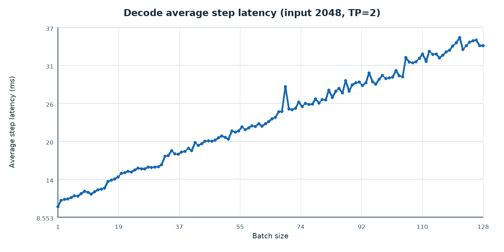
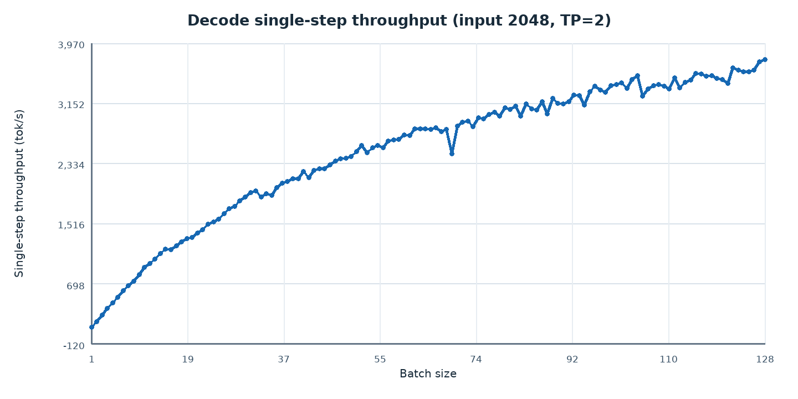
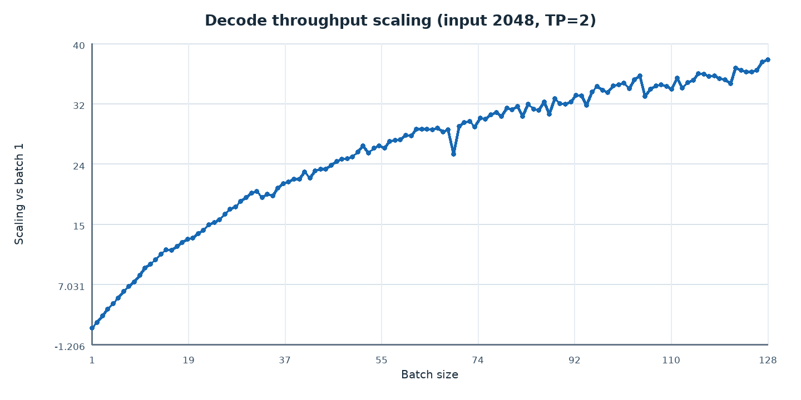

# Decode-Direct Input 2048 TP=2 性能报告

## 运行环境

| 项目 | 值 |
| --- | --- |
| 日期 | 2026-11-18 17:59:16-18:06:19（Asia/Shanghai） |
| 平台 | MetaX C500，64 GiB |
| 设备 | 2 x MetaX C500/C550，物理 GPU 3、4 |
| Driver / runtime | MetaX driver 3.3.12 / MACA 3.2.1.10 |
| InfiniLM build | 当前源码树；未记录独立 build ID |
| 模型 | `/data-aisoft/mechdancer/models/Qwen3-8B` |
| 模式 | `decode-direct` |
| Attention backend | `flash-attn` |
| Graph request | enabled |
| Expected execution mode | `graph` |
| Cache | paged KV cache，block size 256，num blocks 1,152 |
| Max batched tokens | 18,432 |
| Tensor parallel size | 2 |
| Input length | 2,048 tokens / request |
| Batch size | 1..128 |
| Warmup | 每个形状 3 次 repeat |
| Measured repeats | 每个形状 30 次 repeat |
| Batch 执行顺序 | random seed 2026 |
| 干扰控制 | 物理专用 GPU 3、4；每 10 秒采样 `mx-smi` |

本报告对应的原始 JSONL 和 log 为本机运行产物，不随仓库提交：

```text
../../../benchmark-decode-direct-metax-c500-tp2-qwen3-8b-input2048-batch1-128-clean-20261118.jsonl
../../../benchmark-decode-direct-metax-c500-tp2-qwen3-8b-input2048-batch1-128-clean-20261118.log
```

## 构建与测试命令

C++ 扩展使用当前源码构建并安装：

```bash
xmake build _infinilm && xmake install _infinilm
```

性能测试命令：

```bash
BENCHMARK_GPU=3,4 \
INFINILM_MAX_NUM_BATCHED_TOKENS=18432 \
BENCHMARK_MODE=decode-direct \
BATCH_SIZES="$(seq -s, 1 128)" \
INPUT_LENS=2048 \
BENCHMARK_REPEATS=30 \
BENCHMARK_OUTPUT=benchmark-decode-direct-metax-c500-tp2-qwen3-8b-input2048-batch1-128-clean-20261118.jsonl \
./run_bench-metax.sh
```


脚本说明：上述命令记录的是 2026-11-18 运行时的调用方式；当时本地 `run_bench-metax.sh` 硬编码 `--tp 2`。该脚本被仓库 `.gitignore` 忽略，不随本报告提交；如果后续脚本被改为其他 TP 值，复现前必须先确认或改回 `--tp 2`，并保持 `BENCHMARK_GPU=3,4`。

## 执行模式与 Graph 覆盖

当前 paged graph compiler 对 decode batch `1..128` 全部生成对应 graph；原始 JSONL 中所有 overall summary 的 `expected_execution_mode` 均为 `graph`，无 eager fallback 混入。
`expected_execution_mode` 是 benchmark 根据 compiler 规则推断的字段，不是 C++ runtime 回传的实际执行模式。

## 资源开销

| 项目 | 值 |
| --- | ---: |
| Workspace allocation | 每 rank 1,116.0 MiB，TP=2 合计 2,232.0 MiB |
| 权重加载时间 | 约 27.34 秒 |
| Paged cache blocks | 1,152 |
| 正式 repeat 数 | 3,840 |
| 正式 forward step 数 | 15,360 |
| 本轮总耗时 | 约 423.1 秒 |
| GPU 3/4 温度范围 | 30C-53C |
| GPU 3/4 功耗范围 | 95W-300W |
| GPU 3/4 进程显存峰值 | 36,106 MiB |

## 测试口径

- `decode-direct` 不执行语义完整的 prefill，paged KV cache 初始为全 0。
- Step 0 输入 dummy token；step 1 到 step 3 使用上一步 sampled token。
- 4 个 decode step 的 past KV length 分别为 2048、2049、2050、2051。
- 报告中的 duration 是单 step 时间，由一次 4-step repeat 的对应总耗时指标除以 4 得到。
- Throughput 是 single-step 吞吐：`batch_size / avg_step_duration_s`。
- 计时边界为 `engine_forward_including_sampling`，包含 Python wrapper、C++ engine forward、RankWorker forward、TP 通信、model forward/graph replay 和 sampling。
- 不包含 HTTP、JSON parsing、tokenization、scheduler queueing、`build_model_inputs`、detokenization 和 Python `generate()` 循环。
- 输出 token 不用于正确性判断。
- 分位数使用线性插值；每个 batch 30 个 repeat，p99 只能作为尾部参考。

## 核心结论

| 指标 | 结果 |
| --- | ---: |
| 最高 single-step 吞吐 | batch 128，3,751.00 tok/s |
| batch 128 平均单 step latency | 34.124 ms |
| batch 1 平均单 step latency | 10.070 ms |
| 最大 batch 128 平均单 step latency | 34.124 ms |
| 最大 batch 相对 batch 1 吞吐倍数 | 37.773x |

吞吐 Top 10 overall 结果：

| Batch | Avg Step ms | Single-step tok/s | Scaling |
| ---: | ---: | ---: | ---: |
| 128 | 34.124 | 3,751.00 | 37.773x |
| 127 | 34.130 | 3,721.06 | 37.472x |
| 122 | 33.579 | 3,633.27 | 36.588x |
| 123 | 34.117 | 3,605.25 | 36.305x |
| 126 | 34.979 | 3,602.16 | 36.274x |
| 125 | 34.871 | 3,584.61 | 36.097x |
| 124 | 34.631 | 3,580.64 | 36.058x |
| 115 | 32.323 | 3,557.80 | 35.828x |
| 116 | 32.693 | 3,548.17 | 35.731x |
| 104 | 29.471 | 3,528.88 | 35.536x |

## 趋势图

### 1. Batch size 与平均单 step latency



### 2. Batch size 与吞吐



### 3. Batch size 与吞吐 Scaling




平均单 step latency 从 batch 1 的 10.070 ms 增至 batch 128 的 34.124 ms。吞吐峰值为 batch 128 的 3,751.00 tok/s。

## Batch 区间平均 latency 与吞吐

下表按连续 16 个 batch 分组。`平均单 step latency ms` 和 `平均吞吐 tok/s` 分别是该区间内 batch 的 overall `Avg Step ms` 与 `Single-step tok/s` 的算术平均值；`区间最优 batch` 取该区间内吞吐最高的 batch。

| Batch 区间 | 平均单 step latency ms | 平均吞吐 tok/s | 区间最优 batch |
| --- | ---: | ---: | ---: |
| 1..16 | 11.953 | 688.43 | 15 |
| 17..32 | 15.430 | 1,578.45 | 32 |
| 33..48 | 18.855 | 2,141.98 | 48 |
| 49..64 | 21.572 | 2,615.29 | 62 |
| 65..80 | 25.122 | 2,886.71 | 79 |
| 81..96 | 27.987 | 3,161.54 | 96 |
| 97..112 | 30.858 | 3,387.38 | 104 |
| 113..128 | 33.862 | 3,558.31 | 128 |

区间平均 latency 随 batch size 整体增长；8 个区间中有 4 个区间的最优 batch 是区间右端点。偏离右端点的区间通常包含吞吐跳变或局部回落。

## 关键批次与跳变

下表列出吞吐下降幅度最大的相邻 batch 变化。

| Change | Avg step ms | Single-step tok/s | 吞吐变化 |
| --- | ---: | ---: | ---: |
| 68 -> 69 | 24.305 -> 28.007 | 2,797.81 -> 2,463.67 | -334.13 |
| 104 -> 105 | 29.471 -> 32.326 | 3,528.88 -> 3,248.19 | -280.69 |
| 86 -> 87 | 27.088 -> 28.892 | 3,174.84 -> 3,011.21 | -163.63 |
| 81 -> 82 | 26.016 -> 27.517 | 3,113.53 -> 2,980.01 | -133.52 |
| 111 -> 112 | 31.762 -> 33.308 | 3,494.73 -> 3,362.58 | -132.15 |

这些变化均在 graph 覆盖范围内，不能归因于 eager fallback。如需定位原因，应补充 kernel trace 或 C++ model-only 打点。

## Step 一致性

峰值 batch 128 的 4 个 decode step 结果如下：

| Step | Past KV length | Avg step ms | Std ms | Throughput tok/s |
| ---: | ---: | ---: | ---: | ---: |
| 0 | 2048 | 8.525 | 0.091 | 15,014.55 |
| 1 | 2049 | 8.517 | 0.076 | 15,028.30 |
| 2 | 2050 | 8.533 | 0.121 | 15,000.78 |
| 3 | 2051 | 8.549 | 0.167 | 14,972.55 |

所有 batch 中，4 个 step 平均耗时最大差异为 0.385 ms，出现在 batch 87。该差异主要来自 past KV length 增长以及不同 step 的 kernel 形状。

## 数据稳定性

- 128 个 overall summary换算为单 step 后的 std 中位数为 0.182 ms。
- 最大 std 为 5.898 ms，出现在 batch 87。
- 最大变异系数约 20.413%，中位变异系数约 0.807%。
- P50、P95、P99 和 max 普遍接近。
- 每个 batch 只有 30 个 repeat 样本；p99 可用于观察尾部，正式尾部对比建议提高到 100+ repeat。

## Single-step 完整结果

### Batch 1..64

| Batch | Mode | Avg Step ms | Min ms | P50 ms | P95 ms | P99 ms | Max ms | Std ms | Throughput tok/s | Scaling |
| ---: | --- | ---: | ---: | ---: | ---: | ---: | ---: | ---: | ---: | ---: |
| 1 | graph | 10.070 | 10.027 | 10.066 | 10.129 | 10.151 | 10.158 | 0.030 | 99.30 | 1.000x |
| 2 | graph | 11.038 | 10.604 | 11.002 | 11.539 | 11.664 | 11.691 | 0.254 | 181.19 | 1.825x |
| 3 | graph | 11.206 | 11.058 | 11.211 | 11.294 | 11.420 | 11.471 | 0.079 | 267.71 | 2.696x |
| 4 | graph | 11.228 | 10.984 | 11.128 | 11.547 | 12.367 | 12.692 | 0.306 | 356.27 | 3.588x |
| 5 | graph | 11.452 | 11.303 | 11.411 | 11.720 | 11.758 | 11.765 | 0.113 | 436.61 | 4.397x |
| 6 | graph | 11.699 | 11.370 | 11.540 | 12.088 | 13.359 | 13.875 | 0.464 | 512.84 | 5.164x |
| 7 | graph | 11.658 | 11.519 | 11.582 | 12.013 | 12.043 | 12.048 | 0.160 | 600.45 | 6.047x |
| 8 | graph | 12.011 | 11.461 | 11.790 | 13.511 | 14.382 | 14.653 | 0.678 | 666.04 | 6.707x |
| 9 | graph | 12.372 | 11.700 | 12.217 | 13.340 | 13.424 | 13.445 | 0.528 | 727.47 | 7.326x |
| 10 | graph | 12.218 | 12.031 | 12.123 | 12.700 | 13.746 | 14.064 | 0.380 | 818.46 | 8.242x |
| 11 | graph | 11.967 | 11.810 | 11.913 | 12.257 | 12.471 | 12.552 | 0.166 | 919.23 | 9.257x |
| 12 | graph | 12.342 | 12.253 | 12.329 | 12.446 | 12.524 | 12.555 | 0.061 | 972.29 | 9.791x |
| 13 | graph | 12.591 | 12.448 | 12.580 | 12.789 | 12.830 | 12.842 | 0.096 | 1,032.51 | 10.398x |
| 14 | graph | 12.684 | 12.331 | 12.664 | 13.033 | 13.066 | 13.071 | 0.184 | 1,103.76 | 11.115x |
| 15 | graph | 12.887 | 12.541 | 12.724 | 13.983 | 14.853 | 15.196 | 0.541 | 1,163.98 | 11.721x |
| 16 | graph | 13.831 | 13.688 | 13.810 | 13.991 | 14.039 | 14.055 | 0.095 | 1,156.80 | 11.649x |
| 17 | graph | 14.054 | 13.771 | 13.991 | 14.345 | 15.669 | 16.185 | 0.420 | 1,209.60 | 12.181x |
| 18 | graph | 14.202 | 13.919 | 14.163 | 14.426 | 15.180 | 15.434 | 0.250 | 1,267.46 | 12.763x |
| 19 | graph | 14.525 | 14.256 | 14.551 | 14.626 | 14.653 | 14.662 | 0.094 | 1,308.11 | 13.173x |
| 20 | graph | 15.054 | 14.874 | 15.049 | 15.190 | 15.269 | 15.297 | 0.085 | 1,328.51 | 13.378x |
| 21 | graph | 15.188 | 14.966 | 15.195 | 15.428 | 15.478 | 15.492 | 0.129 | 1,382.70 | 13.924x |
| 22 | graph | 15.362 | 15.218 | 15.343 | 15.596 | 15.638 | 15.652 | 0.101 | 1,432.08 | 14.421x |
| 23 | graph | 15.288 | 14.888 | 15.090 | 16.398 | 17.698 | 18.064 | 0.634 | 1,504.46 | 15.150x |
| 24 | graph | 15.600 | 15.460 | 15.598 | 15.712 | 15.730 | 15.735 | 0.074 | 1,538.50 | 15.493x |
| 25 | graph | 15.848 | 15.704 | 15.849 | 16.009 | 16.064 | 16.086 | 0.097 | 1,577.44 | 15.885x |
| 26 | graph | 15.730 | 15.369 | 15.687 | 16.021 | 16.876 | 17.208 | 0.325 | 1,652.85 | 16.644x |
| 27 | graph | 15.721 | 15.413 | 15.780 | 15.953 | 16.119 | 16.177 | 0.177 | 1,717.44 | 17.295x |
| 28 | graph | 15.986 | 15.642 | 15.925 | 16.189 | 17.604 | 18.163 | 0.430 | 1,751.56 | 17.638x |
| 29 | graph | 15.929 | 15.741 | 15.940 | 16.095 | 16.128 | 16.131 | 0.104 | 1,820.62 | 18.334x |
| 30 | graph | 16.014 | 15.898 | 15.994 | 16.122 | 16.232 | 16.271 | 0.078 | 1,873.41 | 18.865x |
| 31 | graph | 16.032 | 15.923 | 16.000 | 16.183 | 16.318 | 16.365 | 0.087 | 1,933.69 | 19.473x |
| 32 | graph | 16.354 | 16.057 | 16.275 | 16.726 | 17.115 | 17.273 | 0.254 | 1,956.77 | 19.705x |
| 33 | graph | 17.616 | 17.243 | 17.580 | 18.094 | 18.663 | 18.794 | 0.294 | 1,873.34 | 18.865x |
| 34 | graph | 17.728 | 17.339 | 17.654 | 18.255 | 19.120 | 19.372 | 0.363 | 1,917.83 | 19.313x |
| 35 | graph | 18.466 | 18.150 | 18.329 | 18.942 | 20.194 | 20.701 | 0.475 | 1,895.34 | 19.086x |
| 36 | graph | 17.991 | 17.567 | 17.724 | 19.394 | 19.734 | 19.744 | 0.578 | 2,000.98 | 20.150x |
| 37 | graph | 17.937 | 17.686 | 17.870 | 18.253 | 18.473 | 18.546 | 0.212 | 2,062.78 | 20.772x |
| 38 | graph | 18.219 | 18.103 | 18.204 | 18.297 | 18.413 | 18.460 | 0.066 | 2,085.71 | 21.003x |
| 39 | graph | 18.360 | 18.090 | 18.350 | 18.585 | 18.739 | 18.800 | 0.140 | 2,124.21 | 21.391x |
| 40 | graph | 18.834 | 18.700 | 18.812 | 18.975 | 19.150 | 19.218 | 0.103 | 2,123.77 | 21.387x |
| 41 | graph | 18.443 | 18.258 | 18.393 | 18.728 | 18.948 | 19.026 | 0.156 | 2,223.06 | 22.386x |
| 42 | graph | 19.651 | 19.408 | 19.611 | 19.824 | 20.615 | 20.914 | 0.253 | 2,137.26 | 21.523x |
| 43 | graph | 19.242 | 19.140 | 19.229 | 19.376 | 19.385 | 19.388 | 0.073 | 2,234.72 | 22.504x |
| 44 | graph | 19.492 | 19.360 | 19.451 | 19.732 | 19.817 | 19.829 | 0.113 | 2,257.32 | 22.732x |
| 45 | graph | 19.877 | 19.407 | 19.781 | 20.965 | 21.706 | 21.707 | 0.506 | 2,263.94 | 22.798x |
| 46 | graph | 19.912 | 19.748 | 19.916 | 20.091 | 20.131 | 20.146 | 0.100 | 2,310.12 | 23.263x |
| 47 | graph | 19.858 | 19.638 | 19.851 | 20.092 | 20.328 | 20.389 | 0.150 | 2,366.85 | 23.835x |
| 48 | graph | 20.046 | 19.838 | 20.063 | 20.320 | 20.553 | 20.594 | 0.165 | 2,394.46 | 24.113x |
| 49 | graph | 20.392 | 20.275 | 20.353 | 20.601 | 20.687 | 20.696 | 0.107 | 2,402.92 | 24.198x |
| 50 | graph | 20.633 | 20.340 | 20.510 | 21.321 | 21.646 | 21.779 | 0.353 | 2,423.34 | 24.403x |
| 51 | graph | 20.435 | 19.913 | 20.448 | 20.739 | 21.376 | 21.608 | 0.326 | 2,495.71 | 25.132x |
| 52 | graph | 20.189 | 20.050 | 20.145 | 20.483 | 20.537 | 20.546 | 0.129 | 2,575.65 | 25.937x |
| 53 | graph | 21.392 | 21.249 | 21.366 | 21.531 | 21.586 | 21.600 | 0.081 | 2,477.58 | 24.950x |
| 54 | graph | 21.209 | 21.098 | 21.199 | 21.371 | 21.424 | 21.434 | 0.083 | 2,546.08 | 25.639x |
| 55 | graph | 21.364 | 21.217 | 21.326 | 21.771 | 21.810 | 21.819 | 0.145 | 2,574.46 | 25.925x |
| 56 | graph | 21.987 | 21.345 | 21.639 | 23.481 | 25.755 | 26.671 | 1.023 | 2,546.96 | 25.648x |
| 57 | graph | 21.602 | 21.490 | 21.578 | 21.769 | 21.808 | 21.814 | 0.076 | 2,638.59 | 26.571x |
| 58 | graph | 21.829 | 21.447 | 21.763 | 22.231 | 22.440 | 22.524 | 0.212 | 2,657.05 | 26.757x |
| 59 | graph | 22.189 | 22.035 | 22.190 | 22.361 | 22.479 | 22.521 | 0.100 | 2,658.93 | 26.776x |
| 60 | graph | 22.074 | 21.825 | 22.071 | 22.467 | 22.582 | 22.609 | 0.180 | 2,718.12 | 27.372x |
| 61 | graph | 22.471 | 22.368 | 22.441 | 22.669 | 22.794 | 22.828 | 0.099 | 2,714.66 | 27.337x |
| 62 | graph | 22.090 | 21.858 | 22.054 | 22.418 | 22.480 | 22.485 | 0.147 | 2,806.72 | 28.264x |
| 63 | graph | 22.487 | 22.391 | 22.461 | 22.651 | 22.762 | 22.791 | 0.089 | 2,801.67 | 28.213x |
| 64 | graph | 22.806 | 22.251 | 22.615 | 23.723 | 25.070 | 25.609 | 0.627 | 2,806.25 | 28.259x |

### Batch 65..128

| Batch | Mode | Avg Step ms | Min ms | P50 ms | P95 ms | P99 ms | Max ms | Std ms | Throughput tok/s | Scaling |
| ---: | --- | ---: | ---: | ---: | ---: | ---: | ---: | ---: | ---: | ---: |
| 65 | graph | 23.226 | 22.889 | 23.068 | 23.867 | 24.208 | 24.302 | 0.345 | 2,798.56 | 28.182x |
| 66 | graph | 23.415 | 22.949 | 23.428 | 23.523 | 23.563 | 23.579 | 0.121 | 2,818.66 | 28.384x |
| 67 | graph | 24.230 | 23.971 | 24.214 | 24.463 | 24.491 | 24.494 | 0.120 | 2,765.21 | 27.846x |
| 68 | graph | 24.305 | 23.649 | 24.016 | 26.228 | 28.869 | 29.282 | 1.160 | 2,797.81 | 28.174x |
| 69 | graph | 28.007 | 24.746 | 27.650 | 32.540 | 33.392 | 33.529 | 1.940 | 2,463.67 | 24.810x |
| 70 | graph | 24.651 | 23.988 | 24.320 | 26.404 | 29.839 | 30.927 | 1.298 | 2,839.61 | 28.595x |
| 71 | graph | 24.551 | 24.442 | 24.533 | 24.700 | 24.761 | 24.772 | 0.079 | 2,891.90 | 29.122x |
| 72 | graph | 24.773 | 24.632 | 24.766 | 24.891 | 24.924 | 24.936 | 0.071 | 2,906.37 | 29.268x |
| 73 | graph | 25.736 | 25.607 | 25.733 | 25.885 | 25.940 | 25.948 | 0.085 | 2,836.44 | 28.563x |
| 74 | graph | 25.038 | 24.932 | 25.016 | 25.188 | 25.231 | 25.237 | 0.076 | 2,955.51 | 29.762x |
| 75 | graph | 25.484 | 25.075 | 25.525 | 25.642 | 25.695 | 25.715 | 0.162 | 2,943.03 | 29.637x |
| 76 | graph | 25.329 | 25.176 | 25.319 | 25.464 | 25.497 | 25.511 | 0.081 | 3,000.57 | 30.216x |
| 77 | graph | 25.386 | 24.926 | 25.420 | 25.646 | 25.720 | 25.735 | 0.203 | 3,033.21 | 30.545x |
| 78 | graph | 26.182 | 25.663 | 26.258 | 26.440 | 26.481 | 26.496 | 0.236 | 2,979.11 | 30.000x |
| 79 | graph | 25.562 | 25.261 | 25.452 | 26.027 | 26.953 | 27.300 | 0.379 | 3,090.53 | 31.122x |
| 80 | graph | 26.083 | 25.379 | 25.968 | 27.039 | 27.729 | 27.873 | 0.475 | 3,067.10 | 30.886x |
| 81 | graph | 26.016 | 25.847 | 26.012 | 26.147 | 26.177 | 26.183 | 0.080 | 3,113.53 | 31.354x |
| 82 | graph | 27.517 | 26.562 | 27.557 | 28.062 | 28.529 | 28.702 | 0.431 | 2,980.01 | 30.009x |
| 83 | graph | 26.373 | 25.752 | 26.364 | 26.648 | 26.718 | 26.720 | 0.172 | 3,147.22 | 31.693x |
| 84 | graph | 27.337 | 27.199 | 27.327 | 27.431 | 27.473 | 27.490 | 0.076 | 3,072.73 | 30.943x |
| 85 | graph | 27.770 | 27.498 | 27.765 | 27.980 | 28.225 | 28.319 | 0.155 | 3,060.81 | 30.823x |
| 86 | graph | 27.088 | 26.306 | 27.010 | 27.948 | 28.695 | 28.852 | 0.451 | 3,174.84 | 31.971x |
| 87 | graph | 28.892 | 27.050 | 27.587 | 32.444 | 52.579 | 59.727 | 5.898 | 3,011.21 | 30.323x |
| 88 | graph | 27.338 | 26.842 | 27.300 | 27.743 | 27.788 | 27.788 | 0.208 | 3,219.01 | 32.416x |
| 89 | graph | 28.256 | 28.066 | 28.216 | 28.441 | 28.454 | 28.458 | 0.105 | 3,149.74 | 31.718x |
| 90 | graph | 28.601 | 28.385 | 28.597 | 28.794 | 28.865 | 28.893 | 0.117 | 3,146.74 | 31.688x |
| 91 | graph | 28.678 | 27.526 | 27.740 | 35.460 | 38.346 | 39.058 | 2.724 | 3,173.20 | 31.955x |
| 92 | graph | 28.171 | 27.347 | 27.946 | 29.748 | 32.011 | 32.441 | 0.979 | 3,265.73 | 32.886x |
| 93 | graph | 28.574 | 28.306 | 28.577 | 28.734 | 28.771 | 28.783 | 0.106 | 3,254.69 | 32.775x |
| 94 | graph | 30.075 | 28.188 | 30.094 | 31.250 | 33.528 | 34.437 | 1.232 | 3,125.56 | 31.475x |
| 95 | graph | 28.728 | 27.964 | 28.487 | 29.482 | 29.660 | 29.715 | 0.528 | 3,306.87 | 33.301x |
| 96 | graph | 28.379 | 28.166 | 28.306 | 28.694 | 28.724 | 28.731 | 0.186 | 3,382.77 | 34.065x |
| 97 | graph | 29.129 | 28.832 | 29.091 | 29.467 | 29.568 | 29.596 | 0.206 | 3,330.02 | 33.534x |
| 98 | graph | 29.670 | 29.072 | 29.871 | 30.064 | 30.139 | 30.159 | 0.365 | 3,302.96 | 33.261x |
| 99 | graph | 29.199 | 29.033 | 29.178 | 29.317 | 29.702 | 29.855 | 0.144 | 3,390.57 | 34.143x |
| 100 | graph | 29.334 | 29.164 | 29.300 | 29.541 | 29.874 | 29.986 | 0.151 | 3,409.00 | 34.329x |
| 101 | graph | 29.433 | 28.871 | 29.373 | 29.969 | 30.068 | 30.095 | 0.269 | 3,431.58 | 34.556x |
| 102 | graph | 30.412 | 30.117 | 30.423 | 30.561 | 30.604 | 30.615 | 0.102 | 3,353.89 | 33.774x |
| 103 | graph | 29.641 | 29.489 | 29.613 | 29.837 | 29.847 | 29.850 | 0.102 | 3,474.92 | 34.993x |
| 104 | graph | 29.471 | 29.023 | 29.568 | 29.880 | 29.952 | 29.954 | 0.292 | 3,528.88 | 35.536x |
| 105 | graph | 32.326 | 31.195 | 32.180 | 33.270 | 34.129 | 34.423 | 0.657 | 3,248.19 | 32.710x |
| 106 | graph | 31.681 | 31.283 | 31.716 | 32.003 | 32.698 | 32.973 | 0.308 | 3,345.84 | 33.693x |
| 107 | graph | 31.563 | 31.422 | 31.551 | 31.728 | 31.741 | 31.743 | 0.077 | 3,390.07 | 34.138x |
| 108 | graph | 31.722 | 31.534 | 31.698 | 31.933 | 32.003 | 32.031 | 0.130 | 3,404.61 | 34.285x |
| 109 | graph | 32.221 | 31.952 | 32.251 | 32.340 | 32.362 | 32.371 | 0.103 | 3,382.86 | 34.066x |
| 110 | graph | 32.861 | 32.633 | 32.873 | 32.974 | 33.051 | 33.077 | 0.096 | 3,347.43 | 33.709x |
| 111 | graph | 31.762 | 31.487 | 31.634 | 32.201 | 32.289 | 32.300 | 0.253 | 3,494.73 | 35.192x |
| 112 | graph | 33.308 | 32.983 | 33.308 | 33.473 | 33.575 | 33.609 | 0.114 | 3,362.58 | 33.862x |
| 113 | graph | 32.838 | 32.270 | 32.816 | 33.283 | 33.988 | 34.246 | 0.346 | 3,441.18 | 34.653x |
| 114 | graph | 32.857 | 32.220 | 32.456 | 35.322 | 37.821 | 38.500 | 1.285 | 3,469.63 | 34.940x |
| 115 | graph | 32.323 | 31.883 | 32.395 | 32.770 | 32.956 | 33.017 | 0.321 | 3,557.80 | 35.828x |
| 116 | graph | 32.693 | 32.197 | 32.633 | 32.922 | 33.720 | 34.035 | 0.280 | 3,548.17 | 35.731x |
| 117 | graph | 33.208 | 33.049 | 33.211 | 33.298 | 33.347 | 33.359 | 0.056 | 3,523.26 | 35.480x |
| 118 | graph | 33.465 | 33.233 | 33.357 | 34.029 | 34.306 | 34.376 | 0.262 | 3,526.12 | 35.509x |
| 119 | graph | 34.058 | 33.128 | 33.488 | 34.609 | 45.423 | 49.523 | 2.894 | 3,494.00 | 35.185x |
| 120 | graph | 34.560 | 34.240 | 34.572 | 34.698 | 34.769 | 34.795 | 0.108 | 3,472.27 | 34.966x |
| 121 | graph | 35.354 | 34.543 | 35.684 | 36.094 | 36.201 | 36.221 | 0.573 | 3,422.53 | 34.465x |
| 122 | graph | 33.579 | 33.138 | 33.465 | 34.047 | 34.609 | 34.818 | 0.383 | 3,633.27 | 36.588x |
| 123 | graph | 34.117 | 33.846 | 34.065 | 34.500 | 34.552 | 34.552 | 0.192 | 3,605.25 | 36.305x |
| 124 | graph | 34.631 | 33.971 | 34.625 | 34.955 | 35.352 | 35.490 | 0.248 | 3,580.64 | 36.058x |
| 125 | graph | 34.871 | 34.426 | 34.642 | 35.564 | 39.019 | 40.305 | 1.042 | 3,584.61 | 36.097x |
| 126 | graph | 34.979 | 34.210 | 34.808 | 37.018 | 38.967 | 39.146 | 1.073 | 3,602.16 | 36.274x |
| 127 | graph | 34.130 | 33.753 | 34.034 | 34.575 | 34.599 | 34.601 | 0.293 | 3,721.06 | 37.472x |
| 128 | graph | 34.124 | 33.680 | 34.220 | 34.650 | 34.739 | 34.753 | 0.328 | 3,751.00 | 37.773x |

## 结果分析

1. 吞吐最高出现在 batch 128，为 3,751.00 tok/s。
2. 在本轮 batch `1..128` 范围内，吞吐在最大 batch 仍未回落；若资源允许，可继续扩大 batch 寻找饱和点。
3. 对比 MetaX TP=1 峰值 2,394.80 tok/s，本报告 TP=2 峰值为其 1.566x；占用两张卡后的每卡效率为 TP=1 的 0.783x。
4. 对比 NVIDIA A100 TP=2 峰值 4,873.34 tok/s，本报告峰值约为其 0.770x。
5. 正式 p99 对比建议将 `BENCHMARK_REPEATS` 提高到 100 或以上。

## 结论与建议

1. 在本轮 input length 2048、TP=2、batch `1..128` 范围内，**batch 128 吞吐最高**，约 3,751.00 tok/s。
2. batch 128 平均单 step latency 为 34.124 ms。
3. TP=2 相对 TP=1 提高总吞吐，但每卡效率低于 TP=1；是否采用 TP=2 应结合 SLO、总吞吐、时延和部署密度评估。
4. 所有样本均在专用 GPU 3、4 上采集；监控期间目标卡没有外来进程或多进程干扰。

## 数据完整性

```text
config records: 1
sample records: 15,360
overall summary records: 128
step summary records: 640
scaling records: 128
samples per batch: 30
expected execution modes: all graph
```
