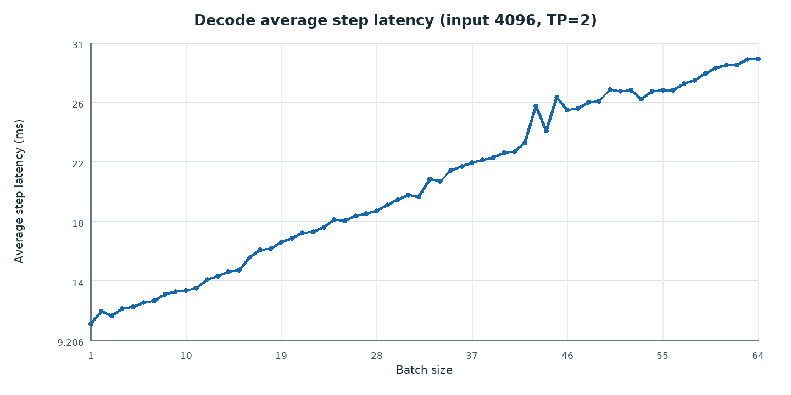
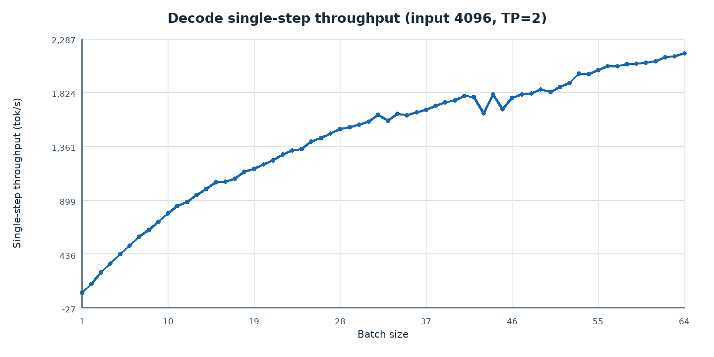
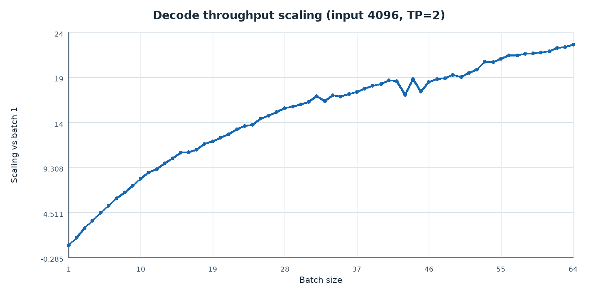

# Decode-Direct Input 4096 TP=2 性能报告

## 运行环境

| 项目 | 值 |
| --- | --- |
| 日期 | 2026-11-18 18:06:37-18:09:48（Asia/Shanghai） |
| 平台 | MetaX C500，64 GiB |
| 设备 | 2 x MetaX C500/C550，物理 GPU 3、4 |
| Driver / runtime | MetaX driver 3.3.12 / MACA 3.2.1.10 |
| InfiniLM build | 当前源码树；未记录独立 build ID |
| 模型 | `/data-aisoft/mechdancer/models/Qwen3-8B` |
| 模式 | `decode-direct` |
| Attention backend | `flash-attn` |
| Graph request | enabled |
| Expected execution mode | `graph` |
| Cache | paged KV cache，block size 256，num blocks 1,088 |
| Max batched tokens | 18,432 |
| Tensor parallel size | 2 |
| Input length | 4,096 tokens / request |
| Batch size | 1..64 |
| Warmup | 每个形状 3 次 repeat |
| Measured repeats | 每个形状 30 次 repeat |
| Batch 执行顺序 | random seed 2026 |
| 干扰控制 | 物理专用 GPU 3、4；每 10 秒采样 `mx-smi` |

本报告对应的原始 JSONL 和 log 为本机运行产物，不随仓库提交：

```text
../../../benchmark-decode-direct-metax-c500-tp2-qwen3-8b-input4096-batch1-64-clean-20261118.jsonl
../../../benchmark-decode-direct-metax-c500-tp2-qwen3-8b-input4096-batch1-64-clean-20261118.log
```

## 构建与测试命令

C++ 扩展使用当前源码构建并安装：

```bash
xmake build _infinilm && xmake install _infinilm
```

性能测试命令：

```bash
BENCHMARK_GPU=3,4 \
INFINILM_MAX_NUM_BATCHED_TOKENS=18432 \
BENCHMARK_MODE=decode-direct \
BATCH_SIZES="$(seq -s, 1 64)" \
INPUT_LENS=4096 \
BENCHMARK_REPEATS=30 \
BENCHMARK_OUTPUT=benchmark-decode-direct-metax-c500-tp2-qwen3-8b-input4096-batch1-64-clean-20261118.jsonl \
./run_bench-metax.sh
```


脚本说明：上述命令记录的是 2026-11-18 运行时的调用方式；当时本地 `run_bench-metax.sh` 硬编码 `--tp 2`。该脚本被仓库 `.gitignore` 忽略，不随本报告提交；如果后续脚本被改为其他 TP 值，复现前必须先确认或改回 `--tp 2`，并保持 `BENCHMARK_GPU=3,4`。

## 执行模式与 Graph 覆盖

当前 paged graph compiler 对 decode batch `1..64` 全部生成对应 graph；原始 JSONL 中所有 overall summary 的 `expected_execution_mode` 均为 `graph`，无 eager fallback 混入。
`expected_execution_mode` 是 benchmark 根据 compiler 规则推断的字段，不是 C++ runtime 回传的实际执行模式。

## 资源开销

| 项目 | 值 |
| --- | ---: |
| Workspace allocation | 每 rank 1,116.0 MiB，TP=2 合计 2,232.0 MiB |
| 权重加载时间 | 约 17.27 秒 |
| Paged cache blocks | 1,088 |
| 正式 repeat 数 | 1,920 |
| 正式 forward step 数 | 7,680 |
| 本轮总耗时 | 约 191.9 秒 |
| GPU 3/4 温度范围 | 30C-53C |
| GPU 3/4 功耗范围 | 95W-300W |
| GPU 3/4 进程显存峰值 | 36,106 MiB |

## 测试口径

- `decode-direct` 不执行语义完整的 prefill，paged KV cache 初始为全 0。
- Step 0 输入 dummy token；step 1 到 step 3 使用上一步 sampled token。
- 4 个 decode step 的 past KV length 分别为 4096、4097、4098、4099。
- 报告中的 duration 是单 step 时间，由一次 4-step repeat 的对应总耗时指标除以 4 得到。
- Throughput 是 single-step 吞吐：`batch_size / avg_step_duration_s`。
- 计时边界为 `engine_forward_including_sampling`，包含 Python wrapper、C++ engine forward、RankWorker forward、TP 通信、model forward/graph replay 和 sampling。
- 不包含 HTTP、JSON parsing、tokenization、scheduler queueing、`build_model_inputs`、detokenization 和 Python `generate()` 循环。
- 输出 token 不用于正确性判断。
- 分位数使用线性插值；每个 batch 30 个 repeat，p99 只能作为尾部参考。

## 核心结论

| 指标 | 结果 |
| --- | ---: |
| 最高 single-step 吞吐 | batch 64，2,163.46 tok/s |
| batch 64 平均单 step latency | 29.582 ms |
| batch 1 平均单 step latency | 10.359 ms |
| 最大 batch 64 平均单 step latency | 29.582 ms |
| 最大 batch 相对 batch 1 吞吐倍数 | 22.411x |

吞吐 Top 10 overall 结果：

| Batch | Avg Step ms | Single-step tok/s | Scaling |
| ---: | ---: | ---: | ---: |
| 64 | 29.582 | 2,163.46 | 22.411x |
| 63 | 29.517 | 2,134.37 | 22.110x |
| 62 | 29.118 | 2,129.29 | 22.057x |
| 61 | 29.140 | 2,093.34 | 21.685x |
| 60 | 28.870 | 2,078.28 | 21.529x |
| 59 | 28.475 | 2,071.98 | 21.464x |
| 58 | 28.034 | 2,068.92 | 21.432x |
| 56 | 27.286 | 2,052.37 | 21.261x |
| 57 | 27.790 | 2,051.10 | 21.247x |
| 55 | 27.305 | 2,014.27 | 20.866x |

## 趋势图

### 1. Batch size 与平均单 step latency



### 2. Batch size 与吞吐



### 3. Batch size 与吞吐 Scaling




平均单 step latency 从 batch 1 的 10.359 ms 增至 batch 64 的 29.582 ms。吞吐峰值为 batch 64 的 2,163.46 tok/s。

## Batch 区间平均 latency 与吞吐

下表按连续 16 个 batch 分组。`平均单 step latency ms` 和 `平均吞吐 tok/s` 分别是该区间内 batch 的 overall `Avg Step ms` 与 `Single-step tok/s` 的算术平均值；`区间最优 batch` 取该区间内吞吐最高的 batch。

| Batch 区间 | 平均单 step latency ms | 平均吞吐 tok/s | 区间最优 batch |
| --- | ---: | ---: | ---: |
| 1..16 | 12.606 | 644.00 | 16 |
| 17..32 | 17.773 | 1,367.03 | 32 |
| 33..48 | 23.521 | 1,718.55 | 48 |
| 49..64 | 27.961 | 2,017.75 | 64 |

区间平均 latency 随 batch size 整体增长；4 个区间中有 4 个区间的最优 batch 是区间右端点。偏离右端点的区间通常包含吞吐跳变或局部回落。

## 关键批次与跳变

下表列出吞吐下降幅度最大的相邻 batch 变化。

| Change | Avg step ms | Single-step tok/s | 吞吐变化 |
| --- | ---: | ---: | ---: |
| 42 -> 43 | 23.494 -> 26.159 | 1,787.66 -> 1,643.80 | -143.85 |
| 44 -> 45 | 24.346 -> 26.790 | 1,807.28 -> 1,679.76 | -127.52 |
| 32 -> 33 | 19.591 -> 20.874 | 1,633.42 -> 1,580.90 | -52.52 |
| 49 -> 50 | 26.500 -> 27.330 | 1,849.05 -> 1,829.49 | -19.56 |
| 34 -> 35 | 20.723 -> 21.492 | 1,640.70 -> 1,628.50 | -12.20 |

这些变化均在 graph 覆盖范围内，不能归因于 eager fallback。如需定位原因，应补充 kernel trace 或 C++ model-only 打点。

## Step 一致性

峰值 batch 64 的 4 个 decode step 结果如下：

| Step | Past KV length | Avg step ms | Std ms | Throughput tok/s |
| ---: | ---: | ---: | ---: | ---: |
| 0 | 4096 | 7.395 | 0.060 | 8,654.36 |
| 1 | 4097 | 7.395 | 0.032 | 8,654.07 |
| 2 | 4098 | 7.394 | 0.026 | 8,655.33 |
| 3 | 4099 | 7.397 | 0.024 | 8,651.61 |

所有 batch 中，4 个 step 平均耗时最大差异为 0.113 ms，出现在 batch 20。该差异主要来自 past KV length 增长以及不同 step 的 kernel 形状。

## 数据稳定性

- 64 个 overall summary换算为单 step 后的 std 中位数为 0.139 ms。
- 最大 std 为 1.216 ms，出现在 batch 50。
- 最大变异系数约 4.449%，中位变异系数约 0.679%。
- P50、P95、P99 和 max 普遍接近。
- 每个 batch 只有 30 个 repeat 样本；p99 可用于观察尾部，正式尾部对比建议提高到 100+ repeat。

## Single-step 完整结果

### Batch 1..64

| Batch | Mode | Avg Step ms | Min ms | P50 ms | P95 ms | P99 ms | Max ms | Std ms | Throughput tok/s | Scaling |
| ---: | --- | ---: | ---: | ---: | ---: | ---: | ---: | ---: | ---: | ---: |
| 1 | graph | 10.359 | 10.174 | 10.343 | 10.533 | 10.841 | 10.965 | 0.164 | 96.53 | 1.000x |
| 2 | graph | 11.275 | 10.855 | 11.130 | 11.889 | 12.489 | 12.730 | 0.382 | 177.38 | 1.837x |
| 3 | graph | 10.990 | 10.910 | 10.943 | 11.235 | 11.258 | 11.259 | 0.107 | 272.97 | 2.828x |
| 4 | graph | 11.471 | 11.323 | 11.442 | 11.758 | 11.801 | 11.808 | 0.111 | 348.70 | 3.612x |
| 5 | graph | 11.604 | 11.314 | 11.693 | 11.745 | 11.759 | 11.764 | 0.153 | 430.88 | 4.463x |
| 6 | graph | 11.915 | 11.840 | 11.899 | 12.024 | 12.206 | 12.266 | 0.080 | 503.56 | 5.216x |
| 7 | graph | 12.038 | 11.850 | 11.908 | 12.478 | 12.754 | 12.838 | 0.240 | 581.49 | 6.024x |
| 8 | graph | 12.510 | 12.405 | 12.470 | 12.750 | 13.010 | 13.068 | 0.135 | 639.50 | 6.625x |
| 9 | graph | 12.702 | 12.593 | 12.702 | 12.786 | 12.831 | 12.840 | 0.051 | 708.56 | 7.340x |
| 10 | graph | 12.813 | 12.665 | 12.714 | 13.083 | 13.354 | 13.459 | 0.187 | 780.45 | 8.085x |
| 11 | graph | 12.977 | 12.896 | 12.964 | 13.107 | 13.238 | 13.283 | 0.077 | 847.66 | 8.781x |
| 12 | graph | 13.607 | 13.477 | 13.587 | 13.726 | 13.882 | 13.938 | 0.080 | 881.90 | 9.136x |
| 13 | graph | 13.835 | 13.687 | 13.802 | 13.896 | 14.619 | 14.910 | 0.206 | 939.66 | 9.734x |
| 14 | graph | 14.155 | 14.035 | 14.145 | 14.278 | 14.340 | 14.356 | 0.071 | 989.07 | 10.246x |
| 15 | graph | 14.270 | 14.093 | 14.242 | 14.559 | 14.565 | 14.566 | 0.152 | 1,051.12 | 10.889x |
| 16 | graph | 15.173 | 15.089 | 15.175 | 15.272 | 15.342 | 15.357 | 0.058 | 1,054.51 | 10.924x |
| 17 | graph | 15.737 | 15.661 | 15.727 | 15.825 | 15.867 | 15.883 | 0.048 | 1,080.29 | 11.191x |
| 18 | graph | 15.800 | 15.594 | 15.689 | 16.550 | 16.957 | 16.983 | 0.328 | 1,139.21 | 11.801x |
| 19 | graph | 16.297 | 16.201 | 16.281 | 16.423 | 16.460 | 16.473 | 0.060 | 1,165.88 | 12.077x |
| 20 | graph | 16.592 | 16.244 | 16.382 | 17.432 | 18.825 | 19.223 | 0.586 | 1,205.37 | 12.486x |
| 21 | graph | 16.958 | 16.845 | 16.960 | 17.038 | 17.046 | 17.049 | 0.045 | 1,238.38 | 12.828x |
| 22 | graph | 17.034 | 16.713 | 17.117 | 17.176 | 17.255 | 17.286 | 0.163 | 1,291.53 | 13.379x |
| 23 | graph | 17.364 | 17.184 | 17.298 | 17.568 | 18.392 | 18.722 | 0.275 | 1,324.55 | 13.721x |
| 24 | graph | 17.922 | 17.840 | 17.915 | 18.019 | 18.026 | 18.027 | 0.045 | 1,339.11 | 13.872x |
| 25 | graph | 17.846 | 17.654 | 17.774 | 18.142 | 18.184 | 18.191 | 0.169 | 1,400.90 | 14.512x |
| 26 | graph | 18.185 | 18.114 | 18.185 | 18.269 | 18.297 | 18.303 | 0.044 | 1,429.77 | 14.811x |
| 27 | graph | 18.368 | 18.227 | 18.336 | 18.624 | 18.658 | 18.668 | 0.120 | 1,469.95 | 15.227x |
| 28 | graph | 18.561 | 18.318 | 18.490 | 18.763 | 18.811 | 18.825 | 0.153 | 1,508.56 | 15.627x |
| 29 | graph | 19.004 | 18.900 | 19.002 | 19.082 | 19.166 | 19.197 | 0.063 | 1,525.99 | 15.808x |
| 30 | graph | 19.414 | 19.253 | 19.421 | 19.599 | 19.671 | 19.678 | 0.102 | 1,545.31 | 16.008x |
| 31 | graph | 19.693 | 19.220 | 19.701 | 19.777 | 19.954 | 20.018 | 0.114 | 1,574.20 | 16.307x |
| 32 | graph | 19.591 | 19.316 | 19.605 | 19.706 | 19.734 | 19.738 | 0.084 | 1,633.42 | 16.921x |
| 33 | graph | 20.874 | 20.758 | 20.857 | 20.968 | 21.028 | 21.051 | 0.069 | 1,580.90 | 16.377x |
| 34 | graph | 20.723 | 20.452 | 20.618 | 21.033 | 21.111 | 21.138 | 0.209 | 1,640.70 | 16.996x |
| 35 | graph | 21.492 | 21.432 | 21.480 | 21.544 | 21.693 | 21.751 | 0.055 | 1,628.50 | 16.870x |
| 36 | graph | 21.797 | 21.698 | 21.776 | 21.934 | 21.993 | 21.995 | 0.072 | 1,651.61 | 17.109x |
| 37 | graph | 22.075 | 21.985 | 22.083 | 22.166 | 22.193 | 22.199 | 0.055 | 1,676.11 | 17.363x |
| 38 | graph | 22.252 | 22.055 | 22.243 | 22.423 | 22.500 | 22.528 | 0.117 | 1,707.72 | 17.690x |
| 39 | graph | 22.420 | 22.247 | 22.443 | 22.616 | 22.648 | 22.658 | 0.107 | 1,739.55 | 18.020x |
| 40 | graph | 22.771 | 22.393 | 22.784 | 22.928 | 23.202 | 23.306 | 0.156 | 1,756.64 | 18.197x |
| 41 | graph | 22.857 | 22.441 | 22.910 | 22.993 | 23.224 | 23.304 | 0.180 | 1,793.74 | 18.581x |
| 42 | graph | 23.494 | 23.352 | 23.457 | 23.791 | 23.879 | 23.905 | 0.134 | 1,787.66 | 18.518x |
| 43 | graph | 26.159 | 25.460 | 26.074 | 27.025 | 27.178 | 27.233 | 0.407 | 1,643.80 | 17.028x |
| 44 | graph | 24.346 | 23.875 | 24.330 | 24.669 | 24.806 | 24.807 | 0.168 | 1,807.28 | 18.722x |
| 45 | graph | 26.790 | 25.584 | 26.450 | 28.560 | 28.602 | 28.605 | 1.105 | 1,679.76 | 17.401x |
| 46 | graph | 25.867 | 25.745 | 25.824 | 26.257 | 26.323 | 26.344 | 0.144 | 1,778.30 | 18.421x |
| 47 | graph | 25.990 | 25.697 | 26.082 | 26.241 | 26.325 | 26.340 | 0.197 | 1,808.36 | 18.733x |
| 48 | graph | 26.430 | 26.351 | 26.411 | 26.558 | 26.622 | 26.637 | 0.063 | 1,816.13 | 18.813x |
| 49 | graph | 26.500 | 26.086 | 26.567 | 26.684 | 26.736 | 26.738 | 0.177 | 1,849.05 | 19.154x |
| 50 | graph | 27.330 | 26.309 | 26.960 | 30.378 | 30.971 | 31.151 | 1.216 | 1,829.49 | 18.952x |
| 51 | graph | 27.238 | 26.709 | 27.181 | 27.546 | 29.239 | 29.883 | 0.527 | 1,872.38 | 19.396x |
| 52 | graph | 27.297 | 26.910 | 27.392 | 27.645 | 27.676 | 27.678 | 0.251 | 1,904.98 | 19.734x |
| 53 | graph | 26.675 | 26.405 | 26.627 | 26.997 | 27.032 | 27.040 | 0.202 | 1,986.90 | 20.582x |
| 54 | graph | 27.220 | 26.850 | 27.196 | 27.578 | 27.712 | 27.754 | 0.190 | 1,983.86 | 20.551x |
| 55 | graph | 27.305 | 26.940 | 27.288 | 27.475 | 27.560 | 27.586 | 0.102 | 2,014.27 | 20.866x |
| 56 | graph | 27.286 | 27.073 | 27.217 | 27.803 | 27.949 | 27.953 | 0.221 | 2,052.37 | 21.261x |
| 57 | graph | 27.790 | 27.690 | 27.757 | 27.935 | 27.962 | 27.971 | 0.074 | 2,051.10 | 21.247x |
| 58 | graph | 28.034 | 27.559 | 27.914 | 29.240 | 30.177 | 30.256 | 0.588 | 2,068.92 | 21.432x |
| 59 | graph | 28.475 | 28.005 | 28.511 | 28.671 | 28.783 | 28.826 | 0.184 | 2,071.98 | 21.464x |
| 60 | graph | 28.870 | 28.656 | 28.751 | 29.367 | 29.438 | 29.464 | 0.249 | 2,078.28 | 21.529x |
| 61 | graph | 29.140 | 28.942 | 29.142 | 29.271 | 29.386 | 29.431 | 0.096 | 2,093.34 | 21.685x |
| 62 | graph | 29.118 | 28.759 | 29.057 | 29.501 | 29.503 | 29.503 | 0.241 | 2,129.29 | 22.057x |
| 63 | graph | 29.517 | 29.402 | 29.492 | 29.695 | 29.706 | 29.710 | 0.089 | 2,134.37 | 22.110x |
| 64 | graph | 29.582 | 29.485 | 29.551 | 29.712 | 29.861 | 29.909 | 0.093 | 2,163.46 | 22.411x |

## 结果分析

1. 吞吐最高出现在 batch 64，为 2,163.46 tok/s。
2. 在本轮 batch `1..64` 范围内，吞吐在最大 batch 仍未回落；若资源允许，可继续扩大 batch 寻找饱和点。
3. 对比 MetaX TP=1 峰值 1,339.42 tok/s，本报告 TP=2 峰值为其 1.615x；占用两张卡后的每卡效率为 TP=1 的 0.808x。
4. 对比 NVIDIA A100 TP=2 峰值 2,731.98 tok/s，本报告峰值约为其 0.792x。
5. 正式 p99 对比建议将 `BENCHMARK_REPEATS` 提高到 100 或以上。

## 结论与建议

1. 在本轮 input length 4096、TP=2、batch `1..64` 范围内，**batch 64 吞吐最高**，约 2,163.46 tok/s。
2. batch 64 平均单 step latency 为 29.582 ms。
3. TP=2 相对 TP=1 提高总吞吐，但每卡效率低于 TP=1；是否采用 TP=2 应结合 SLO、总吞吐、时延和部署密度评估。
4. 所有样本均在专用 GPU 3、4 上采集；监控期间目标卡没有外来进程或多进程干扰。

## 数据完整性

```text
config records: 1
sample records: 7,680
overall summary records: 64
step summary records: 320
scaling records: 64
samples per batch: 30
expected execution modes: all graph
```
