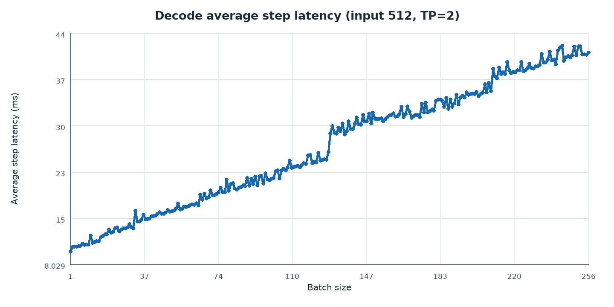
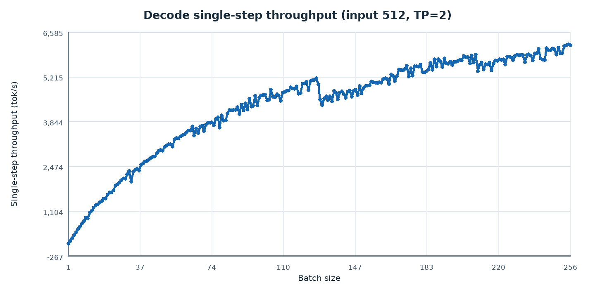
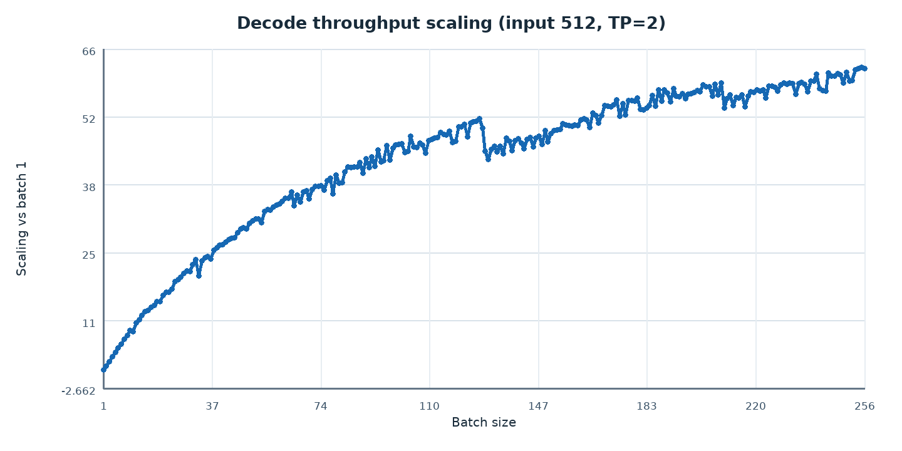

# Decode-Direct Input 512 TP=2 性能报告

## 运行环境

| 项目 | 值 |
| --- | --- |
| 日期 | 2026-11-18 17:24:38-17:40:32（Asia/Shanghai） |
| 平台 | MetaX C500，64 GiB |
| 设备 | 2 x MetaX C500/C550，物理 GPU 3、4 |
| Driver / runtime | MetaX driver 3.3.12 / MACA 3.2.1.10 |
| InfiniLM build | 当前源码树；未记录独立 build ID |
| 模型 | `/data-aisoft/mechdancer/models/Qwen3-8B` |
| 模式 | `decode-direct` |
| Attention backend | `flash-attn` |
| Graph request | enabled |
| Expected execution mode | `graph` |
| Cache | paged KV cache，block size 256，num blocks 768 |
| Max batched tokens | 18,432 |
| Tensor parallel size | 2 |
| Input length | 512 tokens / request |
| Batch size | 1..256 |
| Warmup | 每个形状 3 次 repeat |
| Measured repeats | 每个形状 30 次 repeat |
| Batch 执行顺序 | random seed 2026 |
| 干扰控制 | 物理专用 GPU 3、4；每 10 秒采样 `mx-smi` |

本报告对应的原始 JSONL 和 log 为本机运行产物，不随仓库提交：

```text
../../../benchmark-decode-direct-metax-c500-tp2-qwen3-8b-input512-batch1-256-clean-20261118.jsonl
../../../benchmark-decode-direct-metax-c500-tp2-qwen3-8b-input512-batch1-256-clean-20261118.log
```

## 构建与测试命令

C++ 扩展使用当前源码构建并安装：

```bash
xmake build _infinilm && xmake install _infinilm
```

性能测试命令：

```bash
BENCHMARK_GPU=3,4 \
INFINILM_MAX_NUM_BATCHED_TOKENS=18432 \
BENCHMARK_MODE=decode-direct \
BATCH_SIZES="$(seq -s, 1 256)" \
INPUT_LENS=512 \
BENCHMARK_REPEATS=30 \
BENCHMARK_OUTPUT=benchmark-decode-direct-metax-c500-tp2-qwen3-8b-input512-batch1-256-clean-20261118.jsonl \
./run_bench-metax.sh
```


脚本说明：上述命令记录的是 2026-11-18 运行时的调用方式；当时本地 `run_bench-metax.sh` 硬编码 `--tp 2`。该脚本被仓库 `.gitignore` 忽略，不随本报告提交；如果后续脚本被改为其他 TP 值，复现前必须先确认或改回 `--tp 2`，并保持 `BENCHMARK_GPU=3,4`。

## 执行模式与 Graph 覆盖

当前 paged graph compiler 对 decode batch `1..256` 全部生成对应 graph；原始 JSONL 中所有 overall summary 的 `expected_execution_mode` 均为 `graph`，无 eager fallback 混入。
`expected_execution_mode` 是 benchmark 根据 compiler 规则推断的字段，不是 C++ runtime 回传的实际执行模式。

## 资源开销

| 项目 | 值 |
| --- | ---: |
| Workspace allocation | 每 rank 1,116.0 MiB，TP=2 合计 2,232.0 MiB |
| 权重加载时间 | 约 52.85 秒 |
| Paged cache blocks | 768 |
| 正式 repeat 数 | 7,680 |
| 正式 forward step 数 | 30,720 |
| 本轮总耗时 | 约 954.9 秒 |
| GPU 3/4 温度范围 | 30C-53C |
| GPU 3/4 功耗范围 | 95W-300W |
| GPU 3/4 进程显存峰值 | 36,106 MiB |

## 测试口径

- `decode-direct` 不执行语义完整的 prefill，paged KV cache 初始为全 0。
- Step 0 输入 dummy token；step 1 到 step 3 使用上一步 sampled token。
- 4 个 decode step 的 past KV length 分别为 512、513、514、515。
- 报告中的 duration 是单 step 时间，由一次 4-step repeat 的对应总耗时指标除以 4 得到。
- Throughput 是 single-step 吞吐：`batch_size / avg_step_duration_s`。
- 计时边界为 `engine_forward_including_sampling`，包含 Python wrapper、C++ engine forward、RankWorker forward、TP 通信、model forward/graph replay 和 sampling。
- 不包含 HTTP、JSON parsing、tokenization、scheduler queueing、`build_model_inputs`、detokenization 和 Python `generate()` 循环。
- 输出 token 不用于正确性判断。
- 分位数使用线性插值；每个 batch 30 个 repeat，p99 只能作为尾部参考。

## 核心结论

| 指标 | 结果 |
| --- | ---: |
| 最高 single-step 吞吐 | batch 255，6,218.21 tok/s |
| batch 255 平均单 step latency | 41.009 ms |
| batch 1 平均单 step latency | 9.976 ms |
| 最大 batch 256 平均单 step latency | 41.346 ms |
| 最大 batch 相对 batch 1 吞吐倍数 | 61.769x |

吞吐 Top 10 overall 结果：

| Batch | Avg Step ms | Single-step tok/s | Scaling |
| ---: | ---: | ---: | ---: |
| 255 | 41.009 | 6,218.21 | 62.034x |
| 256 | 41.346 | 6,191.70 | 61.769x |
| 254 | 41.090 | 6,181.62 | 61.669x |
| 253 | 41.027 | 6,166.72 | 61.520x |
| 250 | 40.929 | 6,108.10 | 60.935x |
| 244 | 40.044 | 6,093.37 | 60.788x |
| 247 | 40.605 | 6,082.98 | 60.685x |
| 240 | 39.504 | 6,075.32 | 60.608x |
| 248 | 40.917 | 6,061.00 | 60.465x |
| 245 | 40.612 | 6,032.66 | 60.183x |

## 趋势图

### 1. Batch size 与平均单 step latency



### 2. Batch size 与吞吐



### 3. Batch size 与吞吐 Scaling




平均单 step latency 从 batch 1 的 9.976 ms 增至 batch 256 的 41.346 ms。吞吐峰值为 batch 255 的 6,218.21 tok/s。

## Batch 区间平均 latency 与吞吐

下表按连续 16 个 batch 分组。`平均单 step latency ms` 和 `平均吞吐 tok/s` 分别是该区间内 batch 的 overall `Avg Step ms` 与 `Single-step tok/s` 的算术平均值；`区间最优 batch` 取该区间内吞吐最高的 batch。

| Batch 区间 | 平均单 step latency ms | 平均吞吐 tok/s | 区间最优 batch |
| --- | ---: | ---: | ---: |
| 1..16 | 11.252 | 738.91 | 16 |
| 17..32 | 13.440 | 1,814.91 | 32 |
| 33..48 | 15.602 | 2,593.08 | 48 |
| 49..64 | 17.002 | 3,319.54 | 64 |
| 65..80 | 19.356 | 3,744.42 | 79 |
| 81..96 | 20.785 | 4,257.92 | 96 |
| 97..112 | 22.593 | 4,625.90 | 104 |
| 113..128 | 24.377 | 4,943.68 | 127 |
| 129..144 | 29.522 | 4,624.32 | 144 |
| 145..160 | 31.089 | 4,905.95 | 155 |
| 161..176 | 31.884 | 5,286.61 | 173 |
| 177..192 | 33.229 | 5,554.09 | 192 |
| 193..208 | 35.025 | 5,724.63 | 208 |
| 209..224 | 38.459 | 5,630.31 | 224 |
| 225..240 | 39.678 | 5,860.33 | 240 |
| 241..256 | 41.343 | 6,012.62 | 255 |

区间平均 latency 随 batch size 整体增长；16 个区间中有 10 个区间的最优 batch 是区间右端点。偏离右端点的区间通常包含吞吐跳变或局部回落。

## 关键批次与跳变

下表列出吞吐下降幅度最大的相邻 batch 变化。

| Change | Avg step ms | Single-step tok/s | 吞吐变化 |
| --- | ---: | ---: | ---: |
| 208 -> 209 | 35.279 -> 38.792 | 5,895.81 -> 5,387.68 | -508.13 |
| 128 -> 129 | 25.695 -> 28.589 | 4,981.42 -> 4,512.18 | -469.24 |
| 32 -> 33 | 13.692 -> 16.435 | 2,337.05 -> 2,007.92 | -329.13 |
| 173 -> 174 | 31.175 -> 33.260 | 5,549.31 -> 5,231.50 | -317.81 |
| 77 -> 78 | 19.402 -> 21.315 | 3,968.71 -> 3,659.45 | -309.25 |

这些变化均在 graph 覆盖范围内，不能归因于 eager fallback。如需定位原因，应补充 kernel trace 或 C++ model-only 打点。

## Step 一致性

峰值 batch 255 的 4 个 decode step 结果如下：

| Step | Past KV length | Avg step ms | Std ms | Throughput tok/s |
| ---: | ---: | ---: | ---: | ---: |
| 0 | 512 | 10.250 | 0.084 | 24,879.01 |
| 1 | 513 | 10.263 | 0.103 | 24,847.74 |
| 2 | 514 | 10.250 | 0.094 | 24,877.27 |
| 3 | 515 | 10.246 | 0.085 | 24,887.39 |

所有 batch 中，4 个 step 平均耗时最大差异为 0.222 ms，出现在 batch 217。该差异主要来自 past KV length 增长以及不同 step 的 kernel 形状。

## 数据稳定性

- 256 个 overall summary换算为单 step 后的 std 中位数为 0.192 ms。
- 最大 std 为 1.839 ms，出现在 batch 243。
- 最大变异系数约 5.826%，中位变异系数约 0.738%。
- P50、P95、P99 和 max 普遍接近。
- 每个 batch 只有 30 个 repeat 样本；p99 可用于观察尾部，正式尾部对比建议提高到 100+ repeat。

## Single-step 完整结果

### Batch 1..64

| Batch | Mode | Avg Step ms | Min ms | P50 ms | P95 ms | P99 ms | Max ms | Std ms | Throughput tok/s | Scaling |
| ---: | --- | ---: | ---: | ---: | ---: | ---: | ---: | ---: | ---: | ---: |
| 1 | graph | 9.976 | 9.934 | 9.969 | 10.036 | 10.051 | 10.056 | 0.028 | 100.24 | 1.000x |
| 2 | graph | 10.748 | 10.614 | 10.710 | 11.059 | 11.315 | 11.340 | 0.153 | 186.08 | 1.856x |
| 3 | graph | 10.840 | 10.406 | 10.633 | 11.305 | 13.187 | 13.954 | 0.632 | 276.76 | 2.761x |
| 4 | graph | 10.789 | 10.367 | 10.695 | 12.264 | 12.682 | 12.812 | 0.587 | 370.74 | 3.699x |
| 5 | graph | 10.863 | 10.659 | 10.763 | 11.270 | 11.302 | 11.306 | 0.208 | 460.28 | 4.592x |
| 6 | graph | 10.955 | 10.728 | 10.803 | 11.342 | 12.057 | 12.349 | 0.330 | 547.68 | 5.464x |
| 7 | graph | 11.278 | 11.054 | 11.229 | 11.665 | 11.737 | 11.764 | 0.206 | 620.67 | 6.192x |
| 8 | graph | 11.073 | 10.934 | 11.008 | 11.412 | 11.582 | 11.628 | 0.158 | 722.50 | 7.208x |
| 9 | graph | 11.165 | 11.035 | 11.080 | 11.642 | 11.689 | 11.703 | 0.186 | 806.08 | 8.042x |
| 10 | graph | 11.156 | 11.097 | 11.157 | 11.181 | 11.239 | 11.262 | 0.028 | 896.34 | 8.942x |
| 11 | graph | 12.538 | 12.163 | 12.483 | 12.988 | 13.417 | 13.567 | 0.290 | 877.32 | 8.752x |
| 12 | graph | 11.436 | 11.343 | 11.403 | 11.567 | 11.878 | 11.985 | 0.118 | 1,049.28 | 10.468x |
| 13 | graph | 11.583 | 11.401 | 11.491 | 12.090 | 12.115 | 12.120 | 0.222 | 1,122.35 | 11.197x |
| 14 | graph | 11.663 | 11.534 | 11.608 | 12.004 | 12.074 | 12.087 | 0.138 | 1,200.40 | 11.975x |
| 15 | graph | 11.697 | 11.341 | 11.701 | 11.856 | 12.050 | 12.118 | 0.141 | 1,282.39 | 12.793x |
| 16 | graph | 12.275 | 12.184 | 12.270 | 12.341 | 12.374 | 12.385 | 0.046 | 1,303.47 | 13.004x |
| 17 | graph | 12.455 | 12.303 | 12.394 | 12.807 | 12.861 | 12.872 | 0.152 | 1,364.91 | 13.617x |
| 18 | graph | 12.770 | 12.388 | 12.558 | 14.129 | 15.124 | 15.430 | 0.641 | 1,409.52 | 14.062x |
| 19 | graph | 12.788 | 12.484 | 12.835 | 12.977 | 13.008 | 13.014 | 0.154 | 1,485.82 | 14.823x |
| 20 | graph | 13.527 | 13.398 | 13.505 | 13.686 | 13.784 | 13.822 | 0.087 | 1,478.57 | 14.750x |
| 21 | graph | 13.022 | 12.724 | 12.949 | 13.543 | 13.901 | 14.045 | 0.270 | 1,612.69 | 16.088x |
| 22 | graph | 13.184 | 12.730 | 13.033 | 14.496 | 15.038 | 15.231 | 0.572 | 1,668.68 | 16.647x |
| 23 | graph | 13.690 | 13.524 | 13.688 | 13.850 | 13.874 | 13.881 | 0.089 | 1,680.04 | 16.760x |
| 24 | graph | 13.831 | 13.652 | 13.766 | 14.310 | 14.380 | 14.394 | 0.194 | 1,735.19 | 17.310x |
| 25 | graph | 13.221 | 12.963 | 13.269 | 13.481 | 13.516 | 13.522 | 0.177 | 1,890.97 | 18.865x |
| 26 | graph | 13.472 | 13.398 | 13.470 | 13.556 | 13.587 | 13.589 | 0.043 | 1,929.98 | 19.254x |
| 27 | graph | 13.674 | 13.319 | 13.635 | 14.152 | 14.250 | 14.281 | 0.224 | 1,974.49 | 19.698x |
| 28 | graph | 13.676 | 13.583 | 13.651 | 13.847 | 13.958 | 14.000 | 0.091 | 2,047.36 | 20.425x |
| 29 | graph | 13.821 | 13.419 | 13.789 | 14.626 | 14.970 | 15.023 | 0.359 | 2,098.25 | 20.932x |
| 30 | graph | 14.349 | 14.171 | 14.335 | 14.537 | 14.764 | 14.831 | 0.116 | 2,090.67 | 20.857x |
| 31 | graph | 13.874 | 13.783 | 13.875 | 13.977 | 13.985 | 13.987 | 0.057 | 2,234.32 | 22.290x |
| 32 | graph | 13.692 | 13.521 | 13.661 | 13.952 | 14.065 | 14.096 | 0.139 | 2,337.05 | 23.315x |
| 33 | graph | 16.435 | 14.802 | 16.590 | 17.282 | 17.992 | 18.230 | 0.712 | 2,007.92 | 20.031x |
| 34 | graph | 14.777 | 14.665 | 14.774 | 14.888 | 14.931 | 14.942 | 0.067 | 2,300.91 | 22.954x |
| 35 | graph | 14.791 | 14.678 | 14.796 | 14.872 | 14.894 | 14.901 | 0.052 | 2,366.26 | 23.606x |
| 36 | graph | 15.029 | 14.907 | 15.027 | 15.155 | 15.215 | 15.229 | 0.068 | 2,395.31 | 23.896x |
| 37 | graph | 15.813 | 15.648 | 15.796 | 15.993 | 16.020 | 16.027 | 0.089 | 2,339.85 | 23.343x |
| 38 | graph | 15.082 | 14.730 | 15.084 | 15.314 | 15.398 | 15.422 | 0.140 | 2,519.49 | 25.135x |
| 39 | graph | 15.171 | 15.083 | 15.171 | 15.244 | 15.267 | 15.273 | 0.049 | 2,570.63 | 25.645x |
| 40 | graph | 15.260 | 15.093 | 15.248 | 15.412 | 15.549 | 15.601 | 0.097 | 2,621.19 | 26.149x |
| 41 | graph | 15.573 | 15.102 | 15.541 | 16.239 | 16.409 | 16.441 | 0.281 | 2,632.72 | 26.264x |
| 42 | graph | 15.649 | 15.578 | 15.646 | 15.702 | 15.717 | 15.722 | 0.033 | 2,683.93 | 26.775x |
| 43 | graph | 15.739 | 15.393 | 15.766 | 16.001 | 16.238 | 16.325 | 0.195 | 2,732.06 | 27.255x |
| 44 | graph | 15.971 | 15.871 | 15.949 | 16.111 | 16.278 | 16.327 | 0.089 | 2,755.07 | 27.485x |
| 45 | graph | 16.255 | 15.807 | 16.208 | 16.757 | 16.969 | 17.055 | 0.376 | 2,768.34 | 27.617x |
| 46 | graph | 15.980 | 15.878 | 15.961 | 16.121 | 16.244 | 16.290 | 0.081 | 2,878.60 | 28.717x |
| 47 | graph | 15.953 | 15.639 | 15.943 | 16.184 | 17.061 | 17.397 | 0.304 | 2,946.22 | 29.392x |
| 48 | graph | 16.157 | 16.055 | 16.131 | 16.285 | 16.352 | 16.376 | 0.073 | 2,970.86 | 29.638x |
| 49 | graph | 16.593 | 16.023 | 16.233 | 18.411 | 18.937 | 19.124 | 0.826 | 2,952.98 | 29.459x |
| 50 | graph | 16.317 | 16.235 | 16.285 | 16.481 | 16.502 | 16.504 | 0.076 | 3,064.37 | 30.571x |
| 51 | graph | 16.353 | 16.127 | 16.367 | 16.559 | 16.609 | 16.626 | 0.121 | 3,118.75 | 31.113x |
| 52 | graph | 16.490 | 16.365 | 16.462 | 16.639 | 16.666 | 16.668 | 0.080 | 3,153.50 | 31.460x |
| 53 | graph | 16.794 | 16.442 | 16.856 | 17.060 | 17.083 | 17.089 | 0.196 | 3,155.98 | 31.485x |
| 54 | graph | 17.555 | 17.219 | 17.552 | 17.809 | 17.997 | 18.042 | 0.167 | 3,076.01 | 30.687x |
| 55 | graph | 16.665 | 16.527 | 16.642 | 16.811 | 16.897 | 16.926 | 0.085 | 3,300.38 | 32.925x |
| 56 | graph | 16.771 | 16.601 | 16.706 | 17.060 | 17.088 | 17.098 | 0.160 | 3,339.02 | 33.311x |
| 57 | graph | 17.139 | 16.960 | 17.138 | 17.301 | 17.340 | 17.344 | 0.088 | 3,325.78 | 33.178x |
| 58 | graph | 17.078 | 16.820 | 17.095 | 17.337 | 17.371 | 17.378 | 0.160 | 3,396.26 | 33.882x |
| 59 | graph | 17.179 | 17.025 | 17.178 | 17.353 | 17.388 | 17.401 | 0.087 | 3,434.43 | 34.262x |
| 60 | graph | 17.377 | 16.969 | 17.256 | 18.097 | 19.487 | 19.997 | 0.540 | 3,452.75 | 34.445x |
| 61 | graph | 17.425 | 17.334 | 17.412 | 17.536 | 17.574 | 17.578 | 0.061 | 3,500.66 | 34.923x |
| 62 | graph | 17.363 | 17.006 | 17.182 | 17.873 | 20.437 | 21.416 | 0.784 | 3,570.72 | 35.622x |
| 63 | graph | 17.621 | 17.051 | 17.163 | 19.477 | 19.650 | 19.698 | 0.841 | 3,575.37 | 35.668x |
| 64 | graph | 17.318 | 17.202 | 17.292 | 17.536 | 17.571 | 17.571 | 0.091 | 3,695.68 | 36.869x |

### Batch 65..128

| Batch | Mode | Avg Step ms | Min ms | P50 ms | P95 ms | P99 ms | Max ms | Std ms | Throughput tok/s | Scaling |
| ---: | --- | ---: | ---: | ---: | ---: | ---: | ---: | ---: | ---: | ---: |
| 65 | graph | 18.993 | 18.614 | 19.015 | 19.286 | 19.530 | 19.610 | 0.216 | 3,422.23 | 34.141x |
| 66 | graph | 18.186 | 17.889 | 18.226 | 18.354 | 18.383 | 18.391 | 0.140 | 3,629.18 | 36.205x |
| 67 | graph | 19.140 | 18.973 | 19.079 | 19.548 | 19.597 | 19.608 | 0.165 | 3,500.50 | 34.922x |
| 68 | graph | 18.388 | 18.245 | 18.391 | 18.455 | 18.526 | 18.549 | 0.059 | 3,698.11 | 36.893x |
| 69 | graph | 18.564 | 18.416 | 18.572 | 18.694 | 18.711 | 18.712 | 0.070 | 3,716.85 | 37.080x |
| 70 | graph | 19.671 | 18.839 | 19.119 | 21.571 | 22.054 | 22.235 | 0.989 | 3,558.62 | 35.501x |
| 71 | graph | 18.918 | 18.788 | 18.912 | 19.035 | 19.093 | 19.116 | 0.071 | 3,753.08 | 37.441x |
| 72 | graph | 18.915 | 18.584 | 18.989 | 19.165 | 19.261 | 19.298 | 0.191 | 3,806.53 | 37.975x |
| 73 | graph | 19.153 | 19.037 | 19.141 | 19.292 | 19.302 | 19.304 | 0.069 | 3,811.37 | 38.023x |
| 74 | graph | 19.341 | 19.002 | 19.336 | 19.540 | 19.865 | 19.994 | 0.173 | 3,826.10 | 38.170x |
| 75 | graph | 20.098 | 19.969 | 20.101 | 20.277 | 20.290 | 20.291 | 0.085 | 3,731.63 | 37.227x |
| 76 | graph | 19.381 | 19.279 | 19.365 | 19.549 | 19.725 | 19.753 | 0.096 | 3,921.28 | 39.119x |
| 77 | graph | 19.402 | 19.303 | 19.382 | 19.519 | 19.639 | 19.677 | 0.075 | 3,968.71 | 39.592x |
| 78 | graph | 21.315 | 20.264 | 20.812 | 23.513 | 23.862 | 23.971 | 1.089 | 3,659.45 | 36.507x |
| 79 | graph | 19.584 | 19.221 | 19.594 | 19.903 | 20.139 | 20.208 | 0.216 | 4,033.88 | 40.243x |
| 80 | graph | 20.654 | 20.474 | 20.649 | 20.861 | 20.967 | 21.006 | 0.127 | 3,873.27 | 38.640x |
| 81 | graph | 20.833 | 20.316 | 20.822 | 21.126 | 21.258 | 21.303 | 0.198 | 3,888.08 | 38.788x |
| 82 | graph | 20.013 | 19.832 | 20.012 | 20.219 | 20.368 | 20.410 | 0.116 | 4,097.43 | 40.877x |
| 83 | graph | 19.774 | 19.492 | 19.747 | 20.124 | 20.139 | 20.140 | 0.171 | 4,197.34 | 41.873x |
| 84 | graph | 20.050 | 19.678 | 20.080 | 20.226 | 20.338 | 20.373 | 0.142 | 4,189.63 | 41.796x |
| 85 | graph | 20.219 | 19.928 | 20.238 | 20.531 | 20.593 | 20.603 | 0.167 | 4,203.91 | 41.939x |
| 86 | graph | 20.450 | 20.175 | 20.395 | 20.982 | 21.242 | 21.331 | 0.241 | 4,205.29 | 41.953x |
| 87 | graph | 20.301 | 20.020 | 20.242 | 20.747 | 20.857 | 20.901 | 0.198 | 4,285.46 | 42.752x |
| 88 | graph | 21.623 | 21.418 | 21.609 | 21.915 | 21.969 | 21.987 | 0.146 | 4,069.75 | 40.600x |
| 89 | graph | 20.384 | 20.281 | 20.370 | 20.499 | 20.625 | 20.659 | 0.076 | 4,366.10 | 43.557x |
| 90 | graph | 21.467 | 21.060 | 21.412 | 21.754 | 21.818 | 21.842 | 0.167 | 4,192.53 | 41.825x |
| 91 | graph | 20.679 | 20.491 | 20.565 | 21.286 | 22.089 | 22.373 | 0.364 | 4,400.63 | 43.901x |
| 92 | graph | 21.806 | 21.572 | 21.785 | 22.003 | 22.086 | 22.112 | 0.131 | 4,219.00 | 42.089x |
| 93 | graph | 20.472 | 20.251 | 20.403 | 20.967 | 21.148 | 21.174 | 0.228 | 4,542.82 | 45.320x |
| 94 | graph | 21.860 | 21.664 | 21.833 | 22.158 | 22.229 | 22.240 | 0.158 | 4,300.00 | 42.897x |
| 95 | graph | 21.926 | 21.708 | 21.884 | 22.338 | 22.449 | 22.453 | 0.181 | 4,332.80 | 43.225x |
| 96 | graph | 20.708 | 20.350 | 20.652 | 21.133 | 21.497 | 21.609 | 0.236 | 4,635.89 | 46.248x |
| 97 | graph | 22.323 | 22.081 | 22.290 | 22.590 | 22.703 | 22.745 | 0.150 | 4,345.34 | 43.350x |
| 98 | graph | 21.412 | 21.290 | 21.384 | 21.538 | 21.670 | 21.723 | 0.089 | 4,576.85 | 45.659x |
| 99 | graph | 21.288 | 21.017 | 21.285 | 21.571 | 21.676 | 21.715 | 0.201 | 4,650.52 | 46.394x |
| 100 | graph | 21.482 | 21.288 | 21.459 | 21.673 | 21.761 | 21.786 | 0.111 | 4,654.98 | 46.439x |
| 101 | graph | 21.620 | 21.513 | 21.620 | 21.743 | 21.788 | 21.790 | 0.063 | 4,671.61 | 46.605x |
| 102 | graph | 22.707 | 22.316 | 22.719 | 22.980 | 23.127 | 23.183 | 0.194 | 4,492.09 | 44.814x |
| 103 | graph | 22.816 | 22.667 | 22.810 | 23.012 | 23.035 | 23.040 | 0.102 | 4,514.29 | 45.035x |
| 104 | graph | 21.561 | 21.296 | 21.469 | 21.883 | 21.904 | 21.905 | 0.186 | 4,823.45 | 48.120x |
| 105 | graph | 22.806 | 22.651 | 22.799 | 22.931 | 22.975 | 22.984 | 0.073 | 4,604.15 | 45.932x |
| 106 | graph | 23.093 | 22.524 | 22.906 | 24.449 | 25.402 | 25.602 | 0.642 | 4,590.10 | 45.792x |
| 107 | graph | 22.824 | 22.442 | 22.866 | 22.999 | 23.088 | 23.114 | 0.158 | 4,688.11 | 46.769x |
| 108 | graph | 23.239 | 22.708 | 23.246 | 23.465 | 24.376 | 24.738 | 0.342 | 4,647.43 | 46.364x |
| 109 | graph | 24.333 | 24.147 | 24.317 | 24.584 | 24.709 | 24.737 | 0.153 | 4,479.57 | 44.689x |
| 110 | graph | 23.229 | 23.117 | 23.209 | 23.339 | 23.369 | 23.378 | 0.064 | 4,735.51 | 47.242x |
| 111 | graph | 23.351 | 23.215 | 23.352 | 23.440 | 23.450 | 23.451 | 0.058 | 4,753.64 | 47.423x |
| 112 | graph | 23.398 | 22.926 | 23.372 | 23.865 | 24.007 | 24.044 | 0.217 | 4,786.75 | 47.753x |
| 113 | graph | 23.543 | 23.121 | 23.588 | 23.848 | 23.870 | 23.871 | 0.224 | 4,799.72 | 47.883x |
| 114 | graph | 23.298 | 23.032 | 23.214 | 23.854 | 24.129 | 24.159 | 0.257 | 4,893.07 | 48.814x |
| 115 | graph | 23.692 | 23.576 | 23.671 | 23.824 | 23.938 | 23.979 | 0.082 | 4,853.95 | 48.424x |
| 116 | graph | 23.937 | 23.543 | 23.901 | 24.358 | 24.586 | 24.658 | 0.232 | 4,845.98 | 48.344x |
| 117 | graph | 23.796 | 23.671 | 23.821 | 23.889 | 23.932 | 23.950 | 0.069 | 4,916.81 | 49.051x |
| 118 | graph | 25.139 | 24.913 | 25.143 | 25.395 | 25.476 | 25.487 | 0.136 | 4,693.98 | 46.828x |
| 119 | graph | 25.217 | 24.913 | 25.217 | 25.528 | 25.570 | 25.582 | 0.166 | 4,719.02 | 47.078x |
| 120 | graph | 23.971 | 23.773 | 23.906 | 24.322 | 24.991 | 25.212 | 0.261 | 5,006.12 | 49.942x |
| 121 | graph | 24.127 | 23.992 | 24.133 | 24.236 | 24.322 | 24.354 | 0.076 | 5,015.13 | 50.032x |
| 122 | graph | 24.117 | 23.919 | 24.105 | 24.305 | 24.460 | 24.523 | 0.117 | 5,058.61 | 50.465x |
| 123 | graph | 25.575 | 25.242 | 25.540 | 25.897 | 26.010 | 26.035 | 0.184 | 4,809.35 | 47.979x |
| 124 | graph | 24.389 | 24.241 | 24.356 | 24.624 | 24.665 | 24.681 | 0.110 | 5,084.20 | 50.721x |
| 125 | graph | 24.437 | 23.921 | 24.390 | 24.639 | 25.224 | 25.446 | 0.228 | 5,115.23 | 51.030x |
| 126 | graph | 24.580 | 24.363 | 24.565 | 24.784 | 24.789 | 24.790 | 0.098 | 5,126.18 | 51.140x |
| 127 | graph | 24.517 | 24.355 | 24.504 | 24.618 | 24.643 | 24.653 | 0.073 | 5,180.08 | 51.677x |
| 128 | graph | 25.695 | 25.388 | 25.726 | 25.890 | 25.955 | 25.979 | 0.154 | 4,981.42 | 49.695x |

### Batch 129..192

| Batch | Mode | Avg Step ms | Min ms | P50 ms | P95 ms | P99 ms | Max ms | Std ms | Throughput tok/s | Scaling |
| ---: | --- | ---: | ---: | ---: | ---: | ---: | ---: | ---: | ---: | ---: |
| 129 | graph | 28.589 | 28.327 | 28.576 | 28.868 | 28.901 | 28.910 | 0.149 | 4,512.18 | 45.014x |
| 130 | graph | 29.821 | 29.520 | 29.828 | 30.050 | 30.179 | 30.222 | 0.145 | 4,359.40 | 43.490x |
| 131 | graph | 28.730 | 28.479 | 28.732 | 28.946 | 29.122 | 29.169 | 0.136 | 4,559.67 | 45.488x |
| 132 | graph | 28.574 | 28.214 | 28.503 | 29.282 | 29.704 | 29.840 | 0.354 | 4,619.63 | 46.086x |
| 133 | graph | 29.490 | 28.956 | 29.550 | 29.915 | 30.039 | 30.086 | 0.325 | 4,509.98 | 44.992x |
| 134 | graph | 28.990 | 28.778 | 28.999 | 29.102 | 29.155 | 29.174 | 0.089 | 4,622.26 | 46.112x |
| 135 | graph | 30.195 | 29.839 | 30.233 | 30.391 | 30.563 | 30.622 | 0.157 | 4,470.87 | 44.602x |
| 136 | graph | 28.435 | 28.245 | 28.395 | 28.713 | 28.931 | 29.017 | 0.149 | 4,782.92 | 47.715x |
| 137 | graph | 28.991 | 28.477 | 29.064 | 29.224 | 29.260 | 29.263 | 0.229 | 4,725.55 | 47.143x |
| 138 | graph | 30.498 | 30.247 | 30.497 | 30.730 | 30.746 | 30.751 | 0.132 | 4,524.93 | 45.141x |
| 139 | graph | 29.329 | 28.757 | 28.992 | 30.473 | 33.232 | 34.134 | 0.991 | 4,739.28 | 47.280x |
| 140 | graph | 29.348 | 28.930 | 29.251 | 29.825 | 29.946 | 29.973 | 0.305 | 4,770.37 | 47.590x |
| 141 | graph | 30.136 | 29.592 | 29.957 | 31.103 | 31.313 | 31.352 | 0.465 | 4,678.71 | 46.676x |
| 142 | graph | 31.108 | 30.789 | 31.112 | 31.495 | 31.594 | 31.612 | 0.201 | 4,564.67 | 45.538x |
| 143 | graph | 30.090 | 29.895 | 30.092 | 30.264 | 30.343 | 30.361 | 0.103 | 4,752.40 | 47.411x |
| 144 | graph | 30.023 | 29.382 | 30.047 | 30.352 | 30.538 | 30.559 | 0.221 | 4,796.28 | 47.848x |
| 145 | graph | 31.507 | 31.154 | 31.485 | 31.905 | 31.938 | 31.939 | 0.195 | 4,602.17 | 45.912x |
| 146 | graph | 30.559 | 30.142 | 30.337 | 31.497 | 34.412 | 35.328 | 0.950 | 4,777.66 | 47.663x |
| 147 | graph | 30.496 | 29.913 | 30.597 | 30.855 | 30.889 | 30.903 | 0.265 | 4,820.33 | 48.088x |
| 148 | graph | 31.758 | 31.468 | 31.770 | 31.914 | 31.926 | 31.931 | 0.109 | 4,660.26 | 46.491x |
| 149 | graph | 30.198 | 29.788 | 30.116 | 30.575 | 30.891 | 31.019 | 0.295 | 4,934.08 | 49.223x |
| 150 | graph | 31.878 | 31.573 | 31.887 | 32.098 | 32.121 | 32.127 | 0.149 | 4,705.49 | 46.943x |
| 151 | graph | 30.963 | 30.753 | 30.963 | 31.198 | 31.230 | 31.242 | 0.131 | 4,876.75 | 48.651x |
| 152 | graph | 30.834 | 30.695 | 30.818 | 30.981 | 30.998 | 31.004 | 0.075 | 4,929.55 | 49.178x |
| 153 | graph | 30.907 | 30.763 | 30.894 | 31.035 | 31.095 | 31.119 | 0.083 | 4,950.34 | 49.385x |
| 154 | graph | 31.005 | 30.290 | 31.034 | 31.267 | 32.056 | 32.371 | 0.347 | 4,966.90 | 49.551x |
| 155 | graph | 30.513 | 30.130 | 30.480 | 31.028 | 31.387 | 31.523 | 0.317 | 5,079.74 | 50.676x |
| 156 | graph | 30.867 | 30.332 | 31.035 | 31.164 | 31.198 | 31.211 | 0.305 | 5,054.00 | 50.420x |
| 157 | graph | 31.179 | 30.599 | 31.267 | 31.441 | 31.662 | 31.747 | 0.262 | 5,035.47 | 50.235x |
| 158 | graph | 31.455 | 30.949 | 31.405 | 32.164 | 32.586 | 32.752 | 0.383 | 5,023.13 | 50.111x |
| 159 | graph | 31.504 | 30.838 | 31.493 | 31.777 | 32.025 | 32.120 | 0.194 | 5,046.93 | 50.349x |
| 160 | graph | 31.794 | 31.248 | 31.703 | 32.128 | 34.432 | 35.297 | 0.682 | 5,032.45 | 50.205x |
| 161 | graph | 31.242 | 30.964 | 31.255 | 31.363 | 31.395 | 31.401 | 0.099 | 5,153.39 | 51.411x |
| 162 | graph | 31.317 | 31.051 | 31.314 | 31.472 | 31.541 | 31.566 | 0.095 | 5,172.95 | 51.606x |
| 163 | graph | 31.636 | 30.919 | 31.607 | 32.116 | 33.768 | 34.361 | 0.571 | 5,152.43 | 51.401x |
| 164 | graph | 32.839 | 32.423 | 32.844 | 33.195 | 33.217 | 33.223 | 0.207 | 4,994.06 | 49.822x |
| 165 | graph | 31.221 | 30.932 | 31.109 | 31.872 | 32.187 | 32.302 | 0.309 | 5,284.88 | 52.723x |
| 166 | graph | 31.679 | 31.026 | 31.566 | 32.723 | 33.233 | 33.438 | 0.550 | 5,240.08 | 52.276x |
| 167 | graph | 32.857 | 30.636 | 32.799 | 35.376 | 35.475 | 35.487 | 1.526 | 5,082.63 | 50.705x |
| 168 | graph | 32.048 | 31.095 | 31.388 | 33.761 | 34.079 | 34.134 | 0.999 | 5,242.15 | 52.296x |
| 169 | graph | 31.053 | 30.522 | 31.176 | 31.335 | 31.646 | 31.758 | 0.310 | 5,442.38 | 54.294x |
| 170 | graph | 31.327 | 30.782 | 31.434 | 31.974 | 32.679 | 32.881 | 0.452 | 5,426.65 | 54.137x |
| 171 | graph | 31.546 | 30.771 | 31.538 | 32.063 | 32.495 | 32.604 | 0.326 | 5,420.67 | 54.077x |
| 172 | graph | 31.522 | 30.937 | 31.578 | 31.752 | 31.814 | 31.838 | 0.218 | 5,456.57 | 54.436x |
| 173 | graph | 31.175 | 30.911 | 31.077 | 31.729 | 31.772 | 31.788 | 0.255 | 5,549.31 | 55.361x |
| 174 | graph | 33.260 | 32.875 | 33.260 | 33.506 | 33.542 | 33.556 | 0.155 | 5,231.50 | 52.190x |
| 175 | graph | 31.917 | 31.682 | 31.949 | 32.144 | 32.173 | 32.181 | 0.155 | 5,483.04 | 54.700x |
| 176 | graph | 33.504 | 33.192 | 33.481 | 33.803 | 33.890 | 33.925 | 0.176 | 5,253.08 | 52.405x |
| 177 | graph | 31.938 | 31.450 | 31.958 | 32.262 | 32.273 | 32.275 | 0.260 | 5,541.97 | 55.288x |
| 178 | graph | 32.143 | 31.484 | 32.222 | 32.367 | 32.408 | 32.419 | 0.251 | 5,537.68 | 55.245x |
| 179 | graph | 32.375 | 31.605 | 32.322 | 33.417 | 34.112 | 34.180 | 0.518 | 5,528.98 | 55.158x |
| 180 | graph | 32.185 | 31.832 | 32.193 | 32.374 | 32.424 | 32.433 | 0.116 | 5,592.69 | 55.794x |
| 181 | graph | 33.769 | 33.397 | 33.790 | 33.954 | 33.975 | 33.977 | 0.145 | 5,360.01 | 53.472x |
| 182 | graph | 33.976 | 33.467 | 33.966 | 34.287 | 34.325 | 34.331 | 0.207 | 5,356.68 | 53.439x |
| 183 | graph | 33.940 | 33.537 | 34.019 | 34.177 | 34.246 | 34.270 | 0.201 | 5,391.85 | 53.790x |
| 184 | graph | 33.819 | 32.904 | 33.985 | 34.199 | 34.266 | 34.267 | 0.384 | 5,440.70 | 54.277x |
| 185 | graph | 32.785 | 32.091 | 32.391 | 35.511 | 35.860 | 35.999 | 1.009 | 5,642.83 | 56.294x |
| 186 | graph | 34.224 | 33.790 | 34.271 | 34.465 | 34.544 | 34.568 | 0.196 | 5,434.83 | 54.219x |
| 187 | graph | 32.488 | 32.180 | 32.362 | 32.945 | 33.009 | 33.019 | 0.274 | 5,755.91 | 57.422x |
| 188 | graph | 33.972 | 32.882 | 33.320 | 36.849 | 40.164 | 41.446 | 1.685 | 5,533.92 | 55.207x |
| 189 | graph | 32.840 | 32.240 | 32.947 | 33.209 | 33.347 | 33.375 | 0.295 | 5,755.18 | 57.415x |
| 190 | graph | 33.365 | 33.132 | 33.372 | 33.514 | 33.704 | 33.768 | 0.112 | 5,694.60 | 56.810x |
| 191 | graph | 34.660 | 34.291 | 34.690 | 34.930 | 34.956 | 34.957 | 0.176 | 5,510.75 | 54.976x |
| 192 | graph | 33.178 | 32.806 | 33.177 | 33.335 | 33.375 | 33.380 | 0.114 | 5,786.90 | 57.731x |

### Batch 193..256

| Batch | Mode | Avg Step ms | Min ms | P50 ms | P95 ms | P99 ms | Max ms | Std ms | Throughput tok/s | Scaling |
| ---: | --- | ---: | ---: | ---: | ---: | ---: | ---: | ---: | ---: | ---: |
| 193 | graph | 34.297 | 33.768 | 34.335 | 34.545 | 34.618 | 34.642 | 0.209 | 5,627.33 | 56.139x |
| 194 | graph | 34.560 | 34.333 | 34.510 | 34.886 | 35.265 | 35.408 | 0.227 | 5,613.36 | 56.000x |
| 195 | graph | 34.313 | 34.187 | 34.300 | 34.416 | 34.474 | 34.495 | 0.065 | 5,683.03 | 56.695x |
| 196 | graph | 35.115 | 34.255 | 34.730 | 36.901 | 37.331 | 37.334 | 0.862 | 5,581.67 | 55.684x |
| 197 | graph | 34.716 | 34.232 | 34.742 | 34.865 | 34.962 | 35.001 | 0.147 | 5,674.60 | 56.611x |
| 198 | graph | 34.840 | 34.153 | 34.849 | 35.084 | 35.164 | 35.183 | 0.193 | 5,683.17 | 56.696x |
| 199 | graph | 34.862 | 34.608 | 34.822 | 35.079 | 35.106 | 35.107 | 0.120 | 5,708.28 | 56.947x |
| 200 | graph | 34.809 | 33.831 | 34.454 | 38.142 | 38.889 | 39.111 | 1.270 | 5,745.70 | 57.320x |
| 201 | graph | 35.143 | 34.304 | 35.035 | 35.367 | 38.430 | 39.655 | 0.871 | 5,719.55 | 57.059x |
| 202 | graph | 34.507 | 34.173 | 34.458 | 35.025 | 35.102 | 35.108 | 0.274 | 5,853.86 | 58.399x |
| 203 | graph | 34.843 | 34.207 | 34.962 | 35.268 | 35.366 | 35.400 | 0.319 | 5,826.19 | 58.123x |
| 204 | graph | 35.028 | 34.688 | 35.042 | 35.280 | 35.403 | 35.450 | 0.197 | 5,823.92 | 58.100x |
| 205 | graph | 36.391 | 35.569 | 36.472 | 36.725 | 36.774 | 36.788 | 0.313 | 5,633.25 | 56.198x |
| 206 | graph | 35.110 | 34.784 | 35.135 | 35.241 | 35.279 | 35.294 | 0.115 | 5,867.21 | 58.532x |
| 207 | graph | 36.591 | 36.094 | 36.604 | 36.912 | 36.943 | 36.945 | 0.193 | 5,657.19 | 56.437x |
| 208 | graph | 35.279 | 35.014 | 35.297 | 35.421 | 35.455 | 35.455 | 0.105 | 5,895.81 | 58.817x |
| 209 | graph | 38.792 | 36.659 | 38.808 | 39.325 | 40.796 | 41.396 | 0.740 | 5,387.68 | 53.748x |
| 210 | graph | 37.603 | 36.858 | 37.398 | 39.577 | 40.033 | 40.217 | 0.756 | 5,584.65 | 55.713x |
| 211 | graph | 37.315 | 36.618 | 37.431 | 37.627 | 37.716 | 37.749 | 0.302 | 5,654.64 | 56.412x |
| 212 | graph | 38.981 | 38.560 | 38.980 | 39.290 | 39.465 | 39.502 | 0.189 | 5,438.55 | 54.256x |
| 213 | graph | 37.977 | 36.880 | 37.674 | 40.517 | 43.350 | 44.030 | 1.402 | 5,608.69 | 55.953x |
| 214 | graph | 38.232 | 37.390 | 37.857 | 40.503 | 40.999 | 41.173 | 0.931 | 5,597.40 | 55.840x |
| 215 | graph | 37.976 | 37.677 | 37.990 | 38.222 | 38.269 | 38.287 | 0.154 | 5,661.53 | 56.480x |
| 216 | graph | 39.857 | 38.542 | 39.618 | 41.547 | 42.649 | 42.926 | 1.020 | 5,419.35 | 54.064x |
| 217 | graph | 38.510 | 37.347 | 38.105 | 41.596 | 42.792 | 43.268 | 1.338 | 5,634.94 | 56.215x |
| 218 | graph | 38.122 | 37.854 | 38.142 | 38.207 | 38.249 | 38.266 | 0.093 | 5,718.45 | 57.048x |
| 219 | graph | 38.335 | 38.203 | 38.331 | 38.519 | 38.576 | 38.593 | 0.099 | 5,712.77 | 56.991x |
| 220 | graph | 38.234 | 37.731 | 38.299 | 38.434 | 38.502 | 38.529 | 0.198 | 5,754.04 | 57.403x |
| 221 | graph | 38.581 | 38.157 | 38.577 | 38.803 | 39.308 | 39.496 | 0.220 | 5,728.25 | 57.146x |
| 222 | graph | 38.559 | 37.776 | 38.535 | 38.756 | 39.757 | 40.160 | 0.350 | 5,757.47 | 57.437x |
| 223 | graph | 39.881 | 39.516 | 39.946 | 40.115 | 40.142 | 40.150 | 0.177 | 5,591.63 | 55.783x |
| 224 | graph | 38.389 | 37.764 | 38.481 | 38.745 | 38.808 | 38.818 | 0.301 | 5,834.99 | 58.211x |
| 225 | graph | 38.605 | 38.203 | 38.569 | 39.007 | 39.098 | 39.123 | 0.260 | 5,828.21 | 58.143x |
| 226 | graph | 38.908 | 38.343 | 38.926 | 39.275 | 39.439 | 39.497 | 0.284 | 5,808.63 | 57.948x |
| 227 | graph | 39.599 | 38.529 | 39.349 | 41.577 | 42.580 | 42.711 | 0.877 | 5,732.40 | 57.187x |
| 228 | graph | 38.891 | 38.387 | 38.879 | 39.389 | 39.420 | 39.430 | 0.339 | 5,862.48 | 58.485x |
| 229 | graph | 38.835 | 38.406 | 38.621 | 39.866 | 41.117 | 41.457 | 0.608 | 5,896.71 | 58.827x |
| 230 | graph | 39.209 | 38.696 | 39.148 | 39.835 | 40.064 | 40.106 | 0.358 | 5,866.04 | 58.520x |
| 231 | graph | 39.200 | 38.559 | 39.345 | 39.536 | 39.596 | 39.619 | 0.322 | 5,892.80 | 58.787x |
| 232 | graph | 39.409 | 39.103 | 39.439 | 39.501 | 39.563 | 39.580 | 0.091 | 5,886.97 | 58.729x |
| 233 | graph | 41.114 | 40.800 | 40.989 | 41.541 | 41.609 | 41.629 | 0.240 | 5,667.19 | 56.537x |
| 234 | graph | 39.749 | 39.571 | 39.716 | 39.971 | 40.153 | 40.227 | 0.137 | 5,886.88 | 58.728x |
| 235 | graph | 39.784 | 39.531 | 39.786 | 39.878 | 39.933 | 39.955 | 0.075 | 5,906.84 | 58.928x |
| 236 | graph | 40.205 | 39.915 | 40.187 | 40.487 | 40.550 | 40.574 | 0.164 | 5,869.93 | 58.559x |
| 237 | graph | 41.483 | 40.878 | 41.477 | 41.817 | 41.977 | 42.035 | 0.236 | 5,713.15 | 56.995x |
| 238 | graph | 40.114 | 39.380 | 40.061 | 40.492 | 41.126 | 41.314 | 0.286 | 5,933.09 | 59.189x |
| 239 | graph | 40.245 | 39.720 | 40.092 | 41.083 | 42.740 | 43.292 | 0.636 | 5,938.67 | 59.245x |
| 240 | graph | 39.504 | 39.200 | 39.369 | 40.027 | 40.178 | 40.229 | 0.320 | 6,075.32 | 60.608x |
| 241 | graph | 41.635 | 40.397 | 41.758 | 42.212 | 42.250 | 42.259 | 0.489 | 5,788.45 | 57.746x |
| 242 | graph | 42.099 | 41.532 | 42.115 | 42.335 | 42.355 | 42.360 | 0.166 | 5,748.36 | 57.347x |
| 243 | graph | 42.429 | 40.108 | 42.167 | 45.858 | 46.744 | 47.106 | 1.839 | 5,727.27 | 57.136x |
| 244 | graph | 40.044 | 39.726 | 39.908 | 40.534 | 40.765 | 40.855 | 0.286 | 6,093.37 | 60.788x |
| 245 | graph | 40.612 | 39.792 | 40.619 | 40.896 | 41.132 | 41.213 | 0.221 | 6,032.66 | 60.183x |
| 246 | graph | 40.799 | 40.554 | 40.794 | 41.047 | 41.064 | 41.066 | 0.136 | 6,029.53 | 60.151x |
| 247 | graph | 40.605 | 39.794 | 40.692 | 40.900 | 41.020 | 41.052 | 0.304 | 6,082.98 | 60.685x |
| 248 | graph | 40.917 | 40.707 | 40.888 | 41.154 | 41.253 | 41.286 | 0.117 | 6,061.00 | 60.465x |
| 249 | graph | 42.265 | 41.900 | 42.360 | 42.429 | 42.494 | 42.517 | 0.172 | 5,891.40 | 58.773x |
| 250 | graph | 40.929 | 40.805 | 40.895 | 41.182 | 41.241 | 41.259 | 0.103 | 6,108.10 | 60.935x |
| 251 | graph | 42.328 | 41.009 | 42.388 | 42.654 | 42.766 | 42.810 | 0.354 | 5,929.92 | 59.158x |
| 252 | graph | 42.349 | 42.035 | 42.372 | 42.749 | 42.786 | 42.788 | 0.208 | 5,950.60 | 59.364x |
| 253 | graph | 41.027 | 40.343 | 41.105 | 41.572 | 42.725 | 43.143 | 0.525 | 6,166.72 | 61.520x |
| 254 | graph | 41.090 | 40.925 | 41.063 | 41.256 | 41.272 | 41.276 | 0.089 | 6,181.62 | 61.669x |
| 255 | graph | 41.009 | 40.318 | 41.061 | 41.372 | 41.436 | 41.453 | 0.290 | 6,218.21 | 62.034x |
| 256 | graph | 41.346 | 40.473 | 41.156 | 42.683 | 44.760 | 45.447 | 0.885 | 6,191.70 | 61.769x |

## 结果分析

1. 吞吐最高出现在 batch 255，为 6,218.21 tok/s。
2. 最大 batch 256 的吞吐为 6,191.70 tok/s，低于峰值约 0.43%。
3. 对比 MetaX TP=1 峰值 4,552.35 tok/s，本报告 TP=2 峰值为其 1.366x；占用两张卡后的每卡效率为 TP=1 的 0.683x。
4. 对比 NVIDIA A100 TP=2 峰值 8,969.22 tok/s，本报告峰值约为其 0.693x。
5. 正式 p99 对比建议将 `BENCHMARK_REPEATS` 提高到 100 或以上。

## 结论与建议

1. 在本轮 input length 512、TP=2、batch `1..256` 范围内，**batch 255 吞吐最高**，约 6,218.21 tok/s。
2. batch 255 平均单 step latency 为 41.009 ms。
3. TP=2 相对 TP=1 提高总吞吐，但每卡效率低于 TP=1；是否采用 TP=2 应结合 SLO、总吞吐、时延和部署密度评估。
4. 所有样本均在专用 GPU 3、4 上采集；监控期间目标卡没有外来进程或多进程干扰。

## 数据完整性

```text
config records: 1
sample records: 30,720
overall summary records: 256
step summary records: 1,280
scaling records: 256
samples per batch: 30
expected execution modes: all graph
```
