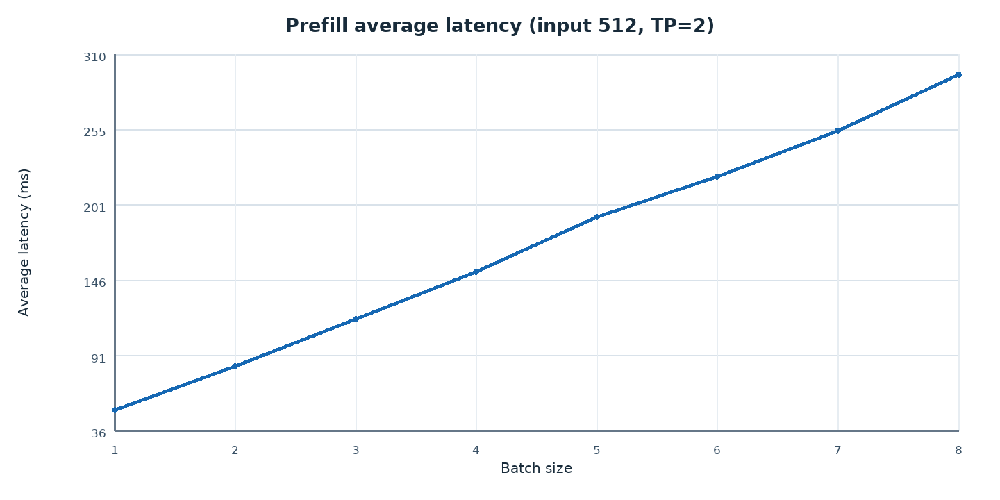
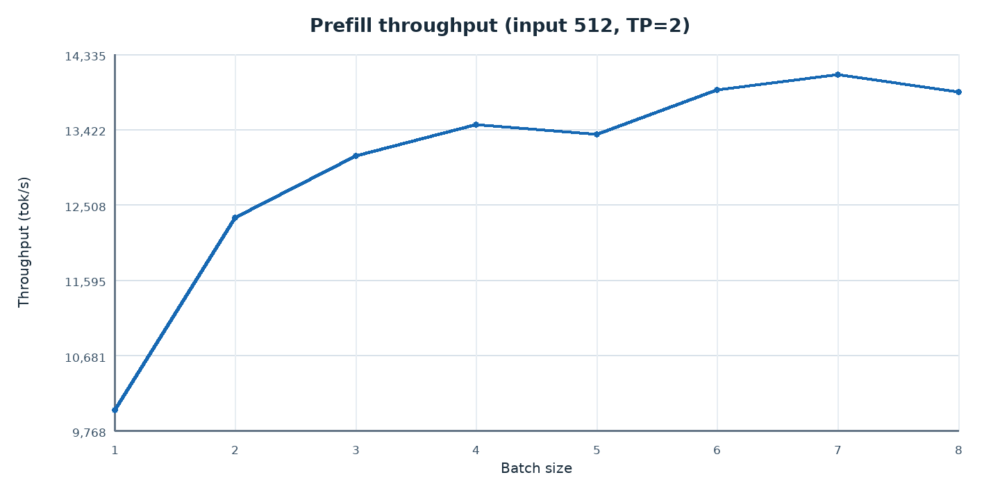
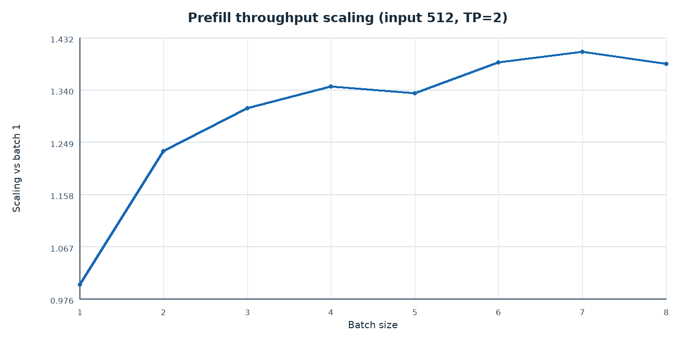

# Prefill-Direct Input 512 TP=2 性能报告

## 运行环境

| 项目 | 值 |
| --- | --- |
| 日期 | 2026-11-18 17:16:17-17:17:12（Asia/Shanghai） |
| 平台 | MetaX C500，64 GiB |
| 设备 | 2 x MetaX C500/C550，物理 GPU 3、4 |
| Driver / runtime | MetaX driver 3.3.12 / MACA 3.2.1.10 |
| InfiniLM build | 当前源码树；未记录独立 build ID |
| 模型 | `/data-aisoft/mechdancer/models/Qwen3-8B` |
| 模式 | `prefill-direct` |
| Attention backend | `flash-attn` |
| Graph request | enabled |
| Expected execution mode | `eager` |
| Cache | paged KV cache，block size 256，num blocks 16 |
| Max batched tokens | 18,432 |
| Tensor parallel size | 2 |
| Input length | 512 tokens / request |
| Batch size | 1..8 |
| Warmup | 每个形状 3 次 repeat |
| Measured repeats | 每个形状 30 次 repeat |
| Batch 执行顺序 | random seed 2026 |
| 干扰控制 | 物理专用 GPU 3、4；每 10 秒采样 `mx-smi` |

本报告对应的原始 JSONL 和 log 为本机运行产物，不随仓库提交：

```text
../../../benchmark-prefill-direct-metax-c500-tp2-qwen3-8b-input512-batch1-8-clean-20261118.jsonl
../../../benchmark-prefill-direct-metax-c500-tp2-qwen3-8b-input512-batch1-8-clean-20261118.log
```

## 构建与测试命令

C++ 扩展使用当前源码构建并安装：

```bash
xmake build _infinilm && xmake install _infinilm
```

性能测试命令：

```bash
BENCHMARK_GPU=3,4 \
INFINILM_MAX_NUM_BATCHED_TOKENS=18432 \
BENCHMARK_MODE=prefill-direct \
BATCH_SIZES="$(seq -s, 1 8)" \
INPUT_LENS=512 \
BENCHMARK_REPEATS=30 \
BENCHMARK_OUTPUT=benchmark-prefill-direct-metax-c500-tp2-qwen3-8b-input512-batch1-8-clean-20261118.jsonl \
./run_bench-metax.sh
```


脚本说明：上述命令记录的是 2026-11-18 运行时的调用方式；当时本地 `run_bench-metax.sh` 硬编码 `--tp 2`。该脚本被仓库 `.gitignore` 忽略，不随本报告提交；如果后续脚本被改为其他 TP 值，复现前必须先确认或改回 `--tp 2`，并保持 `BENCHMARK_GPU=3,4`。

## 执行模式与 Graph 覆盖

`run_bench-metax.sh` 请求开启 graph compiling，但当前 paged graph compiler 的 graph key 只匹配 decode-only 形状。packed prefill 形状不匹配该 key，因此本轮 expected execution mode 为 `eager`。
`expected_execution_mode` 是 benchmark 根据 compiler 规则推断的字段，不是 C++ runtime 回传的实际执行模式。

## 资源开销

| 项目 | 值 |
| --- | ---: |
| Workspace allocation | 每 rank 1,116.0 MiB，TP=2 合计 2,232.0 MiB |
| 权重加载时间 | 约 9.90 秒 |
| Paged cache blocks | 16 |
| 正式 repeat 数 | 240 |
| 本轮总耗时 | 约 56.0 秒 |
| GPU 3/4 温度范围 | 30C-53C |
| GPU 3/4 功耗范围 | 95W-300W |
| GPU 3/4 进程显存峰值 | 36,106 MiB |

## 测试口径

- 每个 sample 是一次物理 prefill forward。
- `token_count = batch_size * 512`。
- `throughput = batch_size * 512 / avg_forward_duration_s`。
- 计时边界为 `engine_forward_including_sampling`，包含 Python wrapper、C++ engine forward、RankWorker forward、TP 通信、model forward 和 sampling。
- 不包含 HTTP、JSON parsing、tokenization、scheduler queueing、`build_model_inputs`、detokenization 和 Python `generate()` 循环。
- 输出 token 不用于正确性判断。
- 分位数使用线性插值；每个 batch 30 个 repeat，p99 只能作为尾部参考。

## 核心结论

| 指标 | 结果 |
| --- | ---: |
| 最高 prefill 吞吐 | batch 7，14,090.26 tok/s |
| batch 1 平均 latency | 51.135 ms |
| batch 7 平均 latency | 254.360 ms |
| 最大 batch 8 吞吐 | 13,873.94 tok/s |

吞吐 Top 10 overall 结果：

| Batch | Avg ms | Throughput tok/s | Scaling |
| ---: | ---: | ---: | ---: |
| 7 | 254.360 | 14,090.26 | 1.407x |
| 6 | 220.974 | 13,902.09 | 1.388x |
| 8 | 295.230 | 13,873.94 | 1.386x |
| 4 | 151.934 | 13,479.54 | 1.346x |
| 5 | 191.570 | 13,363.28 | 1.335x |
| 3 | 117.227 | 13,102.80 | 1.309x |
| 2 | 82.911 | 12,350.62 | 1.233x |
| 1 | 51.135 | 10,012.73 | 1.000x |

## 趋势图

### 1. Batch size 与平均 latency



### 2. Batch size 与吞吐



### 3. Batch size 与吞吐 Scaling




平均 latency 从 batch 1 的 51.135 ms 增至 batch 8 的 295.230 ms。吞吐峰值为 batch 7 的 14,090.26 tok/s。

## 关键批次与区间

| Batch / range | 观察 |
| --- | --- |
| batch 1 -> 8 | 平均 latency 从 51.135 ms 增至 295.230 ms，为 5.774x。 |
| batch 7 | 吞吐峰值，14,090.26 tok/s。 |
| batch 7 | per-request prefill latency 最低，为 36.34 ms/request。 |

## 数据稳定性

- 8 个 overall summary的 std 中位数为 0.950 ms。
- 最大 std 为 4.198 ms，出现在 batch 3。
- 最大变异系数约 3.581%，中位变异系数约 0.683%。
- P50、P95、P99 和 max 普遍接近。
- 每个 batch 只有 30 个 repeat 样本；p99 可用于观察尾部，正式尾部对比建议提高到 100+ repeat。

## 完整结果表

| Batch | Mode | Input tokens | Avg ms | Min ms | P50 ms | P95 ms | P99 ms | Max ms | Std ms | Throughput tok/s | Scaling |
| ---: | --- | ---: | ---: | ---: | ---: | ---: | ---: | ---: | ---: | ---: | ---: |
| 1 | eager | 512 | 51.135 | 49.860 | 51.256 | 51.693 | 51.777 | 51.778 | 0.489 | 10,012.73 | 1.000x |
| 2 | eager | 1,024 | 82.911 | 82.313 | 82.898 | 83.416 | 83.550 | 83.597 | 0.280 | 12,350.62 | 1.233x |
| 3 | eager | 1,536 | 117.227 | 115.727 | 116.307 | 119.220 | 133.978 | 139.345 | 4.198 | 13,102.80 | 1.309x |
| 4 | eager | 2,048 | 151.934 | 150.396 | 151.802 | 153.101 | 153.133 | 153.144 | 0.829 | 13,479.54 | 1.346x |
| 5 | eager | 2,560 | 191.570 | 190.229 | 191.608 | 192.448 | 192.881 | 193.004 | 0.549 | 13,363.28 | 1.335x |
| 6 | eager | 3,072 | 220.974 | 219.662 | 220.440 | 222.204 | 227.877 | 230.159 | 1.814 | 13,902.09 | 1.388x |
| 7 | eager | 3,584 | 254.360 | 253.025 | 254.160 | 255.274 | 258.472 | 259.670 | 1.072 | 14,090.26 | 1.407x |
| 8 | eager | 4,096 | 295.230 | 293.361 | 294.607 | 295.366 | 308.321 | 313.521 | 3.421 | 13,873.94 | 1.386x |
## 结果分析

1. 吞吐最高出现在 batch 7，为 14,090.26 tok/s。
2. 最大 batch 8 的吞吐为 13,873.94 tok/s，低于峰值约 1.54%。
3. 对比 MetaX TP=1 峰值 9,310.41 tok/s，本报告 TP=2 峰值为其 1.513x；占用两张卡后的每卡效率为 TP=1 的 0.757x。
4. 对比 NVIDIA A100 TP=2 峰值 21,452.86 tok/s，本报告峰值约为其 0.657x。
5. 正式 p99 对比建议将 `BENCHMARK_REPEATS` 提高到 100 或以上。

## 结论与建议

1. 在本轮 input length 512、TP=2、batch `1..8` 范围内，**batch 7 吞吐最高**，约 14,090.26 tok/s。
2. batch 7 平均 forward latency 为 254.360 ms。
3. TP=2 相对 TP=1 提高总吞吐，但每卡效率低于 TP=1；是否采用 TP=2 应结合 SLO、总吞吐、时延和部署密度评估。
4. 所有样本均在专用 GPU 3、4 上采集；监控期间目标卡没有外来进程或多进程干扰。

## 数据完整性

```text
config records: 1
sample records: 240
overall summary records: 8
scaling records: 8
samples per batch: 30
expected execution modes: all eager
```
