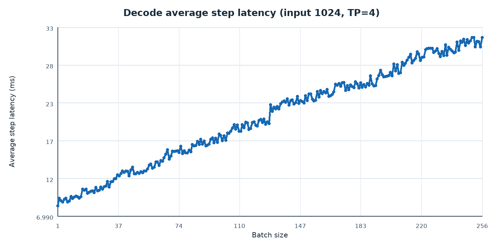
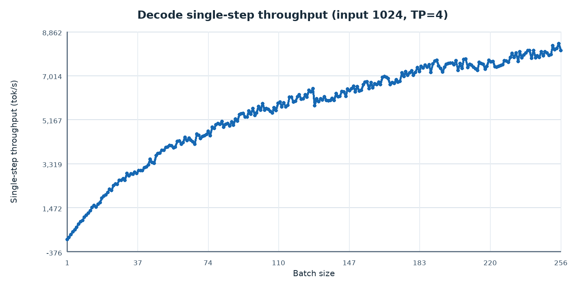
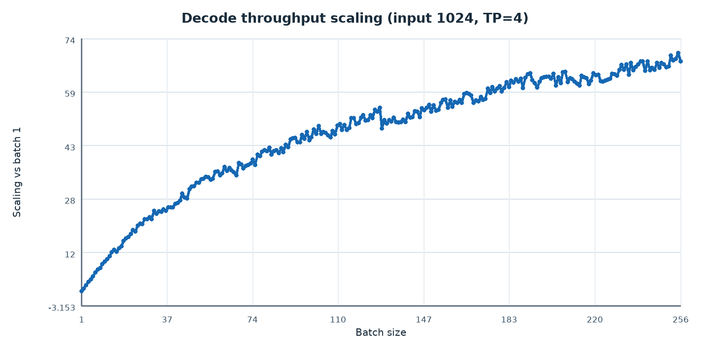

# Decode-Direct Input 1024 TP=4 性能报告

## 运行环境

| 项目 | 值 |
| --- | --- |
| 日期 | 2026-11-18 18:49:04-19:01:36（Asia/Shanghai） |
| 平台 | MetaX C500，64 GiB |
| 设备 | 4 x MetaX C500/C550，物理 GPU 3、4、5、6 |
| Driver / runtime | MetaX driver 3.3.12 / MACA 3.2.1.10 |
| InfiniLM build | 当前源码树；未记录独立 build ID |
| 模型 | `/data-aisoft/mechdancer/models/Qwen3-8B` |
| 模式 | `decode-direct` |
| Attention backend | `flash-attn` |
| Graph request | enabled |
| Expected execution mode | `graph` |
| Cache | paged KV cache，block size 256，num blocks 1,280 |
| Max batched tokens | 9,216 |
| Tensor parallel size | 4 |
| Input length | 1,024 tokens / request |
| Batch size | 1..256 |
| Warmup | 每个形状 3 次 repeat |
| Measured repeats | 每个形状 30 次 repeat |
| Batch 执行顺序 | random seed 2026 |
| 干扰控制 | 物理专用 GPU 3、4、5、6；每 10 秒采样 `mx-smi` |

本报告对应的原始 JSONL 和 log 为本机运行产物，不随仓库提交：

```text
../../../benchmark-decode-direct-metax-c500-tp4-qwen3-8b-input1024-batch1-256-clean-20261118.jsonl
../../../benchmark-decode-direct-metax-c500-tp4-qwen3-8b-input1024-batch1-256-clean-20261118.log
```

## 构建与测试命令

C++ 扩展使用当前源码构建并安装：

```bash
xmake build _infinilm && xmake install _infinilm
```

性能测试命令：

```bash
BENCHMARK_GPU=3,4,5,6 \
INFINILM_MAX_NUM_BATCHED_TOKENS=9216 \
BENCHMARK_MODE=decode-direct \
BATCH_SIZES="$(seq -s, 1 256)" \
INPUT_LENS=1024 \
BENCHMARK_REPEATS=30 \
BENCHMARK_OUTPUT=benchmark-decode-direct-metax-c500-tp4-qwen3-8b-input1024-batch1-256-clean-20261118.jsonl \
./run_bench-metax.sh
```


脚本说明：上述命令记录的是 2026-11-18 运行时的调用方式；当时本地 `run_bench-metax.sh` 硬编码 `--tp 4`。该脚本被仓库 `.gitignore` 忽略，不随本报告提交；复现时必须确认脚本仍为 `--tp 4`，并保持 `BENCHMARK_GPU=3,4,5,6`。

## 执行模式与 Graph 覆盖

当前 paged graph compiler 对 decode batch `1..256` 全部生成对应 graph；原始 JSONL 中所有 overall summary 的 `expected_execution_mode` 均为 `graph`，无 eager fallback 混入。
`expected_execution_mode` 是 benchmark 根据 compiler 规则推断的字段，不是 C++ runtime 回传的实际执行模式。

## 资源开销

| 项目 | 值 |
| --- | ---: |
| Workspace allocation | 每 rank 351.0 MiB，TP=4 合计 1,404.0 MiB |
| 权重加载时间 | 约 48.61 秒 |
| Paged cache blocks | 1,280 |
| 正式 repeat 数 | 7,680 |
| 正式 forward step 数 | 30,720 |
| 本轮总耗时 | 约 752.7 秒 |
| GPU 3/4/5/6 温度范围 | 30C-54C |
| GPU 3/4/5/6 功耗范围 | 92W-307W |
| GPU 3/4/5/6 进程显存峰值 | 20,058 MiB |

## 测试口径

- `decode-direct` 不执行语义完整的 prefill，paged KV cache 初始为全 0。
- Step 0 输入 dummy token；step 1 到 step 3 使用上一步 sampled token。
- 4 个 decode step 的 past KV length 分别为 1024、1025、1026、1027。
- 报告中的 duration 是单 step 时间，由一次 4-step repeat 的对应总耗时指标除以 4 得到。
- Throughput 是 single-step 吞吐：`batch_size / avg_step_duration_s`。
- 计时边界为 `engine_forward_including_sampling`，包含 Python wrapper、C++ engine forward、RankWorker forward、TP 通信、model forward/graph replay 和 sampling。
- 不包含 HTTP、JSON parsing、tokenization、scheduler queueing、`build_model_inputs`、detokenization 和 Python `generate()` 循环。
- 输出 token 不用于正确性判断。
- 分位数使用线性插值；每个 batch 30 个 repeat，p99 只能作为尾部参考。

## 核心结论

| 指标 | 结果 |
| --- | ---: |
| 最高 single-step 吞吐 | batch 255，8,366.76 tok/s |
| batch 255 平均单 step latency | 30.478 ms |
| batch 1 平均单 step latency | 8.393 ms |
| 最大 batch 256 平均单 step latency | 31.744 ms |
| 最大 batch 相对 batch 1 吞吐倍数 | 67.688x |

吞吐 Top 10 overall 结果：

| Batch | Avg Step ms | Single-step tok/s | Scaling |
| ---: | ---: | ---: | ---: |
| 255 | 30.478 | 8,366.76 | 70.224x |
| 252 | 30.455 | 8,274.63 | 69.451x |
| 254 | 31.162 | 8,150.87 | 68.412x |
| 253 | 31.241 | 8,098.42 | 67.972x |
| 242 | 29.965 | 8,075.99 | 67.784x |
| 240 | 29.725 | 8,073.96 | 67.767x |
| 256 | 31.744 | 8,064.55 | 67.688x |
| 239 | 29.650 | 8,060.69 | 67.655x |
| 246 | 30.653 | 8,025.33 | 67.359x |
| 235 | 29.303 | 8,019.63 | 67.311x |

## 趋势图

### 1. Batch size 与平均单 step latency



### 2. Batch size 与吞吐



### 3. Batch size 与吞吐 Scaling




平均单 step latency 从 batch 1 的 8.393 ms 增至 batch 256 的 31.744 ms。吞吐峰值为 batch 255 的 8,366.76 tok/s。

## Batch 区间平均 latency 与吞吐

下表按连续 16 个 batch 分组。`平均单 step latency ms` 和 `平均吞吐 tok/s` 分别是该区间内 batch 的 overall `Avg Step ms` 与 `Single-step tok/s` 的算术平均值；`区间最优 batch` 取该区间内吞吐最高的 batch。

| Batch 区间 | 平均单 step latency ms | 平均吞吐 tok/s | 区间最优 batch |
| --- | ---: | ---: | ---: |
| 1..16 | 9.436 | 884.59 | 15 |
| 17..32 | 10.744 | 2,272.06 | 32 |
| 33..48 | 12.769 | 3,165.82 | 48 |
| 49..64 | 13.768 | 4,098.13 | 62 |
| 65..80 | 15.812 | 4,584.77 | 79 |
| 81..96 | 17.102 | 5,174.20 | 95 |
| 97..112 | 18.590 | 5,622.51 | 111 |
| 113..128 | 19.813 | 6,082.45 | 128 |
| 129..144 | 22.507 | 6,064.50 | 143 |
| 145..160 | 23.422 | 6,511.85 | 156 |
| 161..176 | 24.633 | 6,842.11 | 176 |
| 177..192 | 25.226 | 7,315.01 | 192 |
| 193..208 | 26.895 | 7,456.62 | 207 |
| 209..224 | 29.074 | 7,447.99 | 219 |
| 225..240 | 29.861 | 7,787.90 | 240 |
| 241..256 | 31.123 | 7,985.95 | 255 |

区间平均 latency 随 batch size 整体增长；16 个区间中有 6 个区间的最优 batch 是区间右端点。偏离右端点的区间通常包含吞吐跳变或局部回落。

## 关键批次与跳变

下表列出吞吐下降幅度最大的相邻 batch 变化。

| Change | Avg step ms | Single-step tok/s | 吞吐变化 |
| --- | ---: | ---: | ---: |
| 128 -> 129 | 19.807 -> 22.427 | 6,462.49 -> 5,752.06 | -710.43 |
| 202 -> 203 | 26.451 -> 28.074 | 7,636.82 -> 7,230.97 | -405.85 |
| 207 -> 208 | 26.866 -> 28.305 | 7,704.89 -> 7,348.47 | -356.43 |
| 233 -> 234 | 29.265 -> 30.730 | 7,961.76 -> 7,614.70 | -347.05 |
| 240 -> 241 | 29.725 -> 31.141 | 8,073.96 -> 7,739.10 | -334.86 |

这些变化均在 graph 覆盖范围内，不能归因于 eager fallback。如需定位原因，应补充 kernel trace 或 C++ model-only 打点。

## Step 一致性

峰值 batch 255 的 4 个 decode step 结果如下：

| Step | Past KV length | Avg step ms | Std ms | Throughput tok/s |
| ---: | ---: | ---: | ---: | ---: |
| 0 | 1024 | 7.623 | 0.044 | 33,452.73 |
| 1 | 1025 | 7.618 | 0.037 | 33,472.88 |
| 2 | 1026 | 7.618 | 0.032 | 33,475.33 |
| 3 | 1027 | 7.619 | 0.042 | 33,467.21 |

所有 batch 中，4 个 step 平均耗时最大差异为 0.103 ms，出现在 batch 157。该差异主要来自 past KV length 增长以及不同 step 的 kernel 形状。

## 数据稳定性

- 256 个 overall summary换算为单 step 后的 std 中位数为 0.187 ms。
- 最大 std 为 0.822 ms，出现在 batch 45。
- 最大变异系数约 6.452%，中位变异系数约 1.035%。
- P50、P95、P99 和 max 普遍接近。
- 每个 batch 只有 30 个 repeat 样本；p99 可用于观察尾部，正式尾部对比建议提高到 100+ repeat。

## Single-step 完整结果

### Batch 1..64

| Batch | Mode | Avg Step ms | Min ms | P50 ms | P95 ms | P99 ms | Max ms | Std ms | Throughput tok/s | Scaling |
| ---: | --- | ---: | ---: | ---: | ---: | ---: | ---: | ---: | ---: | ---: |
| 1 | graph | 8.393 | 8.289 | 8.348 | 8.638 | 9.005 | 9.147 | 0.162 | 119.14 | 1.000x |
| 2 | graph | 9.483 | 9.264 | 9.372 | 9.988 | 10.051 | 10.068 | 0.245 | 210.89 | 1.770x |
| 3 | graph | 9.164 | 8.879 | 8.927 | 9.844 | 11.326 | 11.904 | 0.591 | 327.36 | 2.748x |
| 4 | graph | 8.970 | 8.821 | 8.911 | 9.471 | 9.664 | 9.673 | 0.201 | 445.91 | 3.743x |
| 5 | graph | 9.329 | 9.116 | 9.292 | 9.707 | 9.944 | 9.981 | 0.184 | 535.95 | 4.498x |
| 6 | graph | 9.466 | 9.206 | 9.409 | 9.970 | 10.044 | 10.072 | 0.206 | 633.88 | 5.320x |
| 7 | graph | 8.961 | 8.909 | 8.953 | 9.043 | 9.083 | 9.096 | 0.042 | 781.14 | 6.556x |
| 8 | graph | 9.082 | 8.977 | 9.098 | 9.168 | 9.212 | 9.221 | 0.057 | 880.83 | 7.393x |
| 9 | graph | 9.730 | 9.365 | 9.593 | 10.385 | 10.420 | 10.430 | 0.360 | 924.97 | 7.764x |
| 10 | graph | 9.427 | 9.044 | 9.238 | 10.333 | 11.213 | 11.537 | 0.513 | 1,060.80 | 8.904x |
| 11 | graph | 9.619 | 9.458 | 9.615 | 9.770 | 9.991 | 10.069 | 0.121 | 1,143.55 | 9.598x |
| 12 | graph | 9.785 | 9.626 | 9.774 | 9.944 | 10.113 | 10.172 | 0.109 | 1,226.34 | 10.293x |
| 13 | graph | 9.686 | 9.281 | 9.663 | 10.516 | 10.721 | 10.790 | 0.389 | 1,342.08 | 11.264x |
| 14 | graph | 9.472 | 9.249 | 9.415 | 10.042 | 10.126 | 10.157 | 0.226 | 1,478.04 | 12.406x |
| 15 | graph | 9.657 | 9.457 | 9.602 | 9.940 | 10.381 | 10.557 | 0.199 | 1,553.33 | 13.038x |
| 16 | graph | 10.744 | 10.502 | 10.694 | 11.287 | 11.431 | 11.457 | 0.236 | 1,489.20 | 12.499x |
| 17 | graph | 10.592 | 10.461 | 10.586 | 10.718 | 10.873 | 10.919 | 0.091 | 1,605.03 | 13.471x |
| 18 | graph | 10.743 | 10.554 | 10.720 | 11.119 | 11.184 | 11.196 | 0.162 | 1,675.44 | 14.062x |
| 19 | graph | 10.168 | 10.074 | 10.134 | 10.352 | 10.374 | 10.380 | 0.090 | 1,868.60 | 15.684x |
| 20 | graph | 10.278 | 10.115 | 10.193 | 10.801 | 11.254 | 11.298 | 0.262 | 1,945.95 | 16.333x |
| 21 | graph | 10.456 | 10.198 | 10.418 | 10.946 | 11.133 | 11.145 | 0.239 | 2,008.39 | 16.857x |
| 22 | graph | 10.487 | 10.231 | 10.382 | 10.885 | 10.893 | 10.894 | 0.242 | 2,097.88 | 17.608x |
| 23 | graph | 10.266 | 10.117 | 10.281 | 10.395 | 10.427 | 10.438 | 0.081 | 2,240.45 | 18.805x |
| 24 | graph | 10.986 | 10.860 | 10.969 | 11.116 | 11.309 | 11.384 | 0.102 | 2,184.60 | 18.336x |
| 25 | graph | 10.477 | 10.399 | 10.467 | 10.516 | 10.631 | 10.677 | 0.045 | 2,386.29 | 20.029x |
| 26 | graph | 10.575 | 10.471 | 10.564 | 10.653 | 10.785 | 10.831 | 0.061 | 2,458.56 | 20.635x |
| 27 | graph | 11.041 | 10.678 | 11.059 | 11.332 | 11.536 | 11.593 | 0.196 | 2,445.45 | 20.525x |
| 28 | graph | 10.725 | 10.579 | 10.686 | 11.107 | 11.199 | 11.203 | 0.158 | 2,610.78 | 21.913x |
| 29 | graph | 11.078 | 10.848 | 11.012 | 11.402 | 11.616 | 11.678 | 0.206 | 2,617.81 | 21.972x |
| 30 | graph | 11.167 | 10.866 | 11.067 | 11.726 | 11.953 | 12.010 | 0.271 | 2,686.47 | 22.548x |
| 31 | graph | 11.816 | 11.644 | 11.780 | 12.134 | 12.218 | 12.223 | 0.138 | 2,623.53 | 22.020x |
| 32 | graph | 11.043 | 10.850 | 10.927 | 11.833 | 12.078 | 12.142 | 0.310 | 2,897.72 | 24.321x |
| 33 | graph | 11.773 | 11.649 | 11.749 | 11.935 | 11.960 | 11.964 | 0.087 | 2,803.05 | 23.527x |
| 34 | graph | 11.783 | 11.656 | 11.790 | 11.892 | 12.072 | 12.136 | 0.093 | 2,885.40 | 24.218x |
| 35 | graph | 12.178 | 11.891 | 12.129 | 12.518 | 12.526 | 12.529 | 0.188 | 2,874.08 | 24.123x |
| 36 | graph | 12.196 | 11.854 | 11.980 | 12.824 | 13.125 | 13.227 | 0.383 | 2,951.74 | 24.775x |
| 37 | graph | 12.735 | 12.591 | 12.727 | 12.835 | 13.000 | 13.065 | 0.088 | 2,905.46 | 24.386x |
| 38 | graph | 12.556 | 12.389 | 12.527 | 12.891 | 12.952 | 12.976 | 0.133 | 3,026.55 | 25.403x |
| 39 | graph | 12.897 | 12.622 | 12.825 | 13.577 | 13.639 | 13.662 | 0.275 | 3,023.98 | 25.381x |
| 40 | graph | 13.245 | 13.080 | 13.230 | 13.428 | 13.741 | 13.846 | 0.139 | 3,020.02 | 25.348x |
| 41 | graph | 13.065 | 12.877 | 13.049 | 13.220 | 13.437 | 13.520 | 0.120 | 3,138.04 | 26.338x |
| 42 | graph | 13.245 | 13.054 | 13.228 | 13.453 | 13.711 | 13.812 | 0.141 | 3,171.05 | 26.615x |
| 43 | graph | 13.192 | 12.936 | 13.183 | 13.413 | 13.490 | 13.491 | 0.122 | 3,259.45 | 27.357x |
| 44 | graph | 12.557 | 12.403 | 12.541 | 12.755 | 12.878 | 12.893 | 0.095 | 3,503.89 | 29.409x |
| 45 | graph | 13.393 | 12.485 | 13.407 | 14.541 | 15.339 | 15.559 | 0.822 | 3,359.90 | 28.201x |
| 46 | graph | 13.787 | 13.541 | 13.748 | 14.206 | 14.421 | 14.446 | 0.199 | 3,336.36 | 28.003x |
| 47 | graph | 12.845 | 12.684 | 12.796 | 13.223 | 13.669 | 13.766 | 0.217 | 3,659.07 | 30.712x |
| 48 | graph | 12.851 | 12.759 | 12.835 | 13.015 | 13.152 | 13.170 | 0.085 | 3,735.13 | 31.350x |
| 49 | graph | 13.061 | 12.806 | 12.915 | 13.826 | 14.238 | 14.382 | 0.364 | 3,751.69 | 31.489x |
| 50 | graph | 12.908 | 12.833 | 12.889 | 13.010 | 13.151 | 13.199 | 0.069 | 3,873.44 | 32.511x |
| 51 | graph | 13.157 | 12.886 | 13.094 | 13.556 | 13.585 | 13.587 | 0.211 | 3,876.28 | 32.535x |
| 52 | graph | 13.023 | 12.799 | 13.031 | 13.199 | 13.261 | 13.266 | 0.107 | 3,992.99 | 33.514x |
| 53 | graph | 13.225 | 13.142 | 13.202 | 13.358 | 13.471 | 13.506 | 0.074 | 4,007.52 | 33.636x |
| 54 | graph | 13.230 | 13.130 | 13.225 | 13.353 | 13.484 | 13.518 | 0.078 | 4,081.49 | 34.257x |
| 55 | graph | 13.546 | 13.196 | 13.529 | 14.000 | 14.032 | 14.042 | 0.250 | 4,060.27 | 34.079x |
| 56 | graph | 14.060 | 13.962 | 14.035 | 14.160 | 14.505 | 14.646 | 0.120 | 3,982.84 | 33.429x |
| 57 | graph | 14.222 | 14.017 | 14.234 | 14.294 | 14.769 | 14.961 | 0.161 | 4,007.88 | 33.639x |
| 58 | graph | 13.658 | 13.529 | 13.643 | 13.887 | 13.968 | 13.973 | 0.105 | 4,246.48 | 35.642x |
| 59 | graph | 13.803 | 13.503 | 13.743 | 14.112 | 14.237 | 14.288 | 0.208 | 4,274.46 | 35.877x |
| 60 | graph | 14.493 | 14.217 | 14.461 | 14.836 | 15.181 | 15.244 | 0.197 | 4,139.83 | 34.747x |
| 61 | graph | 14.521 | 14.253 | 14.506 | 14.750 | 15.006 | 15.078 | 0.149 | 4,200.88 | 35.259x |
| 62 | graph | 14.044 | 13.801 | 14.011 | 14.348 | 14.380 | 14.387 | 0.165 | 4,414.63 | 37.053x |
| 63 | graph | 14.720 | 14.550 | 14.675 | 15.028 | 15.121 | 15.123 | 0.131 | 4,279.91 | 35.922x |
| 64 | graph | 14.613 | 14.414 | 14.577 | 14.854 | 15.036 | 15.085 | 0.129 | 4,379.52 | 36.758x |

### Batch 65..128

| Batch | Mode | Avg Step ms | Min ms | P50 ms | P95 ms | P99 ms | Max ms | Std ms | Throughput tok/s | Scaling |
| ---: | --- | ---: | ---: | ---: | ---: | ---: | ---: | ---: | ---: | ---: |
| 65 | graph | 15.093 | 14.874 | 14.998 | 15.486 | 15.533 | 15.547 | 0.185 | 4,306.70 | 36.147x |
| 66 | graph | 15.559 | 15.444 | 15.527 | 15.804 | 15.999 | 16.018 | 0.129 | 4,242.00 | 35.604x |
| 67 | graph | 16.195 | 16.015 | 16.187 | 16.430 | 16.512 | 16.517 | 0.114 | 4,137.11 | 34.724x |
| 68 | graph | 14.915 | 14.798 | 14.893 | 15.111 | 15.181 | 15.203 | 0.091 | 4,559.18 | 38.266x |
| 69 | graph | 15.313 | 15.201 | 15.298 | 15.448 | 15.496 | 15.513 | 0.065 | 4,505.94 | 37.820x |
| 70 | graph | 16.006 | 15.570 | 15.955 | 16.372 | 16.484 | 16.524 | 0.229 | 4,373.46 | 36.708x |
| 71 | graph | 15.947 | 15.569 | 16.018 | 16.196 | 16.209 | 16.214 | 0.215 | 4,452.16 | 37.368x |
| 72 | graph | 16.020 | 15.823 | 16.004 | 16.269 | 16.419 | 16.456 | 0.132 | 4,494.43 | 37.723x |
| 73 | graph | 16.071 | 15.552 | 16.019 | 16.583 | 16.628 | 16.632 | 0.324 | 4,542.25 | 38.124x |
| 74 | graph | 15.807 | 15.404 | 15.648 | 16.366 | 16.562 | 16.631 | 0.370 | 4,681.59 | 39.294x |
| 75 | graph | 16.679 | 16.486 | 16.613 | 17.135 | 17.356 | 17.417 | 0.212 | 4,496.61 | 37.741x |
| 76 | graph | 15.664 | 15.514 | 15.644 | 15.871 | 15.985 | 15.998 | 0.099 | 4,852.03 | 40.724x |
| 77 | graph | 16.048 | 15.739 | 15.933 | 16.773 | 17.513 | 17.635 | 0.384 | 4,798.22 | 40.273x |
| 78 | graph | 15.763 | 15.690 | 15.734 | 15.916 | 16.101 | 16.154 | 0.092 | 4,948.43 | 41.534x |
| 79 | graph | 15.782 | 15.619 | 15.716 | 16.082 | 16.258 | 16.320 | 0.166 | 5,005.55 | 42.013x |
| 80 | graph | 16.127 | 15.852 | 15.945 | 17.407 | 17.439 | 17.446 | 0.468 | 4,960.59 | 41.635x |
| 81 | graph | 15.926 | 15.759 | 15.910 | 16.104 | 16.206 | 16.247 | 0.119 | 5,086.16 | 42.689x |
| 82 | graph | 16.912 | 16.740 | 16.854 | 17.185 | 17.425 | 17.508 | 0.161 | 4,848.68 | 40.696x |
| 83 | graph | 16.736 | 16.432 | 16.679 | 17.188 | 17.239 | 17.254 | 0.222 | 4,959.46 | 41.626x |
| 84 | graph | 16.777 | 16.273 | 16.850 | 17.135 | 17.453 | 17.562 | 0.309 | 5,006.75 | 42.023x |
| 85 | graph | 17.342 | 17.011 | 17.315 | 17.685 | 17.931 | 17.982 | 0.196 | 4,901.37 | 41.138x |
| 86 | graph | 16.938 | 16.574 | 16.882 | 17.289 | 17.305 | 17.307 | 0.247 | 5,077.21 | 42.614x |
| 87 | graph | 17.652 | 17.403 | 17.633 | 17.982 | 18.168 | 18.198 | 0.155 | 4,928.75 | 41.368x |
| 88 | graph | 16.951 | 16.713 | 16.879 | 17.187 | 17.910 | 18.203 | 0.263 | 5,191.35 | 43.572x |
| 89 | graph | 17.427 | 16.886 | 17.377 | 17.755 | 17.789 | 17.794 | 0.181 | 5,107.01 | 42.864x |
| 90 | graph | 16.748 | 16.637 | 16.730 | 16.913 | 16.967 | 16.977 | 0.082 | 5,373.68 | 45.103x |
| 91 | graph | 16.807 | 16.655 | 16.797 | 16.964 | 17.100 | 17.143 | 0.096 | 5,414.40 | 45.444x |
| 92 | graph | 16.947 | 16.772 | 16.932 | 17.182 | 17.254 | 17.269 | 0.116 | 5,428.84 | 45.566x |
| 93 | graph | 17.653 | 17.465 | 17.623 | 17.942 | 18.171 | 18.264 | 0.165 | 5,268.29 | 44.218x |
| 94 | graph | 17.833 | 17.662 | 17.823 | 18.056 | 18.313 | 18.378 | 0.141 | 5,271.16 | 44.242x |
| 95 | graph | 17.167 | 16.735 | 17.099 | 17.814 | 18.005 | 18.036 | 0.292 | 5,533.87 | 46.447x |
| 96 | graph | 17.810 | 17.458 | 17.829 | 18.246 | 18.385 | 18.394 | 0.222 | 5,390.21 | 45.241x |
| 97 | graph | 17.227 | 17.075 | 17.208 | 17.389 | 17.520 | 17.556 | 0.093 | 5,630.56 | 47.259x |
| 98 | graph | 18.362 | 18.097 | 18.356 | 18.807 | 18.913 | 18.921 | 0.192 | 5,337.24 | 44.797x |
| 99 | graph | 18.181 | 17.972 | 18.168 | 18.555 | 18.684 | 18.694 | 0.174 | 5,445.36 | 45.704x |
| 100 | graph | 17.466 | 17.390 | 17.448 | 17.603 | 17.717 | 17.762 | 0.076 | 5,725.31 | 48.054x |
| 101 | graph | 18.127 | 17.800 | 18.187 | 18.365 | 18.468 | 18.500 | 0.197 | 5,571.80 | 46.766x |
| 102 | graph | 17.496 | 17.411 | 17.481 | 17.625 | 17.704 | 17.734 | 0.067 | 5,829.95 | 48.932x |
| 103 | graph | 18.534 | 18.367 | 18.514 | 18.789 | 18.892 | 18.928 | 0.134 | 5,557.30 | 46.644x |
| 104 | graph | 18.457 | 18.186 | 18.412 | 18.889 | 19.105 | 19.172 | 0.209 | 5,634.58 | 47.293x |
| 105 | graph | 18.761 | 18.304 | 18.737 | 19.215 | 19.232 | 19.233 | 0.271 | 5,596.83 | 46.976x |
| 106 | graph | 19.200 | 19.000 | 19.155 | 19.564 | 19.827 | 19.893 | 0.184 | 5,520.87 | 46.338x |
| 107 | graph | 19.681 | 19.484 | 19.618 | 20.142 | 20.417 | 20.510 | 0.210 | 5,436.58 | 45.631x |
| 108 | graph | 19.072 | 18.569 | 19.098 | 19.540 | 19.722 | 19.757 | 0.302 | 5,662.74 | 47.529x |
| 109 | graph | 19.652 | 19.452 | 19.617 | 20.036 | 20.093 | 20.115 | 0.173 | 5,546.48 | 46.553x |
| 110 | graph | 18.767 | 18.469 | 18.752 | 19.087 | 19.310 | 19.375 | 0.182 | 5,861.47 | 49.197x |
| 111 | graph | 18.778 | 18.626 | 18.739 | 19.021 | 19.094 | 19.101 | 0.122 | 5,911.25 | 49.615x |
| 112 | graph | 19.677 | 18.842 | 19.851 | 20.163 | 20.353 | 20.396 | 0.424 | 5,691.81 | 47.773x |
| 113 | graph | 19.242 | 18.895 | 19.159 | 19.717 | 19.749 | 19.752 | 0.279 | 5,872.63 | 49.291x |
| 114 | graph | 20.002 | 19.708 | 19.960 | 20.295 | 20.401 | 20.419 | 0.145 | 5,699.56 | 47.838x |
| 115 | graph | 19.937 | 19.781 | 19.887 | 20.291 | 20.403 | 20.414 | 0.147 | 5,768.05 | 48.413x |
| 116 | graph | 18.995 | 18.832 | 18.952 | 19.276 | 19.506 | 19.575 | 0.147 | 6,106.78 | 51.256x |
| 117 | graph | 19.131 | 18.948 | 19.134 | 19.349 | 19.457 | 19.495 | 0.128 | 6,115.75 | 51.331x |
| 118 | graph | 19.973 | 19.779 | 19.931 | 20.271 | 20.467 | 20.504 | 0.153 | 5,907.84 | 49.586x |
| 119 | graph | 20.054 | 19.892 | 20.003 | 20.281 | 20.347 | 20.363 | 0.129 | 5,933.97 | 49.805x |
| 120 | graph | 19.577 | 19.073 | 19.174 | 21.048 | 21.660 | 21.723 | 0.699 | 6,129.49 | 51.446x |
| 121 | graph | 19.468 | 19.081 | 19.432 | 19.882 | 19.923 | 19.927 | 0.252 | 6,215.18 | 52.166x |
| 122 | graph | 20.244 | 19.944 | 20.242 | 20.488 | 20.732 | 20.810 | 0.172 | 6,026.41 | 50.581x |
| 123 | graph | 20.380 | 20.163 | 20.348 | 20.723 | 20.886 | 20.926 | 0.165 | 6,035.33 | 50.656x |
| 124 | graph | 19.976 | 19.498 | 20.023 | 20.286 | 20.351 | 20.375 | 0.238 | 6,207.33 | 52.100x |
| 125 | graph | 20.462 | 20.217 | 20.425 | 20.858 | 21.042 | 21.105 | 0.205 | 6,108.76 | 51.272x |
| 126 | graph | 19.704 | 19.583 | 19.708 | 19.824 | 19.849 | 19.858 | 0.084 | 6,394.63 | 53.672x |
| 127 | graph | 20.048 | 19.584 | 20.005 | 20.539 | 20.934 | 21.090 | 0.381 | 6,334.95 | 53.171x |
| 128 | graph | 19.807 | 19.380 | 19.797 | 20.415 | 20.454 | 20.469 | 0.327 | 6,462.49 | 54.241x |

### Batch 129..192

| Batch | Mode | Avg Step ms | Min ms | P50 ms | P95 ms | P99 ms | Max ms | Std ms | Throughput tok/s | Scaling |
| ---: | --- | ---: | ---: | ---: | ---: | ---: | ---: | ---: | ---: | ---: |
| 129 | graph | 22.427 | 22.244 | 22.385 | 22.837 | 22.849 | 22.853 | 0.163 | 5,752.06 | 48.279x |
| 130 | graph | 21.490 | 21.151 | 21.460 | 21.948 | 22.234 | 22.337 | 0.272 | 6,049.35 | 50.774x |
| 131 | graph | 22.095 | 21.472 | 22.087 | 22.544 | 22.602 | 22.617 | 0.313 | 5,928.81 | 49.762x |
| 132 | graph | 21.847 | 21.209 | 21.805 | 22.493 | 22.698 | 22.702 | 0.371 | 6,042.05 | 50.713x |
| 133 | graph | 22.212 | 21.607 | 22.236 | 22.886 | 22.899 | 22.903 | 0.381 | 5,987.84 | 50.258x |
| 134 | graph | 21.847 | 21.395 | 21.856 | 22.173 | 22.218 | 22.230 | 0.275 | 6,133.54 | 51.480x |
| 135 | graph | 22.601 | 21.785 | 22.698 | 23.143 | 23.553 | 23.684 | 0.456 | 5,973.22 | 50.135x |
| 136 | graph | 22.838 | 22.489 | 22.816 | 23.227 | 23.380 | 23.422 | 0.197 | 5,955.11 | 49.983x |
| 137 | graph | 22.952 | 22.435 | 22.920 | 23.266 | 23.370 | 23.398 | 0.184 | 5,969.01 | 50.099x |
| 138 | graph | 22.762 | 22.586 | 22.741 | 23.056 | 23.168 | 23.189 | 0.152 | 6,062.72 | 50.886x |
| 139 | graph | 23.253 | 23.090 | 23.222 | 23.587 | 23.658 | 23.661 | 0.139 | 5,977.84 | 50.174x |
| 140 | graph | 22.377 | 22.133 | 22.358 | 22.619 | 22.838 | 22.895 | 0.153 | 6,256.53 | 52.513x |
| 141 | graph | 23.020 | 22.432 | 23.138 | 23.414 | 23.499 | 23.517 | 0.295 | 6,125.15 | 51.410x |
| 142 | graph | 23.132 | 22.279 | 23.291 | 23.554 | 23.938 | 24.066 | 0.445 | 6,138.64 | 51.523x |
| 143 | graph | 22.531 | 22.294 | 22.502 | 22.844 | 22.965 | 23.009 | 0.181 | 6,346.77 | 53.270x |
| 144 | graph | 22.737 | 22.220 | 22.639 | 23.469 | 23.550 | 23.551 | 0.349 | 6,333.30 | 53.157x |
| 145 | graph | 23.612 | 23.426 | 23.550 | 23.958 | 24.064 | 24.092 | 0.170 | 6,140.88 | 51.542x |
| 146 | graph | 22.632 | 22.371 | 22.499 | 23.230 | 23.269 | 23.275 | 0.277 | 6,451.17 | 54.146x |
| 147 | graph | 23.006 | 22.502 | 22.936 | 23.595 | 23.673 | 23.699 | 0.370 | 6,389.56 | 53.629x |
| 148 | graph | 22.872 | 22.719 | 22.860 | 23.078 | 23.131 | 23.146 | 0.108 | 6,470.84 | 54.311x |
| 149 | graph | 22.673 | 22.556 | 22.623 | 22.899 | 22.992 | 23.025 | 0.124 | 6,571.56 | 55.157x |
| 150 | graph | 23.694 | 23.575 | 23.644 | 23.923 | 24.034 | 24.079 | 0.117 | 6,330.67 | 53.135x |
| 151 | graph | 23.024 | 22.779 | 22.962 | 23.423 | 23.713 | 23.788 | 0.218 | 6,558.41 | 55.046x |
| 152 | graph | 23.911 | 23.357 | 23.906 | 24.268 | 24.501 | 24.572 | 0.247 | 6,356.94 | 53.355x |
| 153 | graph | 23.924 | 23.636 | 23.880 | 24.235 | 24.321 | 24.356 | 0.174 | 6,395.26 | 53.677x |
| 154 | graph | 23.197 | 22.746 | 23.156 | 23.610 | 23.815 | 23.883 | 0.288 | 6,638.71 | 55.720x |
| 155 | graph | 22.981 | 22.767 | 22.991 | 23.120 | 23.141 | 23.150 | 0.105 | 6,744.84 | 56.611x |
| 156 | graph | 23.082 | 22.945 | 23.042 | 23.260 | 23.276 | 23.281 | 0.104 | 6,758.55 | 56.726x |
| 157 | graph | 24.280 | 23.807 | 24.209 | 24.759 | 26.077 | 26.604 | 0.510 | 6,466.19 | 54.272x |
| 158 | graph | 23.485 | 23.233 | 23.459 | 23.816 | 23.855 | 23.856 | 0.165 | 6,727.66 | 56.467x |
| 159 | graph | 24.426 | 24.135 | 24.305 | 24.744 | 26.293 | 26.918 | 0.494 | 6,509.39 | 54.635x |
| 160 | graph | 23.956 | 23.316 | 24.104 | 24.461 | 24.574 | 24.579 | 0.322 | 6,679.03 | 56.059x |
| 161 | graph | 24.256 | 23.702 | 24.276 | 24.757 | 24.835 | 24.841 | 0.254 | 6,637.54 | 55.711x |
| 162 | graph | 24.054 | 23.436 | 24.113 | 24.708 | 24.929 | 24.942 | 0.399 | 6,734.72 | 56.526x |
| 163 | graph | 24.562 | 24.417 | 24.500 | 24.901 | 24.969 | 24.976 | 0.141 | 6,636.14 | 55.699x |
| 164 | graph | 23.589 | 23.304 | 23.594 | 23.732 | 23.838 | 23.880 | 0.119 | 6,952.31 | 58.353x |
| 165 | graph | 23.669 | 23.379 | 23.661 | 23.836 | 23.989 | 24.048 | 0.123 | 6,971.08 | 58.510x |
| 166 | graph | 23.905 | 23.508 | 23.819 | 24.541 | 24.582 | 24.590 | 0.302 | 6,944.22 | 58.285x |
| 167 | graph | 24.198 | 23.817 | 24.078 | 24.936 | 24.998 | 25.006 | 0.367 | 6,901.48 | 57.926x |
| 168 | graph | 25.286 | 25.043 | 25.250 | 25.643 | 25.657 | 25.661 | 0.154 | 6,644.03 | 55.765x |
| 169 | graph | 25.160 | 24.801 | 25.106 | 25.555 | 26.906 | 27.449 | 0.457 | 6,716.91 | 56.377x |
| 170 | graph | 25.399 | 25.243 | 25.378 | 25.762 | 25.831 | 25.832 | 0.140 | 6,693.23 | 56.178x |
| 171 | graph | 24.983 | 24.124 | 25.066 | 25.503 | 25.735 | 25.818 | 0.381 | 6,844.67 | 57.449x |
| 172 | graph | 25.497 | 25.218 | 25.419 | 25.820 | 26.030 | 26.097 | 0.192 | 6,745.78 | 56.619x |
| 173 | graph | 25.528 | 25.323 | 25.509 | 25.776 | 25.857 | 25.889 | 0.143 | 6,776.90 | 56.880x |
| 174 | graph | 24.420 | 24.267 | 24.350 | 24.715 | 24.749 | 24.753 | 0.140 | 7,125.40 | 59.805x |
| 175 | graph | 25.099 | 24.464 | 25.098 | 25.723 | 25.810 | 25.845 | 0.446 | 6,972.37 | 58.521x |
| 176 | graph | 24.523 | 24.317 | 24.517 | 24.707 | 24.820 | 24.861 | 0.116 | 7,177.07 | 60.239x |
| 177 | graph | 25.186 | 24.342 | 25.422 | 25.964 | 26.116 | 26.178 | 0.647 | 7,027.63 | 58.985x |
| 178 | graph | 24.961 | 24.209 | 25.119 | 25.266 | 25.303 | 25.310 | 0.300 | 7,131.20 | 59.854x |
| 179 | graph | 24.785 | 24.363 | 24.604 | 25.456 | 25.683 | 25.744 | 0.396 | 7,221.98 | 60.616x |
| 180 | graph | 25.632 | 25.248 | 25.543 | 25.938 | 27.546 | 28.191 | 0.507 | 7,022.39 | 58.941x |
| 181 | graph | 25.329 | 24.568 | 25.412 | 26.161 | 26.387 | 26.405 | 0.550 | 7,145.92 | 59.978x |
| 182 | graph | 24.775 | 24.435 | 24.620 | 25.636 | 25.741 | 25.750 | 0.386 | 7,346.24 | 61.659x |
| 183 | graph | 25.461 | 24.806 | 25.549 | 25.746 | 25.799 | 25.820 | 0.272 | 7,187.51 | 60.327x |
| 184 | graph | 24.859 | 24.729 | 24.824 | 25.179 | 25.224 | 25.235 | 0.128 | 7,401.73 | 62.125x |
| 185 | graph | 25.241 | 24.646 | 25.115 | 26.005 | 26.143 | 26.155 | 0.449 | 7,329.45 | 61.518x |
| 186 | graph | 24.920 | 24.721 | 24.922 | 25.155 | 25.202 | 25.208 | 0.119 | 7,463.98 | 62.647x |
| 187 | graph | 25.393 | 24.621 | 25.412 | 25.912 | 26.105 | 26.180 | 0.426 | 7,364.22 | 61.810x |
| 188 | graph | 25.158 | 24.924 | 25.101 | 25.499 | 25.622 | 25.672 | 0.203 | 7,472.81 | 62.721x |
| 189 | graph | 26.453 | 26.086 | 26.384 | 26.829 | 26.925 | 26.932 | 0.201 | 7,144.69 | 59.967x |
| 190 | graph | 25.328 | 24.943 | 25.171 | 26.077 | 26.176 | 26.215 | 0.391 | 7,501.67 | 62.963x |
| 191 | graph | 25.050 | 24.876 | 25.021 | 25.350 | 25.462 | 25.475 | 0.149 | 7,624.78 | 63.997x |
| 192 | graph | 25.085 | 24.709 | 25.087 | 25.433 | 25.739 | 25.859 | 0.261 | 7,653.90 | 64.241x |

### Batch 193..256

| Batch | Mode | Avg Step ms | Min ms | P50 ms | P95 ms | P99 ms | Max ms | Std ms | Throughput tok/s | Scaling |
| ---: | --- | ---: | ---: | ---: | ---: | ---: | ---: | ---: | ---: | ---: |
| 193 | graph | 25.993 | 25.838 | 25.924 | 26.341 | 26.502 | 26.554 | 0.165 | 7,425.11 | 62.321x |
| 194 | graph | 26.477 | 25.812 | 26.600 | 27.080 | 27.122 | 27.135 | 0.462 | 7,327.23 | 61.499x |
| 195 | graph | 27.213 | 26.805 | 27.194 | 27.430 | 27.599 | 27.663 | 0.176 | 7,165.67 | 60.143x |
| 196 | graph | 26.605 | 25.932 | 26.555 | 27.261 | 27.329 | 27.341 | 0.449 | 7,367.15 | 61.834x |
| 197 | graph | 26.297 | 26.152 | 26.260 | 26.541 | 26.668 | 26.702 | 0.125 | 7,491.27 | 62.876x |
| 198 | graph | 26.336 | 26.200 | 26.298 | 26.512 | 26.563 | 26.576 | 0.102 | 7,518.36 | 63.104x |
| 199 | graph | 26.412 | 26.278 | 26.377 | 26.642 | 26.757 | 26.792 | 0.113 | 7,534.38 | 63.238x |
| 200 | graph | 26.516 | 26.226 | 26.337 | 27.570 | 27.784 | 27.830 | 0.443 | 7,542.70 | 63.308x |
| 201 | graph | 26.903 | 26.361 | 26.801 | 27.675 | 27.732 | 27.746 | 0.432 | 7,471.26 | 62.708x |
| 202 | graph | 26.451 | 25.819 | 26.457 | 26.632 | 26.650 | 26.652 | 0.148 | 7,636.82 | 64.098x |
| 203 | graph | 28.074 | 27.820 | 28.010 | 28.447 | 28.519 | 28.546 | 0.191 | 7,230.97 | 60.691x |
| 204 | graph | 27.103 | 26.645 | 26.921 | 27.820 | 27.835 | 27.835 | 0.406 | 7,526.80 | 63.174x |
| 205 | graph | 27.994 | 26.844 | 28.047 | 28.276 | 28.332 | 28.354 | 0.282 | 7,323.03 | 61.464x |
| 206 | graph | 26.782 | 26.600 | 26.770 | 26.964 | 27.115 | 27.174 | 0.114 | 7,691.83 | 64.560x |
| 207 | graph | 26.866 | 26.703 | 26.824 | 27.041 | 27.180 | 27.236 | 0.116 | 7,704.89 | 64.669x |
| 208 | graph | 28.305 | 28.105 | 28.210 | 28.730 | 29.045 | 29.164 | 0.234 | 7,348.47 | 61.678x |
| 209 | graph | 27.882 | 27.710 | 27.824 | 28.114 | 28.311 | 28.374 | 0.142 | 7,495.87 | 62.915x |
| 210 | graph | 28.176 | 27.873 | 28.061 | 28.772 | 28.929 | 28.986 | 0.296 | 7,453.05 | 62.555x |
| 211 | graph | 28.634 | 27.912 | 28.555 | 29.309 | 29.358 | 29.368 | 0.429 | 7,368.83 | 61.849x |
| 212 | graph | 29.013 | 28.099 | 29.153 | 29.401 | 29.486 | 29.510 | 0.390 | 7,307.09 | 61.330x |
| 213 | graph | 29.447 | 29.031 | 29.412 | 29.730 | 29.867 | 29.918 | 0.172 | 7,233.26 | 60.711x |
| 214 | graph | 28.232 | 28.028 | 28.193 | 28.439 | 28.527 | 28.559 | 0.114 | 7,580.12 | 63.622x |
| 215 | graph | 28.571 | 28.145 | 28.377 | 29.224 | 29.479 | 29.574 | 0.421 | 7,525.19 | 63.161x |
| 216 | graph | 28.844 | 28.300 | 28.662 | 29.627 | 29.650 | 29.657 | 0.440 | 7,488.44 | 62.852x |
| 217 | graph | 29.782 | 29.334 | 29.740 | 30.198 | 30.213 | 30.215 | 0.196 | 7,286.33 | 61.156x |
| 218 | graph | 29.465 | 29.134 | 29.327 | 29.917 | 30.033 | 30.079 | 0.297 | 7,398.56 | 62.098x |
| 219 | graph | 28.583 | 28.351 | 28.561 | 28.796 | 28.900 | 28.935 | 0.111 | 7,661.78 | 64.307x |
| 220 | graph | 28.983 | 28.527 | 28.845 | 29.719 | 29.840 | 29.876 | 0.387 | 7,590.75 | 63.711x |
| 221 | graph | 29.033 | 28.295 | 28.943 | 29.903 | 29.983 | 29.994 | 0.469 | 7,611.92 | 63.889x |
| 222 | graph | 30.056 | 29.876 | 30.044 | 30.285 | 30.348 | 30.366 | 0.117 | 7,386.11 | 61.994x |
| 223 | graph | 30.234 | 29.873 | 30.212 | 30.543 | 30.612 | 30.626 | 0.153 | 7,375.68 | 61.906x |
| 224 | graph | 30.250 | 30.091 | 30.223 | 30.436 | 30.479 | 30.494 | 0.111 | 7,404.95 | 62.152x |
| 225 | graph | 30.245 | 30.019 | 30.248 | 30.489 | 30.664 | 30.727 | 0.160 | 7,439.34 | 62.440x |
| 226 | graph | 30.269 | 30.117 | 30.246 | 30.564 | 30.659 | 30.668 | 0.126 | 7,466.26 | 62.666x |
| 227 | graph | 29.680 | 28.591 | 29.718 | 30.362 | 30.521 | 30.578 | 0.544 | 7,648.19 | 64.193x |
| 228 | graph | 29.873 | 28.917 | 29.981 | 30.448 | 30.545 | 30.582 | 0.398 | 7,632.39 | 64.061x |
| 229 | graph | 30.228 | 30.074 | 30.202 | 30.492 | 30.585 | 30.618 | 0.125 | 7,575.80 | 63.586x |
| 230 | graph | 29.560 | 28.841 | 29.358 | 30.473 | 30.646 | 30.679 | 0.474 | 7,780.85 | 65.307x |
| 231 | graph | 29.078 | 28.934 | 29.052 | 29.255 | 29.295 | 29.306 | 0.089 | 7,944.04 | 66.676x |
| 232 | graph | 29.806 | 29.187 | 29.706 | 30.580 | 30.646 | 30.671 | 0.515 | 7,783.61 | 65.330x |
| 233 | graph | 29.265 | 29.133 | 29.227 | 29.537 | 29.613 | 29.629 | 0.117 | 7,961.76 | 66.825x |
| 234 | graph | 30.730 | 30.496 | 30.703 | 30.964 | 31.011 | 31.023 | 0.113 | 7,614.70 | 63.912x |
| 235 | graph | 29.303 | 29.158 | 29.275 | 29.456 | 29.483 | 29.483 | 0.079 | 8,019.63 | 67.311x |
| 236 | graph | 30.383 | 29.512 | 30.590 | 31.061 | 31.221 | 31.225 | 0.485 | 7,767.40 | 65.194x |
| 237 | graph | 30.098 | 29.567 | 29.966 | 30.772 | 30.845 | 30.870 | 0.416 | 7,874.16 | 66.090x |
| 238 | graph | 29.886 | 29.584 | 29.703 | 30.707 | 31.076 | 31.195 | 0.382 | 7,963.68 | 66.841x |
| 239 | graph | 29.650 | 29.491 | 29.615 | 29.851 | 30.163 | 30.282 | 0.153 | 8,060.69 | 67.655x |
| 240 | graph | 29.725 | 29.407 | 29.716 | 30.024 | 30.065 | 30.074 | 0.169 | 8,073.96 | 67.767x |
| 241 | graph | 31.141 | 30.603 | 31.179 | 31.524 | 31.669 | 31.728 | 0.260 | 7,739.10 | 64.956x |
| 242 | graph | 29.965 | 29.702 | 29.930 | 30.223 | 30.764 | 30.938 | 0.212 | 8,075.99 | 67.784x |
| 243 | graph | 31.295 | 30.991 | 31.287 | 31.617 | 31.685 | 31.698 | 0.154 | 7,764.82 | 65.172x |
| 244 | graph | 31.080 | 29.992 | 31.202 | 31.615 | 31.654 | 31.659 | 0.475 | 7,850.79 | 65.894x |
| 245 | graph | 31.505 | 31.295 | 31.482 | 31.826 | 31.975 | 32.019 | 0.171 | 7,776.65 | 65.271x |
| 246 | graph | 30.653 | 29.942 | 30.648 | 31.323 | 31.405 | 31.420 | 0.448 | 8,025.33 | 67.359x |
| 247 | graph | 31.485 | 31.297 | 31.468 | 31.701 | 31.719 | 31.723 | 0.121 | 7,845.13 | 65.846x |
| 248 | graph | 30.963 | 30.225 | 30.940 | 31.401 | 31.501 | 31.538 | 0.374 | 8,009.67 | 67.227x |
| 249 | graph | 31.258 | 30.500 | 31.284 | 31.705 | 31.830 | 31.875 | 0.295 | 7,965.95 | 66.860x |
| 250 | graph | 31.770 | 30.890 | 31.893 | 32.054 | 32.123 | 32.151 | 0.358 | 7,869.02 | 66.047x |
| 251 | graph | 31.782 | 31.620 | 31.789 | 31.933 | 31.991 | 32.014 | 0.095 | 7,897.44 | 66.285x |
| 252 | graph | 30.455 | 30.317 | 30.449 | 30.601 | 30.654 | 30.670 | 0.100 | 8,274.63 | 69.451x |
| 253 | graph | 31.241 | 30.371 | 31.521 | 31.748 | 32.142 | 32.301 | 0.530 | 8,098.42 | 67.972x |
| 254 | graph | 31.162 | 30.413 | 31.193 | 31.919 | 32.003 | 32.004 | 0.491 | 8,150.87 | 68.412x |
| 255 | graph | 30.478 | 30.344 | 30.451 | 30.646 | 30.703 | 30.718 | 0.092 | 8,366.76 | 70.224x |
| 256 | graph | 31.744 | 31.519 | 31.680 | 32.037 | 32.211 | 32.266 | 0.157 | 8,064.55 | 67.688x |

## 结果分析

1. 吞吐最高出现在 batch 255，为 8,366.76 tok/s。
2. 最大 batch 256 的吞吐为 8,064.55 tok/s，低于峰值约 3.61%。
3. 对比 MetaX TP=1 峰值 3,418.89 tok/s，本报告 TP=4 峰值为其 2.447x。
4. 对比 MetaX TP=2 峰值 5,257.30 tok/s，本报告 TP=4 峰值为其 1.591x；占用四张卡后的每卡效率为 TP=2 的 0.796x。
5. 对比 NVIDIA A100 TP=4 峰值 10,683.02 tok/s，本报告峰值约为其 0.783x。
6. 正式 p99 对比建议将 `BENCHMARK_REPEATS` 提高到 100 或以上。

## 结论与建议

1. 在本轮 input length 1024、TP=4、batch `1..256` 范围内，**batch 255 吞吐最高**，约 8,366.76 tok/s。
2. batch 255 平均单 step latency 为 30.478 ms。
3. TP=4 相对 TP=2 继续提高总吞吐，但每卡效率低于 TP=2；是否采用 TP=4 应结合 SLO、总吞吐、时延和部署密度评估。
4. 所有样本均在专用 GPU 3、4、5、6 上采集；监控期间目标卡没有外来进程或多进程干扰。

## 数据完整性

```text
config records: 1
sample records: 30,720
overall summary records: 256
step summary records: 1,280
scaling records: 256
samples per batch: 30
expected execution modes: all graph
```
