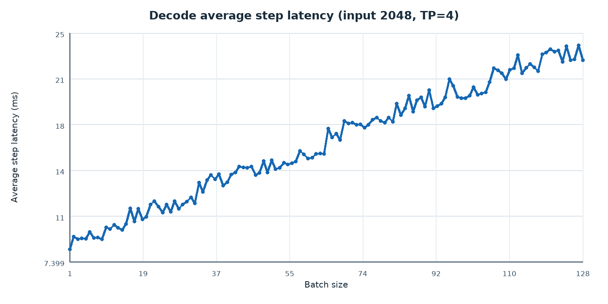
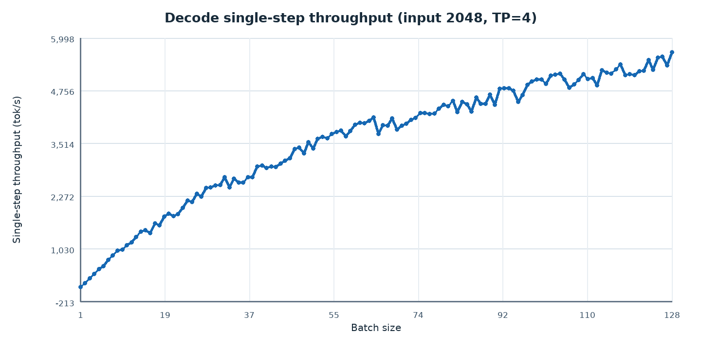
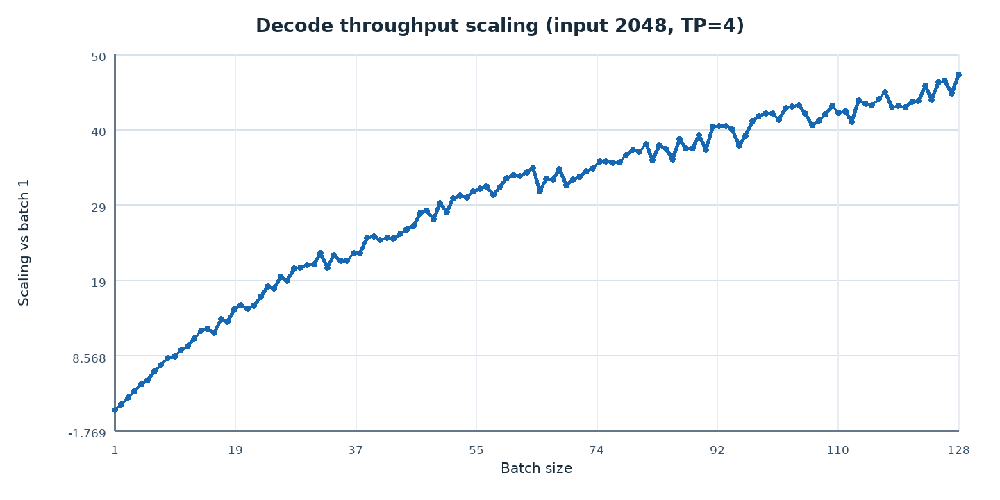

# Decode-Direct Input 2048 TP=4 性能报告

## 运行环境

| 项目 | 值 |
| --- | --- |
| 日期 | 2026-11-18 19:02:08-19:07:15（Asia/Shanghai） |
| 平台 | MetaX C500，64 GiB |
| 设备 | 4 x MetaX C500/C550，物理 GPU 3、4、5、6 |
| Driver / runtime | MetaX driver 3.3.12 / MACA 3.2.1.10 |
| InfiniLM build | 当前源码树；未记录独立 build ID |
| 模型 | `/data-aisoft/mechdancer/models/Qwen3-8B` |
| 模式 | `decode-direct` |
| Attention backend | `flash-attn` |
| Graph request | enabled |
| Expected execution mode | `graph` |
| Cache | paged KV cache，block size 256，num blocks 1,152 |
| Max batched tokens | 18,432 |
| Tensor parallel size | 4 |
| Input length | 2,048 tokens / request |
| Batch size | 1..128 |
| Warmup | 每个形状 3 次 repeat |
| Measured repeats | 每个形状 30 次 repeat |
| Batch 执行顺序 | random seed 2026 |
| 干扰控制 | 物理专用 GPU 3、4、5、6；每 10 秒采样 `mx-smi` |

本报告对应的原始 JSONL 和 log 为本机运行产物，不随仓库提交：

```text
../../../benchmark-decode-direct-metax-c500-tp4-qwen3-8b-input2048-batch1-128-clean-20261118.jsonl
../../../benchmark-decode-direct-metax-c500-tp4-qwen3-8b-input2048-batch1-128-clean-20261118.log
```

## 构建与测试命令

C++ 扩展使用当前源码构建并安装：

```bash
xmake build _infinilm && xmake install _infinilm
```

性能测试命令：

```bash
BENCHMARK_GPU=3,4,5,6 \
INFINILM_MAX_NUM_BATCHED_TOKENS=18432 \
BENCHMARK_MODE=decode-direct \
BATCH_SIZES="$(seq -s, 1 128)" \
INPUT_LENS=2048 \
BENCHMARK_REPEATS=30 \
BENCHMARK_OUTPUT=benchmark-decode-direct-metax-c500-tp4-qwen3-8b-input2048-batch1-128-clean-20261118.jsonl \
./run_bench-metax.sh
```


脚本说明：上述命令记录的是 2026-11-18 运行时的调用方式；当时本地 `run_bench-metax.sh` 硬编码 `--tp 4`。该脚本被仓库 `.gitignore` 忽略，不随本报告提交；复现时必须确认脚本仍为 `--tp 4`，并保持 `BENCHMARK_GPU=3,4,5,6`。

## 执行模式与 Graph 覆盖

当前 paged graph compiler 对 decode batch `1..128` 全部生成对应 graph；原始 JSONL 中所有 overall summary 的 `expected_execution_mode` 均为 `graph`，无 eager fallback 混入。
`expected_execution_mode` 是 benchmark 根据 compiler 规则推断的字段，不是 C++ runtime 回传的实际执行模式。

## 资源开销

| 项目 | 值 |
| --- | ---: |
| Workspace allocation | 每 rank 702.0 MiB，TP=4 合计 2,808.0 MiB |
| 权重加载时间 | 约 28.12 秒 |
| Paged cache blocks | 1,152 |
| 正式 repeat 数 | 3,840 |
| 正式 forward step 数 | 15,360 |
| 本轮总耗时 | 约 307.1 秒 |
| GPU 3/4/5/6 温度范围 | 30C-54C |
| GPU 3/4/5/6 功耗范围 | 92W-307W |
| GPU 3/4/5/6 进程显存峰值 | 20,058 MiB |

## 测试口径

- `decode-direct` 不执行语义完整的 prefill，paged KV cache 初始为全 0。
- Step 0 输入 dummy token；step 1 到 step 3 使用上一步 sampled token。
- 4 个 decode step 的 past KV length 分别为 2048、2049、2050、2051。
- 报告中的 duration 是单 step 时间，由一次 4-step repeat 的对应总耗时指标除以 4 得到。
- Throughput 是 single-step 吞吐：`batch_size / avg_step_duration_s`。
- 计时边界为 `engine_forward_including_sampling`，包含 Python wrapper、C++ engine forward、RankWorker forward、TP 通信、model forward/graph replay 和 sampling。
- 不包含 HTTP、JSON parsing、tokenization、scheduler queueing、`build_model_inputs`、detokenization 和 Python `generate()` 循环。
- 输出 token 不用于正确性判断。
- 分位数使用线性插值；每个 batch 30 个 repeat，p99 只能作为尾部参考。

## 核心结论

| 指标 | 结果 |
| --- | ---: |
| 最高 single-step 吞吐 | batch 128，5,665.03 tok/s |
| batch 128 平均单 step latency | 22.595 ms |
| batch 1 平均单 step latency | 8.323 ms |
| 最大 batch 128 平均单 step latency | 22.595 ms |
| 最大 batch 相对 batch 1 吞吐倍数 | 47.149x |

吞吐 Top 10 overall 结果：

| Batch | Avg Step ms | Single-step tok/s | Scaling |
| ---: | ---: | ---: | ---: |
| 128 | 22.595 | 5,665.03 | 47.149x |
| 126 | 22.666 | 5,558.96 | 46.266x |
| 125 | 22.586 | 5,534.42 | 46.062x |
| 123 | 22.457 | 5,477.25 | 45.586x |
| 117 | 21.772 | 5,373.95 | 44.727x |
| 127 | 23.717 | 5,354.82 | 44.567x |
| 116 | 22.060 | 5,258.42 | 43.765x |
| 124 | 23.643 | 5,244.57 | 43.650x |
| 113 | 21.590 | 5,233.90 | 43.561x |
| 122 | 23.331 | 5,229.11 | 43.521x |

## 趋势图

### 1. Batch size 与平均单 step latency



### 2. Batch size 与吞吐



### 3. Batch size 与吞吐 Scaling




平均单 step latency 从 batch 1 的 8.323 ms 增至 batch 128 的 22.595 ms。吞吐峰值为 batch 128 的 5,665.03 tok/s。

## Batch 区间平均 latency 与吞吐

下表按连续 16 个 batch 分组。`平均单 step latency ms` 和 `平均吞吐 tok/s` 分别是该区间内 batch 的 overall `Avg Step ms` 与 `Single-step tok/s` 的算术平均值；`区间最优 batch` 取该区间内吞吐最高的 batch。

| Batch 区间 | 平均单 step latency ms | 平均吞吐 tok/s | 区间最优 batch |
| --- | ---: | ---: | ---: |
| 1..16 | 9.602 | 861.52 | 15 |
| 17..32 | 11.463 | 2,128.85 | 32 |
| 33..48 | 13.866 | 2,915.91 | 48 |
| 49..64 | 15.040 | 3,752.94 | 64 |
| 65..80 | 17.666 | 4,101.70 | 79 |
| 81..96 | 19.444 | 4,552.58 | 93 |
| 97..112 | 20.890 | 5,004.25 | 104 |
| 113..128 | 22.724 | 5,303.57 | 128 |

区间平均 latency 随 batch size 整体增长；8 个区间中有 4 个区间的最优 batch 是区间右端点。偏离右端点的区间通常包含吞吐跳变或局部回落。

## 关键批次与跳变

下表列出吞吐下降幅度最大的相邻 batch 变化。

| Change | Avg step ms | Single-step tok/s | 吞吐变化 |
| --- | ---: | ---: | ---: |
| 64 -> 65 | 15.515 -> 17.428 | 4,124.92 -> 3,729.67 | -395.25 |
| 68 -> 69 | 16.569 -> 17.998 | 4,104.00 -> 3,833.75 | -270.25 |
| 81 -> 82 | 17.953 -> 19.311 | 4,511.85 -> 4,246.29 | -265.56 |
| 94 -> 95 | 19.781 -> 21.156 | 4,752.05 -> 4,490.43 | -261.62 |
| 117 -> 118 | 21.772 -> 23.024 | 5,373.95 -> 5,125.06 | -248.89 |

这些变化均在 graph 覆盖范围内，不能归因于 eager fallback。如需定位原因，应补充 kernel trace 或 C++ model-only 打点。

## Step 一致性

峰值 batch 128 的 4 个 decode step 结果如下：

| Step | Past KV length | Avg step ms | Std ms | Throughput tok/s |
| ---: | ---: | ---: | ---: | ---: |
| 0 | 2048 | 5.645 | 0.069 | 22,675.32 |
| 1 | 2049 | 5.643 | 0.019 | 22,683.24 |
| 2 | 2050 | 5.656 | 0.074 | 22,632.55 |
| 3 | 2051 | 5.651 | 0.089 | 22,649.42 |

所有 batch 中，4 个 step 平均耗时最大差异为 0.136 ms，出现在 batch 7。该差异主要来自 past KV length 增长以及不同 step 的 kernel 形状。

## 数据稳定性

- 128 个 overall summary换算为单 step 后的 std 中位数为 0.152 ms。
- 最大 std 为 0.937 ms，出现在 batch 7。
- 最大变异系数约 10.191%，中位变异系数约 0.931%。
- P50、P95、P99 和 max 普遍接近。
- 每个 batch 只有 30 个 repeat 样本；p99 可用于观察尾部，正式尾部对比建议提高到 100+ repeat。

## Single-step 完整结果

### Batch 1..64

| Batch | Mode | Avg Step ms | Min ms | P50 ms | P95 ms | P99 ms | Max ms | Std ms | Throughput tok/s | Scaling |
| ---: | --- | ---: | ---: | ---: | ---: | ---: | ---: | ---: | ---: | ---: |
| 1 | graph | 8.323 | 8.100 | 8.169 | 9.133 | 9.165 | 9.171 | 0.326 | 120.15 | 1.000x |
| 2 | graph | 9.305 | 8.959 | 9.198 | 9.914 | 9.959 | 9.969 | 0.291 | 214.94 | 1.789x |
| 3 | graph | 9.106 | 8.833 | 9.024 | 9.630 | 9.768 | 9.782 | 0.235 | 329.47 | 2.742x |
| 4 | graph | 9.173 | 9.033 | 9.108 | 9.699 | 9.740 | 9.748 | 0.193 | 436.07 | 3.629x |
| 5 | graph | 9.121 | 9.016 | 9.119 | 9.212 | 9.268 | 9.285 | 0.050 | 548.21 | 4.563x |
| 6 | graph | 9.642 | 8.945 | 9.651 | 10.378 | 10.461 | 10.470 | 0.430 | 622.27 | 5.179x |
| 7 | graph | 9.192 | 8.789 | 8.893 | 9.652 | 12.738 | 13.988 | 0.937 | 761.53 | 6.338x |
| 8 | graph | 9.240 | 9.133 | 9.180 | 9.549 | 9.835 | 9.913 | 0.162 | 865.76 | 7.206x |
| 9 | graph | 9.089 | 9.003 | 9.087 | 9.159 | 9.387 | 9.472 | 0.085 | 990.23 | 8.242x |
| 10 | graph | 9.976 | 9.703 | 9.946 | 10.377 | 10.411 | 10.415 | 0.180 | 1,002.38 | 8.343x |
| 11 | graph | 9.867 | 9.706 | 9.836 | 10.072 | 10.350 | 10.442 | 0.142 | 1,114.85 | 9.279x |
| 12 | graph | 10.172 | 9.922 | 10.143 | 10.359 | 10.677 | 10.793 | 0.156 | 1,179.74 | 9.819x |
| 13 | graph | 9.952 | 9.789 | 9.943 | 10.080 | 10.306 | 10.395 | 0.112 | 1,306.29 | 10.872x |
| 14 | graph | 9.812 | 9.721 | 9.810 | 9.887 | 9.911 | 9.916 | 0.045 | 1,426.89 | 11.876x |
| 15 | graph | 10.246 | 10.020 | 10.230 | 10.508 | 10.579 | 10.592 | 0.143 | 1,463.95 | 12.184x |
| 16 | graph | 11.415 | 11.133 | 11.375 | 11.689 | 12.026 | 12.161 | 0.206 | 1,401.63 | 11.666x |
| 17 | graph | 10.435 | 10.332 | 10.416 | 10.577 | 10.631 | 10.644 | 0.071 | 1,629.20 | 13.560x |
| 18 | graph | 11.390 | 11.063 | 11.350 | 11.919 | 11.993 | 11.997 | 0.250 | 1,580.40 | 13.153x |
| 19 | graph | 10.600 | 10.472 | 10.596 | 10.715 | 10.837 | 10.886 | 0.086 | 1,792.52 | 14.919x |
| 20 | graph | 10.782 | 10.475 | 10.783 | 11.030 | 11.474 | 11.649 | 0.228 | 1,854.99 | 15.439x |
| 21 | graph | 11.701 | 11.540 | 11.659 | 11.990 | 12.143 | 12.195 | 0.151 | 1,794.73 | 14.937x |
| 22 | graph | 11.952 | 11.746 | 11.922 | 12.375 | 12.621 | 12.632 | 0.204 | 1,840.70 | 15.320x |
| 23 | graph | 11.545 | 11.338 | 11.474 | 12.130 | 12.548 | 12.669 | 0.276 | 1,992.16 | 16.580x |
| 24 | graph | 11.100 | 11.025 | 11.095 | 11.142 | 11.373 | 11.466 | 0.075 | 2,162.23 | 17.996x |
| 25 | graph | 11.713 | 11.545 | 11.712 | 11.847 | 12.035 | 12.112 | 0.104 | 2,134.32 | 17.764x |
| 26 | graph | 11.179 | 11.071 | 11.184 | 11.312 | 11.361 | 11.364 | 0.069 | 2,325.88 | 19.358x |
| 27 | graph | 11.959 | 11.813 | 11.975 | 12.066 | 12.164 | 12.195 | 0.082 | 2,257.65 | 18.790x |
| 28 | graph | 11.381 | 11.316 | 11.360 | 11.485 | 11.593 | 11.632 | 0.063 | 2,460.28 | 20.477x |
| 29 | graph | 11.704 | 11.549 | 11.669 | 12.023 | 12.161 | 12.211 | 0.153 | 2,477.88 | 20.623x |
| 30 | graph | 11.927 | 11.601 | 11.712 | 12.941 | 13.299 | 13.380 | 0.465 | 2,515.24 | 20.934x |
| 31 | graph | 12.255 | 12.056 | 12.251 | 12.443 | 12.693 | 12.792 | 0.150 | 2,529.62 | 21.054x |
| 32 | graph | 11.792 | 11.660 | 11.766 | 11.985 | 12.074 | 12.092 | 0.095 | 2,713.72 | 22.586x |
| 33 | graph | 13.356 | 13.206 | 13.337 | 13.624 | 13.747 | 13.776 | 0.125 | 2,470.79 | 20.564x |
| 34 | graph | 12.658 | 12.576 | 12.639 | 12.816 | 12.852 | 12.860 | 0.070 | 2,685.97 | 22.355x |
| 35 | graph | 13.540 | 12.807 | 13.455 | 14.363 | 15.289 | 15.629 | 0.576 | 2,584.97 | 21.514x |
| 36 | graph | 13.924 | 13.669 | 13.904 | 14.258 | 14.434 | 14.503 | 0.172 | 2,585.37 | 21.518x |
| 37 | graph | 13.609 | 13.393 | 13.595 | 13.866 | 13.925 | 13.926 | 0.127 | 2,718.74 | 22.628x |
| 38 | graph | 14.006 | 13.703 | 13.979 | 14.342 | 14.560 | 14.645 | 0.207 | 2,713.13 | 22.581x |
| 39 | graph | 13.152 | 13.066 | 13.128 | 13.288 | 13.374 | 13.397 | 0.077 | 2,965.22 | 24.679x |
| 40 | graph | 13.394 | 13.253 | 13.390 | 13.616 | 13.789 | 13.844 | 0.119 | 2,986.44 | 24.856x |
| 41 | graph | 13.967 | 13.802 | 13.942 | 14.153 | 14.261 | 14.291 | 0.103 | 2,935.51 | 24.432x |
| 42 | graph | 14.132 | 13.435 | 14.117 | 14.454 | 15.077 | 15.330 | 0.323 | 2,972.03 | 24.736x |
| 43 | graph | 14.562 | 14.308 | 14.524 | 14.795 | 15.627 | 15.944 | 0.283 | 2,952.92 | 24.577x |
| 44 | graph | 14.504 | 14.330 | 14.476 | 14.648 | 14.962 | 15.079 | 0.129 | 3,033.69 | 25.249x |
| 45 | graph | 14.476 | 14.324 | 14.448 | 14.655 | 14.912 | 15.006 | 0.123 | 3,108.52 | 25.872x |
| 46 | graph | 14.565 | 14.245 | 14.555 | 14.694 | 14.916 | 15.005 | 0.144 | 3,158.26 | 26.286x |
| 47 | graph | 13.930 | 13.779 | 13.926 | 14.035 | 14.070 | 14.080 | 0.066 | 3,374.05 | 28.082x |
| 48 | graph | 14.080 | 13.907 | 14.072 | 14.216 | 14.450 | 14.534 | 0.116 | 3,409.00 | 28.373x |
| 49 | graph | 14.973 | 14.744 | 14.963 | 15.339 | 15.444 | 15.451 | 0.165 | 3,272.54 | 27.237x |
| 50 | graph | 14.115 | 13.967 | 14.098 | 14.311 | 14.418 | 14.451 | 0.098 | 3,542.23 | 29.481x |
| 51 | graph | 15.045 | 14.910 | 14.981 | 15.332 | 15.530 | 15.606 | 0.145 | 3,389.87 | 28.213x |
| 52 | graph | 14.375 | 14.224 | 14.346 | 14.597 | 14.667 | 14.668 | 0.107 | 3,617.36 | 30.107x |
| 53 | graph | 14.471 | 14.339 | 14.468 | 14.562 | 14.575 | 14.579 | 0.062 | 3,662.51 | 30.482x |
| 54 | graph | 14.856 | 14.540 | 14.851 | 15.155 | 15.368 | 15.438 | 0.216 | 3,634.83 | 30.252x |
| 55 | graph | 14.727 | 14.576 | 14.710 | 14.946 | 15.136 | 15.172 | 0.118 | 3,734.62 | 31.083x |
| 56 | graph | 14.824 | 14.633 | 14.795 | 15.139 | 15.179 | 15.189 | 0.138 | 3,777.63 | 31.441x |
| 57 | graph | 14.949 | 14.699 | 14.957 | 15.110 | 15.188 | 15.214 | 0.128 | 3,812.86 | 31.734x |
| 58 | graph | 15.747 | 15.424 | 15.679 | 16.217 | 16.367 | 16.415 | 0.227 | 3,683.13 | 30.654x |
| 59 | graph | 15.504 | 15.219 | 15.307 | 16.145 | 16.795 | 17.045 | 0.405 | 3,805.51 | 31.673x |
| 60 | graph | 15.185 | 15.054 | 15.176 | 15.371 | 15.553 | 15.612 | 0.112 | 3,951.30 | 32.886x |
| 61 | graph | 15.243 | 15.130 | 15.243 | 15.327 | 15.410 | 15.439 | 0.062 | 4,001.92 | 33.307x |
| 62 | graph | 15.541 | 15.347 | 15.527 | 15.732 | 15.829 | 15.858 | 0.111 | 3,989.39 | 33.203x |
| 63 | graph | 15.569 | 15.429 | 15.562 | 15.766 | 15.846 | 15.875 | 0.104 | 4,046.44 | 33.678x |
| 64 | graph | 15.515 | 15.360 | 15.494 | 15.740 | 15.870 | 15.891 | 0.112 | 4,124.92 | 34.331x |

### Batch 65..128

| Batch | Mode | Avg Step ms | Min ms | P50 ms | P95 ms | P99 ms | Max ms | Std ms | Throughput tok/s | Scaling |
| ---: | --- | ---: | ---: | ---: | ---: | ---: | ---: | ---: | ---: | ---: |
| 65 | graph | 17.428 | 17.221 | 17.391 | 17.796 | 18.000 | 18.022 | 0.180 | 3,729.67 | 31.041x |
| 66 | graph | 16.756 | 16.451 | 16.634 | 17.159 | 17.624 | 17.810 | 0.297 | 3,938.87 | 32.783x |
| 67 | graph | 17.056 | 16.856 | 17.012 | 17.347 | 17.451 | 17.463 | 0.136 | 3,928.24 | 32.694x |
| 68 | graph | 16.569 | 16.384 | 16.565 | 16.785 | 16.922 | 16.945 | 0.120 | 4,104.00 | 34.157x |
| 69 | graph | 17.998 | 17.684 | 17.956 | 18.410 | 18.592 | 18.645 | 0.203 | 3,833.75 | 31.908x |
| 70 | graph | 17.810 | 17.556 | 17.731 | 18.275 | 18.371 | 18.404 | 0.235 | 3,930.28 | 32.711x |
| 71 | graph | 17.872 | 17.482 | 17.897 | 18.134 | 18.210 | 18.233 | 0.164 | 3,972.77 | 33.065x |
| 72 | graph | 17.713 | 17.229 | 17.724 | 18.089 | 18.505 | 18.652 | 0.279 | 4,064.84 | 33.831x |
| 73 | graph | 17.743 | 17.485 | 17.658 | 18.089 | 18.353 | 18.433 | 0.211 | 4,114.28 | 34.243x |
| 74 | graph | 17.509 | 17.256 | 17.496 | 17.756 | 17.801 | 17.815 | 0.152 | 4,226.47 | 35.176x |
| 75 | graph | 17.726 | 17.551 | 17.725 | 17.870 | 17.898 | 17.908 | 0.092 | 4,231.00 | 35.214x |
| 76 | graph | 18.099 | 17.474 | 18.153 | 18.608 | 18.925 | 18.998 | 0.369 | 4,199.21 | 34.949x |
| 77 | graph | 18.250 | 17.844 | 18.246 | 18.588 | 18.670 | 18.703 | 0.254 | 4,219.19 | 35.116x |
| 78 | graph | 18.007 | 17.747 | 17.977 | 18.369 | 18.463 | 18.481 | 0.167 | 4,331.53 | 36.051x |
| 79 | graph | 17.874 | 17.671 | 17.796 | 18.556 | 18.690 | 18.728 | 0.254 | 4,419.90 | 36.786x |
| 80 | graph | 18.252 | 17.783 | 18.228 | 18.745 | 18.749 | 18.749 | 0.317 | 4,383.15 | 36.480x |
| 81 | graph | 17.953 | 17.794 | 17.943 | 18.108 | 18.140 | 18.142 | 0.080 | 4,511.85 | 37.551x |
| 82 | graph | 19.311 | 18.313 | 19.125 | 20.272 | 20.659 | 20.713 | 0.603 | 4,246.29 | 35.341x |
| 83 | graph | 18.459 | 17.970 | 18.405 | 19.002 | 19.161 | 19.168 | 0.306 | 4,496.54 | 37.424x |
| 84 | graph | 18.952 | 18.356 | 18.837 | 19.534 | 19.897 | 20.037 | 0.478 | 4,432.23 | 36.889x |
| 85 | graph | 19.931 | 19.545 | 19.916 | 20.097 | 20.395 | 20.516 | 0.170 | 4,264.76 | 35.495x |
| 86 | graph | 18.720 | 18.581 | 18.679 | 18.955 | 19.007 | 19.010 | 0.102 | 4,594.12 | 38.236x |
| 87 | graph | 19.574 | 19.422 | 19.537 | 19.914 | 20.117 | 20.170 | 0.159 | 4,444.60 | 36.992x |
| 88 | graph | 19.793 | 19.531 | 19.748 | 20.273 | 20.378 | 20.401 | 0.199 | 4,445.94 | 37.003x |
| 89 | graph | 19.096 | 18.720 | 19.029 | 19.655 | 19.860 | 19.908 | 0.300 | 4,660.68 | 38.790x |
| 90 | graph | 20.335 | 20.046 | 20.275 | 20.781 | 21.157 | 21.267 | 0.229 | 4,425.83 | 36.835x |
| 91 | graph | 18.975 | 18.747 | 18.974 | 19.151 | 19.197 | 19.202 | 0.096 | 4,795.69 | 39.914x |
| 92 | graph | 19.112 | 18.914 | 19.106 | 19.260 | 19.316 | 19.332 | 0.107 | 4,813.64 | 40.063x |
| 93 | graph | 19.313 | 19.114 | 19.312 | 19.462 | 19.542 | 19.560 | 0.090 | 4,815.51 | 40.079x |
| 94 | graph | 19.781 | 19.332 | 19.770 | 20.174 | 20.400 | 20.489 | 0.307 | 4,752.05 | 39.551x |
| 95 | graph | 21.156 | 20.543 | 21.134 | 21.738 | 22.439 | 22.658 | 0.405 | 4,490.43 | 37.373x |
| 96 | graph | 20.640 | 20.432 | 20.600 | 21.037 | 21.444 | 21.510 | 0.218 | 4,651.11 | 38.710x |
| 97 | graph | 19.813 | 19.338 | 19.772 | 20.299 | 20.342 | 20.350 | 0.296 | 4,895.68 | 40.746x |
| 98 | graph | 19.710 | 19.413 | 19.704 | 19.894 | 20.019 | 20.067 | 0.122 | 4,972.08 | 41.382x |
| 99 | graph | 19.725 | 19.532 | 19.736 | 19.967 | 20.090 | 20.117 | 0.141 | 5,019.13 | 41.773x |
| 100 | graph | 19.929 | 19.795 | 19.914 | 20.056 | 20.191 | 20.246 | 0.088 | 5,017.92 | 41.763x |
| 101 | graph | 20.558 | 20.200 | 20.537 | 21.007 | 21.033 | 21.042 | 0.183 | 4,912.98 | 40.890x |
| 102 | graph | 19.972 | 19.826 | 19.940 | 20.208 | 20.260 | 20.263 | 0.105 | 5,107.17 | 42.506x |
| 103 | graph | 20.068 | 19.793 | 20.041 | 20.339 | 20.465 | 20.510 | 0.169 | 5,132.64 | 42.718x |
| 104 | graph | 20.170 | 20.001 | 20.131 | 20.354 | 20.522 | 20.587 | 0.117 | 5,156.18 | 42.914x |
| 105 | graph | 20.945 | 20.790 | 20.904 | 21.179 | 21.338 | 21.382 | 0.123 | 5,013.14 | 41.724x |
| 106 | graph | 21.978 | 21.780 | 21.924 | 22.266 | 22.356 | 22.382 | 0.146 | 4,823.03 | 40.141x |
| 107 | graph | 21.821 | 21.479 | 21.730 | 22.220 | 22.236 | 22.236 | 0.233 | 4,903.45 | 40.811x |
| 108 | graph | 21.590 | 21.035 | 21.685 | 22.082 | 22.218 | 22.238 | 0.329 | 5,002.25 | 41.633x |
| 109 | graph | 21.169 | 20.968 | 21.152 | 21.396 | 21.450 | 21.459 | 0.130 | 5,149.08 | 42.855x |
| 110 | graph | 21.855 | 21.362 | 21.848 | 22.295 | 22.339 | 22.354 | 0.272 | 5,033.22 | 41.891x |
| 111 | graph | 21.969 | 21.484 | 21.971 | 22.598 | 22.723 | 22.749 | 0.322 | 5,052.47 | 42.051x |
| 112 | graph | 22.962 | 22.647 | 22.887 | 23.461 | 23.674 | 23.726 | 0.241 | 4,877.55 | 40.595x |
| 113 | graph | 21.590 | 21.382 | 21.592 | 21.746 | 21.884 | 21.934 | 0.112 | 5,233.90 | 43.561x |
| 114 | graph | 22.021 | 21.592 | 21.790 | 22.764 | 23.098 | 23.189 | 0.410 | 5,176.99 | 43.087x |
| 115 | graph | 22.309 | 21.696 | 22.346 | 22.686 | 22.871 | 22.909 | 0.256 | 5,154.94 | 42.904x |
| 116 | graph | 22.060 | 21.895 | 22.058 | 22.260 | 22.321 | 22.321 | 0.105 | 5,258.42 | 43.765x |
| 117 | graph | 21.772 | 21.600 | 21.739 | 22.073 | 22.160 | 22.186 | 0.132 | 5,373.95 | 44.727x |
| 118 | graph | 23.024 | 22.809 | 22.993 | 23.288 | 23.436 | 23.479 | 0.146 | 5,125.06 | 42.655x |
| 119 | graph | 23.154 | 22.628 | 23.055 | 24.111 | 24.334 | 24.417 | 0.418 | 5,139.54 | 42.776x |
| 120 | graph | 23.431 | 23.205 | 23.394 | 23.794 | 24.088 | 24.126 | 0.187 | 5,121.40 | 42.625x |
| 121 | graph | 23.230 | 22.674 | 23.248 | 23.730 | 23.809 | 23.821 | 0.303 | 5,208.71 | 43.351x |
| 122 | graph | 23.331 | 23.192 | 23.306 | 23.566 | 23.662 | 23.686 | 0.107 | 5,229.11 | 43.521x |
| 123 | graph | 22.457 | 22.308 | 22.423 | 22.745 | 22.791 | 22.807 | 0.121 | 5,477.25 | 45.586x |
| 124 | graph | 23.643 | 23.410 | 23.573 | 24.005 | 24.317 | 24.441 | 0.217 | 5,244.57 | 43.650x |
| 125 | graph | 22.586 | 22.415 | 22.609 | 22.736 | 22.757 | 22.760 | 0.099 | 5,534.42 | 46.062x |
| 126 | graph | 22.666 | 22.541 | 22.634 | 22.845 | 22.913 | 22.935 | 0.094 | 5,558.96 | 46.266x |
| 127 | graph | 23.717 | 23.554 | 23.682 | 24.017 | 24.185 | 24.203 | 0.140 | 5,354.82 | 44.567x |
| 128 | graph | 22.595 | 22.461 | 22.551 | 22.906 | 23.344 | 23.460 | 0.192 | 5,665.03 | 47.149x |

## 结果分析

1. 吞吐最高出现在 batch 128，为 5,665.03 tok/s。
2. 在本轮 batch `1..128` 范围内，吞吐在最大 batch 仍未回落；若资源允许，可继续扩大 batch 寻找饱和点。
3. 对比 MetaX TP=1 峰值 2,394.80 tok/s，本报告 TP=4 峰值为其 2.366x。
4. 对比 MetaX TP=2 峰值 3,751.00 tok/s，本报告 TP=4 峰值为其 1.510x；占用四张卡后的每卡效率为 TP=2 的 0.755x。
5. 对比 NVIDIA A100 TP=4 峰值 7,058.49 tok/s，本报告峰值约为其 0.803x。
6. 正式 p99 对比建议将 `BENCHMARK_REPEATS` 提高到 100 或以上。

## 结论与建议

1. 在本轮 input length 2048、TP=4、batch `1..128` 范围内，**batch 128 吞吐最高**，约 5,665.03 tok/s。
2. batch 128 平均单 step latency 为 22.595 ms。
3. TP=4 相对 TP=2 继续提高总吞吐，但每卡效率低于 TP=2；是否采用 TP=4 应结合 SLO、总吞吐、时延和部署密度评估。
4. 所有样本均在专用 GPU 3、4、5、6 上采集；监控期间目标卡没有外来进程或多进程干扰。

## 数据完整性

```text
config records: 1
sample records: 15,360
overall summary records: 128
step summary records: 640
scaling records: 128
samples per batch: 30
expected execution modes: all graph
```
