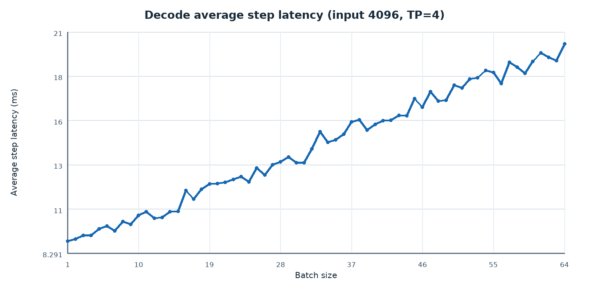
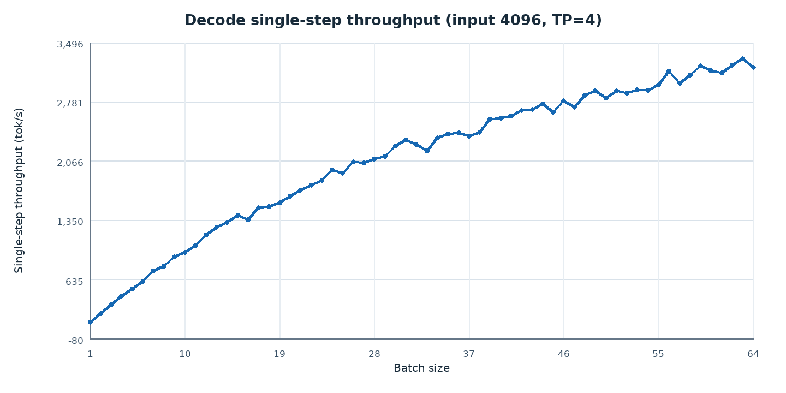
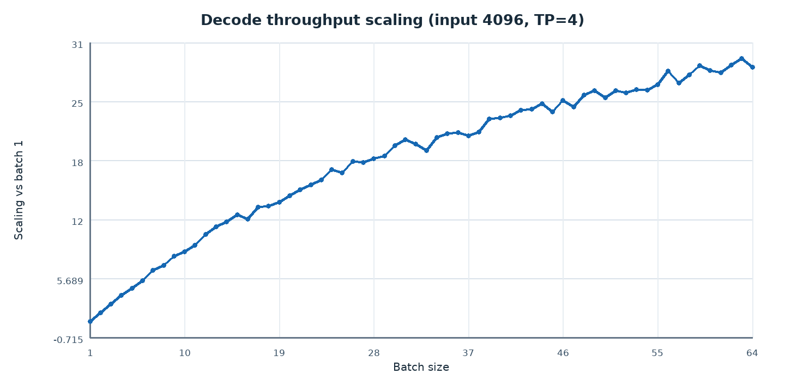

# Decode-Direct Input 4096 TP=4 性能报告

## 运行环境

| 项目 | 值 |
| --- | --- |
| 日期 | 2026-11-18 19:07:38-19:09:57（Asia/Shanghai） |
| 平台 | MetaX C500，64 GiB |
| 设备 | 4 x MetaX C500/C550，物理 GPU 3、4、5、6 |
| Driver / runtime | MetaX driver 3.3.12 / MACA 3.2.1.10 |
| InfiniLM build | 当前源码树；未记录独立 build ID |
| 模型 | `/data-aisoft/mechdancer/models/Qwen3-8B` |
| 模式 | `decode-direct` |
| Attention backend | `flash-attn` |
| Graph request | enabled |
| Expected execution mode | `graph` |
| Cache | paged KV cache，block size 256，num blocks 1,088 |
| Max batched tokens | 18,432 |
| Tensor parallel size | 4 |
| Input length | 4,096 tokens / request |
| Batch size | 1..64 |
| Warmup | 每个形状 3 次 repeat |
| Measured repeats | 每个形状 30 次 repeat |
| Batch 执行顺序 | random seed 2026 |
| 干扰控制 | 物理专用 GPU 3、4、5、6；每 10 秒采样 `mx-smi` |

本报告对应的原始 JSONL 和 log 为本机运行产物，不随仓库提交：

```text
../../../benchmark-decode-direct-metax-c500-tp4-qwen3-8b-input4096-batch1-64-clean-20261118.jsonl
../../../benchmark-decode-direct-metax-c500-tp4-qwen3-8b-input4096-batch1-64-clean-20261118.log
```

## 构建与测试命令

C++ 扩展使用当前源码构建并安装：

```bash
xmake build _infinilm && xmake install _infinilm
```

性能测试命令：

```bash
BENCHMARK_GPU=3,4,5,6 \
INFINILM_MAX_NUM_BATCHED_TOKENS=18432 \
BENCHMARK_MODE=decode-direct \
BATCH_SIZES="$(seq -s, 1 64)" \
INPUT_LENS=4096 \
BENCHMARK_REPEATS=30 \
BENCHMARK_OUTPUT=benchmark-decode-direct-metax-c500-tp4-qwen3-8b-input4096-batch1-64-clean-20261118.jsonl \
./run_bench-metax.sh
```


脚本说明：上述命令记录的是 2026-11-18 运行时的调用方式；当时本地 `run_bench-metax.sh` 硬编码 `--tp 4`。该脚本被仓库 `.gitignore` 忽略，不随本报告提交；复现时必须确认脚本仍为 `--tp 4`，并保持 `BENCHMARK_GPU=3,4,5,6`。

## 执行模式与 Graph 覆盖

当前 paged graph compiler 对 decode batch `1..64` 全部生成对应 graph；原始 JSONL 中所有 overall summary 的 `expected_execution_mode` 均为 `graph`，无 eager fallback 混入。
`expected_execution_mode` 是 benchmark 根据 compiler 规则推断的字段，不是 C++ runtime 回传的实际执行模式。

## 资源开销

| 项目 | 值 |
| --- | ---: |
| Workspace allocation | 每 rank 702.0 MiB，TP=4 合计 2,808.0 MiB |
| 权重加载时间 | 约 17.15 秒 |
| Paged cache blocks | 1,088 |
| 正式 repeat 数 | 1,920 |
| 正式 forward step 数 | 7,680 |
| 本轮总耗时 | 约 139.9 秒 |
| GPU 3/4/5/6 温度范围 | 30C-54C |
| GPU 3/4/5/6 功耗范围 | 92W-307W |
| GPU 3/4/5/6 进程显存峰值 | 20,058 MiB |

## 测试口径

- `decode-direct` 不执行语义完整的 prefill，paged KV cache 初始为全 0。
- Step 0 输入 dummy token；step 1 到 step 3 使用上一步 sampled token。
- 4 个 decode step 的 past KV length 分别为 4096、4097、4098、4099。
- 报告中的 duration 是单 step 时间，由一次 4-step repeat 的对应总耗时指标除以 4 得到。
- Throughput 是 single-step 吞吐：`batch_size / avg_step_duration_s`。
- 计时边界为 `engine_forward_including_sampling`，包含 Python wrapper、C++ engine forward、RankWorker forward、TP 通信、model forward/graph replay 和 sampling。
- 不包含 HTTP、JSON parsing、tokenization、scheduler queueing、`build_model_inputs`、detokenization 和 Python `generate()` 循环。
- 输出 token 不用于正确性判断。
- 分位数使用线性插值；每个 batch 30 个 repeat，p99 只能作为尾部参考。

## 核心结论

| 指标 | 结果 |
| --- | ---: |
| 最高 single-step 吞吐 | batch 63，3,304.40 tok/s |
| batch 63 平均单 step latency | 19.066 ms |
| batch 1 平均单 step latency | 8.954 ms |
| 最大 batch 64 平均单 step latency | 20.006 ms |
| 最大 batch 相对 batch 1 吞吐倍数 | 28.645x |

吞吐 Top 10 overall 结果：

| Batch | Avg Step ms | Single-step tok/s | Scaling |
| ---: | ---: | ---: | ---: |
| 63 | 19.066 | 3,304.40 | 29.589x |
| 62 | 19.233 | 3,223.59 | 28.866x |
| 59 | 18.353 | 3,214.80 | 28.787x |
| 64 | 20.006 | 3,199.01 | 28.645x |
| 60 | 19.024 | 3,153.90 | 28.242x |
| 56 | 17.777 | 3,150.06 | 28.207x |
| 61 | 19.482 | 3,131.10 | 28.037x |
| 58 | 18.700 | 3,101.60 | 27.773x |
| 57 | 18.964 | 3,005.71 | 26.915x |
| 55 | 18.408 | 2,987.91 | 26.755x |

## 趋势图

### 1. Batch size 与平均单 step latency



### 2. Batch size 与吞吐



### 3. Batch size 与吞吐 Scaling




平均单 step latency 从 batch 1 的 8.954 ms 增至 batch 64 的 20.006 ms。吞吐峰值为 batch 63 的 3,304.40 tok/s。

## Batch 区间平均 latency 与吞吐

下表按连续 16 个 batch 分组。`平均单 step latency ms` 和 `平均吞吐 tok/s` 分别是该区间内 batch 的 overall `Avg Step ms` 与 `Single-step tok/s` 的算术平均值；`区间最优 batch` 取该区间内吞吐最高的 batch。

| Batch 区间 | 平均单 step latency ms | 平均吞吐 tok/s | 区间最优 batch |
| --- | ---: | ---: | ---: |
| 1..16 | 10.009 | 823.35 | 15 |
| 17..32 | 12.744 | 1,909.09 | 31 |
| 33..48 | 15.759 | 2,563.11 | 48 |
| 49..64 | 18.483 | 3,052.77 | 63 |

区间平均 latency 随 batch size 整体增长；4 个区间中有 1 个区间的最优 batch 是区间右端点。偏离右端点的区间通常包含吞吐跳变或局部回落。

## 关键批次与跳变

下表列出吞吐下降幅度最大的相邻 batch 变化。

| Change | Avg step ms | Single-step tok/s | 吞吐变化 |
| --- | ---: | ---: | ---: |
| 56 -> 57 | 17.777 -> 18.964 | 3,150.06 -> 3,005.71 | -144.35 |
| 63 -> 64 | 19.066 -> 20.006 | 3,304.40 -> 3,199.01 | -105.39 |
| 44 -> 45 | 15.986 -> 16.938 | 2,752.40 -> 2,656.80 | -95.60 |
| 49 -> 50 | 16.845 -> 17.700 | 2,908.84 -> 2,824.81 | -84.03 |
| 46 -> 47 | 16.461 -> 17.328 | 2,794.41 -> 2,712.41 | -82.00 |

这些变化均在 graph 覆盖范围内，不能归因于 eager fallback。如需定位原因，应补充 kernel trace 或 C++ model-only 打点。

## Step 一致性

峰值 batch 63 的 4 个 decode step 结果如下：

| Step | Past KV length | Avg step ms | Std ms | Throughput tok/s |
| ---: | ---: | ---: | ---: | ---: |
| 0 | 4096 | 4.764 | 0.033 | 13,224.58 |
| 1 | 4097 | 4.764 | 0.025 | 13,224.25 |
| 2 | 4098 | 4.765 | 0.035 | 13,220.17 |
| 3 | 4099 | 4.772 | 0.060 | 13,201.38 |

所有 batch 中，4 个 step 平均耗时最大差异为 0.083 ms，出现在 batch 50。该差异主要来自 past KV length 增长以及不同 step 的 kernel 形状。

## 数据稳定性

- 64 个 overall summary换算为单 step 后的 std 中位数为 0.139 ms。
- 最大 std 为 0.775 ms，出现在 batch 60。
- 最大变异系数约 6.172%，中位变异系数约 0.947%。
- P50、P95、P99 和 max 普遍接近。
- 每个 batch 只有 30 个 repeat 样本；p99 可用于观察尾部，正式尾部对比建议提高到 100+ repeat。

## Single-step 完整结果

### Batch 1..64

| Batch | Mode | Avg Step ms | Min ms | P50 ms | P95 ms | P99 ms | Max ms | Std ms | Throughput tok/s | Scaling |
| ---: | --- | ---: | ---: | ---: | ---: | ---: | ---: | ---: | ---: | ---: |
| 1 | graph | 8.954 | 8.692 | 8.814 | 9.469 | 11.089 | 11.739 | 0.553 | 111.68 | 1.000x |
| 2 | graph | 9.091 | 8.815 | 8.880 | 9.726 | 10.408 | 10.671 | 0.422 | 220.01 | 1.970x |
| 3 | graph | 9.293 | 9.083 | 9.205 | 9.916 | 10.049 | 10.081 | 0.249 | 322.84 | 2.891x |
| 4 | graph | 9.284 | 9.155 | 9.258 | 9.537 | 9.803 | 9.849 | 0.139 | 430.84 | 3.858x |
| 5 | graph | 9.649 | 9.303 | 9.626 | 10.082 | 10.503 | 10.647 | 0.266 | 518.20 | 4.640x |
| 6 | graph | 9.800 | 9.587 | 9.723 | 10.341 | 10.482 | 10.524 | 0.237 | 612.24 | 5.482x |
| 7 | graph | 9.536 | 9.394 | 9.486 | 9.903 | 10.072 | 10.081 | 0.159 | 734.06 | 6.573x |
| 8 | graph | 10.067 | 9.867 | 9.990 | 10.678 | 10.968 | 11.007 | 0.257 | 794.64 | 7.116x |
| 9 | graph | 9.894 | 9.770 | 9.832 | 10.289 | 10.390 | 10.426 | 0.160 | 909.68 | 8.146x |
| 10 | graph | 10.399 | 10.224 | 10.343 | 10.754 | 10.901 | 10.907 | 0.168 | 961.63 | 8.611x |
| 11 | graph | 10.605 | 10.092 | 10.591 | 10.986 | 11.283 | 11.349 | 0.246 | 1,037.28 | 9.288x |
| 12 | graph | 10.243 | 10.171 | 10.230 | 10.306 | 10.435 | 10.485 | 0.057 | 1,171.51 | 10.490x |
| 13 | graph | 10.289 | 10.209 | 10.293 | 10.379 | 10.480 | 10.503 | 0.060 | 1,263.48 | 11.314x |
| 14 | graph | 10.610 | 10.519 | 10.590 | 10.737 | 10.847 | 10.870 | 0.071 | 1,319.52 | 11.816x |
| 15 | graph | 10.641 | 10.595 | 10.629 | 10.714 | 10.846 | 10.884 | 0.055 | 1,409.67 | 12.623x |
| 16 | graph | 11.796 | 11.545 | 11.779 | 12.080 | 12.300 | 12.343 | 0.154 | 1,356.34 | 12.145x |
| 17 | graph | 11.311 | 11.191 | 11.304 | 11.457 | 11.472 | 11.473 | 0.074 | 1,502.98 | 13.458x |
| 18 | graph | 11.874 | 11.690 | 11.869 | 12.000 | 12.210 | 12.282 | 0.101 | 1,515.86 | 13.574x |
| 19 | graph | 12.167 | 12.012 | 12.160 | 12.306 | 12.420 | 12.466 | 0.100 | 1,561.56 | 13.983x |
| 20 | graph | 12.197 | 12.082 | 12.163 | 12.447 | 12.657 | 12.686 | 0.129 | 1,639.81 | 14.684x |
| 21 | graph | 12.253 | 12.131 | 12.243 | 12.410 | 12.611 | 12.693 | 0.110 | 1,713.89 | 15.347x |
| 22 | graph | 12.405 | 12.248 | 12.392 | 12.646 | 12.737 | 12.740 | 0.117 | 1,773.49 | 15.881x |
| 23 | graph | 12.569 | 12.456 | 12.549 | 12.747 | 12.920 | 12.969 | 0.104 | 1,829.87 | 16.386x |
| 24 | graph | 12.265 | 12.187 | 12.254 | 12.341 | 12.456 | 12.499 | 0.058 | 1,956.74 | 17.522x |
| 25 | graph | 13.060 | 12.822 | 13.052 | 13.356 | 13.456 | 13.477 | 0.152 | 1,914.24 | 17.141x |
| 26 | graph | 12.671 | 12.563 | 12.658 | 12.815 | 12.884 | 12.890 | 0.070 | 2,051.91 | 18.374x |
| 27 | graph | 13.233 | 12.984 | 13.225 | 13.461 | 13.502 | 13.513 | 0.144 | 2,040.34 | 18.270x |
| 28 | graph | 13.398 | 13.212 | 13.388 | 13.642 | 13.816 | 13.877 | 0.135 | 2,089.84 | 18.713x |
| 29 | graph | 13.666 | 13.391 | 13.673 | 13.887 | 14.025 | 14.064 | 0.151 | 2,122.08 | 19.002x |
| 30 | graph | 13.352 | 13.191 | 13.334 | 13.574 | 13.655 | 13.668 | 0.097 | 2,246.78 | 20.119x |
| 31 | graph | 13.356 | 13.249 | 13.317 | 13.626 | 13.997 | 14.109 | 0.168 | 2,321.10 | 20.784x |
| 32 | graph | 14.129 | 13.934 | 14.120 | 14.337 | 14.549 | 14.621 | 0.139 | 2,264.92 | 20.281x |
| 33 | graph | 15.090 | 14.924 | 15.088 | 15.245 | 15.360 | 15.405 | 0.101 | 2,186.94 | 19.583x |
| 34 | graph | 14.485 | 14.343 | 14.487 | 14.593 | 14.678 | 14.712 | 0.074 | 2,347.22 | 21.018x |
| 35 | graph | 14.621 | 14.453 | 14.597 | 14.769 | 14.893 | 14.935 | 0.097 | 2,393.86 | 21.436x |
| 36 | graph | 14.958 | 14.652 | 14.827 | 15.427 | 15.560 | 15.608 | 0.261 | 2,406.79 | 21.552x |
| 37 | graph | 15.633 | 15.412 | 15.602 | 15.892 | 15.953 | 15.969 | 0.122 | 2,366.81 | 21.194x |
| 38 | graph | 15.750 | 15.538 | 15.742 | 15.876 | 16.095 | 16.172 | 0.111 | 2,412.69 | 21.604x |
| 39 | graph | 15.184 | 15.113 | 15.164 | 15.331 | 15.354 | 15.359 | 0.064 | 2,568.45 | 22.999x |
| 40 | graph | 15.500 | 15.404 | 15.488 | 15.630 | 15.676 | 15.683 | 0.066 | 2,580.61 | 23.108x |
| 41 | graph | 15.700 | 15.467 | 15.618 | 15.879 | 17.005 | 17.431 | 0.334 | 2,611.52 | 23.385x |
| 42 | graph | 15.714 | 15.531 | 15.725 | 15.814 | 15.819 | 15.820 | 0.063 | 2,672.75 | 23.933x |
| 43 | graph | 15.993 | 15.820 | 15.981 | 16.176 | 16.291 | 16.295 | 0.089 | 2,688.61 | 24.075x |
| 44 | graph | 15.986 | 15.816 | 15.970 | 16.291 | 16.315 | 16.320 | 0.124 | 2,752.40 | 24.646x |
| 45 | graph | 16.938 | 16.369 | 17.128 | 17.322 | 17.710 | 17.867 | 0.393 | 2,656.80 | 23.790x |
| 46 | graph | 16.461 | 16.168 | 16.429 | 16.736 | 17.297 | 17.510 | 0.228 | 2,794.41 | 25.023x |
| 47 | graph | 17.328 | 17.140 | 17.288 | 17.636 | 17.843 | 17.895 | 0.168 | 2,712.41 | 24.288x |
| 48 | graph | 16.798 | 16.698 | 16.766 | 17.020 | 17.041 | 17.049 | 0.086 | 2,857.44 | 25.587x |
| 49 | graph | 16.845 | 16.730 | 16.813 | 17.012 | 17.151 | 17.205 | 0.098 | 2,908.84 | 26.047x |
| 50 | graph | 17.700 | 17.311 | 17.556 | 18.634 | 20.016 | 20.382 | 0.590 | 2,824.81 | 25.295x |
| 51 | graph | 17.531 | 17.271 | 17.453 | 17.863 | 18.218 | 18.355 | 0.221 | 2,909.18 | 26.050x |
| 52 | graph | 18.020 | 17.798 | 17.968 | 18.348 | 18.492 | 18.539 | 0.184 | 2,885.61 | 25.839x |
| 53 | graph | 18.102 | 17.936 | 18.078 | 18.461 | 18.688 | 18.690 | 0.171 | 2,927.86 | 26.217x |
| 54 | graph | 18.519 | 18.380 | 18.490 | 18.850 | 19.179 | 19.230 | 0.178 | 2,915.97 | 26.111x |
| 55 | graph | 18.408 | 18.130 | 18.366 | 18.880 | 18.942 | 18.953 | 0.194 | 2,987.91 | 26.755x |
| 56 | graph | 17.777 | 17.643 | 17.765 | 17.977 | 18.054 | 18.082 | 0.099 | 3,150.06 | 28.207x |
| 57 | graph | 18.964 | 18.796 | 18.925 | 19.304 | 19.422 | 19.430 | 0.147 | 3,005.71 | 26.915x |
| 58 | graph | 18.700 | 18.435 | 18.688 | 18.895 | 18.902 | 18.903 | 0.110 | 3,101.60 | 27.773x |
| 59 | graph | 18.353 | 18.136 | 18.334 | 18.577 | 18.648 | 18.672 | 0.118 | 3,214.80 | 28.787x |
| 60 | graph | 19.024 | 18.271 | 18.522 | 20.087 | 20.794 | 21.058 | 0.775 | 3,153.90 | 28.242x |
| 61 | graph | 19.482 | 19.324 | 19.450 | 19.794 | 19.991 | 20.001 | 0.150 | 3,131.10 | 28.037x |
| 62 | graph | 19.233 | 18.610 | 19.394 | 19.680 | 19.824 | 19.876 | 0.386 | 3,223.59 | 28.866x |
| 63 | graph | 19.066 | 18.887 | 19.061 | 19.224 | 19.307 | 19.333 | 0.086 | 3,304.40 | 29.589x |
| 64 | graph | 20.006 | 19.630 | 19.966 | 20.411 | 20.544 | 20.582 | 0.190 | 3,199.01 | 28.645x |

## 结果分析

1. 吞吐最高出现在 batch 63，为 3,304.40 tok/s。
2. 最大 batch 64 的吞吐为 3,199.01 tok/s，低于峰值约 3.19%。
3. 对比 MetaX TP=1 峰值 1,339.42 tok/s，本报告 TP=4 峰值为其 2.467x。
4. 对比 MetaX TP=2 峰值 2,163.46 tok/s，本报告 TP=4 峰值为其 1.527x；占用四张卡后的每卡效率为 TP=2 的 0.764x。
5. 对比 NVIDIA A100 TP=4 峰值 4,181.42 tok/s，本报告峰值约为其 0.790x。
6. 正式 p99 对比建议将 `BENCHMARK_REPEATS` 提高到 100 或以上。

## 结论与建议

1. 在本轮 input length 4096、TP=4、batch `1..64` 范围内，**batch 63 吞吐最高**，约 3,304.40 tok/s。
2. batch 63 平均单 step latency 为 19.066 ms。
3. TP=4 相对 TP=2 继续提高总吞吐，但每卡效率低于 TP=2；是否采用 TP=4 应结合 SLO、总吞吐、时延和部署密度评估。
4. 所有样本均在专用 GPU 3、4、5、6 上采集；监控期间目标卡没有外来进程或多进程干扰。

## 数据完整性

```text
config records: 1
sample records: 7,680
overall summary records: 64
step summary records: 320
scaling records: 64
samples per batch: 30
expected execution modes: all graph
```
