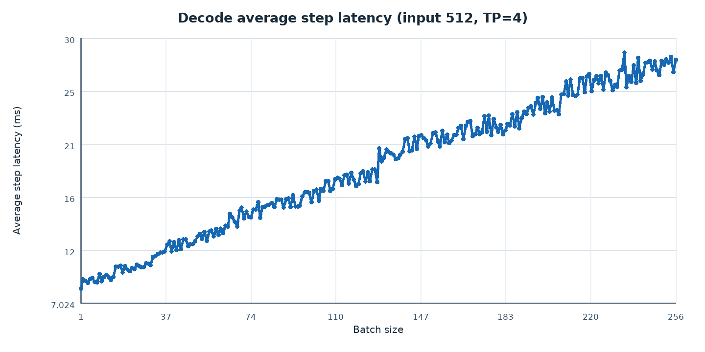
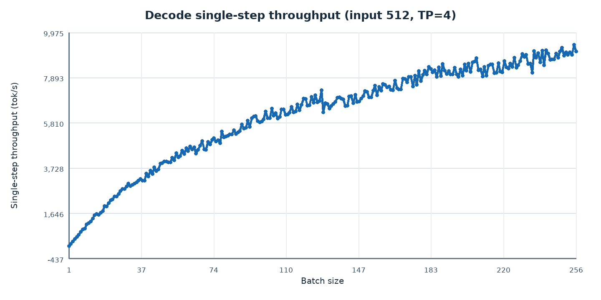
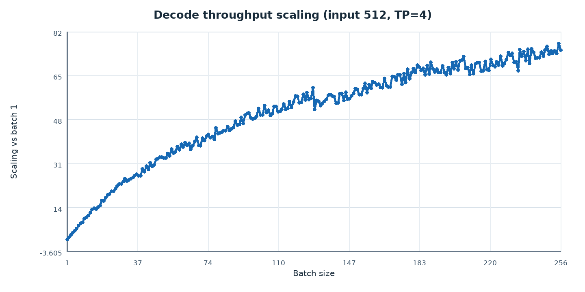

# Decode-Direct Input 512 TP=4 性能报告

## 运行环境

| 项目 | 值 |
| --- | --- |
| 日期 | 2026-11-18 18:37:11-18:48:38（Asia/Shanghai） |
| 平台 | MetaX C500，64 GiB |
| 设备 | 4 x MetaX C500/C550，物理 GPU 3、4、5、6 |
| Driver / runtime | MetaX driver 3.3.12 / MACA 3.2.1.10 |
| InfiniLM build | 当前源码树；未记录独立 build ID |
| 模型 | `/data-aisoft/mechdancer/models/Qwen3-8B` |
| 模式 | `decode-direct` |
| Attention backend | `flash-attn` |
| Graph request | enabled |
| Expected execution mode | `graph` |
| Cache | paged KV cache，block size 256，num blocks 768 |
| Max batched tokens | 18,432 |
| Tensor parallel size | 4 |
| Input length | 512 tokens / request |
| Batch size | 1..256 |
| Warmup | 每个形状 3 次 repeat |
| Measured repeats | 每个形状 30 次 repeat |
| Batch 执行顺序 | random seed 2026 |
| 干扰控制 | 物理专用 GPU 3、4、5、6；每 10 秒采样 `mx-smi` |

本报告对应的原始 JSONL 和 log 为本机运行产物，不随仓库提交：

```text
../../../benchmark-decode-direct-metax-c500-tp4-qwen3-8b-input512-batch1-256-clean-20261118.jsonl
../../../benchmark-decode-direct-metax-c500-tp4-qwen3-8b-input512-batch1-256-clean-20261118.log
```

## 构建与测试命令

C++ 扩展使用当前源码构建并安装：

```bash
xmake build _infinilm && xmake install _infinilm
```

性能测试命令：

```bash
BENCHMARK_GPU=3,4,5,6 \
INFINILM_MAX_NUM_BATCHED_TOKENS=18432 \
BENCHMARK_MODE=decode-direct \
BATCH_SIZES="$(seq -s, 1 256)" \
INPUT_LENS=512 \
BENCHMARK_REPEATS=30 \
BENCHMARK_OUTPUT=benchmark-decode-direct-metax-c500-tp4-qwen3-8b-input512-batch1-256-clean-20261118.jsonl \
./run_bench-metax.sh
```


脚本说明：上述命令记录的是 2026-11-18 运行时的调用方式；当时本地 `run_bench-metax.sh` 硬编码 `--tp 4`。该脚本被仓库 `.gitignore` 忽略，不随本报告提交；复现时必须确认脚本仍为 `--tp 4`，并保持 `BENCHMARK_GPU=3,4,5,6`。

## 执行模式与 Graph 覆盖

当前 paged graph compiler 对 decode batch `1..256` 全部生成对应 graph；原始 JSONL 中所有 overall summary 的 `expected_execution_mode` 均为 `graph`，无 eager fallback 混入。
`expected_execution_mode` 是 benchmark 根据 compiler 规则推断的字段，不是 C++ runtime 回传的实际执行模式。

## 资源开销

| 项目 | 值 |
| --- | ---: |
| Workspace allocation | 每 rank 702.0 MiB，TP=4 合计 2,808.0 MiB |
| 权重加载时间 | 约 47.05 秒 |
| Paged cache blocks | 768 |
| 正式 repeat 数 | 7,680 |
| 正式 forward step 数 | 30,720 |
| 本轮总耗时 | 约 687.5 秒 |
| GPU 3/4/5/6 温度范围 | 30C-54C |
| GPU 3/4/5/6 功耗范围 | 92W-307W |
| GPU 3/4/5/6 进程显存峰值 | 20,058 MiB |

## 测试口径

- `decode-direct` 不执行语义完整的 prefill，paged KV cache 初始为全 0。
- Step 0 输入 dummy token；step 1 到 step 3 使用上一步 sampled token。
- 4 个 decode step 的 past KV length 分别为 512、513、514、515。
- 报告中的 duration 是单 step 时间，由一次 4-step repeat 的对应总耗时指标除以 4 得到。
- Throughput 是 single-step 吞吐：`batch_size / avg_step_duration_s`。
- 计时边界为 `engine_forward_including_sampling`，包含 Python wrapper、C++ engine forward、RankWorker forward、TP 通信、model forward/graph replay 和 sampling。
- 不包含 HTTP、JSON parsing、tokenization、scheduler queueing、`build_model_inputs`、detokenization 和 Python `generate()` 循环。
- 输出 token 不用于正确性判断。
- 分位数使用线性插值；每个 batch 30 个 repeat，p99 只能作为尾部参考。

## 核心结论

| 指标 | 结果 |
| --- | ---: |
| 最高 single-step 吞吐 | batch 255，9,417.38 tok/s |
| batch 255 平均单 step latency | 27.078 ms |
| batch 1 平均单 step latency | 8.256 ms |
| 最大 batch 256 平均单 step latency | 28.123 ms |
| 最大 batch 相对 batch 1 吞吐倍数 | 75.157x |

吞吐 Top 10 overall 结果：

| Batch | Avg Step ms | Single-step tok/s | Scaling |
| ---: | ---: | ---: | ---: |
| 255 | 27.078 | 9,417.38 | 77.753x |
| 249 | 26.827 | 9,281.77 | 76.634x |
| 241 | 26.326 | 9,154.54 | 75.583x |
| 239 | 26.149 | 9,140.05 | 75.464x |
| 235 | 25.756 | 9,124.04 | 75.332x |
| 256 | 28.123 | 9,102.95 | 75.157x |
| 248 | 27.251 | 9,100.62 | 75.138x |
| 253 | 27.890 | 9,071.50 | 74.898x |
| 251 | 27.709 | 9,058.33 | 74.789x |
| 237 | 26.249 | 9,028.92 | 74.546x |

## 趋势图

### 1. Batch size 与平均单 step latency



### 2. Batch size 与吞吐



### 3. Batch size 与吞吐 Scaling




平均单 step latency 从 batch 1 的 8.256 ms 增至 batch 256 的 28.123 ms。吞吐峰值为 batch 255 的 9,417.38 tok/s。

## Batch 区间平均 latency 与吞吐

下表按连续 16 个 batch 分组。`平均单 step latency ms` 和 `平均吞吐 tok/s` 分别是该区间内 batch 的 overall `Avg Step ms` 与 `Single-step tok/s` 的算术平均值；`区间最优 batch` 取该区间内吞吐最高的 batch。

| Batch 区间 | 平均单 step latency ms | 平均吞吐 tok/s | 区间最优 batch |
| --- | ---: | ---: | ---: |
| 1..16 | 9.132 | 917.41 | 15 |
| 17..32 | 10.208 | 2,394.08 | 31 |
| 33..48 | 11.879 | 3,403.84 | 48 |
| 49..64 | 13.029 | 4,331.97 | 62 |
| 65..80 | 14.811 | 4,895.51 | 78 |
| 81..96 | 15.752 | 5,620.20 | 95 |
| 97..112 | 16.966 | 6,160.28 | 103 |
| 113..128 | 17.914 | 6,729.38 | 128 |
| 129..144 | 20.234 | 6,748.51 | 143 |
| 145..160 | 21.228 | 7,186.87 | 159 |
| 161..176 | 22.164 | 7,605.95 | 175 |
| 177..192 | 22.614 | 8,161.62 | 189 |
| 193..208 | 24.200 | 8,289.25 | 206 |
| 209..224 | 26.026 | 8,322.54 | 220 |
| 225..240 | 26.701 | 8,715.82 | 239 |
| 241..256 | 27.619 | 8,999.75 | 255 |

区间平均 latency 随 batch size 整体增长；16 个区间中有 2 个区间的最优 batch 是区间右端点。偏离右端点的区间通常包含吞吐跳变或局部回落。

## 关键批次与跳变

下表列出吞吐下降幅度最大的相邻 batch 变化。

| Change | Avg step ms | Single-step tok/s | 吞吐变化 |
| --- | ---: | ---: | ---: |
| 128 -> 129 | 17.513 -> 20.469 | 7,308.99 -> 6,302.16 | -1,006.83 |
| 239 -> 240 | 26.149 -> 28.313 | 9,140.05 -> 8,476.62 | -663.43 |
| 206 -> 207 | 23.447 -> 25.107 | 8,785.62 -> 8,244.61 | -541.00 |
| 177 -> 178 | 21.612 -> 23.024 | 8,189.81 -> 7,730.94 | -458.86 |
| 225 -> 226 | 25.558 -> 27.044 | 8,803.58 -> 8,356.68 | -446.90 |

这些变化均在 graph 覆盖范围内，不能归因于 eager fallback。如需定位原因，应补充 kernel trace 或 C++ model-only 打点。

## Step 一致性

峰值 batch 255 的 4 个 decode step 结果如下：

| Step | Past KV length | Avg step ms | Std ms | Throughput tok/s |
| ---: | ---: | ---: | ---: | ---: |
| 0 | 512 | 6.774 | 0.076 | 37,645.35 |
| 1 | 513 | 6.760 | 0.055 | 37,719.74 |
| 2 | 514 | 6.765 | 0.053 | 37,696.71 |
| 3 | 515 | 6.779 | 0.058 | 37,616.49 |

所有 batch 中，4 个 step 平均耗时最大差异为 0.116 ms，出现在 batch 240。该差异主要来自 past KV length 增长以及不同 step 的 kernel 形状。

## 数据稳定性

- 256 个 overall summary换算为单 step 后的 std 中位数为 0.175 ms。
- 最大 std 为 1.609 ms，出现在 batch 240。
- 最大变异系数约 8.518%，中位变异系数约 0.995%。
- P50、P95、P99 和 max 普遍接近。
- 每个 batch 只有 30 个 repeat 样本；p99 可用于观察尾部，正式尾部对比建议提高到 100+ repeat。

## Single-step 完整结果

### Batch 1..64

| Batch | Mode | Avg Step ms | Min ms | P50 ms | P95 ms | P99 ms | Max ms | Std ms | Throughput tok/s | Scaling |
| ---: | --- | ---: | ---: | ---: | ---: | ---: | ---: | ---: | ---: | ---: |
| 1 | graph | 8.256 | 8.087 | 8.224 | 8.472 | 8.478 | 8.480 | 0.116 | 121.12 | 1.000x |
| 2 | graph | 9.070 | 8.834 | 8.970 | 9.562 | 9.672 | 9.700 | 0.230 | 220.52 | 1.821x |
| 3 | graph | 8.974 | 8.707 | 8.937 | 9.236 | 9.563 | 9.693 | 0.228 | 334.28 | 2.760x |
| 4 | graph | 8.781 | 8.521 | 8.670 | 9.010 | 10.953 | 11.698 | 0.553 | 455.52 | 3.761x |
| 5 | graph | 9.111 | 8.962 | 9.108 | 9.272 | 9.431 | 9.474 | 0.101 | 548.79 | 4.531x |
| 6 | graph | 9.202 | 8.941 | 9.080 | 9.797 | 9.877 | 9.896 | 0.276 | 652.06 | 5.384x |
| 7 | graph | 8.855 | 8.696 | 8.781 | 9.123 | 9.127 | 9.128 | 0.149 | 790.48 | 6.526x |
| 8 | graph | 8.839 | 8.645 | 8.823 | 8.931 | 9.321 | 9.466 | 0.131 | 905.03 | 7.472x |
| 9 | graph | 9.561 | 9.201 | 9.391 | 10.232 | 10.309 | 10.333 | 0.368 | 941.30 | 7.772x |
| 10 | graph | 8.895 | 8.719 | 8.902 | 8.946 | 9.048 | 9.090 | 0.058 | 1,124.22 | 9.282x |
| 11 | graph | 9.305 | 9.170 | 9.301 | 9.407 | 9.571 | 9.631 | 0.081 | 1,182.10 | 9.760x |
| 12 | graph | 9.481 | 9.348 | 9.482 | 9.566 | 9.680 | 9.725 | 0.069 | 1,265.65 | 10.450x |
| 13 | graph | 9.257 | 9.035 | 9.105 | 10.040 | 10.093 | 10.099 | 0.334 | 1,404.33 | 11.595x |
| 14 | graph | 9.038 | 8.897 | 8.976 | 9.364 | 9.582 | 9.657 | 0.163 | 1,549.03 | 12.789x |
| 15 | graph | 9.284 | 9.191 | 9.255 | 9.495 | 9.690 | 9.728 | 0.111 | 1,615.62 | 13.339x |
| 16 | graph | 10.200 | 10.050 | 10.146 | 10.514 | 10.930 | 11.024 | 0.191 | 1,568.58 | 12.951x |
| 17 | graph | 10.189 | 10.000 | 10.123 | 10.723 | 10.783 | 10.795 | 0.207 | 1,668.50 | 13.776x |
| 18 | graph | 10.291 | 10.049 | 10.305 | 10.467 | 10.581 | 10.614 | 0.127 | 1,749.07 | 14.441x |
| 19 | graph | 9.666 | 9.529 | 9.655 | 9.803 | 9.821 | 9.828 | 0.085 | 1,965.67 | 16.229x |
| 20 | graph | 10.234 | 10.036 | 10.234 | 10.412 | 10.523 | 10.563 | 0.108 | 1,954.32 | 16.136x |
| 21 | graph | 9.952 | 9.676 | 9.948 | 10.330 | 10.710 | 10.832 | 0.230 | 2,110.22 | 17.423x |
| 22 | graph | 9.794 | 9.560 | 9.685 | 10.305 | 10.343 | 10.350 | 0.242 | 2,246.28 | 18.546x |
| 23 | graph | 10.062 | 9.712 | 9.873 | 10.857 | 12.339 | 12.938 | 0.620 | 2,285.76 | 18.872x |
| 24 | graph | 9.955 | 9.725 | 9.857 | 10.843 | 10.876 | 10.882 | 0.310 | 2,410.80 | 19.904x |
| 25 | graph | 10.352 | 10.071 | 10.287 | 10.681 | 10.876 | 10.914 | 0.193 | 2,415.04 | 19.939x |
| 26 | graph | 10.246 | 10.047 | 10.124 | 11.117 | 11.214 | 11.246 | 0.327 | 2,537.54 | 20.951x |
| 27 | graph | 10.157 | 10.042 | 10.124 | 10.327 | 10.362 | 10.368 | 0.089 | 2,658.27 | 21.948x |
| 28 | graph | 10.148 | 9.905 | 10.185 | 10.260 | 10.266 | 10.267 | 0.106 | 2,759.17 | 22.781x |
| 29 | graph | 10.493 | 10.306 | 10.473 | 10.707 | 10.766 | 10.769 | 0.117 | 2,763.63 | 22.818x |
| 30 | graph | 10.427 | 10.146 | 10.322 | 11.478 | 11.734 | 11.762 | 0.394 | 2,877.16 | 23.755x |
| 31 | graph | 10.312 | 10.165 | 10.330 | 10.416 | 10.431 | 10.436 | 0.084 | 3,006.14 | 24.820x |
| 32 | graph | 11.043 | 10.790 | 10.976 | 11.488 | 11.810 | 11.890 | 0.225 | 2,897.78 | 23.925x |
| 33 | graph | 11.140 | 11.005 | 11.117 | 11.285 | 11.375 | 11.403 | 0.077 | 2,962.31 | 24.458x |
| 34 | graph | 11.290 | 11.174 | 11.264 | 11.493 | 11.513 | 11.518 | 0.098 | 3,011.64 | 24.865x |
| 35 | graph | 11.426 | 11.220 | 11.421 | 11.548 | 11.566 | 11.572 | 0.084 | 3,063.15 | 25.291x |
| 36 | graph | 11.410 | 11.251 | 11.410 | 11.608 | 11.659 | 11.677 | 0.106 | 3,155.22 | 26.051x |
| 37 | graph | 11.511 | 11.332 | 11.441 | 11.853 | 11.953 | 11.970 | 0.164 | 3,214.24 | 26.538x |
| 38 | graph | 12.097 | 11.958 | 12.086 | 12.309 | 12.428 | 12.471 | 0.112 | 3,141.39 | 25.937x |
| 39 | graph | 12.387 | 12.170 | 12.309 | 13.013 | 13.073 | 13.088 | 0.235 | 3,148.41 | 25.994x |
| 40 | graph | 11.499 | 11.400 | 11.490 | 11.632 | 11.672 | 11.685 | 0.071 | 3,478.41 | 28.719x |
| 41 | graph | 12.307 | 12.189 | 12.277 | 12.424 | 12.587 | 12.645 | 0.088 | 3,331.49 | 27.506x |
| 42 | graph | 11.629 | 11.502 | 11.635 | 11.713 | 11.716 | 11.717 | 0.057 | 3,611.77 | 29.820x |
| 43 | graph | 12.458 | 12.271 | 12.461 | 12.599 | 12.838 | 12.921 | 0.118 | 3,451.65 | 28.498x |
| 44 | graph | 11.696 | 11.492 | 11.718 | 11.882 | 11.946 | 11.958 | 0.128 | 3,761.90 | 31.060x |
| 45 | graph | 12.552 | 11.717 | 12.584 | 13.899 | 14.566 | 14.708 | 0.727 | 3,585.11 | 29.600x |
| 46 | graph | 12.555 | 12.377 | 12.518 | 12.839 | 12.997 | 13.053 | 0.133 | 3,663.89 | 30.250x |
| 47 | graph | 11.963 | 11.660 | 11.919 | 12.474 | 12.507 | 12.519 | 0.193 | 3,928.94 | 32.439x |
| 48 | graph | 12.146 | 11.939 | 12.042 | 12.582 | 12.631 | 12.631 | 0.209 | 3,951.85 | 32.628x |
| 49 | graph | 12.141 | 11.772 | 12.022 | 12.928 | 13.004 | 13.008 | 0.323 | 4,035.96 | 33.322x |
| 50 | graph | 12.389 | 11.899 | 12.035 | 15.246 | 15.923 | 16.066 | 1.055 | 4,035.96 | 33.322x |
| 51 | graph | 12.808 | 12.660 | 12.803 | 12.915 | 13.151 | 13.247 | 0.113 | 3,981.92 | 32.876x |
| 52 | graph | 13.017 | 12.689 | 13.002 | 13.398 | 13.599 | 13.656 | 0.188 | 3,994.85 | 32.983x |
| 53 | graph | 12.605 | 12.222 | 12.544 | 13.018 | 13.283 | 13.373 | 0.256 | 4,204.70 | 34.716x |
| 54 | graph | 13.205 | 12.936 | 13.166 | 13.569 | 13.876 | 13.994 | 0.206 | 4,089.34 | 33.763x |
| 55 | graph | 12.447 | 12.161 | 12.444 | 12.623 | 12.677 | 12.686 | 0.100 | 4,418.61 | 36.482x |
| 56 | graph | 13.254 | 13.073 | 13.243 | 13.337 | 13.778 | 13.951 | 0.143 | 4,225.22 | 34.885x |
| 57 | graph | 13.317 | 13.118 | 13.294 | 13.704 | 13.870 | 13.875 | 0.168 | 4,280.36 | 35.340x |
| 58 | graph | 12.821 | 12.450 | 12.794 | 13.264 | 13.291 | 13.294 | 0.243 | 4,523.80 | 37.350x |
| 59 | graph | 13.469 | 13.222 | 13.456 | 13.747 | 13.897 | 13.949 | 0.162 | 4,380.31 | 36.166x |
| 60 | graph | 12.931 | 12.570 | 12.841 | 13.337 | 13.352 | 13.353 | 0.306 | 4,640.09 | 38.310x |
| 61 | graph | 13.508 | 13.264 | 13.454 | 13.775 | 14.067 | 14.178 | 0.172 | 4,515.90 | 37.285x |
| 62 | graph | 13.124 | 12.751 | 12.997 | 13.984 | 14.365 | 14.379 | 0.395 | 4,724.00 | 39.003x |
| 63 | graph | 13.761 | 13.589 | 13.727 | 14.013 | 14.124 | 14.165 | 0.140 | 4,578.13 | 37.799x |
| 64 | graph | 13.668 | 13.459 | 13.651 | 13.928 | 14.166 | 14.251 | 0.156 | 4,682.40 | 38.660x |

### Batch 65..128

| Batch | Mode | Avg Step ms | Min ms | P50 ms | P95 ms | P99 ms | Max ms | Std ms | Throughput tok/s | Scaling |
| ---: | --- | ---: | ---: | ---: | ---: | ---: | ---: | ---: | ---: | ---: |
| 65 | graph | 14.790 | 14.602 | 14.739 | 15.206 | 15.315 | 15.331 | 0.175 | 4,394.99 | 36.287x |
| 66 | graph | 14.464 | 14.241 | 14.424 | 14.800 | 14.877 | 14.883 | 0.171 | 4,562.91 | 37.673x |
| 67 | graph | 14.075 | 13.951 | 14.069 | 14.205 | 14.269 | 14.293 | 0.077 | 4,760.26 | 39.303x |
| 68 | graph | 13.682 | 13.386 | 13.703 | 13.828 | 13.890 | 13.914 | 0.123 | 4,969.89 | 41.033x |
| 69 | graph | 15.065 | 14.897 | 15.022 | 15.375 | 15.549 | 15.558 | 0.155 | 4,580.06 | 37.815x |
| 70 | graph | 15.305 | 14.681 | 15.501 | 15.835 | 16.421 | 16.658 | 0.483 | 4,573.59 | 37.761x |
| 71 | graph | 14.370 | 14.198 | 14.373 | 14.533 | 14.578 | 14.584 | 0.090 | 4,940.80 | 40.793x |
| 72 | graph | 14.966 | 14.774 | 14.934 | 15.331 | 15.642 | 15.684 | 0.185 | 4,811.01 | 39.722x |
| 73 | graph | 14.509 | 14.383 | 14.495 | 14.667 | 14.756 | 14.761 | 0.078 | 5,031.50 | 41.542x |
| 74 | graph | 14.469 | 14.174 | 14.447 | 14.829 | 14.955 | 14.962 | 0.185 | 5,114.26 | 42.225x |
| 75 | graph | 15.158 | 14.904 | 15.165 | 15.421 | 15.452 | 15.462 | 0.168 | 4,948.04 | 40.853x |
| 76 | graph | 15.146 | 14.840 | 15.129 | 15.559 | 15.740 | 15.790 | 0.210 | 5,017.72 | 41.428x |
| 77 | graph | 15.799 | 14.477 | 15.903 | 16.454 | 16.555 | 16.581 | 0.599 | 4,873.84 | 40.240x |
| 78 | graph | 14.410 | 14.085 | 14.399 | 14.641 | 14.752 | 14.786 | 0.149 | 5,412.73 | 44.690x |
| 79 | graph | 15.351 | 15.132 | 15.339 | 15.546 | 15.829 | 15.938 | 0.151 | 5,146.09 | 42.488x |
| 80 | graph | 15.413 | 15.201 | 15.366 | 15.898 | 15.996 | 16.010 | 0.191 | 5,190.45 | 42.854x |
| 81 | graph | 15.527 | 15.344 | 15.477 | 15.923 | 16.250 | 16.309 | 0.194 | 5,216.84 | 43.072x |
| 82 | graph | 15.561 | 15.375 | 15.511 | 16.097 | 16.175 | 16.185 | 0.198 | 5,269.65 | 43.508x |
| 83 | graph | 15.698 | 15.386 | 15.690 | 15.980 | 16.196 | 16.225 | 0.164 | 5,287.40 | 43.655x |
| 84 | graph | 15.363 | 14.987 | 15.365 | 15.696 | 15.759 | 15.766 | 0.229 | 5,467.73 | 45.144x |
| 85 | graph | 16.028 | 15.803 | 15.971 | 16.582 | 16.651 | 16.657 | 0.214 | 5,303.34 | 43.786x |
| 86 | graph | 16.017 | 15.822 | 15.997 | 16.208 | 16.243 | 16.252 | 0.128 | 5,369.34 | 44.331x |
| 87 | graph | 15.990 | 15.774 | 15.976 | 16.260 | 16.269 | 16.270 | 0.130 | 5,440.95 | 44.923x |
| 88 | graph | 15.310 | 15.163 | 15.279 | 15.522 | 15.704 | 15.771 | 0.129 | 5,747.86 | 47.456x |
| 89 | graph | 16.044 | 15.846 | 15.977 | 16.392 | 16.576 | 16.603 | 0.175 | 5,547.34 | 45.801x |
| 90 | graph | 16.115 | 15.954 | 16.067 | 16.524 | 16.685 | 16.718 | 0.175 | 5,584.85 | 46.111x |
| 91 | graph | 15.367 | 15.168 | 15.328 | 15.781 | 15.809 | 15.819 | 0.158 | 5,921.75 | 48.892x |
| 92 | graph | 16.378 | 16.110 | 16.317 | 16.880 | 17.014 | 17.035 | 0.224 | 5,617.15 | 46.377x |
| 93 | graph | 15.415 | 15.289 | 15.404 | 15.553 | 15.690 | 15.743 | 0.089 | 6,033.24 | 49.813x |
| 94 | graph | 15.414 | 15.137 | 15.441 | 15.596 | 15.649 | 15.669 | 0.123 | 6,098.31 | 50.350x |
| 95 | graph | 15.499 | 15.396 | 15.474 | 15.676 | 15.780 | 15.791 | 0.092 | 6,129.29 | 50.606x |
| 96 | graph | 16.304 | 15.918 | 16.337 | 16.677 | 16.879 | 16.906 | 0.232 | 5,888.10 | 48.614x |
| 97 | graph | 16.617 | 16.369 | 16.584 | 16.908 | 17.187 | 17.267 | 0.184 | 5,837.53 | 48.197x |
| 98 | graph | 16.687 | 16.454 | 16.643 | 16.949 | 17.235 | 17.351 | 0.194 | 5,872.94 | 48.489x |
| 99 | graph | 16.600 | 16.382 | 16.541 | 17.027 | 17.125 | 17.138 | 0.191 | 5,963.70 | 49.239x |
| 100 | graph | 15.806 | 15.665 | 15.782 | 15.997 | 16.098 | 16.122 | 0.105 | 6,326.75 | 52.236x |
| 101 | graph | 16.744 | 16.545 | 16.699 | 16.974 | 17.202 | 17.294 | 0.160 | 6,031.89 | 49.802x |
| 102 | graph | 16.905 | 16.682 | 16.848 | 17.416 | 17.537 | 17.553 | 0.222 | 6,033.74 | 49.817x |
| 103 | graph | 15.919 | 15.687 | 15.906 | 16.139 | 16.201 | 16.223 | 0.132 | 6,470.13 | 53.420x |
| 104 | graph | 16.933 | 16.739 | 16.909 | 17.219 | 17.397 | 17.437 | 0.151 | 6,141.97 | 50.710x |
| 105 | graph | 16.758 | 16.670 | 16.737 | 16.855 | 16.926 | 16.949 | 0.061 | 6,265.61 | 51.731x |
| 106 | graph | 17.632 | 17.393 | 17.601 | 18.080 | 18.141 | 18.145 | 0.190 | 6,011.71 | 49.635x |
| 107 | graph | 17.606 | 17.484 | 17.552 | 17.992 | 18.096 | 18.115 | 0.157 | 6,077.37 | 50.177x |
| 108 | graph | 16.784 | 16.612 | 16.754 | 17.002 | 17.026 | 17.031 | 0.110 | 6,434.72 | 53.127x |
| 109 | graph | 16.950 | 16.670 | 16.940 | 17.240 | 17.374 | 17.428 | 0.181 | 6,430.52 | 53.093x |
| 110 | graph | 17.771 | 17.151 | 17.888 | 18.098 | 18.244 | 18.302 | 0.290 | 6,189.76 | 51.105x |
| 111 | graph | 17.909 | 17.651 | 17.895 | 18.250 | 18.474 | 18.520 | 0.177 | 6,197.83 | 51.172x |
| 112 | graph | 17.839 | 17.031 | 17.917 | 18.389 | 18.621 | 18.707 | 0.440 | 6,278.23 | 51.835x |
| 113 | graph | 17.268 | 16.939 | 17.216 | 17.824 | 18.101 | 18.204 | 0.301 | 6,544.06 | 54.030x |
| 114 | graph | 18.130 | 17.921 | 18.092 | 18.518 | 18.729 | 18.758 | 0.180 | 6,288.02 | 51.916x |
| 115 | graph | 18.158 | 17.974 | 18.127 | 18.458 | 18.713 | 18.764 | 0.161 | 6,333.18 | 52.289x |
| 116 | graph | 17.413 | 17.176 | 17.339 | 17.940 | 18.318 | 18.406 | 0.255 | 6,661.52 | 55.000x |
| 117 | graph | 18.317 | 18.126 | 18.284 | 18.715 | 18.809 | 18.821 | 0.175 | 6,387.56 | 52.738x |
| 118 | graph | 17.747 | 17.177 | 17.761 | 18.130 | 18.214 | 18.230 | 0.302 | 6,648.88 | 54.896x |
| 119 | graph | 17.174 | 16.969 | 17.110 | 17.446 | 17.494 | 17.509 | 0.148 | 6,928.97 | 57.208x |
| 120 | graph | 17.340 | 17.077 | 17.302 | 17.676 | 18.396 | 18.625 | 0.276 | 6,920.28 | 57.136x |
| 121 | graph | 18.298 | 17.928 | 18.309 | 18.553 | 18.705 | 18.767 | 0.187 | 6,612.77 | 54.598x |
| 122 | graph | 18.443 | 18.253 | 18.372 | 18.883 | 18.935 | 18.941 | 0.176 | 6,614.90 | 54.615x |
| 123 | graph | 17.575 | 17.431 | 17.566 | 17.719 | 17.829 | 17.868 | 0.098 | 6,998.66 | 57.784x |
| 124 | graph | 18.378 | 18.010 | 18.434 | 18.721 | 18.817 | 18.855 | 0.219 | 6,747.28 | 55.708x |
| 125 | graph | 17.630 | 17.286 | 17.611 | 17.898 | 17.975 | 17.989 | 0.164 | 7,090.11 | 58.539x |
| 126 | graph | 18.625 | 18.134 | 18.608 | 18.935 | 19.071 | 19.126 | 0.207 | 6,765.17 | 55.856x |
| 127 | graph | 18.622 | 18.247 | 18.585 | 18.989 | 19.191 | 19.264 | 0.221 | 6,819.74 | 56.306x |
| 128 | graph | 17.513 | 17.229 | 17.570 | 17.768 | 17.861 | 17.898 | 0.170 | 7,308.99 | 60.346x |

### Batch 129..192

| Batch | Mode | Avg Step ms | Min ms | P50 ms | P95 ms | P99 ms | Max ms | Std ms | Throughput tok/s | Scaling |
| ---: | --- | ---: | ---: | ---: | ---: | ---: | ---: | ---: | ---: | ---: |
| 129 | graph | 20.469 | 20.288 | 20.424 | 20.816 | 20.866 | 20.882 | 0.164 | 6,302.16 | 52.033x |
| 130 | graph | 19.324 | 19.164 | 19.305 | 19.533 | 19.641 | 19.658 | 0.125 | 6,727.41 | 55.544x |
| 131 | graph | 19.636 | 19.487 | 19.628 | 19.842 | 19.906 | 19.928 | 0.119 | 6,671.42 | 55.082x |
| 132 | graph | 20.392 | 20.207 | 20.341 | 20.847 | 20.979 | 21.022 | 0.194 | 6,473.02 | 53.444x |
| 133 | graph | 20.169 | 19.587 | 20.054 | 20.762 | 20.826 | 20.831 | 0.394 | 6,594.17 | 54.444x |
| 134 | graph | 20.033 | 19.431 | 19.966 | 20.776 | 20.927 | 20.936 | 0.402 | 6,688.85 | 55.226x |
| 135 | graph | 19.900 | 19.666 | 19.858 | 20.200 | 20.275 | 20.286 | 0.146 | 6,783.88 | 56.010x |
| 136 | graph | 19.528 | 19.368 | 19.504 | 19.706 | 19.744 | 19.756 | 0.095 | 6,964.20 | 57.499x |
| 137 | graph | 19.617 | 19.452 | 19.598 | 19.821 | 19.839 | 19.846 | 0.107 | 6,983.58 | 57.659x |
| 138 | graph | 19.920 | 19.338 | 19.969 | 20.423 | 20.459 | 20.462 | 0.327 | 6,927.56 | 57.197x |
| 139 | graph | 20.170 | 20.041 | 20.141 | 20.354 | 20.449 | 20.475 | 0.101 | 6,891.39 | 56.898x |
| 140 | graph | 21.264 | 21.055 | 21.193 | 21.702 | 21.716 | 21.719 | 0.180 | 6,583.78 | 54.358x |
| 141 | graph | 21.362 | 20.864 | 21.358 | 21.539 | 21.611 | 21.636 | 0.139 | 6,600.55 | 54.497x |
| 142 | graph | 20.220 | 20.017 | 20.223 | 20.466 | 20.531 | 20.539 | 0.138 | 7,022.87 | 57.984x |
| 143 | graph | 20.280 | 20.131 | 20.249 | 20.521 | 20.586 | 20.592 | 0.121 | 7,051.36 | 58.219x |
| 144 | graph | 21.461 | 21.302 | 21.398 | 21.814 | 21.935 | 21.977 | 0.159 | 6,709.97 | 55.400x |
| 145 | graph | 20.417 | 20.287 | 20.375 | 20.622 | 20.722 | 20.743 | 0.105 | 7,101.81 | 58.635x |
| 146 | graph | 21.539 | 21.300 | 21.520 | 21.941 | 21.960 | 21.961 | 0.181 | 6,778.37 | 55.965x |
| 147 | graph | 21.601 | 21.311 | 21.555 | 21.968 | 22.037 | 22.061 | 0.175 | 6,805.34 | 56.188x |
| 148 | graph | 21.362 | 20.525 | 21.599 | 21.850 | 21.930 | 21.943 | 0.479 | 6,928.11 | 57.201x |
| 149 | graph | 21.141 | 20.398 | 21.154 | 21.479 | 21.752 | 21.858 | 0.279 | 7,048.01 | 58.191x |
| 150 | graph | 20.624 | 20.477 | 20.587 | 20.883 | 21.057 | 21.127 | 0.133 | 7,273.19 | 60.050x |
| 151 | graph | 20.870 | 20.434 | 20.827 | 21.599 | 21.752 | 21.766 | 0.325 | 7,235.30 | 59.737x |
| 152 | graph | 21.781 | 21.600 | 21.749 | 22.082 | 22.160 | 22.179 | 0.142 | 6,978.59 | 57.618x |
| 153 | graph | 21.877 | 21.554 | 21.780 | 22.534 | 22.632 | 22.658 | 0.278 | 6,993.70 | 57.743x |
| 154 | graph | 21.090 | 20.632 | 21.074 | 21.766 | 21.802 | 21.816 | 0.349 | 7,301.93 | 60.288x |
| 155 | graph | 20.619 | 20.359 | 20.608 | 20.878 | 20.967 | 20.986 | 0.162 | 7,517.34 | 62.066x |
| 156 | graph | 21.992 | 21.801 | 21.911 | 22.398 | 22.451 | 22.462 | 0.188 | 7,093.51 | 58.567x |
| 157 | graph | 21.022 | 20.706 | 20.894 | 21.731 | 22.629 | 22.932 | 0.426 | 7,468.39 | 61.662x |
| 158 | graph | 21.644 | 21.089 | 21.623 | 22.254 | 22.343 | 22.348 | 0.384 | 7,299.97 | 60.271x |
| 159 | graph | 20.920 | 20.755 | 20.896 | 21.126 | 21.348 | 21.411 | 0.133 | 7,600.21 | 62.750x |
| 160 | graph | 21.147 | 20.683 | 21.076 | 21.535 | 21.671 | 21.715 | 0.234 | 7,566.09 | 62.469x |
| 161 | graph | 21.616 | 20.922 | 21.597 | 22.118 | 22.259 | 22.303 | 0.360 | 7,448.33 | 61.496x |
| 162 | graph | 21.664 | 21.159 | 21.636 | 22.229 | 22.444 | 22.505 | 0.379 | 7,477.97 | 61.741x |
| 163 | graph | 22.231 | 22.089 | 22.198 | 22.487 | 22.537 | 22.547 | 0.121 | 7,332.04 | 60.536x |
| 164 | graph | 22.418 | 21.910 | 22.359 | 22.887 | 23.089 | 23.124 | 0.230 | 7,315.41 | 60.399x |
| 165 | graph | 21.259 | 21.041 | 21.212 | 21.496 | 21.538 | 21.552 | 0.132 | 7,761.36 | 64.081x |
| 166 | graph | 22.415 | 21.487 | 22.444 | 22.837 | 22.895 | 22.898 | 0.277 | 7,405.59 | 61.143x |
| 167 | graph | 22.738 | 22.570 | 22.686 | 22.964 | 23.065 | 23.096 | 0.125 | 7,344.50 | 60.639x |
| 168 | graph | 22.854 | 22.575 | 22.826 | 23.201 | 23.485 | 23.589 | 0.225 | 7,351.06 | 60.693x |
| 169 | graph | 21.506 | 21.303 | 21.486 | 21.692 | 21.740 | 21.758 | 0.117 | 7,858.13 | 64.880x |
| 170 | graph | 21.695 | 21.580 | 21.682 | 21.906 | 21.941 | 21.947 | 0.091 | 7,835.86 | 64.696x |
| 171 | graph | 22.251 | 21.608 | 22.272 | 22.692 | 22.738 | 22.752 | 0.307 | 7,684.93 | 63.450x |
| 172 | graph | 21.700 | 21.582 | 21.689 | 21.828 | 21.862 | 21.875 | 0.072 | 7,926.23 | 65.442x |
| 173 | graph | 21.843 | 21.430 | 21.867 | 22.048 | 22.179 | 22.218 | 0.157 | 7,920.10 | 65.391x |
| 174 | graph | 23.254 | 22.952 | 23.153 | 23.620 | 23.920 | 24.040 | 0.226 | 7,482.58 | 61.779x |
| 175 | graph | 21.890 | 21.753 | 21.885 | 22.033 | 22.109 | 22.129 | 0.090 | 7,994.42 | 66.005x |
| 176 | graph | 23.290 | 23.098 | 23.249 | 23.550 | 23.860 | 23.968 | 0.164 | 7,556.74 | 62.391x |
| 177 | graph | 21.612 | 21.169 | 21.625 | 21.905 | 21.957 | 21.963 | 0.187 | 8,189.81 | 67.618x |
| 178 | graph | 23.024 | 22.498 | 23.041 | 23.257 | 23.344 | 23.370 | 0.159 | 7,730.94 | 63.830x |
| 179 | graph | 22.278 | 21.705 | 22.270 | 22.770 | 22.864 | 22.896 | 0.354 | 8,034.81 | 66.338x |
| 180 | graph | 21.887 | 21.513 | 21.761 | 22.344 | 23.198 | 23.546 | 0.375 | 8,223.98 | 67.900x |
| 181 | graph | 22.483 | 21.871 | 22.490 | 23.043 | 23.101 | 23.121 | 0.388 | 8,050.56 | 66.469x |
| 182 | graph | 21.691 | 21.482 | 21.645 | 22.027 | 22.061 | 22.066 | 0.151 | 8,390.54 | 69.276x |
| 183 | graph | 22.040 | 21.859 | 22.009 | 22.233 | 22.293 | 22.314 | 0.102 | 8,303.06 | 68.553x |
| 184 | graph | 22.595 | 22.056 | 22.494 | 23.192 | 23.291 | 23.326 | 0.356 | 8,143.34 | 67.235x |
| 185 | graph | 22.438 | 21.977 | 22.358 | 23.020 | 23.213 | 23.281 | 0.337 | 8,244.79 | 68.072x |
| 186 | graph | 23.432 | 22.457 | 23.518 | 23.881 | 23.962 | 23.973 | 0.341 | 7,938.00 | 65.539x |
| 187 | graph | 22.355 | 22.030 | 22.303 | 22.773 | 23.029 | 23.063 | 0.215 | 8,365.16 | 69.066x |
| 188 | graph | 23.618 | 23.253 | 23.580 | 23.935 | 24.115 | 24.183 | 0.177 | 7,960.03 | 65.721x |
| 189 | graph | 22.176 | 21.894 | 22.179 | 22.332 | 22.457 | 22.506 | 0.117 | 8,522.66 | 70.366x |
| 190 | graph | 23.095 | 22.213 | 23.234 | 23.728 | 23.739 | 23.740 | 0.417 | 8,226.74 | 67.923x |
| 191 | graph | 23.660 | 23.471 | 23.647 | 23.916 | 24.021 | 24.041 | 0.141 | 8,072.57 | 66.650x |
| 192 | graph | 23.446 | 23.158 | 23.407 | 23.768 | 23.869 | 23.884 | 0.161 | 8,188.91 | 67.611x |

### Batch 193..256

| Batch | Mode | Avg Step ms | Min ms | P50 ms | P95 ms | P99 ms | Max ms | Std ms | Throughput tok/s | Scaling |
| ---: | --- | ---: | ---: | ---: | ---: | ---: | ---: | ---: | ---: | ---: |
| 193 | graph | 23.974 | 23.395 | 24.001 | 24.347 | 24.373 | 24.378 | 0.274 | 8,050.37 | 66.467x |
| 194 | graph | 24.124 | 23.755 | 24.179 | 24.543 | 24.634 | 24.662 | 0.265 | 8,041.78 | 66.396x |
| 195 | graph | 23.374 | 22.798 | 23.269 | 24.569 | 24.616 | 24.627 | 0.557 | 8,342.63 | 68.880x |
| 196 | graph | 24.388 | 23.041 | 24.495 | 24.779 | 24.877 | 24.887 | 0.443 | 8,036.77 | 66.355x |
| 197 | graph | 24.848 | 24.519 | 24.841 | 25.180 | 25.200 | 25.206 | 0.186 | 7,928.29 | 65.459x |
| 198 | graph | 23.906 | 23.353 | 23.859 | 24.505 | 24.543 | 24.557 | 0.347 | 8,282.34 | 68.382x |
| 199 | graph | 24.928 | 24.691 | 24.808 | 25.403 | 25.481 | 25.496 | 0.218 | 7,983.07 | 65.911x |
| 200 | graph | 23.515 | 23.325 | 23.513 | 23.642 | 23.661 | 23.669 | 0.093 | 8,505.20 | 70.222x |
| 201 | graph | 24.441 | 23.480 | 24.771 | 25.131 | 25.197 | 25.223 | 0.622 | 8,223.89 | 67.900x |
| 202 | graph | 23.649 | 23.534 | 23.611 | 23.802 | 23.850 | 23.867 | 0.090 | 8,541.55 | 70.522x |
| 203 | graph | 24.876 | 24.579 | 24.838 | 25.230 | 25.250 | 25.255 | 0.172 | 8,160.39 | 67.375x |
| 204 | graph | 23.720 | 23.563 | 23.704 | 23.900 | 23.958 | 23.967 | 0.099 | 8,600.38 | 71.008x |
| 205 | graph | 23.750 | 23.387 | 23.780 | 23.902 | 24.060 | 24.120 | 0.159 | 8,631.53 | 71.265x |
| 206 | graph | 23.447 | 23.179 | 23.382 | 23.767 | 23.875 | 23.915 | 0.202 | 8,785.62 | 72.537x |
| 207 | graph | 25.107 | 24.907 | 25.108 | 25.328 | 25.405 | 25.420 | 0.129 | 8,244.61 | 68.071x |
| 208 | graph | 25.152 | 24.951 | 25.149 | 25.305 | 25.542 | 25.632 | 0.124 | 8,269.65 | 68.277x |
| 209 | graph | 26.285 | 25.903 | 26.277 | 26.566 | 26.579 | 26.585 | 0.170 | 7,951.42 | 65.650x |
| 210 | graph | 25.036 | 24.810 | 25.006 | 25.367 | 25.469 | 25.498 | 0.158 | 8,387.86 | 69.253x |
| 211 | graph | 26.449 | 26.142 | 26.420 | 26.749 | 26.828 | 26.857 | 0.188 | 7,977.61 | 65.866x |
| 212 | graph | 25.077 | 24.595 | 25.119 | 25.441 | 25.572 | 25.614 | 0.240 | 8,453.92 | 69.799x |
| 213 | graph | 25.018 | 24.851 | 24.986 | 25.268 | 25.367 | 25.401 | 0.123 | 8,514.02 | 70.295x |
| 214 | graph | 25.133 | 24.965 | 25.102 | 25.413 | 25.431 | 25.435 | 0.115 | 8,514.76 | 70.301x |
| 215 | graph | 26.537 | 26.289 | 26.520 | 26.767 | 26.849 | 26.861 | 0.133 | 8,101.94 | 66.893x |
| 216 | graph | 26.586 | 26.276 | 26.571 | 26.838 | 26.964 | 26.990 | 0.135 | 8,124.62 | 67.080x |
| 217 | graph | 25.322 | 25.119 | 25.306 | 25.505 | 25.571 | 25.595 | 0.098 | 8,569.49 | 70.753x |
| 218 | graph | 26.684 | 26.486 | 26.641 | 26.978 | 27.108 | 27.141 | 0.148 | 8,169.66 | 67.452x |
| 219 | graph | 26.929 | 26.605 | 26.925 | 27.232 | 27.334 | 27.368 | 0.166 | 8,132.51 | 67.145x |
| 220 | graph | 25.411 | 25.200 | 25.451 | 25.543 | 25.620 | 25.646 | 0.109 | 8,657.64 | 71.481x |
| 221 | graph | 26.387 | 25.513 | 26.491 | 26.819 | 26.900 | 26.932 | 0.398 | 8,375.31 | 69.150x |
| 222 | graph | 26.727 | 26.219 | 26.743 | 26.942 | 27.007 | 27.031 | 0.157 | 8,306.17 | 68.579x |
| 223 | graph | 26.107 | 25.522 | 26.075 | 26.719 | 26.898 | 26.937 | 0.380 | 8,541.77 | 70.524x |
| 224 | graph | 26.724 | 26.065 | 26.812 | 26.952 | 26.991 | 27.003 | 0.248 | 8,382.01 | 69.205x |
| 225 | graph | 25.558 | 25.397 | 25.525 | 25.819 | 25.899 | 25.907 | 0.115 | 8,803.58 | 72.686x |
| 226 | graph | 27.044 | 26.739 | 27.055 | 27.255 | 27.296 | 27.306 | 0.135 | 8,356.68 | 68.996x |
| 227 | graph | 26.809 | 26.068 | 26.941 | 27.257 | 27.458 | 27.535 | 0.376 | 8,467.33 | 69.910x |
| 228 | graph | 26.327 | 25.621 | 26.331 | 27.139 | 27.249 | 27.268 | 0.503 | 8,660.43 | 71.504x |
| 229 | graph | 25.508 | 24.969 | 25.472 | 25.983 | 26.014 | 26.018 | 0.249 | 8,977.52 | 74.122x |
| 230 | graph | 25.972 | 25.582 | 25.930 | 26.391 | 26.474 | 26.505 | 0.221 | 8,855.78 | 73.117x |
| 231 | graph | 25.825 | 25.612 | 25.808 | 26.047 | 26.145 | 26.168 | 0.132 | 8,944.81 | 73.852x |
| 232 | graph | 27.197 | 26.876 | 27.185 | 27.418 | 27.598 | 27.668 | 0.154 | 8,530.24 | 70.429x |
| 233 | graph | 27.299 | 26.957 | 27.253 | 27.535 | 27.661 | 27.710 | 0.145 | 8,535.17 | 70.470x |
| 234 | graph | 28.795 | 27.424 | 29.053 | 29.472 | 29.768 | 29.877 | 0.686 | 8,126.35 | 67.094x |
| 235 | graph | 25.756 | 25.302 | 25.875 | 26.066 | 26.119 | 26.123 | 0.256 | 9,124.04 | 75.332x |
| 236 | graph | 26.753 | 25.980 | 26.799 | 27.264 | 27.464 | 27.542 | 0.384 | 8,821.56 | 72.834x |
| 237 | graph | 26.249 | 26.024 | 26.275 | 26.389 | 26.401 | 26.405 | 0.100 | 9,028.92 | 74.546x |
| 238 | graph | 27.661 | 27.386 | 27.628 | 27.949 | 28.007 | 28.027 | 0.142 | 8,604.11 | 71.039x |
| 239 | graph | 26.149 | 25.942 | 26.147 | 26.317 | 26.323 | 26.325 | 0.103 | 9,140.05 | 75.464x |
| 240 | graph | 28.313 | 26.151 | 28.604 | 31.027 | 31.736 | 31.900 | 1.609 | 8,476.62 | 69.986x |
| 241 | graph | 26.326 | 26.164 | 26.316 | 26.464 | 26.492 | 26.494 | 0.081 | 9,154.54 | 75.583x |
| 242 | graph | 26.892 | 25.839 | 27.024 | 27.763 | 27.882 | 27.917 | 0.568 | 8,999.04 | 74.300x |
| 243 | graph | 27.872 | 27.618 | 27.856 | 28.079 | 28.175 | 28.194 | 0.110 | 8,718.29 | 71.981x |
| 244 | graph | 27.941 | 27.618 | 27.943 | 28.206 | 28.317 | 28.363 | 0.176 | 8,732.64 | 72.100x |
| 245 | graph | 28.039 | 27.725 | 27.990 | 28.398 | 28.537 | 28.548 | 0.181 | 8,737.86 | 72.143x |
| 246 | graph | 27.302 | 26.468 | 27.416 | 27.769 | 27.963 | 28.034 | 0.395 | 9,010.22 | 74.392x |
| 247 | graph | 28.008 | 27.769 | 28.000 | 28.237 | 28.278 | 28.288 | 0.132 | 8,818.91 | 72.812x |
| 248 | graph | 27.251 | 26.631 | 27.200 | 27.951 | 28.148 | 28.201 | 0.433 | 9,100.62 | 75.138x |
| 249 | graph | 26.827 | 26.625 | 26.831 | 26.963 | 27.069 | 27.112 | 0.108 | 9,281.77 | 76.634x |
| 250 | graph | 28.064 | 27.325 | 28.187 | 28.483 | 28.523 | 28.536 | 0.378 | 8,908.20 | 73.549x |
| 251 | graph | 27.709 | 26.797 | 27.830 | 28.351 | 28.405 | 28.423 | 0.454 | 9,058.33 | 74.789x |
| 252 | graph | 28.175 | 27.276 | 28.276 | 28.751 | 28.895 | 28.929 | 0.383 | 8,944.12 | 73.846x |
| 253 | graph | 27.890 | 26.848 | 28.047 | 28.499 | 28.893 | 29.050 | 0.501 | 9,071.50 | 74.898x |
| 254 | graph | 28.413 | 28.069 | 28.364 | 28.838 | 29.073 | 29.139 | 0.202 | 8,939.57 | 73.808x |
| 255 | graph | 27.078 | 26.771 | 27.057 | 27.287 | 27.454 | 27.512 | 0.155 | 9,417.38 | 77.753x |
| 256 | graph | 28.123 | 27.379 | 28.081 | 28.677 | 28.767 | 28.768 | 0.280 | 9,102.95 | 75.157x |

## 结果分析

1. 吞吐最高出现在 batch 255，为 9,417.38 tok/s。
2. 最大 batch 256 的吞吐为 9,102.95 tok/s，低于峰值约 3.34%。
3. 对比 MetaX TP=1 峰值 4,552.35 tok/s，本报告 TP=4 峰值为其 2.069x。
4. 对比 MetaX TP=2 峰值 6,218.21 tok/s，本报告 TP=4 峰值为其 1.514x；占用四张卡后的每卡效率为 TP=2 的 0.757x。
5. 对比 NVIDIA A100 TP=4 峰值 12,317.88 tok/s，本报告峰值约为其 0.765x。
6. 正式 p99 对比建议将 `BENCHMARK_REPEATS` 提高到 100 或以上。

## 结论与建议

1. 在本轮 input length 512、TP=4、batch `1..256` 范围内，**batch 255 吞吐最高**，约 9,417.38 tok/s。
2. batch 255 平均单 step latency 为 27.078 ms。
3. TP=4 相对 TP=2 继续提高总吞吐，但每卡效率低于 TP=2；是否采用 TP=4 应结合 SLO、总吞吐、时延和部署密度评估。
4. 所有样本均在专用 GPU 3、4、5、6 上采集；监控期间目标卡没有外来进程或多进程干扰。

## 数据完整性

```text
config records: 1
sample records: 30,720
overall summary records: 256
step summary records: 1,280
scaling records: 256
samples per batch: 30
expected execution modes: all graph
```
