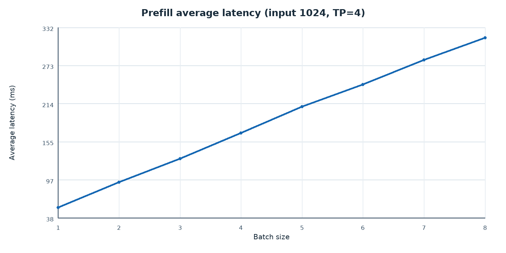
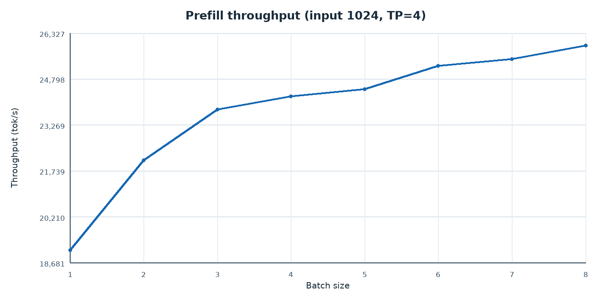
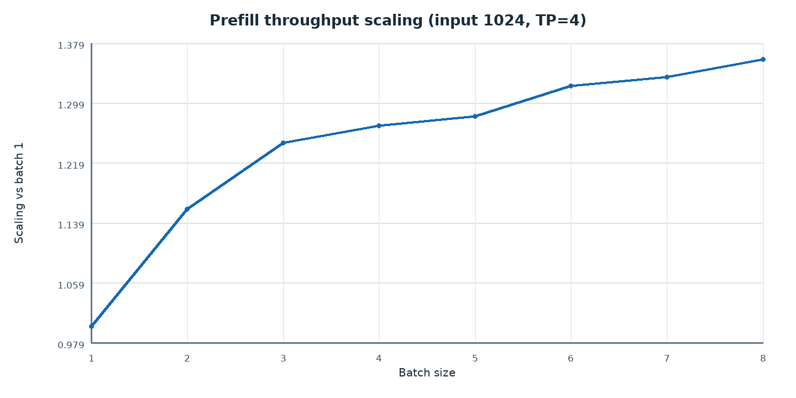

# Prefill-Direct Input 1024 TP=4 性能报告

## 运行环境

| 项目 | 值 |
| --- | --- |
| 日期 | 2026-11-18 18:32:32-18:33:31（Asia/Shanghai） |
| 平台 | MetaX C500，64 GiB |
| 设备 | 4 x MetaX C500/C550，物理 GPU 3、4、5、6 |
| Driver / runtime | MetaX driver 3.3.12 / MACA 3.2.1.10 |
| InfiniLM build | 当前源码树；未记录独立 build ID |
| 模型 | `/data-aisoft/mechdancer/models/Qwen3-8B` |
| 模式 | `prefill-direct` |
| Attention backend | `flash-attn` |
| Graph request | enabled |
| Expected execution mode | `eager` |
| Cache | paged KV cache，block size 256，num blocks 32 |
| Max batched tokens | 9,216 |
| Tensor parallel size | 4 |
| Input length | 1,024 tokens / request |
| Batch size | 1..8 |
| Warmup | 每个形状 3 次 repeat |
| Measured repeats | 每个形状 30 次 repeat |
| Batch 执行顺序 | random seed 2026 |
| 干扰控制 | 物理专用 GPU 3、4、5、6；每 10 秒采样 `mx-smi` |

本报告对应的原始 JSONL 和 log 为本机运行产物，不随仓库提交：

```text
../../../benchmark-prefill-direct-metax-c500-tp4-qwen3-8b-input1024-batch1-8-clean-20261118.jsonl
../../../benchmark-prefill-direct-metax-c500-tp4-qwen3-8b-input1024-batch1-8-clean-20261118.log
```

## 构建与测试命令

C++ 扩展使用当前源码构建并安装：

```bash
xmake build _infinilm && xmake install _infinilm
```

性能测试命令：

```bash
BENCHMARK_GPU=3,4,5,6 \
INFINILM_MAX_NUM_BATCHED_TOKENS=9216 \
BENCHMARK_MODE=prefill-direct \
BATCH_SIZES="$(seq -s, 1 8)" \
INPUT_LENS=1024 \
BENCHMARK_REPEATS=30 \
BENCHMARK_OUTPUT=benchmark-prefill-direct-metax-c500-tp4-qwen3-8b-input1024-batch1-8-clean-20261118.jsonl \
./run_bench-metax.sh
```


脚本说明：上述命令记录的是 2026-11-18 运行时的调用方式；当时本地 `run_bench-metax.sh` 硬编码 `--tp 4`。该脚本被仓库 `.gitignore` 忽略，不随本报告提交；复现时必须确认脚本仍为 `--tp 4`，并保持 `BENCHMARK_GPU=3,4,5,6`。

## 执行模式与 Graph 覆盖

`run_bench-metax.sh` 请求开启 graph compiling，但当前 paged graph compiler 的 graph key 只匹配 decode-only 形状。packed prefill 形状不匹配该 key，因此本轮 expected execution mode 为 `eager`。
`expected_execution_mode` 是 benchmark 根据 compiler 规则推断的字段，不是 C++ runtime 回传的实际执行模式。

## 资源开销

| 项目 | 值 |
| --- | ---: |
| Workspace allocation | 每 rank 351.0 MiB，TP=4 合计 1,404.0 MiB |
| 权重加载时间 | 约 9.35 秒 |
| Paged cache blocks | 32 |
| 正式 repeat 数 | 240 |
| 本轮总耗时 | 约 59.3 秒 |
| GPU 3/4/5/6 温度范围 | 30C-54C |
| GPU 3/4/5/6 功耗范围 | 92W-307W |
| GPU 3/4/5/6 进程显存峰值 | 20,058 MiB |

## 测试口径

- 每个 sample 是一次物理 prefill forward。
- `token_count = batch_size * 1024`。
- `throughput = batch_size * 1024 / avg_forward_duration_s`。
- 计时边界为 `engine_forward_including_sampling`，包含 Python wrapper、C++ engine forward、RankWorker forward、TP 通信、model forward 和 sampling。
- 不包含 HTTP、JSON parsing、tokenization、scheduler queueing、`build_model_inputs`、detokenization 和 Python `generate()` 循环。
- 输出 token 不用于正确性判断。
- 分位数使用线性插值；每个 batch 30 个 repeat，p99 只能作为尾部参考。

## 核心结论

| 指标 | 结果 |
| --- | ---: |
| 最高 prefill 吞吐 | batch 8，25,917.55 tok/s |
| batch 1 平均 latency | 53.639 ms |
| batch 8 平均 latency | 316.079 ms |
| 最大 batch 8 吞吐 | 25,917.55 tok/s |

吞吐 Top 10 overall 结果：

| Batch | Avg ms | Throughput tok/s | Scaling |
| ---: | ---: | ---: | ---: |
| 8 | 316.079 | 25,917.55 | 1.358x |
| 7 | 281.522 | 25,461.63 | 1.334x |
| 6 | 243.532 | 25,228.72 | 1.322x |
| 5 | 209.370 | 24,454.27 | 1.281x |
| 4 | 169.097 | 24,222.83 | 1.269x |
| 3 | 129.207 | 23,775.89 | 1.245x |
| 2 | 92.705 | 22,091.48 | 1.157x |
| 1 | 53.639 | 19,090.65 | 1.000x |

## 趋势图

### 1. Batch size 与平均 latency



### 2. Batch size 与吞吐



### 3. Batch size 与吞吐 Scaling




平均 latency 从 batch 1 的 53.639 ms 增至 batch 8 的 316.079 ms。吞吐峰值为 batch 8 的 25,917.55 tok/s。

## 关键批次与区间

| Batch / range | 观察 |
| --- | --- |
| batch 1 -> 8 | 平均 latency 从 53.639 ms 增至 316.079 ms，为 5.893x。 |
| batch 8 | 吞吐峰值，25,917.55 tok/s。 |
| batch 8 | per-request prefill latency 最低，为 39.51 ms/request。 |

## 数据稳定性

- 8 个 overall summary的 std 中位数为 1.186 ms。
- 最大 std 为 1.769 ms，出现在 batch 7。
- 最大变异系数约 2.076%，中位变异系数约 0.564%。
- P50、P95、P99 和 max 普遍接近。
- 每个 batch 只有 30 个 repeat 样本；p99 可用于观察尾部，正式尾部对比建议提高到 100+ repeat。

## 完整结果表

| Batch | Mode | Input tokens | Avg ms | Min ms | P50 ms | P95 ms | P99 ms | Max ms | Std ms | Throughput tok/s | Scaling |
| ---: | --- | ---: | ---: | ---: | ---: | ---: | ---: | ---: | ---: | ---: | ---: |
| 1 | eager | 1,024 | 53.639 | 51.024 | 53.806 | 54.999 | 55.091 | 55.109 | 1.114 | 19,090.65 | 1.000x |
| 2 | eager | 2,048 | 92.705 | 91.990 | 92.735 | 93.394 | 93.513 | 93.530 | 0.401 | 22,091.48 | 1.157x |
| 3 | eager | 3,072 | 129.207 | 128.591 | 129.160 | 129.950 | 130.156 | 130.235 | 0.437 | 23,775.89 | 1.245x |
| 4 | eager | 4,096 | 169.097 | 167.114 | 168.992 | 170.707 | 172.706 | 173.365 | 1.258 | 24,222.83 | 1.269x |
| 5 | eager | 5,120 | 209.370 | 208.321 | 209.294 | 210.374 | 210.514 | 210.529 | 0.558 | 24,454.27 | 1.281x |
| 6 | eager | 6,144 | 243.532 | 241.938 | 242.928 | 245.870 | 248.582 | 249.655 | 1.645 | 25,228.72 | 1.322x |
| 7 | eager | 7,168 | 281.522 | 279.181 | 281.182 | 284.746 | 287.630 | 288.141 | 1.769 | 25,461.63 | 1.334x |
| 8 | eager | 8,192 | 316.079 | 313.212 | 316.032 | 318.218 | 318.459 | 318.541 | 1.579 | 25,917.55 | 1.358x |
## 结果分析

1. 吞吐最高出现在 batch 8，为 25,917.55 tok/s。
2. 在本轮 batch `1..8` 范围内，吞吐在最大 batch 仍未回落；若资源允许，可继续扩大 batch 寻找饱和点。
3. 对比 MetaX TP=1 峰值 9,298.77 tok/s，本报告 TP=4 峰值为其 2.787x。
4. 对比 MetaX TP=2 峰值 14,646.77 tok/s，本报告 TP=4 峰值为其 1.770x；占用四张卡后的每卡效率为 TP=2 的 0.885x。
5. 对比 NVIDIA A100 TP=4 峰值 35,960.64 tok/s，本报告峰值约为其 0.721x。
6. 正式 p99 对比建议将 `BENCHMARK_REPEATS` 提高到 100 或以上。

## 结论与建议

1. 在本轮 input length 1024、TP=4、batch `1..8` 范围内，**batch 8 吞吐最高**，约 25,917.55 tok/s。
2. batch 8 平均 forward latency 为 316.079 ms。
3. TP=4 相对 TP=2 继续提高总吞吐，但每卡效率低于 TP=2；是否采用 TP=4 应结合 SLO、总吞吐、时延和部署密度评估。
4. 所有样本均在专用 GPU 3、4、5、6 上采集；监控期间目标卡没有外来进程或多进程干扰。

## 数据完整性

```text
config records: 1
sample records: 240
overall summary records: 8
scaling records: 8
samples per batch: 30
expected execution modes: all eager
```
