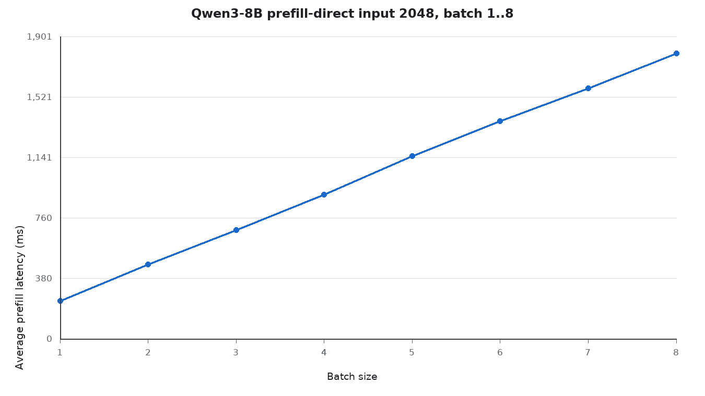
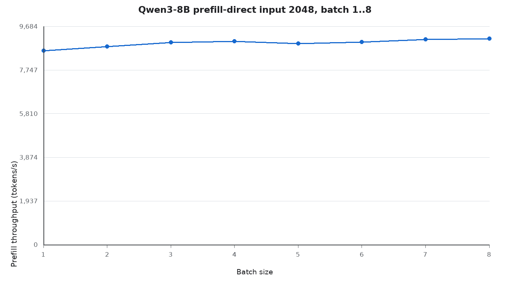
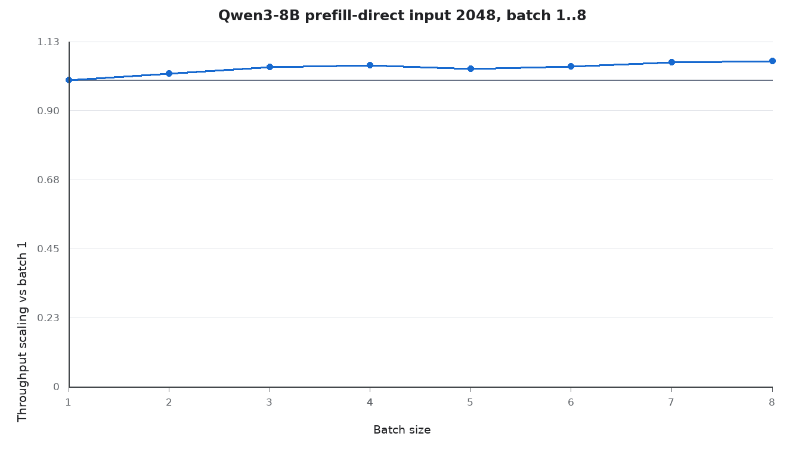

# Prefill-Direct 性能报告

## 运行环境

| 项目 | 值 |
| --- | --- |
| 日期 | 2026-11-13 16:01-16:05（Asia/Shanghai） |
| 平台 | MetaX |
| 设备 | C500，物理 GPU 5，64 GiB |
| Driver / runtime | MetaX driver 3.3.12 / MACA 3.2.1.10 |
| InfiniLM build | 当前源码树；基准 commit `112ee225` |
| 模型 | `/data-aisoft/mechdancer/models/Qwen3-8B` |
| 模式 | `prefill-direct` |
| Attention backend | `flash-attn` |
| Cache | paged KV cache，block size 256 |
| Max batched tokens | 18,432 |
| Tensor parallel size | 1 |
| 输入长度 | 2,048 tokens / request |
| Batch size | 1..8，共 8 个形状 |
| Warmup | 每个形状 3 次 repeat |
| 正式样本 | 每个形状 30 次 repeat |
| Batch 执行顺序 | random seed 2026 |
| 干扰检查 | GPU 5 全程无外来进程、无多进程采样点 |

本报告对应的原始 JSONL 和 log 为本机运行产物，不随仓库提交：

```text
../../../benchmark-prefill-direct-metax-c500-qwen3-8b-input2048-batch1-8-clean-20261113.jsonl
../../../benchmark-prefill-direct-metax-c500-qwen3-8b-input2048-batch1-8-clean-20261113.log
```

## 构建与测试命令

C++ 扩展使用当前源码构建并安装：

```bash
xmake build _infinilm && xmake install _infinilm
```

性能测试命令：

```bash
BENCHMARK_GPU=5 \
INFINILM_MAX_NUM_BATCHED_TOKENS=18432 \
BENCHMARK_MODE=prefill-direct \
BATCH_SIZES=1,2,3,4,5,6,7,8 \
INPUT_LENS=2048 \
BENCHMARK_REPEATS=30 \
BENCHMARK_OUTPUT=benchmark-prefill-direct-metax-c500-qwen3-8b-input2048-batch1-8-clean-20261113.jsonl \
./run_bench.sh
```

## 执行模式与 Graph 覆盖

`run_bench.sh` 请求开启 graph compiling，但当前 paged graph compiler 的 graph key 只匹配 decode-only 形状。packed prefill 形状不匹配该 key，因此本轮 expected execution mode 为 `eager`。

`expected_execution_mode` 是 benchmark 根据 compiler 规则推断的字段，不是 C++ runtime 回传的实际执行模式。

## 资源开销

| 项目 | 值 |
| --- | ---: |
| Workspace allocation | 1944.0 MiB |
| 权重加载时间 | 约 8.81 秒 |
| Paged cache blocks | 64 |
| Total benchmark wall time | 约 279.4 秒 |
| GPU 5 温度范围 | 32C-55C |
| GPU 5 功耗范围 | 91W-317W |

## 测试口径

- 每个 sample 是一次物理 prefill forward。
- `token_count = batch_size * 2048`。
- `throughput = batch_size * 2048 / avg_forward_duration_s`。
- 计时边界为 `engine_forward_including_sampling`，包含 Python wrapper、C++ engine forward、RankWorker forward、model forward/graph replay 和 sampling。
- 不包含 HTTP、JSON parsing、tokenization、scheduler queueing、`build_model_inputs`、detokenization 和 Python `generate()` 循环。
- 输出 token 不用于正确性判断。
- 分位数使用线性插值；每个 batch 30 个 repeat，p99 只能作为尾部参考。

## 核心结论

| 指标 | 结果 |
| --- | ---: |
| 最高 prefill 吞吐 | batch 8，9,135.67 tok/s |
| batch 1 平均 latency | 237.955 ms |
| batch 8 平均 latency | 1793.410 ms |
| 最大 batch 8 吞吐 | 9,135.67 tok/s |

吞吐 Top 10 overall 结果：

| Rank | Batch | Avg ms | Throughput tok/s |
| ---: | ---: | ---: | ---: |
| 1 | 8 | 1793.410 | 9,135.67 |
| 2 | 7 | 1575.139 | 9,101.42 |
| 3 | 4 | 907.497 | 9,027.03 |
| 4 | 6 | 1367.796 | 8,983.79 |
| 5 | 3 | 684.881 | 8,970.90 |
| 6 | 5 | 1147.617 | 8,922.84 |
| 7 | 2 | 465.670 | 8,795.93 |
| 8 | 1 | 237.955 | 8,606.68 |

## 趋势图

### 1. Batch size 与平均 latency



### 2. Batch size 与吞吐



### 3. Batch size 与吞吐 Scaling



平均 latency 从 batch 1 的 237.955 ms 增至 batch 8 的 1793.410 ms。吞吐峰值为 batch 8 的 9,135.67 tok/s。

## 完整结果表

| Batch | Input tokens | Avg ms | Min ms | P50 ms | P95 ms | P99 ms | Max ms | Std ms | Throughput tok/s | Scaling |
| ---: | ---: | ---: | ---: | ---: | ---: | ---: | ---: | ---: | ---: | ---: |
| 1 | 2,048 | 237.955 | 237.038 | 238.012 | 238.305 | 238.431 | 238.476 | 0.307 | 8606.68 | 1.000x |
| 2 | 4,096 | 465.670 | 465.120 | 465.626 | 466.314 | 466.589 | 466.670 | 0.356 | 8795.93 | 1.022x |
| 3 | 6,144 | 684.881 | 683.573 | 684.934 | 686.435 | 686.980 | 687.029 | 0.824 | 8970.90 | 1.042x |
| 4 | 8,192 | 907.497 | 906.027 | 907.405 | 908.529 | 908.564 | 908.567 | 0.700 | 9027.03 | 1.049x |
| 5 | 10,240 | 1147.617 | 1145.063 | 1147.656 | 1148.501 | 1149.524 | 1149.880 | 0.775 | 8922.84 | 1.037x |
| 6 | 12,288 | 1367.796 | 1364.607 | 1367.851 | 1370.613 | 1370.772 | 1370.774 | 1.777 | 8983.79 | 1.044x |
| 7 | 14,336 | 1575.139 | 1572.924 | 1575.432 | 1576.259 | 1577.199 | 1577.565 | 1.082 | 9101.42 | 1.057x |
| 8 | 16,384 | 1793.410 | 1790.233 | 1793.484 | 1795.562 | 1796.523 | 1796.809 | 1.421 | 9135.67 | 1.061x |

## 结果分析

1. 吞吐最高出现在 batch 8，为 9,135.67 tok/s。
2. 在本轮 batch `1..8` 范围内，吞吐在最大 batch 仍未回落；若资源允许，可继续扩大 batch 寻找饱和点。
3. 本轮数据稳定性较好，std 中位数为 0.824 ms，最大 std 为 1.777 ms。
4. 正式 p99 对比建议将 `BENCHMARK_REPEATS` 提高到 100 或以上。

## 结论与建议

1. 在本轮 input length 2048、batch `1..8` 范围内，**batch 8 吞吐最高**，约 9,135.67 tok/s。
2. batch 8 平均 forward latency 为 1793.410 ms，latency 随 batch 接近线性增长。
3. 所有样本均在专用 GPU 5 上采集；监控期间目标卡没有外来进程。

## 数据完整性

```text
config records: 1
sample records: 240
summary records: 8
scaling records: 8
每个 batch repeat 数: 30
```
