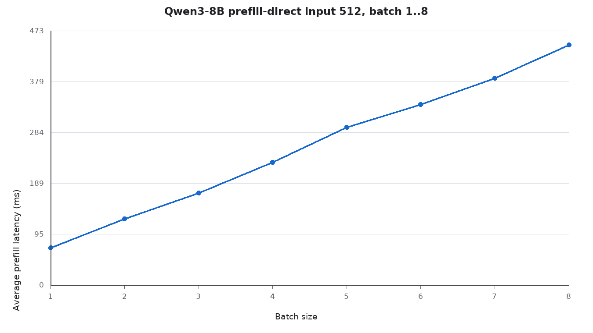
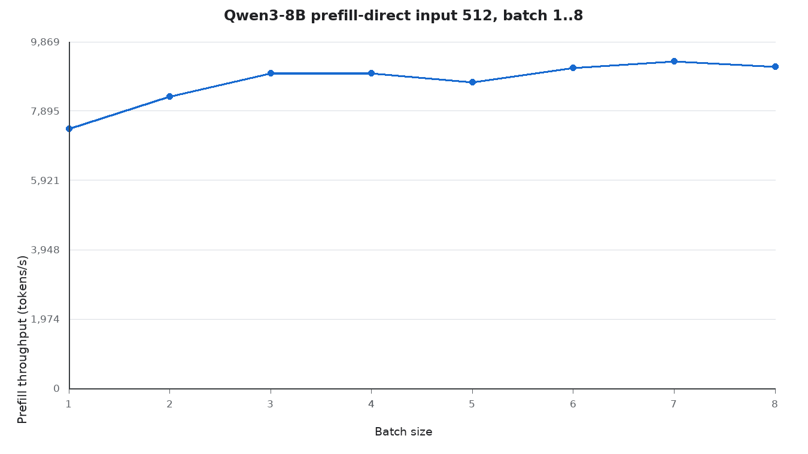
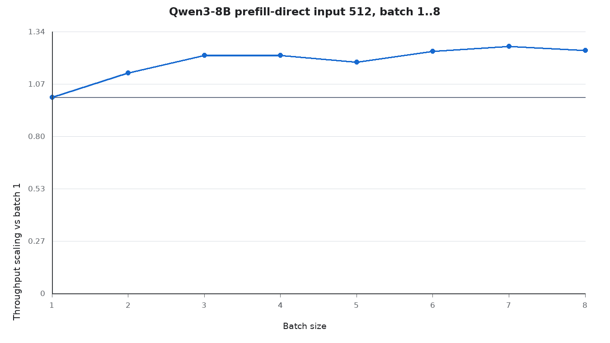

# Prefill-Direct 性能报告

## 运行环境

| 项目 | 值 |
| --- | --- |
| 日期 | 2026-11-13 15:54-15:55（Asia/Shanghai） |
| 平台 | MetaX |
| 设备 | C500，物理 GPU 5，64 GiB |
| Driver / runtime | MetaX driver 3.3.12 / MACA 3.2.1.10 |
| InfiniLM build | 当前源码树；基准 commit `112ee225` |
| 模型 | `/data-aisoft/mechdancer/models/Qwen3-8B` |
| 模式 | `prefill-direct` |
| Attention backend | `flash-attn` |
| Cache | paged KV cache，block size 256 |
| Max batched tokens | 18,432 |
| Tensor parallel size | 1 |
| 输入长度 | 512 tokens / request |
| Batch size | 1..8，共 8 个形状 |
| Warmup | 每个形状 3 次 repeat |
| 正式样本 | 每个形状 30 次 repeat |
| Batch 执行顺序 | random seed 2026 |
| 干扰检查 | GPU 5 全程无外来进程、无多进程采样点 |

本报告对应的原始 JSONL 和 log 为本机运行产物，不随仓库提交：

```text
../../../benchmark-prefill-direct-metax-c500-qwen3-8b-input512-batch1-8-clean-20261113.jsonl
../../../benchmark-prefill-direct-metax-c500-qwen3-8b-input512-batch1-8-clean-20261113.log
```

## 构建与测试命令

C++ 扩展使用当前源码构建并安装：

```bash
xmake build _infinilm && xmake install _infinilm
```

性能测试命令：

```bash
BENCHMARK_GPU=5 \
INFINILM_MAX_NUM_BATCHED_TOKENS=18432 \
BENCHMARK_MODE=prefill-direct \
BATCH_SIZES=1,2,3,4,5,6,7,8 \
INPUT_LENS=512 \
BENCHMARK_REPEATS=30 \
BENCHMARK_OUTPUT=benchmark-prefill-direct-metax-c500-qwen3-8b-input512-batch1-8-clean-20261113.jsonl \
./run_bench.sh
```

## 执行模式与 Graph 覆盖

`run_bench.sh` 请求开启 graph compiling，但当前 paged graph compiler 的 graph key 只匹配 decode-only 形状。packed prefill 形状不匹配该 key，因此本轮 expected execution mode 为 `eager`。

`expected_execution_mode` 是 benchmark 根据 compiler 规则推断的字段，不是 C++ runtime 回传的实际执行模式。

## 资源开销

| 项目 | 值 |
| --- | ---: |
| Workspace allocation | 1944.0 MiB |
| 权重加载时间 | 约 9.07 秒 |
| Paged cache blocks | 16 |
| Total benchmark wall time | 约 77.8 秒 |
| GPU 5 温度范围 | 32C-55C |
| GPU 5 功耗范围 | 91W-317W |

## 测试口径

- 每个 sample 是一次物理 prefill forward。
- `token_count = batch_size * 512`。
- `throughput = batch_size * 512 / avg_forward_duration_s`。
- 计时边界为 `engine_forward_including_sampling`，包含 Python wrapper、C++ engine forward、RankWorker forward、model forward/graph replay 和 sampling。
- 不包含 HTTP、JSON parsing、tokenization、scheduler queueing、`build_model_inputs`、detokenization 和 Python `generate()` 循环。
- 输出 token 不用于正确性判断。
- 分位数使用线性插值；每个 batch 30 个 repeat，p99 只能作为尾部参考。

## 核心结论

| 指标 | 结果 |
| --- | ---: |
| 最高 prefill 吞吐 | batch 7，9,310.41 tok/s |
| batch 1 平均 latency | 69.259 ms |
| batch 7 平均 latency | 384.946 ms |
| 最大 batch 8 吞吐 | 9,169.85 tok/s |

吞吐 Top 10 overall 结果：

| Rank | Batch | Avg ms | Throughput tok/s |
| ---: | ---: | ---: | ---: |
| 1 | 7 | 384.946 | 9,310.41 |
| 2 | 8 | 446.681 | 9,169.85 |
| 3 | 6 | 336.205 | 9,137.27 |
| 4 | 4 | 228.286 | 8,971.19 |
| 5 | 3 | 171.244 | 8,969.64 |
| 6 | 5 | 293.721 | 8,715.75 |
| 7 | 2 | 123.148 | 8,315.22 |
| 8 | 1 | 69.259 | 7,392.53 |

## 趋势图

### 1. Batch size 与平均 latency



### 2. Batch size 与吞吐



### 3. Batch size 与吞吐 Scaling



平均 latency 从 batch 1 的 69.259 ms 增至 batch 8 的 446.681 ms。吞吐峰值为 batch 7 的 9,310.41 tok/s。

## 完整结果表

| Batch | Input tokens | Avg ms | Min ms | P50 ms | P95 ms | P99 ms | Max ms | Std ms | Throughput tok/s | Scaling |
| ---: | ---: | ---: | ---: | ---: | ---: | ---: | ---: | ---: | ---: | ---: |
| 1 | 512 | 69.259 | 68.878 | 69.245 | 69.503 | 69.918 | 70.086 | 0.241 | 7392.53 | 1.000x |
| 2 | 1,024 | 123.148 | 122.803 | 123.114 | 123.457 | 123.496 | 123.509 | 0.189 | 8315.22 | 1.125x |
| 3 | 1,536 | 171.244 | 169.754 | 171.164 | 172.230 | 172.701 | 172.821 | 0.496 | 8969.64 | 1.213x |
| 4 | 2,048 | 228.286 | 227.948 | 228.224 | 228.693 | 229.376 | 229.617 | 0.315 | 8971.19 | 1.214x |
| 5 | 2,560 | 293.721 | 293.010 | 293.661 | 294.349 | 294.673 | 294.789 | 0.385 | 8715.75 | 1.179x |
| 6 | 3,072 | 336.205 | 334.785 | 336.118 | 337.026 | 338.536 | 339.118 | 0.738 | 9137.27 | 1.236x |
| 7 | 3,584 | 384.946 | 383.716 | 385.039 | 385.726 | 387.028 | 387.548 | 0.762 | 9310.41 | 1.259x |
| 8 | 4,096 | 446.681 | 446.262 | 446.687 | 447.088 | 447.122 | 447.130 | 0.229 | 9169.85 | 1.240x |

## 结果分析

1. 吞吐最高出现在 batch 7，为 9,310.41 tok/s。
2. 最大 batch 8 的吞吐为 9,169.85 tok/s，低于峰值约 1.51%。
3. 本轮数据稳定性较好，std 中位数为 0.385 ms，最大 std 为 0.762 ms。
4. 正式 p99 对比建议将 `BENCHMARK_REPEATS` 提高到 100 或以上。

## 结论与建议

1. 在本轮 input length 512、batch `1..8` 范围内，**batch 7 吞吐最高**，约 9,310.41 tok/s。
2. batch 8 平均 forward latency 为 446.681 ms，latency 随 batch 接近线性增长。
3. 所有样本均在专用 GPU 5 上采集；监控期间目标卡没有外来进程。

## 数据完整性

```text
config records: 1
sample records: 240
summary records: 8
scaling records: 8
每个 batch repeat 数: 30
```
