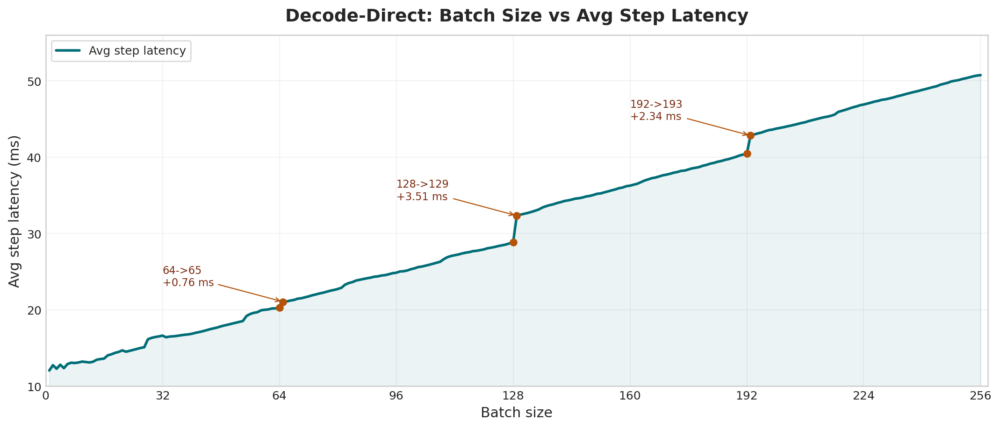
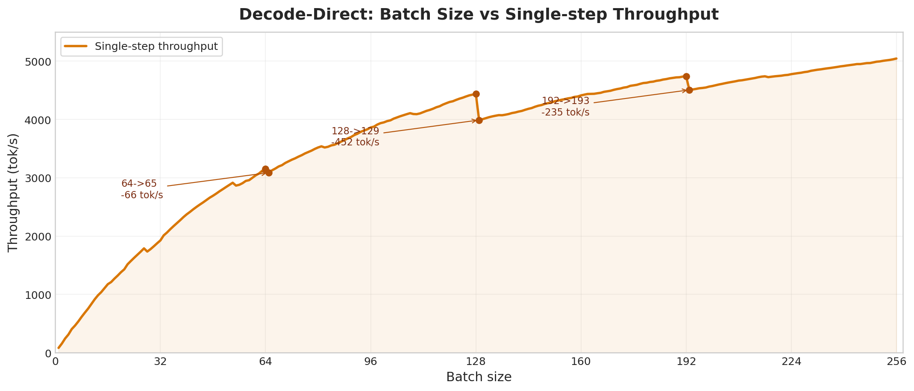
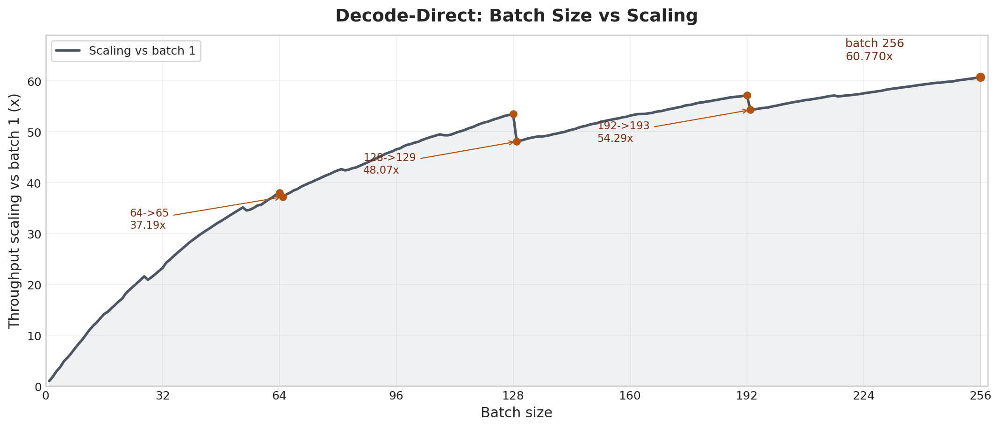

# Decode-Direct Graph 1..256 性能报告

## 运行环境

| 项目 | 值 |
| --- | --- |
| 日期 | 2026-11-11 13:29-13:47（Asia/Shanghai） |
| 平台 | NVIDIA |
| 设备 | A100-SXM4-80GB |
| Driver | 535.161.08 |
| InfiniLM build | 当前源码树；未记录独立 build ID |
| 模型 | `/data-aisoft/mechdancer/models/Qwen3-8B` |
| 模式 | `decode-direct` |
| Attention backend | `flash-attn` |
| Graph compiling | enabled |
| Cache | paged KV cache，block size 256，num blocks 1280 |
| Max batched tokens | 9216 |
| Tensor parallel size | 1 |
| 输入长度 | 1024 tokens / request |
| Batch size | 1..256，共 256 个形状 |
| Decode step 数 | 每个 repeat 固定 4 step |
| Warmup | 每个形状 3 次 repeat |
| 正式样本 | 每个形状 30 次 repeat |
| Batch 执行顺序 | random seed 2026 |

本报告对应的原始 JSONL 和 log 为本机运行产物，不随仓库提交：

```text
../../../benchmark-decode-direct-qwen3-8b-flash-attn-graph1-256-20261111.jsonl
../../../benchmark-decode-direct-qwen3-8b-flash-attn-graph1-256-20261111.log
```

## 构建与测试命令

C++ 扩展按当前源码重新构建并安装：

```bash
xmake build _infinilm && xmake install _infinilm
```

性能测试命令：

```bash
BENCHMARK_MODE=decode-direct \
BATCH_SIZES="$(seq -s, 1 256)" \
INPUT_LENS=1024 \
BENCHMARK_REPEATS=30 \
BENCHMARK_OUTPUT=benchmark-decode-direct-qwen3-8b-flash-attn-graph1-256-20261111.jsonl \
./run_bench.sh
```

## 执行模式与 Graph 覆盖

当前 [paged_compiler.cpp](../../../csrc/engine/compiler/paged_compiler.cpp) 的 decode graph 覆盖规则为：

```text
batch 1..255：逐个编译
batch 256：追加编译
```

因此本次 `1..256` 全部 256 个 batch 均有对应 decode graph，无 eager fallback 混入。原始 JSONL 中所有 overall summary 的 `expected_execution_mode` 也均为 `graph`。

## 资源开销

- Workspace manager 分配约 972 MiB。
- 测试运行期间观测到 GPU 显存占用约 68.6 GiB。
- 权重加载与 graph 编译阶段合计约 38.7 秒；该时间不包含在正式 performance sample 中。

## 测试口径

- `decode-direct` 不执行语义完整的 prefill，paged KV cache 初始为全 0。
- Step 0 输入 dummy token；step 1 到 step 3 使用上一步 sampled token。
- 4 个 decode step 的 past KV length 分别为 1024、1025、1026、1027。
- 报告中的 duration 是单 step 时间，由一次 4-step repeat 的对应总耗时指标除以 4 得到。
- Throughput 是 single-step 吞吐：`batch_size / avg_step_duration_s`。每个 request 每 step 生成 1 个 token，因此 single-step request throughput 与 token throughput 数值相同。
- 表格中的 Min/P50/P95/P99/Max 是每个 repeat 的平均 step 时间分布，不是把 120 个独立 step sample 重新混合后的分布。
- 计时边界为 `engine_forward_including_sampling`，包含 Python wrapper、C++ engine forward、RankWorker forward、graph replay 和 sampling；不包含 HTTP、JSON parsing、tokenization、scheduler queueing、`build_model_inputs`、detokenization 和 Python `generate()` 循环。
- 运行配置：`max_num_batched_tokens=9216`，paged cache `num_blocks=1280`，block size 256。

## 核心结论

| 指标 | 结果 |
| --- | ---: |
| 最高 single-step 吞吐 | batch 256，5044.65 tok/s |
| batch 256 平均单 step latency | 50.747 ms |
| batch 256 P99 单 step latency | 51.195 ms |
| batch 1 平均单 step latency | 12.046 ms |
| batch 256 相对 batch 1 吞吐倍数 | 60.770x |
| batch 256 相对理想 256x 的效率 | 23.7% |
| 单 step std 中位数 | 0.026 ms |
| 最大单 step std | 0.225 ms，batch 166 |

### 1. Batch 256 吞吐最高，但增益已趋缓

Top 10 overall 结果：

| Rank | Batch | Avg step ms | Single-step tok/s |
| ---: | ---: | ---: | ---: |
| 1 | 256 | 50.747 | 5044.65 |
| 2 | 255 | 50.683 | 5031.32 |
| 3 | 254 | 50.589 | 5020.86 |
| 4 | 253 | 50.462 | 5013.68 |
| 5 | 252 | 50.339 | 5006.06 |
| 6 | 251 | 50.242 | 4995.82 |
| 7 | 250 | 50.094 | 4990.58 |
| 8 | 249 | 50.015 | 4978.55 |
| 9 | 248 | 49.923 | 4967.60 |
| 10 | 247 | 49.737 | 4966.12 |

吞吐从 batch 1 的 83.01 tok/s 增至 batch 256 的 5044.65 tok/s。最后 32 个 batch 的吞吐斜率约 7.99 tok/s per batch，最后 16 个 batch 约 7.61 tok/s per batch，最后 5 个 batch 约 9.48 tok/s per batch。斜率仍为正，因此本次 `1..256` 范围内尚未出现吞吐回落；但相邻大 batch 的增益已经比较小。

### 2. 三处明显 latency 跳变

尽管所有 batch 都有 graph，仍有几处稳定的 latency 跳变：

| 变化 | Avg step ms | Single-step tok/s | 吞吐变化 |
| --- | ---: | ---: | ---: |
| 128 -> 129 | 28.819 -> 32.331 | 4441.51 -> 3989.99 | -451.53 |
| 192 -> 193 | 40.486 -> 42.824 | 4742.32 -> 4506.87 | -235.46 |
| 64 -> 65 | 20.295 -> 21.053 | 3153.50 -> 3087.47 | -66.02 |

这些跳变不是 eager fallback 造成，因为当前 compiler 已覆盖全部 batch。更可能来自不同 batch 区间的 kernel 选择、workspace 使用或 graph 内部操作形态变化。若要定位原因，需要结合 kernel trace 或 C++ model-only 打点。

另有两个较小跳变：

| 变化 | Avg step ms | Single-step tok/s | 吞吐变化 |
| --- | ---: | ---: | ---: |
| 27 -> 28 | 15.090 -> 16.137 | 1789.28 -> 1735.14 | -54.14 |
| 54 -> 55 | 18.525 -> 19.190 | 2914.92 -> 2866.09 | -48.83 |

### 3. 平均 latency 随 batch 增长

Batch 256 的平均单 step latency 是 batch 1 的 4.213 倍。吞吐提升主要来自 batch 内并行；每个 request 自身的 decode latency 随 batch 增大而变差。

分段平均如下：

| Batch 区间 | 平均单 step latency ms | 平均吞吐 tok/s | 区间最优 batch |
| --- | ---: | ---: | ---: |
| 1..16 | 12.975 | 645.06 | 16 |
| 17..32 | 15.162 | 1604.82 | 32 |
| 33..64 | 18.129 | 2653.20 | 64 |
| 65..96 | 22.969 | 3493.24 | 96 |
| 97..128 | 26.975 | 4163.66 | 128 |
| 129..160 | 34.389 | 4197.66 | 160 |
| 161..192 | 38.470 | 4584.94 | 192 |
| 193..224 | 44.765 | 4655.44 | 224 |
| 225..256 | 48.901 | 4916.38 | 256 |

### 4. 4 个 decode step 的耗时几乎相同

| Decode step | Past KV length | 全部 batch 平均 step latency ms |
| ---: | ---: | ---: |
| 0 | 1024 | 31.066 |
| 1 | 1025 | 31.082 |
| 2 | 1026 | 31.090 |
| 3 | 1027 | 31.096 |

Past KV length 从 1024 增至 1027 时，平均 step latency 仅增加约 0.030 ms。与 batch size 和 batch 区间跳变相比，这 3 个 token 的 KV 增量影响很小。

### 5. 数据稳定性较好

- 256 个 overall summary 换算为单 step 后，std 中位数为 0.026 ms。
- 最大单 step std 为 0.225 ms，出现在 batch 166。
- 最大变异系数约 0.923%，中位变异系数约 0.088%。
- P50、P95、P99 和 max 普遍接近。

每个 batch 只有 30 个 repeat 样本；p99 可以用于观察尾部，但正式尾部对比建议提高到 100+ repeat。

## 趋势图

以下三张图均由本轮 JSONL 中的 256 个 overall summary 生成。横轴为 batch size，纵轴分别为单 step 平均耗时、single-step token 吞吐和相对 batch 1 的吞吐倍数。橙色点标出 64->65、128->129、192->193 三个主要跳变位置。

### 1. Batch size 与 Avg Step Latency



平均单 step latency 从 batch 1 的 12.046 ms 增至 batch 256 的 50.747 ms，总体呈上升趋势，但趋势并不平滑。64->65、128->129、192->193 均出现明显向上跳变，其中 128->129 的增幅最大，约 3.512 ms。

### 2. Batch size 与 Single-step Throughput



Single-step 吞吐从 batch 1 的 83.01 tok/s 增至 batch 256 的 5,044.65 tok/s。曲线整体上升，但在 64->65、128->129、192->193 出现短暂下降；batch 256 达到本轮最高吞吐。

### 3. Batch size 与 Scaling



Scaling 定义为当前 batch 吞吐除以 batch 1 吞吐。该曲线与吞吐曲线形状一致，从 batch 1 的 1.000x 增至 batch 256 的 60.770x。64->65、128->129、192->193 的下降同样对应三处 latency 跳变。

## 关键批次对比

| Batch | Avg Step ms | Min Step ms | P50 Step ms | P95 Step ms | P99 Step ms | Max Step ms | Std Step ms | Single-step tok/s |
| ---: | ---: | ---: | ---: | ---: | ---: | ---: | ---: | ---: |
| 1 | 12.046 | 12.021 | 12.046 | 12.069 | 12.082 | 12.087 | 0.015 | 83.01 |
| 8 | 13.027 | 12.992 | 13.030 | 13.060 | 13.064 | 13.065 | 0.018 | 614.12 |
| 16 | 13.608 | 13.574 | 13.612 | 13.629 | 13.651 | 13.659 | 0.018 | 1175.80 |
| 27 | 15.090 | 15.062 | 15.090 | 15.109 | 15.129 | 15.137 | 0.014 | 1789.28 |
| 28 | 16.137 | 15.990 | 16.147 | 16.215 | 16.266 | 16.283 | 0.068 | 1735.14 |
| 32 | 16.614 | 16.578 | 16.615 | 16.637 | 16.638 | 16.638 | 0.016 | 1926.05 |
| 48 | 17.831 | 17.803 | 17.833 | 17.852 | 17.857 | 17.859 | 0.014 | 2692.02 |
| 54 | 18.525 | 18.489 | 18.524 | 18.559 | 18.572 | 18.577 | 0.021 | 2914.92 |
| 55 | 19.190 | 19.145 | 19.191 | 19.222 | 19.232 | 19.235 | 0.021 | 2866.09 |
| 64 | 20.295 | 20.259 | 20.300 | 20.314 | 20.318 | 20.319 | 0.013 | 3153.50 |
| 65 | 21.053 | 21.004 | 21.051 | 21.082 | 21.090 | 21.092 | 0.018 | 3087.47 |
| 80 | 22.727 | 22.577 | 22.730 | 22.790 | 22.854 | 22.869 | 0.048 | 3520.01 |
| 96 | 24.855 | 24.836 | 24.851 | 24.878 | 24.915 | 24.927 | 0.017 | 3862.39 |
| 112 | 27.149 | 27.116 | 27.146 | 27.191 | 27.218 | 27.227 | 0.024 | 4125.44 |
| 120 | 27.910 | 27.814 | 27.915 | 27.953 | 28.060 | 28.104 | 0.048 | 4299.57 |
| 128 | 28.819 | 28.780 | 28.819 | 28.840 | 28.876 | 28.891 | 0.018 | 4441.51 |
| 129 | 32.331 | 32.201 | 32.330 | 32.372 | 32.396 | 32.405 | 0.031 | 3989.99 |
| 144 | 34.431 | 34.366 | 34.426 | 34.476 | 34.542 | 34.566 | 0.035 | 4182.31 |
| 160 | 36.263 | 36.189 | 36.258 | 36.334 | 36.344 | 36.345 | 0.032 | 4412.26 |
| 176 | 38.389 | 38.331 | 38.373 | 38.492 | 38.533 | 38.540 | 0.048 | 4584.60 |
| 192 | 40.486 | 40.436 | 40.475 | 40.581 | 40.619 | 40.627 | 0.043 | 4742.32 |
| 193 | 42.824 | 42.692 | 42.823 | 42.886 | 42.956 | 42.977 | 0.044 | 4506.87 |
| 208 | 44.575 | 44.538 | 44.557 | 44.601 | 44.936 | 45.065 | 0.092 | 4666.28 |
| 224 | 46.894 | 46.861 | 46.896 | 46.925 | 46.927 | 46.927 | 0.017 | 4776.71 |
| 240 | 48.808 | 48.778 | 48.802 | 48.843 | 48.922 | 48.952 | 0.032 | 4917.20 |
| 248 | 49.923 | 49.864 | 49.890 | 50.035 | 50.371 | 50.495 | 0.114 | 4967.60 |
| 252 | 50.339 | 50.302 | 50.338 | 50.361 | 50.364 | 50.364 | 0.013 | 5006.06 |
| 254 | 50.589 | 50.520 | 50.583 | 50.696 | 50.753 | 50.756 | 0.049 | 5020.86 |
| 255 | 50.683 | 50.631 | 50.661 | 50.807 | 50.927 | 50.967 | 0.069 | 5031.32 |
| 256 | 50.747 | 50.701 | 50.723 | 50.756 | 51.195 | 51.374 | 0.117 | 5044.65 |

## Single-step 完整结果

Duration 单位为 ms，均由 4-step repeat 总耗时除以 4 得到。Mode 均为 graph。

### Batch 1..64


| Batch | Mode | Avg Step ms | Min Step ms | P50 Step ms | P95 Step ms | P99 Step ms | Max Step ms | Std Step ms | Single-step tok/s | Scaling |
| ---: | --- | ---: | ---: | ---: | ---: | ---: | ---: | ---: | ---: | ---: |
| 1 | graph | 12.046 | 12.021 | 12.046 | 12.069 | 12.082 | 12.087 | 0.015 | 83.01 | 1.000x |
| 2 | graph | 12.746 | 12.720 | 12.743 | 12.779 | 12.791 | 12.794 | 0.017 | 156.92 | 1.890x |
| 3 | graph | 12.273 | 12.208 | 12.246 | 12.346 | 12.720 | 12.856 | 0.113 | 244.44 | 2.945x |
| 4 | graph | 12.806 | 12.773 | 12.794 | 12.832 | 13.006 | 13.073 | 0.052 | 312.36 | 3.763x |
| 5 | graph | 12.354 | 12.329 | 12.348 | 12.393 | 12.436 | 12.449 | 0.024 | 404.74 | 4.876x |
| 6 | graph | 12.898 | 12.857 | 12.879 | 12.927 | 13.303 | 13.447 | 0.104 | 465.20 | 5.604x |
| 7 | graph | 13.067 | 13.033 | 13.067 | 13.095 | 13.104 | 13.106 | 0.018 | 535.70 | 6.453x |
| 8 | graph | 13.027 | 12.992 | 13.030 | 13.060 | 13.064 | 13.065 | 0.018 | 614.12 | 7.398x |
| 9 | graph | 13.098 | 13.067 | 13.096 | 13.132 | 13.171 | 13.185 | 0.022 | 687.15 | 8.278x |
| 10 | graph | 13.211 | 13.189 | 13.209 | 13.228 | 13.237 | 13.240 | 0.013 | 756.94 | 9.118x |
| 11 | graph | 13.160 | 13.130 | 13.157 | 13.197 | 13.215 | 13.218 | 0.021 | 835.89 | 10.069x |
| 12 | graph | 13.098 | 13.073 | 13.100 | 13.125 | 13.143 | 13.147 | 0.017 | 916.16 | 11.036x |
| 13 | graph | 13.198 | 13.104 | 13.188 | 13.213 | 13.534 | 13.663 | 0.089 | 985.00 | 11.866x |
| 14 | graph | 13.460 | 13.408 | 13.440 | 13.542 | 13.742 | 13.816 | 0.073 | 1040.12 | 12.530x |
| 15 | graph | 13.546 | 13.519 | 13.545 | 13.569 | 13.598 | 13.610 | 0.017 | 1107.36 | 13.340x |
| 16 | graph | 13.608 | 13.574 | 13.612 | 13.629 | 13.651 | 13.659 | 0.018 | 1175.80 | 14.164x |
| 17 | graph | 14.030 | 14.008 | 14.026 | 14.054 | 14.079 | 14.087 | 0.016 | 1211.71 | 14.597x |
| 18 | graph | 14.172 | 14.148 | 14.172 | 14.187 | 14.192 | 14.193 | 0.011 | 1270.15 | 15.301x |
| 19 | graph | 14.358 | 14.330 | 14.359 | 14.386 | 14.390 | 14.391 | 0.015 | 1323.33 | 15.941x |
| 20 | graph | 14.482 | 14.463 | 14.484 | 14.496 | 14.499 | 14.500 | 0.008 | 1381.02 | 16.636x |
| 21 | graph | 14.683 | 14.652 | 14.685 | 14.708 | 14.725 | 14.732 | 0.017 | 1430.25 | 17.229x |
| 22 | graph | 14.508 | 14.461 | 14.497 | 14.589 | 14.593 | 14.593 | 0.037 | 1516.36 | 18.267x |
| 23 | graph | 14.623 | 14.596 | 14.623 | 14.642 | 14.653 | 14.654 | 0.011 | 1572.87 | 18.947x |
| 24 | graph | 14.745 | 14.686 | 14.743 | 14.788 | 14.840 | 14.856 | 0.029 | 1627.64 | 19.607x |
| 25 | graph | 14.873 | 14.839 | 14.872 | 14.895 | 14.901 | 14.903 | 0.014 | 1680.85 | 20.248x |
| 26 | graph | 15.002 | 14.949 | 14.977 | 15.055 | 15.438 | 15.590 | 0.112 | 1733.14 | 20.878x |
| 27 | graph | 15.090 | 15.062 | 15.090 | 15.109 | 15.129 | 15.137 | 0.014 | 1789.28 | 21.554x |
| 28 | graph | 16.137 | 15.990 | 16.147 | 16.215 | 16.266 | 16.283 | 0.068 | 1735.14 | 20.902x |
| 29 | graph | 16.322 | 16.217 | 16.321 | 16.372 | 16.412 | 16.425 | 0.035 | 1776.74 | 21.403x |
| 30 | graph | 16.434 | 16.399 | 16.434 | 16.450 | 16.463 | 16.468 | 0.014 | 1825.51 | 21.991x |
| 31 | graph | 16.515 | 16.459 | 16.506 | 16.570 | 16.656 | 16.691 | 0.046 | 1877.03 | 22.611x |
| 32 | graph | 16.614 | 16.578 | 16.615 | 16.637 | 16.638 | 16.638 | 0.016 | 1926.05 | 23.202x |
| 33 | graph | 16.400 | 16.366 | 16.402 | 16.427 | 16.473 | 16.488 | 0.022 | 2012.15 | 24.239x |
| 34 | graph | 16.496 | 16.443 | 16.478 | 16.559 | 16.837 | 16.930 | 0.085 | 2061.16 | 24.830x |
| 35 | graph | 16.526 | 16.488 | 16.516 | 16.556 | 16.661 | 16.704 | 0.036 | 2117.90 | 25.513x |
| 36 | graph | 16.585 | 16.542 | 16.580 | 16.625 | 16.702 | 16.731 | 0.034 | 2170.62 | 26.148x |
| 37 | graph | 16.659 | 16.628 | 16.661 | 16.682 | 16.684 | 16.685 | 0.015 | 2220.97 | 26.755x |
| 38 | graph | 16.726 | 16.687 | 16.722 | 16.756 | 16.785 | 16.796 | 0.021 | 2271.95 | 27.369x |
| 39 | graph | 16.772 | 16.740 | 16.772 | 16.791 | 16.800 | 16.803 | 0.015 | 2325.27 | 28.011x |
| 40 | graph | 16.854 | 16.808 | 16.848 | 16.899 | 16.921 | 16.929 | 0.024 | 2373.28 | 28.589x |
| 41 | graph | 16.979 | 16.948 | 16.979 | 17.002 | 17.021 | 17.027 | 0.016 | 2414.76 | 29.089x |
| 42 | graph | 17.075 | 17.035 | 17.073 | 17.095 | 17.112 | 17.119 | 0.015 | 2459.76 | 29.631x |
| 43 | graph | 17.192 | 17.167 | 17.193 | 17.209 | 17.211 | 17.212 | 0.012 | 2501.19 | 30.130x |
| 44 | graph | 17.319 | 17.291 | 17.320 | 17.339 | 17.346 | 17.349 | 0.014 | 2540.59 | 30.605x |
| 45 | graph | 17.456 | 17.421 | 17.456 | 17.487 | 17.502 | 17.506 | 0.020 | 2577.93 | 31.055x |
| 46 | graph | 17.569 | 17.539 | 17.571 | 17.587 | 17.589 | 17.590 | 0.012 | 2618.21 | 31.540x |
| 47 | graph | 17.679 | 17.642 | 17.680 | 17.701 | 17.703 | 17.703 | 0.016 | 2658.48 | 32.025x |
| 48 | graph | 17.831 | 17.803 | 17.833 | 17.852 | 17.857 | 17.859 | 0.014 | 2692.02 | 32.429x |
| 49 | graph | 17.955 | 17.871 | 17.955 | 17.976 | 18.002 | 18.012 | 0.022 | 2729.00 | 32.875x |
| 50 | graph | 18.059 | 18.024 | 18.063 | 18.084 | 18.088 | 18.089 | 0.016 | 2768.64 | 33.352x |
| 51 | graph | 18.182 | 18.151 | 18.183 | 18.202 | 18.212 | 18.214 | 0.014 | 2804.95 | 33.790x |
| 52 | graph | 18.295 | 18.265 | 18.290 | 18.318 | 18.331 | 18.336 | 0.015 | 2842.27 | 34.239x |
| 53 | graph | 18.414 | 18.371 | 18.407 | 18.437 | 18.628 | 18.705 | 0.057 | 2878.23 | 34.672x |
| 54 | graph | 18.525 | 18.489 | 18.524 | 18.559 | 18.572 | 18.577 | 0.021 | 2914.92 | 35.114x |
| 55 | graph | 19.190 | 19.145 | 19.191 | 19.222 | 19.232 | 19.235 | 0.021 | 2866.09 | 34.526x |
| 56 | graph | 19.447 | 19.404 | 19.450 | 19.484 | 19.494 | 19.496 | 0.022 | 2879.63 | 34.689x |
| 57 | graph | 19.603 | 19.573 | 19.599 | 19.630 | 19.632 | 19.633 | 0.014 | 2907.78 | 35.028x |
| 58 | graph | 19.685 | 19.646 | 19.679 | 19.733 | 19.747 | 19.752 | 0.025 | 2946.43 | 35.494x |
| 59 | graph | 19.939 | 19.904 | 19.935 | 19.957 | 19.986 | 19.998 | 0.017 | 2959.02 | 35.646x |
| 60 | graph | 19.999 | 19.971 | 19.989 | 20.019 | 20.198 | 20.271 | 0.052 | 3000.22 | 36.142x |
| 61 | graph | 20.055 | 20.014 | 20.057 | 20.080 | 20.099 | 20.107 | 0.020 | 3041.59 | 36.640x |
| 62 | graph | 20.172 | 20.129 | 20.150 | 20.209 | 20.587 | 20.732 | 0.106 | 3073.50 | 37.025x |
| 63 | graph | 20.189 | 20.159 | 20.191 | 20.203 | 20.220 | 20.226 | 0.013 | 3120.55 | 37.591x |
| 64 | graph | 20.295 | 20.259 | 20.300 | 20.314 | 20.318 | 20.319 | 0.013 | 3153.50 | 37.988x |

### Batch 65..128


| Batch | Mode | Avg Step ms | Min Step ms | P50 Step ms | P95 Step ms | P99 Step ms | Max Step ms | Std Step ms | Single-step tok/s | Scaling |
| ---: | --- | ---: | ---: | ---: | ---: | ---: | ---: | ---: | ---: | ---: |
| 65 | graph | 21.053 | 21.004 | 21.051 | 21.082 | 21.090 | 21.092 | 0.018 | 3087.47 | 37.193x |
| 66 | graph | 21.093 | 21.058 | 21.089 | 21.114 | 21.151 | 21.164 | 0.018 | 3128.94 | 37.693x |
| 67 | graph | 21.209 | 21.116 | 21.199 | 21.284 | 21.309 | 21.314 | 0.039 | 3158.97 | 38.054x |
| 68 | graph | 21.289 | 21.127 | 21.296 | 21.317 | 21.329 | 21.333 | 0.037 | 3194.17 | 38.478x |
| 69 | graph | 21.452 | 21.360 | 21.463 | 21.527 | 21.539 | 21.543 | 0.059 | 3216.41 | 38.746x |
| 70 | graph | 21.512 | 21.480 | 21.511 | 21.533 | 21.537 | 21.537 | 0.013 | 3254.03 | 39.199x |
| 71 | graph | 21.631 | 21.603 | 21.628 | 21.649 | 21.649 | 21.649 | 0.011 | 3282.32 | 39.540x |
| 72 | graph | 21.753 | 21.723 | 21.747 | 21.784 | 21.846 | 21.869 | 0.025 | 3309.83 | 39.872x |
| 73 | graph | 21.900 | 21.843 | 21.880 | 21.989 | 22.248 | 22.332 | 0.087 | 3333.30 | 40.154x |
| 74 | graph | 22.011 | 21.981 | 22.009 | 22.041 | 22.049 | 22.050 | 0.015 | 3361.89 | 40.499x |
| 75 | graph | 22.143 | 21.939 | 22.147 | 22.205 | 22.216 | 22.219 | 0.052 | 3387.10 | 40.802x |
| 76 | graph | 22.240 | 22.211 | 22.240 | 22.255 | 22.260 | 22.263 | 0.010 | 3417.23 | 41.165x |
| 77 | graph | 22.372 | 22.328 | 22.375 | 22.413 | 22.431 | 22.436 | 0.027 | 3441.73 | 41.460x |
| 78 | graph | 22.506 | 22.439 | 22.481 | 22.604 | 22.770 | 22.829 | 0.073 | 3465.70 | 41.749x |
| 79 | graph | 22.602 | 22.477 | 22.598 | 22.655 | 22.664 | 22.665 | 0.035 | 3495.27 | 42.105x |
| 80 | graph | 22.727 | 22.577 | 22.730 | 22.790 | 22.854 | 22.869 | 0.048 | 3520.01 | 42.403x |
| 81 | graph | 22.887 | 22.738 | 22.885 | 22.914 | 23.232 | 23.361 | 0.097 | 3539.07 | 42.633x |
| 82 | graph | 23.299 | 23.277 | 23.295 | 23.337 | 23.349 | 23.351 | 0.018 | 3519.50 | 42.397x |
| 83 | graph | 23.503 | 23.466 | 23.503 | 23.525 | 23.528 | 23.529 | 0.016 | 3531.50 | 42.542x |
| 84 | graph | 23.629 | 23.581 | 23.632 | 23.669 | 23.675 | 23.675 | 0.025 | 3554.99 | 42.825x |
| 85 | graph | 23.829 | 23.760 | 23.829 | 23.884 | 23.904 | 23.909 | 0.033 | 3567.11 | 42.971x |
| 86 | graph | 23.933 | 23.894 | 23.928 | 23.961 | 24.056 | 24.091 | 0.033 | 3593.31 | 43.286x |
| 87 | graph | 24.030 | 24.011 | 24.029 | 24.052 | 24.055 | 24.055 | 0.012 | 3620.42 | 43.613x |
| 88 | graph | 24.132 | 24.111 | 24.129 | 24.158 | 24.183 | 24.191 | 0.016 | 3646.54 | 43.928x |
| 89 | graph | 24.216 | 24.183 | 24.216 | 24.232 | 24.249 | 24.255 | 0.012 | 3675.22 | 44.273x |
| 90 | graph | 24.332 | 24.260 | 24.299 | 24.445 | 24.800 | 24.940 | 0.120 | 3698.86 | 44.558x |
| 91 | graph | 24.383 | 24.336 | 24.376 | 24.428 | 24.456 | 24.465 | 0.025 | 3732.16 | 44.959x |
| 92 | graph | 24.493 | 24.474 | 24.490 | 24.532 | 24.542 | 24.543 | 0.018 | 3756.12 | 45.248x |
| 93 | graph | 24.546 | 24.515 | 24.548 | 24.560 | 24.561 | 24.562 | 0.012 | 3788.81 | 45.642x |
| 94 | graph | 24.662 | 24.611 | 24.661 | 24.690 | 24.738 | 24.756 | 0.023 | 3811.51 | 45.915x |
| 95 | graph | 24.794 | 24.739 | 24.781 | 24.812 | 25.077 | 25.181 | 0.074 | 3831.64 | 46.158x |
| 96 | graph | 24.855 | 24.836 | 24.851 | 24.878 | 24.915 | 24.927 | 0.017 | 3862.39 | 46.528x |
| 97 | graph | 25.017 | 24.939 | 24.971 | 25.314 | 25.527 | 25.546 | 0.139 | 3877.33 | 46.708x |
| 98 | graph | 25.051 | 25.023 | 25.045 | 25.096 | 25.130 | 25.142 | 0.026 | 3911.97 | 47.125x |
| 99 | graph | 25.149 | 25.108 | 25.149 | 25.173 | 25.183 | 25.185 | 0.016 | 3936.58 | 47.422x |
| 100 | graph | 25.317 | 25.288 | 25.314 | 25.336 | 25.374 | 25.389 | 0.017 | 3949.86 | 47.582x |
| 101 | graph | 25.431 | 25.402 | 25.429 | 25.453 | 25.465 | 25.469 | 0.014 | 3971.58 | 47.843x |
| 102 | graph | 25.597 | 25.540 | 25.568 | 25.793 | 25.954 | 25.992 | 0.095 | 3984.86 | 48.003x |
| 103 | graph | 25.661 | 25.632 | 25.660 | 25.680 | 25.692 | 25.697 | 0.013 | 4013.87 | 48.353x |
| 104 | graph | 25.776 | 25.741 | 25.776 | 25.801 | 25.808 | 25.810 | 0.014 | 4034.69 | 48.603x |
| 105 | graph | 25.893 | 25.861 | 25.891 | 25.907 | 25.940 | 25.953 | 0.015 | 4055.14 | 48.850x |
| 106 | graph | 26.025 | 25.997 | 26.018 | 26.057 | 26.114 | 26.135 | 0.026 | 4073.05 | 49.066x |
| 107 | graph | 26.154 | 26.130 | 26.150 | 26.198 | 26.203 | 26.204 | 0.020 | 4091.22 | 49.284x |
| 108 | graph | 26.291 | 26.263 | 26.284 | 26.334 | 26.387 | 26.405 | 0.027 | 4107.88 | 49.485x |
| 109 | graph | 26.629 | 26.453 | 26.627 | 26.708 | 26.729 | 26.733 | 0.056 | 4093.24 | 49.309x |
| 110 | graph | 26.889 | 26.856 | 26.882 | 26.920 | 27.041 | 27.088 | 0.040 | 4090.87 | 49.280x |
| 111 | graph | 27.049 | 27.008 | 27.054 | 27.071 | 27.079 | 27.081 | 0.019 | 4103.59 | 49.434x |
| 112 | graph | 27.149 | 27.116 | 27.146 | 27.191 | 27.218 | 27.227 | 0.024 | 4125.44 | 49.697x |
| 113 | graph | 27.246 | 27.108 | 27.258 | 27.323 | 27.359 | 27.374 | 0.066 | 4147.45 | 49.962x |
| 114 | graph | 27.378 | 27.350 | 27.378 | 27.402 | 27.408 | 27.409 | 0.012 | 4163.87 | 50.160x |
| 115 | graph | 27.482 | 27.439 | 27.477 | 27.521 | 27.533 | 27.536 | 0.022 | 4184.61 | 50.410x |
| 116 | graph | 27.556 | 27.509 | 27.556 | 27.596 | 27.606 | 27.607 | 0.021 | 4209.59 | 50.710x |
| 117 | graph | 27.680 | 27.608 | 27.652 | 27.837 | 28.058 | 28.144 | 0.100 | 4226.88 | 50.919x |
| 118 | graph | 27.729 | 27.693 | 27.726 | 27.749 | 27.755 | 27.756 | 0.014 | 4255.55 | 51.264x |
| 119 | graph | 27.816 | 27.785 | 27.814 | 27.838 | 27.850 | 27.855 | 0.014 | 4278.06 | 51.535x |
| 120 | graph | 27.910 | 27.814 | 27.915 | 27.953 | 28.060 | 28.104 | 0.048 | 4299.57 | 51.794x |
| 121 | graph | 28.061 | 27.999 | 28.039 | 28.150 | 28.313 | 28.367 | 0.067 | 4312.10 | 51.945x |
| 122 | graph | 28.141 | 28.108 | 28.137 | 28.181 | 28.195 | 28.200 | 0.022 | 4335.31 | 52.225x |
| 123 | graph | 28.237 | 28.146 | 28.239 | 28.272 | 28.274 | 28.274 | 0.025 | 4356.06 | 52.475x |
| 124 | graph | 28.357 | 28.279 | 28.356 | 28.405 | 28.434 | 28.445 | 0.029 | 4372.87 | 52.677x |
| 125 | graph | 28.448 | 28.413 | 28.443 | 28.475 | 28.504 | 28.516 | 0.020 | 4393.98 | 52.932x |
| 126 | graph | 28.552 | 28.519 | 28.549 | 28.581 | 28.621 | 28.633 | 0.020 | 4412.97 | 53.160x |
| 127 | graph | 28.696 | 28.648 | 28.693 | 28.725 | 28.780 | 28.801 | 0.025 | 4425.72 | 53.314x |
| 128 | graph | 28.819 | 28.780 | 28.819 | 28.840 | 28.876 | 28.891 | 0.018 | 4441.51 | 53.504x |

### Batch 129..192


| Batch | Mode | Avg Step ms | Min Step ms | P50 Step ms | P95 Step ms | P99 Step ms | Max Step ms | Std Step ms | Single-step tok/s | Scaling |
| ---: | --- | ---: | ---: | ---: | ---: | ---: | ---: | ---: | ---: | ---: |
| 129 | graph | 32.331 | 32.201 | 32.330 | 32.372 | 32.396 | 32.405 | 0.031 | 3989.99 | 48.065x |
| 130 | graph | 32.467 | 32.423 | 32.466 | 32.510 | 32.513 | 32.513 | 0.023 | 4004.02 | 48.234x |
| 131 | graph | 32.576 | 32.547 | 32.568 | 32.642 | 32.667 | 32.672 | 0.029 | 4021.33 | 48.443x |
| 132 | graph | 32.685 | 32.663 | 32.681 | 32.705 | 32.765 | 32.789 | 0.022 | 4038.55 | 48.650x |
| 133 | graph | 32.821 | 32.791 | 32.810 | 32.868 | 32.902 | 32.915 | 0.026 | 4052.30 | 48.816x |
| 134 | graph | 32.973 | 32.931 | 32.965 | 33.013 | 33.169 | 33.227 | 0.052 | 4063.98 | 48.956x |
| 135 | graph | 33.136 | 33.113 | 33.132 | 33.175 | 33.192 | 33.196 | 0.020 | 4074.12 | 49.078x |
| 136 | graph | 33.395 | 33.352 | 33.390 | 33.426 | 33.435 | 33.438 | 0.021 | 4072.48 | 49.059x |
| 137 | graph | 33.566 | 33.528 | 33.561 | 33.614 | 33.636 | 33.643 | 0.024 | 4081.54 | 49.168x |
| 138 | graph | 33.713 | 33.679 | 33.708 | 33.761 | 33.783 | 33.786 | 0.023 | 4093.40 | 49.311x |
| 139 | graph | 33.820 | 33.779 | 33.813 | 33.882 | 33.899 | 33.899 | 0.028 | 4109.95 | 49.510x |
| 140 | graph | 33.981 | 33.912 | 33.954 | 34.032 | 34.452 | 34.615 | 0.121 | 4119.94 | 49.630x |
| 141 | graph | 34.099 | 34.067 | 34.094 | 34.135 | 34.190 | 34.210 | 0.026 | 4134.99 | 49.812x |
| 142 | graph | 34.246 | 34.196 | 34.219 | 34.421 | 34.610 | 34.658 | 0.094 | 4146.44 | 49.950x |
| 143 | graph | 34.329 | 34.277 | 34.317 | 34.378 | 34.564 | 34.634 | 0.061 | 4165.53 | 50.180x |
| 144 | graph | 34.431 | 34.366 | 34.426 | 34.476 | 34.542 | 34.566 | 0.035 | 4182.31 | 50.382x |
| 145 | graph | 34.560 | 34.508 | 34.525 | 34.776 | 35.063 | 35.125 | 0.127 | 4195.58 | 50.542x |
| 146 | graph | 34.616 | 34.596 | 34.614 | 34.634 | 34.639 | 34.640 | 0.010 | 4217.69 | 50.808x |
| 147 | graph | 34.708 | 34.685 | 34.705 | 34.727 | 34.774 | 34.793 | 0.018 | 4235.34 | 51.021x |
| 148 | graph | 34.848 | 34.802 | 34.831 | 34.893 | 35.128 | 35.222 | 0.073 | 4247.05 | 51.162x |
| 149 | graph | 34.920 | 34.884 | 34.915 | 34.963 | 34.999 | 35.006 | 0.024 | 4266.89 | 51.401x |
| 150 | graph | 35.045 | 35.002 | 35.047 | 35.073 | 35.086 | 35.089 | 0.017 | 4280.16 | 51.561x |
| 151 | graph | 35.199 | 35.139 | 35.196 | 35.308 | 35.409 | 35.439 | 0.062 | 4289.89 | 51.678x |
| 152 | graph | 35.249 | 35.224 | 35.246 | 35.279 | 35.283 | 35.284 | 0.013 | 4312.24 | 51.947x |
| 153 | graph | 35.391 | 35.319 | 35.394 | 35.432 | 35.437 | 35.439 | 0.028 | 4323.16 | 52.079x |
| 154 | graph | 35.513 | 35.398 | 35.508 | 35.578 | 35.657 | 35.681 | 0.044 | 4336.50 | 52.239x |
| 155 | graph | 35.652 | 35.628 | 35.646 | 35.683 | 35.696 | 35.700 | 0.018 | 4347.60 | 52.373x |
| 156 | graph | 35.772 | 35.718 | 35.750 | 35.828 | 36.205 | 36.346 | 0.109 | 4360.91 | 52.533x |
| 157 | graph | 35.931 | 35.893 | 35.917 | 35.946 | 36.234 | 36.350 | 0.079 | 4369.44 | 52.636x |
| 158 | graph | 36.020 | 35.997 | 36.012 | 36.047 | 36.156 | 36.197 | 0.035 | 4386.41 | 52.840x |
| 159 | graph | 36.192 | 36.136 | 36.178 | 36.261 | 36.328 | 36.354 | 0.045 | 4393.24 | 52.923x |
| 160 | graph | 36.263 | 36.189 | 36.258 | 36.334 | 36.344 | 36.345 | 0.032 | 4412.26 | 53.152x |
| 161 | graph | 36.384 | 36.332 | 36.369 | 36.416 | 36.696 | 36.805 | 0.081 | 4425.03 | 53.306x |
| 162 | graph | 36.512 | 36.474 | 36.503 | 36.561 | 36.578 | 36.582 | 0.028 | 4436.95 | 53.449x |
| 163 | graph | 36.723 | 36.684 | 36.710 | 36.789 | 36.797 | 36.799 | 0.030 | 4438.65 | 53.470x |
| 164 | graph | 36.935 | 36.782 | 36.935 | 36.967 | 37.044 | 37.074 | 0.041 | 4440.21 | 53.489x |
| 165 | graph | 37.085 | 37.043 | 37.078 | 37.125 | 37.160 | 37.171 | 0.026 | 4449.20 | 53.597x |
| 166 | graph | 37.244 | 37.054 | 37.201 | 37.276 | 38.103 | 38.436 | 0.225 | 4457.10 | 53.692x |
| 167 | graph | 37.328 | 37.293 | 37.324 | 37.367 | 37.380 | 37.382 | 0.021 | 4473.80 | 53.893x |
| 168 | graph | 37.478 | 37.449 | 37.471 | 37.504 | 37.565 | 37.588 | 0.025 | 4482.68 | 54.000x |
| 169 | graph | 37.620 | 37.593 | 37.618 | 37.642 | 37.694 | 37.714 | 0.021 | 4492.31 | 54.116x |
| 170 | graph | 37.708 | 37.680 | 37.704 | 37.731 | 37.745 | 37.750 | 0.016 | 4508.30 | 54.309x |
| 171 | graph | 37.823 | 37.792 | 37.820 | 37.854 | 37.869 | 37.872 | 0.017 | 4521.10 | 54.463x |
| 172 | graph | 37.963 | 37.916 | 37.954 | 38.034 | 38.060 | 38.070 | 0.034 | 4530.76 | 54.579x |
| 173 | graph | 38.053 | 38.027 | 38.045 | 38.104 | 38.145 | 38.151 | 0.026 | 4546.29 | 54.767x |
| 174 | graph | 38.202 | 38.172 | 38.190 | 38.294 | 38.335 | 38.337 | 0.039 | 4554.78 | 54.869x |
| 175 | graph | 38.242 | 38.223 | 38.240 | 38.265 | 38.278 | 38.281 | 0.012 | 4576.11 | 55.126x |
| 176 | graph | 38.389 | 38.331 | 38.373 | 38.492 | 38.533 | 38.540 | 0.048 | 4584.60 | 55.228x |
| 177 | graph | 38.530 | 38.462 | 38.526 | 38.611 | 38.669 | 38.689 | 0.049 | 4593.77 | 55.338x |
| 178 | graph | 38.608 | 38.573 | 38.608 | 38.646 | 38.676 | 38.687 | 0.023 | 4610.40 | 55.539x |
| 179 | graph | 38.705 | 38.633 | 38.700 | 38.741 | 38.829 | 38.859 | 0.035 | 4624.68 | 55.711x |
| 180 | graph | 38.880 | 38.852 | 38.874 | 38.913 | 38.969 | 38.991 | 0.025 | 4629.62 | 55.770x |
| 181 | graph | 38.987 | 38.937 | 38.985 | 39.024 | 39.049 | 39.058 | 0.022 | 4642.61 | 55.927x |
| 182 | graph | 39.151 | 39.104 | 39.144 | 39.222 | 39.248 | 39.249 | 0.031 | 4648.68 | 56.000x |
| 183 | graph | 39.248 | 39.206 | 39.244 | 39.284 | 39.349 | 39.372 | 0.029 | 4662.69 | 56.169x |
| 184 | graph | 39.398 | 39.366 | 39.393 | 39.428 | 39.431 | 39.432 | 0.017 | 4670.34 | 56.261x |
| 185 | graph | 39.494 | 39.461 | 39.493 | 39.519 | 39.530 | 39.534 | 0.015 | 4684.25 | 56.428x |
| 186 | graph | 39.636 | 39.606 | 39.635 | 39.677 | 39.696 | 39.703 | 0.021 | 4692.69 | 56.530x |
| 187 | graph | 39.745 | 39.708 | 39.743 | 39.772 | 39.825 | 39.847 | 0.024 | 4705.04 | 56.679x |
| 188 | graph | 39.889 | 39.850 | 39.885 | 39.931 | 39.969 | 39.979 | 0.025 | 4713.13 | 56.776x |
| 189 | graph | 40.034 | 40.010 | 40.032 | 40.058 | 40.064 | 40.066 | 0.013 | 4721.01 | 56.871x |
| 190 | graph | 40.220 | 40.180 | 40.211 | 40.269 | 40.341 | 40.370 | 0.038 | 4724.01 | 56.907x |
| 191 | graph | 40.337 | 40.311 | 40.335 | 40.359 | 40.376 | 40.381 | 0.015 | 4735.09 | 57.041x |
| 192 | graph | 40.486 | 40.436 | 40.475 | 40.581 | 40.619 | 40.627 | 0.043 | 4742.32 | 57.128x |

### Batch 193..256


| Batch | Mode | Avg Step ms | Min Step ms | P50 Step ms | P95 Step ms | P99 Step ms | Max Step ms | Std Step ms | Single-step tok/s | Scaling |
| ---: | --- | ---: | ---: | ---: | ---: | ---: | ---: | ---: | ---: | ---: |
| 193 | graph | 42.824 | 42.692 | 42.823 | 42.886 | 42.956 | 42.977 | 0.044 | 4506.87 | 54.292x |
| 194 | graph | 42.973 | 42.901 | 42.968 | 43.049 | 43.082 | 43.088 | 0.042 | 4514.43 | 54.383x |
| 195 | graph | 43.108 | 43.079 | 43.103 | 43.140 | 43.228 | 43.260 | 0.032 | 4523.51 | 54.492x |
| 196 | graph | 43.220 | 43.183 | 43.216 | 43.247 | 43.269 | 43.277 | 0.017 | 4534.91 | 54.629x |
| 197 | graph | 43.391 | 43.355 | 43.379 | 43.453 | 43.496 | 43.512 | 0.034 | 4540.14 | 54.692x |
| 198 | graph | 43.538 | 43.477 | 43.537 | 43.593 | 43.698 | 43.731 | 0.048 | 4547.74 | 54.784x |
| 199 | graph | 43.608 | 43.513 | 43.604 | 43.679 | 43.690 | 43.694 | 0.036 | 4563.40 | 54.973x |
| 200 | graph | 43.731 | 43.667 | 43.703 | 43.850 | 44.145 | 44.242 | 0.104 | 4573.39 | 55.093x |
| 201 | graph | 43.821 | 43.793 | 43.807 | 43.880 | 43.950 | 43.974 | 0.036 | 4586.80 | 55.254x |
| 202 | graph | 43.914 | 43.882 | 43.906 | 43.944 | 44.032 | 44.064 | 0.032 | 4599.89 | 55.412x |
| 203 | graph | 44.026 | 43.990 | 44.018 | 44.086 | 44.095 | 44.098 | 0.030 | 4610.86 | 55.544x |
| 204 | graph | 44.127 | 44.081 | 44.113 | 44.179 | 44.379 | 44.455 | 0.066 | 4623.05 | 55.691x |
| 205 | graph | 44.237 | 44.177 | 44.222 | 44.323 | 44.335 | 44.337 | 0.040 | 4634.12 | 55.825x |
| 206 | graph | 44.359 | 44.289 | 44.326 | 44.524 | 44.576 | 44.585 | 0.073 | 4643.89 | 55.942x |
| 207 | graph | 44.477 | 44.433 | 44.467 | 44.559 | 44.601 | 44.609 | 0.038 | 4654.06 | 56.065x |
| 208 | graph | 44.575 | 44.538 | 44.557 | 44.601 | 44.936 | 45.065 | 0.092 | 4666.28 | 56.212x |
| 209 | graph | 44.734 | 44.609 | 44.727 | 44.793 | 44.822 | 44.833 | 0.039 | 4672.01 | 56.281x |
| 210 | graph | 44.856 | 44.824 | 44.846 | 44.929 | 44.959 | 44.970 | 0.033 | 4681.63 | 56.397x |
| 211 | graph | 44.978 | 44.797 | 44.970 | 45.053 | 45.118 | 45.143 | 0.062 | 4691.20 | 56.512x |
| 212 | graph | 45.094 | 45.070 | 45.092 | 45.112 | 45.132 | 45.140 | 0.014 | 4701.26 | 56.633x |
| 213 | graph | 45.212 | 45.169 | 45.201 | 45.283 | 45.311 | 45.311 | 0.035 | 4711.17 | 56.753x |
| 214 | graph | 45.298 | 45.273 | 45.293 | 45.340 | 45.360 | 45.366 | 0.022 | 4724.24 | 56.910x |
| 215 | graph | 45.414 | 45.375 | 45.407 | 45.458 | 45.483 | 45.492 | 0.026 | 4734.23 | 57.030x |
| 216 | graph | 45.568 | 45.474 | 45.562 | 45.616 | 45.699 | 45.732 | 0.040 | 4740.21 | 57.103x |
| 217 | graph | 45.920 | 45.896 | 45.918 | 45.956 | 45.968 | 45.969 | 0.018 | 4725.59 | 56.926x |
| 218 | graph | 46.063 | 46.007 | 46.056 | 46.111 | 46.177 | 46.199 | 0.034 | 4732.65 | 57.011x |
| 219 | graph | 46.202 | 46.164 | 46.197 | 46.241 | 46.253 | 46.257 | 0.021 | 4740.06 | 57.101x |
| 220 | graph | 46.364 | 46.326 | 46.360 | 46.421 | 46.461 | 46.473 | 0.029 | 4745.06 | 57.161x |
| 221 | graph | 46.521 | 46.488 | 46.515 | 46.562 | 46.639 | 46.664 | 0.033 | 4750.57 | 57.227x |
| 222 | graph | 46.643 | 46.611 | 46.645 | 46.661 | 46.672 | 46.676 | 0.014 | 4759.59 | 57.336x |
| 223 | graph | 46.803 | 46.611 | 46.803 | 46.858 | 46.875 | 46.880 | 0.049 | 4764.66 | 57.397x |
| 224 | graph | 46.894 | 46.861 | 46.896 | 46.925 | 46.927 | 46.927 | 0.017 | 4776.71 | 57.542x |
| 225 | graph | 47.020 | 46.985 | 47.014 | 47.080 | 47.099 | 47.103 | 0.029 | 4785.20 | 57.645x |
| 226 | graph | 47.143 | 47.016 | 47.142 | 47.196 | 47.279 | 47.308 | 0.046 | 4793.93 | 57.750x |
| 227 | graph | 47.280 | 47.245 | 47.273 | 47.345 | 47.370 | 47.380 | 0.029 | 4801.19 | 57.837x |
| 228 | graph | 47.380 | 47.211 | 47.383 | 47.423 | 47.429 | 47.429 | 0.040 | 4812.19 | 57.970x |
| 229 | graph | 47.518 | 47.463 | 47.499 | 47.588 | 47.651 | 47.676 | 0.044 | 4819.25 | 58.055x |
| 230 | graph | 47.577 | 47.549 | 47.576 | 47.602 | 47.611 | 47.614 | 0.015 | 4834.22 | 58.235x |
| 231 | graph | 47.689 | 47.655 | 47.673 | 47.799 | 47.811 | 47.812 | 0.042 | 4843.85 | 58.351x |
| 232 | graph | 47.806 | 47.743 | 47.797 | 47.879 | 47.920 | 47.931 | 0.035 | 4852.96 | 58.461x |
| 233 | graph | 47.948 | 47.903 | 47.945 | 47.991 | 48.005 | 48.010 | 0.024 | 4859.43 | 58.539x |
| 234 | graph | 48.064 | 48.026 | 48.057 | 48.103 | 48.195 | 48.227 | 0.036 | 4868.50 | 58.648x |
| 235 | graph | 48.190 | 48.153 | 48.181 | 48.255 | 48.294 | 48.305 | 0.035 | 4876.55 | 58.745x |
| 236 | graph | 48.325 | 48.253 | 48.313 | 48.420 | 48.448 | 48.456 | 0.040 | 4883.60 | 58.830x |
| 237 | graph | 48.448 | 48.385 | 48.435 | 48.556 | 48.596 | 48.611 | 0.048 | 4891.80 | 58.929x |
| 238 | graph | 48.565 | 48.510 | 48.551 | 48.661 | 48.703 | 48.714 | 0.048 | 4900.64 | 59.035x |
| 239 | graph | 48.674 | 48.641 | 48.663 | 48.754 | 48.782 | 48.788 | 0.036 | 4910.21 | 59.150x |
| 240 | graph | 48.808 | 48.778 | 48.802 | 48.843 | 48.922 | 48.952 | 0.032 | 4917.20 | 59.235x |
| 241 | graph | 48.926 | 48.883 | 48.918 | 48.968 | 49.030 | 49.054 | 0.032 | 4925.78 | 59.338x |
| 242 | graph | 49.054 | 49.019 | 49.044 | 49.113 | 49.138 | 49.141 | 0.029 | 4933.34 | 59.429x |
| 243 | graph | 49.182 | 49.132 | 49.181 | 49.238 | 49.280 | 49.296 | 0.038 | 4940.78 | 59.519x |
| 244 | graph | 49.295 | 49.235 | 49.300 | 49.317 | 49.324 | 49.326 | 0.018 | 4949.84 | 59.628x |
| 245 | graph | 49.494 | 49.442 | 49.492 | 49.539 | 49.572 | 49.580 | 0.028 | 4950.12 | 59.631x |
| 246 | graph | 49.614 | 49.547 | 49.610 | 49.673 | 49.709 | 49.720 | 0.032 | 4958.24 | 59.729x |
| 247 | graph | 49.737 | 49.661 | 49.734 | 49.789 | 49.803 | 49.806 | 0.030 | 4966.12 | 59.824x |
| 248 | graph | 49.923 | 49.864 | 49.890 | 50.035 | 50.371 | 50.495 | 0.114 | 4967.60 | 59.842x |
| 249 | graph | 50.015 | 49.983 | 50.011 | 50.050 | 50.072 | 50.077 | 0.019 | 4978.55 | 59.974x |
| 250 | graph | 50.094 | 50.062 | 50.087 | 50.153 | 50.177 | 50.183 | 0.028 | 4990.58 | 60.119x |
| 251 | graph | 50.242 | 50.152 | 50.238 | 50.290 | 50.317 | 50.325 | 0.035 | 4995.82 | 60.182x |
| 252 | graph | 50.339 | 50.302 | 50.338 | 50.361 | 50.364 | 50.364 | 0.013 | 5006.06 | 60.305x |
| 253 | graph | 50.462 | 50.426 | 50.457 | 50.511 | 50.551 | 50.566 | 0.030 | 5013.68 | 60.397x |
| 254 | graph | 50.589 | 50.520 | 50.583 | 50.696 | 50.753 | 50.756 | 0.049 | 5020.86 | 60.483x |
| 255 | graph | 50.683 | 50.631 | 50.661 | 50.807 | 50.927 | 50.967 | 0.069 | 5031.32 | 60.609x |
| 256 | graph | 50.747 | 50.701 | 50.723 | 50.756 | 51.195 | 51.374 | 0.117 | 5044.65 | 60.770x |

## 建议

1. **吞吐优先时，当前 `1..256` 范围内 batch 256 最优**，达到 5044.65 tok/s；但最后 32 个 batch 的斜率已降至约 7.99 tok/s per batch。
2. **若要确认峰值，应继续测试 257..320 或更高 batch**；本报告不外推超过 256 的行为。
3. **重点排查 64 -> 65、128 -> 129、192 -> 193 的 latency 跳变**。它们发生在全 graph 覆盖下，不应再归因于 eager fallback。
4. **延迟敏感场景应优先小 batch**。batch 1 平均单 step 12.046 ms，batch 256 为 50.747 ms。
5. **p99 对比需增加样本量**。当前每形状 30 个 repeat，正式 tail benchmark 建议 100+ repeat。

## 数据完整性

```text
config records: 1
step samples: 30720
overall summaries: 256
per-step summaries: 1024
scaling records: 256
每个 batch step samples: 120
每 decode step samples: 7680
```
