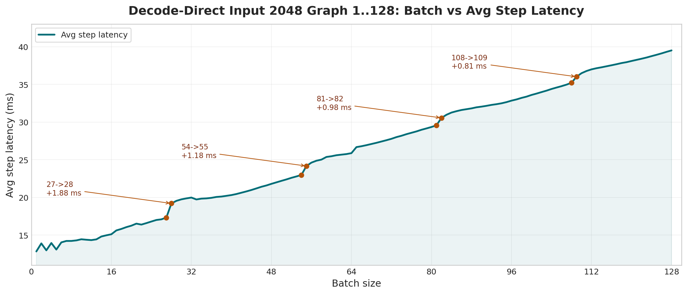
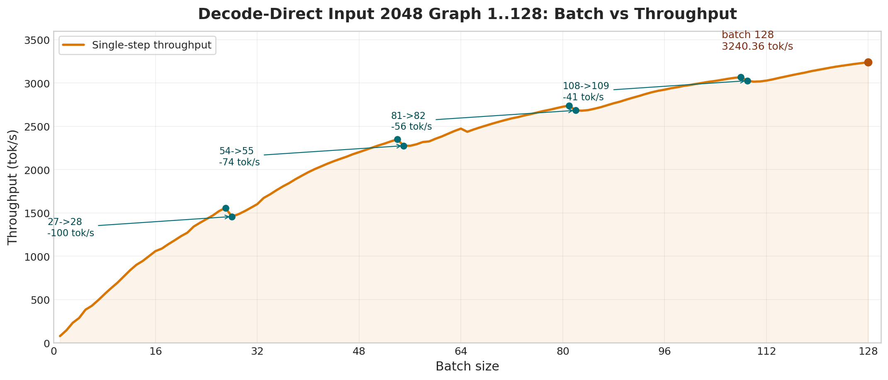
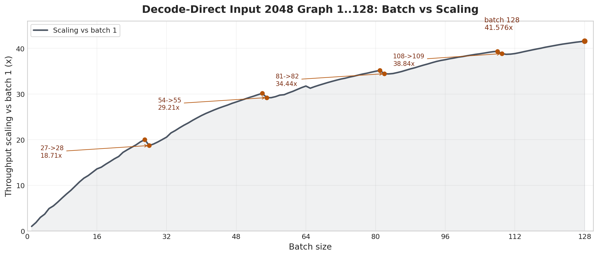

# Decode-Direct Input 2048 Graph 1..128 性能报告

## 运行环境

| 项目 | 值 |
| --- | --- |
| 日期 | 2026-11-11 15:58-16:06（Asia/Shanghai） |
| 平台 | NVIDIA |
| 设备 | A100-SXM4-80GB |
| Driver | 535.161.08 |
| InfiniLM build | 当前源码树；未记录独立 build ID |
| 模型 | `/data-aisoft/mechdancer/models/Qwen3-8B` |
| 模式 | `decode-direct` |
| Attention backend | `flash-attn` |
| Graph compiling | enabled |
| Expected execution mode | `graph` |
| Cache | paged KV cache，block size 256，num blocks 1152 |
| Max batched tokens | 18432 |
| Tensor parallel size | 1 |
| Input length | 2048 tokens / request |
| Batch size | 1..128 |
| Decode steps per repeat | 4 |
| Warmup | 每个形状 3 次 repeat |
| Measured repeats | 每个形状 30 次 repeat |
| Batch 执行顺序 | random seed 2026 |

本报告对应的原始 JSONL 和 log 为本机运行产物，不随仓库提交：

```text
../../../benchmark-decode-direct-qwen3-8b-flash-attn-input2048-graph1-128-20261111.jsonl
../../../benchmark-decode-direct-qwen3-8b-flash-attn-input2048-graph1-128-20261111.log
../../../benchmark-decode-direct-qwen3-8b-flash-attn-input2048-graph1-256-20261111.log
```

## 构建与测试命令

```bash
xmake build _infinilm && xmake install _infinilm
```

首先尝试 batch `1..256`：

```bash
BENCHMARK_MODE=decode-direct \
BATCH_SIZES="$(seq -s, 1 256)" \
INPUT_LENS=2048 \
BENCHMARK_REPEATS=30 \
BENCHMARK_OUTPUT=benchmark-decode-direct-qwen3-8b-flash-attn-input2048-graph1-256-20261111.jsonl \
./run_bench.sh
```

该尝试在 engine 初始化阶段发生 CUDA malloc OOM，没有产生有效 JSONL。随后改用 batch `1..128` 完成本报告：

```bash
BENCHMARK_MODE=decode-direct \
BATCH_SIZES="$(seq -s, 1 128)" \
INPUT_LENS=2048 \
BENCHMARK_REPEATS=30 \
BENCHMARK_OUTPUT=benchmark-decode-direct-qwen3-8b-flash-attn-input2048-graph1-128-20261111.jsonl \
./run_bench.sh
```

## 执行模式与 Graph 覆盖

本轮 cache `max_batch_size=128`，当前 paged graph compiler 编译 decode batch `1..128`。因此报告中所有 batch 均为 expected graph mode，没有 eager fallback 混入。

batch `1..256` 的初始尝试同样要求 compiler 覆盖 `1..256`，但 input length 2048、更大的 paged KV cache、256 个 graph 以及 `max_num_batched_tokens=18432` 的组合超过 A100 80GB 可用显存，在初始化阶段触发 CUDA malloc OOM。

## 资源开销

| 项目 | 值 |
| --- | ---: |
| Workspace manager 配置 | `max_num_batched_tokens=18432` |
| Workspace allocation | 1944 MiB |
| 权重加载与 graph 编译时间 | 约 18.65 秒 |
| 测试期间 GPU 显存占用 | 约 64.3 GiB |
| Paged cache blocks | 1152 |
| Compiled graph 数量 | 128 |
| 正式 step sample 数 | 15,360 |

Input length 2048 且执行 4 个 decode step 时，每个 request 需要 `ceil(2052 / 256) = 9` 个 block。batch 128 共需要 `128 * 9 = 1152` 个 block。

## 测试口径

- `decode-direct` 不执行语义完整的 prefill，paged KV cache 初始为全 0。
- Step 0 输入 dummy token；step 1 到 step 3 使用上一步 sampled token。
- 4 个 decode step 的 past KV length 分别为 2048、2049、2050、2051。
- 报告中的 duration 是单 step 时间，由一次 4-step repeat 的对应总耗时除以 4 得到。
- `single_step_throughput = batch_size / avg_step_latency`。
- 每个 request 每 step 生成 1 个 token，因此 single-step request throughput 与 token throughput 数值相同。
- 表格中的 Min/P50/P95/P99/Max 是每个 repeat 的平均 step 时间分布。
- 计时边界为 `engine_forward_including_sampling`。

## 核心结果

| 指标 | 结果 |
| --- | ---: |
| 最高 single-step 吞吐 | batch 128，3240.36 tok/s |
| batch 128 平均单 step latency | 39.502 ms |
| batch 128 P99 单 step latency | 39.628 ms |
| batch 1 平均单 step latency | 12.831 ms |
| batch 128 相对 batch 1 吞吐倍数 | 41.576x |
| batch 128 相对理想 128x 的效率 | 32.5% |
| 单 step std 中位数 | 0.021 ms |
| 最大单 step std | 0.158 ms，batch 37 |

## 趋势图

### 1. Batch size 与 Avg Step Latency



平均单 step latency 从 batch 1 的 12.831 ms 增至 batch 128 的 39.502 ms。曲线整体上升，但在 27->28、54->55、81->82、108->109 出现明显跳变。

### 2. Batch size 与 Single-step Throughput



吞吐从 batch 1 的 77.94 tok/s 增至 batch 128 的 3240.36 tok/s。最后 16 个 batch 的斜率约 13.31 tok/s per batch，最后 32 个 batch 约 9.00 tok/s per batch，本轮范围内仍未见吞吐回落。

### 3. Batch size 与 Scaling



Scaling 从 batch 1 的 1.000x 增至 batch 128 的 41.576x。相对理想 128x 的效率约 32.5%。

## Batch 区间平均 latency

下表按连续 16 个 batch 分组。`平均单 step latency ms` 和 `平均吞吐 tok/s` 分别是该区间内 16 个 batch 的 overall `Avg Step ms` 与 `Single-step tok/s` 的算术平均值；`区间最优 batch` 取该区间内 `Single-step tok/s` 最高的 batch。

| Batch 区间 | 平均单 step latency ms | 平均吞吐 tok/s | 区间最优 batch |
| --- | ---: | ---: | ---: |
| 1..16 | 14.124 | 589.72 | 16 |
| 17..32 | 17.486 | 1,390.23 | 32 |
| 33..48 | 20.556 | 1,965.35 | 48 |
| 49..64 | 24.207 | 2,331.25 | 64 |
| 65..80 | 27.929 | 2,593.29 | 80 |
| 81..96 | 31.727 | 2,787.78 | 96 |
| 97..112 | 34.700 | 3,010.73 | 108 |
| 113..128 | 38.228 | 3,151.00 | 128 |

区间平均 latency 随 batch size 持续增长，区间平均吞吐也持续上升。大多数区间的最优 batch 是区间右端点；97..112 的最优 batch 是 108，因为 108->109 发生 latency 跳变，导致 109..112 的吞吐尚未恢复到 batch 108 的水平。

## 关键批次与跳变

| Change | Avg step ms | Single-step tok/s | 吞吐变化 |
| --- | ---: | ---: | ---: |
| 27 -> 28 | 17.324 -> 19.201 | 1558.57 -> 1458.27 | -100.30 |
| 54 -> 55 | 22.980 -> 24.163 | 2349.85 -> 2276.23 | -73.62 |
| 81 -> 82 | 29.564 -> 30.549 | 2739.80 -> 2684.20 | -55.60 |
| 108 -> 109 | 35.204 -> 36.011 | 3067.84 -> 3026.89 | -40.95 |

这些跳变均发生在 graph 覆盖范围内，不能归因于 eager fallback。间隔约 27 个 batch，可能与 kernel 选择、workspace 或 graph 内部形状变化有关，需要 kernel trace 或 C++ model-only 打点进一步定位。

## Step 一致性

| Decode step | Past KV length | 全部 batch 平均 step latency ms |
| ---: | ---: | ---: |
| 0 | 2048 | 26.108 |
| 1 | 2049 | 26.116 |
| 2 | 2050 | 26.124 |
| 3 | 2051 | 26.129 |

Past KV length 从 2048 增至 2051 时，平均 step latency 仅增加约 0.020 ms。该影响远小于 batch size 和周期性跳变。

## 数据稳定性

- 128 个 overall summary 换算为单 step 后，std 中位数为 0.021 ms。
- 最大单 step std 为 0.158 ms，出现在 batch 37。
- 最大变异系数约 0.789%，中位变异系数约 0.085%。
- P50、P95、P99 和 max 普遍接近。

## Single-step 完整结果

### Batch 1..64

| Batch | Mode | Avg Step ms | Min Step ms | P50 Step ms | P95 Step ms | P99 Step ms | Max Step ms | Std Step ms | Single-step tok/s | Scaling |
| ---: | --- | ---: | ---: | ---: | ---: | ---: | ---: | ---: | ---: | ---: |
| 1 | graph | 12.831 | 12.795 | 12.818 | 12.910 | 12.971 | 12.986 | 0.042 | 77.94 | 1.000x |
| 2 | graph | 13.897 | 13.878 | 13.899 | 13.909 | 13.912 | 13.913 | 0.009 | 143.92 | 1.847x |
| 3 | graph | 12.977 | 12.925 | 12.980 | 12.999 | 13.002 | 13.003 | 0.018 | 231.18 | 2.966x |
| 4 | graph | 13.946 | 13.920 | 13.949 | 13.960 | 13.962 | 13.963 | 0.010 | 286.82 | 3.680x |
| 5 | graph | 13.078 | 13.044 | 13.078 | 13.107 | 13.145 | 13.157 | 0.022 | 382.33 | 4.906x |
| 6 | graph | 14.032 | 14.008 | 14.035 | 14.057 | 14.068 | 14.071 | 0.017 | 427.58 | 5.486x |
| 7 | graph | 14.219 | 14.198 | 14.215 | 14.241 | 14.261 | 14.269 | 0.015 | 492.28 | 6.316x |
| 8 | graph | 14.222 | 14.186 | 14.226 | 14.250 | 14.252 | 14.252 | 0.020 | 562.50 | 7.217x |
| 9 | graph | 14.295 | 14.266 | 14.295 | 14.321 | 14.340 | 14.346 | 0.016 | 629.58 | 8.078x |
| 10 | graph | 14.444 | 14.413 | 14.445 | 14.460 | 14.461 | 14.461 | 0.012 | 692.31 | 8.883x |
| 11 | graph | 14.382 | 14.349 | 14.381 | 14.409 | 14.417 | 14.419 | 0.016 | 764.86 | 9.814x |
| 12 | graph | 14.333 | 14.306 | 14.337 | 14.347 | 14.352 | 14.353 | 0.013 | 837.22 | 10.742x |
| 13 | graph | 14.431 | 14.406 | 14.430 | 14.454 | 14.458 | 14.460 | 0.014 | 900.81 | 11.558x |
| 14 | graph | 14.810 | 14.768 | 14.806 | 14.881 | 14.928 | 14.931 | 0.036 | 945.28 | 12.129x |
| 15 | graph | 14.972 | 14.931 | 14.972 | 15.003 | 15.018 | 15.023 | 0.019 | 1001.88 | 12.855x |
| 16 | graph | 15.108 | 15.066 | 15.105 | 15.130 | 15.208 | 15.238 | 0.028 | 1059.01 | 13.588x |
| 17 | graph | 15.620 | 15.582 | 15.624 | 15.640 | 15.652 | 15.657 | 0.019 | 1088.38 | 13.965x |
| 18 | graph | 15.816 | 15.794 | 15.808 | 15.870 | 15.908 | 15.909 | 0.025 | 1138.09 | 14.603x |
| 19 | graph | 16.056 | 16.014 | 16.054 | 16.076 | 16.114 | 16.128 | 0.018 | 1183.38 | 15.184x |
| 20 | graph | 16.248 | 16.209 | 16.252 | 16.273 | 16.276 | 16.277 | 0.018 | 1230.96 | 15.794x |
| 21 | graph | 16.519 | 16.494 | 16.518 | 16.548 | 16.566 | 16.569 | 0.017 | 1271.23 | 16.311x |
| 22 | graph | 16.392 | 16.357 | 16.387 | 16.408 | 16.470 | 16.495 | 0.023 | 1342.15 | 17.221x |
| 23 | graph | 16.587 | 16.557 | 16.590 | 16.600 | 16.628 | 16.639 | 0.015 | 1386.60 | 17.791x |
| 24 | graph | 16.799 | 16.635 | 16.802 | 16.841 | 16.869 | 16.877 | 0.036 | 1428.62 | 18.330x |
| 25 | graph | 17.003 | 16.959 | 16.994 | 17.039 | 17.211 | 17.278 | 0.054 | 1470.30 | 18.865x |
| 26 | graph | 17.089 | 17.047 | 17.091 | 17.110 | 17.149 | 17.165 | 0.021 | 1521.44 | 19.521x |
| 27 | graph | 17.324 | 17.171 | 17.331 | 17.342 | 17.382 | 17.398 | 0.037 | 1558.57 | 19.998x |
| 28 | graph | 19.201 | 19.096 | 19.203 | 19.275 | 19.286 | 19.288 | 0.046 | 1458.27 | 18.711x |
| 29 | graph | 19.541 | 19.367 | 19.556 | 19.637 | 19.663 | 19.673 | 0.084 | 1484.03 | 19.041x |
| 30 | graph | 19.741 | 19.675 | 19.739 | 19.775 | 19.788 | 19.794 | 0.022 | 1519.68 | 19.499x |
| 31 | graph | 19.869 | 19.833 | 19.864 | 19.917 | 19.945 | 19.951 | 0.026 | 1560.23 | 20.019x |
| 32 | graph | 19.978 | 19.902 | 19.959 | 20.064 | 20.417 | 20.538 | 0.113 | 1601.77 | 20.552x |
| 33 | graph | 19.727 | 19.710 | 19.726 | 19.746 | 19.751 | 19.751 | 0.011 | 1672.81 | 21.464x |
| 34 | graph | 19.835 | 19.782 | 19.835 | 19.865 | 19.880 | 19.886 | 0.019 | 1714.17 | 21.994x |
| 35 | graph | 19.869 | 19.694 | 19.865 | 19.979 | 20.008 | 20.010 | 0.064 | 1761.57 | 22.602x |
| 36 | graph | 19.941 | 19.927 | 19.937 | 19.960 | 19.972 | 19.977 | 0.012 | 1805.33 | 23.164x |
| 37 | graph | 20.059 | 19.971 | 20.028 | 20.114 | 20.682 | 20.897 | 0.158 | 1844.56 | 23.667x |
| 38 | graph | 20.112 | 20.083 | 20.113 | 20.129 | 20.130 | 20.131 | 0.012 | 1889.40 | 24.243x |
| 39 | graph | 20.207 | 20.172 | 20.208 | 20.228 | 20.228 | 20.229 | 0.014 | 1930.02 | 24.764x |
| 40 | graph | 20.308 | 20.277 | 20.309 | 20.322 | 20.333 | 20.337 | 0.012 | 1969.67 | 25.272x |
| 41 | graph | 20.448 | 20.418 | 20.449 | 20.465 | 20.502 | 20.515 | 0.018 | 2005.12 | 25.727x |
| 42 | graph | 20.622 | 20.591 | 20.621 | 20.648 | 20.659 | 20.663 | 0.015 | 2036.69 | 26.132x |
| 43 | graph | 20.794 | 20.744 | 20.790 | 20.823 | 20.907 | 20.940 | 0.033 | 2067.91 | 26.533x |
| 44 | graph | 20.983 | 20.943 | 20.984 | 21.008 | 21.010 | 21.010 | 0.017 | 2096.93 | 26.905x |
| 45 | graph | 21.193 | 21.168 | 21.188 | 21.217 | 21.265 | 21.283 | 0.020 | 2123.32 | 27.244x |
| 46 | graph | 21.410 | 21.367 | 21.410 | 21.426 | 21.429 | 21.430 | 0.013 | 2148.57 | 27.568x |
| 47 | graph | 21.584 | 21.553 | 21.584 | 21.607 | 21.615 | 21.617 | 0.013 | 2177.54 | 27.940x |
| 48 | graph | 21.798 | 21.773 | 21.796 | 21.834 | 21.853 | 21.855 | 0.018 | 2202.01 | 28.254x |
| 49 | graph | 21.997 | 21.956 | 21.985 | 22.009 | 22.256 | 22.356 | 0.068 | 2227.61 | 28.582x |
| 50 | graph | 22.194 | 22.175 | 22.190 | 22.227 | 22.256 | 22.263 | 0.019 | 2252.85 | 28.906x |
| 51 | graph | 22.386 | 22.344 | 22.385 | 22.403 | 22.431 | 22.441 | 0.016 | 2278.24 | 29.232x |
| 52 | graph | 22.597 | 22.559 | 22.592 | 22.628 | 22.632 | 22.633 | 0.018 | 2301.22 | 29.527x |
| 53 | graph | 22.780 | 22.747 | 22.780 | 22.805 | 22.828 | 22.836 | 0.018 | 2326.57 | 29.852x |
| 54 | graph | 22.980 | 22.954 | 22.980 | 22.999 | 23.009 | 23.013 | 0.012 | 2349.85 | 30.151x |
| 55 | graph | 24.163 | 24.076 | 24.161 | 24.203 | 24.214 | 24.217 | 0.031 | 2276.23 | 29.206x |
| 56 | graph | 24.614 | 24.549 | 24.612 | 24.666 | 24.683 | 24.689 | 0.032 | 2275.10 | 29.191x |
| 57 | graph | 24.865 | 24.783 | 24.867 | 24.909 | 24.966 | 24.989 | 0.041 | 2292.34 | 29.413x |
| 58 | graph | 25.015 | 24.968 | 25.013 | 25.050 | 25.094 | 25.111 | 0.029 | 2318.61 | 29.750x |
| 59 | graph | 25.366 | 25.329 | 25.364 | 25.408 | 25.439 | 25.448 | 0.024 | 2325.91 | 29.843x |
| 60 | graph | 25.461 | 25.287 | 25.466 | 25.507 | 25.531 | 25.534 | 0.040 | 2356.57 | 30.237x |
| 61 | graph | 25.595 | 25.560 | 25.597 | 25.624 | 25.634 | 25.635 | 0.017 | 2383.25 | 30.579x |
| 62 | graph | 25.670 | 25.630 | 25.666 | 25.716 | 25.757 | 25.767 | 0.025 | 2415.26 | 30.990x |
| 63 | graph | 25.749 | 25.697 | 25.751 | 25.778 | 25.785 | 25.786 | 0.018 | 2446.67 | 31.393x |
| 64 | graph | 25.872 | 25.850 | 25.868 | 25.907 | 25.922 | 25.928 | 0.018 | 2473.68 | 31.739x |

### Batch 65..128

| Batch | Mode | Avg Step ms | Min Step ms | P50 Step ms | P95 Step ms | P99 Step ms | Max Step ms | Std Step ms | Single-step tok/s | Scaling |
| ---: | --- | ---: | ---: | ---: | ---: | ---: | ---: | ---: | ---: | ---: |
| 65 | graph | 26.673 | 26.622 | 26.677 | 26.699 | 26.704 | 26.706 | 0.020 | 2436.89 | 31.267x |
| 66 | graph | 26.789 | 26.757 | 26.787 | 26.819 | 26.824 | 26.826 | 0.018 | 2463.71 | 31.611x |
| 67 | graph | 26.931 | 26.900 | 26.927 | 26.961 | 26.984 | 26.990 | 0.018 | 2487.87 | 31.921x |
| 68 | graph | 27.088 | 27.061 | 27.088 | 27.104 | 27.106 | 27.106 | 0.011 | 2510.35 | 32.210x |
| 69 | graph | 27.242 | 27.216 | 27.241 | 27.254 | 27.342 | 27.377 | 0.027 | 2532.82 | 32.498x |
| 70 | graph | 27.413 | 27.364 | 27.416 | 27.441 | 27.451 | 27.454 | 0.019 | 2553.53 | 32.764x |
| 71 | graph | 27.588 | 27.555 | 27.586 | 27.616 | 27.624 | 27.624 | 0.015 | 2573.54 | 33.021x |
| 72 | graph | 27.773 | 27.749 | 27.768 | 27.810 | 27.818 | 27.821 | 0.019 | 2592.41 | 33.263x |
| 73 | graph | 28.001 | 27.945 | 27.997 | 28.051 | 28.089 | 28.100 | 0.028 | 2607.06 | 33.451x |
| 74 | graph | 28.177 | 28.142 | 28.172 | 28.216 | 28.226 | 28.230 | 0.021 | 2626.27 | 33.697x |
| 75 | graph | 28.390 | 28.333 | 28.394 | 28.411 | 28.434 | 28.441 | 0.019 | 2641.74 | 33.896x |
| 76 | graph | 28.571 | 28.549 | 28.569 | 28.588 | 28.596 | 28.599 | 0.012 | 2660.07 | 34.131x |
| 77 | graph | 28.755 | 28.714 | 28.757 | 28.790 | 28.798 | 28.801 | 0.022 | 2677.79 | 34.358x |
| 78 | graph | 28.972 | 28.876 | 28.971 | 29.000 | 29.068 | 29.093 | 0.032 | 2692.28 | 34.544x |
| 79 | graph | 29.152 | 29.118 | 29.148 | 29.197 | 29.211 | 29.215 | 0.023 | 2709.91 | 34.770x |
| 80 | graph | 29.342 | 29.302 | 29.338 | 29.392 | 29.397 | 29.398 | 0.025 | 2726.44 | 34.982x |
| 81 | graph | 29.564 | 29.534 | 29.559 | 29.588 | 29.666 | 29.697 | 0.028 | 2739.80 | 35.154x |
| 82 | graph | 30.549 | 30.492 | 30.549 | 30.587 | 30.596 | 30.597 | 0.025 | 2684.20 | 34.440x |
| 83 | graph | 30.962 | 30.868 | 30.964 | 31.013 | 31.018 | 31.021 | 0.037 | 2680.69 | 34.395x |
| 84 | graph | 31.256 | 31.195 | 31.253 | 31.305 | 31.313 | 31.316 | 0.031 | 2687.45 | 34.482x |
| 85 | graph | 31.439 | 31.402 | 31.433 | 31.481 | 31.520 | 31.530 | 0.026 | 2703.66 | 34.690x |
| 86 | graph | 31.596 | 31.549 | 31.590 | 31.629 | 31.642 | 31.645 | 0.019 | 2721.90 | 34.924x |
| 87 | graph | 31.703 | 31.677 | 31.705 | 31.720 | 31.726 | 31.728 | 0.013 | 2744.24 | 35.211x |
| 88 | graph | 31.810 | 31.773 | 31.805 | 31.839 | 31.883 | 31.897 | 0.021 | 2766.44 | 35.496x |
| 89 | graph | 31.954 | 31.924 | 31.950 | 31.997 | 32.009 | 32.012 | 0.021 | 2785.28 | 35.737x |
| 90 | graph | 32.042 | 32.008 | 32.030 | 32.133 | 32.201 | 32.219 | 0.044 | 2808.78 | 36.039x |
| 91 | graph | 32.149 | 32.127 | 32.145 | 32.170 | 32.207 | 32.221 | 0.018 | 2830.54 | 36.318x |
| 92 | graph | 32.272 | 32.167 | 32.274 | 32.300 | 32.341 | 32.355 | 0.030 | 2850.73 | 36.577x |
| 93 | graph | 32.368 | 32.324 | 32.365 | 32.416 | 32.475 | 32.491 | 0.029 | 2873.18 | 36.865x |
| 94 | graph | 32.484 | 32.454 | 32.483 | 32.503 | 32.506 | 32.506 | 0.013 | 2893.70 | 37.128x |
| 95 | graph | 32.641 | 32.450 | 32.648 | 32.676 | 32.704 | 32.714 | 0.043 | 2910.48 | 37.344x |
| 96 | graph | 32.838 | 32.804 | 32.834 | 32.867 | 32.913 | 32.931 | 0.023 | 2923.48 | 37.511x |
| 97 | graph | 32.999 | 32.977 | 32.999 | 33.021 | 33.031 | 33.035 | 0.014 | 2939.53 | 37.717x |
| 98 | graph | 33.200 | 33.165 | 33.197 | 33.229 | 33.308 | 33.338 | 0.030 | 2951.83 | 37.874x |
| 99 | graph | 33.368 | 33.324 | 33.365 | 33.398 | 33.425 | 33.434 | 0.022 | 2966.89 | 38.068x |
| 100 | graph | 33.592 | 33.558 | 33.588 | 33.624 | 33.661 | 33.676 | 0.023 | 2976.94 | 38.197x |
| 101 | graph | 33.773 | 33.743 | 33.769 | 33.808 | 33.823 | 33.823 | 0.018 | 2990.57 | 38.371x |
| 102 | graph | 33.972 | 33.945 | 33.969 | 33.999 | 34.006 | 34.008 | 0.015 | 3002.50 | 38.525x |
| 103 | graph | 34.163 | 34.003 | 34.169 | 34.203 | 34.216 | 34.220 | 0.040 | 3014.93 | 38.684x |
| 104 | graph | 34.384 | 34.250 | 34.383 | 34.437 | 34.516 | 34.543 | 0.048 | 3024.66 | 38.809x |
| 105 | graph | 34.575 | 34.534 | 34.574 | 34.601 | 34.616 | 34.622 | 0.020 | 3036.89 | 38.966x |
| 106 | graph | 34.758 | 34.730 | 34.759 | 34.775 | 34.788 | 34.793 | 0.014 | 3049.69 | 39.130x |
| 107 | graph | 34.962 | 34.946 | 34.959 | 34.997 | 35.001 | 35.001 | 0.015 | 3060.49 | 39.269x |
| 108 | graph | 35.204 | 35.158 | 35.204 | 35.222 | 35.337 | 35.382 | 0.037 | 3067.84 | 39.363x |
| 109 | graph | 36.011 | 35.959 | 35.996 | 36.087 | 36.196 | 36.240 | 0.053 | 3026.89 | 38.837x |
| 110 | graph | 36.478 | 36.305 | 36.492 | 36.523 | 36.537 | 36.541 | 0.046 | 3015.48 | 38.691x |
| 111 | graph | 36.771 | 36.699 | 36.768 | 36.832 | 36.843 | 36.844 | 0.036 | 3018.67 | 38.732x |
| 112 | graph | 36.989 | 36.817 | 36.992 | 37.029 | 37.081 | 37.102 | 0.047 | 3027.95 | 38.851x |
| 113 | graph | 37.140 | 37.097 | 37.135 | 37.175 | 37.238 | 37.261 | 0.031 | 3042.56 | 39.039x |
| 114 | graph | 37.261 | 37.207 | 37.260 | 37.288 | 37.321 | 37.333 | 0.023 | 3059.49 | 39.256x |
| 115 | graph | 37.396 | 37.362 | 37.398 | 37.430 | 37.437 | 37.439 | 0.021 | 3075.18 | 39.457x |
| 116 | graph | 37.531 | 37.494 | 37.521 | 37.616 | 37.637 | 37.641 | 0.034 | 3090.76 | 39.657x |
| 117 | graph | 37.672 | 37.638 | 37.672 | 37.701 | 37.709 | 37.710 | 0.018 | 3105.76 | 39.849x |
| 118 | graph | 37.823 | 37.797 | 37.819 | 37.847 | 37.864 | 37.871 | 0.014 | 3119.77 | 40.029x |
| 119 | graph | 37.941 | 37.907 | 37.937 | 37.984 | 38.011 | 38.021 | 0.024 | 3136.42 | 40.243x |
| 120 | graph | 38.098 | 38.060 | 38.098 | 38.127 | 38.128 | 38.128 | 0.016 | 3149.74 | 40.414x |
| 121 | graph | 38.248 | 38.201 | 38.253 | 38.273 | 38.292 | 38.298 | 0.018 | 3163.55 | 40.591x |
| 122 | graph | 38.398 | 38.370 | 38.393 | 38.441 | 38.455 | 38.461 | 0.022 | 3177.26 | 40.767x |
| 123 | graph | 38.558 | 38.531 | 38.556 | 38.586 | 38.591 | 38.592 | 0.015 | 3190.02 | 40.930x |
| 124 | graph | 38.742 | 38.719 | 38.742 | 38.754 | 38.761 | 38.763 | 0.009 | 3200.67 | 41.067x |
| 125 | graph | 38.919 | 38.887 | 38.911 | 38.981 | 39.004 | 39.011 | 0.028 | 3211.80 | 41.210x |
| 126 | graph | 39.107 | 39.073 | 39.106 | 39.141 | 39.145 | 39.146 | 0.015 | 3221.93 | 41.340x |
| 127 | graph | 39.311 | 39.275 | 39.308 | 39.338 | 39.426 | 39.462 | 0.033 | 3230.67 | 41.452x |
| 128 | graph | 39.502 | 39.460 | 39.500 | 39.539 | 39.628 | 39.661 | 0.036 | 3240.36 | 41.576x |

## 结论与建议

1. 在本轮 input length 2048、batch `1..128`、全 graph 覆盖范围内，**batch 128 吞吐最高**，约 3240.36 tok/s。
2. 平均单 step latency 从 batch 1 的 12.831 ms 增至 batch 128 的 39.502 ms。
3. Batch `1..256` 全 graph 方案在 A100 80GB 上初始化 OOM；如需更大 batch，需要降低 graph 数量、降低 workspace 配置或使用更大显存设备。
4. 重点排查 27->28、54->55、81->82、108->109 的周期性 latency 跳变。
5. 正式 p99 对比建议将 `BENCHMARK_REPEATS` 提高到 100 或以上。

## 数据完整性

```text
config records: 1
step samples: 15360
overall summaries: 128
per-step summaries: 512
scaling records: 128
每个 batch step samples: 120
每 decode step samples: 3840
```
