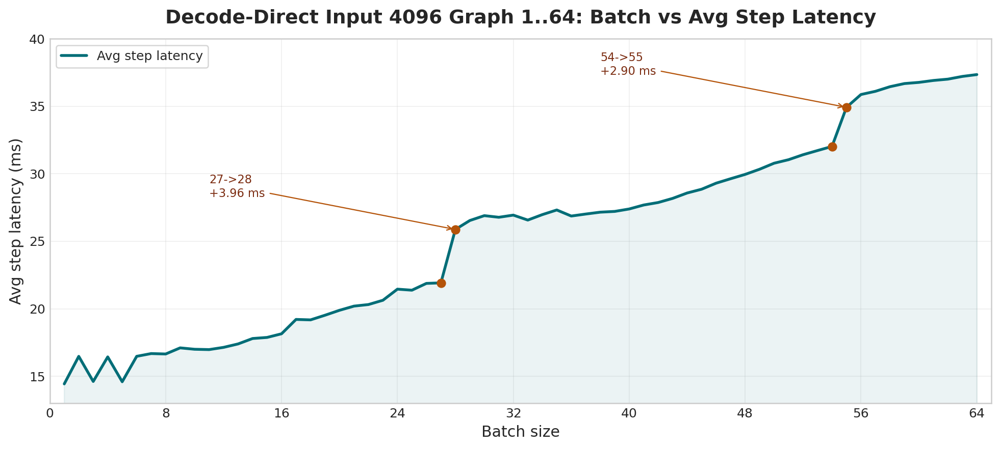
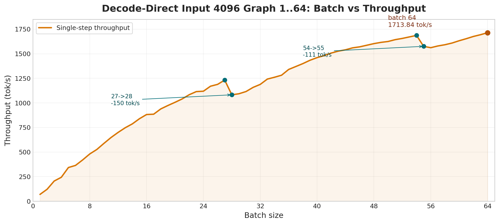
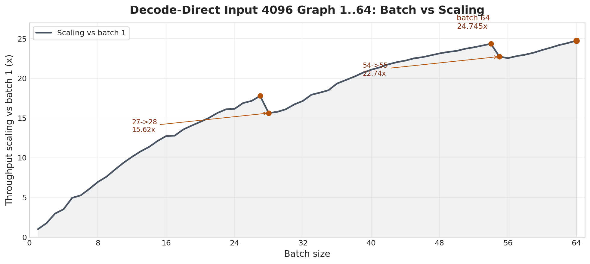

# Decode-Direct Input 4096 Graph 1..64 性能报告

## 运行环境

| 项目 | 值 |
| --- | --- |
| 日期 | 2026-11-13 10:25-10:29（Asia/Shanghai） |
| 平台 | NVIDIA |
| 设备 | A100-SXM4-80GB |
| Driver | 535.161.08 |
| InfiniLM build | 当前源码树；未记录独立 build ID |
| 模型 | `/data-aisoft/mechdancer/models/Qwen3-8B` |
| 模式 | `decode-direct` |
| Attention backend | `flash-attn` |
| Graph compiling | enabled |
| Expected execution mode | `graph` |
| Cache | paged KV cache，block size 256，num blocks 1088 |
| Max batched tokens | 18432 |
| Tensor parallel size | 1 |
| Input length | 4096 tokens / request |
| Batch size | 1..64 |
| Decode steps per repeat | 4 |
| Warmup | 每个形状 3 次 repeat |
| Measured repeats | 每个形状 30 次 repeat |
| Batch 执行顺序 | random seed 2026 |

本报告对应的原始 JSONL 和 log 为本机运行产物，不随仓库提交：

```text
../../../benchmark-decode-direct-qwen3-8b-flash-attn-input4096-graph1-64-20261113.jsonl
../../../benchmark-decode-direct-qwen3-8b-flash-attn-input4096-graph1-64-20261113.log
```

## 构建与测试命令

本轮使用当前已安装的 `_infinilm` 扩展。标准重建命令如下：

```bash
xmake build _infinilm && xmake install _infinilm
```

性能测试命令：

```bash
BENCHMARK_MODE=decode-direct \
BATCH_SIZES="$(seq -s, 1 64)" \
INPUT_LENS=4096 \
BENCHMARK_REPEATS=30 \
BENCHMARK_OUTPUT=benchmark-decode-direct-qwen3-8b-flash-attn-input4096-graph1-64-20261113.jsonl \
./run_bench.sh
```

## 执行模式与 Graph 覆盖

为避免显存不足，本轮将 decode batch 上限限制为 64。当前 paged graph compiler 编译 decode batch `1..64`，所有 batch 均有对应 graph，无 eager fallback 混入。

## 资源开销

| 项目 | 值 |
| --- | ---: |
| Workspace manager 配置 | `max_num_batched_tokens=18432` |
| Workspace allocation | 1944 MiB |
| 权重加载与 graph 编译时间 | 约 12.55 秒 |
| 测试期间 GPU 显存占用 | 约 65.8 GiB |
| Paged cache blocks | 1088 |
| Compiled graph 数量 | 64 |
| 正式 step sample 数 | 7,680 |

Input length 4096 且执行 4 个 decode step 时，每个 request 需要 `ceil(4100 / 256) = 17` 个 block。batch 64 共需要 `64 * 17 = 1088` 个 block。

## 测试口径

- `decode-direct` 不执行语义完整的 prefill，paged KV cache 初始为全 0。
- Step 0 输入 dummy token；step 1 到 step 3 使用上一步 sampled token。
- 4 个 decode step 的 past KV length 分别为 4096、4097、4098、4099。
- 报告中的 duration 是单 step 时间，由一次 4-step repeat 的对应总耗时除以 4 得到。
- `single_step_throughput = batch_size / avg_step_latency`。
- 每个 request 每 step 生成 1 个 token，因此 single-step request throughput 与 token throughput 数值相同。
- 表格中的 Min/P50/P95/P99/Max 是每个 repeat 的平均 step 时间分布。
- 计时边界为 `engine_forward_including_sampling`。

## 核心结果

| 指标 | 结果 |
| --- | ---: |
| 最高 single-step 吞吐 | batch 64，1713.84 tok/s |
| batch 64 平均单 step latency | 37.343 ms |
| batch 64 P99 单 step latency | 37.403 ms |
| batch 1 平均单 step latency | 14.438 ms |
| batch 64 相对 batch 1 吞吐倍数 | 24.745x |
| batch 64 相对理想 64x 的效率 | 38.7% |
| 单 step std 中位数 | 0.051 ms |
| 最大单 step std | 0.216 ms，batch 17 |

## 趋势图

### 1. Batch size 与 Avg Step Latency



平均单 step latency 从 batch 1 的 14.438 ms 增至 batch 64 的 37.343 ms。曲线在 27->28 和 54->55 出现两次明显向上跳变。

### 2. Batch size 与 Single-step Throughput



吞吐整体上升，但 27->28 和 54->55 出明显回落。batch 64 达到本轮最高吞吐 1713.84 tok/s。

### 3. Batch size 与 Scaling



Scaling 从 batch 1 的 1.000x 增至 batch 64 的 24.745x。相对理想 64x 的效率约 38.7%。

## Batch 区间平均 latency 与吞吐

下表按连续 16 个 batch 分组。`平均单 step latency ms` 和 `平均吞吐 tok/s` 分别是区间内 16 个 batch 的 overall `Avg Step ms` 与 `Single-step tok/s` 的算术平均值；`区间最优 batch` 取区间内吞吐最高的 batch。

| Batch 区间 | 平均单 step latency ms | 平均吞吐 tok/s | 区间最优 batch |
| --- | ---: | ---: | ---: |
| 1..16 | 16.615 | 497.65 | 16 |
| 17..32 | 22.412 | 1,086.52 | 27 |
| 33..48 | 27.908 | 1,447.44 | 48 |
| 49..64 | 34.533 | 1,636.17 | 64 |

## 关键批次与跳变

| Change | Avg step ms | Single-step tok/s | 吞吐变化 |
| --- | ---: | ---: | ---: |
| 27 -> 28 | 21.918 -> 25.874 | 1231.85 -> 1082.15 | -149.70 |
| 54 -> 55 | 32.021 -> 34.920 | 1686.38 -> 1575.04 | -111.35 |

两次跳变均发生在 graph 覆盖范围内，不能归因于 eager fallback。跳变后吞吐随 batch 继续恢复，batch 64 达到最高值。

## Step 一致性

| Decode step | Past KV length | 全部 batch 平均 step latency ms |
| ---: | ---: | ---: |
| 0 | 4096 | 25.360 |
| 1 | 4097 | 25.368 |
| 2 | 4098 | 25.369 |
| 3 | 4099 | 25.371 |

Past KV length 从 4096 增至 4099 时，平均 step latency 仅增加约 0.010 ms。该影响远小于 batch size 和跳变。

## 数据稳定性

- 64 个 overall summary 换算为单 step 后，std 中位数为 0.051 ms。
- 最大单 step std 为 0.216 ms，出现在 batch 17。
- 最大变异系数约 1.127%，中位变异系数约 0.218%。
- P50、P95、P99 和 max 普遍接近。

## Single-step 完整结果

### Batch 1..32

| Batch | Mode | Avg Step ms | Min Step ms | P50 Step ms | P95 Step ms | P99 Step ms | Max Step ms | Std Step ms | Single-step tok/s | Scaling |
| ---: | --- | ---: | ---: | ---: | ---: | ---: | ---: | ---: | ---: | ---: |
| 1 | graph | 14.438 | 14.360 | 14.435 | 14.557 | 14.617 | 14.621 | 0.062 | 69.26 | 1.000x |
| 2 | graph | 16.477 | 16.383 | 16.436 | 16.723 | 16.736 | 16.736 | 0.097 | 121.38 | 1.753x |
| 3 | graph | 14.619 | 14.483 | 14.604 | 14.740 | 14.896 | 14.951 | 0.085 | 205.21 | 2.963x |
| 4 | graph | 16.437 | 16.382 | 16.440 | 16.480 | 16.483 | 16.485 | 0.025 | 243.35 | 3.514x |
| 5 | graph | 14.597 | 14.489 | 14.600 | 14.654 | 14.659 | 14.661 | 0.044 | 342.53 | 4.945x |
| 6 | graph | 16.480 | 16.433 | 16.471 | 16.547 | 16.554 | 16.556 | 0.032 | 364.08 | 5.257x |
| 7 | graph | 16.683 | 16.634 | 16.647 | 16.676 | 17.396 | 17.687 | 0.187 | 419.58 | 6.058x |
| 8 | graph | 16.652 | 16.611 | 16.645 | 16.698 | 16.707 | 16.710 | 0.022 | 480.42 | 6.936x |
| 9 | graph | 17.106 | 16.852 | 17.047 | 17.399 | 17.439 | 17.455 | 0.191 | 526.15 | 7.597x |
| 10 | graph | 17.002 | 16.943 | 16.993 | 17.083 | 17.094 | 17.098 | 0.040 | 588.17 | 8.492x |
| 11 | graph | 16.978 | 16.931 | 16.982 | 17.018 | 17.028 | 17.032 | 0.028 | 647.90 | 9.355x |
| 12 | graph | 17.144 | 16.969 | 17.129 | 17.311 | 17.445 | 17.486 | 0.103 | 699.97 | 10.106x |
| 13 | graph | 17.397 | 17.224 | 17.368 | 17.730 | 17.745 | 17.750 | 0.133 | 747.24 | 10.789x |
| 14 | graph | 17.799 | 17.598 | 17.791 | 18.094 | 18.135 | 18.148 | 0.166 | 786.58 | 11.357x |
| 15 | graph | 17.879 | 17.802 | 17.876 | 17.908 | 17.942 | 17.954 | 0.025 | 838.99 | 12.114x |
| 16 | graph | 18.149 | 18.111 | 18.140 | 18.174 | 18.303 | 18.356 | 0.041 | 881.61 | 12.729x |
| 17 | graph | 19.211 | 18.878 | 19.217 | 19.586 | 19.655 | 19.678 | 0.216 | 884.91 | 12.777x |
| 18 | graph | 19.178 | 19.119 | 19.167 | 19.256 | 19.272 | 19.276 | 0.040 | 938.56 | 13.551x |
| 19 | graph | 19.522 | 19.420 | 19.486 | 19.764 | 20.086 | 20.145 | 0.145 | 973.24 | 14.052x |
| 20 | graph | 19.888 | 19.826 | 19.877 | 19.941 | 19.956 | 19.961 | 0.034 | 1005.64 | 14.520x |
| 21 | graph | 20.197 | 20.119 | 20.199 | 20.250 | 20.307 | 20.328 | 0.042 | 1039.76 | 15.012x |
| 22 | graph | 20.314 | 20.257 | 20.300 | 20.408 | 20.496 | 20.531 | 0.055 | 1082.97 | 15.636x |
| 23 | graph | 20.632 | 20.579 | 20.626 | 20.675 | 20.683 | 20.683 | 0.026 | 1114.77 | 16.095x |
| 24 | graph | 21.453 | 21.183 | 21.443 | 21.746 | 21.807 | 21.817 | 0.155 | 1118.72 | 16.152x |
| 25 | graph | 21.376 | 21.304 | 21.369 | 21.476 | 21.502 | 21.505 | 0.048 | 1169.52 | 16.886x |
| 26 | graph | 21.879 | 21.706 | 21.878 | 22.068 | 22.113 | 22.125 | 0.116 | 1188.33 | 17.157x |
| 27 | graph | 21.918 | 21.845 | 21.913 | 22.001 | 22.010 | 22.010 | 0.037 | 1231.85 | 17.786x |
| 28 | graph | 25.874 | 25.693 | 25.868 | 25.987 | 26.014 | 26.024 | 0.076 | 1082.15 | 15.624x |
| 29 | graph | 26.537 | 26.441 | 26.516 | 26.691 | 26.734 | 26.738 | 0.076 | 1092.80 | 15.778x |
| 30 | graph | 26.896 | 26.661 | 26.881 | 27.080 | 27.370 | 27.483 | 0.139 | 1115.39 | 16.104x |
| 31 | graph | 26.776 | 26.722 | 26.779 | 26.820 | 26.836 | 26.841 | 0.032 | 1157.75 | 16.716x |
| 32 | graph | 26.936 | 26.856 | 26.928 | 27.030 | 27.105 | 27.124 | 0.059 | 1188.01 | 17.153x |

### Batch 33..64

| Batch | Mode | Avg Step ms | Min Step ms | P50 Step ms | P95 Step ms | P99 Step ms | Max Step ms | Std Step ms | Single-step tok/s | Scaling |
| ---: | --- | ---: | ---: | ---: | ---: | ---: | ---: | ---: | ---: | ---: |
| 33 | graph | 26.569 | 26.486 | 26.577 | 26.648 | 26.661 | 26.662 | 0.050 | 1242.07 | 17.933x |
| 34 | graph | 26.972 | 26.828 | 26.957 | 27.202 | 27.263 | 27.286 | 0.126 | 1260.56 | 18.200x |
| 35 | graph | 27.316 | 27.113 | 27.329 | 27.453 | 27.490 | 27.501 | 0.107 | 1281.29 | 18.500x |
| 36 | graph | 26.868 | 26.794 | 26.875 | 26.901 | 26.906 | 26.908 | 0.029 | 1339.91 | 19.346x |
| 37 | graph | 27.016 | 26.957 | 27.010 | 27.056 | 27.089 | 27.102 | 0.029 | 1369.56 | 19.774x |
| 38 | graph | 27.154 | 27.097 | 27.147 | 27.223 | 27.227 | 27.228 | 0.038 | 1399.43 | 20.205x |
| 39 | graph | 27.210 | 27.125 | 27.218 | 27.246 | 27.256 | 27.257 | 0.031 | 1433.31 | 20.694x |
| 40 | graph | 27.390 | 27.349 | 27.384 | 27.458 | 27.473 | 27.478 | 0.032 | 1460.36 | 21.085x |
| 41 | graph | 27.684 | 27.510 | 27.639 | 27.893 | 28.481 | 28.686 | 0.203 | 1480.98 | 21.383x |
| 42 | graph | 27.869 | 27.833 | 27.868 | 27.902 | 27.911 | 27.913 | 0.018 | 1507.03 | 21.759x |
| 43 | graph | 28.174 | 28.134 | 28.170 | 28.236 | 28.241 | 28.242 | 0.029 | 1526.21 | 22.036x |
| 44 | graph | 28.574 | 28.481 | 28.566 | 28.669 | 28.736 | 28.763 | 0.058 | 1539.87 | 22.233x |
| 45 | graph | 28.853 | 28.773 | 28.848 | 28.914 | 28.929 | 28.930 | 0.030 | 1559.63 | 22.518x |
| 46 | graph | 29.301 | 29.218 | 29.287 | 29.402 | 29.525 | 29.574 | 0.068 | 1569.93 | 22.667x |
| 47 | graph | 29.630 | 29.591 | 29.613 | 29.706 | 29.731 | 29.737 | 0.040 | 1586.23 | 22.902x |
| 48 | graph | 29.949 | 29.898 | 29.942 | 29.991 | 30.057 | 30.083 | 0.036 | 1602.71 | 23.140x |
| 49 | graph | 30.332 | 30.292 | 30.328 | 30.361 | 30.380 | 30.387 | 0.025 | 1615.44 | 23.324x |
| 50 | graph | 30.779 | 30.667 | 30.752 | 30.928 | 31.006 | 31.022 | 0.083 | 1624.51 | 23.455x |
| 51 | graph | 31.039 | 30.963 | 31.003 | 31.126 | 31.547 | 31.717 | 0.133 | 1643.08 | 23.723x |
| 52 | graph | 31.408 | 31.233 | 31.429 | 31.511 | 31.535 | 31.542 | 0.084 | 1655.63 | 23.904x |
| 53 | graph | 31.717 | 31.662 | 31.712 | 31.779 | 31.808 | 31.820 | 0.042 | 1671.05 | 24.127x |
| 54 | graph | 32.021 | 31.894 | 32.028 | 32.128 | 32.149 | 32.153 | 0.069 | 1686.38 | 24.348x |
| 55 | graph | 34.920 | 34.719 | 34.934 | 35.109 | 35.138 | 35.149 | 0.111 | 1575.04 | 22.741x |
| 56 | graph | 35.867 | 35.788 | 35.863 | 35.938 | 35.981 | 35.991 | 0.046 | 1561.34 | 22.543x |
| 57 | graph | 36.104 | 36.010 | 36.079 | 36.266 | 36.408 | 36.461 | 0.090 | 1578.77 | 22.795x |
| 58 | graph | 36.445 | 36.295 | 36.413 | 36.632 | 37.103 | 37.288 | 0.174 | 1591.45 | 22.978x |
| 59 | graph | 36.677 | 36.572 | 36.663 | 36.762 | 36.862 | 36.903 | 0.065 | 1608.62 | 23.226x |
| 60 | graph | 36.765 | 36.645 | 36.767 | 36.842 | 36.902 | 36.920 | 0.051 | 1632.00 | 23.563x |
| 61 | graph | 36.907 | 36.871 | 36.908 | 36.944 | 36.957 | 36.959 | 0.021 | 1652.82 | 23.864x |
| 62 | graph | 37.005 | 36.958 | 37.004 | 37.043 | 37.045 | 37.045 | 0.022 | 1675.47 | 24.191x |
| 63 | graph | 37.206 | 37.118 | 37.183 | 37.387 | 37.462 | 37.485 | 0.082 | 1693.27 | 24.448x |
| 64 | graph | 37.343 | 37.248 | 37.345 | 37.402 | 37.403 | 37.404 | 0.038 | 1713.84 | 24.745x |

## 结论与建议

1. 在本轮 input length 4096、batch `1..64`、全 graph 覆盖范围内，**batch 64 吞吐最高**，约 1713.84 tok/s。
2. 平均单 step latency 从 batch 1 的 14.438 ms 增至 batch 64 的 37.343 ms。
3. 重点排查 27->28 和 54->55 的 latency 跳变。
4. 如需扩大 batch 范围，需要先确认 64 个以上 graph 与更大 KV cache 的显存开销。
5. 正式 p99 对比建议将 `BENCHMARK_REPEATS` 提高到 100 或以上。

## 数据完整性

```text
config records: 1
step samples: 7680
overall summaries: 64
per-step summaries: 256
scaling records: 64
每个 batch step samples: 120
每 decode step samples: 1920
```
