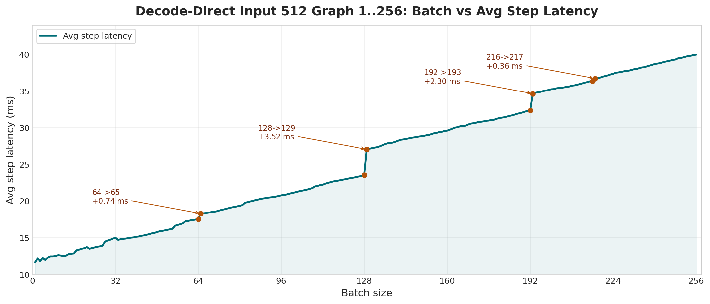
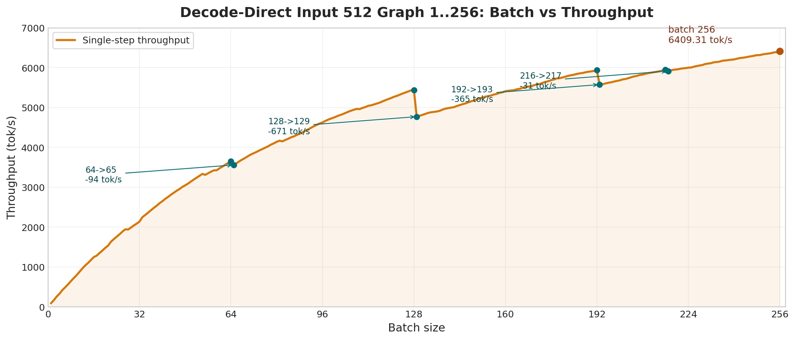
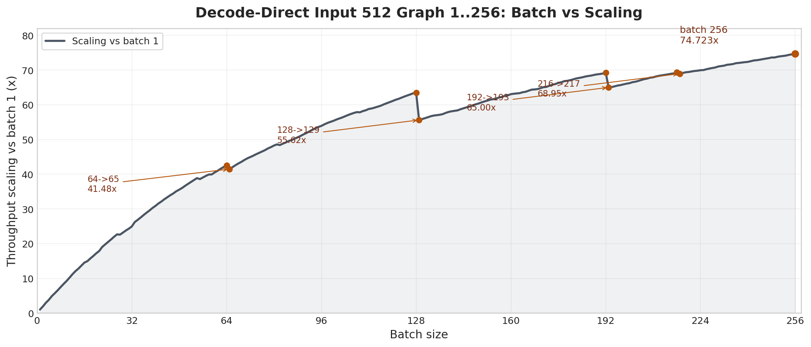

# Decode-Direct Input 512 Graph 1..256 性能报告

## 运行环境

| 项目 | 值 |
| --- | --- |
| 日期 | 2026-11-12 17:18-17:33（Asia/Shanghai） |
| 平台 | NVIDIA |
| 设备 | A100-SXM4-80GB |
| Driver | 535.161.08 |
| InfiniLM build | 当前源码树；未记录独立 build ID |
| 模型 | `/data-aisoft/mechdancer/models/Qwen3-8B` |
| 模式 | `decode-direct` |
| Attention backend | `flash-attn` |
| Graph compiling | enabled |
| Expected execution mode | `graph` |
| Cache | paged KV cache，block size 256，num blocks 768 |
| Max batched tokens | 18432 |
| Tensor parallel size | 1 |
| Input length | 512 tokens / request |
| Batch size | 1..256 |
| Decode steps per repeat | 4 |
| Warmup | 每个形状 3 次 repeat |
| Measured repeats | 每个形状 30 次 repeat |
| Batch 执行顺序 | random seed 2026 |

本报告对应的原始 JSONL 和 log 为本机运行产物，不随仓库提交：

```text
../../../benchmark-decode-direct-qwen3-8b-flash-attn-input512-graph1-256-20261112.jsonl
../../../benchmark-decode-direct-qwen3-8b-flash-attn-input512-graph1-256-20261112.log
```

## 构建与测试命令

本轮使用当前已安装的 `_infinilm` 扩展。标准重建命令如下：

```bash
xmake build _infinilm && xmake install _infinilm
```

性能测试命令：

```bash
BENCHMARK_MODE=decode-direct \
BATCH_SIZES="$(seq -s, 1 256)" \
INPUT_LENS=512 \
BENCHMARK_REPEATS=30 \
BENCHMARK_OUTPUT=benchmark-decode-direct-qwen3-8b-flash-attn-input512-graph1-256-20261112.jsonl \
./run_bench.sh
```

## 执行模式与 Graph 覆盖

当前 paged graph compiler 编译 decode batch size `1..256`。因此本轮所有 batch 均有对应 decode graph，无 eager fallback 混入。原始 JSONL 中所有 overall summary 的 `expected_execution_mode` 均为 `graph`。

## 资源开销

| 项目 | 值 |
| --- | ---: |
| Workspace manager 配置 | `max_num_batched_tokens=18432` |
| Workspace allocation | 1944 MiB |
| 权重加载与 graph 编译时间 | 约 38.49 秒 |
| 测试期间 GPU 显存占用 | 约 51.2 GiB |
| Paged cache blocks | 768 |
| Compiled graph 数量 | 256 |
| 正式 step sample 数 | 30,720 |

Input length 512 且执行 4 个 decode step 时，每个 request 需要 `ceil(516 / 256) = 3` 个 block。batch 256 共需要 `256 * 3 = 768` 个 block。

## 测试口径

- `decode-direct` 不执行语义完整的 prefill，paged KV cache 初始为全 0。
- Step 0 输入 dummy token；step 1 到 step 3 使用上一步 sampled token。
- 4 个 decode step 的 past KV length 分别为 512、513、514、515。
- 报告中的 duration 是单 step 时间，由一次 4-step repeat 的对应总耗时除以 4 得到。
- `single_step_throughput = batch_size / avg_step_latency`。
- 每个 request 每 step 生成 1 个 token，因此 single-step request throughput 与 token throughput 数值相同。
- 表格中的 Min/P50/P95/P99/Max 是每个 repeat 的平均 step 时间分布。
- 计时边界为 `engine_forward_including_sampling`。

## 核心结果

| 指标 | 结果 |
| --- | ---: |
| 最高 single-step 吞吐 | batch 256，6409.31 tok/s |
| batch 256 平均单 step latency | 39.942 ms |
| batch 256 P99 单 step latency | 40.019 ms |
| batch 1 平均单 step latency | 11.658 ms |
| batch 256 相对 batch 1 吞吐倍数 | 74.723x |
| batch 256 相对理想 256x 的效率 | 29.2% |
| 单 step std 中位数 | 0.018 ms |
| 最大单 step std | 0.097 ms，batch 58 |

## 趋势图

### 1. Batch size 与 Avg Step Latency



平均单 step latency 从 batch 1 的 11.658 ms 增至 batch 256 的 39.942 ms。曲线整体上升，但在 64->65、128->129、192->193、216->217 出现明显跳变。

### 2. Batch size 与 Single-step Throughput



吞吐从 batch 1 的 85.77 tok/s 增至 batch 256 的 6409.31 tok/s。本轮 `1..256` 范围内最高吞吐出现在 batch 256。

### 3. Batch size 与 Scaling



Scaling 从 batch 1 的 1.000x 增至 batch 256 的 74.723x。相对理想 256x 的效率约 29.2%。

## Batch 区间平均 latency 与吞吐

下表按连续 16 个 batch 分组。`平均单 step latency ms` 和 `平均吞吐 tok/s` 分别是该区间内 16 个 batch 的 overall `Avg Step ms` 与 `Single-step tok/s` 的算术平均值；`区间最优 batch` 取该区间内 `Single-step tok/s` 最高的 batch。

| Batch 区间 | 平均单 step latency ms | 平均吞吐 tok/s | 区间最优 batch |
| --- | ---: | ---: | ---: |
| 1..16 | 12.378 | 678.02 | 16 |
| 17..32 | 13.943 | 1,747.83 | 32 |
| 33..48 | 15.163 | 2,665.81 | 48 |
| 49..64 | 16.714 | 3,374.92 | 64 |
| 65..80 | 18.754 | 3,862.57 | 80 |
| 81..96 | 20.234 | 4,371.35 | 96 |
| 97..112 | 21.474 | 4,864.11 | 112 |
| 113..128 | 22.942 | 5,250.47 | 128 |
| 129..144 | 27.754 | 4,916.78 | 144 |
| 145..160 | 29.040 | 5,250.26 | 160 |
| 161..176 | 30.421 | 5,537.97 | 176 |
| 177..192 | 31.659 | 5,826.82 | 192 |
| 193..208 | 35.196 | 5,696.03 | 208 |
| 209..224 | 36.524 | 5,926.94 | 224 |
| 225..240 | 38.003 | 6,117.30 | 240 |
| 241..256 | 39.350 | 6,314.62 | 256 |

区间平均 latency 与区间平均吞吐均随 batch size 上升。多数区间的最优 batch 为区间右端点；包含 graph 内部跳变的区间可能偏离该规律。

## 关键批次与跳变

| Change | Avg step ms | Single-step tok/s | 吞吐变化 |
| --- | ---: | ---: | ---: |
| 64 -> 65 | 17.526 -> 18.270 | 3651.66 -> 3557.73 | -93.93 |
| 128 -> 129 | 23.524 -> 27.042 | 5441.32 -> 4770.37 | -670.96 |
| 192 -> 193 | 32.322 -> 34.619 | 5940.15 -> 5575.03 | -365.12 |
| 216 -> 217 | 36.329 -> 36.689 | 5945.64 -> 5914.50 | -31.14 |

这些跳变均发生在 graph 覆盖范围内，不能归因于 eager fallback。其中 128->129 和 192->193 的降幅最大，可能与 kernel 选择、workspace 或 graph 内部形状变化有关，需要 kernel trace 或 C++ model-only 打点进一步定位。

## Step 一致性

| Decode step | Past KV length | 全部 batch 平均 step latency ms |
| ---: | ---: | ---: |
| 0 | 512 | 25.586 |
| 1 | 513 | 25.594 |
| 2 | 514 | 25.602 |
| 3 | 515 | 25.606 |

Past KV length 从 512 增至 515 时，平均 step latency 仅增加约 0.019 ms。该影响远小于 batch size 和跳变。

## 数据稳定性

- 256 个 overall summary 换算为单 step 后，std 中位数为 0.018 ms。
- 最大单 step std 为 0.097 ms，出现在 batch 58。
- 最大变异系数约 0.723%，中位变异系数约 0.076%。
- P50、P95、P99 和 max 普遍接近。

## Single-step 完整结果

### Batch 1..64

| Batch | Mode | Avg Step ms | Min Step ms | P50 Step ms | P95 Step ms | P99 Step ms | Max Step ms | Std Step ms | Single-step tok/s | Scaling |
| ---: | --- | ---: | ---: | ---: | ---: | ---: | ---: | ---: | ---: | ---: |
| 1 | graph | 11.658 | 11.529 | 11.675 | 11.702 | 11.709 | 11.710 | 0.052 | 85.77 | 1.000x |
| 2 | graph | 12.182 | 12.161 | 12.180 | 12.208 | 12.211 | 12.212 | 0.014 | 164.18 | 1.914x |
| 3 | graph | 11.800 | 11.664 | 11.849 | 11.875 | 11.885 | 11.888 | 0.085 | 254.23 | 2.964x |
| 4 | graph | 12.235 | 12.190 | 12.236 | 12.279 | 12.301 | 12.307 | 0.028 | 326.94 | 3.812x |
| 5 | graph | 11.970 | 11.943 | 11.970 | 12.000 | 12.000 | 12.001 | 0.017 | 417.73 | 4.870x |
| 6 | graph | 12.278 | 12.256 | 12.276 | 12.297 | 12.354 | 12.376 | 0.021 | 488.69 | 5.697x |
| 7 | graph | 12.437 | 12.400 | 12.432 | 12.467 | 12.487 | 12.493 | 0.019 | 562.86 | 6.562x |
| 8 | graph | 12.436 | 12.417 | 12.433 | 12.460 | 12.463 | 12.464 | 0.014 | 643.32 | 7.500x |
| 9 | graph | 12.494 | 12.472 | 12.497 | 12.511 | 12.513 | 12.514 | 0.013 | 720.33 | 8.398x |
| 10 | graph | 12.606 | 12.542 | 12.602 | 12.643 | 12.652 | 12.654 | 0.022 | 793.28 | 9.248x |
| 11 | graph | 12.553 | 12.507 | 12.551 | 12.581 | 12.582 | 12.582 | 0.023 | 876.32 | 10.217x |
| 12 | graph | 12.487 | 12.467 | 12.484 | 12.510 | 12.525 | 12.532 | 0.016 | 960.96 | 11.203x |
| 13 | graph | 12.541 | 12.514 | 12.541 | 12.561 | 12.565 | 12.566 | 0.014 | 1036.60 | 12.085x |
| 14 | graph | 12.739 | 12.711 | 12.740 | 12.755 | 12.757 | 12.758 | 0.012 | 1099.03 | 12.813x |
| 15 | graph | 12.800 | 12.782 | 12.797 | 12.823 | 12.826 | 12.827 | 0.012 | 1171.92 | 13.663x |
| 16 | graph | 12.839 | 12.812 | 12.835 | 12.869 | 12.883 | 12.888 | 0.018 | 1246.21 | 14.529x |
| 17 | graph | 13.266 | 13.245 | 13.256 | 13.321 | 13.395 | 13.414 | 0.034 | 1281.44 | 14.940x |
| 18 | graph | 13.353 | 13.308 | 13.341 | 13.441 | 13.499 | 13.514 | 0.044 | 1347.98 | 15.715x |
| 19 | graph | 13.477 | 13.446 | 13.480 | 13.492 | 13.506 | 13.512 | 0.014 | 1409.79 | 16.436x |
| 20 | graph | 13.550 | 13.519 | 13.547 | 13.571 | 13.649 | 13.680 | 0.027 | 1476.03 | 17.208x |
| 21 | graph | 13.698 | 13.616 | 13.713 | 13.756 | 13.771 | 13.773 | 0.046 | 1533.12 | 17.874x |
| 22 | graph | 13.482 | 13.460 | 13.483 | 13.493 | 13.494 | 13.494 | 0.009 | 1631.86 | 19.025x |
| 23 | graph | 13.565 | 13.539 | 13.568 | 13.581 | 13.590 | 13.592 | 0.012 | 1695.51 | 19.767x |
| 24 | graph | 13.658 | 13.628 | 13.656 | 13.685 | 13.691 | 13.693 | 0.018 | 1757.24 | 20.487x |
| 25 | graph | 13.750 | 13.708 | 13.749 | 13.771 | 13.823 | 13.844 | 0.022 | 1818.23 | 21.198x |
| 26 | graph | 13.803 | 13.631 | 13.824 | 13.840 | 13.841 | 13.841 | 0.056 | 1883.68 | 21.961x |
| 27 | graph | 13.894 | 13.878 | 13.895 | 13.905 | 13.910 | 13.911 | 0.007 | 1943.31 | 22.656x |
| 28 | graph | 14.454 | 14.429 | 14.455 | 14.474 | 14.489 | 14.495 | 0.014 | 1937.11 | 22.584x |
| 29 | graph | 14.595 | 14.557 | 14.595 | 14.619 | 14.627 | 14.628 | 0.014 | 1986.98 | 23.165x |
| 30 | graph | 14.712 | 14.685 | 14.706 | 14.749 | 14.789 | 14.803 | 0.025 | 2039.20 | 23.774x |
| 31 | graph | 14.868 | 14.834 | 14.866 | 14.903 | 14.928 | 14.934 | 0.020 | 2085.04 | 24.308x |
| 32 | graph | 14.962 | 14.938 | 14.958 | 14.982 | 15.021 | 15.037 | 0.018 | 2138.79 | 24.935x |
| 33 | graph | 14.678 | 14.513 | 14.697 | 14.715 | 14.760 | 14.777 | 0.053 | 2248.26 | 26.211x |
| 34 | graph | 14.767 | 14.740 | 14.765 | 14.793 | 14.832 | 14.845 | 0.020 | 2302.46 | 26.843x |
| 35 | graph | 14.826 | 14.793 | 14.827 | 14.851 | 14.860 | 14.863 | 0.017 | 2360.79 | 27.523x |
| 36 | graph | 14.862 | 14.830 | 14.866 | 14.882 | 14.883 | 14.884 | 0.015 | 2422.26 | 28.240x |
| 37 | graph | 14.917 | 14.879 | 14.917 | 14.939 | 14.967 | 14.978 | 0.017 | 2480.36 | 28.917x |
| 38 | graph | 14.987 | 14.951 | 14.979 | 15.077 | 15.087 | 15.089 | 0.034 | 2535.48 | 29.560x |
| 39 | graph | 15.018 | 14.986 | 15.021 | 15.041 | 15.046 | 15.047 | 0.016 | 2596.87 | 30.276x |
| 40 | graph | 15.104 | 14.985 | 15.090 | 15.226 | 15.249 | 15.257 | 0.057 | 2648.22 | 30.874x |
| 41 | graph | 15.145 | 15.120 | 15.149 | 15.166 | 15.170 | 15.171 | 0.014 | 2707.11 | 31.561x |
| 42 | graph | 15.241 | 15.198 | 15.241 | 15.285 | 15.297 | 15.301 | 0.029 | 2755.81 | 32.128x |
| 43 | graph | 15.292 | 15.260 | 15.288 | 15.314 | 15.343 | 15.354 | 0.017 | 2811.95 | 32.783x |
| 44 | graph | 15.376 | 15.342 | 15.379 | 15.391 | 15.392 | 15.392 | 0.013 | 2861.59 | 33.362x |
| 45 | graph | 15.459 | 15.426 | 15.445 | 15.489 | 15.582 | 15.618 | 0.036 | 2910.98 | 33.938x |
| 46 | graph | 15.568 | 15.537 | 15.569 | 15.588 | 15.594 | 15.595 | 0.014 | 2954.80 | 34.448x |
| 47 | graph | 15.624 | 15.601 | 15.618 | 15.642 | 15.691 | 15.710 | 0.020 | 3008.16 | 35.070x |
| 48 | graph | 15.749 | 15.704 | 15.735 | 15.794 | 16.032 | 16.122 | 0.072 | 3047.78 | 35.532x |
| 49 | graph | 15.850 | 15.785 | 15.821 | 15.945 | 16.181 | 16.264 | 0.086 | 3091.46 | 36.042x |
| 50 | graph | 15.905 | 15.869 | 15.899 | 15.928 | 16.035 | 16.077 | 0.035 | 3143.61 | 36.650x |
| 51 | graph | 15.976 | 15.948 | 15.973 | 16.004 | 16.018 | 16.023 | 0.017 | 3192.26 | 37.217x |
| 52 | graph | 16.052 | 16.014 | 16.049 | 16.087 | 16.093 | 16.094 | 0.017 | 3239.44 | 37.767x |
| 53 | graph | 16.124 | 16.084 | 16.122 | 16.146 | 16.155 | 16.158 | 0.015 | 3287.07 | 38.322x |
| 54 | graph | 16.198 | 16.175 | 16.200 | 16.216 | 16.219 | 16.219 | 0.012 | 3333.66 | 38.865x |
| 55 | graph | 16.618 | 16.582 | 16.618 | 16.644 | 16.654 | 16.655 | 0.016 | 3309.74 | 38.586x |
| 56 | graph | 16.719 | 16.676 | 16.719 | 16.747 | 16.751 | 16.752 | 0.019 | 3349.45 | 39.049x |
| 57 | graph | 16.821 | 16.790 | 16.818 | 16.847 | 16.850 | 16.850 | 0.016 | 3388.60 | 39.506x |
| 58 | graph | 16.946 | 16.900 | 16.928 | 16.953 | 17.316 | 17.463 | 0.097 | 3422.71 | 39.904x |
| 59 | graph | 17.225 | 17.183 | 17.223 | 17.257 | 17.298 | 17.312 | 0.023 | 3425.28 | 39.933x |
| 60 | graph | 17.266 | 17.238 | 17.266 | 17.284 | 17.295 | 17.298 | 0.014 | 3475.09 | 40.514x |
| 61 | graph | 17.346 | 17.300 | 17.345 | 17.390 | 17.399 | 17.402 | 0.024 | 3516.66 | 40.999x |
| 62 | graph | 17.394 | 17.363 | 17.393 | 17.413 | 17.425 | 17.429 | 0.014 | 3564.49 | 41.556x |
| 63 | graph | 17.464 | 17.429 | 17.458 | 17.501 | 17.511 | 17.516 | 0.022 | 3607.49 | 42.058x |
| 64 | graph | 17.526 | 17.497 | 17.522 | 17.543 | 17.597 | 17.618 | 0.021 | 3651.66 | 42.573x |

### Batch 65..128

| Batch | Mode | Avg Step ms | Min Step ms | P50 Step ms | P95 Step ms | P99 Step ms | Max Step ms | Std Step ms | Single-step tok/s | Scaling |
| ---: | --- | ---: | ---: | ---: | ---: | ---: | ---: | ---: | ---: | ---: |
| 65 | graph | 18.270 | 18.253 | 18.267 | 18.293 | 18.308 | 18.311 | 0.012 | 3557.73 | 41.478x |
| 66 | graph | 18.311 | 18.287 | 18.312 | 18.331 | 18.336 | 18.336 | 0.012 | 3604.31 | 42.021x |
| 67 | graph | 18.341 | 18.313 | 18.344 | 18.358 | 18.363 | 18.364 | 0.014 | 3652.96 | 42.588x |
| 68 | graph | 18.396 | 18.204 | 18.411 | 18.435 | 18.452 | 18.459 | 0.057 | 3696.46 | 43.095x |
| 69 | graph | 18.472 | 18.391 | 18.463 | 18.538 | 18.560 | 18.567 | 0.041 | 3735.39 | 43.549x |
| 70 | graph | 18.513 | 18.487 | 18.514 | 18.530 | 18.536 | 18.537 | 0.013 | 3781.20 | 44.083x |
| 71 | graph | 18.577 | 18.507 | 18.584 | 18.656 | 18.733 | 18.760 | 0.065 | 3821.92 | 44.558x |
| 72 | graph | 18.678 | 18.646 | 18.670 | 18.730 | 18.758 | 18.767 | 0.027 | 3854.81 | 44.941x |
| 73 | graph | 18.779 | 18.709 | 18.782 | 18.796 | 18.803 | 18.806 | 0.016 | 3887.29 | 45.320x |
| 74 | graph | 18.853 | 18.831 | 18.850 | 18.874 | 18.881 | 18.883 | 0.011 | 3925.05 | 45.760x |
| 75 | graph | 18.950 | 18.915 | 18.953 | 18.965 | 18.965 | 18.965 | 0.012 | 3957.85 | 46.142x |
| 76 | graph | 19.038 | 19.004 | 19.038 | 19.070 | 19.077 | 19.079 | 0.019 | 3991.91 | 46.540x |
| 77 | graph | 19.125 | 19.093 | 19.124 | 19.144 | 19.148 | 19.149 | 0.014 | 4026.23 | 46.940x |
| 78 | graph | 19.172 | 19.156 | 19.173 | 19.185 | 19.190 | 19.191 | 0.009 | 4068.44 | 47.432x |
| 79 | graph | 19.265 | 19.229 | 19.262 | 19.296 | 19.344 | 19.363 | 0.025 | 4100.68 | 47.808x |
| 80 | graph | 19.329 | 19.292 | 19.329 | 19.350 | 19.393 | 19.411 | 0.021 | 4138.84 | 48.252x |
| 81 | graph | 19.441 | 19.416 | 19.444 | 19.459 | 19.463 | 19.465 | 0.015 | 4166.46 | 48.574x |
| 82 | graph | 19.756 | 19.714 | 19.752 | 19.774 | 19.859 | 19.893 | 0.029 | 4150.64 | 48.390x |
| 83 | graph | 19.831 | 19.800 | 19.825 | 19.890 | 19.912 | 19.916 | 0.027 | 4185.32 | 48.794x |
| 84 | graph | 19.930 | 19.879 | 19.934 | 19.964 | 19.971 | 19.973 | 0.024 | 4214.75 | 49.137x |
| 85 | graph | 19.995 | 19.965 | 19.996 | 20.015 | 20.020 | 20.020 | 0.012 | 4251.09 | 49.561x |
| 86 | graph | 20.119 | 20.036 | 20.115 | 20.171 | 20.200 | 20.209 | 0.030 | 4274.64 | 49.836x |
| 87 | graph | 20.181 | 20.153 | 20.179 | 20.200 | 20.203 | 20.204 | 0.011 | 4310.92 | 50.259x |
| 88 | graph | 20.274 | 20.247 | 20.276 | 20.294 | 20.302 | 20.304 | 0.014 | 4340.44 | 50.603x |
| 89 | graph | 20.335 | 20.314 | 20.334 | 20.355 | 20.357 | 20.357 | 0.011 | 4376.64 | 51.025x |
| 90 | graph | 20.384 | 20.358 | 20.384 | 20.401 | 20.412 | 20.414 | 0.013 | 4415.24 | 51.475x |
| 91 | graph | 20.450 | 20.415 | 20.452 | 20.472 | 20.489 | 20.494 | 0.016 | 4449.80 | 51.878x |
| 92 | graph | 20.489 | 20.435 | 20.487 | 20.525 | 20.550 | 20.559 | 0.024 | 4490.15 | 52.348x |
| 93 | graph | 20.532 | 20.500 | 20.534 | 20.550 | 20.552 | 20.553 | 0.012 | 4529.48 | 52.807x |
| 94 | graph | 20.595 | 20.573 | 20.595 | 20.605 | 20.605 | 20.605 | 0.007 | 4564.26 | 53.212x |
| 95 | graph | 20.664 | 20.651 | 20.664 | 20.670 | 20.695 | 20.705 | 0.009 | 4597.43 | 53.599x |
| 96 | graph | 20.759 | 20.714 | 20.759 | 20.786 | 20.807 | 20.814 | 0.017 | 4624.41 | 53.913x |
| 97 | graph | 20.807 | 20.771 | 20.807 | 20.825 | 20.828 | 20.828 | 0.012 | 4661.93 | 54.351x |
| 98 | graph | 20.872 | 20.846 | 20.871 | 20.886 | 20.938 | 20.958 | 0.019 | 4695.25 | 54.739x |
| 99 | graph | 20.965 | 20.938 | 20.963 | 20.984 | 21.019 | 21.031 | 0.016 | 4722.11 | 55.053x |
| 100 | graph | 21.063 | 21.040 | 21.065 | 21.081 | 21.082 | 21.082 | 0.009 | 4747.58 | 55.349x |
| 101 | graph | 21.137 | 21.100 | 21.137 | 21.161 | 21.171 | 21.174 | 0.014 | 4778.35 | 55.708x |
| 102 | graph | 21.225 | 21.208 | 21.225 | 21.238 | 21.240 | 21.241 | 0.007 | 4805.61 | 56.026x |
| 103 | graph | 21.322 | 21.297 | 21.322 | 21.346 | 21.350 | 21.352 | 0.012 | 4830.72 | 56.319x |
| 104 | graph | 21.395 | 21.349 | 21.395 | 21.417 | 21.425 | 21.427 | 0.015 | 4861.02 | 56.672x |
| 105 | graph | 21.463 | 21.441 | 21.462 | 21.478 | 21.483 | 21.485 | 0.010 | 4892.18 | 57.035x |
| 106 | graph | 21.546 | 21.527 | 21.545 | 21.568 | 21.574 | 21.575 | 0.011 | 4919.72 | 57.356x |
| 107 | graph | 21.640 | 21.616 | 21.638 | 21.654 | 21.661 | 21.664 | 0.011 | 4944.57 | 57.646x |
| 108 | graph | 21.752 | 21.729 | 21.753 | 21.768 | 21.772 | 21.773 | 0.010 | 4965.01 | 57.884x |
| 109 | graph | 21.978 | 21.942 | 21.978 | 22.001 | 22.007 | 22.008 | 0.013 | 4959.47 | 57.820x |
| 110 | graph | 22.045 | 21.865 | 22.055 | 22.086 | 22.101 | 22.103 | 0.045 | 4989.90 | 58.174x |
| 111 | graph | 22.156 | 22.078 | 22.147 | 22.225 | 22.244 | 22.249 | 0.041 | 5010.04 | 58.409x |
| 112 | graph | 22.212 | 22.177 | 22.215 | 22.230 | 22.251 | 22.258 | 0.015 | 5042.28 | 58.785x |
| 113 | graph | 22.357 | 22.264 | 22.354 | 22.407 | 22.415 | 22.416 | 0.028 | 5054.42 | 58.927x |
| 114 | graph | 22.458 | 22.282 | 22.476 | 22.510 | 22.601 | 22.637 | 0.072 | 5076.08 | 59.179x |
| 115 | graph | 22.553 | 22.527 | 22.551 | 22.581 | 22.583 | 22.584 | 0.014 | 5099.08 | 59.447x |
| 116 | graph | 22.652 | 22.593 | 22.636 | 22.766 | 22.784 | 22.791 | 0.048 | 5121.01 | 59.703x |
| 117 | graph | 22.704 | 22.629 | 22.704 | 22.718 | 22.769 | 22.789 | 0.022 | 5153.17 | 60.078x |
| 118 | graph | 22.771 | 22.751 | 22.769 | 22.789 | 22.790 | 22.791 | 0.010 | 5182.13 | 60.416x |
| 119 | graph | 22.844 | 22.825 | 22.835 | 22.889 | 22.894 | 22.895 | 0.019 | 5209.35 | 60.733x |
| 120 | graph | 22.913 | 22.889 | 22.912 | 22.934 | 22.936 | 22.937 | 0.011 | 5237.13 | 61.057x |
| 121 | graph | 22.968 | 22.948 | 22.964 | 22.996 | 23.023 | 23.030 | 0.016 | 5268.13 | 61.418x |
| 122 | graph | 23.060 | 23.015 | 23.058 | 23.103 | 23.146 | 23.157 | 0.027 | 5290.51 | 61.679x |
| 123 | graph | 23.121 | 23.098 | 23.116 | 23.164 | 23.222 | 23.240 | 0.027 | 5319.82 | 62.021x |
| 124 | graph | 23.183 | 23.153 | 23.185 | 23.203 | 23.209 | 23.210 | 0.014 | 5348.71 | 62.358x |
| 125 | graph | 23.254 | 23.216 | 23.244 | 23.271 | 23.498 | 23.584 | 0.063 | 5375.53 | 62.670x |
| 126 | graph | 23.328 | 23.286 | 23.327 | 23.346 | 23.396 | 23.416 | 0.021 | 5401.16 | 62.969x |
| 127 | graph | 23.389 | 23.303 | 23.424 | 23.456 | 23.461 | 23.462 | 0.059 | 5429.91 | 63.304x |
| 128 | graph | 23.524 | 23.480 | 23.517 | 23.573 | 23.651 | 23.678 | 0.038 | 5441.32 | 63.437x |

### Batch 129..192

| Batch | Mode | Avg Step ms | Min Step ms | P50 Step ms | P95 Step ms | P99 Step ms | Max Step ms | Std Step ms | Single-step tok/s | Scaling |
| ---: | --- | ---: | ---: | ---: | ---: | ---: | ---: | ---: | ---: | ---: |
| 129 | graph | 27.042 | 27.025 | 27.038 | 27.066 | 27.066 | 27.067 | 0.012 | 4770.37 | 55.615x |
| 130 | graph | 27.126 | 27.097 | 27.127 | 27.150 | 27.153 | 27.153 | 0.015 | 4792.49 | 55.873x |
| 131 | graph | 27.206 | 27.158 | 27.199 | 27.249 | 27.306 | 27.325 | 0.030 | 4815.18 | 56.138x |
| 132 | graph | 27.278 | 27.239 | 27.267 | 27.354 | 27.442 | 27.470 | 0.044 | 4839.01 | 56.415x |
| 133 | graph | 27.342 | 27.306 | 27.345 | 27.357 | 27.362 | 27.364 | 0.013 | 4864.28 | 56.710x |
| 134 | graph | 27.459 | 27.446 | 27.455 | 27.480 | 27.497 | 27.500 | 0.011 | 4880.06 | 56.894x |
| 135 | graph | 27.607 | 27.572 | 27.608 | 27.631 | 27.634 | 27.634 | 0.015 | 4890.06 | 57.011x |
| 136 | graph | 27.758 | 27.739 | 27.754 | 27.782 | 27.810 | 27.821 | 0.017 | 4899.40 | 57.119x |
| 137 | graph | 27.872 | 27.836 | 27.878 | 27.890 | 27.891 | 27.891 | 0.015 | 4915.35 | 57.305x |
| 138 | graph | 27.899 | 27.861 | 27.896 | 27.930 | 27.938 | 27.940 | 0.015 | 4946.40 | 57.667x |
| 139 | graph | 27.968 | 27.949 | 27.965 | 27.985 | 27.987 | 27.987 | 0.010 | 4969.99 | 57.942x |
| 140 | graph | 28.083 | 28.053 | 28.081 | 28.110 | 28.115 | 28.115 | 0.016 | 4985.17 | 58.119x |
| 141 | graph | 28.216 | 28.179 | 28.217 | 28.239 | 28.240 | 28.241 | 0.017 | 4997.22 | 58.260x |
| 142 | graph | 28.353 | 28.316 | 28.340 | 28.425 | 28.470 | 28.486 | 0.039 | 5008.33 | 58.389x |
| 143 | graph | 28.396 | 28.355 | 28.395 | 28.430 | 28.453 | 28.459 | 0.021 | 5036.00 | 58.712x |
| 144 | graph | 28.463 | 28.431 | 28.464 | 28.484 | 28.488 | 28.489 | 0.014 | 5059.16 | 58.982x |
| 145 | graph | 28.531 | 28.428 | 28.532 | 28.556 | 28.561 | 28.562 | 0.022 | 5082.27 | 59.251x |
| 146 | graph | 28.614 | 28.559 | 28.606 | 28.670 | 28.685 | 28.688 | 0.029 | 5102.39 | 59.486x |
| 147 | graph | 28.661 | 28.611 | 28.659 | 28.692 | 28.699 | 28.699 | 0.017 | 5128.84 | 59.794x |
| 148 | graph | 28.714 | 28.702 | 28.714 | 28.723 | 28.727 | 28.729 | 0.006 | 5154.27 | 60.091x |
| 149 | graph | 28.787 | 28.773 | 28.785 | 28.806 | 28.812 | 28.814 | 0.009 | 5175.95 | 60.344x |
| 150 | graph | 28.830 | 28.757 | 28.837 | 28.878 | 28.879 | 28.879 | 0.030 | 5202.91 | 60.658x |
| 151 | graph | 28.885 | 28.854 | 28.884 | 28.896 | 28.901 | 28.902 | 0.008 | 5227.70 | 60.947x |
| 152 | graph | 28.965 | 28.881 | 28.962 | 29.027 | 29.060 | 29.063 | 0.034 | 5247.76 | 61.181x |
| 153 | graph | 29.022 | 28.991 | 29.026 | 29.041 | 29.042 | 29.042 | 0.015 | 5271.83 | 61.461x |
| 154 | graph | 29.136 | 29.091 | 29.129 | 29.187 | 29.197 | 29.201 | 0.026 | 5285.56 | 61.621x |
| 155 | graph | 29.250 | 29.219 | 29.235 | 29.283 | 29.540 | 29.643 | 0.074 | 5299.09 | 61.779x |
| 156 | graph | 29.286 | 29.262 | 29.277 | 29.325 | 29.361 | 29.374 | 0.025 | 5326.74 | 62.102x |
| 157 | graph | 29.397 | 29.349 | 29.382 | 29.394 | 29.717 | 29.848 | 0.084 | 5340.63 | 62.264x |
| 158 | graph | 29.433 | 29.394 | 29.434 | 29.467 | 29.508 | 29.522 | 0.025 | 5368.21 | 62.585x |
| 159 | graph | 29.543 | 29.509 | 29.536 | 29.563 | 29.668 | 29.709 | 0.033 | 5382.02 | 62.746x |
| 160 | graph | 29.586 | 29.566 | 29.580 | 29.618 | 29.658 | 29.668 | 0.019 | 5407.98 | 63.049x |
| 161 | graph | 29.710 | 29.675 | 29.709 | 29.732 | 29.749 | 29.754 | 0.014 | 5419.08 | 63.178x |
| 162 | graph | 29.853 | 29.830 | 29.851 | 29.873 | 29.876 | 29.877 | 0.012 | 5426.61 | 63.266x |
| 163 | graph | 29.995 | 29.963 | 29.992 | 30.029 | 30.042 | 30.046 | 0.019 | 5434.29 | 63.355x |
| 164 | graph | 30.056 | 30.035 | 30.053 | 30.064 | 30.122 | 30.145 | 0.018 | 5456.56 | 63.615x |
| 165 | graph | 30.176 | 30.132 | 30.178 | 30.205 | 30.249 | 30.266 | 0.024 | 5467.92 | 63.748x |
| 166 | graph | 30.212 | 30.148 | 30.194 | 30.289 | 30.322 | 30.335 | 0.045 | 5494.58 | 64.058x |
| 167 | graph | 30.256 | 30.076 | 30.258 | 30.288 | 30.291 | 30.292 | 0.035 | 5519.59 | 64.350x |
| 168 | graph | 30.408 | 30.320 | 30.407 | 30.457 | 30.495 | 30.509 | 0.035 | 5524.93 | 64.412x |
| 169 | graph | 30.539 | 30.515 | 30.538 | 30.564 | 30.577 | 30.582 | 0.015 | 5533.98 | 64.518x |
| 170 | graph | 30.587 | 30.566 | 30.587 | 30.604 | 30.632 | 30.642 | 0.013 | 5557.83 | 64.796x |
| 171 | graph | 30.646 | 30.621 | 30.646 | 30.672 | 30.676 | 30.676 | 0.014 | 5579.87 | 65.053x |
| 172 | graph | 30.781 | 30.703 | 30.783 | 30.842 | 30.854 | 30.857 | 0.039 | 5587.90 | 65.146x |
| 173 | graph | 30.791 | 30.754 | 30.790 | 30.811 | 30.825 | 30.830 | 0.015 | 5618.45 | 65.502x |
| 174 | graph | 30.845 | 30.813 | 30.839 | 30.900 | 30.932 | 30.935 | 0.025 | 5641.08 | 65.766x |
| 175 | graph | 30.923 | 30.879 | 30.924 | 30.950 | 30.963 | 30.968 | 0.017 | 5659.13 | 65.977x |
| 176 | graph | 30.954 | 30.937 | 30.951 | 30.969 | 31.016 | 31.034 | 0.017 | 5685.77 | 66.287x |
| 177 | graph | 31.042 | 31.002 | 31.041 | 31.066 | 31.077 | 31.082 | 0.015 | 5701.98 | 66.476x |
| 178 | graph | 31.066 | 31.015 | 31.039 | 31.127 | 31.131 | 31.133 | 0.045 | 5729.65 | 66.799x |
| 179 | graph | 31.200 | 31.168 | 31.189 | 31.239 | 31.328 | 31.364 | 0.036 | 5737.09 | 66.886x |
| 180 | graph | 31.285 | 31.262 | 31.278 | 31.314 | 31.365 | 31.386 | 0.023 | 5753.57 | 67.078x |
| 181 | graph | 31.353 | 31.340 | 31.348 | 31.389 | 31.410 | 31.413 | 0.016 | 5772.92 | 67.303x |
| 182 | graph | 31.406 | 31.382 | 31.405 | 31.431 | 31.443 | 31.447 | 0.013 | 5794.99 | 67.561x |
| 183 | graph | 31.502 | 31.467 | 31.502 | 31.522 | 31.571 | 31.591 | 0.021 | 5809.14 | 67.726x |
| 184 | graph | 31.596 | 31.574 | 31.590 | 31.624 | 31.687 | 31.711 | 0.024 | 5823.45 | 67.892x |
| 185 | graph | 31.671 | 31.655 | 31.671 | 31.689 | 31.694 | 31.696 | 0.010 | 5841.27 | 68.100x |
| 186 | graph | 31.760 | 31.745 | 31.759 | 31.772 | 31.775 | 31.775 | 0.008 | 5856.45 | 68.277x |
| 187 | graph | 31.879 | 31.833 | 31.880 | 31.897 | 31.917 | 31.924 | 0.015 | 5865.87 | 68.387x |
| 188 | graph | 31.960 | 31.939 | 31.957 | 31.992 | 32.010 | 32.014 | 0.017 | 5882.43 | 68.580x |
| 189 | graph | 32.052 | 32.031 | 32.050 | 32.074 | 32.101 | 32.108 | 0.014 | 5896.70 | 68.746x |
| 190 | graph | 32.172 | 32.142 | 32.170 | 32.192 | 32.208 | 32.214 | 0.014 | 5905.76 | 68.852x |
| 191 | graph | 32.276 | 32.243 | 32.264 | 32.369 | 32.441 | 32.448 | 0.044 | 5917.69 | 68.991x |
| 192 | graph | 32.322 | 32.300 | 32.314 | 32.338 | 32.469 | 32.523 | 0.039 | 5940.15 | 69.253x |

### Batch 193..256

| Batch | Mode | Avg Step ms | Min Step ms | P50 Step ms | P95 Step ms | P99 Step ms | Max Step ms | Std Step ms | Single-step tok/s | Scaling |
| ---: | --- | ---: | ---: | ---: | ---: | ---: | ---: | ---: | ---: | ---: |
| 193 | graph | 34.619 | 34.585 | 34.619 | 34.630 | 34.682 | 34.702 | 0.019 | 5575.03 | 64.996x |
| 194 | graph | 34.743 | 34.721 | 34.736 | 34.757 | 34.848 | 34.884 | 0.028 | 5583.92 | 65.100x |
| 195 | graph | 34.810 | 34.779 | 34.813 | 34.828 | 34.830 | 34.830 | 0.012 | 5601.76 | 65.308x |
| 196 | graph | 34.871 | 34.783 | 34.886 | 34.938 | 34.947 | 34.947 | 0.050 | 5620.73 | 65.529x |
| 197 | graph | 34.977 | 34.956 | 34.970 | 35.011 | 35.053 | 35.070 | 0.021 | 5632.33 | 65.664x |
| 198 | graph | 35.041 | 35.023 | 35.040 | 35.059 | 35.064 | 35.066 | 0.010 | 5650.47 | 65.876x |
| 199 | graph | 35.114 | 35.091 | 35.108 | 35.162 | 35.177 | 35.180 | 0.020 | 5667.28 | 66.072x |
| 200 | graph | 35.214 | 35.129 | 35.214 | 35.238 | 35.244 | 35.246 | 0.020 | 5679.51 | 66.214x |
| 201 | graph | 35.239 | 35.189 | 35.237 | 35.262 | 35.279 | 35.285 | 0.017 | 5703.86 | 66.498x |
| 202 | graph | 35.341 | 35.310 | 35.339 | 35.373 | 35.388 | 35.394 | 0.018 | 5715.69 | 66.636x |
| 203 | graph | 35.398 | 35.368 | 35.394 | 35.422 | 35.479 | 35.500 | 0.023 | 5734.82 | 66.859x |
| 204 | graph | 35.428 | 35.390 | 35.423 | 35.471 | 35.494 | 35.499 | 0.022 | 5758.09 | 67.130x |
| 205 | graph | 35.471 | 35.395 | 35.471 | 35.504 | 35.534 | 35.544 | 0.025 | 5779.29 | 67.378x |
| 206 | graph | 35.557 | 35.414 | 35.563 | 35.596 | 35.630 | 35.642 | 0.038 | 5793.46 | 67.543x |
| 207 | graph | 35.593 | 35.562 | 35.593 | 35.611 | 35.620 | 35.622 | 0.012 | 5815.68 | 67.802x |
| 208 | graph | 35.711 | 35.635 | 35.709 | 35.731 | 35.771 | 35.787 | 0.022 | 5824.58 | 67.906x |
| 209 | graph | 35.751 | 35.565 | 35.770 | 35.825 | 35.852 | 35.863 | 0.075 | 5846.03 | 68.156x |
| 210 | graph | 35.828 | 35.802 | 35.821 | 35.862 | 35.865 | 35.866 | 0.018 | 5861.32 | 68.334x |
| 211 | graph | 35.921 | 35.876 | 35.923 | 35.955 | 35.962 | 35.963 | 0.021 | 5873.93 | 68.481x |
| 212 | graph | 36.020 | 36.002 | 36.017 | 36.048 | 36.056 | 36.060 | 0.015 | 5885.70 | 68.618x |
| 213 | graph | 36.121 | 36.026 | 36.122 | 36.183 | 36.208 | 36.218 | 0.040 | 5896.86 | 68.748x |
| 214 | graph | 36.202 | 36.188 | 36.200 | 36.218 | 36.224 | 36.226 | 0.009 | 5911.27 | 68.916x |
| 215 | graph | 36.310 | 36.275 | 36.306 | 36.365 | 36.378 | 36.380 | 0.023 | 5921.24 | 69.032x |
| 216 | graph | 36.329 | 36.286 | 36.328 | 36.357 | 36.362 | 36.363 | 0.016 | 5945.64 | 69.317x |
| 217 | graph | 36.689 | 36.566 | 36.693 | 36.751 | 36.829 | 36.858 | 0.051 | 5914.50 | 68.954x |
| 218 | graph | 36.751 | 36.734 | 36.748 | 36.770 | 36.777 | 36.780 | 0.011 | 5931.81 | 69.156x |
| 219 | graph | 36.814 | 36.771 | 36.805 | 36.894 | 36.912 | 36.915 | 0.032 | 5948.86 | 69.355x |
| 220 | graph | 36.938 | 36.908 | 36.933 | 36.982 | 36.998 | 37.002 | 0.023 | 5955.89 | 69.436x |
| 221 | graph | 37.026 | 37.011 | 37.024 | 37.042 | 37.048 | 37.049 | 0.009 | 5968.78 | 69.587x |
| 222 | graph | 37.117 | 37.069 | 37.114 | 37.143 | 37.150 | 37.152 | 0.015 | 5981.14 | 69.731x |
| 223 | graph | 37.241 | 37.205 | 37.243 | 37.263 | 37.267 | 37.269 | 0.015 | 5988.01 | 69.811x |
| 224 | graph | 37.333 | 37.298 | 37.329 | 37.352 | 37.439 | 37.475 | 0.030 | 6000.03 | 69.951x |
| 225 | graph | 37.474 | 37.388 | 37.486 | 37.518 | 37.533 | 37.539 | 0.038 | 6004.12 | 69.999x |
| 226 | graph | 37.519 | 37.500 | 37.519 | 37.535 | 37.539 | 37.540 | 0.010 | 6023.60 | 70.226x |
| 227 | graph | 37.578 | 37.546 | 37.575 | 37.612 | 37.652 | 37.661 | 0.021 | 6040.75 | 70.426x |
| 228 | graph | 37.658 | 37.637 | 37.657 | 37.676 | 37.682 | 37.684 | 0.011 | 6054.50 | 70.586x |
| 229 | graph | 37.744 | 37.715 | 37.740 | 37.774 | 37.840 | 37.863 | 0.028 | 6067.19 | 70.734x |
| 230 | graph | 37.755 | 37.727 | 37.753 | 37.798 | 37.817 | 37.823 | 0.021 | 6091.87 | 71.022x |
| 231 | graph | 37.854 | 37.831 | 37.852 | 37.883 | 37.896 | 37.897 | 0.014 | 6102.33 | 71.144x |
| 232 | graph | 37.949 | 37.917 | 37.948 | 37.961 | 38.027 | 38.054 | 0.022 | 6113.54 | 71.274x |
| 233 | graph | 37.980 | 37.961 | 37.978 | 38.001 | 38.012 | 38.013 | 0.012 | 6134.84 | 71.523x |
| 234 | graph | 38.098 | 38.078 | 38.100 | 38.122 | 38.139 | 38.145 | 0.015 | 6141.98 | 71.606x |
| 235 | graph | 38.194 | 38.178 | 38.188 | 38.218 | 38.265 | 38.285 | 0.020 | 6152.85 | 71.733x |
| 236 | graph | 38.228 | 38.211 | 38.227 | 38.249 | 38.253 | 38.254 | 0.010 | 6173.57 | 71.974x |
| 237 | graph | 38.346 | 38.316 | 38.347 | 38.371 | 38.394 | 38.401 | 0.019 | 6180.64 | 72.057x |
| 238 | graph | 38.451 | 38.425 | 38.445 | 38.505 | 38.512 | 38.512 | 0.022 | 6189.75 | 72.163x |
| 239 | graph | 38.554 | 38.523 | 38.545 | 38.589 | 38.699 | 38.741 | 0.038 | 6199.13 | 72.272x |
| 240 | graph | 38.672 | 38.651 | 38.672 | 38.695 | 38.700 | 38.702 | 0.013 | 6206.08 | 72.353x |
| 241 | graph | 38.725 | 38.697 | 38.727 | 38.736 | 38.738 | 38.738 | 0.010 | 6223.44 | 72.556x |
| 242 | graph | 38.779 | 38.762 | 38.779 | 38.794 | 38.798 | 38.799 | 0.010 | 6240.46 | 72.754x |
| 243 | graph | 38.891 | 38.852 | 38.885 | 38.926 | 38.997 | 39.018 | 0.028 | 6248.24 | 72.845x |
| 244 | graph | 38.985 | 38.937 | 38.984 | 39.015 | 39.020 | 39.021 | 0.019 | 6258.90 | 72.969x |
| 245 | graph | 39.055 | 39.031 | 39.056 | 39.072 | 39.087 | 39.092 | 0.014 | 6273.22 | 73.136x |
| 246 | graph | 39.135 | 39.102 | 39.134 | 39.160 | 39.180 | 39.184 | 0.016 | 6285.95 | 73.284x |
| 247 | graph | 39.220 | 39.179 | 39.223 | 39.232 | 39.236 | 39.238 | 0.011 | 6297.88 | 73.424x |
| 248 | graph | 39.274 | 39.229 | 39.270 | 39.305 | 39.330 | 39.339 | 0.021 | 6314.68 | 73.619x |
| 249 | graph | 39.433 | 39.403 | 39.432 | 39.454 | 39.462 | 39.465 | 0.015 | 6314.44 | 73.617x |
| 250 | graph | 39.482 | 39.444 | 39.471 | 39.534 | 39.604 | 39.627 | 0.036 | 6332.06 | 73.822x |
| 251 | graph | 39.563 | 39.519 | 39.545 | 39.586 | 39.890 | 40.009 | 0.084 | 6344.32 | 73.965x |
| 252 | graph | 39.667 | 39.640 | 39.661 | 39.692 | 39.761 | 39.787 | 0.026 | 6352.84 | 74.064x |
| 253 | graph | 39.757 | 39.737 | 39.754 | 39.782 | 39.786 | 39.786 | 0.014 | 6363.64 | 74.190x |
| 254 | graph | 39.797 | 39.763 | 39.787 | 39.854 | 39.885 | 39.894 | 0.028 | 6382.37 | 74.409x |
| 255 | graph | 39.892 | 39.869 | 39.891 | 39.914 | 39.938 | 39.947 | 0.015 | 6392.21 | 74.523x |
| 256 | graph | 39.942 | 39.901 | 39.942 | 39.979 | 40.019 | 40.032 | 0.025 | 6409.31 | 74.723x |

## 结论与建议

1. 在本轮 input length 512、batch `1..256`、全 graph 覆盖范围内，**batch 256 吞吐最高**，约 6409.31 tok/s。
2. 平均单 step latency 从 batch 1 的 11.658 ms 增至 batch 256 的 39.942 ms。
3. 重点排查 64->65、128->129、192->193、216->217 的 latency 跳变。
4. 正式 p99 对比建议将 `BENCHMARK_REPEATS` 提高到 100 或以上。

## 数据完整性

```text
config records: 1
step samples: 30720
overall summaries: 256
per-step summaries: 1024
scaling records: 256
每个 batch step samples: 120
每 decode step samples: 7680
```
