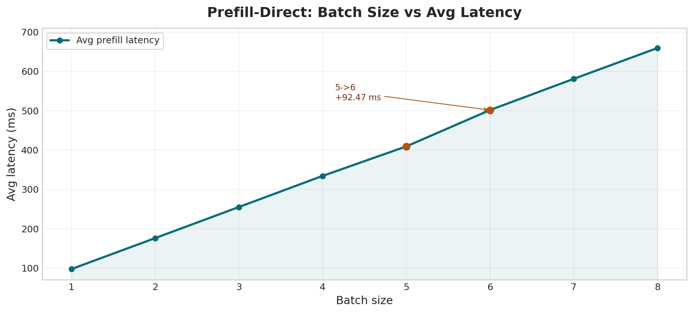
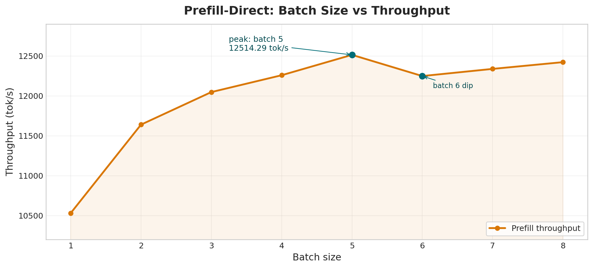
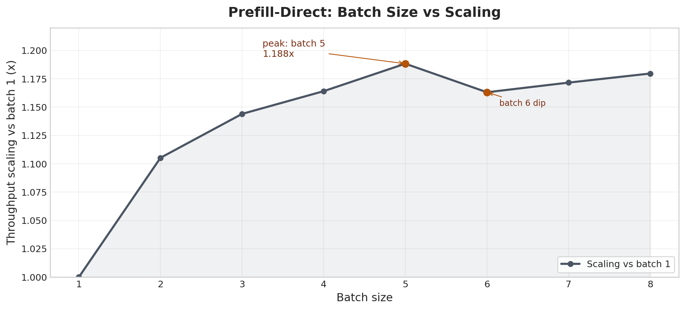

# Prefill-Direct 性能报告

## 运行环境

| 项目 | 值 |
| --- | --- |
| 日期 | 2026-11-11 |
| 平台 | NVIDIA |
| 设备 | A100-SXM4-80GB |
| Driver | 535.161.08 |
| InfiniLM build | 当前源码树；未记录独立 build ID |
| 模型 | `/data-aisoft/mechdancer/models/Qwen3-8B` |
| 模式 | `prefill-direct` |
| Attention backend | `flash-attn` |
| Cache | paged KV cache，block size 256，num blocks 32 |
| Max batched tokens | 9216 |
| Tensor parallel size | 1 |
| 输入长度 | 1024 tokens / request |
| Batch size | 1..8 |
| Warmup | 每个形状 3 次 |
| 正式样本 | 每个形状 30 次 |
| Batch 执行顺序 | random seed 2026 |

本报告对应的原始 JSONL 为本机运行产物，不随仓库提交：

```text
../../../benchmark-prefill-direct-qwen3-8b-flash-attn-20261111.jsonl
```

## 构建与测试命令

C++ 扩展使用当前源码构建并安装：

```bash
xmake build _infinilm && xmake install _infinilm
```

性能测试命令：

```bash
BENCHMARK_MODE=prefill-direct \
BATCH_SIZES=1,2,3,4,5,6,7,8 \
INPUT_LENS=1024 \
BENCHMARK_REPEATS=30 \
BENCHMARK_OUTPUT=benchmark-prefill-direct-qwen3-8b-flash-attn-20261111.jsonl \
./run_bench.sh
```

## 执行模式

`run_bench.sh` 请求开启 graph compiling，但当前 paged graph compiler 的 graph key 只匹配 decode-only 形状。packed prefill 形状不匹配该 key，因此本次 `prefill-direct` 的 expected execution mode 为 `eager`。

`expected_execution_mode` 是 benchmark 根据 compiler 规则推断的字段，不是 C++ runtime 回传的实际执行模式。

## 测试口径

- 每个 sample 是一次 physical prefill forward。
- Prefill token 数为 `batch_size * 1024`。
- 计时边界为 `engine_forward_including_sampling`，包含：
  - Python `InferEngine.forward` wrapper
  - C++ `InferEngine` forward
  - `RankWorker` forward
  - model forward
  - sampling
- 不包含：
  - HTTP
  - JSON parsing
  - tokenization
  - scheduler queueing
  - `build_model_inputs`
  - detokenization
  - Python `generate()` 循环
- Direct prefill 使用合成输入和全 0 paged KV cache，输出 token 不用于正确性判断。
- 每个 batch size 30 个正式样本。p99 使用线性插值，30 个样本下的 p99 只能作为尾部参考，稳定性弱于 100+ 样本。

## 资源开销

- Workspace manager 分配约 972 MiB。
- 权重加载耗时约 7.21 秒。
- 本轮未单独保留 run log，资源数据来自运行时输出；后续标准报告应保留完整 log。

## 核心结果

本表同时是本次 batch `1..8` 的完整结果表。

| Batch | Input tokens | Avg ms | Min ms | P50 ms | P95 ms | P99 ms | Max ms | Std ms | Throughput tok/s | Scaling vs BS1 |
| ---: | ---: | ---: | ---: | ---: | ---: | ---: | ---: | ---: | ---: | ---: |
| 1 | 1,024 | 97.240 | 97.191 | 97.226 | 97.306 | 97.317 | 97.318 | 0.034 | 10,530.70 | 1.000x |
| 2 | 2,048 | 175.947 | 175.775 | 175.962 | 176.022 | 176.027 | 176.027 | 0.064 | 11,639.85 | 1.105x |
| 3 | 3,072 | 254.984 | 254.934 | 254.983 | 255.019 | 255.056 | 255.071 | 0.030 | 12,047.83 | 1.144x |
| 4 | 4,096 | 334.118 | 334.036 | 334.115 | 334.259 | 334.341 | 334.346 | 0.069 | 12,259.14 | 1.164x |
| 5 | 5,120 | 409.132 | 409.035 | 409.116 | 409.256 | 409.295 | 409.299 | 0.059 | 12,514.29 | 1.188x |
| 6 | 6,144 | 501.599 | 501.421 | 501.573 | 501.788 | 501.900 | 501.919 | 0.098 | 12,248.84 | 1.163x |
| 7 | 7,168 | 580.943 | 580.663 | 580.811 | 581.659 | 581.782 | 581.820 | 0.322 | 12,338.56 | 1.172x |
| 8 | 8,192 | 659.420 | 659.248 | 659.354 | 659.760 | 660.221 | 660.368 | 0.222 | 12,423.03 | 1.180x |

## 趋势图

以下三张图均由本轮 JSONL 中的 8 个 overall summary 生成。横轴为 batch size，纵轴分别为平均 prefill latency、prefill throughput 和相对 batch 1 的吞吐倍数。

### 1. Batch size 与 Avg Latency



平均 latency 从 batch 1 的 97.240 ms 增至 batch 8 的 659.420 ms，总体接近线性增长。batch 5 到 batch 6 的增幅最明显，从 409.132 ms 增至 501.599 ms，增加约 92.47 ms。

### 2. Batch size 与 Throughput



吞吐从 batch 1 的 10,530.70 tok/s 上升至 batch 5 的 12,514.29 tok/s，并在 batch 5 达到峰值。batch 6 降至 12,248.84 tok/s，batch 6 到 batch 8 保持在 12.2k 到 12.5k tok/s 的平台区。

### 3. Batch size 与 Scaling



Scaling 定义为当前 batch 吞吐除以 batch 1 吞吐。曲线在 batch 5 达到最高值 1.188x，batch 6 降至 1.163x，随后缓慢回升到 batch 8 的 1.180x。该趋势与 throughput 曲线一致。

## 结果分析

### 1. Latency 基本随 batch size 线性增加

Batch 1 的平均 forward 时间为 97.24 ms，batch 8 为 659.42 ms。Batch 8 的总 token 数是 batch 1 的 8 倍，平均耗时约为 batch 1 的 6.78 倍，说明大 batch 带来了一定并行效率，但并没有形成理想的 8 倍计算重叠。

各 batch 的平均耗时为：

```text
97.24 -> 175.95 -> 254.98 -> 334.12 -> 409.13 -> 501.60 -> 580.94 -> 659.42 ms
```

从 batch 1 到 batch 5，耗时增量较稳定；batch 5 到 6 的增量相对更大，之后 batch 6 到 8 又回到较平滑的增长。

### 2. Throughput 在 batch 5 达到峰值

各 batch 的吞吐为：

```text
10,530.70
11,639.85
12,047.83
12,259.14
12,514.29
12,248.84
12,338.56
12,423.03 tok/s
```

峰值出现在 batch 5：

```text
12,514.29 tok/s
```

Batch 6 到 8 的吞吐在 12.2k 到 12.4k tok/s 之间波动，基本进入平台期。相比 batch 1：

- batch 5 提升约 18.8%
- batch 8 提升约 18.0%

这说明在该模型、输入长度、flash-attn 和当前执行模式下，增加 prefill batch size 的吞吐收益主要在 batch 1 到 5 之间获得，batch 6 以后边际收益很小。

### 3. 结果波动很小

每个 batch 的 30 个样本波动都很低：

- Std 最大约 0.322 ms，出现在 batch 7。
- Std / mean 均约在 0.03% 到 0.06% 量级。
- P50、P95、P99 和 max 都非常接近。

因此，本次数据的短期稳定性很好；主要不确定性来自 p99 样本量只有 30，而不是样本间大幅波动。

### 4. Per-request latency 随 batch size 明显变差

以每次 forward 处理的请求数计算：

| Batch | Per-request prefill latency |
| ---: | ---: |
| 1 | 97.24 ms/request |
| 2 | 87.97 ms/request |
| 3 | 85.00 ms/request |
| 4 | 83.53 ms/request |
| 5 | 81.83 ms/request |
| 6 | 83.60 ms/request |
| 7 | 82.99 ms/request |
| 8 | 82.43 ms/request |

单个请求的等待时间从 batch 1 的约 97.24 ms 降到 batch 5 的约 81.83 ms，之后变化不大。若目标是降低单个请求的 prefill 延迟，batch 5 左右已经接近本次测试的最优区间。

## 结论

1. 在 input length 1024 的 direct prefill 场景下，batch 5 的总吞吐最高，约 **12,514 tok/s**。
2. Batch 8 吞吐约 **12,423 tok/s**，只比峰值低 0.7%，但单次 forward 耗时增加到约 **659.42 ms**。
3. 如果优先考虑吞吐，batch 5 到 8 都处于较优平台区，其中 batch 5 兼顾最高吞吐和较低 forward latency。
4. 如果优先考虑单请求响应时间，batch 5 的 per-request latency 约 **81.83 ms/request**，是本次结果中的最低值。
5. 本结果是 synthetic direct-forward 性能，不包含 scheduler、tokenization、detokenization 和 HTTP，不能直接等价为端到端服务 TTFT。

## 数据完整性

```text
config records: 1
sample records: 240
summary records: 8
scaling records: 8
每个 batch 样本数: 30
```
