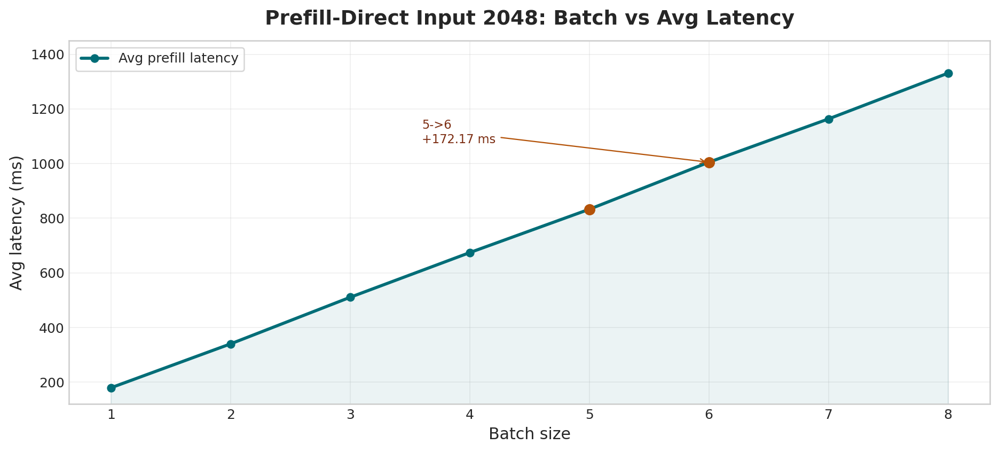
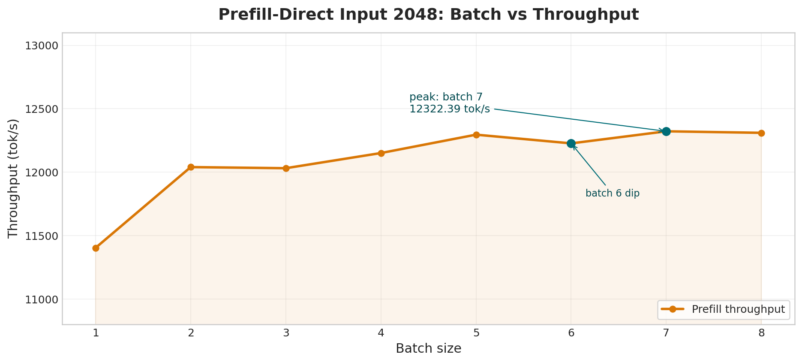
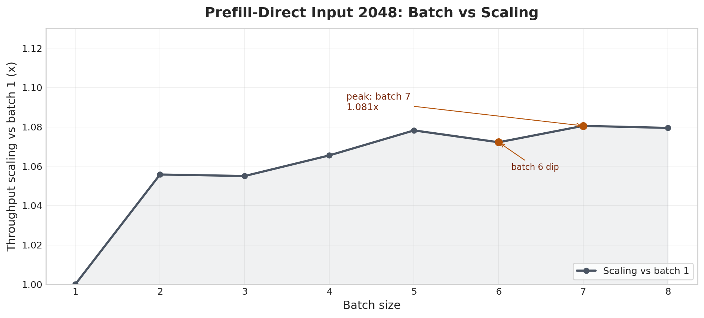

# Prefill-Direct Input 2048 性能报告

## 运行环境

| 项目 | 值 |
| --- | --- |
| 日期 | 2026-11-11 15:47-15:50（Asia/Shanghai） |
| 平台 | NVIDIA |
| 设备 | A100-SXM4-80GB |
| Driver | 535.161.08 |
| InfiniLM build | 当前源码树；未记录独立 build ID |
| 模型 | `/data-aisoft/mechdancer/models/Qwen3-8B` |
| 模式 | `prefill-direct` |
| Attention backend | `flash-attn` |
| Graph request | enabled |
| Expected execution mode | `eager` |
| Cache | paged KV cache，block size 256，num blocks 64 |
| Max batched tokens | 18432 |
| Tensor parallel size | 1 |
| Input length | 2048 tokens / request |
| Batch size | 1..8 |
| Warmup | 每个形状 3 次 |
| Measured repeats | 每个形状 30 次 |
| Batch 执行顺序 | random seed 2026 |

本报告对应的原始 JSONL 和 log 为本机运行产物，不随仓库提交：

```text
../../../benchmark-prefill-direct-qwen3-8b-flash-attn-input2048-20261111.jsonl
../../../benchmark-prefill-direct-qwen3-8b-flash-attn-input2048-20261111.log
```

## 构建与测试命令

```bash
xmake build _infinilm && xmake install _infinilm
```

```bash
BENCHMARK_MODE=prefill-direct \
BATCH_SIZES=1,2,3,4,5,6,7,8 \
INPUT_LENS=2048 \
BENCHMARK_REPEATS=30 \
BENCHMARK_OUTPUT=benchmark-prefill-direct-qwen3-8b-flash-attn-input2048-20261111.jsonl \
./run_bench.sh
```

## 执行模式与 Graph 覆盖

`run_bench.sh` 请求开启 graph compiling，但当前 paged graph compiler 的 graph key 只匹配 decode-only 形状。packed prefill 形状不匹配该 key，因此本轮 `prefill-direct` 的 expected execution mode 为 `eager`。

`expected_execution_mode` 是 benchmark 根据 compiler 规则推断的字段，不是 C++ runtime 回传的实际执行模式。

## 资源开销

| 项目 | 值 |
| --- | ---: |
| Workspace manager 配置 | `max_num_batched_tokens=18432` |
| Workspace allocation | 1944 MiB |
| 权重加载时间 | 约 7.28 秒 |
| Paged cache blocks | 64 |
| 正式 sample 数 | 240 |

本轮 batch 8 的 prefill token 数为 `8 * 2048 = 16384`，低于默认 `max_num_batched_tokens=18432`，因此 workspace 上限保持 18432。

## 测试口径

- 每个 sample 是一次物理 prefill forward。
- `token_count = batch_size * 2048`。
- `throughput = batch_size * 2048 / avg_forward_duration_s`。
- 计时边界为 `engine_forward_including_sampling`。
- Direct prefill 使用合成输入和全 0 paged KV cache，输出 token 不用于正确性判断。
- 分位数使用线性插值。
- 每个 batch 有 30 个正式样本，p99 只能作为尾部参考。

## 核心结果

本表同时是本次 batch `1..8` 的完整结果表。

| Batch | Input tokens | Avg ms | Min ms | P50 ms | P95 ms | P99 ms | Max ms | Std ms | Throughput tok/s | Scaling |
| ---: | ---: | ---: | ---: | ---: | ---: | ---: | ---: | ---: | ---: | ---: |
| 1 | 2,048 | 179.588 | 179.465 | 179.583 | 179.681 | 179.684 | 179.684 | 0.050 | 11403.88 | 1.000x |
| 2 | 4,096 | 340.193 | 340.112 | 340.180 | 340.272 | 340.297 | 340.305 | 0.049 | 12040.24 | 1.056x |
| 3 | 6,144 | 510.658 | 510.560 | 510.628 | 510.777 | 510.872 | 510.911 | 0.077 | 12031.54 | 1.055x |
| 4 | 8,192 | 674.180 | 672.567 | 674.415 | 675.007 | 675.204 | 675.283 | 0.707 | 12151.06 | 1.066x |
| 5 | 10,240 | 832.800 | 831.204 | 831.914 | 835.809 | 836.788 | 837.031 | 1.733 | 12295.87 | 1.078x |
| 6 | 12,288 | 1004.970 | 1004.671 | 1004.849 | 1005.879 | 1006.236 | 1006.309 | 0.384 | 12227.23 | 1.072x |
| 7 | 14,336 | 1163.411 | 1162.945 | 1163.446 | 1163.678 | 1163.686 | 1163.689 | 0.203 | 12322.39 | 1.081x |
| 8 | 16,384 | 1330.915 | 1323.992 | 1330.744 | 1335.355 | 1336.053 | 1336.203 | 2.703 | 12310.33 | 1.079x |

## 趋势图

### 1. Batch size 与 Avg Latency



平均 latency 从 batch 1 的 179.588 ms 增至 batch 8 的 1330.915 ms。整体接近线性增长；其中 batch 5 到 batch 6 的增幅最大，从 832.800 ms 增至 1004.970 ms，增加 172.171 ms。

### 2. Batch size 与 Throughput



吞吐峰值出现在 batch 7，为 12322.39 tok/s。batch 6 回落后，batch 7 达到峰值，batch 8 为 12310.33 tok/s，仅比峰值低约 0.10%。

### 3. Batch size 与 Scaling



Scaling 从 batch 1 的 1.000x 增至 batch 8 的 1.079x。由于 input length 为 2048 时 batch 8 的理想 scaling 为 8x，相对理想 8x 的效率约为 13.5%。

## 结果分析

### 1. Latency 基本随 batch size 线性增长

Batch 8 的平均耗时是 batch 1 的 7.411 倍，而处理 token 数是 batch 1 的 8 倍。说明 batch 内并行带来一定效率提升，但没有达到理想线性扩展。

### 2. 吞吐在 batch 5 后进入平台区

batch 2 到 batch 8 的吞吐均约在 12.0k 到 12.3k tok/s 之间。batch 7 达到最高值 12322.39 tok/s，batch 8 为 12310.33 tok/s。

### 3. Per-request latency 在 batch 7 最低

| Batch | Per-request prefill latency |
| ---: | ---: |
| 1 | 179.59 ms/request |
| 2 | 170.10 ms/request |
| 3 | 170.22 ms/request |
| 4 | 168.54 ms/request |
| 5 | 166.56 ms/request |
| 6 | 167.50 ms/request |
| 7 | 166.20 ms/request |
| 8 | 166.36 ms/request |

batch 7 的 per-request latency 为 166.20 ms/request，是本轮最低值；batch 8 为 166.36 ms/request，二者差异较小。

### 4. 数据稳定性较好

- Std 中位数为 0.293 ms。
- 最大 std 为 2.703 ms，出现在 batch 8。
- P50、P95、P99 和 max 普遍接近。

## 结论与建议

1. 在本轮 input length 2048、batch `1..8` 范围内，**batch 7 吞吐最高**，约 12322.39 tok/s。
2. Batch 8 吞吐约 12310.33 tok/s，与峰值差异很小，但单次 forward 平均耗时增加到 1330.915 ms。
3. 若继续扩大 batch 范围，需要重新评估 `max_num_batched_tokens`、workspace 与 KV cache 内存。
4. 正式 p99 对比建议将 `BENCHMARK_REPEATS` 提高到 100 或以上。

## 数据完整性

```text
config records: 1
sample records: 240
summary records: 8
scaling records: 8
每个 batch 样本数: 30
```
