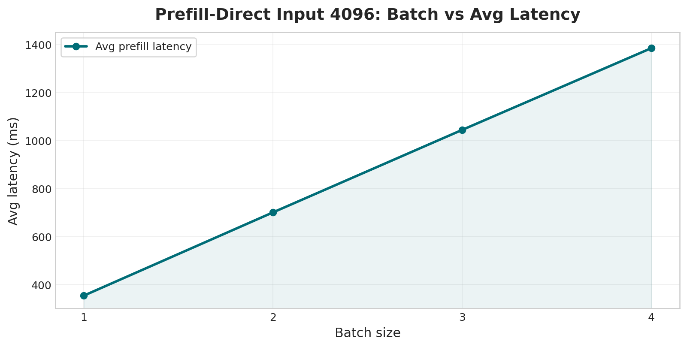
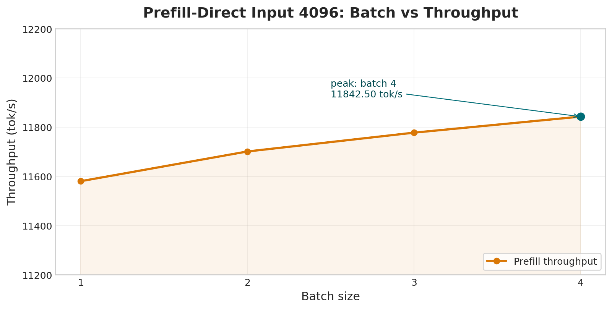
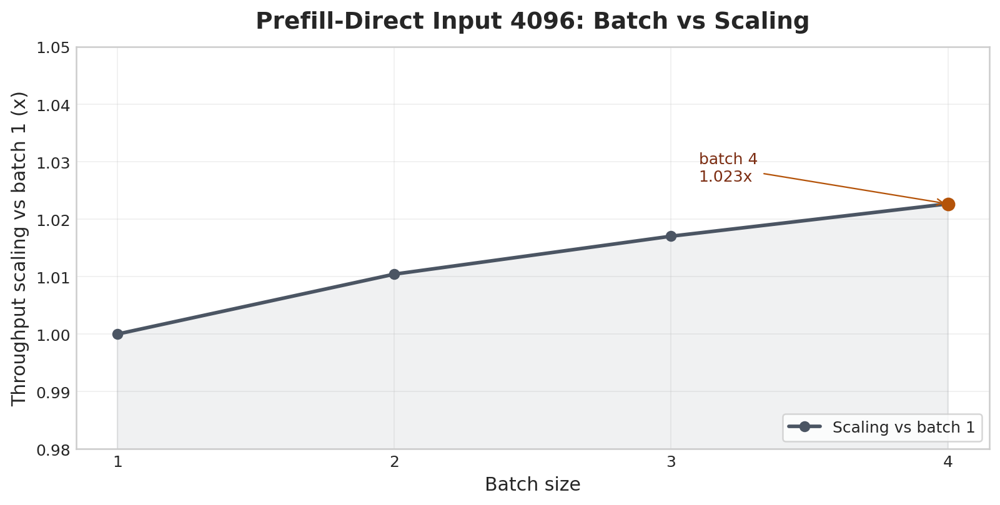

# Prefill-Direct Input 4096 性能报告

## 运行环境

| 项目 | 值 |
| --- | --- |
| 日期 | 2026-11-13 10:22-10:24（Asia/Shanghai） |
| 平台 | NVIDIA |
| 设备 | A100-SXM4-80GB |
| Driver | 535.161.08 |
| InfiniLM build | 当前源码树；未记录独立 build ID |
| 模型 | `/data-aisoft/mechdancer/models/Qwen3-8B` |
| 模式 | `prefill-direct` |
| Attention backend | `flash-attn` |
| Graph request | enabled |
| Expected execution mode | `eager` |
| Cache | paged KV cache，block size 256，num blocks 64 |
| Max batched tokens | 18432 |
| Tensor parallel size | 1 |
| Input length | 4096 tokens / request |
| Batch size | 1..4 |
| Warmup | 每个形状 3 次 |
| Measured repeats | 每个形状 30 次 |
| Batch 执行顺序 | random seed 2026 |

本报告对应的原始 JSONL 和 log 为本机运行产物，不随仓库提交：

```text
../../../benchmark-prefill-direct-qwen3-8b-flash-attn-input4096-20261113.jsonl
../../../benchmark-prefill-direct-qwen3-8b-flash-attn-input4096-20261113.log
```

## 构建与测试命令

本轮使用当前已安装的 `_infinilm` 扩展。标准重建命令如下：

```bash
xmake build _infinilm && xmake install _infinilm
```

性能测试命令：

```bash
BENCHMARK_MODE=prefill-direct \
BATCH_SIZES=1,2,3,4 \
INPUT_LENS=4096 \
BENCHMARK_REPEATS=30 \
BENCHMARK_OUTPUT=benchmark-prefill-direct-qwen3-8b-flash-attn-input4096-20261113.jsonl \
./run_bench.sh
```

## 执行模式与 Graph 覆盖

`run_bench.sh` 请求开启 graph compiling，但当前 paged graph compiler 的 graph key 只匹配 decode-only 形状。packed prefill 形状不匹配该 key，因此本轮 `prefill-direct` 的 expected execution mode 为 `eager`。

`expected_execution_mode` 是 benchmark 根据 compiler 规则推断的字段，不是 C++ runtime 回传的实际执行模式。

## 资源开销

| 项目 | 值 |
| --- | ---: |
| Workspace manager 配置 | `max_num_batched_tokens=18432` |
| Workspace allocation | 1944 MiB |
| 权重加载时间 | 约 7.10 秒 |
| Paged cache blocks | 64 |
| 正式 sample 数 | 120 |

为避免显存不足，本轮将 prefill batch 上限限制为 4。batch 4 的 prefill token 数为 `4 * 4096 = 16384`，低于 `max_num_batched_tokens=18432`；batch 5 会需要 20480 tokens，超过该上限。

## 测试口径

- 每个 sample 是一次物理 prefill forward。
- `token_count = batch_size * 4096`。
- `throughput = batch_size * 4096 / avg_forward_duration_s`。
- 计时边界为 `engine_forward_including_sampling`。
- Direct prefill 使用合成输入和全 0 paged KV cache，输出 token 不用于正确性判断。
- 分位数使用线性插值。
- 每个 batch 有 30 个正式样本，p99 只能作为尾部参考。

## 核心结果

本表同时是本次 batch `1..4` 的完整结果表。

| Batch | Input tokens | Avg ms | Min ms | P50 ms | P95 ms | P99 ms | Max ms | Std ms | Throughput tok/s | Scaling |
| ---: | ---: | ---: | ---: | ---: | ---: | ---: | ---: | ---: | ---: | ---: |
| 1 | 4,096 | 353.713 | 353.560 | 353.712 | 353.873 | 353.899 | 353.907 | 0.096 | 11579.99 | 1.000x |
| 2 | 8,192 | 700.127 | 698.439 | 699.852 | 701.491 | 701.764 | 701.870 | 1.049 | 11700.73 | 1.010x |
| 3 | 12,288 | 1043.368 | 1043.146 | 1043.334 | 1043.569 | 1043.718 | 1043.774 | 0.123 | 11777.24 | 1.017x |
| 4 | 16,384 | 1383.492 | 1377.713 | 1383.872 | 1388.857 | 1389.231 | 1389.339 | 3.761 | 11842.50 | 1.023x |

## 趋势图

### 1. Batch size 与 Avg Latency



平均 latency 从 batch 1 的 353.713 ms 增至 batch 4 的 1383.492 ms，接近线性增长。

### 2. Batch size 与 Throughput



吞吐从 batch 1 的 11579.99 tok/s 增至 batch 4 的 11842.50 tok/s。本轮 batch 4 为吞吐峰值。

### 3. Batch size 与 Scaling



Scaling 从 batch 1 的 1.000x 增至 batch 4 的 1.023x。相对理想 4x 的效率约为 25.6%。

## 结果分析

1. Batch 4 吞吐最高，为 11842.50 tok/s。
2. Batch 4 平均 forward 耗时为 1383.492 ms。
3. Batch 1 到 4 的吞吐差异较小，最大差异约 2.27%。
4. Batch 4 的 std 最大，为 3.761 ms，但仍远小于平均耗时。
5. 本轮 batch 上限由 `max_num_batched_tokens=18432` 决定；如需测试 batch 5，需要提高该配置并重新评估显存。

## 数据完整性

```text
config records: 1
sample records: 120
summary records: 4
scaling records: 4
每个 batch 样本数: 30
```
