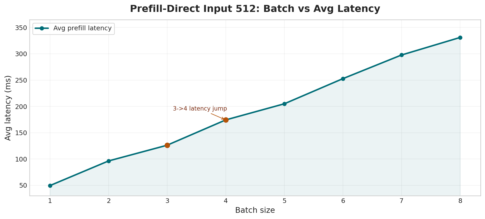
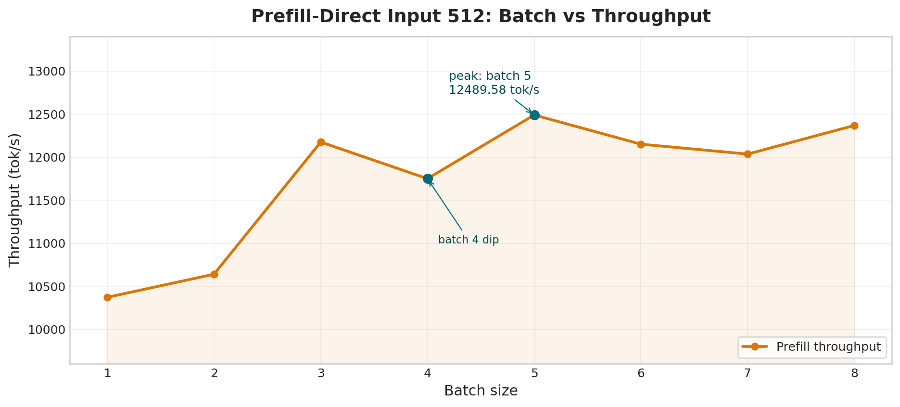
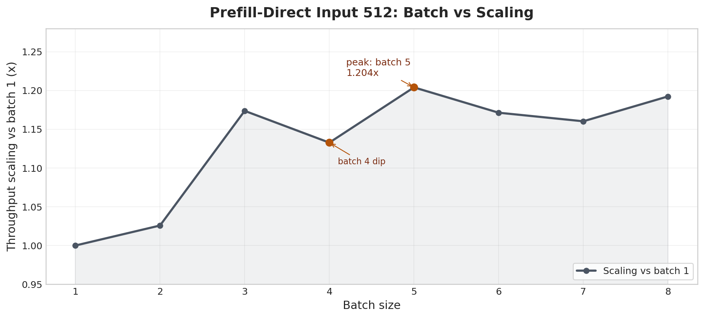

# Prefill-Direct Input 512 性能报告

## 运行环境

| 项目 | 值 |
| --- | --- |
| 日期 | 2026-11-12 17:16-17:17（Asia/Shanghai） |
| 平台 | NVIDIA |
| 设备 | A100-SXM4-80GB |
| Driver | 535.161.08 |
| InfiniLM build | 当前源码树；未记录独立 build ID |
| 模型 | `/data-aisoft/mechdancer/models/Qwen3-8B` |
| 模式 | `prefill-direct` |
| Attention backend | `flash-attn` |
| Graph request | enabled |
| Expected execution mode | `eager` |
| Cache | paged KV cache，block size 256，num blocks 16 |
| Max batched tokens | 18432 |
| Tensor parallel size | 1 |
| Input length | 512 tokens / request |
| Batch size | 1..8 |
| Warmup | 每个形状 3 次 |
| Measured repeats | 每个形状 30 次 |
| Batch 执行顺序 | random seed 2026 |

本报告对应的原始 JSONL 和 log 为本机运行产物，不随仓库提交：

```text
../../../benchmark-prefill-direct-qwen3-8b-flash-attn-input512-20261112.jsonl
../../../benchmark-prefill-direct-qwen3-8b-flash-attn-input512-20261112.log
```

## 构建与测试命令

本轮使用当前已安装的 `_infinilm` 扩展。标准重建命令如下：

```bash
xmake build _infinilm && xmake install _infinilm
```

性能测试命令：

```bash
BENCHMARK_MODE=prefill-direct \
BATCH_SIZES=1,2,3,4,5,6,7,8 \
INPUT_LENS=512 \
BENCHMARK_REPEATS=30 \
BENCHMARK_OUTPUT=benchmark-prefill-direct-qwen3-8b-flash-attn-input512-20261112.jsonl \
./run_bench.sh
```

## 执行模式与 Graph 覆盖

`run_bench.sh` 请求开启 graph compiling，但当前 paged graph compiler 的 graph key 只匹配 decode-only 形状。packed prefill 形状不匹配该 key，因此本轮 `prefill-direct` 的 expected execution mode 为 `eager`。

`expected_execution_mode` 是 benchmark 根据 compiler 规则推断的字段，不是 C++ runtime 回传的实际执行模式。

## 资源开销

| 项目 | 值 |
| --- | ---: |
| Workspace manager 配置 | `max_num_batched_tokens=18432` |
| Workspace allocation | 1944 MiB |
| 权重加载时间 | 约 6.84 秒 |
| Paged cache blocks | 16 |
| 正式 sample 数 | 240 |

Input length 512 时，batch 8 的 prefill token 数为 `8 * 512 = 4096`，低于 `max_num_batched_tokens=18432`，因此 workspace 上限保持 18432。

## 测试口径

- 每个 sample 是一次物理 prefill forward。
- `token_count = batch_size * 512`。
- `throughput = batch_size * 512 / avg_forward_duration_s`。
- 计时边界为 `engine_forward_including_sampling`。
- Direct prefill 使用合成输入和全 0 paged KV cache，输出 token 不用于正确性判断。
- 分位数使用线性插值。
- 每个 batch 有 30 个正式样本，p99 只能作为尾部参考。

## 核心结果

本表同时是本次 batch `1..8` 的完整结果表。

| Batch | Input tokens | Avg ms | Min ms | P50 ms | P95 ms | P99 ms | Max ms | Std ms | Throughput tok/s | Scaling |
| ---: | ---: | ---: | ---: | ---: | ---: | ---: | ---: | ---: | ---: | ---: |
| 1 | 512 | 49.362 | 49.304 | 49.346 | 49.490 | 49.599 | 49.615 | 0.065 | 10372.43 | 1.000x |
| 2 | 1,024 | 96.238 | 96.202 | 96.225 | 96.301 | 96.318 | 96.321 | 0.033 | 10640.27 | 1.026x |
| 3 | 1,536 | 126.158 | 126.107 | 126.145 | 126.201 | 126.327 | 126.378 | 0.049 | 12175.20 | 1.174x |
| 4 | 2,048 | 174.300 | 173.817 | 174.368 | 174.443 | 174.479 | 174.490 | 0.148 | 11749.86 | 1.133x |
| 5 | 2,560 | 204.971 | 204.890 | 204.960 | 205.043 | 205.166 | 205.215 | 0.058 | 12489.58 | 1.204x |
| 6 | 3,072 | 252.830 | 252.761 | 252.817 | 252.910 | 252.932 | 252.939 | 0.050 | 12150.46 | 1.171x |
| 7 | 3,584 | 297.784 | 297.215 | 297.902 | 298.042 | 298.125 | 298.150 | 0.253 | 12035.58 | 1.160x |
| 8 | 4,096 | 331.167 | 330.839 | 331.137 | 331.373 | 331.568 | 331.637 | 0.132 | 12368.37 | 1.192x |

## 趋势图

### 1. Batch size 与 Avg Latency



平均 latency 从 batch 1 的 49.362 ms 增至 batch 8 的 331.167 ms。整体呈上升趋势，其中 batch 3 到 batch 4 出现较明显增幅。

### 2. Batch size 与 Throughput



吞吐峰值出现在 batch 5，为 12489.58 tok/s。batch 4 出现局部回落，batch 5 恢复到峰值，batch 6 到 8 保持在 12.0k 到 12.4k tok/s 平台区。

### 3. Batch size 与 Scaling



Scaling 从 batch 1 的 1.000x 增至 batch 8 的 1.192x。相对理想 8x 的效率约为 14.9%。

## 结果分析

### 1. Latency 随 batch size 增长

Batch 8 的平均耗时是 batch 1 的 6.709 倍，而处理 token 数是 batch 1 的 8 倍。batch 内并行提高了总吞吐，但没有让 forward latency 保持不变。

### 2. 吞吐在 batch 5 后进入平台区

batch 5 吞吐最高，为 12489.58 tok/s；batch 8 为 12368.37 tok/s，仅比峰值低约 0.97%。

### 3. Per-request latency 在 batch 5 最低

| Batch | Per-request prefill latency |
| ---: | ---: |
| 1 | 49.36 ms/request |
| 2 | 48.12 ms/request |
| 3 | 42.05 ms/request |
| 4 | 43.57 ms/request |
| 5 | 40.99 ms/request |
| 6 | 42.14 ms/request |
| 7 | 42.54 ms/request |
| 8 | 41.40 ms/request |

batch 5 的 per-request latency 为 40.99 ms/request，是本轮最低值；batch 8 为 41.40 ms/request。

### 4. 数据稳定性较好

- Std 中位数为 0.062 ms。
- 最大 std 为 0.253 ms，出现在 batch 7。
- P50、P95、P99 和 max 普遍接近。

## 结论与建议

1. 在本轮 input length 512、batch `1..8` 范围内，**batch 5 吞吐最高**，约 12489.58 tok/s。
2. Batch 8 吞吐约 12368.37 tok/s，与峰值差异很小，但单次 forward 平均耗时增加到 331.167 ms。
3. 如需寻找 prefill 吞吐饱和点，可继续扩大 batch 范围，同时监控 workspace 与 KV cache 内存。
4. 正式 p99 对比建议将 `BENCHMARK_REPEATS` 提高到 100 或以上。

## 数据完整性

```text
config records: 1
sample records: 240
summary records: 8
scaling records: 8
每个 batch 样本数: 30
```
