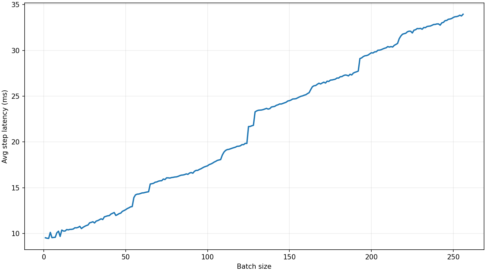
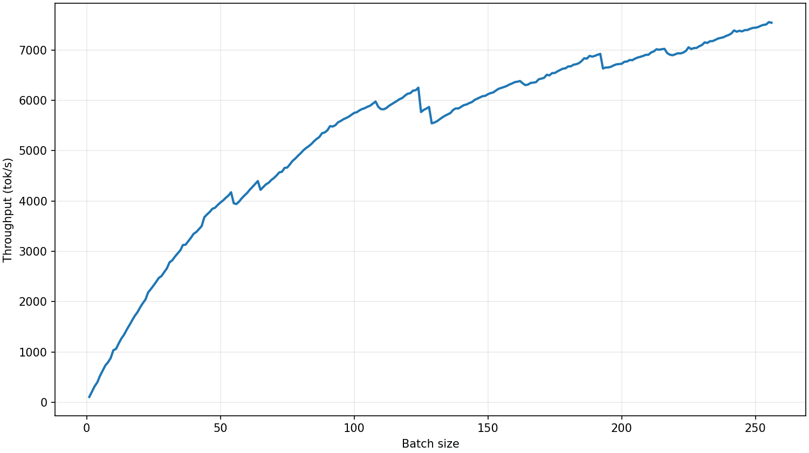
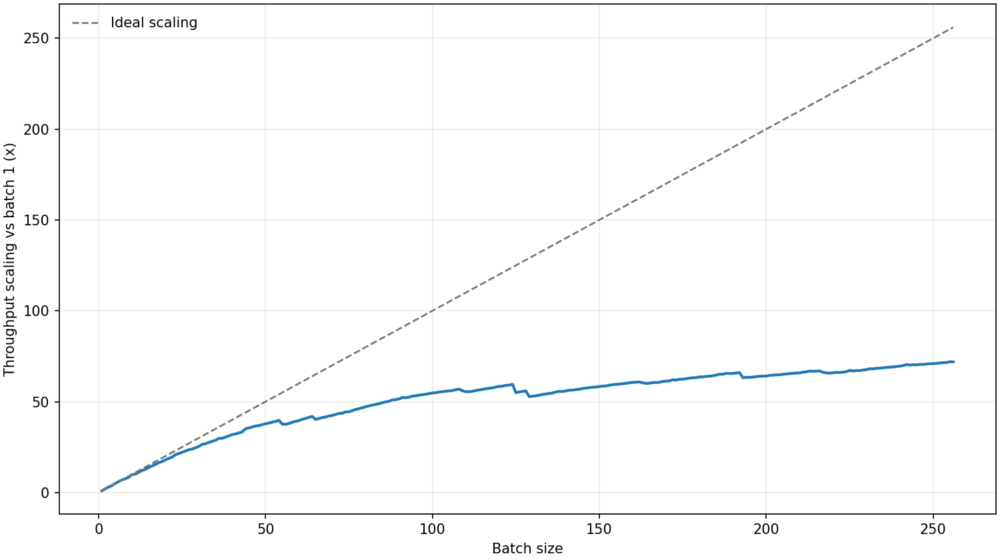

# Decode-Direct Input 1024 TP=2 性能报告

## 运行环境

| 项目 | 值 |
| --- | --- |
| 日期 | 2026-11-18 14:54:36-15:07:25（Asia/Shanghai） |
| 平台 | NVIDIA |
| 设备 | 2 x A100-SXM4-80GB，默认 CUDA_VISIBLE_DEVICES=3,4 |
| Driver | 535.161.08 |
| InfiniLM build | 当前源码树；未记录独立 build ID |
| 模型 | `/data-aisoft/mechdancer/models/Qwen3-8B` |
| 模式 | `decode-direct` |
| Attention backend | `flash-attn` |
| Graph request | enabled |
| Expected execution mode | `graph` |
| Cache | paged KV cache，block size 256，num blocks 1280 |
| Max batched tokens | 18432 |
| Tensor parallel size | 2 |
| Input length | 1024 tokens / request |
| Batch size | 1..256 |
| Warmup | 每个形状 3 次 repeat |
| Measured repeats | 每个形状 30 次 repeat |
| Batch 执行顺序 | random seed 2026 |

本报告对应的原始 JSONL 和 log 为本机运行产物，不随仓库提交：

```text
../../../benchmark-decode-direct-qwen3-8b-flash-attn-tp2-input1024-graph1-256-20261118.jsonl
../../../benchmark-decode-direct-qwen3-8b-flash-attn-tp2-input1024-graph1-256-20261118.log
```

## 构建与测试命令

本轮使用当前已安装的 `_infinilm` 扩展。标准重建命令如下：

```bash
xmake build _infinilm && xmake install _infinilm
```

性能测试命令：

```bash
BENCHMARK_MODE=decode-direct \
BATCH_SIZES="$(seq -s, 1 256)" \
INPUT_LENS=1024 \
BENCHMARK_REPEATS=30 \
BENCHMARK_OUTPUT=benchmark-decode-direct-qwen3-8b-flash-attn-tp2-input1024-graph1-256-20261118.jsonl \
./run_bench-nvidia.sh
```

## 执行模式与 Graph 覆盖

当前 paged graph compiler 编译 decode batch size `1..256`。因此本轮所有 batch 均有对应 decode graph，无 eager fallback 混入；原始 JSONL 中所有 overall summary 的 `expected_execution_mode` 均为 `graph`。

## 资源开销

| 项目 | 值 |
| --- | ---: |
| Workspace allocation | 每 rank 1,116 MiB，TP=2 合计 2,232 MiB |
| 权重加载与 graph 编译时间 | 权重加载约 33.88 秒；graph 编译未单独记录 |
| Paged cache blocks | 1280 |
| Compiled graph 数量 | 256 |
| 正式 step sample 数 | 30,720 |
| 本轮总耗时 | 约 769 秒 |

Input length 1024 且执行 4 个 decode step 时，每个 request 需要 `ceil((1024 + 4) / 256) = 5` 个 block。batch 256 共需要 `256 * 5 = 1280` 个 block；本轮配置为 `1280` 个 block。

## 测试口径

- `decode-direct` 不执行语义完整的 prefill，paged KV cache 初始为全 0。
- Step 0 输入 dummy token；step 1 到 step 3 使用上一步 sampled token。
- 4 个 decode step 的 past KV length 分别为 1024、1025、1026、1027。
- 报告中的 duration 是单 step 时间，由一次 4-step repeat 的对应总耗时除以 4 得到。
- `single_step_throughput = batch_size / avg_step_latency`。
- 每个 request 每 step 生成 1 个 token，因此 single-step request throughput 与 token throughput 数值相同。
- 表格中的 Min/P50/P95/P99/Max 是每个 repeat 的平均 step 时间分布。
- 计时边界为 `engine_forward_including_sampling`。

## 核心结果

| 指标 | 结果 |
| --- | ---: |
| 最高 single-step 吞吐 | batch 255，7,552.53 tok/s |
| 峰值 batch 平均单 step latency | 33.764 ms |
| 峰值 batch P99 单 step latency | 33.903 ms |
| batch 1 平均单 step latency | 9.532 ms |
| 峰值 batch 相对 batch 1 吞吐倍数 | 71.990x |
| 峰值 batch 相对理想 batch 倍数的效率 | 28.2% |
| 单 step std 中位数 | 0.029 ms |
| 最大单 step std | 0.170 ms，batch 74 |

## 趋势图

### 1. Batch size 与 Avg Step Latency



平均单 step latency 从 batch 1 的 9.532 ms 变为 batch 256 的 33.949 ms，峰值吞吐 batch 255 为 33.764 ms。

### 2. Batch size 与 Throughput



吞吐峰值出现在 batch 255，为 7,552.53 tok/s；最大 batch 256 为 7,540.75 tok/s。

### 3. Batch size 与 Scaling



Scaling 从 batch 1 的 1.000x 变为 batch 256 的 71.877x；相对理想 256x 的效率约为 28.1%。

## Batch 区间平均 latency 与吞吐

下表按连续 16 个 batch 分组。`平均单 step latency ms` 和 `平均吞吐 tok/s` 分别是区间内 各 batch overall `Avg Step ms` 与 `Single-step tok/s` 的算术平均值；`区间最优 batch` 取区间内吞吐最高的 batch。

| Batch 区间 | 平均单 step latency ms | 平均吞吐 tok/s | 区间最优 batch |
| ---: | ---: | ---: | ---: |
| 1..16 | 9.969 | 839.00 | 16 |
| 17..32 | 10.851 | 2248.93 | 32 |
| 33..48 | 11.944 | 3384.24 | 48 |
| 49..64 | 13.753 | 4103.78 | 64 |
| 65..80 | 15.829 | 4576.73 | 80 |
| 81..96 | 16.589 | 5331.99 | 96 |
| 97..112 | 17.965 | 5815.26 | 108 |
| 113..128 | 20.078 | 6005.93 | 124 |
| 129..144 | 23.680 | 5762.99 | 144 |
| 145..160 | 24.666 | 6181.12 | 160 |
| 161..176 | 26.246 | 6419.10 | 176 |
| 177..192 | 27.262 | 6766.67 | 192 |
| 193..208 | 29.700 | 6749.91 | 208 |
| 209..224 | 31.146 | 6951.39 | 216 |
| 225..240 | 32.502 | 7152.77 | 240 |
| 241..256 | 33.425 | 7434.03 | 255 |

## 关键批次与跳变

| 变化 | Avg step ms | 吞吐 tok/s | 观察 |
| --- | ---: | ---: | --- |
| 124 -> 125 | 19.841 -> 21.680 | 6249.82 -> 5765.67 | latency 增加 9.3%，可能对应 kernel shape 或 workspace 分档变化 |
| 54 -> 55 | 12.942 -> 13.916 | 4172.39 -> 3952.28 | latency 增加 7.5%，可能对应 kernel shape 或 workspace 分档变化 |
| 10 -> 11 | 9.683 -> 10.376 | 1032.78 -> 1060.15 | latency 增加 7.2%，可能对应 kernel shape 或 workspace 分档变化 |
| 3 -> 4 | 9.466 -> 10.123 | 316.94 -> 395.14 | latency 增加 6.9%，可能对应 kernel shape 或 workspace 分档变化 |
| 128 -> 129 | 21.818 -> 23.282 | 5866.64 -> 5540.75 | latency 增加 6.7%，可能对应 kernel shape 或 workspace 分档变化 |
| 64 -> 65 | 14.563 -> 15.404 | 4394.65 -> 4219.78 | latency 增加 5.8%，可能对应 kernel shape 或 workspace 分档变化 |

## Step 一致性

峰值 batch 255 的 4 个 decode step 结果如下：

| Step | Past KV length | Avg step ms | Std ms | Throughput tok/s |
| ---: | ---: | ---: | ---: | ---: |
| 0 | 1024 | 33.749 | 0.127 | 7555.68 |
| 1 | 1025 | 33.761 | 0.097 | 7553.12 |
| 2 | 1026 | 33.754 | 0.116 | 7554.57 |
| 3 | 1027 | 33.789 | 0.148 | 7546.75 |

所有 batch 中，4 个 step 平均耗时最大差异为 0.104 ms，出现在 batch 240。该差异主要来自 past KV length 从 input length 增长到 input length + 3，以及不同 step 的 kernel 形状。

## 数据稳定性

- 单 step std 中位数为 0.029 ms。
- 最大 std 为 0.170 ms，出现在 batch 74。
- 所有 batch 内 4 个 step 的平均耗时差异不超过 0.104 ms，step 间一致性较好。
- P99 与 max 接近，整体尾部稳定；但每个 batch 只有 30 个 repeat，p99 仍是尾部参考值。

## Single-step 完整结果

### Batch 1..64

| Batch | Mode | Avg Step ms | Min Step ms | P50 Step ms | P95 Step ms | P99 Step ms | Max Step ms | Std Step ms | Single-step tok/s | Scaling |
| ---: | --- | ---: | ---: | ---: | ---: | ---: | ---: | ---: | ---: | ---: |
| 1 | graph | 9.532 | 9.515 | 9.524 | 9.557 | 9.647 | 9.681 | 0.030 | 104.91 | 1.000x |
| 2 | graph | 9.484 | 9.462 | 9.484 | 9.506 | 9.514 | 9.517 | 0.012 | 210.89 | 2.010x |
| 3 | graph | 9.466 | 9.407 | 9.465 | 9.499 | 9.534 | 9.547 | 0.027 | 316.94 | 3.021x |
| 4 | graph | 10.123 | 10.099 | 10.118 | 10.156 | 10.158 | 10.159 | 0.016 | 395.14 | 3.766x |
| 5 | graph | 9.546 | 9.518 | 9.548 | 9.566 | 9.573 | 9.575 | 0.015 | 523.80 | 4.993x |
| 6 | graph | 9.570 | 9.556 | 9.568 | 9.588 | 9.590 | 9.590 | 0.009 | 626.96 | 5.976x |
| 7 | graph | 9.585 | 9.568 | 9.577 | 9.605 | 9.674 | 9.702 | 0.024 | 730.33 | 6.961x |
| 8 | graph | 10.083 | 10.017 | 10.063 | 10.198 | 10.208 | 10.210 | 0.059 | 793.39 | 7.563x |
| 9 | graph | 10.251 | 10.233 | 10.250 | 10.267 | 10.280 | 10.282 | 0.010 | 877.93 | 8.368x |
| 10 | graph | 9.683 | 9.663 | 9.678 | 9.708 | 9.717 | 9.719 | 0.013 | 1,032.78 | 9.844x |
| 11 | graph | 10.376 | 10.357 | 10.376 | 10.387 | 10.394 | 10.397 | 0.009 | 1,060.15 | 10.105x |
| 12 | graph | 10.268 | 10.258 | 10.266 | 10.285 | 10.289 | 10.290 | 0.009 | 1,168.64 | 11.139x |
| 13 | graph | 10.267 | 10.246 | 10.267 | 10.292 | 10.305 | 10.310 | 0.015 | 1,266.14 | 12.069x |
| 14 | graph | 10.430 | 10.412 | 10.428 | 10.454 | 10.460 | 10.462 | 0.012 | 1,342.34 | 12.795x |
| 15 | graph | 10.399 | 10.308 | 10.372 | 10.528 | 10.576 | 10.593 | 0.080 | 1,442.44 | 13.749x |
| 16 | graph | 10.449 | 10.420 | 10.440 | 10.500 | 10.523 | 10.529 | 0.026 | 1,531.22 | 14.595x |
| 17 | graph | 10.456 | 10.438 | 10.453 | 10.478 | 10.482 | 10.482 | 0.012 | 1,625.86 | 15.497x |
| 18 | graph | 10.490 | 10.468 | 10.486 | 10.519 | 10.530 | 10.534 | 0.015 | 1,715.86 | 16.355x |
| 19 | graph | 10.627 | 10.610 | 10.625 | 10.649 | 10.652 | 10.653 | 0.011 | 1,787.92 | 17.042x |
| 20 | graph | 10.620 | 10.603 | 10.614 | 10.646 | 10.655 | 10.658 | 0.015 | 1,883.28 | 17.951x |
| 21 | graph | 10.672 | 10.647 | 10.672 | 10.699 | 10.705 | 10.705 | 0.015 | 1,967.79 | 18.757x |
| 22 | graph | 10.782 | 10.748 | 10.771 | 10.853 | 10.880 | 10.886 | 0.031 | 2,040.42 | 19.449x |
| 23 | graph | 10.539 | 10.514 | 10.537 | 10.559 | 10.562 | 10.563 | 0.011 | 2,182.39 | 20.802x |
| 24 | graph | 10.678 | 10.659 | 10.674 | 10.702 | 10.710 | 10.712 | 0.013 | 2,247.69 | 21.425x |
| 25 | graph | 10.783 | 10.769 | 10.780 | 10.800 | 10.807 | 10.810 | 0.010 | 2,318.43 | 22.099x |
| 26 | graph | 10.868 | 10.847 | 10.863 | 10.896 | 10.927 | 10.940 | 0.019 | 2,392.29 | 22.803x |
| 27 | graph | 10.928 | 10.913 | 10.925 | 10.948 | 10.961 | 10.965 | 0.013 | 2,470.73 | 23.551x |
| 28 | graph | 11.167 | 11.150 | 11.165 | 11.187 | 11.188 | 11.188 | 0.012 | 2,507.48 | 23.901x |
| 29 | graph | 11.217 | 11.191 | 11.218 | 11.242 | 11.251 | 11.251 | 0.015 | 2,585.43 | 24.644x |
| 30 | graph | 11.283 | 11.251 | 11.282 | 11.313 | 11.324 | 11.328 | 0.019 | 2,658.88 | 25.344x |
| 31 | graph | 11.152 | 11.093 | 11.145 | 11.241 | 11.262 | 11.263 | 0.045 | 2,779.73 | 26.496x |
| 32 | graph | 11.353 | 11.334 | 11.350 | 11.380 | 11.388 | 11.389 | 0.013 | 2,818.65 | 26.867x |
| 33 | graph | 11.411 | 11.387 | 11.410 | 11.437 | 11.456 | 11.462 | 0.016 | 2,891.82 | 27.564x |
| 34 | graph | 11.504 | 11.450 | 11.499 | 11.547 | 11.582 | 11.592 | 0.027 | 2,955.62 | 28.173x |
| 35 | graph | 11.604 | 11.584 | 11.597 | 11.631 | 11.641 | 11.643 | 0.015 | 3,016.27 | 28.751x |
| 36 | graph | 11.526 | 11.425 | 11.536 | 11.603 | 11.658 | 11.678 | 0.058 | 3,123.44 | 29.772x |
| 37 | graph | 11.818 | 11.785 | 11.810 | 11.879 | 11.891 | 11.892 | 0.027 | 3,130.71 | 29.842x |
| 38 | graph | 11.874 | 11.816 | 11.885 | 11.906 | 11.909 | 11.910 | 0.027 | 3,200.40 | 30.506x |
| 39 | graph | 11.933 | 11.906 | 11.932 | 11.959 | 11.981 | 11.988 | 0.018 | 3,268.36 | 31.154x |
| 40 | graph | 11.954 | 11.764 | 11.977 | 12.052 | 12.060 | 12.060 | 0.078 | 3,346.29 | 31.896x |
| 41 | graph | 12.122 | 12.049 | 12.121 | 12.184 | 12.213 | 12.221 | 0.039 | 3,382.22 | 32.239x |
| 42 | graph | 12.208 | 12.164 | 12.205 | 12.246 | 12.260 | 12.263 | 0.023 | 3,440.32 | 32.793x |
| 43 | graph | 12.290 | 12.233 | 12.292 | 12.328 | 12.332 | 12.332 | 0.025 | 3,498.74 | 33.350x |
| 44 | graph | 11.972 | 11.944 | 11.962 | 12.009 | 12.016 | 12.018 | 0.022 | 3,675.22 | 35.032x |
| 45 | graph | 12.060 | 12.031 | 12.053 | 12.104 | 12.117 | 12.122 | 0.023 | 3,731.33 | 35.567x |
| 46 | graph | 12.172 | 12.107 | 12.173 | 12.203 | 12.241 | 12.255 | 0.027 | 3,779.22 | 36.023x |
| 47 | graph | 12.227 | 12.185 | 12.227 | 12.263 | 12.270 | 12.271 | 0.021 | 3,843.83 | 36.639x |
| 48 | graph | 12.422 | 12.381 | 12.421 | 12.449 | 12.451 | 12.451 | 0.018 | 3,864.00 | 36.831x |
| 49 | graph | 12.505 | 12.447 | 12.493 | 12.542 | 12.806 | 12.912 | 0.080 | 3,918.30 | 37.349x |
| 50 | graph | 12.603 | 12.562 | 12.594 | 12.652 | 12.659 | 12.662 | 0.028 | 3,967.37 | 37.816x |
| 51 | graph | 12.723 | 12.667 | 12.722 | 12.760 | 12.771 | 12.776 | 0.027 | 4,008.60 | 38.209x |
| 52 | graph | 12.806 | 12.755 | 12.795 | 12.844 | 13.079 | 13.174 | 0.072 | 4,060.58 | 38.705x |
| 53 | graph | 12.910 | 12.883 | 12.909 | 12.944 | 12.964 | 12.971 | 0.021 | 4,105.23 | 39.131x |
| 54 | graph | 12.942 | 12.884 | 12.939 | 12.993 | 12.997 | 12.999 | 0.031 | 4,172.39 | 39.771x |
| 55 | graph | 13.916 | 13.855 | 13.912 | 13.977 | 13.984 | 13.984 | 0.036 | 3,952.28 | 37.673x |
| 56 | graph | 14.220 | 14.167 | 14.220 | 14.259 | 14.276 | 14.283 | 0.025 | 3,937.99 | 37.536x |
| 57 | graph | 14.296 | 14.240 | 14.297 | 14.353 | 14.371 | 14.374 | 0.032 | 3,987.04 | 38.004x |
| 58 | graph | 14.311 | 14.247 | 14.311 | 14.352 | 14.355 | 14.356 | 0.026 | 4,052.71 | 38.630x |
| 59 | graph | 14.364 | 14.310 | 14.366 | 14.407 | 14.421 | 14.425 | 0.029 | 4,107.40 | 39.151x |
| 60 | graph | 14.430 | 14.309 | 14.441 | 14.477 | 14.495 | 14.501 | 0.039 | 4,158.00 | 39.634x |
| 61 | graph | 14.443 | 14.372 | 14.434 | 14.498 | 14.503 | 14.504 | 0.033 | 4,223.37 | 40.257x |
| 62 | graph | 14.493 | 14.423 | 14.491 | 14.551 | 14.558 | 14.560 | 0.033 | 4,277.96 | 40.777x |
| 63 | graph | 14.527 | 14.487 | 14.529 | 14.562 | 14.578 | 14.580 | 0.021 | 4,336.68 | 41.337x |
| 64 | graph | 14.563 | 14.511 | 14.563 | 14.618 | 14.652 | 14.665 | 0.033 | 4,394.65 | 41.889x |


### Batch 65..128

| Batch | Mode | Avg Step ms | Min Step ms | P50 Step ms | P95 Step ms | P99 Step ms | Max Step ms | Std Step ms | Single-step tok/s | Scaling |
| ---: | --- | ---: | ---: | ---: | ---: | ---: | ---: | ---: | ---: | ---: |
| 65 | graph | 15.404 | 15.345 | 15.398 | 15.457 | 15.473 | 15.478 | 0.035 | 4,219.78 | 40.222x |
| 66 | graph | 15.440 | 15.376 | 15.440 | 15.475 | 15.497 | 15.505 | 0.027 | 4,274.66 | 40.746x |
| 67 | graph | 15.481 | 15.397 | 15.482 | 15.522 | 15.532 | 15.535 | 0.030 | 4,327.93 | 41.253x |
| 68 | graph | 15.602 | 15.510 | 15.602 | 15.651 | 15.668 | 15.674 | 0.033 | 4,358.44 | 41.544x |
| 69 | graph | 15.630 | 15.569 | 15.636 | 15.681 | 15.684 | 15.685 | 0.036 | 4,414.63 | 42.080x |
| 70 | graph | 15.717 | 15.645 | 15.705 | 15.766 | 15.911 | 15.970 | 0.057 | 4,453.76 | 42.453x |
| 71 | graph | 15.758 | 15.676 | 15.760 | 15.862 | 15.927 | 15.944 | 0.057 | 4,505.77 | 42.948x |
| 72 | graph | 15.766 | 15.673 | 15.783 | 15.825 | 15.833 | 15.835 | 0.048 | 4,566.82 | 43.530x |
| 73 | graph | 15.945 | 15.877 | 15.943 | 16.003 | 16.034 | 16.046 | 0.037 | 4,578.12 | 43.638x |
| 74 | graph | 15.895 | 15.680 | 15.853 | 16.119 | 16.157 | 16.171 | 0.170 | 4,655.60 | 44.377x |
| 75 | graph | 16.082 | 15.960 | 16.094 | 16.147 | 16.161 | 16.166 | 0.054 | 4,663.74 | 44.454x |
| 76 | graph | 16.078 | 15.971 | 16.086 | 16.145 | 16.154 | 16.156 | 0.055 | 4,727.04 | 45.058x |
| 77 | graph | 16.053 | 15.962 | 16.049 | 16.112 | 16.214 | 16.251 | 0.050 | 4,796.69 | 45.721x |
| 78 | graph | 16.111 | 16.012 | 16.110 | 16.162 | 16.280 | 16.328 | 0.055 | 4,841.31 | 46.147x |
| 79 | graph | 16.134 | 15.974 | 16.142 | 16.187 | 16.206 | 16.212 | 0.047 | 4,896.63 | 46.674x |
| 80 | graph | 16.172 | 16.110 | 16.172 | 16.211 | 16.216 | 16.218 | 0.029 | 4,946.72 | 47.152x |
| 81 | graph | 16.186 | 16.058 | 16.184 | 16.253 | 16.270 | 16.276 | 0.042 | 5,004.45 | 47.702x |
| 82 | graph | 16.239 | 16.173 | 16.242 | 16.276 | 16.280 | 16.281 | 0.027 | 5,049.53 | 48.132x |
| 83 | graph | 16.317 | 16.264 | 16.314 | 16.368 | 16.382 | 16.387 | 0.029 | 5,086.71 | 48.486x |
| 84 | graph | 16.375 | 16.303 | 16.374 | 16.423 | 16.485 | 16.505 | 0.039 | 5,129.91 | 48.898x |
| 85 | graph | 16.391 | 16.241 | 16.393 | 16.457 | 16.470 | 16.473 | 0.046 | 5,185.84 | 49.431x |
| 86 | graph | 16.435 | 16.350 | 16.440 | 16.498 | 16.513 | 16.519 | 0.043 | 5,232.67 | 49.877x |
| 87 | graph | 16.508 | 16.464 | 16.504 | 16.543 | 16.617 | 16.647 | 0.034 | 5,270.06 | 50.234x |
| 88 | graph | 16.463 | 16.433 | 16.456 | 16.511 | 16.527 | 16.531 | 0.023 | 5,345.40 | 50.952x |
| 89 | graph | 16.603 | 16.541 | 16.600 | 16.642 | 16.682 | 16.699 | 0.032 | 5,360.56 | 51.096x |
| 90 | graph | 16.658 | 16.561 | 16.662 | 16.703 | 16.705 | 16.706 | 0.033 | 5,402.83 | 51.499x |
| 91 | graph | 16.586 | 16.433 | 16.581 | 16.717 | 16.775 | 16.796 | 0.075 | 5,486.52 | 52.297x |
| 92 | graph | 16.796 | 16.724 | 16.803 | 16.844 | 16.845 | 16.846 | 0.034 | 5,477.50 | 52.211x |
| 93 | graph | 16.893 | 16.850 | 16.890 | 16.936 | 16.954 | 16.961 | 0.025 | 5,505.16 | 52.475x |
| 94 | graph | 16.897 | 16.833 | 16.900 | 16.949 | 16.965 | 16.968 | 0.035 | 5,562.99 | 53.026x |
| 95 | graph | 16.999 | 16.934 | 17.005 | 17.040 | 17.048 | 17.050 | 0.031 | 5,588.44 | 53.268x |
| 96 | graph | 17.072 | 17.017 | 17.068 | 17.127 | 17.144 | 17.146 | 0.033 | 5,623.24 | 53.600x |
| 97 | graph | 17.178 | 17.096 | 17.180 | 17.223 | 17.240 | 17.243 | 0.032 | 5,646.74 | 53.824x |
| 98 | graph | 17.271 | 17.217 | 17.270 | 17.318 | 17.322 | 17.323 | 0.029 | 5,674.20 | 54.086x |
| 99 | graph | 17.333 | 17.289 | 17.325 | 17.378 | 17.397 | 17.405 | 0.032 | 5,711.76 | 54.444x |
| 100 | graph | 17.395 | 17.345 | 17.393 | 17.442 | 17.455 | 17.458 | 0.027 | 5,748.61 | 54.795x |
| 101 | graph | 17.527 | 17.462 | 17.526 | 17.575 | 17.616 | 17.633 | 0.032 | 5,762.43 | 54.927x |
| 102 | graph | 17.589 | 17.529 | 17.591 | 17.642 | 17.651 | 17.652 | 0.031 | 5,798.99 | 55.275x |
| 103 | graph | 17.680 | 17.607 | 17.675 | 17.731 | 17.841 | 17.884 | 0.051 | 5,825.91 | 55.532x |
| 104 | graph | 17.797 | 17.728 | 17.787 | 17.875 | 17.902 | 17.909 | 0.039 | 5,843.62 | 55.701x |
| 105 | graph | 17.883 | 17.800 | 17.881 | 17.954 | 18.012 | 18.027 | 0.050 | 5,871.61 | 55.967x |
| 106 | graph | 17.988 | 17.937 | 17.989 | 18.027 | 18.045 | 18.051 | 0.029 | 5,892.66 | 56.168x |
| 107 | graph | 18.032 | 17.947 | 18.033 | 18.084 | 18.116 | 18.128 | 0.036 | 5,933.89 | 56.561x |
| 108 | graph | 18.075 | 18.016 | 18.073 | 18.130 | 18.138 | 18.140 | 0.031 | 5,975.11 | 56.954x |
| 109 | graph | 18.565 | 18.476 | 18.569 | 18.607 | 18.642 | 18.655 | 0.031 | 5,871.12 | 55.963x |
| 110 | graph | 18.886 | 18.840 | 18.881 | 18.927 | 18.933 | 18.935 | 0.027 | 5,824.41 | 55.518x |
| 111 | graph | 19.074 | 19.025 | 19.067 | 19.135 | 19.140 | 19.140 | 0.032 | 5,819.49 | 55.471x |
| 112 | graph | 19.166 | 19.109 | 19.167 | 19.207 | 19.228 | 19.236 | 0.025 | 5,843.69 | 55.701x |
| 113 | graph | 19.191 | 19.154 | 19.188 | 19.231 | 19.238 | 19.241 | 0.023 | 5,888.13 | 56.125x |
| 114 | graph | 19.254 | 19.196 | 19.245 | 19.329 | 19.370 | 19.385 | 0.043 | 5,920.83 | 56.437x |
| 115 | graph | 19.316 | 19.263 | 19.309 | 19.378 | 19.390 | 19.393 | 0.038 | 5,953.71 | 56.750x |
| 116 | graph | 19.374 | 19.284 | 19.377 | 19.429 | 19.446 | 19.449 | 0.039 | 5,987.36 | 57.071x |
| 117 | graph | 19.426 | 19.379 | 19.426 | 19.461 | 19.464 | 19.464 | 0.022 | 6,022.76 | 57.408x |
| 118 | graph | 19.521 | 19.442 | 19.524 | 19.578 | 19.589 | 19.592 | 0.041 | 6,044.81 | 57.618x |
| 119 | graph | 19.533 | 19.460 | 19.539 | 19.594 | 19.617 | 19.621 | 0.038 | 6,092.17 | 58.070x |
| 120 | graph | 19.577 | 19.506 | 19.582 | 19.628 | 19.650 | 19.658 | 0.040 | 6,129.71 | 58.428x |
| 121 | graph | 19.706 | 19.590 | 19.705 | 19.780 | 19.788 | 19.788 | 0.047 | 6,140.16 | 58.527x |
| 122 | graph | 19.705 | 19.640 | 19.698 | 19.775 | 19.797 | 19.802 | 0.039 | 6,191.45 | 59.016x |
| 123 | graph | 19.843 | 19.775 | 19.843 | 19.899 | 19.922 | 19.929 | 0.034 | 6,198.54 | 59.084x |
| 124 | graph | 19.841 | 19.789 | 19.837 | 19.871 | 19.872 | 19.872 | 0.020 | 6,249.82 | 59.573x |
| 125 | graph | 21.680 | 21.641 | 21.684 | 21.715 | 21.725 | 21.725 | 0.020 | 5,765.67 | 54.958x |
| 126 | graph | 21.693 | 21.621 | 21.691 | 21.740 | 21.768 | 21.777 | 0.032 | 5,808.21 | 55.363x |
| 127 | graph | 21.766 | 21.720 | 21.763 | 21.791 | 21.830 | 21.845 | 0.023 | 5,834.88 | 55.617x |
| 128 | graph | 21.818 | 21.775 | 21.818 | 21.856 | 21.875 | 21.881 | 0.023 | 5,866.64 | 55.920x |


### Batch 129..192

| Batch | Mode | Avg Step ms | Min Step ms | P50 Step ms | P95 Step ms | P99 Step ms | Max Step ms | Std Step ms | Single-step tok/s | Scaling |
| ---: | --- | ---: | ---: | ---: | ---: | ---: | ---: | ---: | ---: | ---: |
| 129 | graph | 23.282 | 23.198 | 23.280 | 23.325 | 23.329 | 23.330 | 0.029 | 5,540.75 | 52.814x |
| 130 | graph | 23.391 | 23.299 | 23.389 | 23.451 | 23.484 | 23.495 | 0.035 | 5,557.67 | 52.975x |
| 131 | graph | 23.460 | 23.328 | 23.461 | 23.502 | 23.516 | 23.521 | 0.033 | 5,584.01 | 53.226x |
| 132 | graph | 23.474 | 23.427 | 23.473 | 23.514 | 23.520 | 23.523 | 0.028 | 5,623.18 | 53.599x |
| 133 | graph | 23.490 | 23.426 | 23.487 | 23.537 | 23.587 | 23.606 | 0.034 | 5,661.93 | 53.969x |
| 134 | graph | 23.536 | 23.488 | 23.535 | 23.564 | 23.581 | 23.588 | 0.018 | 5,693.35 | 54.268x |
| 135 | graph | 23.599 | 23.556 | 23.596 | 23.637 | 23.645 | 23.647 | 0.023 | 5,720.57 | 54.528x |
| 136 | graph | 23.665 | 23.618 | 23.666 | 23.707 | 23.716 | 23.720 | 0.029 | 5,746.78 | 54.778x |
| 137 | graph | 23.587 | 23.499 | 23.590 | 23.658 | 23.696 | 23.710 | 0.050 | 5,808.34 | 55.364x |
| 138 | graph | 23.637 | 23.588 | 23.633 | 23.704 | 23.719 | 23.719 | 0.030 | 5,838.23 | 55.649x |
| 139 | graph | 23.817 | 23.769 | 23.814 | 23.859 | 23.879 | 23.884 | 0.024 | 5,836.29 | 55.631x |
| 140 | graph | 23.849 | 23.822 | 23.846 | 23.883 | 23.886 | 23.887 | 0.017 | 5,870.17 | 55.954x |
| 141 | graph | 23.886 | 23.678 | 23.894 | 23.948 | 23.963 | 23.968 | 0.058 | 5,903.16 | 56.268x |
| 142 | graph | 24.002 | 23.951 | 24.000 | 24.063 | 24.069 | 24.069 | 0.031 | 5,916.16 | 56.392x |
| 143 | graph | 24.058 | 24.017 | 24.061 | 24.079 | 24.087 | 24.089 | 0.017 | 5,944.02 | 56.658x |
| 144 | graph | 24.148 | 24.103 | 24.146 | 24.184 | 24.219 | 24.233 | 0.029 | 5,963.20 | 56.841x |
| 145 | graph | 24.142 | 24.075 | 24.142 | 24.207 | 24.232 | 24.239 | 0.034 | 6,006.05 | 57.249x |
| 146 | graph | 24.207 | 24.168 | 24.208 | 24.243 | 24.249 | 24.252 | 0.023 | 6,031.40 | 57.491x |
| 147 | graph | 24.274 | 24.231 | 24.270 | 24.305 | 24.308 | 24.308 | 0.018 | 6,055.94 | 57.724x |
| 148 | graph | 24.340 | 24.275 | 24.334 | 24.385 | 24.520 | 24.574 | 0.054 | 6,080.63 | 57.960x |
| 149 | graph | 24.475 | 24.445 | 24.473 | 24.505 | 24.519 | 24.523 | 0.017 | 6,087.79 | 58.028x |
| 150 | graph | 24.509 | 24.291 | 24.520 | 24.558 | 24.566 | 24.567 | 0.053 | 6,120.30 | 58.338x |
| 151 | graph | 24.584 | 24.537 | 24.583 | 24.613 | 24.651 | 24.667 | 0.026 | 6,142.28 | 58.547x |
| 152 | graph | 24.692 | 24.646 | 24.695 | 24.715 | 24.720 | 24.721 | 0.019 | 6,155.76 | 58.676x |
| 153 | graph | 24.702 | 24.649 | 24.707 | 24.730 | 24.740 | 24.743 | 0.021 | 6,193.77 | 59.038x |
| 154 | graph | 24.727 | 24.682 | 24.729 | 24.751 | 24.759 | 24.762 | 0.018 | 6,228.05 | 59.365x |
| 155 | graph | 24.820 | 24.775 | 24.824 | 24.854 | 24.857 | 24.857 | 0.024 | 6,245.02 | 59.527x |
| 156 | graph | 24.909 | 24.883 | 24.909 | 24.941 | 24.943 | 24.944 | 0.018 | 6,262.79 | 59.696x |
| 157 | graph | 24.988 | 24.924 | 24.982 | 25.041 | 25.162 | 25.212 | 0.050 | 6,283.14 | 59.890x |
| 158 | graph | 25.031 | 24.994 | 25.031 | 25.064 | 25.077 | 25.081 | 0.020 | 6,312.26 | 60.168x |
| 159 | graph | 25.106 | 25.072 | 25.108 | 25.132 | 25.138 | 25.139 | 0.016 | 6,333.09 | 60.366x |
| 160 | graph | 25.158 | 25.106 | 25.158 | 25.194 | 25.207 | 25.212 | 0.027 | 6,359.72 | 60.620x |
| 161 | graph | 25.279 | 25.232 | 25.281 | 25.310 | 25.314 | 25.315 | 0.020 | 6,368.82 | 60.707x |
| 162 | graph | 25.382 | 25.330 | 25.376 | 25.431 | 25.506 | 25.536 | 0.040 | 6,382.38 | 60.836x |
| 163 | graph | 25.726 | 25.693 | 25.718 | 25.750 | 25.856 | 25.899 | 0.036 | 6,336.11 | 60.395x |
| 164 | graph | 26.030 | 25.940 | 26.033 | 26.056 | 26.132 | 26.163 | 0.036 | 6,300.36 | 60.054x |
| 165 | graph | 26.139 | 26.076 | 26.140 | 26.183 | 26.194 | 26.198 | 0.030 | 6,312.51 | 60.170x |
| 166 | graph | 26.163 | 26.113 | 26.157 | 26.237 | 26.275 | 26.285 | 0.039 | 6,344.73 | 60.477x |
| 167 | graph | 26.297 | 26.231 | 26.291 | 26.375 | 26.386 | 26.387 | 0.041 | 6,350.60 | 60.533x |
| 168 | graph | 26.412 | 26.371 | 26.414 | 26.435 | 26.443 | 26.447 | 0.019 | 6,360.72 | 60.630x |
| 169 | graph | 26.334 | 26.295 | 26.336 | 26.376 | 26.377 | 26.377 | 0.023 | 6,417.60 | 61.172x |
| 170 | graph | 26.440 | 26.398 | 26.435 | 26.483 | 26.492 | 26.493 | 0.021 | 6,429.66 | 61.287x |
| 171 | graph | 26.529 | 26.428 | 26.528 | 26.595 | 26.654 | 26.672 | 0.042 | 6,445.81 | 61.441x |
| 172 | graph | 26.436 | 26.312 | 26.463 | 26.537 | 26.552 | 26.554 | 0.072 | 6,506.34 | 62.018x |
| 173 | graph | 26.639 | 26.607 | 26.638 | 26.663 | 26.673 | 26.676 | 0.017 | 6,494.34 | 61.903x |
| 174 | graph | 26.607 | 26.571 | 26.608 | 26.643 | 26.660 | 26.665 | 0.022 | 6,539.66 | 62.335x |
| 175 | graph | 26.752 | 26.676 | 26.756 | 26.790 | 26.799 | 26.802 | 0.029 | 6,541.53 | 62.353x |
| 176 | graph | 26.771 | 26.730 | 26.772 | 26.793 | 26.794 | 26.795 | 0.018 | 6,574.34 | 62.666x |
| 177 | graph | 26.813 | 26.776 | 26.806 | 26.854 | 26.877 | 26.885 | 0.025 | 6,601.19 | 62.922x |
| 178 | graph | 26.855 | 26.774 | 26.855 | 26.924 | 26.957 | 26.964 | 0.035 | 6,628.15 | 63.179x |
| 179 | graph | 26.982 | 26.944 | 26.985 | 27.002 | 27.017 | 27.023 | 0.017 | 6,634.11 | 63.236x |
| 180 | graph | 26.976 | 26.904 | 26.970 | 27.036 | 27.054 | 27.059 | 0.034 | 6,672.61 | 63.603x |
| 181 | graph | 27.122 | 27.028 | 27.098 | 27.177 | 27.552 | 27.704 | 0.116 | 6,673.49 | 63.611x |
| 182 | graph | 27.139 | 27.093 | 27.139 | 27.179 | 27.183 | 27.184 | 0.025 | 6,706.33 | 63.924x |
| 183 | graph | 27.247 | 27.103 | 27.264 | 27.314 | 27.335 | 27.340 | 0.063 | 6,716.35 | 64.019x |
| 184 | graph | 27.313 | 27.250 | 27.308 | 27.356 | 27.406 | 27.425 | 0.036 | 6,736.83 | 64.215x |
| 185 | graph | 27.291 | 27.241 | 27.291 | 27.323 | 27.334 | 27.337 | 0.020 | 6,778.76 | 64.614x |
| 186 | graph | 27.215 | 27.099 | 27.251 | 27.296 | 27.300 | 27.301 | 0.071 | 6,834.38 | 65.144x |
| 187 | graph | 27.391 | 27.357 | 27.390 | 27.425 | 27.426 | 27.426 | 0.018 | 6,826.94 | 65.074x |
| 188 | graph | 27.315 | 27.222 | 27.270 | 27.456 | 27.521 | 27.546 | 0.085 | 6,882.64 | 65.604x |
| 189 | graph | 27.524 | 27.475 | 27.526 | 27.564 | 27.571 | 27.574 | 0.024 | 6,866.81 | 65.454x |
| 190 | graph | 27.607 | 27.565 | 27.591 | 27.676 | 27.716 | 27.731 | 0.038 | 6,882.37 | 65.602x |
| 191 | graph | 27.664 | 27.617 | 27.657 | 27.718 | 27.774 | 27.796 | 0.037 | 6,904.17 | 65.810x |
| 192 | graph | 27.739 | 27.652 | 27.745 | 27.785 | 27.813 | 27.824 | 0.037 | 6,921.54 | 65.975x |


### Batch 193..256

| Batch | Mode | Avg Step ms | Min Step ms | P50 Step ms | P95 Step ms | P99 Step ms | Max Step ms | Std Step ms | Single-step tok/s | Scaling |
| ---: | --- | ---: | ---: | ---: | ---: | ---: | ---: | ---: | ---: | ---: |
| 193 | graph | 29.107 | 29.035 | 29.112 | 29.157 | 29.207 | 29.227 | 0.042 | 6,630.76 | 63.204x |
| 194 | graph | 29.173 | 29.127 | 29.170 | 29.215 | 29.219 | 29.221 | 0.022 | 6,650.08 | 63.388x |
| 195 | graph | 29.317 | 29.245 | 29.311 | 29.376 | 29.380 | 29.381 | 0.032 | 6,651.36 | 63.400x |
| 196 | graph | 29.407 | 29.323 | 29.406 | 29.461 | 29.490 | 29.500 | 0.036 | 6,665.13 | 63.531x |
| 197 | graph | 29.432 | 29.266 | 29.439 | 29.533 | 29.557 | 29.563 | 0.056 | 6,693.28 | 63.800x |
| 198 | graph | 29.494 | 29.438 | 29.487 | 29.542 | 29.601 | 29.624 | 0.037 | 6,713.31 | 63.990x |
| 199 | graph | 29.619 | 29.560 | 29.621 | 29.671 | 29.682 | 29.686 | 0.031 | 6,718.67 | 64.041x |
| 200 | graph | 29.739 | 29.682 | 29.743 | 29.787 | 29.802 | 29.807 | 0.033 | 6,725.12 | 64.103x |
| 201 | graph | 29.716 | 29.657 | 29.715 | 29.755 | 29.782 | 29.790 | 0.025 | 6,764.08 | 64.474x |
| 202 | graph | 29.839 | 29.779 | 29.840 | 29.873 | 29.908 | 29.917 | 0.025 | 6,769.69 | 64.528x |
| 203 | graph | 29.852 | 29.800 | 29.853 | 29.885 | 29.892 | 29.893 | 0.021 | 6,800.24 | 64.819x |
| 204 | graph | 30.017 | 29.943 | 30.023 | 30.057 | 30.062 | 30.064 | 0.027 | 6,796.15 | 64.780x |
| 205 | graph | 30.027 | 29.963 | 30.030 | 30.058 | 30.066 | 30.069 | 0.021 | 6,827.09 | 65.075x |
| 206 | graph | 30.076 | 30.004 | 30.077 | 30.116 | 30.118 | 30.118 | 0.029 | 6,849.36 | 65.287x |
| 207 | graph | 30.159 | 30.112 | 30.164 | 30.188 | 30.189 | 30.190 | 0.023 | 6,863.68 | 65.424x |
| 208 | graph | 30.230 | 30.192 | 30.224 | 30.262 | 30.342 | 30.374 | 0.033 | 6,880.52 | 65.584x |
| 209 | graph | 30.280 | 30.232 | 30.273 | 30.310 | 30.404 | 30.441 | 0.035 | 6,902.23 | 65.791x |
| 210 | graph | 30.416 | 30.086 | 30.441 | 30.505 | 30.518 | 30.523 | 0.098 | 6,904.24 | 65.810x |
| 211 | graph | 30.361 | 30.247 | 30.367 | 30.393 | 30.416 | 30.425 | 0.034 | 6,949.74 | 66.244x |
| 212 | graph | 30.414 | 30.377 | 30.411 | 30.450 | 30.455 | 30.456 | 0.022 | 6,970.44 | 66.441x |
| 213 | graph | 30.370 | 30.248 | 30.365 | 30.488 | 30.522 | 30.535 | 0.076 | 7,013.58 | 66.853x |
| 214 | graph | 30.554 | 30.501 | 30.542 | 30.594 | 30.804 | 30.886 | 0.066 | 7,003.95 | 66.761x |
| 215 | graph | 30.651 | 30.579 | 30.649 | 30.708 | 30.746 | 30.754 | 0.038 | 7,014.57 | 66.862x |
| 216 | graph | 30.763 | 30.709 | 30.761 | 30.812 | 30.831 | 30.839 | 0.030 | 7,021.48 | 66.928x |
| 217 | graph | 31.276 | 31.232 | 31.275 | 31.314 | 31.318 | 31.320 | 0.024 | 6,938.19 | 66.134x |
| 218 | graph | 31.569 | 31.516 | 31.573 | 31.601 | 31.607 | 31.609 | 0.022 | 6,905.51 | 65.822x |
| 219 | graph | 31.767 | 31.703 | 31.754 | 31.850 | 31.866 | 31.866 | 0.044 | 6,894.01 | 65.713x |
| 220 | graph | 31.827 | 31.743 | 31.821 | 31.933 | 31.963 | 31.974 | 0.056 | 6,912.46 | 65.889x |
| 221 | graph | 31.871 | 31.788 | 31.867 | 31.949 | 31.985 | 31.999 | 0.048 | 6,934.12 | 66.095x |
| 222 | graph | 32.032 | 31.976 | 32.035 | 32.058 | 32.078 | 32.085 | 0.022 | 6,930.58 | 66.061x |
| 223 | graph | 32.098 | 31.970 | 32.100 | 32.150 | 32.170 | 32.177 | 0.035 | 6,947.45 | 66.222x |
| 224 | graph | 32.093 | 32.026 | 32.090 | 32.142 | 32.150 | 32.152 | 0.027 | 6,979.70 | 66.530x |
| 225 | graph | 31.904 | 31.785 | 31.899 | 32.025 | 32.079 | 32.094 | 0.078 | 7,052.44 | 67.223x |
| 226 | graph | 32.206 | 32.162 | 32.205 | 32.253 | 32.260 | 32.262 | 0.025 | 7,017.42 | 66.889x |
| 227 | graph | 32.258 | 32.195 | 32.255 | 32.314 | 32.368 | 32.386 | 0.038 | 7,037.01 | 67.076x |
| 228 | graph | 32.387 | 32.335 | 32.387 | 32.412 | 32.466 | 32.487 | 0.026 | 7,039.86 | 67.103x |
| 229 | graph | 32.373 | 32.329 | 32.368 | 32.413 | 32.425 | 32.427 | 0.025 | 7,073.89 | 67.427x |
| 230 | graph | 32.406 | 32.361 | 32.401 | 32.443 | 32.488 | 32.506 | 0.027 | 7,097.43 | 67.652x |
| 231 | graph | 32.310 | 32.135 | 32.304 | 32.431 | 32.441 | 32.442 | 0.086 | 7,149.43 | 68.147x |
| 232 | graph | 32.499 | 32.458 | 32.497 | 32.535 | 32.547 | 32.552 | 0.023 | 7,138.78 | 68.046x |
| 233 | graph | 32.486 | 32.454 | 32.484 | 32.509 | 32.516 | 32.518 | 0.016 | 7,172.36 | 68.366x |
| 234 | graph | 32.609 | 32.550 | 32.610 | 32.638 | 32.642 | 32.643 | 0.022 | 7,175.99 | 68.401x |
| 235 | graph | 32.641 | 32.616 | 32.643 | 32.666 | 32.678 | 32.682 | 0.015 | 7,199.51 | 68.625x |
| 236 | graph | 32.661 | 32.597 | 32.663 | 32.692 | 32.705 | 32.711 | 0.024 | 7,225.72 | 68.875x |
| 237 | graph | 32.739 | 32.703 | 32.734 | 32.775 | 32.784 | 32.785 | 0.019 | 7,239.00 | 69.001x |
| 238 | graph | 32.826 | 32.776 | 32.822 | 32.863 | 32.917 | 32.937 | 0.030 | 7,250.41 | 69.110x |
| 239 | graph | 32.839 | 32.760 | 32.834 | 32.901 | 32.991 | 33.024 | 0.045 | 7,277.95 | 69.373x |
| 240 | graph | 32.890 | 32.820 | 32.876 | 32.922 | 33.217 | 33.336 | 0.086 | 7,297.06 | 69.555x |
| 241 | graph | 32.891 | 32.857 | 32.883 | 32.925 | 32.936 | 32.940 | 0.020 | 7,327.23 | 69.842x |
| 242 | graph | 32.757 | 32.726 | 32.754 | 32.786 | 32.796 | 32.798 | 0.018 | 7,387.82 | 70.420x |
| 243 | graph | 33.008 | 32.972 | 33.005 | 33.044 | 33.067 | 33.074 | 0.023 | 7,361.77 | 70.171x |
| 244 | graph | 33.060 | 32.976 | 33.063 | 33.121 | 33.128 | 33.129 | 0.038 | 7,380.47 | 70.350x |
| 245 | graph | 33.249 | 33.179 | 33.246 | 33.324 | 33.391 | 33.412 | 0.047 | 7,368.68 | 70.237x |
| 246 | graph | 33.271 | 33.166 | 33.265 | 33.352 | 33.380 | 33.389 | 0.052 | 7,393.94 | 70.478x |
| 247 | graph | 33.400 | 33.354 | 33.400 | 33.430 | 33.458 | 33.469 | 0.022 | 7,395.19 | 70.490x |
| 248 | graph | 33.426 | 33.375 | 33.430 | 33.447 | 33.451 | 33.453 | 0.017 | 7,419.33 | 70.720x |
| 249 | graph | 33.481 | 33.444 | 33.480 | 33.507 | 33.534 | 33.545 | 0.022 | 7,437.07 | 70.889x |
| 250 | graph | 33.593 | 33.554 | 33.587 | 33.641 | 33.696 | 33.718 | 0.033 | 7,441.96 | 70.936x |
| 251 | graph | 33.672 | 33.606 | 33.673 | 33.715 | 33.736 | 33.743 | 0.030 | 7,454.20 | 71.053x |
| 252 | graph | 33.691 | 33.630 | 33.676 | 33.744 | 34.013 | 34.114 | 0.083 | 7,479.81 | 71.297x |
| 253 | graph | 33.742 | 33.676 | 33.729 | 33.823 | 33.838 | 33.841 | 0.039 | 7,498.01 | 71.470x |
| 254 | graph | 33.841 | 33.790 | 33.837 | 33.883 | 33.886 | 33.887 | 0.024 | 7,505.73 | 71.544x |
| 255 | graph | 33.764 | 33.621 | 33.773 | 33.870 | 33.903 | 33.916 | 0.074 | 7,552.53 | 71.990x |
| 256 | graph | 33.949 | 33.910 | 33.948 | 33.986 | 33.999 | 34.002 | 0.021 | 7,540.75 | 71.877x |

## TP=1 对比摘要

| 配置 | 峰值 batch | 峰值吞吐 tok/s | 峰值 Avg Step ms |
| --- | ---: | ---: | ---: |
| TP=1 | 256 | 5,044.65 | 50.747 |
| TP=2 | 255 | 7,552.53 | 33.764 |

以各自峰值吞吐对比，TP=2 吞吐为 TP=1 的 1.497x；峰值处 latency 为 TP=1 的 0.665x。
注意：TP=1 input 1024 报告使用 `max_num_batched_tokens=9216`，本组 TP=2 使用 18432，因此该组对比不是严格控制变量结果。

## 结论与建议

1. 在本轮 input length 1024、batch `1..256`、全 graph 覆盖范围内，**batch 255 吞吐最高**，约 7,552.53 tok/s。
2. 相对 batch 1，峰值吞吐 scaling 为 71.990x；相对理想 255x 的效率为 28.2%。
3. batch 1 平均单 step latency 为 9.532 ms，峰值吞吐 batch 为 33.764 ms。若以低延迟优先，应避免盲目使用最大 batch。
4. 4 个 decode step 之间的一致性较好；如需验证更长上下文的退化，应增加 decode step 数或输入长度。

## 数据完整性

```text
config records: 1
sample records: 30720
overall summary records: 256
per-step summary records: 1024
scaling records: 256
step samples per batch: 120
samples per decode step: 30
```
