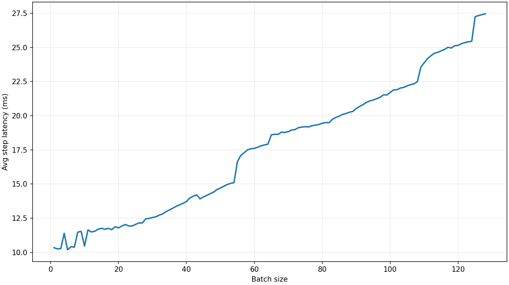
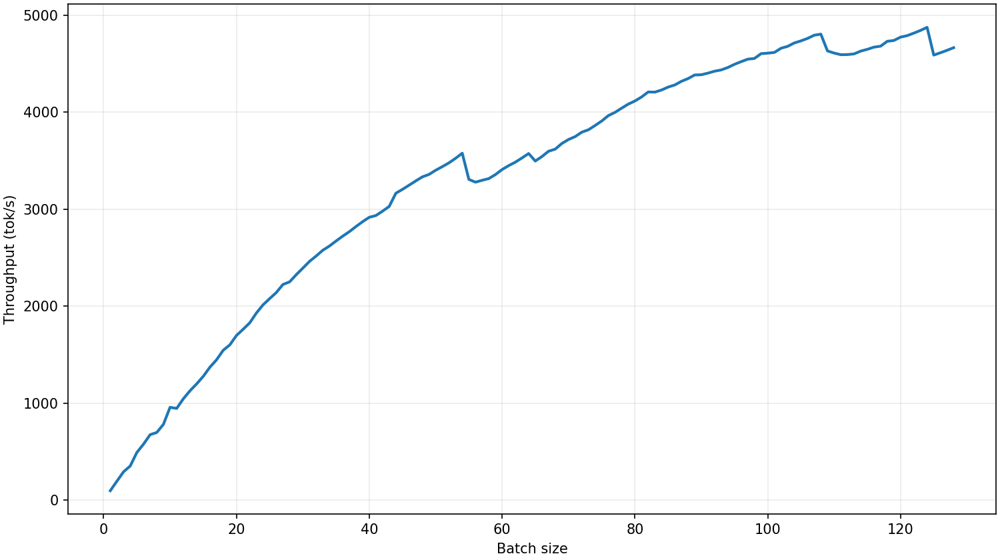
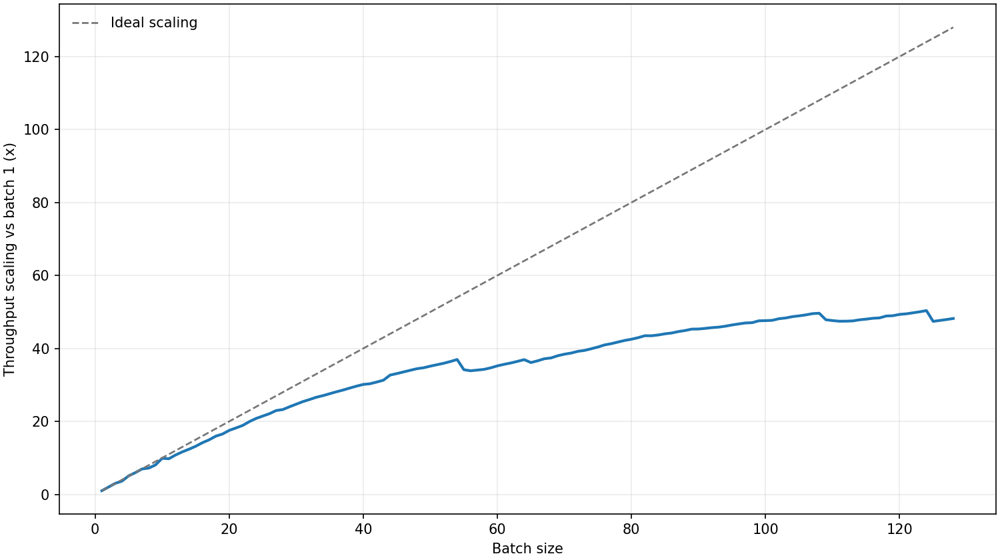

# Decode-Direct Input 2048 TP=2 性能报告

## 运行环境

| 项目 | 值 |
| --- | --- |
| 日期 | 2026-11-18 15:10:28-15:15:45（Asia/Shanghai） |
| 平台 | NVIDIA |
| 设备 | 2 x A100-SXM4-80GB，默认 CUDA_VISIBLE_DEVICES=3,4 |
| Driver | 535.161.08 |
| InfiniLM build | 当前源码树；未记录独立 build ID |
| 模型 | `/data-aisoft/mechdancer/models/Qwen3-8B` |
| 模式 | `decode-direct` |
| Attention backend | `flash-attn` |
| Graph request | enabled |
| Expected execution mode | `graph` |
| Cache | paged KV cache，block size 256，num blocks 1152 |
| Max batched tokens | 18432 |
| Tensor parallel size | 2 |
| Input length | 2048 tokens / request |
| Batch size | 1..128 |
| Warmup | 每个形状 3 次 repeat |
| Measured repeats | 每个形状 30 次 repeat |
| Batch 执行顺序 | random seed 2026 |

本报告对应的原始 JSONL 和 log 为本机运行产物，不随仓库提交：

```text
../../../benchmark-decode-direct-qwen3-8b-flash-attn-tp2-input2048-graph1-128-20261118.jsonl
../../../benchmark-decode-direct-qwen3-8b-flash-attn-tp2-input2048-graph1-128-20261118.log
```

## 构建与测试命令

本轮使用当前已安装的 `_infinilm` 扩展。标准重建命令如下：

```bash
xmake build _infinilm && xmake install _infinilm
```

性能测试命令：

```bash
BENCHMARK_MODE=decode-direct \
BATCH_SIZES="$(seq -s, 1 128)" \
INPUT_LENS=2048 \
BENCHMARK_REPEATS=30 \
BENCHMARK_OUTPUT=benchmark-decode-direct-qwen3-8b-flash-attn-tp2-input2048-graph1-128-20261118.jsonl \
./run_bench-nvidia.sh
```

## 执行模式与 Graph 覆盖

当前 paged graph compiler 编译 decode batch size `1..128`。因此本轮所有 batch 均有对应 decode graph，无 eager fallback 混入；原始 JSONL 中所有 overall summary 的 `expected_execution_mode` 均为 `graph`。

## 资源开销

| 项目 | 值 |
| --- | ---: |
| Workspace allocation | 每 rank 1,116 MiB，TP=2 合计 2,232 MiB |
| 权重加载与 graph 编译时间 | 权重加载约 16.92 秒；graph 编译未单独记录 |
| Paged cache blocks | 1152 |
| Compiled graph 数量 | 128 |
| 正式 step sample 数 | 15,360 |
| 本轮总耗时 | 约 317 秒 |

Input length 2048 且执行 4 个 decode step 时，每个 request 需要 `ceil((2048 + 4) / 256) = 9` 个 block。batch 128 共需要 `128 * 9 = 1152` 个 block；本轮配置为 `1152` 个 block。

## 测试口径

- `decode-direct` 不执行语义完整的 prefill，paged KV cache 初始为全 0。
- Step 0 输入 dummy token；step 1 到 step 3 使用上一步 sampled token。
- 4 个 decode step 的 past KV length 分别为 2048、2049、2050、2051。
- 报告中的 duration 是单 step 时间，由一次 4-step repeat 的对应总耗时除以 4 得到。
- `single_step_throughput = batch_size / avg_step_latency`。
- 每个 request 每 step 生成 1 个 token，因此 single-step request throughput 与 token throughput 数值相同。
- 表格中的 Min/P50/P95/P99/Max 是每个 repeat 的平均 step 时间分布。
- 计时边界为 `engine_forward_including_sampling`。

## 核心结果

| 指标 | 结果 |
| --- | ---: |
| 最高 single-step 吞吐 | batch 124，4,873.34 tok/s |
| 峰值 batch 平均单 step latency | 25.445 ms |
| 峰值 batch P99 单 step latency | 25.474 ms |
| batch 1 平均单 step latency | 10.336 ms |
| 峰值 batch 相对 batch 1 吞吐倍数 | 50.370x |
| 峰值 batch 相对理想 batch 倍数的效率 | 40.6% |
| 单 step std 中位数 | 0.038 ms |
| 最大单 step std | 0.144 ms，batch 11 |

## 趋势图

### 1. Batch size 与 Avg Step Latency



平均单 step latency 从 batch 1 的 10.336 ms 变为 batch 128 的 27.446 ms，峰值吞吐 batch 124 为 25.445 ms。

### 2. Batch size 与 Throughput



吞吐峰值出现在 batch 124，为 4,873.34 tok/s；最大 batch 128 为 4,663.67 tok/s。

### 3. Batch size 与 Scaling



Scaling 从 batch 1 的 1.000x 变为 batch 128 的 48.203x；相对理想 128x 的效率约为 37.7%。

## Batch 区间平均 latency 与吞吐

下表按连续 16 个 batch 分组。`平均单 step latency ms` 和 `平均吞吐 tok/s` 分别是区间内 各 batch overall `Avg Step ms` 与 `Single-step tok/s` 的算术平均值；`区间最优 batch` 取区间内吞吐最高的 batch。

| Batch 区间 | 平均单 step latency ms | 平均吞吐 tok/s | 区间最优 batch |
| ---: | ---: | ---: | ---: |
| 1..16 | 11.030 | 754.36 | 16 |
| 17..32 | 12.126 | 2012.24 | 32 |
| 33..48 | 13.712 | 2945.78 | 48 |
| 49..64 | 16.513 | 3422.44 | 54 |
| 65..80 | 19.014 | 3810.26 | 80 |
| 81..96 | 20.364 | 4343.02 | 96 |
| 97..112 | 22.450 | 4654.94 | 108 |
| 113..128 | 25.618 | 4704.83 | 124 |

## 关键批次与跳变

| 变化 | Avg step ms | 吞吐 tok/s | 观察 |
| --- | ---: | ---: | --- |
| 10 -> 11 | 10.458 -> 11.638 | 956.23 -> 945.15 | latency 增加 11.3%，可能对应 kernel shape 或 workspace 分档变化 |
| 3 -> 4 | 10.272 -> 11.387 | 292.05 -> 351.29 | latency 增加 10.8%，可能对应 kernel shape 或 workspace 分档变化 |
| 7 -> 8 | 10.382 -> 11.477 | 674.25 -> 697.05 | latency 增加 10.5%，可能对应 kernel shape 或 workspace 分档变化 |
| 54 -> 55 | 15.101 -> 16.638 | 3575.99 -> 3305.65 | latency 增加 10.2%，可能对应 kernel shape 或 workspace 分档变化 |
| 124 -> 125 | 25.445 -> 27.249 | 4873.34 -> 4587.35 | latency 增加 7.1%，可能对应 kernel shape 或 workspace 分档变化 |
| 108 -> 109 | 22.485 -> 23.541 | 4803.29 -> 4630.16 | latency 增加 4.7%，可能对应 kernel shape 或 workspace 分档变化 |

## Step 一致性

峰值 batch 124 的 4 个 decode step 结果如下：

| Step | Past KV length | Avg step ms | Std ms | Throughput tok/s |
| ---: | ---: | ---: | ---: | ---: |
| 0 | 2048 | 25.447 | 0.032 | 4872.79 |
| 1 | 2049 | 25.431 | 0.037 | 4875.92 |
| 2 | 2050 | 25.447 | 0.037 | 4872.79 |
| 3 | 2051 | 25.452 | 0.035 | 4871.87 |

所有 batch 中，4 个 step 平均耗时最大差异为 0.149 ms，出现在 batch 112。该差异主要来自 past KV length 从 input length 增长到 input length + 3，以及不同 step 的 kernel 形状。

## 数据稳定性

- 单 step std 中位数为 0.038 ms。
- 最大 std 为 0.144 ms，出现在 batch 11。
- 所有 batch 内 4 个 step 的平均耗时差异不超过 0.149 ms，step 间一致性较好。
- P99 与 max 接近，整体尾部稳定；但每个 batch 只有 30 个 repeat，p99 仍是尾部参考值。

## Single-step 完整结果

### Batch 1..64

| Batch | Mode | Avg Step ms | Min Step ms | P50 Step ms | P95 Step ms | P99 Step ms | Max Step ms | Std Step ms | Single-step tok/s | Scaling |
| ---: | --- | ---: | ---: | ---: | ---: | ---: | ---: | ---: | ---: | ---: |
| 1 | graph | 10.336 | 10.316 | 10.329 | 10.359 | 10.392 | 10.405 | 0.017 | 96.75 | 1.000x |
| 2 | graph | 10.253 | 10.223 | 10.246 | 10.292 | 10.308 | 10.314 | 0.021 | 195.07 | 2.016x |
| 3 | graph | 10.272 | 10.248 | 10.270 | 10.302 | 10.307 | 10.307 | 0.014 | 292.05 | 3.019x |
| 4 | graph | 11.387 | 11.366 | 11.385 | 11.410 | 11.416 | 11.419 | 0.012 | 351.29 | 3.631x |
| 5 | graph | 10.188 | 10.171 | 10.186 | 10.216 | 10.217 | 10.218 | 0.012 | 490.76 | 5.072x |
| 6 | graph | 10.409 | 10.372 | 10.396 | 10.493 | 10.530 | 10.543 | 0.038 | 576.40 | 5.958x |
| 7 | graph | 10.382 | 10.359 | 10.381 | 10.407 | 10.408 | 10.409 | 0.013 | 674.25 | 6.969x |
| 8 | graph | 11.477 | 11.453 | 11.476 | 11.502 | 11.525 | 11.534 | 0.018 | 697.05 | 7.205x |
| 9 | graph | 11.528 | 11.473 | 11.510 | 11.618 | 11.888 | 11.980 | 0.092 | 780.68 | 8.069x |
| 10 | graph | 10.458 | 10.435 | 10.449 | 10.501 | 10.515 | 10.517 | 0.021 | 956.23 | 9.883x |
| 11 | graph | 11.638 | 11.581 | 11.612 | 11.658 | 12.194 | 12.407 | 0.144 | 945.15 | 9.769x |
| 12 | graph | 11.491 | 11.468 | 11.486 | 11.521 | 11.554 | 11.566 | 0.021 | 1,044.31 | 10.794x |
| 13 | graph | 11.538 | 11.501 | 11.535 | 11.576 | 11.611 | 11.623 | 0.024 | 1,126.73 | 11.646x |
| 14 | graph | 11.690 | 11.660 | 11.678 | 11.717 | 11.886 | 11.955 | 0.051 | 1,197.57 | 12.378x |
| 15 | graph | 11.758 | 11.674 | 11.759 | 11.789 | 11.803 | 11.809 | 0.025 | 1,275.72 | 13.186x |
| 16 | graph | 11.681 | 11.659 | 11.678 | 11.709 | 11.714 | 11.715 | 0.014 | 1,369.73 | 14.157x |
| 17 | graph | 11.756 | 11.593 | 11.739 | 11.842 | 12.105 | 12.208 | 0.101 | 1,446.11 | 14.947x |
| 18 | graph | 11.658 | 11.518 | 11.702 | 11.752 | 11.758 | 11.759 | 0.086 | 1,543.98 | 15.958x |
| 19 | graph | 11.874 | 11.845 | 11.872 | 11.895 | 11.911 | 11.916 | 0.015 | 1,600.14 | 16.539x |
| 20 | graph | 11.786 | 11.740 | 11.762 | 11.946 | 11.992 | 11.996 | 0.064 | 1,696.94 | 17.539x |
| 21 | graph | 11.928 | 11.902 | 11.922 | 11.969 | 11.971 | 11.972 | 0.020 | 1,760.61 | 18.197x |
| 22 | graph | 12.040 | 12.006 | 12.037 | 12.085 | 12.092 | 12.095 | 0.023 | 1,827.17 | 18.885x |
| 23 | graph | 11.928 | 11.885 | 11.926 | 11.964 | 12.001 | 12.012 | 0.024 | 1,928.31 | 19.931x |
| 24 | graph | 11.924 | 11.903 | 11.921 | 11.965 | 11.977 | 11.979 | 0.018 | 2,012.68 | 20.803x |
| 25 | graph | 12.036 | 12.002 | 12.023 | 12.102 | 12.106 | 12.107 | 0.029 | 2,077.02 | 21.468x |
| 26 | graph | 12.151 | 12.071 | 12.155 | 12.200 | 12.206 | 12.207 | 0.034 | 2,139.70 | 22.115x |
| 27 | graph | 12.147 | 12.116 | 12.144 | 12.178 | 12.188 | 12.192 | 0.019 | 2,222.77 | 22.974x |
| 28 | graph | 12.448 | 12.408 | 12.440 | 12.499 | 12.559 | 12.581 | 0.036 | 2,249.31 | 23.248x |
| 29 | graph | 12.482 | 12.441 | 12.482 | 12.518 | 12.539 | 12.544 | 0.021 | 2,323.32 | 24.013x |
| 30 | graph | 12.545 | 12.464 | 12.550 | 12.620 | 12.637 | 12.641 | 0.044 | 2,391.32 | 24.716x |
| 31 | graph | 12.599 | 12.559 | 12.592 | 12.651 | 12.671 | 12.678 | 0.028 | 2,460.50 | 25.431x |
| 32 | graph | 12.719 | 12.672 | 12.717 | 12.771 | 12.805 | 12.812 | 0.029 | 2,515.87 | 26.003x |
| 33 | graph | 12.813 | 12.771 | 12.804 | 12.845 | 13.014 | 13.081 | 0.052 | 2,575.43 | 26.619x |
| 34 | graph | 12.983 | 12.941 | 12.981 | 13.015 | 13.030 | 13.035 | 0.024 | 2,618.84 | 27.068x |
| 35 | graph | 13.105 | 13.070 | 13.107 | 13.134 | 13.141 | 13.143 | 0.018 | 2,670.82 | 27.605x |
| 36 | graph | 13.231 | 13.152 | 13.208 | 13.314 | 13.544 | 13.634 | 0.085 | 2,720.81 | 28.122x |
| 37 | graph | 13.371 | 13.221 | 13.387 | 13.467 | 13.543 | 13.566 | 0.075 | 2,767.21 | 28.601x |
| 38 | graph | 13.475 | 13.394 | 13.477 | 13.514 | 13.536 | 13.544 | 0.027 | 2,820.04 | 29.147x |
| 39 | graph | 13.588 | 13.452 | 13.597 | 13.651 | 13.674 | 13.683 | 0.053 | 2,870.28 | 29.667x |
| 40 | graph | 13.721 | 13.673 | 13.714 | 13.763 | 13.788 | 13.797 | 0.024 | 2,915.31 | 30.132x |
| 41 | graph | 13.977 | 13.950 | 13.974 | 14.004 | 14.015 | 14.019 | 0.016 | 2,933.38 | 30.319x |
| 42 | graph | 14.101 | 14.053 | 14.095 | 14.173 | 14.194 | 14.199 | 0.034 | 2,978.41 | 30.784x |
| 43 | graph | 14.205 | 14.156 | 14.189 | 14.250 | 14.474 | 14.561 | 0.071 | 3,027.13 | 31.288x |
| 44 | graph | 13.911 | 13.848 | 13.918 | 13.951 | 13.959 | 13.962 | 0.028 | 3,163.07 | 32.693x |
| 45 | graph | 14.049 | 14.008 | 14.040 | 14.115 | 14.141 | 14.149 | 0.033 | 3,202.99 | 33.105x |
| 46 | graph | 14.168 | 14.124 | 14.165 | 14.206 | 14.249 | 14.267 | 0.030 | 3,246.78 | 33.558x |
| 47 | graph | 14.286 | 14.217 | 14.280 | 14.305 | 14.469 | 14.535 | 0.050 | 3,290.00 | 34.005x |
| 48 | graph | 14.406 | 14.299 | 14.408 | 14.461 | 14.502 | 14.516 | 0.045 | 3,332.04 | 34.439x |
| 49 | graph | 14.595 | 14.539 | 14.595 | 14.680 | 14.720 | 14.724 | 0.047 | 3,357.32 | 34.700x |
| 50 | graph | 14.705 | 14.649 | 14.701 | 14.748 | 14.811 | 14.835 | 0.036 | 3,400.13 | 35.143x |
| 51 | graph | 14.837 | 14.753 | 14.839 | 14.881 | 14.884 | 14.886 | 0.031 | 3,437.39 | 35.528x |
| 52 | graph | 14.958 | 14.893 | 14.955 | 15.024 | 15.071 | 15.084 | 0.039 | 3,476.38 | 35.931x |
| 53 | graph | 15.043 | 14.995 | 15.028 | 15.102 | 15.188 | 15.222 | 0.044 | 3,523.32 | 36.416x |
| 54 | graph | 15.101 | 15.040 | 15.101 | 15.153 | 15.153 | 15.153 | 0.032 | 3,575.99 | 36.961x |
| 55 | graph | 16.638 | 16.572 | 16.642 | 16.691 | 16.719 | 16.729 | 0.036 | 3,305.65 | 34.166x |
| 56 | graph | 17.086 | 16.981 | 17.075 | 17.202 | 17.215 | 17.218 | 0.058 | 3,277.46 | 33.875x |
| 57 | graph | 17.290 | 17.067 | 17.327 | 17.450 | 17.514 | 17.538 | 0.129 | 3,296.73 | 34.074x |
| 58 | graph | 17.500 | 17.426 | 17.498 | 17.537 | 17.547 | 17.550 | 0.026 | 3,314.20 | 34.255x |
| 59 | graph | 17.583 | 17.545 | 17.582 | 17.616 | 17.631 | 17.636 | 0.023 | 3,355.59 | 34.683x |
| 60 | graph | 17.609 | 17.563 | 17.608 | 17.642 | 17.649 | 17.651 | 0.020 | 3,407.34 | 35.217x |
| 61 | graph | 17.691 | 17.596 | 17.671 | 17.854 | 17.908 | 17.923 | 0.076 | 3,448.02 | 35.638x |
| 62 | graph | 17.796 | 17.699 | 17.807 | 17.872 | 17.896 | 17.904 | 0.051 | 3,483.85 | 36.008x |
| 63 | graph | 17.862 | 17.758 | 17.855 | 17.919 | 18.137 | 18.224 | 0.078 | 3,527.05 | 36.455x |
| 64 | graph | 17.914 | 17.807 | 17.902 | 17.998 | 18.021 | 18.030 | 0.051 | 3,572.59 | 36.925x |


### Batch 65..128

| Batch | Mode | Avg Step ms | Min Step ms | P50 Step ms | P95 Step ms | P99 Step ms | Max Step ms | Std Step ms | Single-step tok/s | Scaling |
| ---: | --- | ---: | ---: | ---: | ---: | ---: | ---: | ---: | ---: | ---: |
| 65 | graph | 18.598 | 18.523 | 18.583 | 18.665 | 18.688 | 18.697 | 0.045 | 3,495.07 | 36.124x |
| 66 | graph | 18.637 | 18.558 | 18.632 | 18.691 | 18.717 | 18.727 | 0.037 | 3,541.32 | 36.602x |
| 67 | graph | 18.630 | 18.585 | 18.626 | 18.675 | 18.688 | 18.692 | 0.027 | 3,596.27 | 37.170x |
| 68 | graph | 18.796 | 18.698 | 18.780 | 18.885 | 18.896 | 18.898 | 0.046 | 3,617.76 | 37.392x |
| 69 | graph | 18.771 | 18.575 | 18.815 | 18.900 | 18.905 | 18.906 | 0.102 | 3,675.91 | 37.993x |
| 70 | graph | 18.833 | 18.613 | 18.856 | 18.928 | 18.949 | 18.954 | 0.089 | 3,716.96 | 38.418x |
| 71 | graph | 18.950 | 18.857 | 18.948 | 19.012 | 19.044 | 19.055 | 0.041 | 3,746.72 | 38.725x |
| 72 | graph | 18.985 | 18.928 | 18.984 | 19.046 | 19.054 | 19.056 | 0.034 | 3,792.43 | 39.198x |
| 73 | graph | 19.123 | 19.049 | 19.107 | 19.145 | 19.610 | 19.798 | 0.128 | 3,817.34 | 39.455x |
| 74 | graph | 19.165 | 19.102 | 19.165 | 19.222 | 19.273 | 19.292 | 0.039 | 3,861.22 | 39.909x |
| 75 | graph | 19.194 | 19.093 | 19.195 | 19.250 | 19.270 | 19.276 | 0.036 | 3,907.47 | 40.387x |
| 76 | graph | 19.176 | 19.094 | 19.173 | 19.241 | 19.259 | 19.263 | 0.040 | 3,963.37 | 40.964x |
| 77 | graph | 19.266 | 19.186 | 19.251 | 19.353 | 19.371 | 19.375 | 0.045 | 3,996.76 | 41.310x |
| 78 | graph | 19.308 | 19.241 | 19.303 | 19.366 | 19.371 | 19.372 | 0.029 | 4,039.80 | 41.754x |
| 79 | graph | 19.354 | 19.302 | 19.349 | 19.405 | 19.437 | 19.450 | 0.030 | 4,081.81 | 42.189x |
| 80 | graph | 19.446 | 19.376 | 19.434 | 19.534 | 19.581 | 19.599 | 0.058 | 4,113.86 | 42.520x |
| 81 | graph | 19.493 | 19.375 | 19.497 | 19.577 | 19.644 | 19.667 | 0.061 | 4,155.25 | 42.948x |
| 82 | graph | 19.491 | 19.356 | 19.416 | 19.695 | 19.702 | 19.705 | 0.132 | 4,207.01 | 43.483x |
| 83 | graph | 19.736 | 19.682 | 19.732 | 19.795 | 19.797 | 19.797 | 0.033 | 4,205.56 | 43.468x |
| 84 | graph | 19.872 | 19.823 | 19.866 | 19.949 | 19.973 | 19.977 | 0.038 | 4,226.97 | 43.689x |
| 85 | graph | 19.965 | 19.876 | 19.945 | 20.066 | 20.219 | 20.267 | 0.071 | 4,257.50 | 44.005x |
| 86 | graph | 20.098 | 20.061 | 20.091 | 20.132 | 20.189 | 20.211 | 0.029 | 4,279.11 | 44.228x |
| 87 | graph | 20.154 | 19.978 | 20.152 | 20.231 | 20.243 | 20.245 | 0.061 | 4,316.74 | 44.617x |
| 88 | graph | 20.254 | 20.173 | 20.247 | 20.308 | 20.317 | 20.321 | 0.038 | 4,344.81 | 44.907x |
| 89 | graph | 20.309 | 20.186 | 20.306 | 20.449 | 20.510 | 20.524 | 0.072 | 4,382.28 | 45.294x |
| 90 | graph | 20.526 | 20.467 | 20.521 | 20.571 | 20.679 | 20.719 | 0.044 | 4,384.76 | 45.320x |
| 91 | graph | 20.675 | 20.460 | 20.689 | 20.784 | 20.796 | 20.799 | 0.088 | 4,401.41 | 45.492x |
| 92 | graph | 20.809 | 20.583 | 20.836 | 20.919 | 20.936 | 20.942 | 0.098 | 4,421.14 | 45.696x |
| 93 | graph | 20.972 | 20.876 | 20.951 | 21.076 | 21.417 | 21.549 | 0.120 | 4,434.47 | 45.834x |
| 94 | graph | 21.079 | 20.939 | 21.082 | 21.133 | 21.157 | 21.166 | 0.043 | 4,459.46 | 46.092x |
| 95 | graph | 21.148 | 21.074 | 21.147 | 21.220 | 21.230 | 21.231 | 0.039 | 4,492.14 | 46.430x |
| 96 | graph | 21.240 | 21.174 | 21.236 | 21.295 | 21.321 | 21.328 | 0.035 | 4,519.72 | 46.715x |
| 97 | graph | 21.341 | 21.267 | 21.340 | 21.394 | 21.426 | 21.436 | 0.037 | 4,545.14 | 46.977x |
| 98 | graph | 21.526 | 21.333 | 21.530 | 21.648 | 21.913 | 22.019 | 0.124 | 4,552.70 | 47.056x |
| 99 | graph | 21.512 | 21.295 | 21.561 | 21.656 | 21.677 | 21.685 | 0.125 | 4,602.04 | 47.566x |
| 100 | graph | 21.706 | 21.629 | 21.702 | 21.771 | 21.872 | 21.912 | 0.055 | 4,607.09 | 47.618x |
| 101 | graph | 21.887 | 21.806 | 21.897 | 21.938 | 21.946 | 21.949 | 0.041 | 4,614.57 | 47.695x |
| 102 | graph | 21.899 | 21.804 | 21.907 | 21.938 | 21.948 | 21.952 | 0.032 | 4,657.77 | 48.142x |
| 103 | graph | 22.022 | 21.887 | 22.015 | 22.142 | 22.180 | 22.186 | 0.060 | 4,677.23 | 48.343x |
| 104 | graph | 22.070 | 21.977 | 22.071 | 22.120 | 22.125 | 22.125 | 0.033 | 4,712.30 | 48.705x |
| 105 | graph | 22.181 | 22.108 | 22.182 | 22.238 | 22.273 | 22.287 | 0.040 | 4,733.70 | 48.926x |
| 106 | graph | 22.273 | 22.228 | 22.276 | 22.320 | 22.329 | 22.330 | 0.027 | 4,759.19 | 49.190x |
| 107 | graph | 22.329 | 22.284 | 22.325 | 22.386 | 22.402 | 22.404 | 0.028 | 4,792.00 | 49.529x |
| 108 | graph | 22.485 | 22.426 | 22.478 | 22.539 | 22.557 | 22.563 | 0.033 | 4,803.29 | 49.646x |
| 109 | graph | 23.541 | 23.425 | 23.536 | 23.615 | 23.654 | 23.668 | 0.050 | 4,630.16 | 47.856x |
| 110 | graph | 23.872 | 23.706 | 23.889 | 24.012 | 24.173 | 24.226 | 0.113 | 4,607.96 | 47.627x |
| 111 | graph | 24.175 | 23.928 | 24.202 | 24.261 | 24.311 | 24.330 | 0.098 | 4,591.47 | 47.456x |
| 112 | graph | 24.388 | 24.252 | 24.364 | 24.455 | 24.839 | 24.994 | 0.123 | 4,592.44 | 47.466x |
| 113 | graph | 24.568 | 24.472 | 24.571 | 24.653 | 24.735 | 24.759 | 0.057 | 4,599.51 | 47.539x |
| 114 | graph | 24.631 | 24.558 | 24.634 | 24.690 | 24.710 | 24.712 | 0.036 | 4,628.29 | 47.837x |
| 115 | graph | 24.749 | 24.675 | 24.752 | 24.805 | 24.814 | 24.814 | 0.038 | 4,646.67 | 48.027x |
| 116 | graph | 24.844 | 24.764 | 24.837 | 24.921 | 24.958 | 24.971 | 0.046 | 4,669.10 | 48.259x |
| 117 | graph | 25.004 | 24.875 | 24.985 | 25.096 | 25.308 | 25.389 | 0.088 | 4,679.30 | 48.364x |
| 118 | graph | 24.950 | 24.638 | 24.975 | 25.068 | 25.090 | 25.095 | 0.112 | 4,729.47 | 48.883x |
| 119 | graph | 25.117 | 25.002 | 25.126 | 25.182 | 25.208 | 25.214 | 0.045 | 4,737.87 | 48.970x |
| 120 | graph | 25.145 | 24.908 | 25.161 | 25.225 | 25.245 | 25.253 | 0.076 | 4,772.31 | 49.325x |
| 121 | graph | 25.273 | 25.189 | 25.264 | 25.374 | 25.391 | 25.391 | 0.048 | 4,787.72 | 49.485x |
| 122 | graph | 25.345 | 25.267 | 25.351 | 25.408 | 25.415 | 25.417 | 0.045 | 4,813.64 | 49.753x |
| 123 | graph | 25.406 | 25.353 | 25.408 | 25.453 | 25.481 | 25.487 | 0.030 | 4,841.41 | 50.040x |
| 124 | graph | 25.445 | 25.403 | 25.449 | 25.472 | 25.474 | 25.475 | 0.021 | 4,873.34 | 50.370x |
| 125 | graph | 27.249 | 27.206 | 27.244 | 27.291 | 27.321 | 27.332 | 0.025 | 4,587.35 | 47.414x |
| 126 | graph | 27.325 | 27.255 | 27.326 | 27.369 | 27.384 | 27.388 | 0.030 | 4,611.15 | 47.660x |
| 127 | graph | 27.392 | 27.320 | 27.389 | 27.453 | 27.504 | 27.517 | 0.037 | 4,636.41 | 47.921x |
| 128 | graph | 27.446 | 27.383 | 27.453 | 27.488 | 27.492 | 27.493 | 0.029 | 4,663.67 | 48.203x |

## TP=1 对比摘要

| 配置 | 峰值 batch | 峰值吞吐 tok/s | 峰值 Avg Step ms |
| --- | ---: | ---: | ---: |
| TP=1 | 128 | 3,240.36 | 39.502 |
| TP=2 | 124 | 4,873.34 | 25.445 |

以各自峰值吞吐对比，TP=2 吞吐为 TP=1 的 1.504x；峰值处 latency 为 TP=1 的 0.644x。

## 结论与建议

1. 在本轮 input length 2048、batch `1..128`、全 graph 覆盖范围内，**batch 124 吞吐最高**，约 4,873.34 tok/s。
2. 相对 batch 1，峰值吞吐 scaling 为 50.370x；相对理想 124x 的效率为 40.6%。
3. batch 1 平均单 step latency 为 10.336 ms，峰值吞吐 batch 为 25.445 ms。若以低延迟优先，应避免盲目使用最大 batch。
4. 4 个 decode step 之间的一致性较好；如需验证更长上下文的退化，应增加 decode step 数或输入长度。

## 数据完整性

```text
config records: 1
sample records: 15360
overall summary records: 128
per-step summary records: 512
scaling records: 128
step samples per batch: 120
samples per decode step: 30
```
