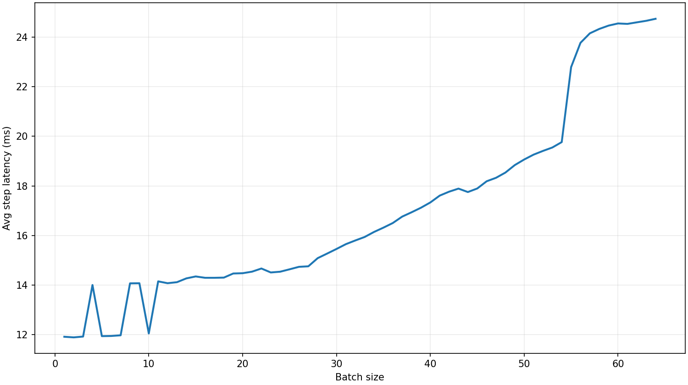
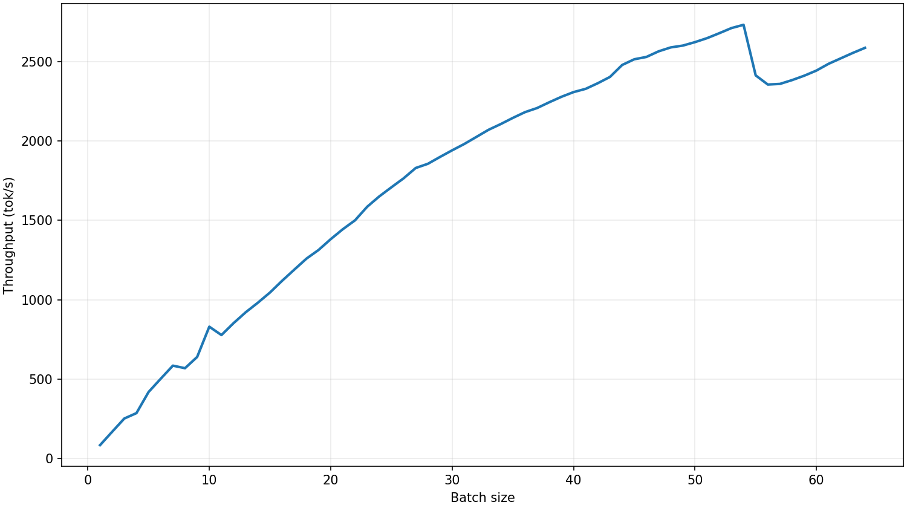
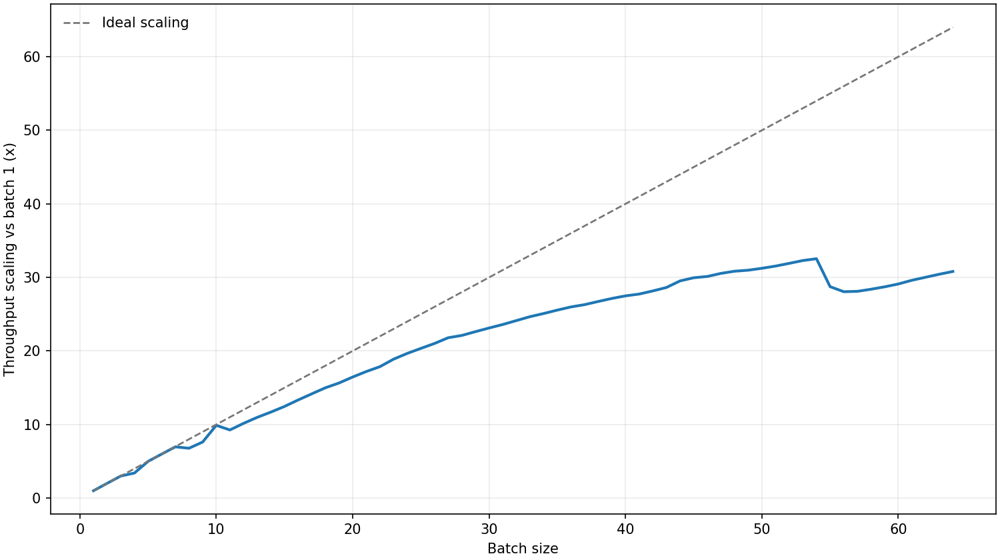

# Decode-Direct Input 4096 TP=2 性能报告

## 运行环境

| 项目 | 值 |
| --- | --- |
| 日期 | 2026-11-18 15:18:47-15:21:22（Asia/Shanghai） |
| 平台 | NVIDIA |
| 设备 | 2 x A100-SXM4-80GB，默认 CUDA_VISIBLE_DEVICES=3,4 |
| Driver | 535.161.08 |
| InfiniLM build | 当前源码树；未记录独立 build ID |
| 模型 | `/data-aisoft/mechdancer/models/Qwen3-8B` |
| 模式 | `decode-direct` |
| Attention backend | `flash-attn` |
| Graph request | enabled |
| Expected execution mode | `graph` |
| Cache | paged KV cache，block size 256，num blocks 1088 |
| Max batched tokens | 18432 |
| Tensor parallel size | 2 |
| Input length | 4096 tokens / request |
| Batch size | 1..64 |
| Warmup | 每个形状 3 次 repeat |
| Measured repeats | 每个形状 30 次 repeat |
| Batch 执行顺序 | random seed 2026 |

本报告对应的原始 JSONL 和 log 为本机运行产物，不随仓库提交：

```text
../../../benchmark-decode-direct-qwen3-8b-flash-attn-tp2-input4096-graph1-64-20261118.jsonl
../../../benchmark-decode-direct-qwen3-8b-flash-attn-tp2-input4096-graph1-64-20261118.log
```

## 构建与测试命令

本轮使用当前已安装的 `_infinilm` 扩展。标准重建命令如下：

```bash
xmake build _infinilm && xmake install _infinilm
```

性能测试命令：

```bash
BENCHMARK_MODE=decode-direct \
BATCH_SIZES="$(seq -s, 1 64)" \
INPUT_LENS=4096 \
BENCHMARK_REPEATS=30 \
BENCHMARK_OUTPUT=benchmark-decode-direct-qwen3-8b-flash-attn-tp2-input4096-graph1-64-20261118.jsonl \
./run_bench-nvidia.sh
```

## 执行模式与 Graph 覆盖

当前 paged graph compiler 编译 decode batch size `1..64`。因此本轮所有 batch 均有对应 decode graph，无 eager fallback 混入；原始 JSONL 中所有 overall summary 的 `expected_execution_mode` 均为 `graph`。

## 资源开销

| 项目 | 值 |
| --- | ---: |
| Workspace allocation | 每 rank 1,116 MiB，TP=2 合计 2,232 MiB |
| 权重加载与 graph 编译时间 | 权重加载约 11.16 秒；graph 编译未单独记录 |
| Paged cache blocks | 1088 |
| Compiled graph 数量 | 64 |
| 正式 step sample 数 | 7,680 |
| 本轮总耗时 | 约 155 秒 |

Input length 4096 且执行 4 个 decode step 时，每个 request 需要 `ceil((4096 + 4) / 256) = 17` 个 block。batch 64 共需要 `64 * 17 = 1088` 个 block；本轮配置为 `1088` 个 block。

## 测试口径

- `decode-direct` 不执行语义完整的 prefill，paged KV cache 初始为全 0。
- Step 0 输入 dummy token；step 1 到 step 3 使用上一步 sampled token。
- 4 个 decode step 的 past KV length 分别为 4096、4097、4098、4099。
- 报告中的 duration 是单 step 时间，由一次 4-step repeat 的对应总耗时除以 4 得到。
- `single_step_throughput = batch_size / avg_step_latency`。
- 每个 request 每 step 生成 1 个 token，因此 single-step request throughput 与 token throughput 数值相同。
- 表格中的 Min/P50/P95/P99/Max 是每个 repeat 的平均 step 时间分布。
- 计时边界为 `engine_forward_including_sampling`。

## 核心结果

| 指标 | 结果 |
| --- | ---: |
| 最高 single-step 吞吐 | batch 54，2,731.98 tok/s |
| 峰值 batch 平均单 step latency | 19.766 ms |
| 峰值 batch P99 单 step latency | 19.855 ms |
| batch 1 平均单 step latency | 11.911 ms |
| 峰值 batch 相对 batch 1 吞吐倍数 | 32.541x |
| 峰值 batch 相对理想 batch 倍数的效率 | 60.3% |
| 单 step std 中位数 | 0.029 ms |
| 最大单 step std | 0.145 ms，batch 22 |

## 趋势图

### 1. Batch size 与 Avg Step Latency



平均单 step latency 从 batch 1 的 11.911 ms 变为 batch 64 的 24.742 ms，峰值吞吐 batch 54 为 19.766 ms。

### 2. Batch size 与 Throughput



吞吐峰值出现在 batch 54，为 2,731.98 tok/s；最大 batch 64 为 2,586.73 tok/s。

### 3. Batch size 与 Scaling



Scaling 从 batch 1 的 1.000x 变为 batch 64 的 30.811x；相对理想 64x 的效率约为 48.1%。

## Batch 区间平均 latency 与吞吐

下表按连续 16 个 batch 分组。`平均单 step latency ms` 和 `平均吞吐 tok/s` 分别是区间内 各 batch overall `Avg Step ms` 与 `Single-step tok/s` 的算术平均值；`区间最优 batch` 取区间内吞吐最高的 batch。

| Batch 区间 | 平均单 step latency ms | 平均吞吐 tok/s | 区间最优 batch |
| ---: | ---: | ---: | ---: |
| 1..16 | 13.186 | 627.02 | 16 |
| 17..32 | 14.822 | 1645.75 | 32 |
| 33..48 | 17.312 | 2332.24 | 48 |
| 49..64 | 22.406 | 2531.83 | 54 |

## 关键批次与跳变

| 变化 | Avg step ms | 吞吐 tok/s | 观察 |
| --- | ---: | ---: | --- |
| 7 -> 8 | 11.970 -> 14.066 | 584.79 -> 568.73 | latency 增加 17.5%，可能对应 kernel shape 或 workspace 分档变化 |
| 3 -> 4 | 11.919 -> 13.999 | 251.69 -> 285.73 | latency 增加 17.5%，可能对应 kernel shape 或 workspace 分档变化 |
| 10 -> 11 | 12.045 -> 14.147 | 830.21 -> 777.56 | latency 增加 17.4%，可能对应 kernel shape 或 workspace 分档变化 |
| 54 -> 55 | 19.766 -> 22.791 | 2731.98 -> 2413.20 | latency 增加 15.3%，可能对应 kernel shape 或 workspace 分档变化 |
| 55 -> 56 | 22.791 -> 23.773 | 2413.20 -> 2355.64 | latency 增加 4.3%，可能对应 kernel shape 或 workspace 分档变化 |
| 27 -> 28 | 14.754 -> 15.084 | 1829.99 -> 1856.27 | latency 增加 2.2%，可能对应 kernel shape 或 workspace 分档变化 |

## Step 一致性

峰值 batch 54 的 4 个 decode step 结果如下：

| Step | Past KV length | Avg step ms | Std ms | Throughput tok/s |
| ---: | ---: | ---: | ---: | ---: |
| 0 | 4096 | 19.764 | 0.064 | 2732.25 |
| 1 | 4097 | 19.767 | 0.057 | 2731.88 |
| 2 | 4098 | 19.763 | 0.058 | 2732.36 |
| 3 | 4099 | 19.770 | 0.062 | 2731.43 |

所有 batch 中，4 个 step 平均耗时最大差异为 0.107 ms，出现在 batch 22。该差异主要来自 past KV length 从 input length 增长到 input length + 3，以及不同 step 的 kernel 形状。

## 数据稳定性

- 单 step std 中位数为 0.029 ms。
- 最大 std 为 0.145 ms，出现在 batch 22。
- 所有 batch 内 4 个 step 的平均耗时差异不超过 0.107 ms，step 间一致性较好。
- P99 与 max 接近，整体尾部稳定；但每个 batch 只有 30 个 repeat，p99 仍是尾部参考值。

## Single-step 完整结果

### Batch 1..64

| Batch | Mode | Avg Step ms | Min Step ms | P50 Step ms | P95 Step ms | P99 Step ms | Max Step ms | Std Step ms | Single-step tok/s | Scaling |
| ---: | --- | ---: | ---: | ---: | ---: | ---: | ---: | ---: | ---: | ---: |
| 1 | graph | 11.911 | 11.886 | 11.907 | 11.939 | 11.944 | 11.946 | 0.016 | 83.95 | 1.000x |
| 2 | graph | 11.887 | 11.853 | 11.888 | 11.906 | 11.926 | 11.934 | 0.016 | 168.25 | 2.004x |
| 3 | graph | 11.919 | 11.889 | 11.911 | 11.958 | 11.965 | 11.966 | 0.022 | 251.69 | 2.998x |
| 4 | graph | 13.999 | 13.967 | 14.000 | 14.028 | 14.034 | 14.035 | 0.018 | 285.73 | 3.403x |
| 5 | graph | 11.937 | 11.912 | 11.927 | 11.973 | 11.984 | 11.986 | 0.020 | 418.88 | 4.989x |
| 6 | graph | 11.943 | 11.927 | 11.936 | 11.981 | 12.004 | 12.011 | 0.019 | 502.38 | 5.984x |
| 7 | graph | 11.970 | 11.942 | 11.961 | 11.998 | 12.114 | 12.158 | 0.038 | 584.79 | 6.966x |
| 8 | graph | 14.066 | 14.009 | 14.046 | 14.123 | 14.385 | 14.483 | 0.082 | 568.73 | 6.774x |
| 9 | graph | 14.070 | 14.040 | 14.072 | 14.095 | 14.106 | 14.110 | 0.018 | 639.64 | 7.619x |
| 10 | graph | 12.045 | 12.019 | 12.039 | 12.075 | 12.092 | 12.096 | 0.018 | 830.21 | 9.889x |
| 11 | graph | 14.147 | 14.129 | 14.144 | 14.166 | 14.175 | 14.177 | 0.012 | 777.56 | 9.262x |
| 12 | graph | 14.072 | 14.004 | 14.062 | 14.097 | 14.370 | 14.481 | 0.079 | 852.73 | 10.157x |
| 13 | graph | 14.113 | 14.077 | 14.113 | 14.139 | 14.142 | 14.143 | 0.018 | 921.11 | 10.972x |
| 14 | graph | 14.267 | 14.232 | 14.266 | 14.292 | 14.296 | 14.297 | 0.016 | 981.30 | 11.689x |
| 15 | graph | 14.345 | 14.307 | 14.347 | 14.370 | 14.378 | 14.380 | 0.016 | 1,045.65 | 12.455x |
| 16 | graph | 14.290 | 14.255 | 14.289 | 14.321 | 14.347 | 14.357 | 0.021 | 1,119.63 | 13.336x |
| 17 | graph | 14.290 | 14.245 | 14.285 | 14.326 | 14.374 | 14.391 | 0.026 | 1,189.61 | 14.170x |
| 18 | graph | 14.299 | 14.280 | 14.296 | 14.318 | 14.320 | 14.321 | 0.011 | 1,258.86 | 14.995x |
| 19 | graph | 14.464 | 14.395 | 14.463 | 14.495 | 14.674 | 14.747 | 0.060 | 1,313.59 | 15.647x |
| 20 | graph | 14.476 | 14.448 | 14.472 | 14.501 | 14.577 | 14.607 | 0.028 | 1,381.64 | 16.457x |
| 21 | graph | 14.538 | 14.492 | 14.536 | 14.577 | 14.645 | 14.672 | 0.034 | 1,444.47 | 17.205x |
| 22 | graph | 14.665 | 14.593 | 14.636 | 14.713 | 15.228 | 15.427 | 0.145 | 1,500.12 | 17.868x |
| 23 | graph | 14.506 | 14.477 | 14.495 | 14.520 | 14.726 | 14.808 | 0.057 | 1,585.57 | 18.886x |
| 24 | graph | 14.536 | 14.488 | 14.538 | 14.568 | 14.570 | 14.570 | 0.021 | 1,651.03 | 19.666x |
| 25 | graph | 14.633 | 14.575 | 14.628 | 14.678 | 14.829 | 14.890 | 0.056 | 1,708.47 | 20.350x |
| 26 | graph | 14.733 | 14.706 | 14.733 | 14.754 | 14.772 | 14.779 | 0.017 | 1,764.71 | 21.020x |
| 27 | graph | 14.754 | 14.727 | 14.753 | 14.776 | 14.780 | 14.781 | 0.013 | 1,829.99 | 21.798x |
| 28 | graph | 15.084 | 15.049 | 15.078 | 15.119 | 15.121 | 15.121 | 0.021 | 1,856.27 | 22.111x |
| 29 | graph | 15.267 | 15.216 | 15.269 | 15.297 | 15.303 | 15.305 | 0.022 | 1,899.46 | 22.625x |
| 30 | graph | 15.454 | 15.407 | 15.448 | 15.485 | 15.487 | 15.487 | 0.019 | 1,941.26 | 23.123x |
| 31 | graph | 15.648 | 15.571 | 15.616 | 15.741 | 16.126 | 16.275 | 0.124 | 1,981.09 | 23.597x |
| 32 | graph | 15.796 | 15.759 | 15.796 | 15.830 | 15.837 | 15.838 | 0.017 | 2,025.80 | 24.130x |
| 33 | graph | 15.937 | 15.901 | 15.934 | 15.977 | 16.006 | 16.013 | 0.025 | 2,070.62 | 24.664x |
| 34 | graph | 16.140 | 16.082 | 16.136 | 16.171 | 16.249 | 16.275 | 0.031 | 2,106.52 | 25.091x |
| 35 | graph | 16.314 | 16.277 | 16.309 | 16.344 | 16.350 | 16.350 | 0.018 | 2,145.40 | 25.554x |
| 36 | graph | 16.501 | 16.460 | 16.499 | 16.532 | 16.555 | 16.561 | 0.020 | 2,181.71 | 25.987x |
| 37 | graph | 16.759 | 16.723 | 16.757 | 16.795 | 16.810 | 16.815 | 0.021 | 2,207.71 | 26.297x |
| 38 | graph | 16.934 | 16.913 | 16.931 | 16.957 | 16.964 | 16.966 | 0.013 | 2,244.00 | 26.729x |
| 39 | graph | 17.118 | 17.068 | 17.119 | 17.152 | 17.159 | 17.159 | 0.023 | 2,278.32 | 27.138x |
| 40 | graph | 17.331 | 17.250 | 17.309 | 17.364 | 17.742 | 17.896 | 0.109 | 2,308.00 | 27.491x |
| 41 | graph | 17.607 | 17.555 | 17.609 | 17.640 | 17.664 | 17.673 | 0.025 | 2,328.60 | 27.737x |
| 42 | graph | 17.766 | 17.686 | 17.751 | 17.826 | 18.203 | 18.346 | 0.114 | 2,364.13 | 28.160x |
| 43 | graph | 17.890 | 17.791 | 17.901 | 17.959 | 17.965 | 17.967 | 0.046 | 2,403.64 | 28.630x |
| 44 | graph | 17.751 | 17.695 | 17.727 | 17.856 | 18.076 | 18.147 | 0.085 | 2,478.73 | 29.525x |
| 45 | graph | 17.894 | 17.811 | 17.873 | 17.999 | 18.161 | 18.227 | 0.078 | 2,514.76 | 29.954x |
| 46 | graph | 18.185 | 18.123 | 18.186 | 18.225 | 18.265 | 18.279 | 0.030 | 2,529.52 | 30.130x |
| 47 | graph | 18.326 | 18.265 | 18.330 | 18.361 | 18.377 | 18.381 | 0.027 | 2,564.71 | 30.549x |
| 48 | graph | 18.537 | 18.492 | 18.529 | 18.589 | 18.595 | 18.596 | 0.030 | 2,589.46 | 30.844x |
| 49 | graph | 18.839 | 18.779 | 18.838 | 18.909 | 18.957 | 18.969 | 0.039 | 2,601.03 | 30.982x |
| 50 | graph | 19.064 | 18.986 | 19.068 | 19.102 | 19.110 | 19.113 | 0.031 | 2,622.77 | 31.241x |
| 51 | graph | 19.260 | 19.186 | 19.251 | 19.336 | 19.383 | 19.397 | 0.044 | 2,647.99 | 31.541x |
| 52 | graph | 19.410 | 19.339 | 19.399 | 19.486 | 19.605 | 19.645 | 0.055 | 2,678.99 | 31.910x |
| 53 | graph | 19.548 | 19.473 | 19.541 | 19.591 | 19.628 | 19.640 | 0.031 | 2,711.24 | 32.294x |
| 54 | graph | 19.766 | 19.613 | 19.768 | 19.827 | 19.855 | 19.865 | 0.052 | 2,731.98 | 32.541x |
| 55 | graph | 22.791 | 22.571 | 22.772 | 22.913 | 22.922 | 22.923 | 0.085 | 2,413.20 | 28.744x |
| 56 | graph | 23.773 | 23.613 | 23.776 | 23.896 | 23.961 | 23.976 | 0.079 | 2,355.64 | 28.059x |
| 57 | graph | 24.156 | 24.055 | 24.162 | 24.215 | 24.226 | 24.230 | 0.042 | 2,359.68 | 28.107x |
| 58 | graph | 24.332 | 24.265 | 24.332 | 24.385 | 24.454 | 24.481 | 0.041 | 2,383.68 | 28.393x |
| 59 | graph | 24.468 | 24.373 | 24.451 | 24.613 | 24.699 | 24.720 | 0.074 | 2,411.33 | 28.722x |
| 60 | graph | 24.554 | 24.497 | 24.540 | 24.623 | 24.798 | 24.859 | 0.064 | 2,443.64 | 29.107x |
| 61 | graph | 24.536 | 24.485 | 24.534 | 24.584 | 24.640 | 24.657 | 0.032 | 2,486.14 | 29.613x |
| 62 | graph | 24.599 | 24.524 | 24.598 | 24.643 | 24.671 | 24.682 | 0.034 | 2,520.45 | 30.022x |
| 63 | graph | 24.660 | 24.618 | 24.658 | 24.695 | 24.705 | 24.707 | 0.024 | 2,554.73 | 30.430x |
| 64 | graph | 24.742 | 24.632 | 24.742 | 24.811 | 24.834 | 24.838 | 0.043 | 2,586.73 | 30.811x |

## TP=1 对比摘要

| 配置 | 峰值 batch | 峰值吞吐 tok/s | 峰值 Avg Step ms |
| --- | ---: | ---: | ---: |
| TP=1 | 64 | 1,713.84 | 37.343 |
| TP=2 | 54 | 2,731.98 | 19.766 |

以各自峰值吞吐对比，TP=2 吞吐为 TP=1 的 1.594x；峰值处 latency 为 TP=1 的 0.529x。

## 结论与建议

1. 在本轮 input length 4096、batch `1..64`、全 graph 覆盖范围内，**batch 54 吞吐最高**，约 2,731.98 tok/s。
2. 相对 batch 1，峰值吞吐 scaling 为 32.541x；相对理想 54x 的效率为 60.3%。
3. batch 1 平均单 step latency 为 11.911 ms，峰值吞吐 batch 为 19.766 ms。若以低延迟优先，应避免盲目使用最大 batch。
4. 4 个 decode step 之间的一致性较好；如需验证更长上下文的退化，应增加 decode step 数或输入长度。

## 数据完整性

```text
config records: 1
sample records: 7680
overall summary records: 64
per-step summary records: 256
scaling records: 64
step samples per batch: 120
samples per decode step: 30
```
