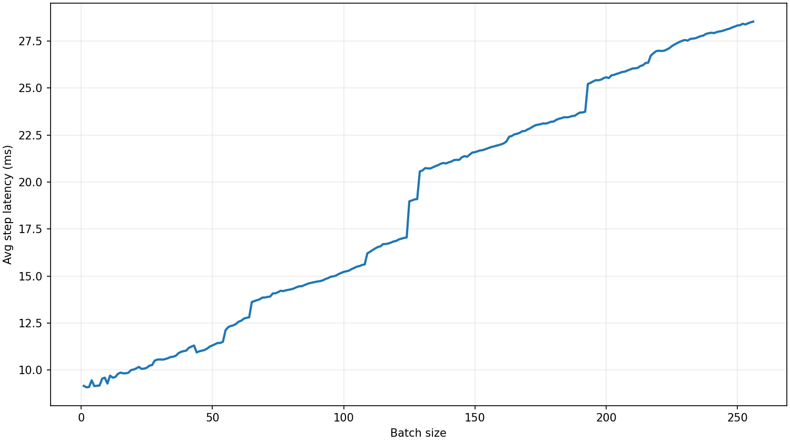
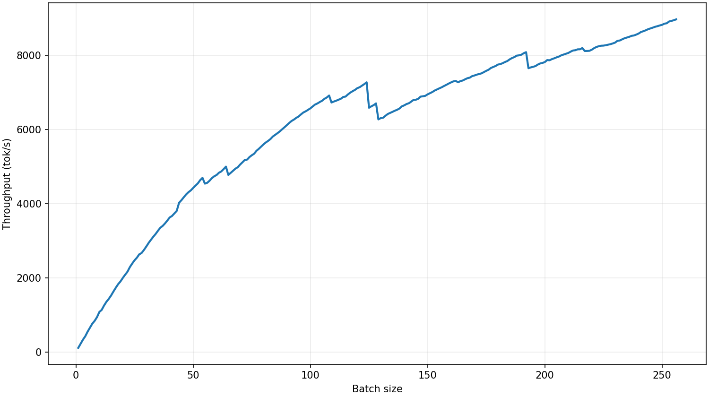
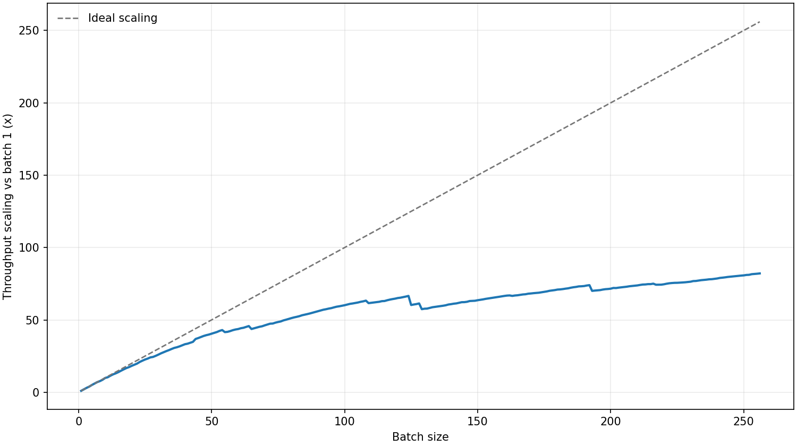

# Decode-Direct Input 512 TP=2 性能报告

## 运行环境

| 项目 | 值 |
| --- | --- |
| 日期 | 2026-11-18 14:39:53-14:51:08（Asia/Shanghai） |
| 平台 | NVIDIA |
| 设备 | 2 x A100-SXM4-80GB，默认 CUDA_VISIBLE_DEVICES=3,4 |
| Driver | 535.161.08 |
| InfiniLM build | 当前源码树；未记录独立 build ID |
| 模型 | `/data-aisoft/mechdancer/models/Qwen3-8B` |
| 模式 | `decode-direct` |
| Attention backend | `flash-attn` |
| Graph request | enabled |
| Expected execution mode | `graph` |
| Cache | paged KV cache，block size 256，num blocks 768 |
| Max batched tokens | 18432 |
| Tensor parallel size | 2 |
| Input length | 512 tokens / request |
| Batch size | 1..256 |
| Warmup | 每个形状 3 次 repeat |
| Measured repeats | 每个形状 30 次 repeat |
| Batch 执行顺序 | random seed 2026 |

本报告对应的原始 JSONL 和 log 为本机运行产物，不随仓库提交：

```text
../../../benchmark-decode-direct-qwen3-8b-flash-attn-tp2-input512-graph1-256-20261118.jsonl
../../../benchmark-decode-direct-qwen3-8b-flash-attn-tp2-input512-graph1-256-20261118.log
```

## 构建与测试命令

本轮使用当前已安装的 `_infinilm` 扩展。标准重建命令如下：

```bash
xmake build _infinilm && xmake install _infinilm
```

性能测试命令：

```bash
BENCHMARK_MODE=decode-direct \
BATCH_SIZES="$(seq -s, 1 256)" \
INPUT_LENS=512 \
BENCHMARK_REPEATS=30 \
BENCHMARK_OUTPUT=benchmark-decode-direct-qwen3-8b-flash-attn-tp2-input512-graph1-256-20261118.jsonl \
./run_bench-nvidia.sh
```

## 执行模式与 Graph 覆盖

当前 paged graph compiler 编译 decode batch size `1..256`。因此本轮所有 batch 均有对应 decode graph，无 eager fallback 混入；原始 JSONL 中所有 overall summary 的 `expected_execution_mode` 均为 `graph`。

## 资源开销

| 项目 | 值 |
| --- | ---: |
| Workspace allocation | 每 rank 1,116 MiB，TP=2 合计 2,232 MiB |
| 权重加载与 graph 编译时间 | 权重加载约 33.81 秒；graph 编译未单独记录 |
| Paged cache blocks | 768 |
| Compiled graph 数量 | 256 |
| 正式 step sample 数 | 30,720 |
| 本轮总耗时 | 约 675 秒 |

Input length 512 且执行 4 个 decode step 时，每个 request 需要 `ceil((512 + 4) / 256) = 3` 个 block。batch 256 共需要 `256 * 3 = 768` 个 block；本轮配置为 `768` 个 block。

## 测试口径

- `decode-direct` 不执行语义完整的 prefill，paged KV cache 初始为全 0。
- Step 0 输入 dummy token；step 1 到 step 3 使用上一步 sampled token。
- 4 个 decode step 的 past KV length 分别为 512、513、514、515。
- 报告中的 duration 是单 step 时间，由一次 4-step repeat 的对应总耗时除以 4 得到。
- `single_step_throughput = batch_size / avg_step_latency`。
- 每个 request 每 step 生成 1 个 token，因此 single-step request throughput 与 token throughput 数值相同。
- 表格中的 Min/P50/P95/P99/Max 是每个 repeat 的平均 step 时间分布。
- 计时边界为 `engine_forward_including_sampling`。

## 核心结果

| 指标 | 结果 |
| --- | ---: |
| 最高 single-step 吞吐 | batch 256，8,969.22 tok/s |
| 峰值 batch 平均单 step latency | 28.542 ms |
| 峰值 batch P99 单 step latency | 28.585 ms |
| batch 1 平均单 step latency | 9.156 ms |
| 峰值 batch 相对 batch 1 吞吐倍数 | 82.120x |
| 峰值 batch 相对理想 batch 倍数的效率 | 32.1% |
| 单 step std 中位数 | 0.026 ms |
| 最大单 step std | 0.118 ms，batch 215 |

## 趋势图

### 1. Batch size 与 Avg Step Latency



平均单 step latency 从 batch 1 的 9.156 ms 变为 batch 256 的 28.542 ms，峰值吞吐 batch 256 为 28.542 ms。

### 2. Batch size 与 Throughput



吞吐峰值出现在 batch 256，为 8,969.22 tok/s；最大 batch 256 为 8,969.22 tok/s。

### 3. Batch size 与 Scaling



Scaling 从 batch 1 的 1.000x 变为 batch 256 的 82.120x；相对理想 256x 的效率约为 32.1%。

## Batch 区间平均 latency 与吞吐

下表按连续 16 个 batch 分组。`平均单 step latency ms` 和 `平均吞吐 tok/s` 分别是区间内 各 batch overall `Avg Step ms` 与 `Single-step tok/s` 的算术平均值；`区间最优 batch` 取区间内吞吐最高的 batch。

| Batch 区间 | 平均单 step latency ms | 平均吞吐 tok/s | 区间最优 batch |
| ---: | ---: | ---: | ---: |
| 1..16 | 9.441 | 888.63 | 16 |
| 17..32 | 10.215 | 2389.40 | 32 |
| 33..48 | 10.971 | 3687.00 | 48 |
| 49..64 | 12.087 | 4667.51 | 64 |
| 65..80 | 13.986 | 5179.71 | 80 |
| 81..96 | 14.660 | 6033.70 | 96 |
| 97..112 | 15.589 | 6701.22 | 108 |
| 113..128 | 17.371 | 6945.48 | 124 |
| 129..144 | 20.912 | 6525.86 | 144 |
| 145..160 | 21.682 | 7032.17 | 160 |
| 161..176 | 22.696 | 7422.75 | 176 |
| 177..192 | 23.436 | 7871.30 | 192 |
| 193..208 | 25.588 | 7834.64 | 208 |
| 209..224 | 26.559 | 8151.15 | 224 |
| 225..240 | 27.623 | 8416.09 | 240 |
| 241..256 | 28.240 | 8798.93 | 256 |

## 关键批次与跳变

| 变化 | Avg step ms | 吞吐 tok/s | 观察 |
| --- | ---: | ---: | --- |
| 124 -> 125 | 17.051 -> 18.980 | 7272.18 -> 6585.73 | latency 增加 11.3%，可能对应 kernel shape 或 workspace 分档变化 |
| 128 -> 129 | 19.094 -> 20.570 | 6703.58 -> 6271.23 | latency 增加 7.7%，可能对应 kernel shape 或 workspace 分档变化 |
| 64 -> 65 | 12.805 -> 13.616 | 4998.18 -> 4773.91 | latency 增加 6.3%，可能对应 kernel shape 或 workspace 分档变化 |
| 192 -> 193 | 23.747 -> 25.222 | 8085.35 -> 7652.06 | latency 增加 6.2%，可能对应 kernel shape 或 workspace 分档变化 |
| 54 -> 55 | 11.502 -> 12.116 | 4694.97 -> 4539.42 | latency 增加 5.3%，可能对应 kernel shape 或 workspace 分档变化 |
| 10 -> 11 | 9.279 -> 9.702 | 1077.68 -> 1133.82 | latency 增加 4.6%，可能对应 kernel shape 或 workspace 分档变化 |

## Step 一致性

峰值 batch 256 的 4 个 decode step 结果如下：

| Step | Past KV length | Avg step ms | Std ms | Throughput tok/s |
| ---: | ---: | ---: | ---: | ---: |
| 0 | 512 | 28.540 | 0.034 | 8969.79 |
| 1 | 513 | 28.538 | 0.051 | 8970.44 |
| 2 | 514 | 28.555 | 0.048 | 8965.13 |
| 3 | 515 | 28.535 | 0.049 | 8971.50 |

所有 batch 中，4 个 step 平均耗时最大差异为 0.106 ms，出现在 batch 215。该差异主要来自 past KV length 从 input length 增长到 input length + 3，以及不同 step 的 kernel 形状。

## 数据稳定性

- 单 step std 中位数为 0.026 ms。
- 最大 std 为 0.118 ms，出现在 batch 215。
- 所有 batch 内 4 个 step 的平均耗时差异不超过 0.106 ms，step 间一致性较好。
- P99 与 max 接近，整体尾部稳定；但每个 batch 只有 30 个 repeat，p99 仍是尾部参考值。

## Single-step 完整结果

### Batch 1..64

| Batch | Mode | Avg Step ms | Min Step ms | P50 Step ms | P95 Step ms | P99 Step ms | Max Step ms | Std Step ms | Single-step tok/s | Scaling |
| ---: | --- | ---: | ---: | ---: | ---: | ---: | ---: | ---: | ---: | ---: |
| 1 | graph | 9.156 | 9.144 | 9.153 | 9.177 | 9.187 | 9.189 | 0.010 | 109.22 | 1.000x |
| 2 | graph | 9.078 | 9.067 | 9.075 | 9.100 | 9.101 | 9.102 | 0.009 | 220.32 | 2.017x |
| 3 | graph | 9.091 | 9.078 | 9.088 | 9.114 | 9.121 | 9.122 | 0.011 | 329.98 | 3.021x |
| 4 | graph | 9.449 | 9.431 | 9.445 | 9.480 | 9.500 | 9.507 | 0.016 | 423.32 | 3.876x |
| 5 | graph | 9.142 | 9.121 | 9.138 | 9.162 | 9.204 | 9.220 | 0.017 | 546.92 | 5.007x |
| 6 | graph | 9.158 | 9.135 | 9.150 | 9.187 | 9.235 | 9.252 | 0.022 | 655.13 | 5.998x |
| 7 | graph | 9.176 | 9.162 | 9.174 | 9.200 | 9.203 | 9.203 | 0.011 | 762.86 | 6.985x |
| 8 | graph | 9.537 | 9.517 | 9.535 | 9.560 | 9.566 | 9.568 | 0.011 | 838.82 | 7.680x |
| 9 | graph | 9.591 | 9.576 | 9.587 | 9.616 | 9.617 | 9.617 | 0.012 | 938.37 | 8.591x |
| 10 | graph | 9.279 | 9.265 | 9.278 | 9.292 | 9.293 | 9.293 | 0.008 | 1,077.68 | 9.867x |
| 11 | graph | 9.702 | 9.683 | 9.699 | 9.729 | 9.749 | 9.755 | 0.015 | 1,133.82 | 10.381x |
| 12 | graph | 9.592 | 9.553 | 9.590 | 9.607 | 9.646 | 9.662 | 0.016 | 1,251.00 | 11.454x |
| 13 | graph | 9.624 | 9.605 | 9.623 | 9.640 | 9.654 | 9.658 | 0.012 | 1,350.82 | 12.368x |
| 14 | graph | 9.794 | 9.766 | 9.793 | 9.820 | 9.826 | 9.829 | 0.016 | 1,429.48 | 13.088x |
| 15 | graph | 9.859 | 9.837 | 9.854 | 9.887 | 9.898 | 9.903 | 0.017 | 1,521.38 | 13.929x |
| 16 | graph | 9.823 | 9.803 | 9.814 | 9.848 | 9.930 | 9.962 | 0.029 | 1,628.89 | 14.914x |
| 17 | graph | 9.824 | 9.808 | 9.823 | 9.841 | 9.846 | 9.846 | 0.009 | 1,730.49 | 15.844x |
| 18 | graph | 9.853 | 9.838 | 9.852 | 9.865 | 9.882 | 9.889 | 0.011 | 1,826.82 | 16.726x |
| 19 | graph | 9.998 | 9.981 | 9.996 | 10.016 | 10.018 | 10.018 | 0.012 | 1,900.46 | 17.400x |
| 20 | graph | 10.024 | 10.007 | 10.021 | 10.048 | 10.050 | 10.051 | 0.012 | 1,995.27 | 18.268x |
| 21 | graph | 10.086 | 10.066 | 10.081 | 10.109 | 10.112 | 10.112 | 0.014 | 2,082.09 | 19.063x |
| 22 | graph | 10.165 | 10.128 | 10.163 | 10.198 | 10.204 | 10.205 | 0.019 | 2,164.22 | 19.815x |
| 23 | graph | 10.059 | 10.041 | 10.056 | 10.079 | 10.081 | 10.082 | 0.011 | 2,286.55 | 20.935x |
| 24 | graph | 10.074 | 10.044 | 10.073 | 10.109 | 10.134 | 10.139 | 0.020 | 2,382.41 | 21.813x |
| 25 | graph | 10.117 | 10.079 | 10.116 | 10.137 | 10.144 | 10.145 | 0.013 | 2,470.97 | 22.624x |
| 26 | graph | 10.232 | 10.172 | 10.233 | 10.260 | 10.263 | 10.264 | 0.019 | 2,541.06 | 23.265x |
| 27 | graph | 10.261 | 10.230 | 10.257 | 10.286 | 10.287 | 10.287 | 0.013 | 2,631.37 | 24.092x |
| 28 | graph | 10.500 | 10.431 | 10.498 | 10.545 | 10.552 | 10.552 | 0.026 | 2,666.74 | 24.416x |
| 29 | graph | 10.551 | 10.510 | 10.543 | 10.619 | 10.664 | 10.670 | 0.035 | 2,748.61 | 25.166x |
| 30 | graph | 10.561 | 10.456 | 10.565 | 10.585 | 10.587 | 10.588 | 0.026 | 2,840.56 | 26.007x |
| 31 | graph | 10.550 | 10.528 | 10.547 | 10.583 | 10.587 | 10.588 | 0.016 | 2,938.31 | 26.902x |
| 32 | graph | 10.580 | 10.508 | 10.578 | 10.614 | 10.624 | 10.625 | 0.021 | 3,024.43 | 27.691x |
| 33 | graph | 10.624 | 10.598 | 10.620 | 10.646 | 10.648 | 10.649 | 0.014 | 3,106.32 | 28.441x |
| 34 | graph | 10.686 | 10.662 | 10.683 | 10.719 | 10.720 | 10.720 | 0.017 | 3,181.65 | 29.130x |
| 35 | graph | 10.707 | 10.681 | 10.700 | 10.758 | 10.766 | 10.766 | 0.020 | 3,268.91 | 29.929x |
| 36 | graph | 10.751 | 10.712 | 10.748 | 10.781 | 10.818 | 10.831 | 0.023 | 3,348.62 | 30.659x |
| 37 | graph | 10.886 | 10.857 | 10.884 | 10.909 | 10.915 | 10.917 | 0.014 | 3,398.88 | 31.119x |
| 38 | graph | 10.963 | 10.933 | 10.963 | 10.989 | 11.020 | 11.032 | 0.019 | 3,466.17 | 31.735x |
| 39 | graph | 11.003 | 10.968 | 10.999 | 11.040 | 11.044 | 11.045 | 0.021 | 3,544.64 | 32.454x |
| 40 | graph | 11.030 | 10.992 | 11.032 | 11.054 | 11.057 | 11.058 | 0.016 | 3,626.47 | 33.203x |
| 41 | graph | 11.179 | 11.161 | 11.175 | 11.200 | 11.203 | 11.205 | 0.013 | 3,667.50 | 33.579x |
| 42 | graph | 11.244 | 11.222 | 11.241 | 11.270 | 11.274 | 11.274 | 0.014 | 3,735.17 | 34.198x |
| 43 | graph | 11.303 | 11.263 | 11.304 | 11.344 | 11.353 | 11.356 | 0.021 | 3,804.36 | 34.832x |
| 44 | graph | 10.935 | 10.915 | 10.931 | 10.962 | 10.971 | 10.972 | 0.015 | 4,023.76 | 36.840x |
| 45 | graph | 10.997 | 10.945 | 10.996 | 11.047 | 11.072 | 11.075 | 0.030 | 4,092.19 | 37.467x |
| 46 | graph | 11.028 | 10.993 | 11.020 | 11.071 | 11.139 | 11.162 | 0.031 | 4,171.17 | 38.190x |
| 47 | graph | 11.064 | 11.040 | 11.061 | 11.094 | 11.109 | 11.113 | 0.017 | 4,247.82 | 38.892x |
| 48 | graph | 11.141 | 11.102 | 11.142 | 11.166 | 11.180 | 11.185 | 0.019 | 4,308.38 | 39.446x |
| 49 | graph | 11.248 | 11.211 | 11.255 | 11.265 | 11.268 | 11.268 | 0.017 | 4,356.41 | 39.886x |
| 50 | graph | 11.308 | 11.276 | 11.308 | 11.345 | 11.358 | 11.362 | 0.020 | 4,421.60 | 40.483x |
| 51 | graph | 11.374 | 11.337 | 11.371 | 11.414 | 11.419 | 11.421 | 0.018 | 4,483.80 | 41.052x |
| 52 | graph | 11.438 | 11.408 | 11.441 | 11.462 | 11.469 | 11.471 | 0.016 | 4,546.15 | 41.623x |
| 53 | graph | 11.439 | 11.413 | 11.433 | 11.483 | 11.507 | 11.513 | 0.023 | 4,633.09 | 42.419x |
| 54 | graph | 11.502 | 11.464 | 11.499 | 11.544 | 11.559 | 11.565 | 0.026 | 4,694.97 | 42.986x |
| 55 | graph | 12.116 | 12.079 | 12.117 | 12.171 | 12.189 | 12.191 | 0.028 | 4,539.42 | 41.562x |
| 56 | graph | 12.278 | 12.250 | 12.272 | 12.315 | 12.337 | 12.345 | 0.022 | 4,560.97 | 41.759x |
| 57 | graph | 12.344 | 12.308 | 12.343 | 12.368 | 12.376 | 12.379 | 0.017 | 4,617.63 | 42.278x |
| 58 | graph | 12.376 | 12.307 | 12.379 | 12.433 | 12.482 | 12.498 | 0.042 | 4,686.53 | 42.909x |
| 59 | graph | 12.452 | 12.416 | 12.446 | 12.486 | 12.572 | 12.607 | 0.034 | 4,738.04 | 43.380x |
| 60 | graph | 12.574 | 12.522 | 12.577 | 12.612 | 12.617 | 12.619 | 0.026 | 4,771.60 | 43.688x |
| 61 | graph | 12.623 | 12.567 | 12.619 | 12.695 | 12.703 | 12.705 | 0.032 | 4,832.44 | 44.245x |
| 62 | graph | 12.735 | 12.658 | 12.737 | 12.812 | 12.831 | 12.835 | 0.042 | 4,868.31 | 44.573x |
| 63 | graph | 12.776 | 12.722 | 12.768 | 12.797 | 13.004 | 13.087 | 0.060 | 4,931.05 | 45.147x |
| 64 | graph | 12.805 | 12.757 | 12.802 | 12.855 | 12.864 | 12.867 | 0.028 | 4,998.18 | 45.762x |


### Batch 65..128

| Batch | Mode | Avg Step ms | Min Step ms | P50 Step ms | P95 Step ms | P99 Step ms | Max Step ms | Std Step ms | Single-step tok/s | Scaling |
| ---: | --- | ---: | ---: | ---: | ---: | ---: | ---: | ---: | ---: | ---: |
| 65 | graph | 13.616 | 13.570 | 13.619 | 13.648 | 13.659 | 13.663 | 0.024 | 4,773.91 | 43.709x |
| 66 | graph | 13.669 | 13.617 | 13.672 | 13.718 | 13.730 | 13.734 | 0.031 | 4,828.32 | 44.207x |
| 67 | graph | 13.715 | 13.680 | 13.712 | 13.744 | 13.745 | 13.745 | 0.015 | 4,885.16 | 44.727x |
| 68 | graph | 13.762 | 13.691 | 13.755 | 13.830 | 13.858 | 13.866 | 0.043 | 4,941.01 | 45.239x |
| 69 | graph | 13.853 | 13.781 | 13.854 | 13.904 | 13.917 | 13.920 | 0.030 | 4,980.87 | 45.604x |
| 70 | graph | 13.858 | 13.783 | 13.857 | 13.904 | 13.913 | 13.916 | 0.032 | 5,051.22 | 46.248x |
| 71 | graph | 13.889 | 13.813 | 13.888 | 13.937 | 13.952 | 13.956 | 0.033 | 5,112.14 | 46.805x |
| 72 | graph | 13.909 | 13.838 | 13.912 | 13.950 | 13.961 | 13.964 | 0.026 | 5,176.62 | 47.396x |
| 73 | graph | 14.074 | 13.989 | 14.072 | 14.147 | 14.164 | 14.170 | 0.047 | 5,186.87 | 47.490x |
| 74 | graph | 14.083 | 14.002 | 14.081 | 14.149 | 14.155 | 14.158 | 0.042 | 5,254.57 | 48.109x |
| 75 | graph | 14.141 | 14.063 | 14.144 | 14.185 | 14.198 | 14.202 | 0.032 | 5,303.65 | 48.559x |
| 76 | graph | 14.218 | 14.134 | 14.215 | 14.265 | 14.275 | 14.278 | 0.030 | 5,345.47 | 48.942x |
| 77 | graph | 14.196 | 14.135 | 14.197 | 14.241 | 14.255 | 14.259 | 0.030 | 5,423.93 | 49.660x |
| 78 | graph | 14.240 | 14.159 | 14.245 | 14.304 | 14.322 | 14.330 | 0.042 | 5,477.35 | 50.149x |
| 79 | graph | 14.266 | 14.174 | 14.267 | 14.329 | 14.348 | 14.354 | 0.035 | 5,537.56 | 50.700x |
| 80 | graph | 14.294 | 14.233 | 14.294 | 14.352 | 14.373 | 14.380 | 0.032 | 5,596.72 | 51.242x |
| 81 | graph | 14.337 | 14.283 | 14.332 | 14.379 | 14.392 | 14.396 | 0.026 | 5,649.54 | 51.726x |
| 82 | graph | 14.403 | 14.346 | 14.399 | 14.446 | 14.467 | 14.474 | 0.027 | 5,693.37 | 52.127x |
| 83 | graph | 14.452 | 14.374 | 14.452 | 14.499 | 14.505 | 14.507 | 0.032 | 5,743.12 | 52.582x |
| 84 | graph | 14.455 | 14.287 | 14.461 | 14.487 | 14.504 | 14.509 | 0.036 | 5,810.99 | 53.204x |
| 85 | graph | 14.517 | 14.346 | 14.530 | 14.571 | 14.573 | 14.573 | 0.051 | 5,855.26 | 53.609x |
| 86 | graph | 14.573 | 14.458 | 14.596 | 14.662 | 14.673 | 14.674 | 0.061 | 5,901.34 | 54.031x |
| 87 | graph | 14.620 | 14.553 | 14.625 | 14.662 | 14.687 | 14.697 | 0.032 | 5,950.59 | 54.482x |
| 88 | graph | 14.649 | 14.615 | 14.641 | 14.697 | 14.709 | 14.714 | 0.027 | 6,007.28 | 55.001x |
| 89 | graph | 14.683 | 14.608 | 14.686 | 14.724 | 14.739 | 14.743 | 0.028 | 6,061.29 | 55.496x |
| 90 | graph | 14.708 | 14.651 | 14.706 | 14.753 | 14.768 | 14.773 | 0.026 | 6,118.92 | 56.023x |
| 91 | graph | 14.730 | 14.593 | 14.733 | 14.765 | 14.808 | 14.825 | 0.036 | 6,177.87 | 56.563x |
| 92 | graph | 14.768 | 14.728 | 14.760 | 14.822 | 14.846 | 14.852 | 0.031 | 6,229.59 | 57.036x |
| 93 | graph | 14.838 | 14.786 | 14.843 | 14.881 | 14.919 | 14.930 | 0.030 | 6,267.60 | 57.384x |
| 94 | graph | 14.887 | 14.832 | 14.883 | 14.934 | 14.948 | 14.954 | 0.031 | 6,314.39 | 57.813x |
| 95 | graph | 14.958 | 14.891 | 14.961 | 14.993 | 14.996 | 14.997 | 0.024 | 6,350.92 | 58.147x |
| 96 | graph | 14.983 | 14.907 | 14.983 | 15.025 | 15.038 | 15.043 | 0.030 | 6,407.06 | 58.661x |
| 97 | graph | 15.020 | 14.979 | 15.016 | 15.064 | 15.072 | 15.072 | 0.025 | 6,458.05 | 59.128x |
| 98 | graph | 15.101 | 15.038 | 15.097 | 15.173 | 15.184 | 15.185 | 0.040 | 6,489.47 | 59.416x |
| 99 | graph | 15.163 | 15.103 | 15.162 | 15.208 | 15.226 | 15.232 | 0.033 | 6,529.15 | 59.779x |
| 100 | graph | 15.222 | 15.146 | 15.211 | 15.271 | 15.485 | 15.569 | 0.071 | 6,569.32 | 60.147x |
| 101 | graph | 15.252 | 15.213 | 15.249 | 15.288 | 15.309 | 15.317 | 0.026 | 6,622.26 | 60.632x |
| 102 | graph | 15.288 | 15.208 | 15.295 | 15.329 | 15.357 | 15.367 | 0.036 | 6,671.76 | 61.085x |
| 103 | graph | 15.369 | 15.280 | 15.363 | 15.454 | 15.502 | 15.519 | 0.049 | 6,701.59 | 61.358x |
| 104 | graph | 15.430 | 15.349 | 15.428 | 15.483 | 15.526 | 15.540 | 0.038 | 6,740.13 | 61.711x |
| 105 | graph | 15.499 | 15.460 | 15.498 | 15.547 | 15.554 | 15.557 | 0.024 | 6,774.51 | 62.026x |
| 106 | graph | 15.528 | 15.481 | 15.532 | 15.555 | 15.564 | 15.567 | 0.023 | 6,826.36 | 62.500x |
| 107 | graph | 15.591 | 15.530 | 15.585 | 15.663 | 15.679 | 15.680 | 0.037 | 6,863.12 | 62.837x |
| 108 | graph | 15.615 | 15.548 | 15.620 | 15.661 | 15.678 | 15.683 | 0.034 | 6,916.35 | 63.324x |
| 109 | graph | 16.204 | 16.128 | 16.204 | 16.256 | 16.268 | 16.271 | 0.034 | 6,726.60 | 61.587x |
| 110 | graph | 16.289 | 16.189 | 16.296 | 16.345 | 16.365 | 16.369 | 0.039 | 6,752.97 | 61.828x |
| 111 | graph | 16.382 | 16.305 | 16.386 | 16.431 | 16.438 | 16.441 | 0.038 | 6,775.54 | 62.035x |
| 112 | graph | 16.465 | 16.403 | 16.461 | 16.504 | 16.534 | 16.545 | 0.031 | 6,802.33 | 62.280x |
| 113 | graph | 16.548 | 16.469 | 16.546 | 16.601 | 16.661 | 16.684 | 0.042 | 6,828.78 | 62.523x |
| 114 | graph | 16.579 | 16.507 | 16.579 | 16.642 | 16.668 | 16.678 | 0.037 | 6,876.18 | 62.957x |
| 115 | graph | 16.698 | 16.648 | 16.691 | 16.770 | 16.786 | 16.789 | 0.032 | 6,887.01 | 63.056x |
| 116 | graph | 16.704 | 16.649 | 16.704 | 16.742 | 16.805 | 16.829 | 0.033 | 6,944.58 | 63.583x |
| 117 | graph | 16.732 | 16.677 | 16.730 | 16.789 | 16.792 | 16.792 | 0.031 | 6,992.55 | 64.022x |
| 118 | graph | 16.780 | 16.707 | 16.777 | 16.830 | 16.850 | 16.858 | 0.036 | 7,032.07 | 64.384x |
| 119 | graph | 16.840 | 16.773 | 16.837 | 16.877 | 16.884 | 16.886 | 0.024 | 7,066.68 | 64.701x |
| 120 | graph | 16.869 | 16.794 | 16.871 | 16.920 | 16.933 | 16.936 | 0.031 | 7,113.61 | 65.130x |
| 121 | graph | 16.949 | 16.902 | 16.931 | 17.012 | 17.098 | 17.124 | 0.044 | 7,139.25 | 65.365x |
| 122 | graph | 16.989 | 16.936 | 16.994 | 17.029 | 17.052 | 17.061 | 0.029 | 7,180.99 | 65.747x |
| 123 | graph | 17.028 | 16.986 | 17.026 | 17.063 | 17.075 | 17.079 | 0.023 | 7,223.23 | 66.134x |
| 124 | graph | 17.051 | 16.976 | 17.049 | 17.097 | 17.102 | 17.104 | 0.031 | 7,272.18 | 66.582x |
| 125 | graph | 18.980 | 18.950 | 18.981 | 19.008 | 19.014 | 19.017 | 0.016 | 6,585.73 | 60.297x |
| 126 | graph | 19.020 | 18.971 | 19.025 | 19.043 | 19.047 | 19.048 | 0.018 | 6,624.51 | 60.652x |
| 127 | graph | 19.078 | 19.018 | 19.082 | 19.116 | 19.123 | 19.123 | 0.025 | 6,656.76 | 60.948x |
| 128 | graph | 19.094 | 19.048 | 19.093 | 19.127 | 19.129 | 19.130 | 0.021 | 6,703.58 | 61.376x |


### Batch 129..192

| Batch | Mode | Avg Step ms | Min Step ms | P50 Step ms | P95 Step ms | P99 Step ms | Max Step ms | Std Step ms | Single-step tok/s | Scaling |
| ---: | --- | ---: | ---: | ---: | ---: | ---: | ---: | ---: | ---: | ---: |
| 129 | graph | 20.570 | 20.528 | 20.569 | 20.602 | 20.610 | 20.613 | 0.021 | 6,271.23 | 57.418x |
| 130 | graph | 20.615 | 20.524 | 20.628 | 20.686 | 20.746 | 20.766 | 0.054 | 6,305.95 | 57.736x |
| 131 | graph | 20.742 | 20.700 | 20.744 | 20.781 | 20.799 | 20.806 | 0.026 | 6,315.75 | 57.825x |
| 132 | graph | 20.729 | 20.693 | 20.730 | 20.763 | 20.776 | 20.781 | 0.022 | 6,367.82 | 58.302x |
| 133 | graph | 20.725 | 20.675 | 20.725 | 20.756 | 20.759 | 20.760 | 0.022 | 6,417.23 | 58.754x |
| 134 | graph | 20.788 | 20.734 | 20.790 | 20.818 | 20.832 | 20.837 | 0.020 | 6,445.88 | 59.017x |
| 135 | graph | 20.850 | 20.777 | 20.855 | 20.872 | 20.875 | 20.876 | 0.022 | 6,474.78 | 59.281x |
| 136 | graph | 20.906 | 20.869 | 20.906 | 20.928 | 20.933 | 20.933 | 0.014 | 6,505.40 | 59.562x |
| 137 | graph | 20.978 | 20.907 | 20.982 | 21.021 | 21.102 | 21.129 | 0.040 | 6,530.75 | 59.794x |
| 138 | graph | 21.018 | 20.966 | 21.015 | 21.055 | 21.129 | 21.154 | 0.031 | 6,565.69 | 60.114x |
| 139 | graph | 20.989 | 20.944 | 20.977 | 21.071 | 21.120 | 21.130 | 0.040 | 6,622.41 | 60.633x |
| 140 | graph | 21.053 | 21.009 | 21.056 | 21.081 | 21.096 | 21.101 | 0.021 | 6,649.91 | 60.885x |
| 141 | graph | 21.091 | 21.041 | 21.092 | 21.134 | 21.137 | 21.137 | 0.023 | 6,685.45 | 61.210x |
| 142 | graph | 21.171 | 21.145 | 21.169 | 21.198 | 21.198 | 21.199 | 0.016 | 6,707.29 | 61.410x |
| 143 | graph | 21.184 | 21.141 | 21.184 | 21.215 | 21.223 | 21.225 | 0.019 | 6,750.40 | 61.805x |
| 144 | graph | 21.183 | 21.054 | 21.236 | 21.277 | 21.285 | 21.287 | 0.084 | 6,797.88 | 62.240x |
| 145 | graph | 21.317 | 21.268 | 21.312 | 21.347 | 21.444 | 21.480 | 0.035 | 6,802.10 | 62.278x |
| 146 | graph | 21.379 | 21.346 | 21.377 | 21.412 | 21.418 | 21.419 | 0.021 | 6,829.16 | 62.526x |
| 147 | graph | 21.348 | 21.208 | 21.386 | 21.428 | 21.442 | 21.447 | 0.080 | 6,885.82 | 63.045x |
| 148 | graph | 21.465 | 21.394 | 21.463 | 21.510 | 21.522 | 21.526 | 0.030 | 6,895.08 | 63.130x |
| 149 | graph | 21.572 | 21.533 | 21.571 | 21.608 | 21.614 | 21.616 | 0.022 | 6,907.01 | 63.239x |
| 150 | graph | 21.592 | 21.555 | 21.592 | 21.621 | 21.629 | 21.631 | 0.018 | 6,947.03 | 63.605x |
| 151 | graph | 21.640 | 21.587 | 21.630 | 21.710 | 21.739 | 21.743 | 0.035 | 6,977.95 | 63.888x |
| 152 | graph | 21.686 | 21.644 | 21.681 | 21.714 | 21.813 | 21.851 | 0.035 | 7,009.24 | 64.175x |
| 153 | graph | 21.703 | 21.646 | 21.704 | 21.732 | 21.768 | 21.782 | 0.027 | 7,049.80 | 64.546x |
| 154 | graph | 21.751 | 21.671 | 21.738 | 21.767 | 22.163 | 22.324 | 0.109 | 7,080.29 | 64.825x |
| 155 | graph | 21.802 | 21.766 | 21.798 | 21.858 | 21.888 | 21.900 | 0.030 | 7,109.34 | 65.091x |
| 156 | graph | 21.856 | 21.773 | 21.851 | 21.893 | 22.108 | 22.195 | 0.069 | 7,137.62 | 65.350x |
| 157 | graph | 21.890 | 21.859 | 21.888 | 21.916 | 21.936 | 21.942 | 0.017 | 7,172.17 | 65.666x |
| 158 | graph | 21.931 | 21.895 | 21.930 | 21.954 | 21.960 | 21.963 | 0.017 | 7,204.30 | 65.961x |
| 159 | graph | 21.966 | 21.913 | 21.961 | 22.001 | 22.076 | 22.103 | 0.033 | 7,238.36 | 66.273x |
| 160 | graph | 22.010 | 21.938 | 22.000 | 22.041 | 22.248 | 22.331 | 0.065 | 7,269.50 | 66.558x |
| 161 | graph | 22.063 | 21.998 | 22.063 | 22.107 | 22.121 | 22.127 | 0.028 | 7,297.13 | 66.811x |
| 162 | graph | 22.164 | 22.093 | 22.162 | 22.201 | 22.295 | 22.331 | 0.038 | 7,309.13 | 66.920x |
| 163 | graph | 22.412 | 22.360 | 22.413 | 22.454 | 22.472 | 22.476 | 0.024 | 7,272.94 | 66.589x |
| 164 | graph | 22.452 | 22.406 | 22.453 | 22.478 | 22.481 | 22.481 | 0.018 | 7,304.40 | 66.877x |
| 165 | graph | 22.538 | 22.504 | 22.537 | 22.572 | 22.579 | 22.581 | 0.017 | 7,320.95 | 67.029x |
| 166 | graph | 22.573 | 22.535 | 22.573 | 22.594 | 22.599 | 22.601 | 0.015 | 7,354.00 | 67.331x |
| 167 | graph | 22.620 | 22.568 | 22.610 | 22.646 | 22.907 | 23.011 | 0.076 | 7,383.01 | 67.597x |
| 168 | graph | 22.708 | 22.645 | 22.704 | 22.753 | 22.843 | 22.875 | 0.041 | 7,398.23 | 67.736x |
| 169 | graph | 22.719 | 22.677 | 22.715 | 22.771 | 22.842 | 22.869 | 0.036 | 7,438.85 | 68.108x |
| 170 | graph | 22.799 | 22.723 | 22.787 | 22.831 | 23.107 | 23.216 | 0.082 | 7,456.61 | 68.271x |
| 171 | graph | 22.863 | 22.812 | 22.860 | 22.899 | 22.914 | 22.920 | 0.023 | 7,479.38 | 68.479x |
| 172 | graph | 22.947 | 22.869 | 22.950 | 22.980 | 22.994 | 22.999 | 0.025 | 7,495.48 | 68.627x |
| 173 | graph | 23.024 | 22.980 | 23.013 | 23.096 | 23.159 | 23.180 | 0.040 | 7,513.77 | 68.794x |
| 174 | graph | 23.054 | 23.003 | 23.056 | 23.074 | 23.081 | 23.082 | 0.016 | 7,547.42 | 69.102x |
| 175 | graph | 23.084 | 23.052 | 23.086 | 23.111 | 23.114 | 23.115 | 0.017 | 7,581.12 | 69.411x |
| 176 | graph | 23.123 | 23.083 | 23.124 | 23.147 | 23.152 | 23.154 | 0.018 | 7,611.53 | 69.689x |
| 177 | graph | 23.113 | 23.060 | 23.110 | 23.149 | 23.161 | 23.162 | 0.022 | 7,658.08 | 70.115x |
| 178 | graph | 23.158 | 23.097 | 23.159 | 23.213 | 23.222 | 23.224 | 0.027 | 7,686.37 | 70.374x |
| 179 | graph | 23.211 | 23.156 | 23.210 | 23.244 | 23.254 | 23.257 | 0.023 | 7,711.83 | 70.607x |
| 180 | graph | 23.224 | 23.173 | 23.225 | 23.251 | 23.257 | 23.259 | 0.021 | 7,750.70 | 70.963x |
| 181 | graph | 23.316 | 23.253 | 23.320 | 23.348 | 23.352 | 23.353 | 0.024 | 7,763.01 | 71.076x |
| 182 | graph | 23.371 | 23.326 | 23.378 | 23.397 | 23.400 | 23.400 | 0.020 | 7,787.35 | 71.299x |
| 183 | graph | 23.403 | 23.343 | 23.407 | 23.426 | 23.439 | 23.443 | 0.020 | 7,819.43 | 71.593x |
| 184 | graph | 23.453 | 23.424 | 23.457 | 23.470 | 23.474 | 23.475 | 0.015 | 7,845.42 | 71.831x |
| 185 | graph | 23.445 | 23.398 | 23.445 | 23.492 | 23.505 | 23.508 | 0.025 | 7,890.67 | 72.245x |
| 186 | graph | 23.466 | 23.403 | 23.469 | 23.498 | 23.511 | 23.514 | 0.023 | 7,926.30 | 72.571x |
| 187 | graph | 23.516 | 23.466 | 23.516 | 23.560 | 23.566 | 23.566 | 0.026 | 7,952.09 | 72.807x |
| 188 | graph | 23.526 | 23.488 | 23.523 | 23.560 | 23.567 | 23.569 | 0.020 | 7,991.18 | 73.165x |
| 189 | graph | 23.627 | 23.558 | 23.622 | 23.694 | 23.716 | 23.718 | 0.035 | 7,999.44 | 73.241x |
| 190 | graph | 23.701 | 23.651 | 23.701 | 23.730 | 23.799 | 23.825 | 0.030 | 8,016.54 | 73.397x |
| 191 | graph | 23.706 | 23.655 | 23.708 | 23.732 | 23.743 | 23.747 | 0.020 | 8,057.14 | 73.769x |
| 192 | graph | 23.747 | 23.597 | 23.779 | 23.821 | 23.833 | 23.838 | 0.077 | 8,085.35 | 74.027x |


### Batch 193..256

| Batch | Mode | Avg Step ms | Min Step ms | P50 Step ms | P95 Step ms | P99 Step ms | Max Step ms | Std Step ms | Single-step tok/s | Scaling |
| ---: | --- | ---: | ---: | ---: | ---: | ---: | ---: | ---: | ---: | ---: |
| 193 | graph | 25.222 | 25.178 | 25.217 | 25.269 | 25.286 | 25.292 | 0.028 | 7,652.06 | 70.060x |
| 194 | graph | 25.280 | 25.206 | 25.276 | 25.344 | 25.364 | 25.366 | 0.033 | 7,673.97 | 70.261x |
| 195 | graph | 25.357 | 25.305 | 25.360 | 25.398 | 25.405 | 25.406 | 0.025 | 7,690.11 | 70.409x |
| 196 | graph | 25.424 | 25.368 | 25.407 | 25.481 | 25.821 | 25.951 | 0.102 | 7,709.34 | 70.585x |
| 197 | graph | 25.418 | 25.359 | 25.423 | 25.454 | 25.455 | 25.456 | 0.024 | 7,750.32 | 70.960x |
| 198 | graph | 25.451 | 25.388 | 25.451 | 25.497 | 25.519 | 25.527 | 0.029 | 7,779.80 | 71.230x |
| 199 | graph | 25.530 | 25.477 | 25.532 | 25.581 | 25.596 | 25.599 | 0.027 | 7,794.65 | 71.366x |
| 200 | graph | 25.581 | 25.525 | 25.584 | 25.615 | 25.629 | 25.633 | 0.025 | 7,818.29 | 71.582x |
| 201 | graph | 25.535 | 25.310 | 25.589 | 25.631 | 25.633 | 25.633 | 0.107 | 7,871.69 | 72.071x |
| 202 | graph | 25.679 | 25.625 | 25.682 | 25.715 | 25.726 | 25.730 | 0.026 | 7,866.21 | 72.021x |
| 203 | graph | 25.707 | 25.645 | 25.690 | 25.729 | 26.028 | 26.150 | 0.085 | 7,896.64 | 72.300x |
| 204 | graph | 25.761 | 25.664 | 25.766 | 25.799 | 25.817 | 25.824 | 0.030 | 7,919.10 | 72.505x |
| 205 | graph | 25.803 | 25.766 | 25.802 | 25.832 | 25.841 | 25.844 | 0.019 | 7,944.92 | 72.742x |
| 206 | graph | 25.859 | 25.797 | 25.853 | 25.899 | 25.974 | 26.003 | 0.036 | 7,966.40 | 72.938x |
| 207 | graph | 25.876 | 25.839 | 25.877 | 25.914 | 25.928 | 25.930 | 0.022 | 7,999.77 | 73.244x |
| 208 | graph | 25.932 | 25.873 | 25.925 | 25.996 | 26.078 | 26.110 | 0.045 | 8,020.91 | 73.437x |
| 209 | graph | 25.986 | 25.931 | 25.984 | 26.030 | 26.076 | 26.093 | 0.029 | 8,042.79 | 73.638x |
| 210 | graph | 26.044 | 25.996 | 26.027 | 26.102 | 26.276 | 26.342 | 0.062 | 8,063.29 | 73.825x |
| 211 | graph | 26.053 | 26.012 | 26.047 | 26.106 | 26.117 | 26.121 | 0.027 | 8,098.77 | 74.150x |
| 212 | graph | 26.077 | 26.012 | 26.076 | 26.143 | 26.179 | 26.192 | 0.041 | 8,129.71 | 74.433x |
| 213 | graph | 26.176 | 26.080 | 26.175 | 26.263 | 26.274 | 26.277 | 0.047 | 8,137.34 | 74.503x |
| 214 | graph | 26.221 | 26.162 | 26.217 | 26.271 | 26.273 | 26.273 | 0.029 | 8,161.43 | 74.724x |
| 215 | graph | 26.340 | 26.177 | 26.323 | 26.394 | 26.776 | 26.931 | 0.118 | 8,162.43 | 74.733x |
| 216 | graph | 26.352 | 26.280 | 26.354 | 26.382 | 26.403 | 26.411 | 0.026 | 8,196.79 | 75.048x |
| 217 | graph | 26.737 | 26.675 | 26.735 | 26.793 | 26.835 | 26.848 | 0.036 | 8,116.15 | 74.309x |
| 218 | graph | 26.858 | 26.790 | 26.857 | 26.898 | 26.904 | 26.904 | 0.027 | 8,116.88 | 74.316x |
| 219 | graph | 26.966 | 26.910 | 26.965 | 27.021 | 27.038 | 27.039 | 0.026 | 8,121.32 | 74.357x |
| 220 | graph | 26.992 | 26.926 | 26.996 | 27.043 | 27.045 | 27.045 | 0.031 | 8,150.51 | 74.624x |
| 221 | graph | 26.977 | 26.914 | 26.972 | 26.995 | 27.226 | 27.319 | 0.067 | 8,192.23 | 75.006x |
| 222 | graph | 26.989 | 26.953 | 26.988 | 27.032 | 27.046 | 27.049 | 0.024 | 8,225.47 | 75.310x |
| 223 | graph | 27.048 | 26.992 | 27.032 | 27.136 | 27.326 | 27.384 | 0.071 | 8,244.62 | 75.486x |
| 224 | graph | 27.123 | 27.081 | 27.120 | 27.161 | 27.189 | 27.199 | 0.023 | 8,258.63 | 75.614x |
| 225 | graph | 27.234 | 27.164 | 27.238 | 27.266 | 27.290 | 27.299 | 0.027 | 8,261.70 | 75.642x |
| 226 | graph | 27.320 | 27.254 | 27.323 | 27.366 | 27.400 | 27.411 | 0.029 | 8,272.22 | 75.738x |
| 227 | graph | 27.394 | 27.286 | 27.394 | 27.447 | 27.457 | 27.459 | 0.033 | 8,286.60 | 75.870x |
| 228 | graph | 27.466 | 27.415 | 27.465 | 27.495 | 27.502 | 27.504 | 0.017 | 8,301.15 | 76.003x |
| 229 | graph | 27.521 | 27.487 | 27.520 | 27.545 | 27.557 | 27.562 | 0.017 | 8,320.85 | 76.183x |
| 230 | graph | 27.564 | 27.523 | 27.559 | 27.610 | 27.658 | 27.672 | 0.030 | 8,344.34 | 76.399x |
| 231 | graph | 27.525 | 27.484 | 27.527 | 27.554 | 27.558 | 27.559 | 0.019 | 8,392.27 | 76.837x |
| 232 | graph | 27.619 | 27.568 | 27.600 | 27.677 | 27.977 | 28.085 | 0.091 | 8,400.04 | 76.909x |
| 233 | graph | 27.633 | 27.595 | 27.635 | 27.660 | 27.671 | 27.675 | 0.019 | 8,432.06 | 77.202x |
| 234 | graph | 27.658 | 27.601 | 27.652 | 27.687 | 27.741 | 27.762 | 0.030 | 8,460.49 | 77.462x |
| 235 | graph | 27.712 | 27.673 | 27.706 | 27.755 | 27.757 | 27.757 | 0.024 | 8,479.94 | 77.640x |
| 236 | graph | 27.768 | 27.688 | 27.749 | 27.810 | 28.080 | 28.190 | 0.083 | 8,498.87 | 77.813x |
| 237 | graph | 27.800 | 27.750 | 27.796 | 27.852 | 27.937 | 27.969 | 0.042 | 8,525.33 | 78.056x |
| 238 | graph | 27.885 | 27.825 | 27.879 | 27.929 | 27.948 | 27.955 | 0.030 | 8,535.00 | 78.144x |
| 239 | graph | 27.923 | 27.874 | 27.921 | 27.979 | 27.992 | 27.994 | 0.029 | 8,559.28 | 78.366x |
| 240 | graph | 27.948 | 27.867 | 27.946 | 27.995 | 27.999 | 28.001 | 0.030 | 8,587.34 | 78.623x |
| 241 | graph | 27.928 | 27.859 | 27.930 | 27.967 | 27.977 | 27.980 | 0.029 | 8,629.30 | 79.008x |
| 242 | graph | 27.979 | 27.927 | 27.972 | 28.024 | 28.101 | 28.130 | 0.037 | 8,649.40 | 79.192x |
| 243 | graph | 28.015 | 27.961 | 28.014 | 28.049 | 28.056 | 28.058 | 0.025 | 8,674.04 | 79.417x |
| 244 | graph | 28.036 | 27.989 | 28.039 | 28.066 | 28.068 | 28.069 | 0.020 | 8,703.18 | 79.684x |
| 245 | graph | 28.082 | 28.039 | 28.083 | 28.112 | 28.121 | 28.124 | 0.022 | 8,724.45 | 79.879x |
| 246 | graph | 28.128 | 28.085 | 28.130 | 28.161 | 28.173 | 28.177 | 0.023 | 8,745.62 | 80.073x |
| 247 | graph | 28.168 | 28.104 | 28.168 | 28.205 | 28.209 | 28.210 | 0.022 | 8,768.92 | 80.286x |
| 248 | graph | 28.229 | 28.180 | 28.224 | 28.279 | 28.287 | 28.289 | 0.031 | 8,785.26 | 80.436x |
| 249 | graph | 28.278 | 28.093 | 28.287 | 28.347 | 28.352 | 28.353 | 0.053 | 8,805.39 | 80.620x |
| 250 | graph | 28.337 | 28.266 | 28.336 | 28.405 | 28.419 | 28.423 | 0.039 | 8,822.39 | 80.775x |
| 251 | graph | 28.349 | 28.262 | 28.353 | 28.384 | 28.405 | 28.412 | 0.027 | 8,853.95 | 81.064x |
| 252 | graph | 28.428 | 28.381 | 28.429 | 28.459 | 28.463 | 28.465 | 0.024 | 8,864.40 | 81.160x |
| 253 | graph | 28.387 | 28.343 | 28.389 | 28.419 | 28.431 | 28.435 | 0.020 | 8,912.39 | 81.599x |
| 254 | graph | 28.449 | 28.385 | 28.452 | 28.481 | 28.486 | 28.488 | 0.024 | 8,928.32 | 81.745x |
| 255 | graph | 28.502 | 28.428 | 28.490 | 28.596 | 28.680 | 28.696 | 0.051 | 8,946.68 | 81.913x |
| 256 | graph | 28.542 | 28.502 | 28.537 | 28.575 | 28.585 | 28.589 | 0.021 | 8,969.22 | 82.120x |

## TP=1 对比摘要

| 配置 | 峰值 batch | 峰值吞吐 tok/s | 峰值 Avg Step ms |
| --- | ---: | ---: | ---: |
| TP=1 | 256 | 6,409.31 | 39.942 |
| TP=2 | 256 | 8,969.22 | 28.542 |

以各自峰值吞吐对比，TP=2 吞吐为 TP=1 的 1.399x；峰值处 latency 为 TP=1 的 0.715x。

## 结论与建议

1. 在本轮 input length 512、batch `1..256`、全 graph 覆盖范围内，**batch 256 吞吐最高**，约 8,969.22 tok/s。
2. 相对 batch 1，峰值吞吐 scaling 为 82.120x；相对理想 256x 的效率为 32.1%。
3. batch 1 平均单 step latency 为 9.156 ms，峰值吞吐 batch 为 28.542 ms。若以低延迟优先，应避免盲目使用最大 batch。
4. 4 个 decode step 之间的一致性较好；如需验证更长上下文的退化，应增加 decode step 数或输入长度。

## 数据完整性

```text
config records: 1
sample records: 30720
overall summary records: 256
per-step summary records: 1024
scaling records: 256
step samples per batch: 120
samples per decode step: 30
```
