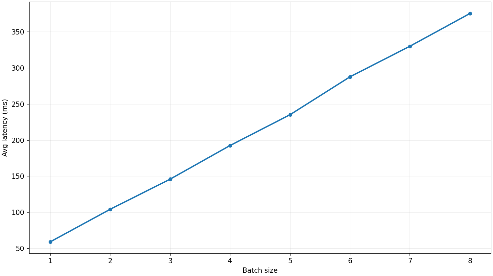
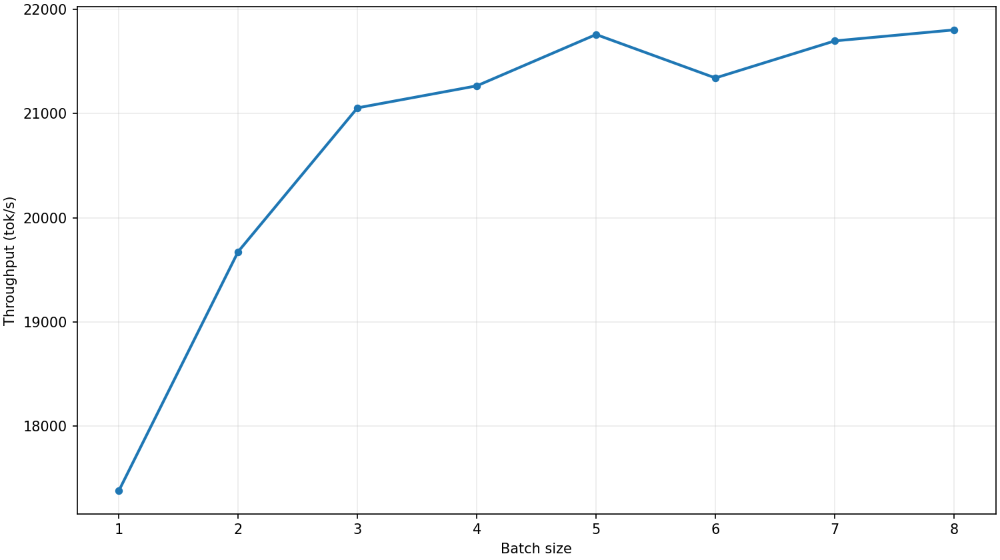
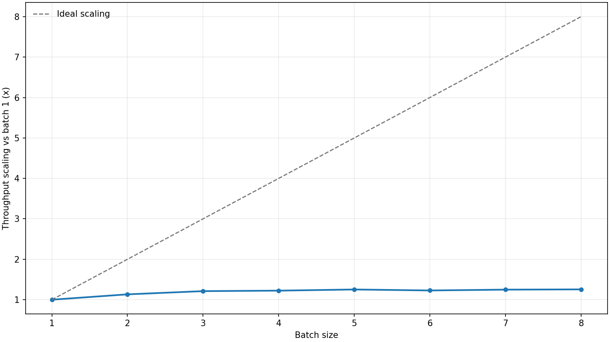

# Prefill-Direct Input 1024 TP=2 性能报告

## 运行环境

| 项目 | 值 |
| --- | --- |
| 日期 | 2026-11-18 14:52:37-14:53:41（Asia/Shanghai） |
| 平台 | NVIDIA |
| 设备 | 2 x A100-SXM4-80GB，默认 CUDA_VISIBLE_DEVICES=3,4 |
| Driver | 535.161.08 |
| InfiniLM build | 当前源码树；未记录独立 build ID |
| 模型 | `/data-aisoft/mechdancer/models/Qwen3-8B` |
| 模式 | `prefill-direct` |
| Attention backend | `flash-attn` |
| Graph request | enabled |
| Expected execution mode | `eager` |
| Cache | paged KV cache，block size 256，num blocks 32 |
| Max batched tokens | 18432 |
| Tensor parallel size | 2 |
| Input length | 1024 tokens / request |
| Batch size | 1..8 |
| Warmup | 每个形状 3 次 repeat |
| Measured repeats | 每个形状 30 次 repeat |
| Batch 执行顺序 | random seed 2026 |

本报告对应的原始 JSONL 和 log 为本机运行产物，不随仓库提交：

```text
../../../benchmark-prefill-direct-qwen3-8b-flash-attn-tp2-input1024-20261118.jsonl
../../../benchmark-prefill-direct-qwen3-8b-flash-attn-tp2-input1024-20261118.log
```

## 构建与测试命令

本轮使用当前已安装的 `_infinilm` 扩展。标准重建命令如下：

```bash
xmake build _infinilm && xmake install _infinilm
```

性能测试命令：

```bash
BENCHMARK_MODE=prefill-direct \
BATCH_SIZES="1,2,3,4,5,6,7,8" \
INPUT_LENS=1024 \
BENCHMARK_REPEATS=30 \
BENCHMARK_OUTPUT=benchmark-prefill-direct-qwen3-8b-flash-attn-tp2-input1024-20261118.jsonl \
./run_bench-nvidia.sh
```

## 执行模式与 Graph 覆盖

`run_bench-nvidia.sh` 请求开启 graph compiling，但 paged graph compiler 的 graph key 只匹配 decode-only 形状。packed prefill 形状不匹配该 key，因此 本轮 expected execution mode 为 `eager`。该字段由 benchmark 根据 compiler 规则推断，不是 C++ runtime 回传的实际执行模式。

## 资源开销

| 项目 | 值 |
| --- | ---: |
| Workspace allocation | 每 rank 1,116 MiB，TP=2 合计 2,232 MiB |
| 权重加载时间 | 约 6.23 秒 |
| Paged cache blocks | 32 |
| 正式 sample 数 | 240 |
| 本轮总耗时 | 约 64 秒 |

Input length 1024 时，batch 8 的 prefill token 数为 `8 * 1024 = 8192`，低于 `max_num_batched_tokens=18432`，因此 workspace 上限保持 18432。

## 测试口径

- 每个 sample 是一次物理 prefill forward。
- `token_count = batch_size * 1024`。
- `throughput = token_count / avg_forward_duration_s`。
- 计时边界为 `engine_forward_including_sampling`。
- Direct prefill 使用合成输入和全 0 paged KV cache，输出 token 不用于正确性判断。
- 分位数使用线性插值；每个 batch 有 30 个正式样本，p99 只能作为尾部参考。

## 核心结果

| Batch | Input tokens | Avg ms | Min ms | P50 ms | P95 ms | P99 ms | Max ms | Std ms | Throughput tok/s | Scaling |
| ---: | ---: | ---: | ---: | ---: | ---: | ---: | ---: | ---: | ---: | ---: |
| 1 | 1,024 | 58.929 | 58.767 | 58.920 | 59.101 | 59.141 | 59.156 | 0.111 | 17,376.92 | 1.000x |
| 2 | 2,048 | 104.098 | 103.911 | 104.102 | 104.243 | 104.254 | 104.254 | 0.078 | 19,673.77 | 1.132x |
| 3 | 3,072 | 145.902 | 145.723 | 145.883 | 146.054 | 146.215 | 146.279 | 0.106 | 21,055.19 | 1.212x |
| 4 | 4,096 | 192.601 | 192.447 | 192.572 | 192.773 | 192.909 | 192.948 | 0.104 | 21,266.78 | 1.224x |
| 5 | 5,120 | 235.296 | 235.135 | 235.274 | 235.506 | 235.628 | 235.677 | 0.117 | 21,759.82 | 1.252x |
| 6 | 6,144 | 287.876 | 287.684 | 287.876 | 288.083 | 288.223 | 288.254 | 0.117 | 21,342.49 | 1.228x |
| 7 | 7,168 | 330.348 | 330.200 | 330.322 | 330.547 | 330.598 | 330.611 | 0.102 | 21,698.30 | 1.249x |
| 8 | 8,192 | 375.707 | 375.601 | 375.683 | 375.878 | 375.960 | 375.984 | 0.084 | 21,804.24 | 1.255x |


## 趋势图

### 1. Batch size 与 Avg Latency



平均 latency 从 batch 1 的 58.929 ms 增至 batch 8 的 375.707 ms。

### 2. Batch size 与 Throughput



吞吐峰值出现在 batch 8，为 21,804.24 tok/s；最大 batch 8 为 21,804.24 tok/s。

### 3. Batch size 与 Scaling



Scaling 从 batch 1 的 1.000x 变为 batch 8 的 1.255x；相对理想 8x 的效率约为 15.7%。

## 关键批次与区间

| Batch / range | 观察 |
| --- | --- |
| batch 1 -> 8 | 平均 latency 从 58.929 ms 增至 375.707 ms，为 6.376x。 |
| batch 8 | 吞吐峰值，21,804.24 tok/s。 |
| batch 8 | per-request prefill latency 最低，为 46.96 ms/request。 |

## 数据稳定性

- Std 中位数为 0.105 ms。
- 最大 std 为 0.117 ms，出现在 batch 6。
- P50、P95、P99 和 max 普遍接近，数据稳定性较好。

## TP=1 对比摘要

| 配置 | 峰值 batch | 峰值吞吐 tok/s | 峰值 Avg ms |
| --- | ---: | ---: | ---: |
| TP=1 | 5 | 12,514.29 | 409.132 |
| TP=2 | 8 | 21,804.24 | 375.707 |

以各自峰值吞吐对比，TP=2 吞吐为 TP=1 的 1.742x；峰值处 latency 为 TP=1 的 0.918x。
注意：TP=1 input 1024 报告使用 `max_num_batched_tokens=9216`，本组 TP=2 使用 18432，因此该组对比不是严格控制变量结果。

## 结论与建议

1. 在本轮 input length 1024、batch `1..8`、TP=2 范围内，**batch 8 吞吐最高**，约 21,804.24 tok/s。
2. batch 8 吞吐约 21,804.24 tok/s，与峰值差异约 0.00%；但单次 forward 平均耗时增加到 375.707 ms。
3. 若以单 request latency 为优先，batch 8 的 per-request latency 最低，为 46.96 ms/request。
4. 正式 p99 对比建议将 `BENCHMARK_REPEATS` 提高到 100 或以上。

## 数据完整性

```text
config records: 1
sample records: 240
overall summary records: 8
scaling records: 8
samples per batch: 30
```
