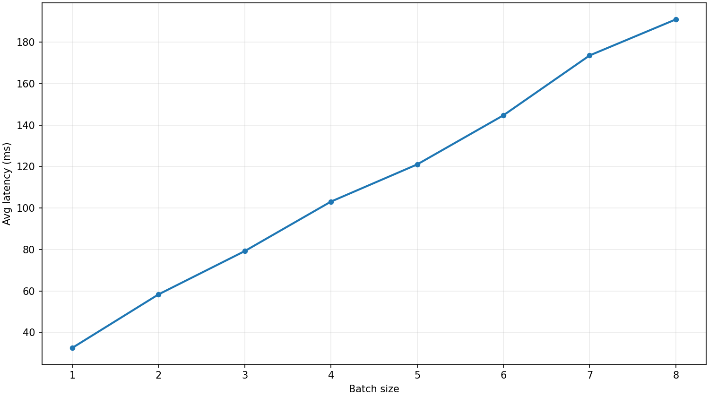
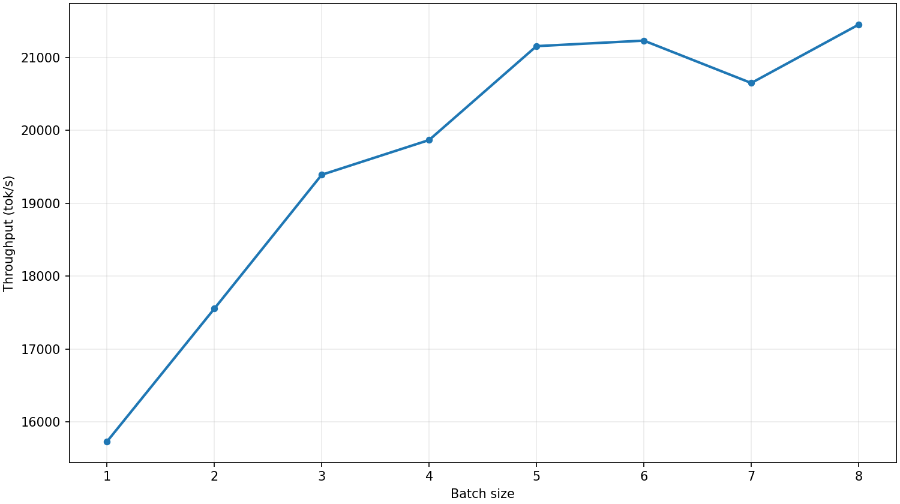
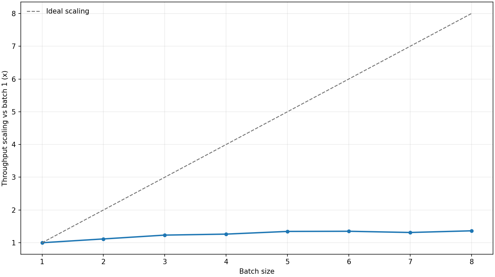

# Prefill-Direct Input 512 TP=2 性能报告

## 运行环境

| 项目 | 值 |
| --- | --- |
| 日期 | 2026-11-18 14:38:12-14:38:50（Asia/Shanghai） |
| 平台 | NVIDIA |
| 设备 | 2 x A100-SXM4-80GB，默认 CUDA_VISIBLE_DEVICES=3,4 |
| Driver | 535.161.08 |
| InfiniLM build | 当前源码树；未记录独立 build ID |
| 模型 | `/data-aisoft/mechdancer/models/Qwen3-8B` |
| 模式 | `prefill-direct` |
| Attention backend | `flash-attn` |
| Graph request | enabled |
| Expected execution mode | `eager` |
| Cache | paged KV cache，block size 256，num blocks 16 |
| Max batched tokens | 18432 |
| Tensor parallel size | 2 |
| Input length | 512 tokens / request |
| Batch size | 1..8 |
| Warmup | 每个形状 3 次 repeat |
| Measured repeats | 每个形状 30 次 repeat |
| Batch 执行顺序 | random seed 2026 |

本报告对应的原始 JSONL 和 log 为本机运行产物，不随仓库提交：

```text
../../../benchmark-prefill-direct-qwen3-8b-flash-attn-tp2-input512-20261118.jsonl
../../../benchmark-prefill-direct-qwen3-8b-flash-attn-tp2-input512-20261118.log
```

## 构建与测试命令

本轮使用当前已安装的 `_infinilm` 扩展。标准重建命令如下：

```bash
xmake build _infinilm && xmake install _infinilm
```

性能测试命令：

```bash
BENCHMARK_MODE=prefill-direct \
BATCH_SIZES="1,2,3,4,5,6,7,8" \
INPUT_LENS=512 \
BENCHMARK_REPEATS=30 \
BENCHMARK_OUTPUT=benchmark-prefill-direct-qwen3-8b-flash-attn-tp2-input512-20261118.jsonl \
./run_bench-nvidia.sh
```

## 执行模式与 Graph 覆盖

`run_bench-nvidia.sh` 请求开启 graph compiling，但 paged graph compiler 的 graph key 只匹配 decode-only 形状。packed prefill 形状不匹配该 key，因此 本轮 expected execution mode 为 `eager`。该字段由 benchmark 根据 compiler 规则推断，不是 C++ runtime 回传的实际执行模式。

## 资源开销

| 项目 | 值 |
| --- | ---: |
| Workspace allocation | 每 rank 1,116 MiB，TP=2 合计 2,232 MiB |
| 权重加载时间 | 约 8.75 秒 |
| Paged cache blocks | 16 |
| 正式 sample 数 | 240 |
| 本轮总耗时 | 约 38 秒 |

Input length 512 时，batch 8 的 prefill token 数为 `8 * 512 = 4096`，低于 `max_num_batched_tokens=18432`，因此 workspace 上限保持 18432。

## 测试口径

- 每个 sample 是一次物理 prefill forward。
- `token_count = batch_size * 512`。
- `throughput = token_count / avg_forward_duration_s`。
- 计时边界为 `engine_forward_including_sampling`。
- Direct prefill 使用合成输入和全 0 paged KV cache，输出 token 不用于正确性判断。
- 分位数使用线性插值；每个 batch 有 30 个正式样本，p99 只能作为尾部参考。

## 核心结果

| Batch | Input tokens | Avg ms | Min ms | P50 ms | P95 ms | P99 ms | Max ms | Std ms | Throughput tok/s | Scaling |
| ---: | ---: | ---: | ---: | ---: | ---: | ---: | ---: | ---: | ---: | ---: |
| 1 | 512 | 32.554 | 32.433 | 32.541 | 32.719 | 32.828 | 32.872 | 0.097 | 15,727.71 | 1.000x |
| 2 | 1,024 | 58.338 | 58.250 | 58.342 | 58.400 | 58.437 | 58.450 | 0.048 | 17,552.92 | 1.116x |
| 3 | 1,536 | 79.211 | 79.078 | 79.211 | 79.308 | 79.354 | 79.372 | 0.063 | 19,391.19 | 1.233x |
| 4 | 2,048 | 103.079 | 102.938 | 103.044 | 103.322 | 103.425 | 103.464 | 0.111 | 19,868.26 | 1.263x |
| 5 | 2,560 | 120.998 | 120.861 | 120.989 | 121.203 | 121.251 | 121.252 | 0.099 | 21,157.32 | 1.345x |
| 6 | 3,072 | 144.681 | 144.516 | 144.668 | 144.788 | 144.999 | 145.080 | 0.098 | 21,232.97 | 1.350x |
| 7 | 3,584 | 173.551 | 173.393 | 173.524 | 173.767 | 173.835 | 173.844 | 0.110 | 20,650.97 | 1.313x |
| 8 | 4,096 | 190.930 | 190.598 | 190.901 | 191.123 | 191.193 | 191.221 | 0.135 | 21,452.86 | 1.364x |


## 趋势图

### 1. Batch size 与 Avg Latency



平均 latency 从 batch 1 的 32.554 ms 增至 batch 8 的 190.930 ms。

### 2. Batch size 与 Throughput



吞吐峰值出现在 batch 8，为 21,452.86 tok/s；最大 batch 8 为 21,452.86 tok/s。

### 3. Batch size 与 Scaling



Scaling 从 batch 1 的 1.000x 变为 batch 8 的 1.364x；相对理想 8x 的效率约为 17.1%。

## 关键批次与区间

| Batch / range | 观察 |
| --- | --- |
| batch 1 -> 8 | 平均 latency 从 32.554 ms 增至 190.930 ms，为 5.865x。 |
| batch 8 | 吞吐峰值，21,452.86 tok/s。 |
| batch 8 | per-request prefill latency 最低，为 23.87 ms/request。 |

## 数据稳定性

- Std 中位数为 0.099 ms。
- 最大 std 为 0.135 ms，出现在 batch 8。
- P50、P95、P99 和 max 普遍接近，数据稳定性较好。

## TP=1 对比摘要

| 配置 | 峰值 batch | 峰值吞吐 tok/s | 峰值 Avg ms |
| --- | ---: | ---: | ---: |
| TP=1 | 5 | 12,489.58 | 204.971 |
| TP=2 | 8 | 21,452.86 | 190.930 |

以各自峰值吞吐对比，TP=2 吞吐为 TP=1 的 1.718x；峰值处 latency 为 TP=1 的 0.931x。

## 结论与建议

1. 在本轮 input length 512、batch `1..8`、TP=2 范围内，**batch 8 吞吐最高**，约 21,452.86 tok/s。
2. batch 8 吞吐约 21,452.86 tok/s，与峰值差异约 0.00%；但单次 forward 平均耗时增加到 190.930 ms。
3. 若以单 request latency 为优先，batch 8 的 per-request latency 最低，为 23.87 ms/request。
4. 正式 p99 对比建议将 `BENCHMARK_REPEATS` 提高到 100 或以上。

## 数据完整性

```text
config records: 1
sample records: 240
overall summary records: 8
scaling records: 8
samples per batch: 30
```
