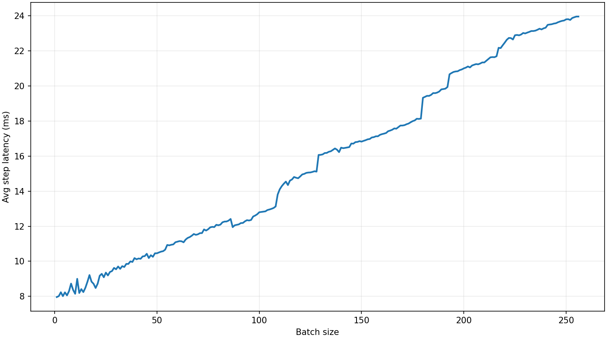
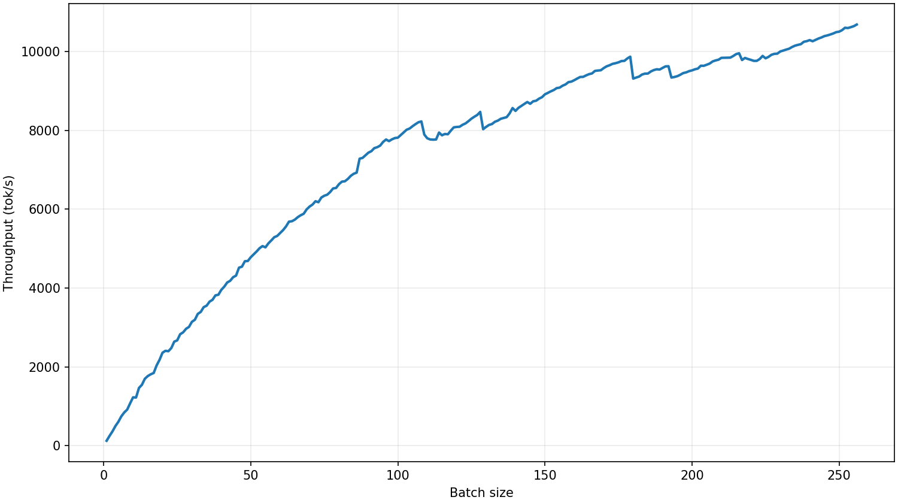
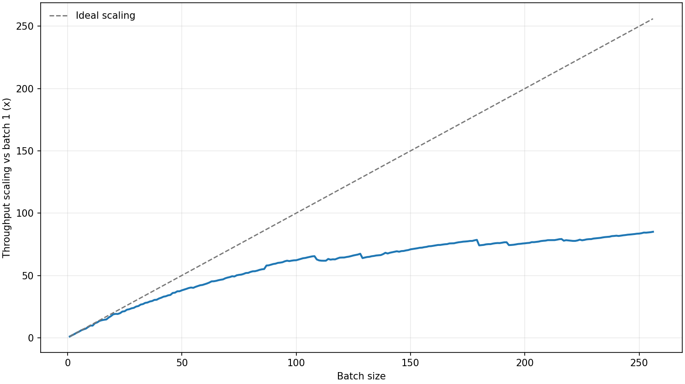

# Decode-Direct Input 1024 TP=4 性能报告

## 运行环境

| 项目 | 值 |
| --- | --- |
| 日期 | 2026-11-18 15:42:48-15:52:16（Asia/Shanghai） |
| 平台 | NVIDIA |
| 设备 | 4 x A100-SXM4-80GB，默认 CUDA_VISIBLE_DEVICES=3,4,5,6 |
| Driver | 535.161.08 |
| InfiniLM build | 当前源码树；未记录独立 build ID |
| 模型 | `/data-aisoft/mechdancer/models/Qwen3-8B` |
| 模式 | `decode-direct` |
| Attention backend | `flash-attn` |
| Graph request | enabled |
| Expected execution mode | `graph` |
| Cache | paged KV cache，block size 256，num blocks 1280 |
| Max batched tokens | 18432 |
| Tensor parallel size | 4 |
| Input length | 1024 tokens / request |
| Batch size | 1..256 |
| Warmup | 每个形状 3 次 repeat |
| Measured repeats | 每个形状 30 次 repeat |
| Batch 执行顺序 | random seed 2026 |

本报告对应的原始 JSONL 和 log 为本机运行产物，不随仓库提交：

```text
../../../benchmark-decode-direct-qwen3-8b-flash-attn-tp4-input1024-graph1-256-20261118.jsonl
../../../benchmark-decode-direct-qwen3-8b-flash-attn-tp4-input1024-graph1-256-20261118.log
```

## 构建与测试命令

本轮使用当前已安装的 `_infinilm` 扩展。标准重建命令如下：

```bash
xmake build _infinilm && xmake install _infinilm
```

性能测试命令：

```bash
BENCHMARK_MODE=decode-direct \
BATCH_SIZES="$(seq -s, 1 256)" \
INPUT_LENS=1024 \
BENCHMARK_REPEATS=30 \
BENCHMARK_OUTPUT=benchmark-decode-direct-qwen3-8b-flash-attn-tp4-input1024-graph1-256-20261118.jsonl \
./run_bench-nvidia.sh
```

## 执行模式与 Graph 覆盖

当前 paged graph compiler 编译 decode batch size `1..256`。因此本轮所有 batch 均有对应 decode graph，无 eager fallback 混入；原始 JSONL 中所有 overall summary 的 `expected_execution_mode` 均为 `graph`。

## 资源开销

| 项目 | 值 |
| --- | ---: |
| Workspace allocation | 每 rank 702 MiB，TP=4 合计 2,808 MiB |
| 权重加载与 graph 编译时间 | 权重加载约 32.52 秒；graph 编译未单独记录 |
| Paged cache blocks | 1280 |
| Compiled graph 数量 | 256 |
| 正式 step sample 数 | 30,720 |
| 本轮总耗时 | 约 568 秒 |

Input length 1024 且执行 4 个 decode step 时，每个 request 需要 `5` 个 block；batch 256 共需要 `1280` 个 block，本轮配置为 `1280` 个 block。

## 测试口径

- `decode-direct` 不执行语义完整的 prefill，paged KV cache 初始为全 0。
- Step 0 输入 dummy token；step 1 到 step 3 使用上一步 sampled token。
- 4 个 decode step 的 past KV length 分别为 1024、1025、1026、1027。
- 报告中的 duration 是单 step 时间，由一次 4-step repeat 的对应总耗时除以 4 得到。
- `single_step_throughput = batch_size / avg_step_latency`。
- 每个 request 每 step 生成 1 个 token，因此 single-step request throughput 与 token throughput 数值相同。
- 表格中的 Min/P50/P95/P99/Max 是每个 repeat 的平均 step 时间分布。
- 计时边界为 `engine_forward_including_sampling`。

## 核心结果

| 指标 | 结果 |
| --- | ---: |
| 最高 single-step 吞吐 | batch 256，10,683.02 tok/s |
| 峰值 batch 平均单 step latency | 23.963 ms |
| 峰值 batch P99 单 step latency | 24.042 ms |
| batch 1 平均单 step latency | 7.960 ms |
| 峰值 batch 相对 batch 1 吞吐倍数 | 85.036x |
| 峰值 batch 相对理想 batch 倍数的效率 | 33.2% |
| 单 step std 中位数 | 0.045 ms |
| 最大单 step std | 0.193 ms，batch 36 |

## 趋势图

### 1. Batch size 与 Avg Step Latency



平均单 step latency 从 batch 1 的 7.960 ms 变为 batch 256 的 23.963 ms；峰值吞吐 batch 256 为 23.963 ms。

### 2. Batch size 与 Throughput



吞吐峰值出现在 batch 256，为 10,683.02 tok/s；最大 batch 256 为 10,683.02 tok/s。

### 3. Batch size 与 Scaling



Scaling 从 batch 1 的 1.000x 变为 batch 256 的 85.036x；相对理想 256x 的效率约为 33.2%。

## Batch 区间平均 latency 与吞吐

下表按连续 16 个 batch 分组；`平均单 step latency ms` 和 `平均吞吐 tok/s` 是区间内各 batch 的算术平均值，`区间最优 batch` 取区间内吞吐最高的 batch。

| Batch 区间 | 平均单 step latency ms | 平均吞吐 tok/s | 区间最优 batch |
| ---: | ---: | ---: | ---: |
| 1..16 | 8.326 | 1010.20 | 16 |
| 17..32 | 9.209 | 2648.69 | 32 |
| 33..48 | 10.091 | 4006.31 | 48 |
| 49..64 | 10.862 | 5194.64 | 64 |
| 65..80 | 11.712 | 6184.99 | 80 |
| 81..96 | 12.217 | 7243.98 | 96 |
| 97..112 | 13.177 | 7932.58 | 108 |
| 113..128 | 14.863 | 8104.97 | 128 |
| 129..144 | 16.309 | 8367.89 | 144 |
| 145..160 | 16.958 | 8991.12 | 160 |
| 161..176 | 17.669 | 9534.93 | 176 |
| 177..192 | 19.338 | 9543.82 | 179 |
| 193..208 | 21.008 | 9542.79 | 208 |
| 209..224 | 22.014 | 9835.38 | 216 |
| 225..240 | 23.098 | 10065.13 | 240 |
| 241..256 | 23.722 | 10474.58 | 256 |

## 关键批次与跳变

| 变化 | Avg step ms | 吞吐 tok/s | 观察 |
| --- | ---: | ---: | --- |
| 10 -> 11 | 8.147 -> 9.000 | 1227.51 -> 1222.24 | latency 增加 10.5%，可能对应 kernel shape 或 workspace 分档变化 |
| 179 -> 180 | 18.139 -> 19.329 | 9868.21 -> 9312.19 | latency 增加 6.6%，可能对应 kernel shape 或 workspace 分档变化 |
| 128 -> 129 | 15.116 -> 16.068 | 8467.61 -> 8028.50 | latency 增加 6.3%，可能对应 kernel shape 或 workspace 分档变化 |
| 21 -> 22 | 8.724 -> 9.177 | 2407.16 -> 2397.19 | latency 增加 5.2%，可能对应 kernel shape 或 workspace 分档变化 |
| 108 -> 109 | 13.129 -> 13.811 | 8226.12 -> 7892.29 | latency 增加 5.2%，可能对应 kernel shape 或 workspace 分档变化 |
| 7 -> 8 | 8.298 -> 8.728 | 843.56 -> 916.58 | latency 增加 5.2%，可能对应 kernel shape 或 workspace 分档变化 |

## Step 一致性

峰值 batch 256 的 4 个 decode step 结果如下：

| Step | Past KV length | Avg step ms | Std ms | Throughput tok/s |
| ---: | ---: | ---: | ---: | ---: |
| 0 | 1024 | 23.948 | 0.081 | 10689.99 |
| 1 | 1025 | 23.973 | 0.075 | 10678.54 |
| 2 | 1026 | 23.965 | 0.069 | 10682.17 |
| 3 | 1027 | 23.967 | 0.062 | 10681.39 |

所有 batch 中，4 个 step 平均耗时最大差异为 0.171 ms，出现在 batch 155。该差异主要来自 past KV length 增长与不同 step 的 kernel 形状。

## 数据稳定性

- 单 step std 中位数为 0.045 ms。
- 最大 std 为 0.193 ms，出现在 batch 36。
- 所有 batch 内 4 个 step 的平均耗时差异不超过 0.171 ms，step 间一致性较好。
- P99 与 max 接近，整体尾部稳定；但每个 batch 只有 30 个 repeat，p99 仍是尾部参考值。

## Single-step 完整结果

### Batch 1..64

| Batch | Mode | Avg Step ms | Min Step ms | P50 Step ms | P95 Step ms | P99 Step ms | Max Step ms | Std Step ms | Single-step tok/s | Scaling |
| ---: | --- | ---: | ---: | ---: | ---: | ---: | ---: | ---: | ---: | ---: |
| 1 | graph | 7.960 | 7.942 | 7.959 | 7.979 | 7.983 | 7.984 | 0.013 | 125.63 | 1.000x |
| 2 | graph | 8.014 | 7.961 | 8.016 | 8.037 | 8.050 | 8.055 | 0.018 | 249.58 | 1.987x |
| 3 | graph | 8.234 | 8.195 | 8.238 | 8.286 | 8.311 | 8.318 | 0.028 | 364.34 | 2.900x |
| 4 | graph | 8.011 | 7.965 | 7.987 | 8.171 | 8.351 | 8.383 | 0.088 | 499.29 | 3.974x |
| 5 | graph | 8.228 | 8.204 | 8.221 | 8.249 | 8.334 | 8.368 | 0.029 | 607.70 | 4.837x |
| 6 | graph | 8.056 | 8.014 | 8.034 | 8.096 | 8.467 | 8.612 | 0.105 | 744.82 | 5.929x |
| 7 | graph | 8.298 | 8.266 | 8.299 | 8.334 | 8.339 | 8.341 | 0.021 | 843.56 | 6.715x |
| 8 | graph | 8.728 | 8.678 | 8.709 | 8.827 | 8.917 | 8.946 | 0.056 | 916.58 | 7.296x |
| 9 | graph | 8.368 | 8.321 | 8.361 | 8.456 | 8.498 | 8.509 | 0.042 | 1,075.58 | 8.562x |
| 10 | graph | 8.147 | 8.083 | 8.126 | 8.281 | 8.293 | 8.294 | 0.053 | 1,227.51 | 9.771x |
| 11 | graph | 9.000 | 8.950 | 8.976 | 9.063 | 9.373 | 9.490 | 0.095 | 1,222.24 | 9.729x |
| 12 | graph | 8.192 | 8.151 | 8.176 | 8.276 | 8.453 | 8.506 | 0.066 | 1,464.81 | 11.660x |
| 13 | graph | 8.414 | 8.389 | 8.404 | 8.454 | 8.511 | 8.529 | 0.028 | 1,545.05 | 12.299x |
| 14 | graph | 8.244 | 8.210 | 8.232 | 8.313 | 8.408 | 8.438 | 0.044 | 1,698.28 | 13.518x |
| 15 | graph | 8.491 | 8.457 | 8.479 | 8.565 | 8.608 | 8.625 | 0.035 | 1,766.61 | 14.062x |
| 16 | graph | 8.832 | 8.818 | 8.827 | 8.855 | 8.865 | 8.868 | 0.012 | 1,811.69 | 14.421x |
| 17 | graph | 9.216 | 9.162 | 9.203 | 9.301 | 9.319 | 9.323 | 0.041 | 1,844.66 | 14.683x |
| 18 | graph | 8.839 | 8.822 | 8.837 | 8.859 | 8.867 | 8.867 | 0.010 | 2,036.49 | 16.210x |
| 19 | graph | 8.717 | 8.665 | 8.683 | 8.846 | 9.208 | 9.313 | 0.121 | 2,179.69 | 17.350x |
| 20 | graph | 8.478 | 8.425 | 8.479 | 8.488 | 8.489 | 8.490 | 0.012 | 2,359.14 | 18.779x |
| 21 | graph | 8.724 | 8.704 | 8.721 | 8.759 | 8.782 | 8.788 | 0.018 | 2,407.16 | 19.161x |
| 22 | graph | 9.177 | 9.150 | 9.167 | 9.190 | 9.388 | 9.468 | 0.055 | 2,397.19 | 19.081x |
| 23 | graph | 9.285 | 9.264 | 9.282 | 9.316 | 9.327 | 9.330 | 0.014 | 2,477.24 | 19.719x |
| 24 | graph | 9.090 | 9.062 | 9.086 | 9.115 | 9.118 | 9.119 | 0.016 | 2,640.38 | 21.017x |
| 25 | graph | 9.355 | 9.320 | 9.355 | 9.400 | 9.415 | 9.417 | 0.023 | 2,672.37 | 21.272x |
| 26 | graph | 9.193 | 9.153 | 9.173 | 9.222 | 9.533 | 9.658 | 0.088 | 2,828.17 | 22.512x |
| 27 | graph | 9.390 | 9.362 | 9.385 | 9.432 | 9.471 | 9.486 | 0.025 | 2,875.29 | 22.887x |
| 28 | graph | 9.442 | 9.399 | 9.436 | 9.471 | 9.581 | 9.623 | 0.037 | 2,965.44 | 23.605x |
| 29 | graph | 9.622 | 9.526 | 9.625 | 9.648 | 9.668 | 9.675 | 0.024 | 3,013.81 | 23.990x |
| 30 | graph | 9.545 | 9.497 | 9.543 | 9.586 | 9.591 | 9.591 | 0.025 | 3,143.15 | 25.019x |
| 31 | graph | 9.703 | 9.602 | 9.657 | 9.917 | 10.211 | 10.296 | 0.136 | 3,194.77 | 25.430x |
| 32 | graph | 9.569 | 9.518 | 9.567 | 9.648 | 9.655 | 9.657 | 0.038 | 3,344.02 | 26.618x |
| 33 | graph | 9.724 | 9.657 | 9.708 | 9.884 | 9.970 | 10.002 | 0.072 | 3,393.78 | 27.014x |
| 34 | graph | 9.674 | 9.628 | 9.676 | 9.700 | 9.712 | 9.717 | 0.019 | 3,514.56 | 27.976x |
| 35 | graph | 9.852 | 9.701 | 9.824 | 10.004 | 10.314 | 10.430 | 0.124 | 3,552.47 | 28.277x |
| 36 | graph | 9.851 | 9.693 | 9.793 | 10.369 | 10.462 | 10.496 | 0.193 | 3,654.61 | 29.090x |
| 37 | graph | 9.996 | 9.929 | 9.996 | 10.045 | 10.053 | 10.054 | 0.029 | 3,701.45 | 29.463x |
| 38 | graph | 9.963 | 9.891 | 9.956 | 10.041 | 10.087 | 10.099 | 0.043 | 3,813.98 | 30.359x |
| 39 | graph | 10.182 | 10.062 | 10.149 | 10.332 | 10.384 | 10.400 | 0.090 | 3,830.13 | 30.488x |
| 40 | graph | 10.115 | 10.002 | 10.081 | 10.239 | 10.687 | 10.863 | 0.151 | 3,954.48 | 31.477x |
| 41 | graph | 10.159 | 9.930 | 10.164 | 10.234 | 10.759 | 10.972 | 0.174 | 4,035.64 | 32.123x |
| 42 | graph | 10.143 | 10.077 | 10.124 | 10.232 | 10.244 | 10.248 | 0.048 | 4,140.85 | 32.961x |
| 43 | graph | 10.280 | 10.220 | 10.279 | 10.332 | 10.337 | 10.337 | 0.026 | 4,182.99 | 33.296x |
| 44 | graph | 10.295 | 10.237 | 10.297 | 10.334 | 10.340 | 10.343 | 0.027 | 4,274.08 | 34.021x |
| 45 | graph | 10.429 | 10.314 | 10.440 | 10.491 | 10.504 | 10.509 | 0.048 | 4,314.71 | 34.345x |
| 46 | graph | 10.187 | 10.106 | 10.174 | 10.215 | 10.536 | 10.666 | 0.094 | 4,515.71 | 35.945x |
| 47 | graph | 10.348 | 10.245 | 10.347 | 10.452 | 10.478 | 10.479 | 0.054 | 4,541.99 | 36.154x |
| 48 | graph | 10.257 | 10.182 | 10.245 | 10.340 | 10.347 | 10.348 | 0.042 | 4,679.61 | 37.249x |
| 49 | graph | 10.456 | 10.358 | 10.424 | 10.642 | 10.837 | 10.916 | 0.107 | 4,686.14 | 37.301x |
| 50 | graph | 10.458 | 10.383 | 10.449 | 10.530 | 10.557 | 10.566 | 0.042 | 4,780.87 | 38.055x |
| 51 | graph | 10.508 | 10.409 | 10.511 | 10.596 | 10.601 | 10.603 | 0.055 | 4,853.53 | 38.634x |
| 52 | graph | 10.552 | 10.451 | 10.553 | 10.639 | 10.652 | 10.655 | 0.054 | 4,927.88 | 39.226x |
| 53 | graph | 10.578 | 10.495 | 10.567 | 10.639 | 10.863 | 10.950 | 0.077 | 5,010.43 | 39.883x |
| 54 | graph | 10.665 | 10.520 | 10.642 | 10.764 | 11.064 | 11.183 | 0.111 | 5,063.40 | 40.304x |
| 55 | graph | 10.931 | 10.818 | 10.931 | 11.040 | 11.064 | 11.070 | 0.057 | 5,031.55 | 40.051x |
| 56 | graph | 10.911 | 10.763 | 10.923 | 10.987 | 11.027 | 11.043 | 0.067 | 5,132.66 | 40.856x |
| 57 | graph | 10.943 | 10.833 | 10.945 | 11.026 | 11.044 | 11.049 | 0.054 | 5,208.60 | 41.460x |
| 58 | graph | 10.965 | 10.834 | 10.967 | 11.035 | 11.041 | 11.043 | 0.044 | 5,289.36 | 42.103x |
| 59 | graph | 11.087 | 10.949 | 11.087 | 11.159 | 11.187 | 11.194 | 0.047 | 5,321.52 | 42.359x |
| 60 | graph | 11.119 | 11.030 | 11.117 | 11.213 | 11.250 | 11.255 | 0.050 | 5,396.31 | 42.954x |
| 61 | graph | 11.152 | 10.976 | 11.166 | 11.235 | 11.255 | 11.261 | 0.065 | 5,469.75 | 43.539x |
| 62 | graph | 11.143 | 11.038 | 11.148 | 11.193 | 11.194 | 11.194 | 0.040 | 5,563.85 | 44.288x |
| 63 | graph | 11.084 | 11.020 | 11.081 | 11.113 | 11.212 | 11.251 | 0.037 | 5,684.05 | 45.245x |
| 64 | graph | 11.239 | 11.152 | 11.237 | 11.278 | 11.301 | 11.310 | 0.033 | 5,694.31 | 45.326x |

### Batch 65..128

| Batch | Mode | Avg Step ms | Min Step ms | P50 Step ms | P95 Step ms | P99 Step ms | Max Step ms | Std Step ms | Single-step tok/s | Scaling |
| ---: | --- | ---: | ---: | ---: | ---: | ---: | ---: | ---: | ---: | ---: |
| 65 | graph | 11.333 | 11.281 | 11.328 | 11.404 | 11.432 | 11.437 | 0.040 | 5,735.45 | 45.654x |
| 66 | graph | 11.382 | 11.287 | 11.376 | 11.501 | 11.533 | 11.545 | 0.062 | 5,798.44 | 46.155x |
| 67 | graph | 11.460 | 11.364 | 11.459 | 11.537 | 11.556 | 11.558 | 0.044 | 5,846.58 | 46.538x |
| 68 | graph | 11.557 | 11.453 | 11.550 | 11.671 | 11.719 | 11.737 | 0.062 | 5,883.96 | 46.836x |
| 69 | graph | 11.510 | 11.444 | 11.503 | 11.568 | 11.599 | 11.609 | 0.038 | 5,994.88 | 47.719x |
| 70 | graph | 11.539 | 11.447 | 11.530 | 11.629 | 11.720 | 11.753 | 0.058 | 6,066.14 | 48.286x |
| 71 | graph | 11.606 | 11.506 | 11.588 | 11.658 | 11.901 | 12.000 | 0.081 | 6,117.27 | 48.693x |
| 72 | graph | 11.610 | 11.539 | 11.617 | 11.673 | 11.679 | 11.680 | 0.035 | 6,201.47 | 49.363x |
| 73 | graph | 11.819 | 11.742 | 11.814 | 11.895 | 12.077 | 12.148 | 0.075 | 6,176.69 | 49.166x |
| 74 | graph | 11.755 | 11.683 | 11.759 | 11.799 | 11.810 | 11.814 | 0.029 | 6,295.33 | 50.110x |
| 75 | graph | 11.828 | 11.767 | 11.817 | 11.890 | 12.030 | 12.086 | 0.057 | 6,340.80 | 50.472x |
| 76 | graph | 11.936 | 11.840 | 11.921 | 12.023 | 12.246 | 12.333 | 0.091 | 6,367.35 | 50.684x |
| 77 | graph | 11.964 | 11.856 | 11.957 | 12.055 | 12.079 | 12.082 | 0.052 | 6,435.74 | 51.228x |
| 78 | graph | 11.952 | 11.892 | 11.945 | 12.008 | 12.071 | 12.095 | 0.042 | 6,526.34 | 51.949x |
| 79 | graph | 12.082 | 11.996 | 12.072 | 12.171 | 12.336 | 12.400 | 0.076 | 6,538.40 | 52.045x |
| 80 | graph | 12.057 | 11.968 | 12.047 | 12.144 | 12.298 | 12.348 | 0.068 | 6,635.03 | 52.814x |
| 81 | graph | 12.092 | 12.032 | 12.089 | 12.142 | 12.155 | 12.156 | 0.030 | 6,698.84 | 53.322x |
| 82 | graph | 12.224 | 12.147 | 12.210 | 12.328 | 12.405 | 12.420 | 0.058 | 6,707.99 | 53.395x |
| 83 | graph | 12.266 | 12.169 | 12.240 | 12.315 | 12.732 | 12.898 | 0.124 | 6,766.49 | 53.861x |
| 84 | graph | 12.271 | 12.178 | 12.273 | 12.371 | 12.378 | 12.380 | 0.057 | 6,845.26 | 54.488x |
| 85 | graph | 12.322 | 12.190 | 12.318 | 12.417 | 12.423 | 12.425 | 0.055 | 6,898.21 | 54.909x |
| 86 | graph | 12.416 | 12.335 | 12.407 | 12.491 | 12.503 | 12.505 | 0.045 | 6,926.56 | 55.135x |
| 87 | graph | 11.949 | 11.858 | 11.913 | 12.059 | 12.254 | 12.331 | 0.094 | 7,280.91 | 57.956x |
| 88 | graph | 12.055 | 11.980 | 12.048 | 12.111 | 12.172 | 12.196 | 0.041 | 7,299.99 | 58.107x |
| 89 | graph | 12.081 | 11.959 | 12.085 | 12.150 | 12.166 | 12.170 | 0.051 | 7,367.18 | 58.642x |
| 90 | graph | 12.107 | 12.016 | 12.093 | 12.193 | 12.207 | 12.210 | 0.048 | 7,433.75 | 59.172x |
| 91 | graph | 12.181 | 12.127 | 12.173 | 12.231 | 12.270 | 12.281 | 0.030 | 7,470.88 | 59.468x |
| 92 | graph | 12.188 | 12.121 | 12.179 | 12.270 | 12.281 | 12.283 | 0.043 | 7,548.48 | 60.085x |
| 93 | graph | 12.282 | 12.136 | 12.282 | 12.374 | 12.488 | 12.534 | 0.077 | 7,572.16 | 60.274x |
| 94 | graph | 12.347 | 12.199 | 12.321 | 12.559 | 12.718 | 12.767 | 0.122 | 7,613.24 | 60.601x |
| 95 | graph | 12.327 | 12.228 | 12.323 | 12.430 | 12.480 | 12.492 | 0.057 | 7,706.74 | 61.345x |
| 96 | graph | 12.360 | 12.292 | 12.355 | 12.412 | 12.432 | 12.440 | 0.035 | 7,766.99 | 61.825x |
| 97 | graph | 12.555 | 12.505 | 12.556 | 12.608 | 12.611 | 12.612 | 0.030 | 7,726.29 | 61.501x |
| 98 | graph | 12.611 | 12.553 | 12.614 | 12.664 | 12.681 | 12.686 | 0.032 | 7,771.12 | 61.858x |
| 99 | graph | 12.685 | 12.628 | 12.682 | 12.747 | 12.774 | 12.785 | 0.035 | 7,804.55 | 62.124x |
| 100 | graph | 12.799 | 12.711 | 12.794 | 12.874 | 12.946 | 12.971 | 0.054 | 7,813.39 | 62.194x |
| 101 | graph | 12.816 | 12.718 | 12.814 | 12.888 | 12.893 | 12.894 | 0.045 | 7,880.94 | 62.732x |
| 102 | graph | 12.831 | 12.751 | 12.823 | 12.911 | 12.953 | 12.965 | 0.048 | 7,949.80 | 63.280x |
| 103 | graph | 12.850 | 12.785 | 12.849 | 12.891 | 12.917 | 12.925 | 0.029 | 8,015.62 | 63.804x |
| 104 | graph | 12.926 | 12.858 | 12.916 | 13.022 | 13.037 | 13.043 | 0.045 | 8,045.92 | 64.045x |
| 105 | graph | 12.956 | 12.887 | 12.946 | 13.025 | 13.133 | 13.175 | 0.053 | 8,104.06 | 64.508x |
| 106 | graph | 12.995 | 12.909 | 12.989 | 13.079 | 13.083 | 13.085 | 0.042 | 8,156.69 | 64.927x |
| 107 | graph | 13.042 | 12.959 | 13.041 | 13.120 | 13.141 | 13.149 | 0.044 | 8,204.48 | 65.307x |
| 108 | graph | 13.129 | 13.048 | 13.110 | 13.202 | 13.312 | 13.355 | 0.056 | 8,226.12 | 65.479x |
| 109 | graph | 13.811 | 13.732 | 13.798 | 13.909 | 13.925 | 13.931 | 0.050 | 7,892.29 | 62.822x |
| 110 | graph | 14.106 | 14.026 | 14.110 | 14.152 | 14.165 | 14.168 | 0.032 | 7,798.13 | 62.073x |
| 111 | graph | 14.288 | 14.242 | 14.292 | 14.334 | 14.349 | 14.352 | 0.029 | 7,768.88 | 61.840x |
| 112 | graph | 14.427 | 14.305 | 14.430 | 14.539 | 14.560 | 14.565 | 0.078 | 7,763.06 | 61.793x |
| 113 | graph | 14.548 | 14.447 | 14.548 | 14.628 | 14.645 | 14.651 | 0.048 | 7,767.60 | 61.830x |
| 114 | graph | 14.350 | 14.280 | 14.341 | 14.417 | 14.425 | 14.426 | 0.038 | 7,944.27 | 63.236x |
| 115 | graph | 14.605 | 14.543 | 14.605 | 14.653 | 14.668 | 14.672 | 0.029 | 7,874.22 | 62.678x |
| 116 | graph | 14.669 | 14.614 | 14.667 | 14.710 | 14.744 | 14.756 | 0.031 | 7,907.76 | 62.945x |
| 117 | graph | 14.811 | 14.674 | 14.807 | 14.907 | 14.920 | 14.925 | 0.063 | 7,899.73 | 62.881x |
| 118 | graph | 14.767 | 14.683 | 14.762 | 14.836 | 14.868 | 14.880 | 0.051 | 7,990.87 | 63.607x |
| 119 | graph | 14.738 | 14.673 | 14.720 | 14.859 | 14.897 | 14.899 | 0.059 | 8,074.43 | 64.272x |
| 120 | graph | 14.841 | 14.749 | 14.836 | 14.920 | 14.931 | 14.934 | 0.044 | 8,085.91 | 64.363x |
| 121 | graph | 14.955 | 14.881 | 14.958 | 15.000 | 15.002 | 15.003 | 0.034 | 8,090.89 | 64.403x |
| 122 | graph | 14.988 | 14.839 | 14.978 | 15.106 | 15.305 | 15.385 | 0.100 | 8,140.06 | 64.794x |
| 123 | graph | 15.045 | 14.981 | 15.046 | 15.101 | 15.120 | 15.128 | 0.035 | 8,175.35 | 65.075x |
| 124 | graph | 15.063 | 14.938 | 15.052 | 15.155 | 15.187 | 15.194 | 0.051 | 8,231.84 | 65.525x |
| 125 | graph | 15.070 | 15.009 | 15.074 | 15.118 | 15.128 | 15.131 | 0.031 | 8,294.86 | 66.026x |
| 126 | graph | 15.100 | 15.026 | 15.096 | 15.178 | 15.234 | 15.253 | 0.042 | 8,344.61 | 66.422x |
| 127 | graph | 15.138 | 15.080 | 15.129 | 15.222 | 15.231 | 15.233 | 0.041 | 8,389.50 | 66.780x |
| 128 | graph | 15.116 | 15.055 | 15.119 | 15.158 | 15.166 | 15.167 | 0.028 | 8,467.61 | 67.402x |

### Batch 129..192

| Batch | Mode | Avg Step ms | Min Step ms | P50 Step ms | P95 Step ms | P99 Step ms | Max Step ms | Std Step ms | Single-step tok/s | Scaling |
| ---: | --- | ---: | ---: | ---: | ---: | ---: | ---: | ---: | ---: | ---: |
| 129 | graph | 16.068 | 15.995 | 16.056 | 16.123 | 16.360 | 16.456 | 0.079 | 8,028.50 | 63.906x |
| 130 | graph | 16.075 | 15.983 | 16.081 | 16.140 | 16.151 | 16.153 | 0.045 | 8,087.12 | 64.373x |
| 131 | graph | 16.100 | 15.982 | 16.099 | 16.160 | 16.171 | 16.175 | 0.045 | 8,136.72 | 64.768x |
| 132 | graph | 16.177 | 16.090 | 16.171 | 16.233 | 16.254 | 16.260 | 0.040 | 8,159.75 | 64.951x |
| 133 | graph | 16.185 | 16.108 | 16.186 | 16.269 | 16.282 | 16.282 | 0.042 | 8,217.63 | 65.412x |
| 134 | graph | 16.249 | 16.155 | 16.237 | 16.329 | 16.369 | 16.384 | 0.061 | 8,246.54 | 65.642x |
| 135 | graph | 16.279 | 16.216 | 16.284 | 16.313 | 16.333 | 16.340 | 0.026 | 8,293.14 | 66.013x |
| 136 | graph | 16.358 | 16.290 | 16.334 | 16.402 | 16.682 | 16.792 | 0.085 | 8,313.77 | 66.177x |
| 137 | graph | 16.438 | 16.307 | 16.398 | 16.683 | 16.773 | 16.790 | 0.112 | 8,334.51 | 66.342x |
| 138 | graph | 16.368 | 16.315 | 16.364 | 16.396 | 16.455 | 16.479 | 0.028 | 8,431.19 | 67.112x |
| 139 | graph | 16.228 | 16.136 | 16.226 | 16.334 | 16.343 | 16.346 | 0.056 | 8,565.34 | 68.180x |
| 140 | graph | 16.484 | 16.419 | 16.486 | 16.551 | 16.600 | 16.615 | 0.040 | 8,492.87 | 67.603x |
| 141 | graph | 16.452 | 16.378 | 16.452 | 16.510 | 16.544 | 16.553 | 0.039 | 8,570.16 | 68.218x |
| 142 | graph | 16.472 | 16.429 | 16.462 | 16.538 | 16.547 | 16.549 | 0.033 | 8,620.78 | 68.621x |
| 143 | graph | 16.495 | 16.445 | 16.493 | 16.542 | 16.551 | 16.553 | 0.028 | 8,669.48 | 69.008x |
| 144 | graph | 16.516 | 16.469 | 16.515 | 16.550 | 16.576 | 16.585 | 0.023 | 8,718.75 | 69.401x |
| 145 | graph | 16.720 | 16.628 | 16.721 | 16.783 | 16.800 | 16.805 | 0.041 | 8,672.36 | 69.031x |
| 146 | graph | 16.712 | 16.636 | 16.695 | 16.801 | 16.815 | 16.816 | 0.049 | 8,736.15 | 69.539x |
| 147 | graph | 16.799 | 16.710 | 16.794 | 16.877 | 16.880 | 16.880 | 0.047 | 8,750.50 | 69.653x |
| 148 | graph | 16.811 | 16.720 | 16.820 | 16.888 | 16.908 | 16.913 | 0.052 | 8,803.68 | 70.077x |
| 149 | graph | 16.855 | 16.707 | 16.849 | 16.906 | 17.189 | 17.302 | 0.093 | 8,840.20 | 70.367x |
| 150 | graph | 16.829 | 16.719 | 16.839 | 16.904 | 16.944 | 16.955 | 0.054 | 8,913.25 | 70.949x |
| 151 | graph | 16.872 | 16.794 | 16.870 | 16.922 | 16.935 | 16.939 | 0.036 | 8,949.81 | 71.240x |
| 152 | graph | 16.910 | 16.701 | 16.943 | 17.042 | 17.118 | 17.141 | 0.110 | 8,988.62 | 71.549x |
| 153 | graph | 16.959 | 16.727 | 16.981 | 17.111 | 17.133 | 17.135 | 0.109 | 9,021.94 | 71.814x |
| 154 | graph | 16.977 | 16.899 | 16.962 | 17.033 | 17.149 | 17.195 | 0.052 | 9,070.85 | 72.203x |
| 155 | graph | 17.064 | 16.932 | 17.029 | 17.216 | 17.751 | 17.963 | 0.177 | 9,083.37 | 72.303x |
| 156 | graph | 17.083 | 17.020 | 17.075 | 17.141 | 17.154 | 17.157 | 0.033 | 9,132.07 | 72.691x |
| 157 | graph | 17.132 | 17.070 | 17.133 | 17.195 | 17.207 | 17.211 | 0.037 | 9,163.89 | 72.944x |
| 158 | graph | 17.132 | 17.052 | 17.134 | 17.201 | 17.209 | 17.212 | 0.044 | 9,222.45 | 73.410x |
| 159 | graph | 17.215 | 17.076 | 17.201 | 17.358 | 17.613 | 17.715 | 0.111 | 9,236.08 | 73.519x |
| 160 | graph | 17.255 | 17.149 | 17.253 | 17.345 | 17.388 | 17.404 | 0.061 | 9,272.74 | 73.810x |
| 161 | graph | 17.284 | 17.219 | 17.284 | 17.344 | 17.370 | 17.378 | 0.038 | 9,314.76 | 74.145x |
| 162 | graph | 17.320 | 17.243 | 17.321 | 17.363 | 17.407 | 17.424 | 0.036 | 9,353.24 | 74.451x |
| 163 | graph | 17.422 | 17.224 | 17.405 | 17.667 | 17.851 | 17.871 | 0.128 | 9,355.99 | 74.473x |
| 164 | graph | 17.459 | 17.385 | 17.455 | 17.521 | 17.560 | 17.575 | 0.039 | 9,393.60 | 74.772x |
| 165 | graph | 17.506 | 17.425 | 17.497 | 17.608 | 17.617 | 17.617 | 0.045 | 9,425.10 | 75.023x |
| 166 | graph | 17.580 | 17.521 | 17.588 | 17.613 | 17.619 | 17.621 | 0.028 | 9,442.61 | 75.162x |
| 167 | graph | 17.565 | 17.520 | 17.567 | 17.605 | 17.610 | 17.612 | 0.024 | 9,507.27 | 75.677x |
| 168 | graph | 17.654 | 17.553 | 17.650 | 17.721 | 17.751 | 17.761 | 0.044 | 9,516.44 | 75.750x |
| 169 | graph | 17.745 | 17.590 | 17.703 | 18.012 | 18.332 | 18.443 | 0.156 | 9,523.85 | 75.809x |
| 170 | graph | 17.746 | 17.661 | 17.719 | 17.887 | 17.988 | 18.026 | 0.079 | 9,579.72 | 76.254x |
| 171 | graph | 17.768 | 17.684 | 17.758 | 17.863 | 17.926 | 17.951 | 0.055 | 9,624.29 | 76.609x |
| 172 | graph | 17.821 | 17.724 | 17.823 | 17.903 | 18.007 | 18.044 | 0.061 | 9,651.43 | 76.825x |
| 173 | graph | 17.860 | 17.795 | 17.864 | 17.919 | 17.976 | 17.994 | 0.044 | 9,686.42 | 77.103x |
| 174 | graph | 17.933 | 17.804 | 17.919 | 18.046 | 18.062 | 18.062 | 0.061 | 9,702.77 | 77.233x |
| 175 | graph | 17.996 | 17.903 | 18.001 | 18.079 | 18.106 | 18.112 | 0.051 | 9,724.35 | 77.405x |
| 176 | graph | 18.038 | 17.951 | 18.043 | 18.091 | 18.102 | 18.106 | 0.035 | 9,757.03 | 77.665x |
| 177 | graph | 18.133 | 18.030 | 18.102 | 18.249 | 18.698 | 18.871 | 0.148 | 9,761.33 | 77.699x |
| 178 | graph | 18.122 | 18.009 | 18.109 | 18.230 | 18.455 | 18.543 | 0.098 | 9,822.12 | 78.183x |
| 179 | graph | 18.139 | 18.078 | 18.137 | 18.184 | 18.195 | 18.198 | 0.030 | 9,868.21 | 78.550x |
| 180 | graph | 19.329 | 19.261 | 19.334 | 19.365 | 19.380 | 19.386 | 0.025 | 9,312.19 | 74.124x |
| 181 | graph | 19.382 | 19.336 | 19.377 | 19.435 | 19.448 | 19.453 | 0.027 | 9,338.59 | 74.334x |
| 182 | graph | 19.439 | 19.354 | 19.438 | 19.535 | 19.554 | 19.556 | 0.048 | 9,362.69 | 74.526x |
| 183 | graph | 19.437 | 19.393 | 19.433 | 19.483 | 19.491 | 19.492 | 0.026 | 9,415.19 | 74.944x |
| 184 | graph | 19.496 | 19.425 | 19.485 | 19.565 | 19.577 | 19.580 | 0.038 | 9,437.93 | 75.125x |
| 185 | graph | 19.598 | 19.519 | 19.593 | 19.679 | 19.713 | 19.725 | 0.051 | 9,439.93 | 75.141x |
| 186 | graph | 19.594 | 19.525 | 19.586 | 19.719 | 19.813 | 19.826 | 0.064 | 9,492.86 | 75.562x |
| 187 | graph | 19.627 | 19.562 | 19.624 | 19.667 | 19.672 | 19.673 | 0.028 | 9,527.78 | 75.840x |
| 188 | graph | 19.689 | 19.617 | 19.688 | 19.725 | 19.744 | 19.749 | 0.028 | 9,548.67 | 76.007x |
| 189 | graph | 19.808 | 19.734 | 19.806 | 19.872 | 19.995 | 20.041 | 0.056 | 9,541.78 | 75.952x |
| 190 | graph | 19.826 | 19.773 | 19.813 | 19.863 | 20.041 | 20.114 | 0.059 | 9,583.25 | 76.282x |
| 191 | graph | 19.850 | 19.777 | 19.861 | 19.890 | 19.893 | 19.894 | 0.032 | 9,622.30 | 76.593x |
| 192 | graph | 19.945 | 19.867 | 19.917 | 19.987 | 20.489 | 20.694 | 0.142 | 9,626.25 | 76.624x |

### Batch 193..256

| Batch | Mode | Avg Step ms | Min Step ms | P50 Step ms | P95 Step ms | P99 Step ms | Max Step ms | Std Step ms | Single-step tok/s | Scaling |
| ---: | --- | ---: | ---: | ---: | ---: | ---: | ---: | ---: | ---: | ---: |
| 193 | graph | 20.668 | 20.600 | 20.657 | 20.737 | 20.837 | 20.873 | 0.053 | 9,338.15 | 74.331x |
| 194 | graph | 20.743 | 20.654 | 20.743 | 20.817 | 20.868 | 20.887 | 0.048 | 9,352.59 | 74.446x |
| 195 | graph | 20.804 | 20.723 | 20.800 | 20.878 | 20.890 | 20.893 | 0.036 | 9,373.34 | 74.611x |
| 196 | graph | 20.831 | 20.766 | 20.816 | 20.916 | 20.949 | 20.957 | 0.044 | 9,409.21 | 74.897x |
| 197 | graph | 20.842 | 20.614 | 20.867 | 20.926 | 20.938 | 20.940 | 0.079 | 9,451.95 | 75.237x |
| 198 | graph | 20.909 | 20.858 | 20.904 | 20.970 | 20.985 | 20.989 | 0.036 | 9,469.79 | 75.379x |
| 199 | graph | 20.946 | 20.894 | 20.951 | 20.983 | 21.003 | 21.011 | 0.026 | 9,500.70 | 75.625x |
| 200 | graph | 21.007 | 20.959 | 21.006 | 21.054 | 21.096 | 21.110 | 0.030 | 9,520.46 | 75.782x |
| 201 | graph | 21.050 | 21.010 | 21.044 | 21.089 | 21.104 | 21.108 | 0.025 | 9,548.68 | 76.007x |
| 202 | graph | 21.115 | 21.008 | 21.080 | 21.296 | 21.676 | 21.823 | 0.150 | 9,566.61 | 76.150x |
| 203 | graph | 21.060 | 20.872 | 21.097 | 21.158 | 21.198 | 21.214 | 0.082 | 9,639.10 | 76.727x |
| 204 | graph | 21.169 | 21.090 | 21.149 | 21.296 | 21.375 | 21.398 | 0.065 | 9,636.83 | 76.708x |
| 205 | graph | 21.213 | 21.111 | 21.199 | 21.277 | 21.494 | 21.581 | 0.079 | 9,663.75 | 76.923x |
| 206 | graph | 21.251 | 21.209 | 21.242 | 21.299 | 21.311 | 21.315 | 0.028 | 9,693.64 | 77.161x |
| 207 | graph | 21.237 | 21.185 | 21.235 | 21.276 | 21.332 | 21.350 | 0.030 | 9,747.10 | 77.586x |
| 208 | graph | 21.284 | 21.240 | 21.280 | 21.329 | 21.351 | 21.360 | 0.030 | 9,772.66 | 77.790x |
| 209 | graph | 21.346 | 21.248 | 21.343 | 21.410 | 21.435 | 21.444 | 0.041 | 9,791.28 | 77.938x |
| 210 | graph | 21.344 | 21.254 | 21.329 | 21.438 | 21.451 | 21.454 | 0.053 | 9,838.73 | 78.316x |
| 211 | graph | 21.442 | 21.315 | 21.417 | 21.629 | 21.675 | 21.681 | 0.088 | 9,840.43 | 78.329x |
| 212 | graph | 21.540 | 21.430 | 21.524 | 21.650 | 21.864 | 21.944 | 0.088 | 9,842.08 | 78.342x |
| 213 | graph | 21.637 | 21.537 | 21.623 | 21.729 | 21.880 | 21.941 | 0.071 | 9,844.18 | 78.359x |
| 214 | graph | 21.651 | 21.609 | 21.650 | 21.703 | 21.712 | 21.716 | 0.028 | 9,884.20 | 78.678x |
| 215 | graph | 21.645 | 21.567 | 21.639 | 21.721 | 21.740 | 21.745 | 0.041 | 9,933.20 | 79.068x |
| 216 | graph | 21.699 | 21.639 | 21.700 | 21.740 | 21.752 | 21.755 | 0.027 | 9,954.60 | 79.238x |
| 217 | graph | 22.180 | 22.059 | 22.134 | 22.422 | 22.462 | 22.468 | 0.106 | 9,783.40 | 77.875x |
| 218 | graph | 22.164 | 22.014 | 22.166 | 22.213 | 22.224 | 22.228 | 0.039 | 9,835.72 | 78.292x |
| 219 | graph | 22.324 | 22.254 | 22.315 | 22.417 | 22.510 | 22.543 | 0.060 | 9,810.09 | 78.088x |
| 220 | graph | 22.476 | 22.376 | 22.448 | 22.597 | 22.884 | 22.986 | 0.108 | 9,788.02 | 77.912x |
| 221 | graph | 22.639 | 22.568 | 22.624 | 22.700 | 22.866 | 22.926 | 0.063 | 9,761.90 | 77.704x |
| 222 | graph | 22.741 | 22.598 | 22.713 | 22.866 | 23.324 | 23.510 | 0.155 | 9,761.97 | 77.705x |
| 223 | graph | 22.735 | 22.669 | 22.737 | 22.779 | 22.791 | 22.795 | 0.030 | 9,808.58 | 78.076x |
| 224 | graph | 22.654 | 22.574 | 22.655 | 22.690 | 22.694 | 22.696 | 0.025 | 9,887.76 | 78.706x |
| 225 | graph | 22.897 | 22.809 | 22.891 | 22.957 | 23.047 | 23.080 | 0.049 | 9,826.79 | 78.221x |
| 226 | graph | 22.914 | 22.832 | 22.876 | 23.196 | 23.300 | 23.302 | 0.114 | 9,863.11 | 78.510x |
| 227 | graph | 22.892 | 22.831 | 22.890 | 22.934 | 22.942 | 22.944 | 0.028 | 9,916.17 | 78.932x |
| 228 | graph | 22.938 | 22.905 | 22.931 | 22.976 | 23.015 | 23.030 | 0.027 | 9,940.00 | 79.122x |
| 229 | graph | 23.026 | 22.955 | 23.025 | 23.081 | 23.089 | 23.089 | 0.031 | 9,945.35 | 79.164x |
| 230 | graph | 22.999 | 22.921 | 22.992 | 23.051 | 23.072 | 23.078 | 0.032 | 10,000.23 | 79.601x |
| 231 | graph | 23.047 | 22.893 | 23.058 | 23.122 | 23.414 | 23.532 | 0.113 | 10,023.15 | 79.784x |
| 232 | graph | 23.089 | 23.052 | 23.091 | 23.119 | 23.128 | 23.131 | 0.020 | 10,047.98 | 79.981x |
| 233 | graph | 23.138 | 23.078 | 23.134 | 23.201 | 23.210 | 23.211 | 0.033 | 10,070.11 | 80.157x |
| 234 | graph | 23.138 | 23.096 | 23.137 | 23.190 | 23.206 | 23.210 | 0.027 | 10,113.15 | 80.500x |
| 235 | graph | 23.160 | 23.125 | 23.157 | 23.193 | 23.209 | 23.211 | 0.019 | 10,146.78 | 80.768x |
| 236 | graph | 23.210 | 23.158 | 23.209 | 23.251 | 23.274 | 23.282 | 0.027 | 10,168.09 | 80.937x |
| 237 | graph | 23.269 | 23.193 | 23.240 | 23.411 | 23.725 | 23.833 | 0.117 | 10,185.18 | 81.073x |
| 238 | graph | 23.229 | 23.174 | 23.220 | 23.293 | 23.396 | 23.436 | 0.050 | 10,245.80 | 81.556x |
| 239 | graph | 23.291 | 23.211 | 23.274 | 23.464 | 23.485 | 23.489 | 0.071 | 10,261.57 | 81.681x |
| 240 | graph | 23.327 | 23.241 | 23.317 | 23.450 | 23.478 | 23.478 | 0.059 | 10,288.65 | 81.897x |
| 241 | graph | 23.490 | 23.379 | 23.488 | 23.543 | 23.569 | 23.579 | 0.038 | 10,259.68 | 81.666x |
| 242 | graph | 23.509 | 23.421 | 23.500 | 23.613 | 23.652 | 23.658 | 0.054 | 10,293.72 | 81.937x |
| 243 | graph | 23.526 | 23.337 | 23.528 | 23.623 | 23.687 | 23.709 | 0.071 | 10,329.07 | 82.219x |
| 244 | graph | 23.563 | 23.506 | 23.559 | 23.620 | 23.626 | 23.627 | 0.034 | 10,355.32 | 82.428x |
| 245 | graph | 23.581 | 23.512 | 23.582 | 23.638 | 23.641 | 23.642 | 0.035 | 10,389.85 | 82.702x |
| 246 | graph | 23.637 | 23.547 | 23.641 | 23.695 | 23.736 | 23.747 | 0.038 | 10,407.50 | 82.843x |
| 247 | graph | 23.680 | 23.612 | 23.684 | 23.750 | 23.759 | 23.760 | 0.036 | 10,430.60 | 83.027x |
| 248 | graph | 23.717 | 23.620 | 23.707 | 23.823 | 23.878 | 23.899 | 0.061 | 10,456.55 | 83.233x |
| 249 | graph | 23.737 | 23.635 | 23.743 | 23.794 | 23.815 | 23.821 | 0.043 | 10,489.95 | 83.499x |
| 250 | graph | 23.804 | 23.678 | 23.764 | 23.950 | 24.531 | 24.765 | 0.188 | 10,502.33 | 83.598x |
| 251 | graph | 23.813 | 23.709 | 23.807 | 23.892 | 23.978 | 24.011 | 0.057 | 10,540.45 | 83.901x |
| 252 | graph | 23.769 | 23.701 | 23.767 | 23.831 | 23.854 | 23.862 | 0.036 | 10,601.92 | 84.391x |
| 253 | graph | 23.881 | 23.807 | 23.860 | 23.918 | 24.207 | 24.324 | 0.087 | 10,594.37 | 84.330x |
| 254 | graph | 23.924 | 23.847 | 23.916 | 23.991 | 24.010 | 24.017 | 0.038 | 10,617.10 | 84.511x |
| 255 | graph | 23.962 | 23.920 | 23.960 | 24.017 | 24.032 | 24.034 | 0.030 | 10,641.90 | 84.709x |
| 256 | graph | 23.963 | 23.740 | 23.980 | 24.020 | 24.042 | 24.050 | 0.064 | 10,683.02 | 85.036x |

## TP=1 / TP=2 / TP=4 对比摘要

| 配置 | 峰值 batch | 峰值吞吐 tok/s | 峰值 Avg Step ms | TP=4 / 该配置吞吐 |
| --- | ---: | ---: | ---: | ---: |
| TP=1 | 256 | 5,044.65 | 50.747 | 2.118x |
| TP=2 | 255 | 7,552.53 | 33.764 | 1.414x |
| TP=4 | 256 | 10,683.02 | 23.963 | 1.000x |

注意：TP=1 input 1024 参考报告使用 `max_num_batched_tokens=9216`；TP=2 和 TP=4 使用 18432，因此 TP=1 对比不是严格控制变量结果。

## 结论与建议

1. 在本轮 input length 1024、batch `1..256`、全 graph 覆盖范围内，**batch 256 吞吐最高**，约 10,683.02 tok/s。
2. 相对 batch 1，峰值吞吐 scaling 为 85.036x；相对理想 256x 的效率为 33.2%。
3. batch 1 平均单 step latency 为 7.960 ms，峰值吞吐 batch 为 23.963 ms；若以低延迟优先，应避免盲目使用最大 batch。
4. 4 个 decode step 之间一致性较好；如需验证更长上下文退化，应增加 decode step 数或输入长度。

## 数据完整性

```text
config records: 1
sample records: 30720
overall summary records: 256
per-step summary records: 1024
scaling records: 256
step samples per batch: 120
samples per decode step: 30
```
