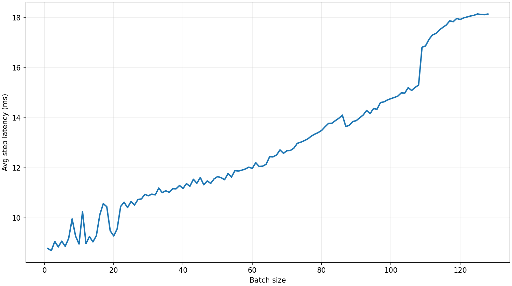
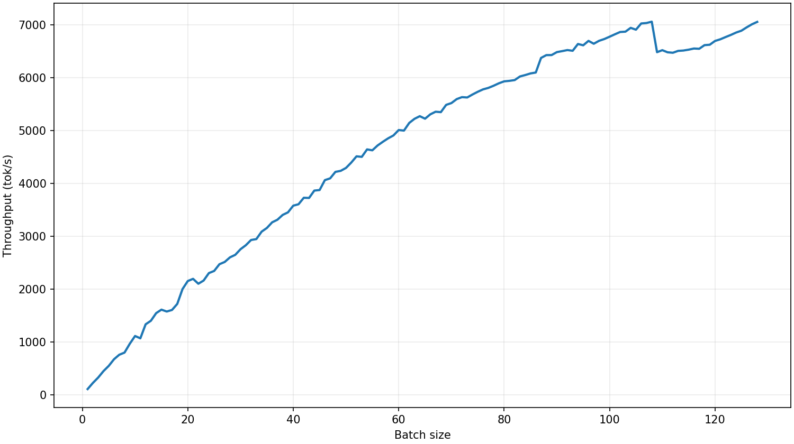
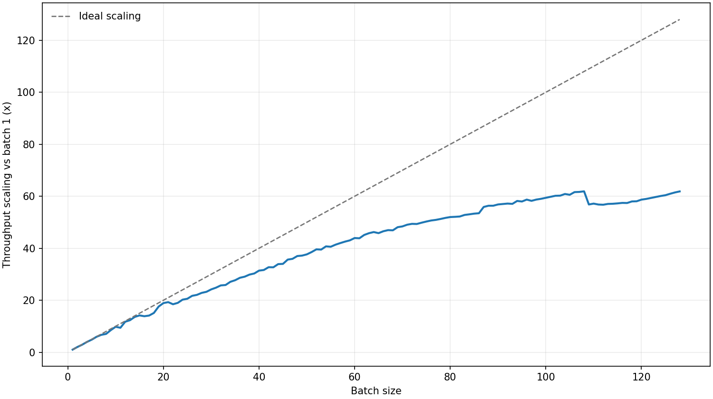

# Decode-Direct Input 2048 TP=4 性能报告

## 运行环境

| 项目 | 值 |
| --- | --- |
| 日期 | 2026-11-18 15:54:14-15:58:12（Asia/Shanghai） |
| 平台 | NVIDIA |
| 设备 | 4 x A100-SXM4-80GB，默认 CUDA_VISIBLE_DEVICES=3,4,5,6 |
| Driver | 535.161.08 |
| InfiniLM build | 当前源码树；未记录独立 build ID |
| 模型 | `/data-aisoft/mechdancer/models/Qwen3-8B` |
| 模式 | `decode-direct` |
| Attention backend | `flash-attn` |
| Graph request | enabled |
| Expected execution mode | `graph` |
| Cache | paged KV cache，block size 256，num blocks 1152 |
| Max batched tokens | 18432 |
| Tensor parallel size | 4 |
| Input length | 2048 tokens / request |
| Batch size | 1..128 |
| Warmup | 每个形状 3 次 repeat |
| Measured repeats | 每个形状 30 次 repeat |
| Batch 执行顺序 | random seed 2026 |

本报告对应的原始 JSONL 和 log 为本机运行产物，不随仓库提交：

```text
../../../benchmark-decode-direct-qwen3-8b-flash-attn-tp4-input2048-graph1-128-20261118.jsonl
../../../benchmark-decode-direct-qwen3-8b-flash-attn-tp4-input2048-graph1-128-20261118.log
```

## 构建与测试命令

本轮使用当前已安装的 `_infinilm` 扩展。标准重建命令如下：

```bash
xmake build _infinilm && xmake install _infinilm
```

性能测试命令：

```bash
BENCHMARK_MODE=decode-direct \
BATCH_SIZES="$(seq -s, 1 128)" \
INPUT_LENS=2048 \
BENCHMARK_REPEATS=30 \
BENCHMARK_OUTPUT=benchmark-decode-direct-qwen3-8b-flash-attn-tp4-input2048-graph1-128-20261118.jsonl \
./run_bench-nvidia.sh
```

## 执行模式与 Graph 覆盖

当前 paged graph compiler 编译 decode batch size `1..128`。因此本轮所有 batch 均有对应 decode graph，无 eager fallback 混入；原始 JSONL 中所有 overall summary 的 `expected_execution_mode` 均为 `graph`。

## 资源开销

| 项目 | 值 |
| --- | ---: |
| Workspace allocation | 每 rank 702 MiB，TP=4 合计 2,808 MiB |
| 权重加载与 graph 编译时间 | 权重加载约 17.59 秒；graph 编译未单独记录 |
| Paged cache blocks | 1152 |
| Compiled graph 数量 | 128 |
| 正式 step sample 数 | 15,360 |
| 本轮总耗时 | 约 238 秒 |

Input length 2048 且执行 4 个 decode step 时，每个 request 需要 `9` 个 block；batch 128 共需要 `1152` 个 block，本轮配置为 `1152` 个 block。

## 测试口径

- `decode-direct` 不执行语义完整的 prefill，paged KV cache 初始为全 0。
- Step 0 输入 dummy token；step 1 到 step 3 使用上一步 sampled token。
- 4 个 decode step 的 past KV length 分别为 2048、2049、2050、2051。
- 报告中的 duration 是单 step 时间，由一次 4-step repeat 的对应总耗时除以 4 得到。
- `single_step_throughput = batch_size / avg_step_latency`。
- 每个 request 每 step 生成 1 个 token，因此 single-step request throughput 与 token throughput 数值相同。
- 表格中的 Min/P50/P95/P99/Max 是每个 repeat 的平均 step 时间分布。
- 计时边界为 `engine_forward_including_sampling`。

## 核心结果

| 指标 | 结果 |
| --- | ---: |
| 最高 single-step 吞吐 | batch 108，7,058.49 tok/s |
| 峰值 batch 平均单 step latency | 15.301 ms |
| 峰值 batch P99 单 step latency | 15.495 ms |
| batch 1 平均单 step latency | 8.769 ms |
| 峰值 batch 相对 batch 1 吞吐倍数 | 61.895x |
| 峰值 batch 相对理想 batch 倍数的效率 | 57.3% |
| 单 step std 中位数 | 0.045 ms |
| 最大单 step std | 0.157 ms，batch 53 |

## 趋势图

### 1. Batch size 与 Avg Step Latency



平均单 step latency 从 batch 1 的 8.769 ms 变为 batch 128 的 18.145 ms；峰值吞吐 batch 108 为 15.301 ms。

### 2. Batch size 与 Throughput



吞吐峰值出现在 batch 108，为 7,058.49 tok/s；最大 batch 128 为 7,054.32 tok/s。

### 3. Batch size 与 Scaling



Scaling 从 batch 1 的 1.000x 变为 batch 128 的 61.858x；相对理想 128x 的效率约为 48.3%。

## Batch 区间平均 latency 与吞吐

下表按连续 16 个 batch 分组；`平均单 step latency ms` 和 `平均吞吐 tok/s` 是区间内各 batch 的算术平均值，`区间最优 batch` 取区间内吞吐最高的 batch。

| Batch 区间 | 平均单 step latency ms | 平均吞吐 tok/s | 区间最优 batch |
| ---: | ---: | ---: | ---: |
| 1..16 | 9.221 | 910.84 | 15 |
| 17..32 | 10.445 | 2336.40 | 32 |
| 33..48 | 11.275 | 3587.87 | 48 |
| 49..64 | 11.862 | 4758.28 | 64 |
| 65..80 | 12.910 | 5610.48 | 80 |
| 81..96 | 13.968 | 6333.17 | 96 |
| 97..112 | 15.456 | 6769.53 | 108 |
| 113..128 | 17.907 | 6727.12 | 128 |

## 关键批次与跳变

| 变化 | Avg step ms | 吞吐 tok/s | 观察 |
| --- | ---: | ---: | --- |
| 10 -> 11 | 8.950 -> 10.249 | 1117.28 -> 1073.25 | latency 增加 14.5%，可能对应 kernel shape 或 workspace 分档变化 |
| 108 -> 109 | 15.301 -> 16.816 | 7058.49 -> 6481.79 | latency 增加 9.9%，可能对应 kernel shape 或 workspace 分档变化 |
| 21 -> 22 | 9.556 -> 10.451 | 2197.59 -> 2105.06 | latency 增加 9.4%，可能对应 kernel shape 或 workspace 分档变化 |
| 15 -> 16 | 9.285 -> 10.127 | 1615.44 -> 1579.88 | latency 增加 9.1%，可能对应 kernel shape 或 workspace 分档变化 |
| 7 -> 8 | 9.177 -> 9.954 | 762.81 -> 803.66 | latency 增加 8.5%，可能对应 kernel shape 或 workspace 分档变化 |
| 16 -> 17 | 10.127 -> 10.566 | 1579.88 -> 1608.86 | latency 增加 4.3%，可能对应 kernel shape 或 workspace 分档变化 |

## Step 一致性

峰值 batch 108 的 4 个 decode step 结果如下：

| Step | Past KV length | Avg step ms | Std ms | Throughput tok/s |
| ---: | ---: | ---: | ---: | ---: |
| 0 | 2048 | 15.342 | 0.207 | 7039.69 |
| 1 | 2049 | 15.277 | 0.061 | 7069.40 |
| 2 | 2050 | 15.285 | 0.063 | 7065.72 |
| 3 | 2051 | 15.299 | 0.075 | 7059.20 |

所有 batch 中，4 个 step 平均耗时最大差异为 0.130 ms，出现在 batch 93。该差异主要来自 past KV length 增长与不同 step 的 kernel 形状。

## 数据稳定性

- 单 step std 中位数为 0.045 ms。
- 最大 std 为 0.157 ms，出现在 batch 53。
- 所有 batch 内 4 个 step 的平均耗时差异不超过 0.130 ms，step 间一致性较好。
- P99 与 max 接近，整体尾部稳定；但每个 batch 只有 30 个 repeat，p99 仍是尾部参考值。

## Single-step 完整结果

### Batch 1..64

| Batch | Mode | Avg Step ms | Min Step ms | P50 Step ms | P95 Step ms | P99 Step ms | Max Step ms | Std Step ms | Single-step tok/s | Scaling |
| ---: | --- | ---: | ---: | ---: | ---: | ---: | ---: | ---: | ---: | ---: |
| 1 | graph | 8.769 | 8.754 | 8.765 | 8.791 | 8.811 | 8.817 | 0.014 | 114.04 | 1.000x |
| 2 | graph | 8.687 | 8.596 | 8.650 | 8.908 | 8.953 | 8.970 | 0.101 | 230.23 | 2.019x |
| 3 | graph | 9.056 | 9.032 | 9.053 | 9.092 | 9.102 | 9.103 | 0.016 | 331.27 | 2.905x |
| 4 | graph | 8.832 | 8.803 | 8.825 | 8.897 | 8.945 | 8.950 | 0.032 | 452.88 | 3.971x |
| 5 | graph | 9.065 | 9.048 | 9.065 | 9.079 | 9.092 | 9.097 | 0.012 | 551.58 | 4.837x |
| 6 | graph | 8.859 | 8.838 | 8.853 | 8.894 | 8.923 | 8.931 | 0.019 | 677.28 | 5.939x |
| 7 | graph | 9.177 | 9.146 | 9.171 | 9.226 | 9.240 | 9.243 | 0.024 | 762.81 | 6.689x |
| 8 | graph | 9.954 | 9.927 | 9.953 | 9.974 | 9.995 | 10.003 | 0.015 | 803.66 | 7.047x |
| 9 | graph | 9.266 | 9.243 | 9.267 | 9.280 | 9.281 | 9.281 | 0.010 | 971.26 | 8.517x |
| 10 | graph | 8.950 | 8.903 | 8.941 | 9.025 | 9.032 | 9.034 | 0.037 | 1,117.28 | 9.797x |
| 11 | graph | 10.249 | 10.223 | 10.246 | 10.271 | 10.280 | 10.284 | 0.014 | 1,073.25 | 9.411x |
| 12 | graph | 8.970 | 8.947 | 8.965 | 9.007 | 9.013 | 9.014 | 0.020 | 1,337.86 | 11.732x |
| 13 | graph | 9.251 | 9.213 | 9.246 | 9.301 | 9.325 | 9.333 | 0.027 | 1,405.26 | 12.323x |
| 14 | graph | 9.036 | 9.005 | 9.027 | 9.079 | 9.104 | 9.111 | 0.024 | 1,549.40 | 13.586x |
| 15 | graph | 9.285 | 9.255 | 9.275 | 9.358 | 9.381 | 9.381 | 0.033 | 1,615.44 | 14.166x |
| 16 | graph | 10.127 | 10.110 | 10.125 | 10.147 | 10.153 | 10.155 | 0.012 | 1,579.88 | 13.854x |
| 17 | graph | 10.566 | 10.489 | 10.536 | 10.614 | 11.116 | 11.315 | 0.142 | 1,608.86 | 14.108x |
| 18 | graph | 10.443 | 10.414 | 10.430 | 10.463 | 10.712 | 10.810 | 0.069 | 1,723.61 | 15.114x |
| 19 | graph | 9.477 | 9.442 | 9.472 | 9.507 | 9.518 | 9.521 | 0.016 | 2,004.94 | 17.581x |
| 20 | graph | 9.275 | 9.249 | 9.268 | 9.314 | 9.331 | 9.337 | 0.020 | 2,156.43 | 18.909x |
| 21 | graph | 9.556 | 9.515 | 9.537 | 9.558 | 9.918 | 10.064 | 0.095 | 2,197.59 | 19.270x |
| 22 | graph | 10.451 | 10.416 | 10.439 | 10.505 | 10.637 | 10.685 | 0.048 | 2,105.06 | 18.459x |
| 23 | graph | 10.621 | 10.584 | 10.610 | 10.685 | 10.766 | 10.786 | 0.039 | 2,165.46 | 18.989x |
| 24 | graph | 10.406 | 10.370 | 10.400 | 10.438 | 10.534 | 10.571 | 0.035 | 2,306.45 | 20.225x |
| 25 | graph | 10.653 | 10.621 | 10.651 | 10.692 | 10.727 | 10.734 | 0.022 | 2,346.76 | 20.578x |
| 26 | graph | 10.509 | 10.456 | 10.498 | 10.567 | 10.583 | 10.588 | 0.037 | 2,474.00 | 21.694x |
| 27 | graph | 10.729 | 10.663 | 10.706 | 10.847 | 10.865 | 10.868 | 0.054 | 2,516.49 | 22.067x |
| 28 | graph | 10.754 | 10.694 | 10.741 | 10.809 | 10.839 | 10.849 | 0.039 | 2,603.78 | 22.832x |
| 29 | graph | 10.939 | 10.896 | 10.938 | 10.974 | 10.995 | 11.002 | 0.023 | 2,651.13 | 23.247x |
| 30 | graph | 10.879 | 10.842 | 10.878 | 10.916 | 10.951 | 10.962 | 0.024 | 2,757.54 | 24.180x |
| 31 | graph | 10.944 | 10.900 | 10.944 | 10.973 | 10.975 | 10.975 | 0.019 | 2,832.53 | 24.838x |
| 32 | graph | 10.915 | 10.855 | 10.913 | 10.965 | 10.968 | 10.969 | 0.032 | 2,931.85 | 25.709x |
| 33 | graph | 11.190 | 11.009 | 11.147 | 11.502 | 11.593 | 11.619 | 0.133 | 2,949.17 | 25.861x |
| 34 | graph | 11.006 | 10.942 | 10.994 | 11.025 | 11.391 | 11.539 | 0.101 | 3,089.30 | 27.090x |
| 35 | graph | 11.079 | 11.039 | 11.068 | 11.149 | 11.195 | 11.212 | 0.039 | 3,159.27 | 27.703x |
| 36 | graph | 11.022 | 10.965 | 11.012 | 11.064 | 11.212 | 11.271 | 0.052 | 3,266.09 | 28.640x |
| 37 | graph | 11.162 | 11.111 | 11.156 | 11.210 | 11.234 | 11.240 | 0.030 | 3,314.96 | 29.068x |
| 38 | graph | 11.156 | 11.089 | 11.150 | 11.241 | 11.267 | 11.278 | 0.049 | 3,406.16 | 29.868x |
| 39 | graph | 11.291 | 11.196 | 11.269 | 11.350 | 11.751 | 11.908 | 0.119 | 3,454.17 | 30.289x |
| 40 | graph | 11.171 | 11.122 | 11.167 | 11.223 | 11.233 | 11.235 | 0.028 | 3,580.60 | 31.398x |
| 41 | graph | 11.365 | 11.267 | 11.367 | 11.418 | 11.425 | 11.427 | 0.037 | 3,607.52 | 31.634x |
| 42 | graph | 11.260 | 11.162 | 11.267 | 11.320 | 11.328 | 11.330 | 0.040 | 3,730.05 | 32.708x |
| 43 | graph | 11.539 | 11.501 | 11.544 | 11.568 | 11.587 | 11.595 | 0.021 | 3,726.34 | 32.676x |
| 44 | graph | 11.381 | 11.283 | 11.351 | 11.540 | 11.549 | 11.549 | 0.077 | 3,866.03 | 33.901x |
| 45 | graph | 11.610 | 11.464 | 11.588 | 11.878 | 12.091 | 12.103 | 0.134 | 3,876.10 | 33.989x |
| 46 | graph | 11.320 | 11.220 | 11.327 | 11.420 | 11.426 | 11.428 | 0.066 | 4,063.56 | 35.633x |
| 47 | graph | 11.472 | 11.423 | 11.469 | 11.528 | 11.551 | 11.553 | 0.029 | 4,097.00 | 35.926x |
| 48 | graph | 11.375 | 11.286 | 11.367 | 11.456 | 11.541 | 11.565 | 0.053 | 4,219.66 | 37.002x |
| 49 | graph | 11.560 | 11.459 | 11.545 | 11.705 | 11.777 | 11.804 | 0.078 | 4,238.93 | 37.171x |
| 50 | graph | 11.645 | 11.519 | 11.653 | 11.700 | 11.750 | 11.766 | 0.045 | 4,293.75 | 37.651x |
| 51 | graph | 11.604 | 11.473 | 11.604 | 11.724 | 11.747 | 11.755 | 0.073 | 4,394.89 | 38.538x |
| 52 | graph | 11.522 | 11.451 | 11.525 | 11.558 | 11.581 | 11.590 | 0.030 | 4,513.24 | 39.576x |
| 53 | graph | 11.770 | 11.647 | 11.738 | 11.818 | 12.372 | 12.593 | 0.157 | 4,503.09 | 39.487x |
| 54 | graph | 11.627 | 11.527 | 11.613 | 11.770 | 11.829 | 11.849 | 0.073 | 4,644.35 | 40.726x |
| 55 | graph | 11.886 | 11.820 | 11.870 | 11.947 | 12.122 | 12.190 | 0.065 | 4,627.15 | 40.575x |
| 56 | graph | 11.868 | 11.829 | 11.865 | 11.916 | 11.924 | 11.924 | 0.023 | 4,718.44 | 41.375x |
| 57 | graph | 11.903 | 11.815 | 11.897 | 12.012 | 12.118 | 12.161 | 0.071 | 4,788.52 | 41.990x |
| 58 | graph | 11.950 | 11.851 | 11.909 | 12.102 | 12.409 | 12.523 | 0.125 | 4,853.42 | 42.559x |
| 59 | graph | 12.022 | 11.919 | 12.025 | 12.123 | 12.157 | 12.170 | 0.065 | 4,907.74 | 43.035x |
| 60 | graph | 11.976 | 11.906 | 11.967 | 12.046 | 12.057 | 12.058 | 0.038 | 5,010.12 | 43.933x |
| 61 | graph | 12.201 | 12.092 | 12.205 | 12.282 | 12.312 | 12.323 | 0.053 | 4,999.68 | 43.842x |
| 62 | graph | 12.051 | 11.884 | 12.037 | 12.198 | 12.217 | 12.220 | 0.074 | 5,144.81 | 45.114x |
| 63 | graph | 12.064 | 11.967 | 12.058 | 12.148 | 12.237 | 12.271 | 0.055 | 5,222.20 | 45.793x |
| 64 | graph | 12.139 | 12.068 | 12.139 | 12.204 | 12.209 | 12.211 | 0.038 | 5,272.24 | 46.232x |

### Batch 65..128

| Batch | Mode | Avg Step ms | Min Step ms | P50 Step ms | P95 Step ms | P99 Step ms | Max Step ms | Std Step ms | Single-step tok/s | Scaling |
| ---: | --- | ---: | ---: | ---: | ---: | ---: | ---: | ---: | ---: | ---: |
| 65 | graph | 12.441 | 12.349 | 12.449 | 12.533 | 12.574 | 12.582 | 0.052 | 5,224.65 | 45.814x |
| 66 | graph | 12.436 | 12.325 | 12.440 | 12.534 | 12.549 | 12.552 | 0.055 | 5,307.22 | 46.538x |
| 67 | graph | 12.508 | 12.438 | 12.507 | 12.559 | 12.584 | 12.593 | 0.034 | 5,356.42 | 46.970x |
| 68 | graph | 12.714 | 12.500 | 12.732 | 12.779 | 12.791 | 12.793 | 0.071 | 5,348.41 | 46.899x |
| 69 | graph | 12.577 | 12.497 | 12.578 | 12.649 | 12.666 | 12.672 | 0.041 | 5,486.01 | 48.106x |
| 70 | graph | 12.681 | 12.559 | 12.647 | 12.809 | 12.813 | 12.815 | 0.087 | 5,519.91 | 48.403x |
| 71 | graph | 12.691 | 12.630 | 12.680 | 12.760 | 12.775 | 12.780 | 0.040 | 5,594.67 | 49.059x |
| 72 | graph | 12.784 | 12.676 | 12.784 | 12.852 | 12.860 | 12.863 | 0.049 | 5,632.14 | 49.387x |
| 73 | graph | 12.976 | 12.911 | 12.977 | 13.039 | 13.050 | 13.054 | 0.036 | 5,625.62 | 49.330x |
| 74 | graph | 13.023 | 12.938 | 13.019 | 13.097 | 13.123 | 13.133 | 0.045 | 5,682.34 | 49.828x |
| 75 | graph | 13.081 | 13.012 | 13.072 | 13.169 | 13.179 | 13.181 | 0.045 | 5,733.44 | 50.276x |
| 76 | graph | 13.151 | 13.108 | 13.145 | 13.213 | 13.227 | 13.229 | 0.035 | 5,778.86 | 50.674x |
| 77 | graph | 13.261 | 13.170 | 13.257 | 13.363 | 13.380 | 13.383 | 0.054 | 5,806.56 | 50.917x |
| 78 | graph | 13.339 | 13.271 | 13.328 | 13.372 | 13.578 | 13.659 | 0.064 | 5,847.42 | 51.275x |
| 79 | graph | 13.404 | 13.343 | 13.396 | 13.502 | 13.518 | 13.520 | 0.045 | 5,893.79 | 51.682x |
| 80 | graph | 13.490 | 13.367 | 13.486 | 13.613 | 13.641 | 13.642 | 0.073 | 5,930.29 | 52.002x |
| 81 | graph | 13.636 | 13.537 | 13.624 | 13.747 | 13.750 | 13.750 | 0.056 | 5,940.11 | 52.088x |
| 82 | graph | 13.771 | 13.671 | 13.762 | 13.836 | 13.900 | 13.925 | 0.046 | 5,954.51 | 52.214x |
| 83 | graph | 13.781 | 13.687 | 13.771 | 13.872 | 13.884 | 13.887 | 0.058 | 6,022.86 | 52.814x |
| 84 | graph | 13.885 | 13.805 | 13.886 | 13.946 | 13.953 | 13.953 | 0.034 | 6,049.61 | 53.048x |
| 85 | graph | 13.980 | 13.903 | 13.985 | 14.042 | 14.066 | 14.075 | 0.043 | 6,080.04 | 53.315x |
| 86 | graph | 14.105 | 14.033 | 14.102 | 14.154 | 14.168 | 14.173 | 0.034 | 6,097.27 | 53.466x |
| 87 | graph | 13.651 | 13.519 | 13.622 | 13.802 | 13.989 | 14.064 | 0.098 | 6,373.19 | 55.886x |
| 88 | graph | 13.694 | 13.600 | 13.679 | 13.794 | 13.905 | 13.947 | 0.071 | 6,426.36 | 56.352x |
| 89 | graph | 13.847 | 13.780 | 13.826 | 13.986 | 14.019 | 14.027 | 0.060 | 6,427.41 | 56.361x |
| 90 | graph | 13.882 | 13.788 | 13.875 | 13.978 | 13.997 | 14.001 | 0.047 | 6,483.12 | 56.850x |
| 91 | graph | 13.996 | 13.888 | 13.988 | 14.113 | 14.228 | 14.272 | 0.081 | 6,501.75 | 57.013x |
| 92 | graph | 14.107 | 14.008 | 14.107 | 14.147 | 14.165 | 14.170 | 0.030 | 6,521.76 | 57.188x |
| 93 | graph | 14.289 | 14.183 | 14.269 | 14.335 | 14.809 | 15.000 | 0.137 | 6,508.30 | 57.070x |
| 94 | graph | 14.163 | 13.981 | 14.165 | 14.301 | 14.348 | 14.357 | 0.090 | 6,636.83 | 58.197x |
| 95 | graph | 14.368 | 14.145 | 14.396 | 14.481 | 14.550 | 14.577 | 0.098 | 6,611.95 | 57.979x |
| 96 | graph | 14.338 | 14.191 | 14.344 | 14.417 | 14.441 | 14.450 | 0.055 | 6,695.60 | 58.713x |
| 97 | graph | 14.605 | 14.530 | 14.583 | 14.750 | 14.938 | 14.990 | 0.088 | 6,641.45 | 58.238x |
| 98 | graph | 14.634 | 14.584 | 14.628 | 14.682 | 14.722 | 14.733 | 0.031 | 6,696.62 | 58.722x |
| 99 | graph | 14.709 | 14.594 | 14.698 | 14.839 | 14.854 | 14.858 | 0.065 | 6,730.40 | 59.018x |
| 100 | graph | 14.762 | 14.685 | 14.755 | 14.826 | 14.843 | 14.849 | 0.034 | 6,774.19 | 59.402x |
| 101 | graph | 14.810 | 14.763 | 14.811 | 14.854 | 14.860 | 14.862 | 0.026 | 6,819.74 | 59.801x |
| 102 | graph | 14.862 | 14.784 | 14.867 | 14.900 | 14.916 | 14.922 | 0.029 | 6,863.32 | 60.183x |
| 103 | graph | 14.994 | 14.877 | 15.003 | 15.066 | 15.077 | 15.077 | 0.046 | 6,869.52 | 60.238x |
| 104 | graph | 14.982 | 14.861 | 14.961 | 15.073 | 15.488 | 15.654 | 0.139 | 6,941.78 | 60.871x |
| 105 | graph | 15.202 | 15.143 | 15.200 | 15.243 | 15.254 | 15.258 | 0.028 | 6,907.06 | 60.567x |
| 106 | graph | 15.090 | 14.906 | 15.111 | 15.181 | 15.490 | 15.615 | 0.129 | 7,024.58 | 61.598x |
| 107 | graph | 15.214 | 15.126 | 15.200 | 15.396 | 15.510 | 15.527 | 0.090 | 7,033.07 | 61.672x |
| 108 | graph | 15.301 | 15.217 | 15.295 | 15.375 | 15.495 | 15.535 | 0.061 | 7,058.49 | 61.895x |
| 109 | graph | 16.816 | 16.731 | 16.806 | 16.933 | 16.943 | 16.943 | 0.054 | 6,481.79 | 56.838x |
| 110 | graph | 16.872 | 16.798 | 16.862 | 16.969 | 16.985 | 16.988 | 0.054 | 6,519.81 | 57.171x |
| 111 | graph | 17.130 | 17.006 | 17.107 | 17.250 | 17.467 | 17.547 | 0.094 | 6,479.67 | 56.819x |
| 112 | graph | 17.308 | 17.255 | 17.303 | 17.354 | 17.373 | 17.379 | 0.029 | 6,470.92 | 56.743x |
| 113 | graph | 17.368 | 17.132 | 17.386 | 17.503 | 17.529 | 17.532 | 0.086 | 6,506.40 | 57.054x |
| 114 | graph | 17.504 | 17.433 | 17.503 | 17.572 | 17.573 | 17.574 | 0.042 | 6,512.87 | 57.110x |
| 115 | graph | 17.613 | 17.483 | 17.590 | 17.719 | 17.972 | 18.068 | 0.099 | 6,529.42 | 57.256x |
| 116 | graph | 17.707 | 17.612 | 17.700 | 17.802 | 17.840 | 17.850 | 0.054 | 6,551.09 | 57.446x |
| 117 | graph | 17.873 | 17.783 | 17.880 | 17.937 | 17.950 | 17.951 | 0.039 | 6,546.18 | 57.403x |
| 118 | graph | 17.839 | 17.732 | 17.839 | 17.884 | 17.897 | 17.902 | 0.036 | 6,614.75 | 58.004x |
| 119 | graph | 17.969 | 17.909 | 17.968 | 18.012 | 18.047 | 18.057 | 0.029 | 6,622.57 | 58.072x |
| 120 | graph | 17.926 | 17.859 | 17.907 | 17.976 | 18.291 | 18.419 | 0.096 | 6,694.19 | 58.700x |
| 121 | graph | 17.991 | 17.922 | 17.982 | 18.060 | 18.114 | 18.135 | 0.044 | 6,725.49 | 58.975x |
| 122 | graph | 18.027 | 17.958 | 18.022 | 18.083 | 18.092 | 18.095 | 0.031 | 6,767.64 | 59.345x |
| 123 | graph | 18.067 | 18.004 | 18.059 | 18.118 | 18.224 | 18.262 | 0.047 | 6,807.93 | 59.698x |
| 124 | graph | 18.094 | 18.011 | 18.084 | 18.171 | 18.243 | 18.270 | 0.049 | 6,853.10 | 60.094x |
| 125 | graph | 18.148 | 18.019 | 18.152 | 18.263 | 18.279 | 18.280 | 0.078 | 6,887.80 | 60.398x |
| 126 | graph | 18.127 | 18.084 | 18.126 | 18.179 | 18.195 | 18.198 | 0.029 | 6,951.03 | 60.953x |
| 127 | graph | 18.119 | 18.050 | 18.105 | 18.165 | 18.419 | 18.519 | 0.079 | 7,009.07 | 61.462x |
| 128 | graph | 18.145 | 18.098 | 18.149 | 18.174 | 18.209 | 18.223 | 0.026 | 7,054.32 | 61.858x |

## TP=1 / TP=2 / TP=4 对比摘要

| 配置 | 峰值 batch | 峰值吞吐 tok/s | 峰值 Avg Step ms | TP=4 / 该配置吞吐 |
| --- | ---: | ---: | ---: | ---: |
| TP=1 | 128 | 3,240.36 | 39.502 | 2.178x |
| TP=2 | 124 | 4,873.34 | 25.445 | 1.448x |
| TP=4 | 108 | 7,058.49 | 15.301 | 1.000x |


## 结论与建议

1. 在本轮 input length 2048、batch `1..128`、全 graph 覆盖范围内，**batch 108 吞吐最高**，约 7,058.49 tok/s。
2. 相对 batch 1，峰值吞吐 scaling 为 61.895x；相对理想 108x 的效率为 57.3%。
3. batch 1 平均单 step latency 为 8.769 ms，峰值吞吐 batch 为 15.301 ms；若以低延迟优先，应避免盲目使用最大 batch。
4. 4 个 decode step 之间一致性较好；如需验证更长上下文退化，应增加 decode step 数或输入长度。

## 数据完整性

```text
config records: 1
sample records: 15360
overall summary records: 128
per-step summary records: 512
scaling records: 128
step samples per batch: 120
samples per decode step: 30
```
