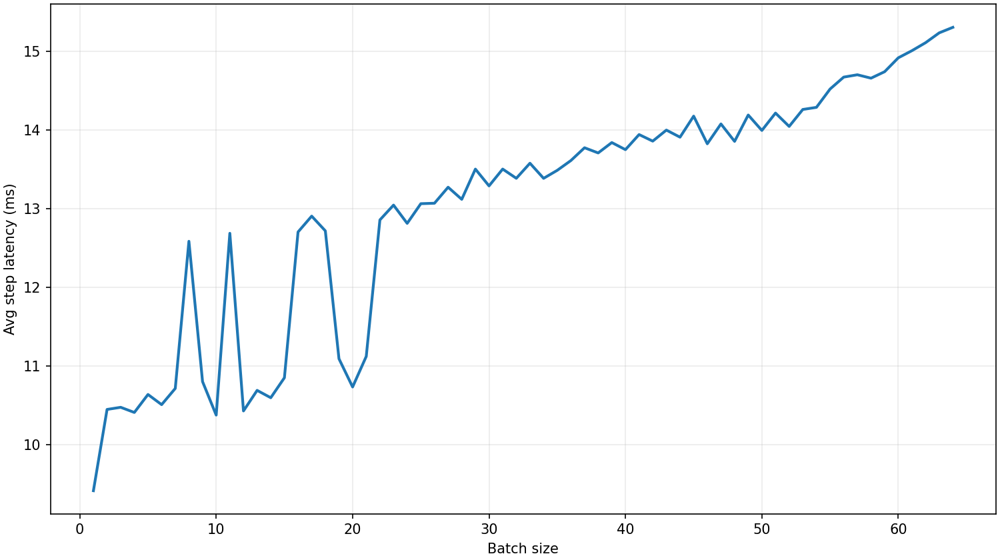
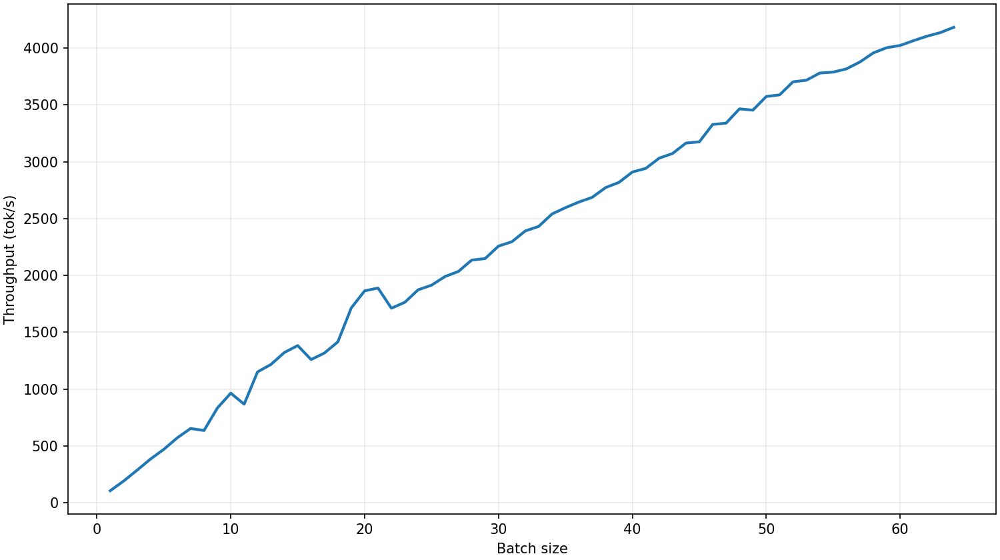
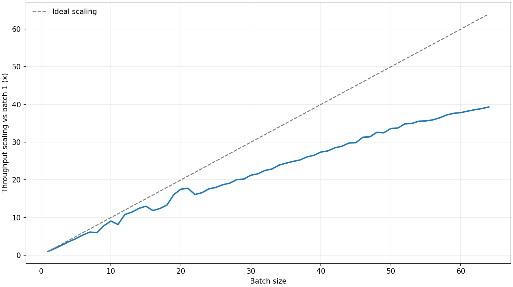

# Decode-Direct Input 4096 TP=4 性能报告

## 运行环境

| 项目 | 值 |
| --- | --- |
| 日期 | 2026-11-18 15:59:50-16:01:53（Asia/Shanghai） |
| 平台 | NVIDIA |
| 设备 | 4 x A100-SXM4-80GB，默认 CUDA_VISIBLE_DEVICES=3,4,5,6 |
| Driver | 535.161.08 |
| InfiniLM build | 当前源码树；未记录独立 build ID |
| 模型 | `/data-aisoft/mechdancer/models/Qwen3-8B` |
| 模式 | `decode-direct` |
| Attention backend | `flash-attn` |
| Graph request | enabled |
| Expected execution mode | `graph` |
| Cache | paged KV cache，block size 256，num blocks 1088 |
| Max batched tokens | 18432 |
| Tensor parallel size | 4 |
| Input length | 4096 tokens / request |
| Batch size | 1..64 |
| Warmup | 每个形状 3 次 repeat |
| Measured repeats | 每个形状 30 次 repeat |
| Batch 执行顺序 | random seed 2026 |

本报告对应的原始 JSONL 和 log 为本机运行产物，不随仓库提交：

```text
../../../benchmark-decode-direct-qwen3-8b-flash-attn-tp4-input4096-graph1-64-20261118.jsonl
../../../benchmark-decode-direct-qwen3-8b-flash-attn-tp4-input4096-graph1-64-20261118.log
```

## 构建与测试命令

本轮使用当前已安装的 `_infinilm` 扩展。标准重建命令如下：

```bash
xmake build _infinilm && xmake install _infinilm
```

性能测试命令：

```bash
BENCHMARK_MODE=decode-direct \
BATCH_SIZES="$(seq -s, 1 64)" \
INPUT_LENS=4096 \
BENCHMARK_REPEATS=30 \
BENCHMARK_OUTPUT=benchmark-decode-direct-qwen3-8b-flash-attn-tp4-input4096-graph1-64-20261118.jsonl \
./run_bench-nvidia.sh
```

## 执行模式与 Graph 覆盖

当前 paged graph compiler 编译 decode batch size `1..64`。因此本轮所有 batch 均有对应 decode graph，无 eager fallback 混入；原始 JSONL 中所有 overall summary 的 `expected_execution_mode` 均为 `graph`。

## 资源开销

| 项目 | 值 |
| --- | ---: |
| Workspace allocation | 每 rank 702 MiB，TP=4 合计 2,808 MiB |
| 权重加载与 graph 编译时间 | 权重加载约 11.60 秒；graph 编译未单独记录 |
| Paged cache blocks | 1088 |
| Compiled graph 数量 | 64 |
| 正式 step sample 数 | 7,680 |
| 本轮总耗时 | 约 123 秒 |

Input length 4096 且执行 4 个 decode step 时，每个 request 需要 `17` 个 block；batch 64 共需要 `1088` 个 block，本轮配置为 `1088` 个 block。

## 测试口径

- `decode-direct` 不执行语义完整的 prefill，paged KV cache 初始为全 0。
- Step 0 输入 dummy token；step 1 到 step 3 使用上一步 sampled token。
- 4 个 decode step 的 past KV length 分别为 4096、4097、4098、4099。
- 报告中的 duration 是单 step 时间，由一次 4-step repeat 的对应总耗时除以 4 得到。
- `single_step_throughput = batch_size / avg_step_latency`。
- 每个 request 每 step 生成 1 个 token，因此 single-step request throughput 与 token throughput 数值相同。
- 表格中的 Min/P50/P95/P99/Max 是每个 repeat 的平均 step 时间分布。
- 计时边界为 `engine_forward_including_sampling`。

## 核心结果

| 指标 | 结果 |
| --- | ---: |
| 最高 single-step 吞吐 | batch 64，4,181.42 tok/s |
| 峰值 batch 平均单 step latency | 15.306 ms |
| 峰值 batch P99 单 step latency | 15.357 ms |
| batch 1 平均单 step latency | 9.410 ms |
| 峰值 batch 相对 batch 1 吞吐倍数 | 39.348x |
| 峰值 batch 相对理想 batch 倍数的效率 | 61.5% |
| 单 step std 中位数 | 0.048 ms |
| 最大单 step std | 0.309 ms，batch 31 |

## 趋势图

### 1. Batch size 与 Avg Step Latency



平均单 step latency 从 batch 1 的 9.410 ms 变为 batch 64 的 15.306 ms；峰值吞吐 batch 64 为 15.306 ms。

### 2. Batch size 与 Throughput



吞吐峰值出现在 batch 64，为 4,181.42 tok/s；最大 batch 64 为 4,181.42 tok/s。

### 3. Batch size 与 Scaling



Scaling 从 batch 1 的 1.000x 变为 batch 64 的 39.348x；相对理想 64x 的效率约为 61.5%。

## Batch 区间平均 latency 与吞吐

下表按连续 16 个 batch 分组；`平均单 step latency ms` 和 `平均吞吐 tok/s` 是区间内各 batch 的算术平均值，`区间最优 batch` 取区间内吞吐最高的 batch。

| Batch 区间 | 平均单 step latency ms | 平均吞吐 tok/s | 区间最优 batch |
| ---: | ---: | ---: | ---: |
| 1..16 | 10.892 | 768.47 | 15 |
| 17..32 | 12.717 | 1919.45 | 32 |
| 33..48 | 13.798 | 2931.78 | 48 |
| 49..64 | 14.617 | 3859.88 | 64 |

## 关键批次与跳变

| 变化 | Avg step ms | 吞吐 tok/s | 观察 |
| --- | ---: | ---: | --- |
| 10 -> 11 | 10.372 -> 12.685 | 964.10 -> 867.14 | latency 增加 22.3%，可能对应 kernel shape 或 workspace 分档变化 |
| 7 -> 8 | 10.712 -> 12.584 | 653.50 -> 635.75 | latency 增加 17.5%，可能对应 kernel shape 或 workspace 分档变化 |
| 15 -> 16 | 10.847 -> 12.702 | 1382.82 -> 1259.62 | latency 增加 17.1%，可能对应 kernel shape 或 workspace 分档变化 |
| 21 -> 22 | 11.119 -> 12.855 | 1888.60 -> 1711.36 | latency 增加 15.6%，可能对应 kernel shape 或 workspace 分档变化 |
| 1 -> 2 | 9.410 -> 10.444 | 106.27 -> 191.49 | latency 增加 11.0%，可能对应 kernel shape 或 workspace 分档变化 |
| 20 -> 21 | 10.730 -> 11.119 | 1863.92 -> 1888.60 | latency 增加 3.6%，可能对应 kernel shape 或 workspace 分档变化 |

## Step 一致性

峰值 batch 64 的 4 个 decode step 结果如下：

| Step | Past KV length | Avg step ms | Std ms | Throughput tok/s |
| ---: | ---: | ---: | ---: | ---: |
| 0 | 4096 | 15.308 | 0.040 | 4180.92 |
| 1 | 4097 | 15.305 | 0.034 | 4181.55 |
| 2 | 4098 | 15.303 | 0.042 | 4182.31 |
| 3 | 4099 | 15.308 | 0.036 | 4180.91 |

所有 batch 中，4 个 step 平均耗时最大差异为 0.198 ms，出现在 batch 49。该差异主要来自 past KV length 增长与不同 step 的 kernel 形状。

## 数据稳定性

- 单 step std 中位数为 0.048 ms。
- 最大 std 为 0.309 ms，出现在 batch 31。
- 所有 batch 内 4 个 step 的平均耗时差异不超过 0.198 ms，step 间一致性较好。
- P99 与 max 接近，整体尾部稳定；但每个 batch 只有 30 个 repeat，p99 仍是尾部参考值。

## Single-step 完整结果

### Batch 1..64

| Batch | Mode | Avg Step ms | Min Step ms | P50 Step ms | P95 Step ms | P99 Step ms | Max Step ms | Std Step ms | Single-step tok/s | Scaling |
| ---: | --- | ---: | ---: | ---: | ---: | ---: | ---: | ---: | ---: | ---: |
| 1 | graph | 9.410 | 9.390 | 9.409 | 9.429 | 9.445 | 9.451 | 0.012 | 106.27 | 1.000x |
| 2 | graph | 10.444 | 10.388 | 10.437 | 10.534 | 10.565 | 10.566 | 0.040 | 191.49 | 1.802x |
| 3 | graph | 10.472 | 10.417 | 10.447 | 10.574 | 10.581 | 10.582 | 0.048 | 286.49 | 2.696x |
| 4 | graph | 10.406 | 10.225 | 10.416 | 10.544 | 10.811 | 10.920 | 0.144 | 384.40 | 3.617x |
| 5 | graph | 10.635 | 10.459 | 10.669 | 10.788 | 10.867 | 10.892 | 0.108 | 470.16 | 4.424x |
| 6 | graph | 10.505 | 10.457 | 10.486 | 10.624 | 10.667 | 10.680 | 0.052 | 571.14 | 5.374x |
| 7 | graph | 10.712 | 10.689 | 10.710 | 10.739 | 10.749 | 10.750 | 0.014 | 653.50 | 6.150x |
| 8 | graph | 12.584 | 12.549 | 12.580 | 12.612 | 12.630 | 12.635 | 0.020 | 635.75 | 5.982x |
| 9 | graph | 10.798 | 10.751 | 10.788 | 10.821 | 11.040 | 11.129 | 0.065 | 833.45 | 7.843x |
| 10 | graph | 10.372 | 10.327 | 10.353 | 10.471 | 10.488 | 10.490 | 0.046 | 964.10 | 9.072x |
| 11 | graph | 12.685 | 12.628 | 12.656 | 12.787 | 12.811 | 12.820 | 0.057 | 867.14 | 8.160x |
| 12 | graph | 10.425 | 10.344 | 10.393 | 10.556 | 10.625 | 10.648 | 0.079 | 1,151.07 | 10.832x |
| 13 | graph | 10.687 | 10.587 | 10.657 | 10.867 | 10.998 | 11.047 | 0.100 | 1,216.45 | 11.447x |
| 14 | graph | 10.593 | 10.571 | 10.585 | 10.626 | 10.688 | 10.711 | 0.027 | 1,321.59 | 12.436x |
| 15 | graph | 10.847 | 10.822 | 10.845 | 10.869 | 10.892 | 10.901 | 0.015 | 1,382.82 | 13.012x |
| 16 | graph | 12.702 | 12.671 | 12.699 | 12.763 | 12.776 | 12.780 | 0.027 | 1,259.62 | 11.853x |
| 17 | graph | 12.904 | 12.846 | 12.881 | 12.987 | 12.990 | 12.991 | 0.049 | 1,317.44 | 12.397x |
| 18 | graph | 12.717 | 12.636 | 12.708 | 12.809 | 12.841 | 12.850 | 0.056 | 1,415.48 | 13.320x |
| 19 | graph | 11.089 | 11.030 | 11.061 | 11.158 | 11.675 | 11.868 | 0.148 | 1,713.41 | 16.123x |
| 20 | graph | 10.730 | 10.672 | 10.716 | 10.829 | 10.871 | 10.889 | 0.054 | 1,863.92 | 17.540x |
| 21 | graph | 11.119 | 11.089 | 11.120 | 11.145 | 11.149 | 11.151 | 0.016 | 1,888.60 | 17.772x |
| 22 | graph | 12.855 | 12.803 | 12.833 | 12.955 | 12.958 | 12.958 | 0.053 | 1,711.36 | 16.104x |
| 23 | graph | 13.044 | 12.945 | 12.989 | 13.269 | 13.355 | 13.361 | 0.109 | 1,763.24 | 16.592x |
| 24 | graph | 12.812 | 12.743 | 12.800 | 12.881 | 12.892 | 12.897 | 0.043 | 1,873.28 | 17.628x |
| 25 | graph | 13.062 | 12.980 | 13.045 | 13.161 | 13.240 | 13.269 | 0.070 | 1,913.94 | 18.010x |
| 26 | graph | 13.068 | 13.011 | 13.066 | 13.105 | 13.128 | 13.137 | 0.025 | 1,989.60 | 18.722x |
| 27 | graph | 13.272 | 13.220 | 13.263 | 13.317 | 13.447 | 13.494 | 0.048 | 2,034.43 | 19.144x |
| 28 | graph | 13.117 | 13.017 | 13.115 | 13.232 | 13.285 | 13.301 | 0.070 | 2,134.55 | 20.086x |
| 29 | graph | 13.502 | 13.449 | 13.497 | 13.590 | 13.645 | 13.650 | 0.042 | 2,147.82 | 20.211x |
| 30 | graph | 13.288 | 13.187 | 13.284 | 13.397 | 13.417 | 13.419 | 0.053 | 2,257.60 | 21.244x |
| 31 | graph | 13.502 | 13.316 | 13.456 | 13.878 | 14.708 | 14.972 | 0.309 | 2,295.88 | 21.604x |
| 32 | graph | 13.385 | 13.314 | 13.381 | 13.447 | 13.456 | 13.459 | 0.042 | 2,390.72 | 22.497x |
| 33 | graph | 13.577 | 13.539 | 13.578 | 13.609 | 13.626 | 13.632 | 0.022 | 2,430.61 | 22.872x |
| 34 | graph | 13.385 | 13.328 | 13.373 | 13.462 | 13.503 | 13.515 | 0.043 | 2,540.22 | 23.904x |
| 35 | graph | 13.486 | 13.418 | 13.453 | 13.596 | 13.617 | 13.623 | 0.060 | 2,595.20 | 24.421x |
| 36 | graph | 13.611 | 13.525 | 13.617 | 13.633 | 13.647 | 13.653 | 0.023 | 2,644.93 | 24.889x |
| 37 | graph | 13.774 | 13.737 | 13.764 | 13.816 | 13.902 | 13.935 | 0.037 | 2,686.27 | 25.278x |
| 38 | graph | 13.708 | 13.668 | 13.706 | 13.744 | 13.748 | 13.749 | 0.020 | 2,772.15 | 26.086x |
| 39 | graph | 13.840 | 13.780 | 13.829 | 13.918 | 14.005 | 14.029 | 0.047 | 2,817.95 | 26.517x |
| 40 | graph | 13.750 | 13.709 | 13.743 | 13.783 | 13.852 | 13.878 | 0.031 | 2,909.15 | 27.375x |
| 41 | graph | 13.942 | 13.853 | 13.920 | 14.004 | 14.351 | 14.489 | 0.109 | 2,940.82 | 27.673x |
| 42 | graph | 13.858 | 13.788 | 13.841 | 13.980 | 13.988 | 13.990 | 0.053 | 3,030.74 | 28.520x |
| 43 | graph | 13.998 | 13.868 | 14.011 | 14.089 | 14.100 | 14.103 | 0.062 | 3,071.76 | 28.906x |
| 44 | graph | 13.908 | 13.853 | 13.900 | 13.984 | 13.995 | 13.997 | 0.040 | 3,163.56 | 29.769x |
| 45 | graph | 14.176 | 14.121 | 14.180 | 14.212 | 14.229 | 14.235 | 0.023 | 3,174.38 | 29.871x |
| 46 | graph | 13.824 | 13.799 | 13.821 | 13.857 | 13.862 | 13.863 | 0.019 | 3,327.46 | 31.312x |
| 47 | graph | 14.077 | 14.015 | 14.078 | 14.145 | 14.167 | 14.170 | 0.040 | 3,338.82 | 31.419x |
| 48 | graph | 13.855 | 13.798 | 13.835 | 13.996 | 14.052 | 14.062 | 0.062 | 3,464.47 | 32.601x |
| 49 | graph | 14.190 | 14.052 | 14.153 | 14.502 | 14.817 | 14.862 | 0.167 | 3,453.06 | 32.494x |
| 50 | graph | 13.994 | 13.912 | 13.981 | 14.128 | 14.164 | 14.171 | 0.064 | 3,572.95 | 33.622x |
| 51 | graph | 14.215 | 14.117 | 14.194 | 14.239 | 14.693 | 14.877 | 0.126 | 3,587.74 | 33.761x |
| 52 | graph | 14.045 | 13.964 | 14.020 | 14.138 | 14.307 | 14.370 | 0.075 | 3,702.36 | 34.840x |
| 53 | graph | 14.261 | 14.209 | 14.257 | 14.308 | 14.329 | 14.335 | 0.028 | 3,716.46 | 34.972x |
| 54 | graph | 14.288 | 14.192 | 14.274 | 14.338 | 14.633 | 14.753 | 0.093 | 3,779.46 | 35.565x |
| 55 | graph | 14.521 | 14.454 | 14.525 | 14.578 | 14.579 | 14.579 | 0.035 | 3,787.64 | 35.642x |
| 56 | graph | 14.673 | 14.601 | 14.674 | 14.717 | 14.725 | 14.728 | 0.031 | 3,816.65 | 35.915x |
| 57 | graph | 14.702 | 14.626 | 14.687 | 14.799 | 14.978 | 15.036 | 0.074 | 3,876.91 | 36.482x |
| 58 | graph | 14.659 | 14.565 | 14.639 | 14.793 | 15.007 | 15.085 | 0.099 | 3,956.63 | 37.232x |
| 59 | graph | 14.741 | 14.611 | 14.725 | 14.944 | 14.982 | 14.990 | 0.089 | 4,002.32 | 37.662x |
| 60 | graph | 14.918 | 14.877 | 14.915 | 14.961 | 14.967 | 14.968 | 0.022 | 4,021.98 | 37.847x |
| 61 | graph | 15.009 | 14.912 | 14.999 | 15.100 | 15.126 | 15.134 | 0.050 | 4,064.28 | 38.245x |
| 62 | graph | 15.110 | 15.035 | 15.098 | 15.194 | 15.205 | 15.205 | 0.046 | 4,103.16 | 38.611x |
| 63 | graph | 15.236 | 15.130 | 15.230 | 15.285 | 15.450 | 15.515 | 0.061 | 4,135.05 | 38.911x |
| 64 | graph | 15.306 | 15.270 | 15.304 | 15.352 | 15.357 | 15.357 | 0.022 | 4,181.42 | 39.348x |

## TP=1 / TP=2 / TP=4 对比摘要

| 配置 | 峰值 batch | 峰值吞吐 tok/s | 峰值 Avg Step ms | TP=4 / 该配置吞吐 |
| --- | ---: | ---: | ---: | ---: |
| TP=1 | 64 | 1,713.84 | 37.343 | 2.440x |
| TP=2 | 54 | 2,731.98 | 19.766 | 1.531x |
| TP=4 | 64 | 4,181.42 | 15.306 | 1.000x |


## 结论与建议

1. 在本轮 input length 4096、batch `1..64`、全 graph 覆盖范围内，**batch 64 吞吐最高**，约 4,181.42 tok/s。
2. 相对 batch 1，峰值吞吐 scaling 为 39.348x；相对理想 64x 的效率为 61.5%。
3. batch 1 平均单 step latency 为 9.410 ms，峰值吞吐 batch 为 15.306 ms；若以低延迟优先，应避免盲目使用最大 batch。
4. 4 个 decode step 之间一致性较好；如需验证更长上下文退化，应增加 decode step 数或输入长度。

## 数据完整性

```text
config records: 1
sample records: 7680
overall summary records: 64
per-step summary records: 256
scaling records: 64
step samples per batch: 120
samples per decode step: 30
```
